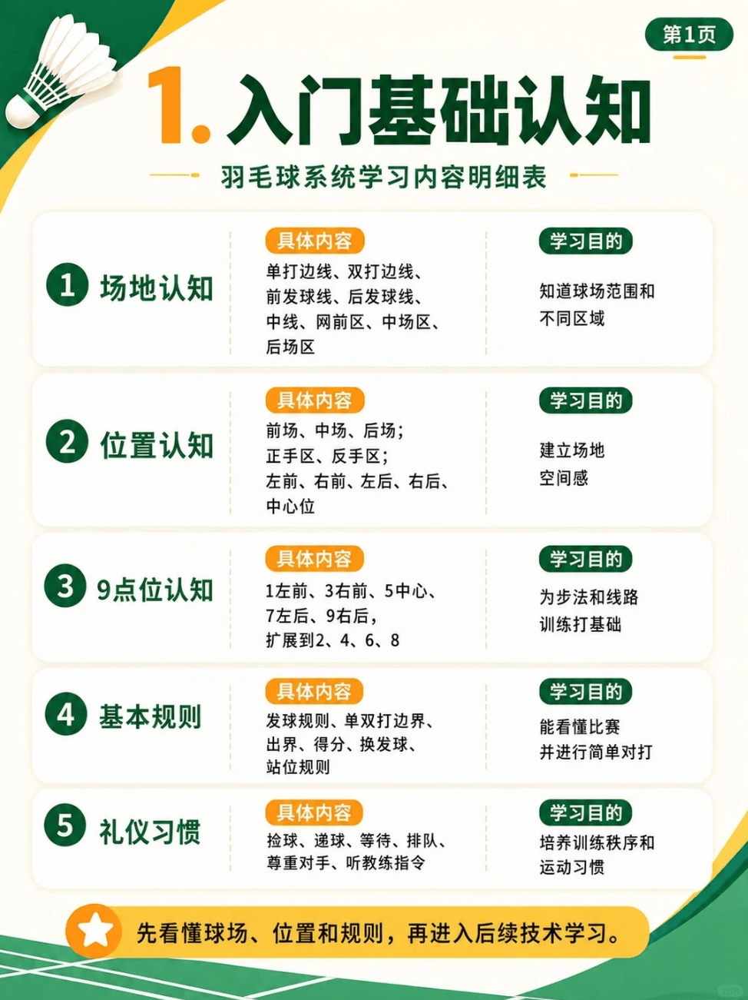

# 入门基础知识

{width="50%"}
/// caption
入门基础知识
///

## 1. 场地认知

> **学习目的**：了解**单打边线、双打边线、前发球线、后发球线、中线、网前区、中场区、后场区**，知道球场范围不同区域

## 2. 位置认知

> **学习目的**：了解**前场、中场、后场；正手区、反手区；左前、右前、左后、右后、中心位**，建立场地空间感。

## 3. 9点位认知

> **学习目的**：了解“**1左前、3右前、5中心、7左后、9右后，扩展到2、4、6、8**”，为步法和线路训练打基础

## 4. 基本规则

> **学习目的**：了解“**发球规则、单双打边界、出界、得分、换发球、站位规则**”，能看懂比赛并进行简单对打

## 5. 礼仪习惯

> **学习目的**：了解“**捡球、递球、等待、排队、尊重对手、听教练指令**”，培养训练秩序和运动习惯

| 技术 | UP 主 | 视频 | 动作要点 |
| --- | --- | --- | --- |
| 新手抓球 | 皮皮软 | [新手保姆级抓球思路教学，带你摆脱球场老登](https://www.bilibili.com/video/BV19HeG6LEKG) | 1.推反手抓往前（斜对角）；2.推斜线抓直线；3.压头顶批斜线；4.压正手滑对角；5.搓近网抓回放；6.挡远网抓突出 |
| 后场进攻 | 皮皮软 | [后场进攻底层逻辑](https://www.bilibili.com/video/BV1QYt364E7h) | 1.平快来球用点杀；2.高远来球蹬转杀；3.较高来用中国跳；4.垂直下路用平高；5.球到边线用快劈；5.下手被动用轮抽（斜对角） |
| 网前高点 | 皮皮软 | [后场进攻底层逻辑](https://www.bilibili.com/video/BV1vSYe6kEHN) | 杀球抢网用直扑，抓到回搓用抹扑，抓到回放用提拉，抓到过渡用抢搓，软压连贯用推球，过渡上扬用快勾 |
| 如何打喜欢杀球的对手 | 徐硕 | [遇到喜欢杀球的对手，就是要用以暴制暴的战术进行反制](https://www.bilibili.com/video/BV1Zte86NE7v) | | |
| 步伐连贯 | 皮皮软 | [单打对抗中步伐应该如何连贯](https://www.bilibili.com/video/BV1EFouBeEXd) | |
| 网前技术 | 皮皮软 | [网前技术用法底层逻辑](https://www.bilibili.com/video/BV1Pf4R6iEz4) | 斜线来球用展搓；直线来球用收搓；高点远网用推球；近网高点用抹推；远网用快拨；近网用勾对角；滚网用海底捞月 |
| 战术反制 | 徐硕 | [面对不同的战术，这几招轻松反制](https://www.bilibili.com/video/BV1LCew6HE4w) | ①遇到进攻强的对手，就多注意网前，抢住网前让对方起球；②遇到防守好的对手，就多打平高，让对手高低中心转换；③遇到速度快的对手，那就多打重复落点，让对手折返跑加不起速；④遇到打四方球的对手，那就多打中路，限制对手的出球角度 |
| 前期铺垫 | 源式羽球 | [想要打好这些效果，前期的铺垫也非常重要](https://www.bilibili.com/video/BV1xEbG6SETg) | ①想要抓推突击杀穿对手，多用挡中路远网；②想要垂直起跳钉地板，多用高搓高；③想要网前抹扑对手，多用搓远网；④想要抽档抽爆对手，多用扑压追身；⑤想要对手原地罚站，多用切削停顿；⑥想要抓过渡打爆对手，多用快速弹推过顶； | 

