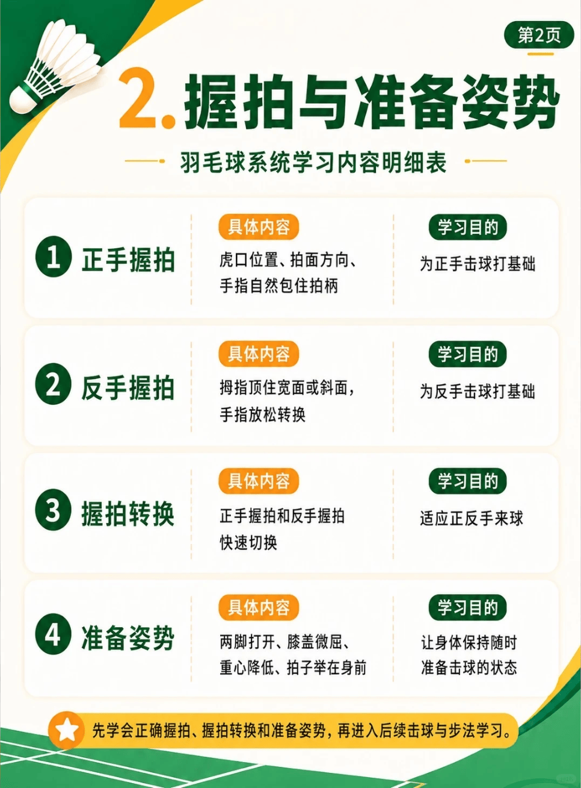

# 握拍、发力与准备姿势

{width="50%"}
/// caption
握拍与准备姿势
///

## 1. 正手握拍

> 学习目的：了解“虎口位置、拍面方向、手指自然包住拍柄”，为正手击球打基础。

## 2. 反手握拍

> 学习目的：了解“拇指顶住宽面或斜面，手指放松转换”，为反手击球打基础。

## 3. 握拍转换

> 学习目的：了解“正手握拍和反手握拍、快速切换”，适应正反手来球。

## 4. 握拍技巧

-   :fontawesome-brands-bilibili:{ .bl } [手腕发力法底层逻辑](https://www.bilibili.com/video/BV1etY96bEHH) &nbsp; `皮皮软`{.md-tag}

    ---
    **动作要点**：握拍上握封网快，握拍上握杀球重，掌心留空搓球转，拇指顶宽面抽球猛，拇指顶侧棱反拍远，拇指顶窄面角度刁。

## 5. 发力技巧

-   :fontawesome-brands-bilibili:{ .bl } [**练会贴球发力，后场再也不费劲！**](https://www.bilibili.com/video/BV1jzVB6ME46) &nbsp; `刘辉`{.md-tag}

    ---
    **动作要点**

-   :fontawesome-brands-bilibili:{ .bl } [**不用手臂死发力，腰腹发力才是关键！**](https://www.bilibili.com/video/BV1ubGb6FEWb) &nbsp; `刘辉`{.md-tag}

    ---
    **动作要点**

-   :fontawesome-brands-bilibili:{ .bl } [**手指发力技术教学**](https://www.bilibili.com/video/BV1grWu6zEZ7) &nbsp; `黄广益`{.md-tag}

    ---
    **动作要点**：

-   :fontawesome-brands-bilibili:{ .bl } [**手腕发力法底层逻辑**](https://www.bilibili.com/video/BV13EtZ6WEHu) &nbsp; `皮皮软`{.md-tag}

    ---
    **动作要点**：杀球发力用闪腕，接杀发力用抖腕，封网发力用点腕，反拍发力用甩腕，平高发力用压腕，滑吊发力用转腕

-   :fontawesome-brands-bilibili:{ .bl } [**蹬转带动身体**](https://www.bilibili.com/video/BV1jVn56pEYd) &nbsp; `刘辉`{.md-tag}

    ---
    **动作要点**：很多业余球友对蹬转的误解，蹬转带动身体，是发力底层逻辑，但并不是每一拍，你都要清晰感受到身体带动。

-   :fontawesome-brands-bilibili:{ .bl } [**讲懂讲透闪动发力**](https://www.bilibili.com/video/BV1Ro4y157AG) &nbsp; `刘辉`{.md-tag}

    ---
    **动作要点**：注意“**闪动发力**”和“**点杀**”的区别，“点杀”是手腕用力，而“闪动发力”是手臂发力加上肘回拉，手腕是锁住的状态。

-   :fontawesome-brands-bilibili:{ .bl } [**闪动回弹发力**](https://www.bilibili.com/video/BV1d64y1j77m) &nbsp; `刘辉`{.md-tag}

    ---
    **动作要点**：

-   :fontawesome-brands-bilibili:{ .bl } [**闪动发力剧场版**](https://www.bilibili.com/video/BV1vr421c7ju) &nbsp; `刘辉`{.md-tag}

    ---
    **动作要点**：

-   :fontawesome-brands-bilibili:{ .bl } [**闪动发力完整纯享版**](https://www.bilibili.com/video/BV1Z9xS6zEfZ) &nbsp; `刘辉`{.md-tag}

    ---
    **动作要点**：

-   :fontawesome-brands-bilibili:{ .bl } [**闪动发力拉胳膊不是拉拍头**](https://www.bilibili.com/video/BV1FSxS6VESP) &nbsp; `刘辉`{.md-tag}

    ---
    **动作要点**：

## 6. 准备姿势

> 学习目的：了解“正手握拍和反手握拍、快速切换”，适应正反手来球。
