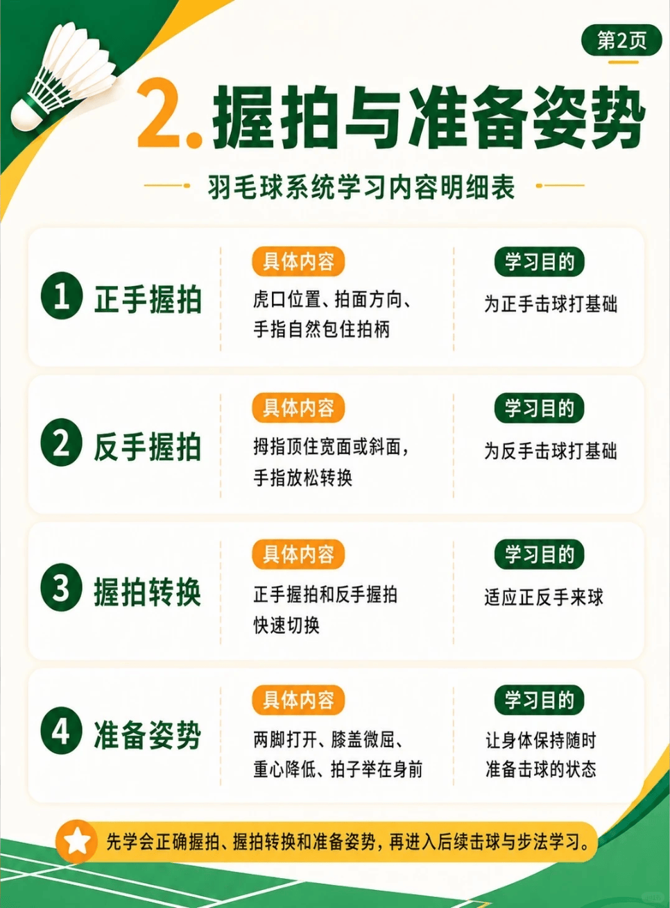

# 握拍与准备姿势

/// caption
握拍与准备姿势
///

## 1. 正手握拍

> 学习目的：了解“虎口位置、拍面方向、手指自然包住拍柄”，为正手击球打基础。

## 2. 反手握拍

> 学习目的：了解“拇指顶住宽面或斜面，手指放松转换”，为反手击球打基础。

## 3. 握拍转换

> 学习目的：了解“正手握拍和反手握拍、快速切换”，适应正反手来球。

## 4. 准备姿势

> 学习目的：了解“正手握拍和反手握拍、快速切换”，适应正反手来球。
