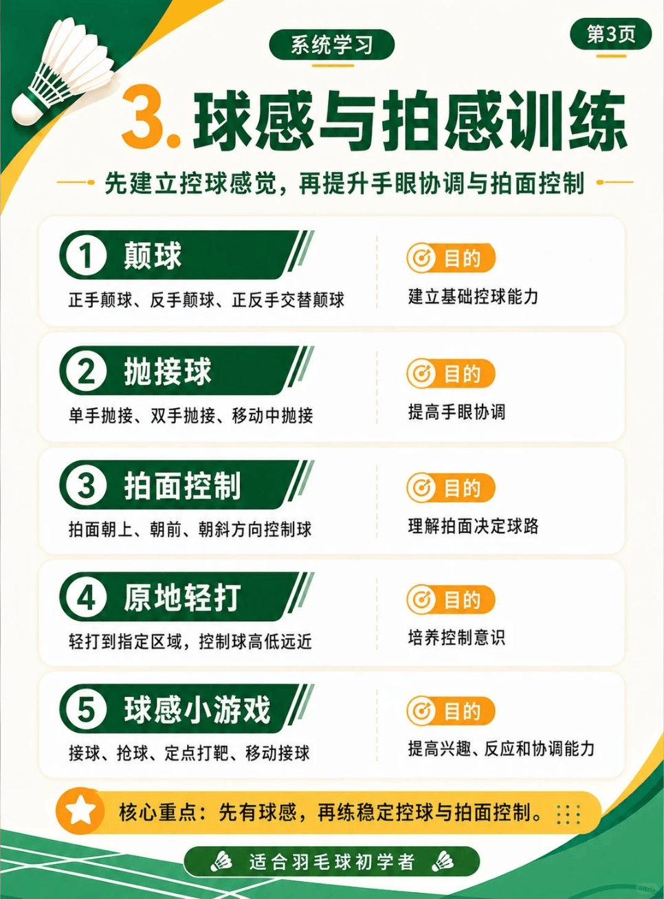

# 球感与拍感

/// caption
球感与拍感
///

## 1. 颠球

> 学习目的：了解“正手颠球、反手颠球、正反手交替颠球”，建立基础控球能力。

## 2. 接抛球

> 学习目的：了解“单手抛接、双手抛接、移动中抛接”，提高手眼协调。

## 3. 拍面控制

> 学习目的：了解“拍面朝上、朝前、朝斜方向控制球”，理解拍面决定球路。

## 4. 原地轻打

> 学习目的：了解“轻打到指定区域，控制球高低远近”，培养控制意识。

## 5. 球感小游戏

> 学习目的：了解“接球、抢球、定点打靶、移动接球”，提高兴趣、反应和协调能力。
