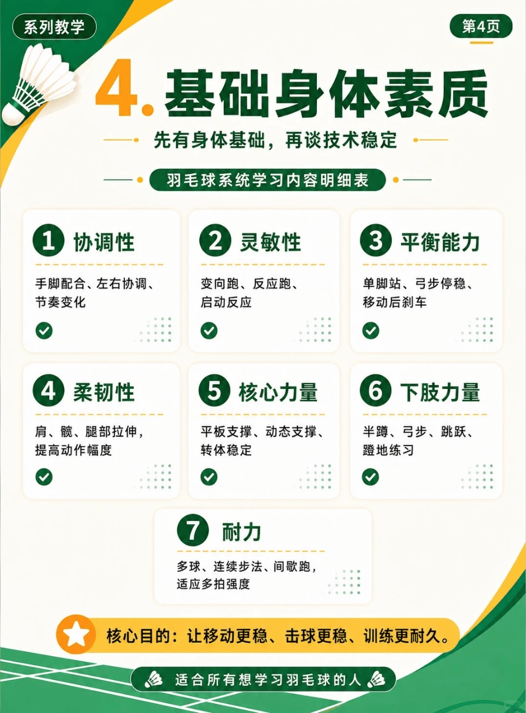

# 体能训练

{width="50%"}
/// caption
体能训练
///

1. **协调性**：手脚配合、左右协调、节奏变化
2. **灵敏性**：变向跑、反应跑、启动反应
3. **平衡能力**：单脚站、弓步停稳、移动后刹车
4. **柔韧性**：肩、髋、腿部拉伸，提高动作幅度
5. **核心力量**：平板支撑、动态支撑、转体稳定
6. **下肢力量**：半蹲、弓步、跳跃、蹬地练习

## 1. 步法训练专项

**要求**：每个动作 30 秒间歇 10 秒，有能力的话前 15 秒常速，后 15 秒加速。

1. [**基础步伐**](https://www.bilibili.com/video/BV1BUiSB8EM)：开合跳、启动步、交叉步、前后跳、左右跳、原地转髋、高抬腿、高抬腿转髋、垫步转髋、全蹲转髋、大步、全蹲弓步、纵跳、挺身跳、十字跳、小碎步、俯身登山
1. [**移动步伐**](https://www.bilibili.com/video/BV1EUiSB8E5q)：并步、垫步、交叉步、并步转体、侧向垫步、高抬腿、垫步起跳（垫两步跳一步）、大字跳（手碰脚尖）、反弓跳、鸭子步、死亡蛙跳

## 2. 核心训练

1. 死虫子、坐姿摸膝、坐姿卷腹、两脚摸脚、仰卧抬脚、仰卧交叉、俄罗斯转体、两头起、背部两头起、拉伸。

