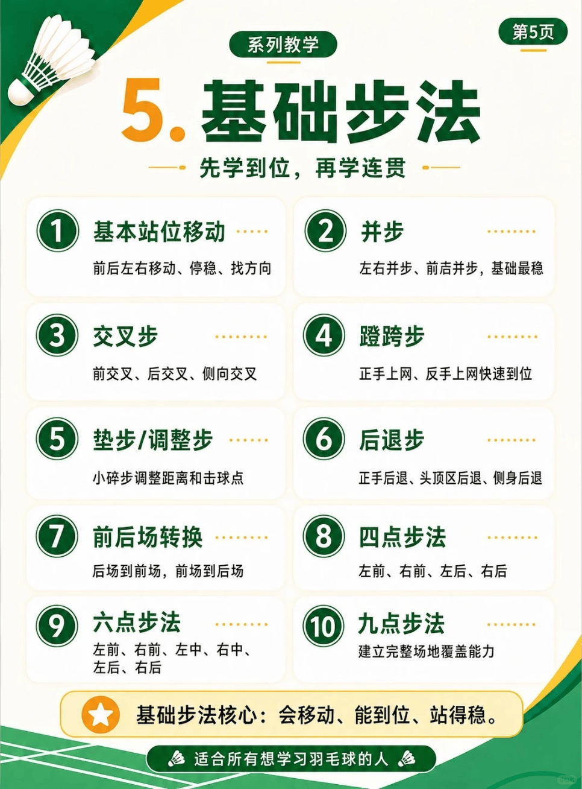

# 基础步法

/// caption
基础步法
///

## 1. 基本站位移动

前后左右移动、停稳、找方向

## 2. 并步

左右并步、前后并步，基础最稳

### 2.1 左右并步

### 2.2 前后并步

## 3. 交叉步

前交叉、后交叉、侧向交叉

### 3.1 前交叉

### 3.2 后交叉

### 3.3 侧向交叉

## 4. 蹬跨步

正手上网、反手上网快速到位

### 4.1 正手上网

### 4.2 反手上网

## 5. 垫步

小碎步调整距离和击球点

## 6. 后退步

正手后退、头顶区后退、侧身后退

## 7. 前后场转换

### 7.1 后场到前场

### 7.2 前场到后场

## 8. 四点步法

### 8.1 左前

### 8.2 右前

### 8.3 左后

### 8.4 右后

## 9. 六点步法

### 9.1 左前

### 9.2 右前

### 9.3 左中

### 9.4 右中

### 9.5 左后

### 9.6 右后

## 10. 九点步法

