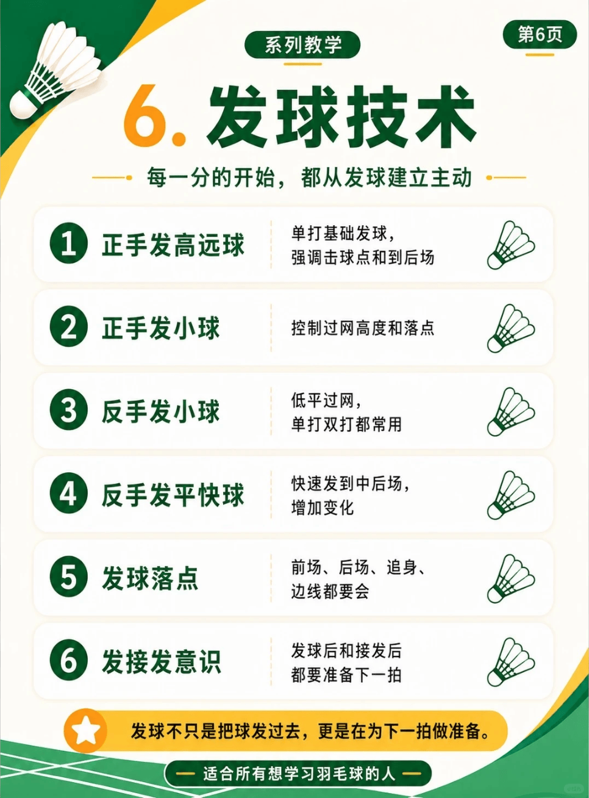

# 发球训练

{width="50%"}
/// caption
发球训练
///

## 1. 正手发高远球

单打基础发球，强调击球点和到后场

-   :fontawesome-brands-bilibili:{ .bl } [**真正的发正手高远球你真的会吗？**](https://www.bilibili.com/video/BV1URuw61Emg) &nbsp; `刘辉`{.md-tag}

    ---
    **动作要点**

## 2. 正手发小球

控制过网高度和落点

## 3. 反手发小球

低平过网，单打双打都常用

-   :fontawesome-brands-bilibili:{ .bl } [**偷发后场发不出力？记住这个小技巧！拿球尽量往前伸，获得更大的引拍空间，发力效果直接提升。**](https://www.bilibili.com/video/BV1ZEeA64EbK) &nbsp; `刘辉`{.md-tag}

    ---
    **动作要点**

-   :fontawesome-brands-bilibili:{ .bl } [**偷发后场球发不出力，根源在于没有顶肘！顶肘就是大臂带动小臂，小臂带动手腕发力。**](https://www.bilibili.com/video/BV1E2eJ6GEoz) &nbsp; `刘辉`{.md-tag}

    ---
    **动作要点**

-   :fontawesome-brands-bilibili:{ .bl } [**发球过网高低总控制不好？**](https://www.bilibili.com/video/BV1L3Y16uEQm) &nbsp; `刘辉`{.md-tag}

    ---
    **动作要点**

-   :fontawesome-brands-bilibili:{ .bl } [**反手发球用法底层逻辑**](https://www.bilibili.com/video/BV1WMeq6wEcs) &nbsp; `刘辉`{.md-tag}

    ---
    **动作要点**：
    
    1. 球头放在**右上方**，用于发**反手平射球**；
    1. 球头放在**正中间**，用于发**反手偷后场**；
    1. 球头放在**左上方**，用于发**直线往前**；
    1. 球毛**向左微倾斜**，用于发**斜线网前**；

-   :fontawesome-brands-bilibili:{ .bl } [**梁伟铿反手发小球7个细节**](https://www.bilibili.com/video/BV1WMeq6wEcs) &nbsp; `未知`{.md-tag}

    ---
    **动作要点**：

-   :fontawesome-brands-bilibili:{ .bl } [**找到发球节奏感，让你发球质量高又稳！**](https://www.bilibili.com/video/BV1TJMX6SE9o) &nbsp; `刘辉`{.md-tag}

    ---
    **动作要点**

-   :fontawesome-brands-bilibili:{ .bl } [**发球总被扑？**](https://www.bilibili.com/video/BV16NMm69E35) &nbsp; `刘辉`{.md-tag}

    ---
    **动作要点**

-   :fontawesome-brands-bilibili:{ .bl } [**不吃压力的发球！**](https://www.bilibili.com/video/BV1EJuq6tEhN) &nbsp; `刘辉`{.md-tag}

    ---
    **问题**：接发对面顶线站，还挥拍吓唬你？！！

    **动作要点**

## 4. 反手发平快球

快速发到中后场，增加变化

## 5. 发球落点

前场、后场、追身、边线都要会

## 6. 发接发意识

发球后和接发后都要准备下一拍

-   :fontawesome-brands-bilibili:{ .bl } [**处理对手偷后场，不要盲目后退**](https://www.bilibili.com/video/BV1USbH6JE9q) &nbsp; `刘辉`{.md-tag}

    ---
    **动作要点**：9式调整为**拳式握拍**，找到点杀的感觉，**多用小臂内旋的力量，少量手腕发力**，快速回击化解被动。

-   :fontawesome-brands-bilibili:{ .bl } [**你的接发还只会挑球吗？重心太高了**](https://www.bilibili.com/video/BV12ejc6dEDX) &nbsp; `黄广益`{.md-tag}

    ---
    **动作要点**：

-   :fontawesome-brands-bilibili:{ .bl } [**接发球总站底线，越打越被动！**](https://www.bilibili.com/video/BV1Dw746qEk5) &nbsp; `刘辉`{.md-tag}

    ---
    **动作要点**

-   :fontawesome-brands-bilibili:{ .bl } [**如何接好冲天炮？**](https://www.bilibili.com/video/BV1RWMb6ZEWV) &nbsp; `刘辉`{.md-tag}

    ---
    **动作要点**

-   :fontawesome-brands-bilibili:{ .bl } [**正确的接发球准备动作**](https://www.bilibili.com/video/BV1yzuH6tEWW) &nbsp; `刘辉`{.md-tag}

    ---
    **动作要点**

-   :fontawesome-brands-bilibili:{ .bl } [**接发举拍不是照搬职业动作！看懂举拍高低底层逻辑，消除多余二次挥拍，接发不再慢半拍，收藏反复看。**](https://www.bilibili.com/video/BV1RQbT6QEyG) &nbsp; `刘辉`{.md-tag}

    ---
    **动作要点**

-   :fontawesome-brands-bilibili:{ .bl } [**接发总是被动起球，一上来就被对手压制？大部分人只学动作，根本不知道拿拍高低背后的底层逻辑。**](https://www.bilibili.com/video/BV1HynA6aE5r) &nbsp; `刘辉`{.md-tag}

    ---
    **动作要点**：

-   :fontawesome-brands-bilibili:{ .bl } [**很多业余球友双打接发第一步就乱迈，一上来就被对手压制，根源就是第一步迈脚错了。**](https://www.bilibili.com/video/BV1wsnB6AEkS) &nbsp; `刘辉`{.md-tag}

    ---
    **动作要点**：

-   :fontawesome-brands-bilibili:{ .bl } [**接发球为什么要左脚在前？一分钟讲透底层逻辑**](https://www.bilibili.com/video/BV1b54w6REfH) &nbsp; `刘辉`{.md-tag}

    ---
    **动作要点**

-   :fontawesome-brands-bilibili:{ .bl } [**发接发让对手不舒服完整纯享版**](https://www.bilibili.com/video/BV1oAWM61ESD) &nbsp; `刘辉`{.md-tag}

    ---
    **动作要点**

