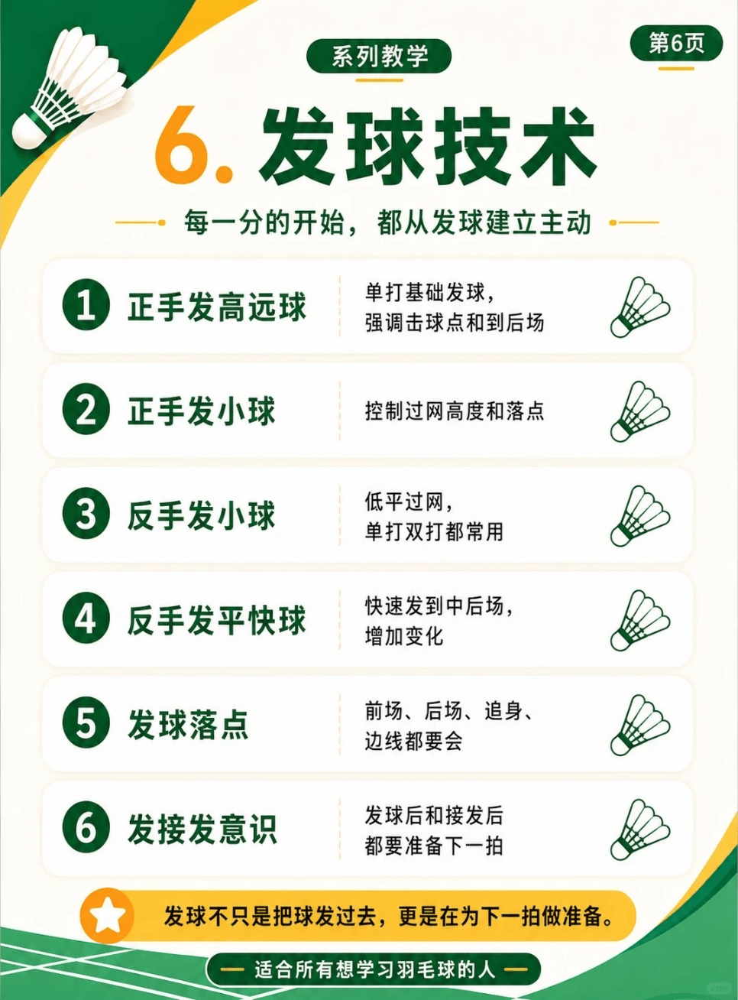

# 发球训练

{width="50%"}
/// caption
发球训练
///

## 1. 正手发高远球

单打基础发球，强调击球点和到后场

## 2. 正手发小球

控制过网高度和落点

## 3. 反手发小球

低平过网，单打双打都常用

-   :fontawesome-brands-bilibili:{ .bl } [**反手发球用法底层逻辑**](https://www.bilibili.com/video/BV1WMeq6wEcs) &nbsp; `刘辉`{.md-tag}

    ---
    **动作要点**：
    
    1. 球头放在**右上方**，用于发**反手平射球**；
    1. 球头放在**正中间**，用于发**反手偷后场**；
    1. 球头放在**左上方**，用于发**直线往前**；
    1. 球毛**向左微倾斜**，用于发**斜线网前**；

## 4. 反手发平快球

快速发到中后场，增加变化

## 5. 发球落点

前场、后场、追身、边线都要会

## 6. 发接发意识

发球后和接发后都要准备下一拍

-   :fontawesome-brands-bilibili:{ .bl } [**处理对手偷后场，不要盲目后退**](https://www.bilibili.com/video/BV1USbH6JE9q) &nbsp; `刘辉`{.md-tag}

    ---
    **动作要点**：9式调整为**拳式握拍**，找到点杀的感觉，**多用小臂内旋的力量，少量手腕发力**，快速回击化解被动。

