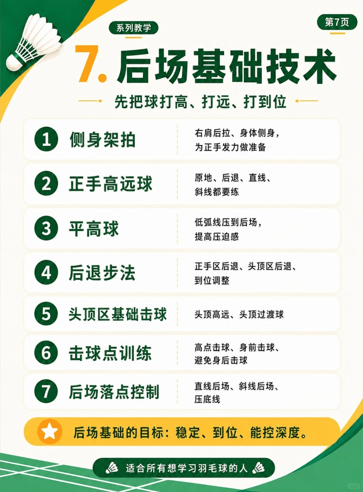

# 后场技术

/// caption
后场技术
///

## 1. 侧身架拍

## 2. 正手高远球

### 2.1 原地高远

### 2,2 后退高远

### 2.3 直线高远

### 2.4 斜线高远

## 3. 平高俅

### 3.1 低弧线压弧后场

## 4. 后退步法

### 4.1 正手区后退

### 4.2 头顶区后退

### 4.3 到位调整

## 5. 头顶区基础击球

### 5.1 头顶高远

### 5.2 头顶过渡

## 6. 击球点训练

### 6.1 高点击球

### 6.2 身前击球

### 6.3 避免身后击球

## 7. 后场落点控制

### 7.1 直线后场

### 7.2 斜线货场

### 7.3 压底线

## 1. 滑拍

| 技术 | UP主 | 视频 | 问题 | 动作要点 |
| --- | --- | --- | --- | --- |
| 头顶滑拍 | 刘辉 | [头顶滑拍，头顶位的意思就是要在头顶击球](https://www.bilibili.com/video/BV1SAha6JEkF) |  | |

## 2. 杀球

| 技术 | UP主 | 视频 | 问题 | 动作要点 |
| --- | --- | --- | --- | --- |
| 双脚跳杀 | 徐硕 | [一个视频双脚起跳全部解决](https://www.bilibili.com/video/BV1TMVp6VESt) |  | ①后退时一定要比球快，这样才有足够的蓄力时间；②起跳前，需要做一个持拍同侧腿的大撤步；③另一侧腿贴地收拢，直至与宽同宽；④双腿同时蓄力向上，完成一个展腹跳；⑤利用放松到握紧的向下受力，杀完大腿落地 |