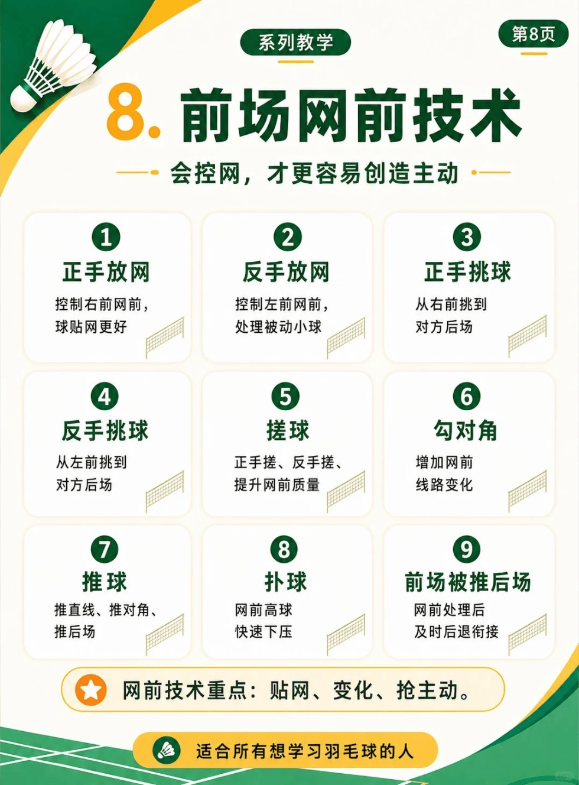

# 前场技术

{width="50%"}
/// caption
前场技术
///

## 1. 正手放网

控制右前网前，球贴网更好

## 2. 反手放网

控制左前网前，处理被动小球

## 3. 正手挑球

从右前挑到对方后场

-   :fontawesome-brands-bilibili:{ .bl } [**提拉米苏正手版**](https://www.bilibili.com/video/BV1FB446jEnN) &nbsp; `刘辉`{.md-tag}

    ---
    **动作要点**：

-   :fontawesome-brands-bilibili:{ .bl } [**什么是提拉米苏！**](https://www.bilibili.com/video/BV17Aa56JEvZ) &nbsp; `刘辉`{.md-tag}

    ---
    **动作要点**

-   :fontawesome-brands-bilibili:{ .bl } [**业余双打接发切腰，为什么要学会提拉米苏？**](https://www.bilibili.com/video/BV1TuaS6AE3n) &nbsp; `刘辉`{.md-tag}

    ---
    **动作要点**

## 4. 反手挑球

从左前挑到对方后场

## 5. 搓球

正手搓、反手搓，提升网前质量

-   :fontawesome-brands-bilibili:{ .bl } [**正手➕反手提拉米苏，双打接发神器！**](https://www.bilibili.com/video/BV1NFHe6oEgC) &nbsp; `刘辉`{.md-tag}

    ---
    **动作要点**

-   :fontawesome-brands-bilibili:{ .bl } [**网前技术用法底层逻辑**](https://www.bilibili.com/video/BV1Pf4R6iEz4) &nbsp; `皮皮软`{.md-tag}

    ---
    **动作要点**：斜线来球用展搓；直线来球用收搓；高点远网用推球；近网高点用抹推；远网用快拨；近网用勾对角；滚网用海底捞月

-   :fontawesome-brands-bilibili:{ .bl } [**网前正手位远网直线球怎么处理失误少？！**](https://www.bilibili.com/video/BV1xsem6wEcT) &nbsp; `刘辉`{.md-tag}

    ---
    **动作要点**

## 6. 勾对角

增加网前，线路变化

-   :fontawesome-brands-bilibili:{ .bl } [**三种不同高度的勾对角技巧，你都会吗？#羽毛球教学**](https://www.bilibili.com/video/BV1eoWg67EE5) &nbsp; `小宋老师`{.md-tag}

    ---
    **动作要点**：

-   :fontawesome-brands-bilibili:{ .bl } [**低手位被动勾对角如何又贴又稳？**](https://www.bilibili.com/video/BV1gfNw6uExJ) &nbsp; `刘辉`{.md-tag}

    ---
    **动作要点**

-   :fontawesome-brands-bilibili:{ .bl } [**一个视频告诉你高质量正手低位勾对角的秘诀！**](https://www.bilibili.com/video/BV1yQN26QEAm) &nbsp; `刘辉`{.md-tag}

    ---
    **问题**：业余球友正手低位勾对角，最常见的问题就是质量不高

    **动作要点**

-   :fontawesome-brands-bilibili:{ .bl } [**3分钟告诉你高质量反手低位勾对角的秘诀！**](https://www.bilibili.com/video/BV1ccNB6REip) &nbsp; `刘辉`{.md-tag}

    ---
    **动作要点**

## 7.推球

推直线、推对角、推后场

-   :fontawesome-brands-bilibili:{ .bl } [**分不清什么来球用推挑？**](https://www.bilibili.com/video/BV1dqgK6qEpS) &nbsp; `刘辉`{.md-tag}

    ---
    **问题**：分不清什么来球用推挑？上来就挥拍，要么下网，要么直接送给对手突击！

    **动作要点**：

-   :fontawesome-brands-bilibili:{ .bl } [**职业选手推反手，为啥不直接冲直线抓球？**](https://www.bilibili.com/video/BV1VBY26zEAo) &nbsp; `刘辉`{.md-tag}

    ---
    **动作要点**

## 8. 扑球

网前高球，快速下压

-   :fontawesome-brands-bilibili:{ .bl } [**我看谁还不会抹扑**](https://www.bilibili.com/video/BV1xEYE6UEf9) &nbsp; `皮皮软`{.md-tag}

    ---
    **动作要点**：

-   :fontawesome-brands-bilibili:{ .bl } [**网前高点用法底层逻辑**](https://www.bilibili.com/video/BV1vSYe6kEHN) &nbsp; `皮皮软`{.md-tag}

    ---
    **动作要点**：杀球抢网用直扑，抓到回搓用抹扑，抓到回放用提拉，抓到过渡用抢搓，软压连贯用推球，过渡上扬用快勾。

-   :fontawesome-brands-bilibili:{ .bl } [**封网握拍跟着击球点变化，学会动态切换封网握拍，下一个网前雨刮器就是你！**](https://www.bilibili.com/video/BV1nyx16cEq1) &nbsp; `刘辉`{.md-tag}

    ---
    **动作要点**

## 9. 前场被推后场

网前处理后，及时后退衔接
