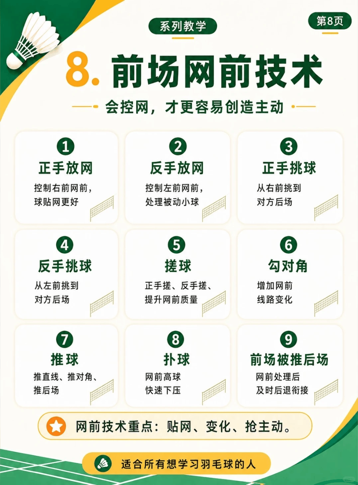

# 前场技术

{width="50%"}
/// caption
前场技术
///

## 1. 正手放网

控制右前网前，球贴网更好

## 2. 反手放网

控制左前网前，处理被动小球

## 3. 正手挑球

从右前挑到对方后场

## 4. 反手挑球

从左前挑到对方后场

## 5. 搓球

正手搓、反手搓，提升网前质量

-   :fontawesome-brands-bilibili:{ .bl } [**网前技术用法底层逻辑**](https://www.bilibili.com/video/BV1Pf4R6iEz4) &nbsp; `皮皮软`{.md-tag}

    ---
    **动作要点**：斜线来球用展搓；直线来球用收搓；高点远网用推球；近网高点用抹推；远网用快拨；近网用勾对角；滚网用海底捞月

## 6. 勾对角

增加网前，线路变化

## 7.推球

推直线、推对角、推后场

## 8. 扑球

网前高球，快速下压

-   :fontawesome-brands-bilibili:{ .bl } [我看谁还不会抹扑](https://www.bilibili.com/video/BV1xEYE6UEf9) &nbsp; `皮皮软`{.md-tag}

    ---
    **动作要点**：

-   :fontawesome-brands-bilibili:{ .bl } [**网前高点用法底层逻辑**](https://www.bilibili.com/video/BV1vSYe6kEHN) &nbsp; `皮皮软`{.md-tag}

    ---
    **动作要点**：杀球抢网用直扑，抓到回搓用抹扑，抓到回放用提拉，抓到过渡用抢搓，软压连贯用推球，过渡上扬用快勾。

## 9. 前场被推后场

网前处理后，及时后退衔接
