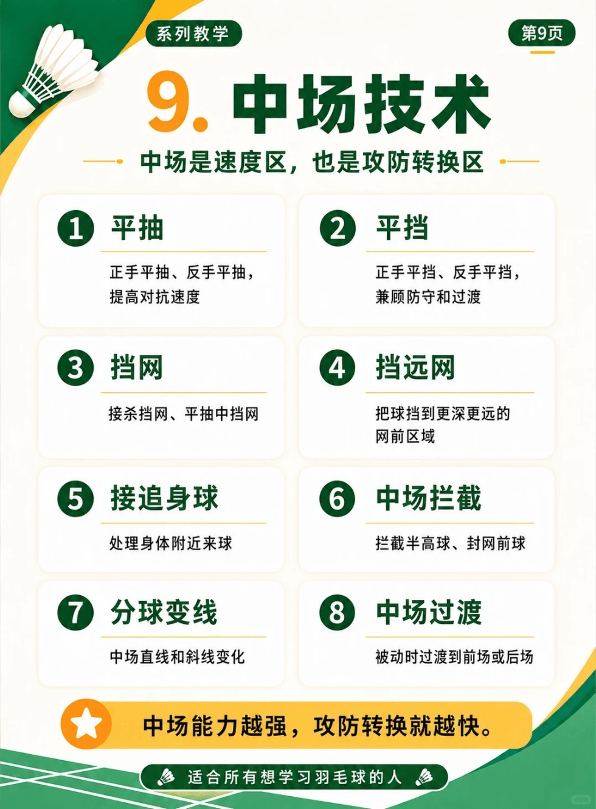

# 中场技术

/// caption
中场技术
///

## 1.平抽

正手平抽、反手平抽，提高对抗速度

## 2. 平挡

正手平挡、反手平挡，兼顾防守和过渡

## 3. 挡网

接杀挡网、平抽中挡网

## 4. 挡远网

把球挡到更深更远的网前区域

## 5. 接追身球

处理身体附近来球

## 6. 中场拦截

拦截半高球、封网前球

## 7. 分球变线

中场直线和斜线变化

## 8. 中场过渡

被动时过渡到前场或后场
