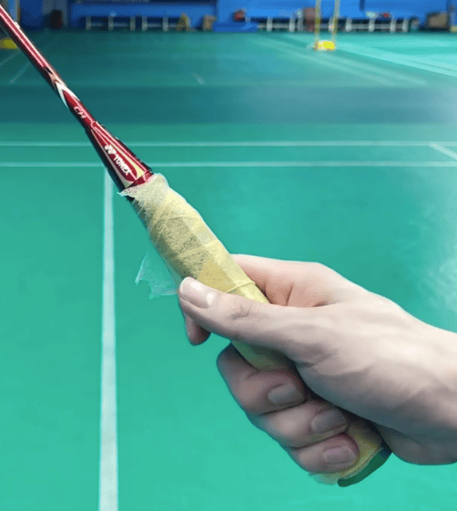
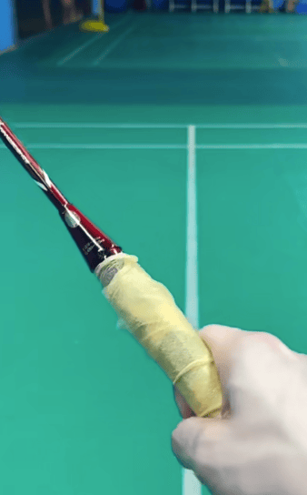

# 进攻技术

{width="80%"}
/// caption
进攻技术
///

## 1. 吊球

吊球是当球员站在后场时，将球往前、往下打的进攻性技术，它的特点是：

1. 属于主动进攻球（区别于被动回球）
2. 要求球在球员前方时才能执行
3. 需要保持动作**隐蔽性**和**威胁性**

整个技术要点是，**通过模仿高远球/杀球动作进行伪装，在击球瞬间改变方向（如正手伪装直线高远，但实际劈对角），也可以叠加滑板技术增加突然性**。

吊球一般分为**正手吊直线**、**正手吊斜线**、**头顶吊直线**、**头顶吊斜线**、**滑板吊球** 以及 **收吊**。

!!! info "吊球"

    收吊就是通过模仿杀球进行伪装，使球突然减速贴网下落，以达到欺骗对手后退防守，从而制造时间差。

    :warning: 收吊不能频繁使用，必须和其他技术配合。

业余球友在练习吊球时常见的错误主要有如下三种：

1. 动作明显减速（与高远球动作不一致）
1. 球速过慢或者过高
1. 落点靠近中场（容易被拦截）

我们在练习吊球时，一般训练步骤：

1. 先掌握基础“**碰**”式吊球
1. 逐步加入假动作元素
1. 最后练习收吊技术

吊球的优劣对比:

- 优质吊球：动作隐蔽+球速快+落点贴网
- 劣质吊球：动作明显+球速慢+落点居中

进阶要点:

- 结合点杀技术增加速度
- 通过身体朝向误导对手
- 保持击球动作一致性

### 1.1 握拍

吊球的握拍一般有三种，分别是“正手握拍”、“李宗伟握拍”以及“陶菲克握拍”，这三种握拍都需靠在手掌肌肉线上，采用食指在上、拇指在侧的基本结构。

| 握拍姿势 | 旋转方向 | 虎口位置 |
| --- | --- | --- |
| 正手握拍 | 不旋转 | 侧棱和斜棱之间 |
| 李宗伟握拍 | 向拇指方向转 | 斜棱或斜棱与宽面之间 |
| 陶菲克握拍 | 向食指方向转 | 斜棱和侧棱之间 |

#### 正手握拍

正手握拍的发力原理，是通过内旋动作产生力量，握紧时力量从斜棱传递到宽面。

常见错误主要有两种，一种是握在手掌中心会导致球拍晃动，第二种是像握木材一样握法不正确。

应用建议，建议三种都学习掌握，不同吊球技术适合不同握法，变换握法可以增加击球变化性。

!!! note "重要提醒"

    无论哪种握法，球拍都必须紧贴手掌肌肉线，握法转换时不能改变基本接触位置。

#### 李宗伟握拍

{width="80%"}
/// caption
李宗伟握拍
///

“李宗伟握拍”是在正常握法基础上，将球拍向拇指方向略微旋转，它特别适特别适合用于**劈吊**技术。

!!! tip "旋转幅度"

    约使宽面从接触肌肉变为接触旁边的棱。

“李宗伟握拍”的关键变化在于：

- 虎口位置：从侧棱和斜棱之间移到斜棱上
- 拇指位置：比正常握法稍高

#### 陶菲克握拍

{width="80%"}
/// caption
陶菲克握拍
///

“陶菲克握拍” 又称是“苍蝇拍”，是在正常握法基础上，将球拍向食指方向旋转。它的发力特点是，**通过食指更多参与控制**。

““陶菲克握拍””的关键变化在于：

- 虎口位置：靠在斜棱和侧棱之间
- 拇指位置：比正常握法扣得更紧

## 2. 劈吊

改变拍面，打出斜线或变速

-   :fontawesome-brands-bilibili:{ .bl } [**以打为主，以削为辅**](https://www.bilibili.com/video/BV1Xnar6QEhV) &nbsp; `刘辉`{.md-tag}

    ---
    **动作要点**：所有切击球头的技术，共用一套底层逻辑：以打为主，以削为辅。

-   :fontawesome-brands-bilibili:{ .bl } [**挤压吊球，提高一致性**](https://www.bilibili.com/video/BV1mXpj6nEyE) &nbsp; `源氏`{.md-tag}

    ---
    **动作要点**：

-   :fontawesome-brands-bilibili:{ .bl } [**正手蹬转劈吊总下网，没球速，还没有欺骗性？**](https://www.bilibili.com/video/BV1UcKn69EyK) &nbsp; `刘辉`{.md-tag}

    ---
    **问题**：正手蹬转劈吊总下网，没球速，还没有欺骗性？

    **动作要点**：

-   :fontawesome-brands-bilibili:{ .bl } [**劈吊动作要随来球调整！**](https://www.bilibili.com/video/BV17HhE6fEye) &nbsp; `刘辉`{.md-tag}

    ---
    **动作要点**

## 3. 滑板

滑板直线、滑板斜线、头顶滑板

-   :fontawesome-brands-bilibili:{ .bl } [**头顶滑拍的精髓，掌握后速度、稳定、隐蔽性直接质变！**](https://www.bilibili.com/video/BV11sHx6qEEF) &nbsp; `刘辉`{.md-tag}

    ---
    **动作要点**

-   :fontawesome-brands-bilibili:{ .bl } [**头顶滑拍要在头顶击球**](https://www.bilibili.com/video/BV1SAha6JEkF) &nbsp; `刘辉`{.md-tag}

    ---
    **动作要点**：

-   :fontawesome-brands-bilibili:{ .bl } [**正手滑板挥拍击球点侧身**](https://www.bilibili.com/video/BV1Md4i6REBk) &nbsp; `刘辉`{.md-tag}

    ---
    **动作要点**：
    
    1. 拍头不要竖着打，要横着打，而且需要一个向前的力；
    1. 练习时可以**先用高远球找击球点**，再慢慢地转滑拍；
    1. 新手建议架好姿势练习滑拍，不要直接使用动态框架。

## 4. 杀球

业余球员后场动作常出现僵硬不顺畅现象，表现为发力不自然、动作衔接非常生硬，打出来的杀球又慢又轻。然而，经常看比赛的同学知道，专业球员的杀球动作非常舒展放松，能有效利用全身协调发力，杀出来的球**又快又重**。虽然业余和专业球员动作外形相似，但发力方法和身体协调性存在本质差异。

高质量后场动作需包含三个要素：**高点球处理**、**杀球力量** 和 **吊球控制**。高远球以及杀球发力原理是，**通过腰部连接上下半身力量，形成力量传导链条**，这个过程所有身体部位（双手、双腿）需协同运作，保持动作连贯性。

!!! tip "动作要点"

    最终要达到的标准动作是全身协调发力，力量从下肢经腰部传导至上肢。这个过程中**腰部**是连接上下半身力量的核心枢纽，直接影响发力效果。

### 4.1 握拍

只有正确的握拍，才能确保击球时能充分发力，并保持击球时拍面正对来球方向。常见的握拍姿势有四种，分别是正手握拍（也称之为 V 字握拍）、李宗伟握拍、陶菲克握拍（也叫做苍蝇拍）。

!!! note "李宗伟握拍和陶菲克握拍的使用场景"

    李宗伟握拍类似内握但空间更小，**适合快速发力**。陶菲克握拍杀球力量大，且更容易**产生爆发力**，拍面稳定性高，特别适合**网前快速抽挡**。

学完习握拍，接下来我们就要学习挥拍。所有技术动作（搓球、杀球等）都基于相同挥拍原理，它需要配合转身、腰部动作形成完整发力体系。当然，不同握法会导致击球点位置微调，需要灵活调整。

### 4.2 挥拍

挥拍是一套完整的链条动作：

- **转身**：通过转身动作寻找击球节奏，适应球的运动轨迹。它要求我们身体需随球速变化调整移动速度和位置，在移动中借力发力，完成击球后能快速回位。
- **回拍**：一般包含架拍、倒拍（也叫做引拍）、挥拍、卸力（也叫做收拍）四个基本动作环节（1234计数法）。业余球友训练时，建议从固定位置挥拍开始练习，先掌握静态挥拍动作，再过渡到动态击球。
- **节奏**：在移动中找到合适的击球时机和击球点，需适应球的不规则运动，不能依赖固定击球点。这一阶段的学习要求我们，能够通过调整身体位置来匹配球的运动节奏。
- **空间感**：在掌握节奏后需培养空间感，预判球的落点。

挥拍的基本姿势有三个要点：

- **架拍要点**：不用完全伸直，保持自然弯曲，战肩时肩胛骨有点紧绷感即可。
- **视线控制**：==头部一定向上看==，胸部微挺，腰部保持挺直状态。
- **手臂位置**：能看到左手右侧部分，保持自然放松状态。

挥拍时的腰部与肩部展开：

- **腰部动作**：不是直接向左侧下压，而是保持挺直状态下放，同时伴随腰部转动。
- **发力顺序**：先下压带动身体摇动，右侧上线时保持腰部持续发力。

!!! warning "常见错误"

    避免直接向侧面下压，要保持垂直下方的动态轨迹。

挥拍时的手腕动作与内旋：

- **手腕控制**：自然向后倒，位置保持在眼睛、鼻子或下巴高度。
- **发力技巧**：小臂推动时，在接近伸直状态时开始手腕动作。
- **内旋要点**：不能仅靠手腕内旋，需要配合肘部转动，使动作保持水平。
- **手指配合**：适当抓握防止球拍废除，同时辅助发力（后三指）。

挥拍结束后的自然放松：

- **收拍动作**：力量释放完毕后，肩膀自然下放。
- **惯性利用**：由于身体后拉产生的惯性会自然推动向左上方。
- **视线转换**：动作完成后，再将视线转向前方。

挥拍动过的连贯性与练习建议：

- **动作连贯**：快速挥拍时不必等到肘部完全到位才开始下一个动作，根据架拍空间灵活调整。
- **练习方法**：建议对着镜子练习，观察动作是否标准。
- **节奏控制**：慢动作分解练习（1234），再加快速度。

!!! warning "常见错误"

    动作过度分解会导致球拍方向偏离。

#### 常见问题

1. 架拍时

原地杀球、后退杀球、直线杀球、斜线杀球

-   :fontawesome-brands-bilibili:{ .bl } [**杀球不要过分侧身**](https://www.bilibili.com/video/BV1EsWC6EEe8) &nbsp; `刘辉`{.md-tag}

    ---
    **动作要点**

-   :fontawesome-brands-bilibili:{ .bl } [**杀球起跳和换脚**](https://www.bilibili.com/video/BV1t9Wi6LEXL) &nbsp; `刘辉`{.md-tag}

    ---
    **动作要点**

-   :fontawesome-brands-bilibili:{ .bl } [**业余球友后场杀球没劲？不是爆发力不行，大概率是架拍高度一开始就错了**](https://www.bilibili.com/video/BV1ohxc6cExC) &nbsp; `刘辉`{.md-tag}

    ---
    **动作要点**

-   :fontawesome-brands-bilibili:{ .bl } [**后场杀球高远球没劲？教你正确倒拍怎么练！**](https://www.bilibili.com/video/BV14Sno6ZEY8) &nbsp; `刘辉`{.md-tag}

    ---
    **动作要点**

-   :fontawesome-brands-bilibili:{ .bl } [**杀球打上杆、杀不到甜区，击球点过高如何校正？**](https://www.bilibili.com/video/BV19UpR6qEqx) &nbsp; `刘辉`{.md-tag}

    ---
    **动作要点**：

-   :fontawesome-brands-bilibili:{ .bl } [**杀球有劲的秘诀，藏在起跳方式里！**](https://www.bilibili.com/video/BV1HuJy6CE3G) &nbsp; `刘辉`{.md-tag}

    ---
    **动作要点**

-   :fontawesome-brands-bilibili:{ .bl } [**蹲着接杀球，就一定是错的吗？**](https://www.bilibili.com/video/BV1mKez63EFD) &nbsp; `刘辉`{.md-tag}

    ---
    **动作要点**

-   :fontawesome-brands-bilibili:{ .bl } [**蹲打接杀的时机，对面杀球冲着脸来如何处理？**](https://www.bilibili.com/video/BV1hLh66VEF5) &nbsp; `刘辉`{.md-tag}

    ---
    **动作要点**

-   :fontawesome-brands-bilibili:{ .bl } [**对手杀球突然变平高，业余球友最容易翻车！**](https://www.bilibili.com/video/BV1MnYX6LEP3) &nbsp; `刘辉`{.md-tag}

    ---
    **动作要点**

-   :fontawesome-brands-bilibili:{ .bl } [**5个细节提高你的杀球稳定性、精准度**](https://www.bilibili.com/video/BV11T8c6HEuK) &nbsp; `刘辉`{.md-tag}

    ---
    **问题**：杀球老是杀不准？

    **动作要点**：

-   :fontawesome-brands-bilibili:{ .bl } [**高远球和杀球为什么要歪着打**](https://www.bilibili.com/video/BV1FbLz6DEvr) &nbsp; `刘辉`{.md-tag}

    ---
    **动作要点**

-   :fontawesome-brands-bilibili:{ .bl } [**杀了球下一拍衔接**](https://www.bilibili.com/video/BV1ztPAzvEm2) &nbsp; `李宇轩`{.md-tag}

    ---
    **动作要点**

-   :fontawesome-brands-bilibili:{ .bl } [**杀球像平抽，怎么办？**](https://www.bilibili.com/video/BV1owpe6EEE3) &nbsp; `汤老师`{.md-tag}

    ---
    **动作要点**

-   :fontawesome-brands-bilibili:{ .bl } [**发力身体姿态**](https://www.bilibili.com/video/BV1Tutm6SEtE) &nbsp; `刘辉`{.md-tag}

    ---
    **动作要点**：使用腰腹的力量时，杀球或者跳杀时人需要向左倾斜，做一个转髋的动作，才能借得上卷腹的力。

-   :fontawesome-brands-bilibili:{ .bl } [**转体和转髋：标准款动作和技巧**](https://www.bilibili.com/video/BV1W6bw6RErY) &nbsp; `刘辉`{.md-tag}

    ---
    **动作要点**：右肩找左腿，右脚后跟抬起，打完后身体朝一定是向左侧。

    - 转体是上半身转过来，而转髋是全身转过来集中发力。大多人发力实际是有转体，没有转髋。
    - 转髋可以通过迈腿和收腿来是实现，但收腿容易让击球点太靠前

-   :fontawesome-brands-bilibili:{ .bl } [**90%的人杀球都在轮大臂**](https://www.bilibili.com/video/BV1JFtW6BEXN) &nbsp; `刘辉`{.md-tag}

    ---
    **动作要点**：

-   :fontawesome-brands-bilibili:{ .bl } [**杀球用肘增加前摇**](https://www.bilibili.com/video/BV1n2bw6DEbR) &nbsp; `刘辉`{.md-tag}

    ---
    **问题**：架拍姿势不对，肘前摇空间小，杀球发不上力。

    **动作要点**：通过肘增加前摇进行杀球发力，增加大臂摆动空间。当小臂与大臂成几乎90度时，引拍空间小导致杀球没力（一般职业球员可以这样发力，业余球友不建议）。

-   :fontawesome-brands-bilibili:{ .bl } [**头顶突击增加爆发力**](https://www.bilibili.com/video/BV13EWg65E7J) &nbsp; `刘辉`{.md-tag}

    ---
    **动作要点**：

-   :fontawesome-brands-bilibili:{ .bl } [**遁地炮杀球，杀得尖和杀得重的底层逻辑，看完你就通透了！**](https://www.bilibili.com/video/BV1yvWg6aEhJ) &nbsp; `小结巴不会杀球`{.md-tag}

    ---
    **动作要点**：

-   :fontawesome-brands-bilibili:{ .bl } [**杀上网连贯教学——两步一冲就！**](https://www.bilibili.com/video/BV1y5GN6HECr) &nbsp; `刘辉`{.md-tag}

    ---
    **动作要点**

-   :fontawesome-brands-bilibili:{ .bl } [**杀上网回位连贯步伐！**](https://www.bilibili.com/video/BV1vw3U6xE8t) &nbsp; `刘辉`{.md-tag}

    ---
    **动作要点**：

-   :fontawesome-brands-bilibili:{ .bl } [**发力不集中，不是你力量不够，是杀球发力的底层逻辑搞错了！**](https://www.bilibili.com/video/BV1t8uh6xEHA) &nbsp; `刘辉`{.md-tag}

    ---
    **问题**：杀球费劲、发力散、用尽全力球却没威力？90%球友的根源，就是抡大臂！

    **动作要点**：

-   :fontawesome-brands-bilibili:{ .bl } [**告别抡大臂，搞明白发力集中的秘诀！**](https://www.bilibili.com/video/BV1AKuZ6oE5N) &nbsp; `刘辉`{.md-tag}

    ---
    **问题**：杀球费劲，高远球乏力

    **动作要点**

## 5. 闪动发力杀球

**点杀**是杀球快，但杀球不重，那有什么方法能让杀球又快又重，答案就是“**闪动发力**杀球”。

-   :fontawesome-brands-bilibili:{ .bl } [**闪动发力靠惯性发力**](https://www.bilibili.com/video/BV16Y816GEfu) &nbsp; `刘辉`{.md-tag}

    ---
    **动作要点**

-   :fontawesome-brands-bilibili:{ .bl } [**闪动回弹发力**](https://www.bilibili.com/video/BV1YQ4y1H79U) &nbsp; `刘辉`{.md-tag}

    ---
    **动作要点**

-   :fontawesome-brands-bilibili:{ .bl } [**弄懂点发力与闪动发力区别！**](https://www.bilibili.com/video/BV1ow816YEUB) &nbsp; `刘辉`{.md-tag}

    ---
    **动作要点**

-   :fontawesome-brands-bilibili:{ .bl } [**练会贴球发力，后场再也不费劲！**](https://www.bilibili.com/video/BV1jzVB6ME46) &nbsp; `刘辉`{.md-tag}

    ---
    **动作要点**

-   :fontawesome-brands-bilibili:{ .bl } [**讲懂讲透闪动发力**](https://www.bilibili.com/video/BV1Ro4y157AG) &nbsp; `刘辉`{.md-tag}

    ---
    **动作要点**：注意“**闪动发力**”和“**点杀**”的区别，“点杀”是手腕用力，而“闪动发力”是手臂发力加上肘回拉，手腕是锁住的状态。

-   :fontawesome-brands-bilibili:{ .bl } [**闪动回弹发力**](https://www.bilibili.com/video/BV1d64y1j77m) &nbsp; `刘辉`{.md-tag}

    ---
    **动作要点**：

-   :fontawesome-brands-bilibili:{ .bl } [**闪动发力剧场版**](https://www.bilibili.com/video/BV1vr421c7ju) &nbsp; `刘辉`{.md-tag}

    ---
    **动作要点**：

-   :fontawesome-brands-bilibili:{ .bl } [**闪动发力完整纯享版**](https://www.bilibili.com/video/BV1Z9xS6zEfZ) &nbsp; `刘辉`{.md-tag}

    ---
    **动作要点**：

-   :fontawesome-brands-bilibili:{ .bl } [**闪动发力拉胳膊不是拉拍头**](https://www.bilibili.com/video/BV1FSxS6VESP) &nbsp; `刘辉`{.md-tag}

    ---
    **动作要点**：

-   :fontawesome-brands-bilibili:{ .bl } [**闪动发力直播**](https://www.bilibili.com/video/BV1MB4y1J79x) &nbsp; `刘辉`{.md-tag}

    ---
    **动作要点**：

-   :fontawesome-brands-bilibili:{ .bl } [**闪动发力的进阶技术**](https://www.bilibili.com/video/BV1YQ4y1H79U) &nbsp; `刘辉`{.md-tag}

    ---
    **动作要点**：

-   :fontawesome-brands-bilibili:{ .bl } [**闪动发力**](https://www.bilibili.com/video/BV1hNTvzHEyJ) &nbsp; `汤老师`{.md-tag}

    ---
    **动作要点**：

-   :fontawesome-brands-bilibili:{ .bl } [**鞭甩发力教学**](https://www.bilibili.com/video/BV1K3dNYTE5t) &nbsp; `爱打球的羊`{.md-tag}

    ---
    **动作要点**：

-   :fontawesome-brands-bilibili:{ .bl } [**暴力杀球，鞭打/闪动发力是如何正确的做？**](https://www.bilibili.com/video/BV1fH4y1L7aT) &nbsp; `李宇轩`{.md-tag}

    ---
    **动作要点**：

## 6. 点杀

小幅度快速下压，提高突然性

-   :fontawesome-brands-bilibili:{ .bl } [**别再迷信断腕点杀靠手腕，真正发力来自小臂内旋**](https://www.bilibili.com/video/BV1qTt26wEYq) &nbsp; `刘辉`{.md-tag}

    ---
    **动作要点**

-   :fontawesome-brands-bilibili:{ .bl } [**别再误解“断腕点杀”了！90%球友都踩过的误区，看完你也能打出林丹同款杀球！**](https://www.bilibili.com/video/BV1KaJK65ELS) &nbsp; `刘辉`{.md-tag}

    ---
    **动作要点**

-   :fontawesome-brands-bilibili:{ .bl } [**后场进攻底层逻辑**](https://www.bilibili.com/video/BV1QYt364E7h) &nbsp; `皮皮软`{.md-tag}

    ---
    **动作要点**：

    1. 平快来球用点杀；高远来球蹬转杀；较高来用中国跳；
    1. 垂直下路用平高；球到边线用快劈；下手被动用轮抽（斜对角）

-   :fontawesome-brands-bilibili:{ .bl } [**如何打好点杀**](https://www.bilibili.com/video/BV1P3L26jECT) &nbsp; `冠霖`{.md-tag}

    ---
    **动作要点**：

-   :fontawesome-brands-bilibili:{ .bl } [**360度无敌转圈反手杀｜李梓嘉章鱼杀**](https://www.bilibili.com/video/BV1jMx16REbT) &nbsp; `未知`{.md-tag}

    ---
    **动作要点**：

-   :fontawesome-brands-bilibili:{ .bl } [**下次对手敢偷你后场，直接反杀**](https://www.bilibili.com/video/BV1H74z6EEiB) &nbsp; `刘辉`{.md-tag}

    ---
    **动作要点**

## 7. 劈杀

结合切拍面改变线路

 
-   :fontawesome-brands-bilibili:{ .bl } [**拿督不传绝技，不转身劈杀斜线！**](https://www.bilibili.com/video/BV1ZLLb6UEMx) &nbsp; `刘辉`{.md-tag}

    ---
    **动作要点**

## 8. 跳杀

单脚起跳、双脚起跳基础

-   :fontawesome-brands-bilibili:{ .bl } [**杀球别整个身体转**](https://www.bilibili.com/video/BV1qZx46BEVF) &nbsp; `刘辉`{.md-tag}

    ---
    **动作要点**

-   :fontawesome-brands-bilibili:{ .bl } [**精简起跳幅度，后场重杀续航直接翻倍**](https://www.bilibili.com/video/BV1rzEu6GEHD) &nbsp; `刘辉`{.md-tag}

    ---
    **动作要点**

-   :fontawesome-brands-bilibili:{ .bl } [**跳杀从来不是越瘦越好，体重根本不是跳杀门槛！**](https://www.bilibili.com/video/BV1w5716VE6z) &nbsp; `刘辉`{.md-tag}

    ---
    **动作要点**

-   :fontawesome-brands-bilibili:{ .bl } [**双脚跳杀如何更稳定？一个视频教会你！**](https://www.bilibili.com/video/BV1LwVK6VE4P) &nbsp; `刘辉`{.md-tag}

    ---
    **动作要点**

-   :fontawesome-brands-bilibili:{ .bl } [**前几天的比赛视频大家对刘亮的中国跳暴力突击印象深刻！帅气的中国跳突击保姆级教程来咯！**](https://www.bilibili.com/video/BV1gVGR6KEcb) &nbsp; `刘辉`{.md-tag}

    ---
    **动作要点**

-   :fontawesome-brands-bilibili:{ .bl } [**4分钟教会你帅气跳杀！别再乱跳杀了！姿势丑、发不出力还容易伤腰！全程拆解，练会随便一拍都是壁纸大片！**](https://www.bilibili.com/video/BV1FMGJ6XEYY) &nbsp; `刘辉`{.md-tag}

    ---
    **动作要点**

-   :fontawesome-brands-bilibili:{ .bl } [**一个视频双脚起跳全部解决**](https://www.bilibili.com/video/BV1TMVp6VESt) &nbsp; `徐硕`{.md-tag}

    ---
    **动作要点**：

    1. 后退时一定要比球快，这样才有足够的蓄力时间；
    1. 起跳前，需要做一个持拍同侧腿的大撤步；
    1. 另一侧腿贴地收拢，直至与宽同宽；双腿同时蓄力向上，完成一个展腹跳；
    1. 利用放松到握紧的向下受力，杀完大腿落地

-   :fontawesome-brands-bilibili:{ .bl } [**跳杀，你就这么练**](https://www.bilibili.com/video/BV1kF4g6TEyq) &nbsp; `汤老师`{.md-tag}

    ---
    **动作要点**：

-   :fontawesome-brands-bilibili:{ .bl } [**霸王杀教学，极其突然的杀球**](https://www.bilibili.com/video/BV1Q6FhzxEjZ) &nbsp; `李宇轩`{.md-tag}

    ---
    **动作要点**：

## 9. 杀上网

杀球后跟进网前

## 10. 吊上网

吊球后上网控制
