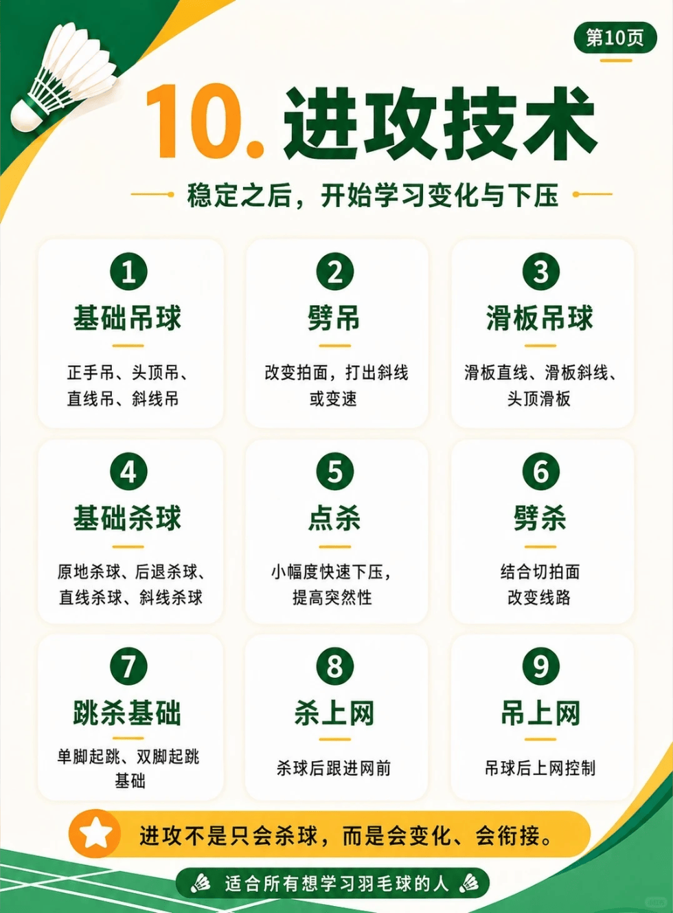

# 进攻技术

/// caption
进攻技术
///

## 1. 基础吊球

正手吊、头顶吊、直线吊、斜线吊

## 2. 劈吊

改变拍面，打出斜线或变速

## 3. 滑板吊球

滑板直线、滑板斜线、头顶滑板

## 4. 基础杀球

原地杀球、后退杀球、直线杀球、斜线杀球

## 5. 点杀

小幅度快速下压，提高突然性

## 6. 劈杀

结合切拍面改变线路

## 7. 跳杀基础

单脚起跳、双脚起跳基础

## 8. 杀上网

杀球后跟进网前

## 9. 吊上网

吊球后上网控制
