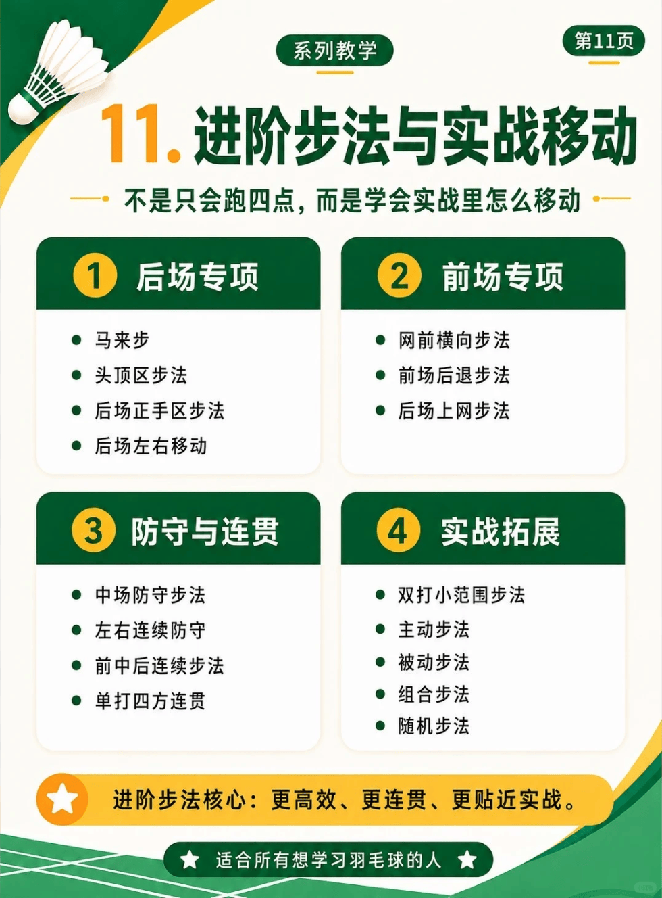

# 步法与实战移动

/// caption
步法与实战移动
///

## 1. 后场专项

- 马来步
- 头顶区步法
- 后场正手区步法
- 后场左右移动

## 2. 前场专项

- 网前横向步法
- 前场后退步法
- 后场上网步法

## 3. 防守与连贯

- 中场防守步法
- 左右连续防守
- 前中后连续步法
- 单打四方连贯

## 4. 实战拓展

- 双打小范围步法
- 主动步法
- 被动步法
- 组合步法
- 随机步法

## 1. 启动步

| 技术 | UP 主 | 视频 | 动作要点 |
| --- | --- | --- | --- |
| 启动步 | 刘辉 | [步法第一步的重要性](https://www.bilibili.com/video/BV1jYtP65E7B)  | 将启动与第一步结合在一起，解决步伐慢的问题，锻炼弹簧腿，全场四个点快速到达 | 
| 启动步 | 源氏 | [在防守时接杀还算轻松，但为何接吊特别难接呢](https://www.bilibili.com/video/BV14aVv6LEqP) | ①首先当来球是斜前方时，两脚不要平行站立；②其次不要光靠脚踝和膝盖来启动，重心压低的时候需要更大的力量才能向前和向后；③准备时通常会屈髋，启动的第一时间应该用髋将身体顶出去，再借助脚、膝盖以及手再顺着这个冲力向前移动 |
