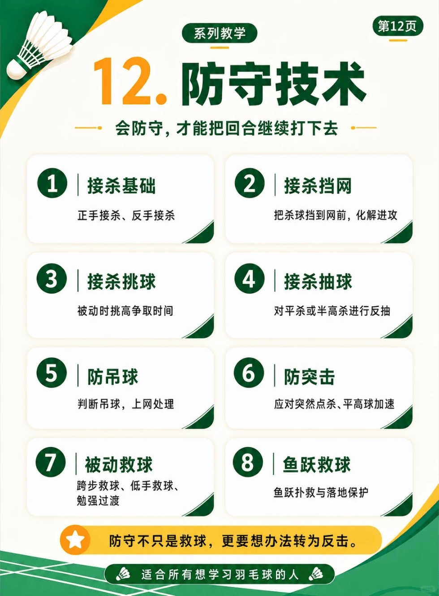

# 防守技术

/// caption
步法与实战移动
///

## 1. 接杀基础

- 正手接杀
- 反手接杀

## 2. 接杀挡网

- 把杀球挡到网前，化解进攻

## 3. 接杀挑球

- 被动时挑高争取时间

## 4. 接杀抽球

- 对平杀或半高杀进行反抽

## 5. 防吊球

- 判断吊球，上网处理

## 6. 防突击

- 应对突然点杀、平高球加速

## 7. 被动救球

- 跨步救球
- 低手救球
- 勉强过渡

## 8. 鱼跃救球

- 鱼跃扑救与落地保护

