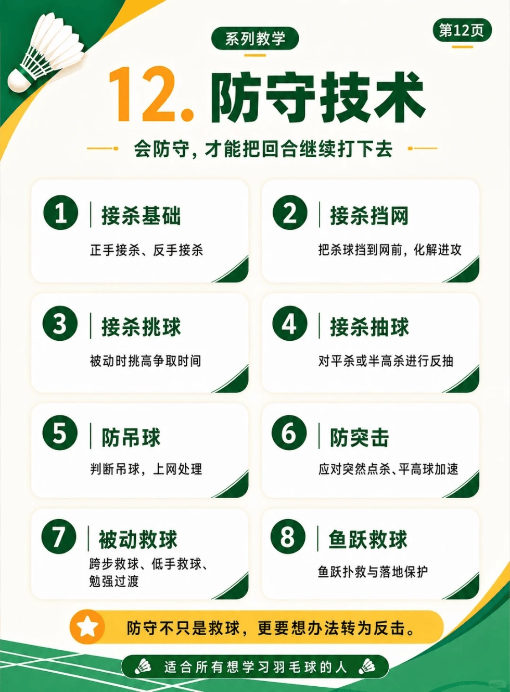

# 防守技术

{width="50%"}
/// caption
步法与实战移动
///

## 1. 接杀基础

### 1.1 正手接杀

 
-   :fontawesome-brands-bilibili:{ .bl } [**蛋总刀削面技术的底层逻辑，逆球头变线为什么对专业运动员来说都有难度？**](https://www.bilibili.com/video/BV1Boh56JEF9) &nbsp; `刘辉`{.md-tag}

    ---
    **问题**：

    **动作要点**

-   :fontawesome-brands-bilibili:{ .bl } [**蛋总正手刀削面接杀技术**](https://www.bilibili.com/video/BV1mr8d62Exy) &nbsp; `刘辉`{.md-tag}

    ---
    **动作要点**

-   :fontawesome-brands-bilibili:{ .bl } [**记住这个接杀逻辑，再也不怕冲脸球！**](https://www.bilibili.com/video/BV11chU6RETz) &nbsp; `刘辉`{.md-tag}

    ---
    **问题**：对手一记杀球又重又快，直奔脸过来，结果要么接不到，要么勉强挡回去直接被动！
    
    **动作要点**

### 1.2 反手接杀

-   :fontawesome-brands-bilibili:{ .bl } [**力量是底子，但爆发力才是羽毛球的灵魂！**](https://www.bilibili.com/video/BV1DxtU6oEqj) &nbsp; `刘辉`{.md-tag}

    ---
    **动作要点**

-   :fontawesome-brands-bilibili:{ .bl } [**拇指顶宽面，是要牺牲一部分手腕发力空间的！**](https://www.bilibili.com/video/BV1Vst861ECp) &nbsp; `刘辉`{.md-tag}

    ---
    **动作要点**

-   :fontawesome-brands-bilibili:{ .bl } [**手指放松抓紧是鞭甩链条的最后一环**](https://www.bilibili.com/video/BV1bAtp6mEL5) &nbsp; `刘辉`{.md-tag}

    ---
    **动作要点**

-   :fontawesome-brands-bilibili:{ .bl } [**蛋总招牌反手刀削面接杀**](https://www.bilibili.com/video/BV12f4R6vEVA) &nbsp; `刘辉`{.md-tag}

    ---
    **动作要点**

-   :fontawesome-brands-bilibili:{ .bl } [**发力身体姿态**](https://www.bilibili.com/video/BV1Tutm6SEtE) &nbsp; `刘辉`{.md-tag}

    ---
    **动作要点**：首先握拍；其次接左侧杀球不要迈右腿，要迈左腿接杀。如果被推后场则直接启动（中国跳或者并步），不需要转身，整个动作连贯性变高。

-   :fontawesome-brands-bilibili:{ .bl } [**为什么职业选手接杀挑球多？**](https://www.bilibili.com/video/BV1Co3g6PESU) &nbsp; `刘辉`{.md-tag}

    ---
    **动作要点**

## 2. 接杀挡网

- 把杀球挡到网前，化解进攻

## 3. 接杀挑球

- 被动时挑高争取时间

## 4. 接杀抽球

- 对平杀或半高杀进行反抽

## 5. 防吊球

- 判断吊球，上网处理

## 6. 防突击

- 应对突然点杀、平高球加速

## 7. 被动救球

- 跨步救球
- 低手救球
- 勉强过渡

## 8. 鱼跃救球

- 鱼跃扑救与落地保护

