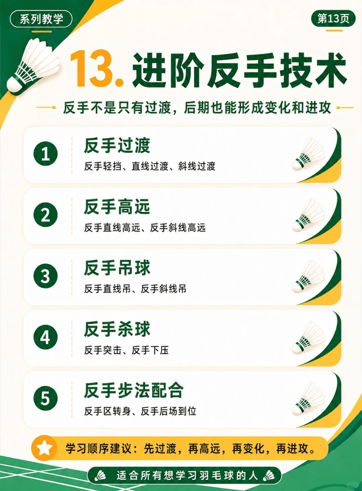

# 反手技术

{width="50%"}
/// caption
反手技术
///

## 1. 反手过渡

反手轻挡、直线过渡、斜线过渡

-   :fontawesome-brands-bilibili:{ .bl } [**会反手过渡直线却不会过渡斜线或者相反！**](https://www.bilibili.com/video/BV1xMMH6dEVU) &nbsp; `刘辉`{.md-tag}

    ---
    **动作要点**

-   :fontawesome-brands-bilibili:{ .bl } [**反手过渡不够稳定，或许你离高手就差这个细节！**](https://www.bilibili.com/video/BV1ShKA6gEeZ) &nbsp; `刘辉`{.md-tag}

    ---
    **动作要点**：

-   :fontawesome-brands-bilibili:{ .bl } [**反手过渡想稳定又贴，发力动作越干净越稳！**](https://www.bilibili.com/video/BV1fZ346qEgU) &nbsp; `刘辉`{.md-tag}

    ---
    **动作要点**：

## 2. 反手高远

反手直线高远、反手斜线高远

-   :fontawesome-brands-bilibili:{ .bl } [**反手后场步法教学**](https://www.bilibili.com/video/BV1Rvnw6UEJ8) &nbsp; `黄广益`{.md-tag}

    ---
    **动作要点**：

-   :fontawesome-brands-bilibili:{ .bl } [**关于主动反手高远球的见解！**](https://www.bilibili.com/video/BV17EJG67ECC) &nbsp; `刘辉`{.md-tag}

    ---
    **动作要点**

-   :fontawesome-brands-bilibili:{ .bl } [**反手被动高远，低位也能拉后场！**](https://www.bilibili.com/video/BV1uiL96GEd2) &nbsp; `刘辉`{.md-tag}

    ---
    **动作要点**

-   :fontawesome-brands-bilibili:{ .bl } [**学会这个细节，反手直接提升一个档次。**](https://www.bilibili.com/video/BV1imjb6DEcU) &nbsp; `刘辉`{.md-tag}

    ---
    **动作要点**

## 3. 反手吊球

反手直线吊、反手斜线吊
## 4. 反手杀球

反手突击、反手下压

## 5. 反手步法配合

反手区转身、反手后场到位

