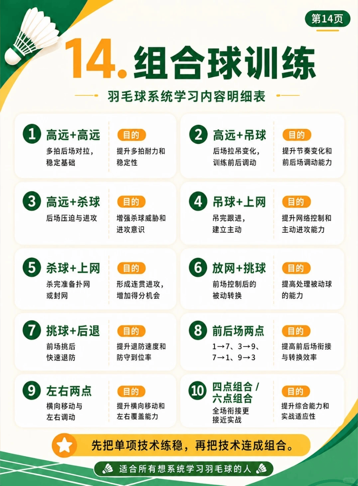

# 第十四章：组合球训练

{width="50%"}
/// caption
组合球训练
///

## 1. 高远+高远
- 具体内容：多拍后场对抗，稳定基础
- 目的：提升多拍耐力和稳定性

## 2. 高远+吊球
- 具体内容：后场拉吊变化，训练前后调动
- 目的：提升节奏变化和前后场调动能力

## 3. 高远+杀球
- 具体内容：后场压迫与进攻
- 目的：增强杀球威胁和进攻意识

## 4. 吊球+上网
- 具体内容：吊完跟进，建立主动
- 目的：提升网络控制和主动进攻能力

## 5. 杀球+上网
- 具体内容：杀完准备扑网或封网
- 目的：形成连贯进攻，增加得分机会

## 6. 放网+挑球
- 具体内容：前场控制后的被动转换
- 目的：提高处理被动球的能力

## 7. 挑球+后退
- 具体内容：前场挑后，快速退防
- 目的：提升退防速度和防守到位率

## 8. 前后场两点
- 具体内容：1→7、3→9、7→1、9→3
- 目的：提高前后场衔接与转换效率

## 9. 左右两点
- 具体内容：横向移动与左右调动
- 目的：提升横向移动和左右覆盖能力

## 10. 四点组合 / 六点组合
- 具体内容：全场衔接更接近实战
- 目的：提升综合能力和实战适应性