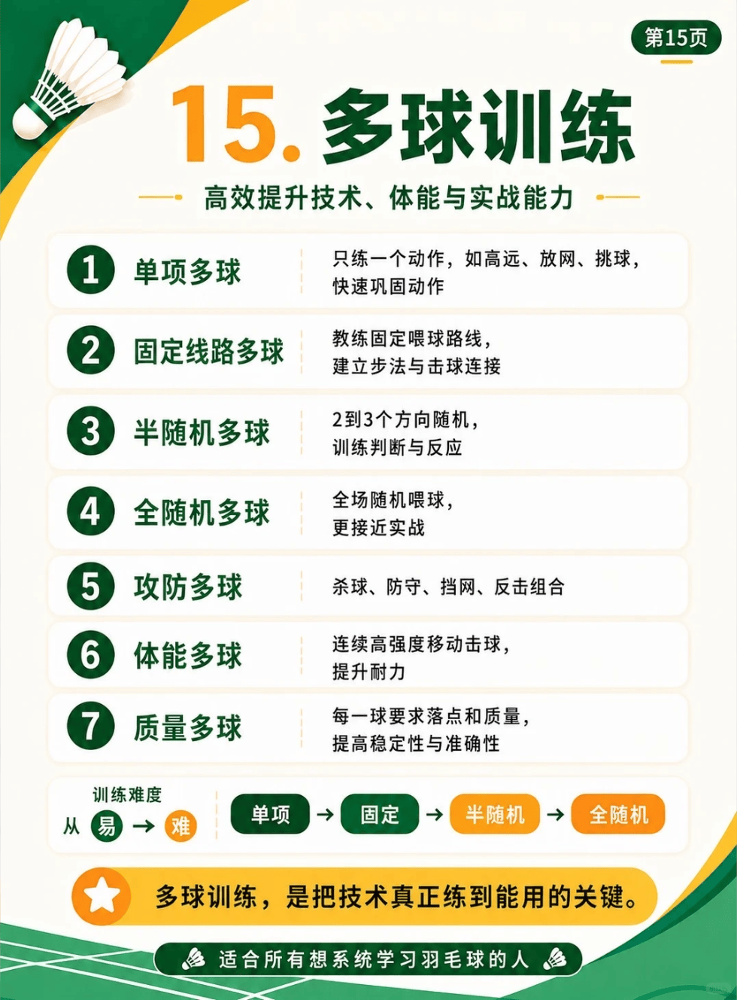

# 多球训练

{width="50%"}
/// caption
多球训练
///

## 1. 单项多球

- 具体内容：只练一个动作，如高远、放网、挑球，快速巩固动作

## 2. 固定线路多球

- 具体内容：教练固定喂球路线，建立步法与击球连接

## 3. 半随机多球

- 具体内容：2到3个方向随机，训练判断与反应

## 4. 全随机多球

- 具体内容：全场随机喂球，更接近实战

## 5. 攻防多球

- 具体内容：杀球、防守、挡网、反击组合

## 6. 体能多球

- 具体内容：连续高强度移动击球，提升耐力

## 7. 质量多球

- 具体内容：每一球要求落点和质量，提高稳定性与准确性
