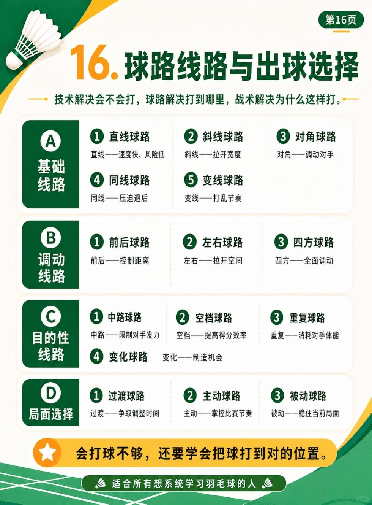

# 第十六章：球路与出球选择

/// caption
球路与出球选择
///

## A. 基础线路

### 1. 直线球路

- 特点：速度快、风险低

### 2. 斜线球路

- 特点：拉开宽度

### 3. 对角球路

- 特点：调动对手

### 4. 同线球路

- 特点：压迫退后

### 5. 变线球路

- 特点：打乱节奏

## B. 调动线路

### 1. 前后球路

- 作用：控制距离

### 2. 左右球路

- 作用：拉开空间

### 3. 四方球路

- 作用：全面调动

## C. 目的性线路

### 1. 中路球路

- 作用：限制对手发力

### 2. 空档球路

- 作用：提高得分效率

### 3. 重复球路

- 作用：消耗对手体能

### 4. 变化球路

- 作用：制造机会

## D. 局面选择

### 1. 过渡球路

- 策略：争取调整时间

### 2. 主动球路

- 策略：掌控比赛节奏

### 3. 被动球路

- 策略：稳住当前局面
