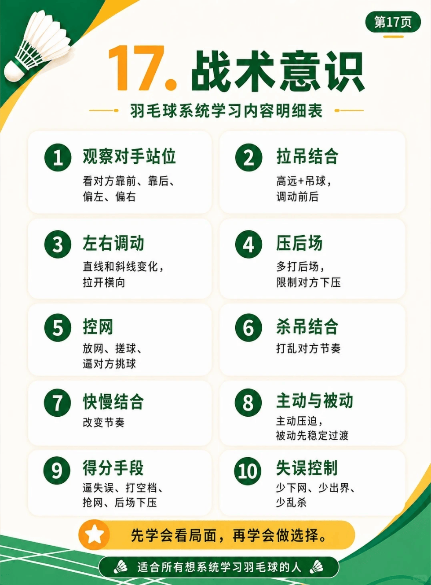

# 战术意识

{width="50%"}
/// caption
战术意识
///

## 1. 观察对手站位

- 看对方靠前、靠后、偏左、偏右

## 2. 拉吊结合

- 高远+吊球，调动前后

## 3. 左右调动

- 直线和斜线变化，拉开横向

## 4. 压后场

- 多打后场，限制对方下压

## 5. 控网

- 放网、搓球、逼对方挑球

## 6. 杀吊结合

- 打乱对方节奏

## 7. 快慢结合

- 改变节奏

## 8. 主动与被动

- 主动压迫，被动先稳定过渡

## 9. 得分手段

- 逼失误、打空档、抢网、后场下压

-   :fontawesome-brands-bilibili:{ .bl } [**新手保姆级抓球思路教学**](https://www.bilibili.com/video/BV19HeG6LEKG) &nbsp; `皮皮软`{.md-tag}

    ---
    **动作要点**：1.推反手抓往前（斜对角）；2.推斜线抓直线；3.压头顶劈斜线；4.压正手滑对角；5.搓近网抓回放；6.挡远网抓突出

-   :fontawesome-brands-bilibili:{ .bl } [**新手保姆级抓球思路教学**](https://www.bilibili.com/video/BV19HeG6LEKG) &nbsp; `皮皮软`{.md-tag}

    ---
    **动作要点**：1.推反手抓往前（斜对角）；2.推斜线抓直线；3.压头顶劈斜线；4.压正手滑对角；5.搓近网抓回放；6.挡远网抓突出

-   :fontawesome-brands-bilibili:{ .bl } [前期的铺垫才能出好效果](https://www.bilibili.com/video/BV1xEbG6SETg) &nbsp; `源氏`{.md-tag}

    ---
    **动作要点**：

    1. 想要抓推突击杀穿对手，多用挡中路远网；
    1. 想要垂直起跳钉地板，多用高搓高；
    1. 想要网前抹扑对手，多用搓远网；
    1. 想要抽档抽爆对手，多用扑压追身；
    1. 想要对手原地罚站，多用切削停顿；
    1. 想要抓过渡打爆对手，多用快速弹推过顶； 

-   :fontawesome-brands-bilibili:{ .bl } [面对不同的战术，这几招轻松反制](https://www.bilibili.com/video/BV1LCew6HE4w) &nbsp; `徐硕`{.md-tag}

    ---
    **动作要点**：
    
    1. 遇到进攻强的对手，就多注意网前，抢住网前让对方起球；
    1. 遇到防守好的对手，就多打平高，让对手高低中心转换；
    1. 遇到速度快的对手，那就多打重复落点，让对手折返跑加不起速；
    1. 遇到打四方球的对手，那就多打中路，限制对手的出球角度

-   :fontawesome-brands-bilibili:{ .bl } [面对杀球对手的以暴制暴战术反制](https://www.bilibili.com/video/BV1Zte86NE7v) &nbsp; `徐硕`{.md-tag}

    ---
    **动作要点**：

## 10. 失误控制

- 少下网、少出界、少乱杀

-   :fontawesome-brands-bilibili:{ .bl } [**你失误多是因为不认球头**](https://www.bilibili.com/video/BV1gAeX6DEto) &nbsp; `刘辉`{.md-tag}

    ---
    **动作要点**：
    
    1. 减少失误，先遵循球的规则；
    1. 勾球挡球推球，顺向才好打；
    1. 逆着球头打，再快也容易失误

