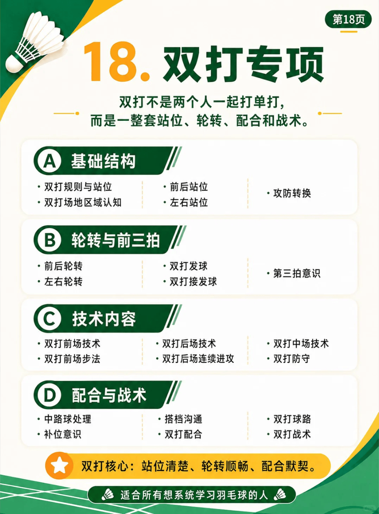

# 双打专项

{width="50%"}
/// caption
双打专项
///

## 1. 基础结构
：
- 双打规则与站位
- 双打场地认知
- 前后站位
- 左右站位
- 攻防转换

## 2. 轮转与前三拍

- 前后轮转
- 左右轮转

-   :fontawesome-brands-bilibili:{ .bl } [**业余双打轮转学习建议。**](https://www.bilibili.com/video/BV1fBpn6jEWx) &nbsp; `刘辉`{.md-tag}

    ---
    **动作要点**

- 双打发球
- 双打接发球

-   :fontawesome-brands-bilibili:{ .bl } [**双打接发站位的底层逻辑，很多球友接发只盯着网前小球，忽略最危险的偷后场内角！**](https://www.bilibili.com/video/BV1Qotd6UEPw) &nbsp; `刘辉`{.md-tag}

    ---
    **动作要点**

- 第三拍意识

## 3. 技术内容

- 双打前场技术
- 双打前场步法
- 双打后场技术
- 双打后场连续进攻
- 双打中场技术
- 双打防守

-   :fontawesome-brands-bilibili:{ .bl } [**双打没有有效沟通，后场站位接发就要主动预判调整站位，优先护住最难受的点位！**](https://www.bilibili.com/video/BV1LHH16GEWR) &nbsp; `刘辉`{.md-tag}

    ---
    **动作要点**

-   :fontawesome-brands-bilibili:{ .bl } [**混双男生站位到底左脚在前还是右脚在前**](https://www.bilibili.com/video/BV1jYtP65E7B) &nbsp; `刘辉`{.md-tag}

    ---
    **动作要点**：

-   :fontawesome-brands-bilibili:{ .bl } [**双打防守站位，为什么左脚在前**](https://www.bilibili.com/video/BV1LYxd6EEHF) &nbsp; `刘辉`{.md-tag}

    ---
    **动作要点**：
    
-   :fontawesome-brands-bilibili:{ .bl } [**双打接杀如何处理才是最优解？**](https://www.bilibili.com/video/BV1KZ3v66E4y) &nbsp; `刘辉`{.md-tag}

    ---
    **动作要点**：

-   :fontawesome-brands-bilibili:{ .bl } [**双打接杀变线，学会了就能化被动为主动！**](https://www.bilibili.com/video/BV11B316PEgx) &nbsp; `刘辉`{.md-tag}

    ---
    **动作要点**

-   :fontawesome-brands-bilibili:{ .bl } [**双打接杀顶后场，直接打破对方进攻节奏。**](https://www.bilibili.com/video/BV1SkbQ6iEGF) &nbsp; `刘辉`{.md-tag}

    ---
    **问题**：双打一直被对手前封后杀压着打？只会挡网很容易被封网抓机会！

    **动作要点**

## 4. 配合与战术

### 4.1 中路球处理

### 4.2 补位意识

### 4.3 搭档沟通

### 4.4 双打配合

### 4.5 双打球路

### 4.6 双打战术

