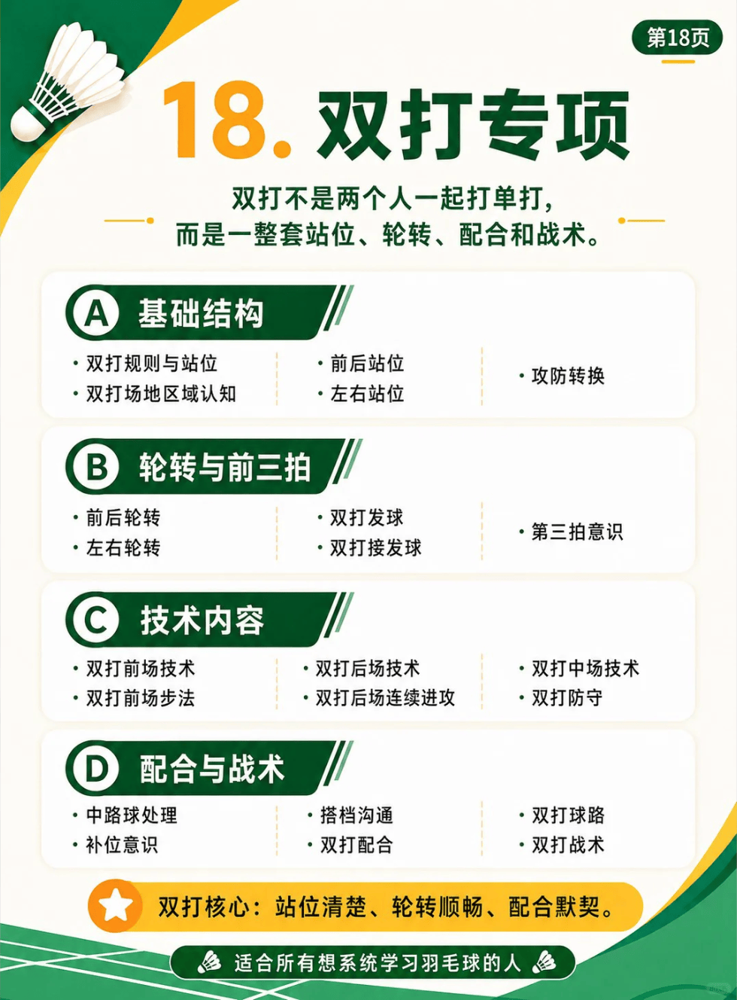

# 第十八章：双打专项

/// caption
双打专项
///

## A. 基础结构

- 包含内容：
  - 双打规则与站位
  - 双打场地认知
  - 前后站位
  - 左右站位
  - 攻防转换

## B. 轮转与前三拍

- 包含内容：
  - 前后轮转
  - 左右轮转
  - 双打发球
  - 双打接发球
  - 第三拍意识

## C. 技术内容

- 包含内容：
  - 双打前场技术
  - 双打前场步法
  - 双打后场技术
  - 双打后场连续进攻
  - 双打中场技术
  - 双打防守

## D. 配合与战术

- 包含内容：
  - 中路球处理
  - 补位意识
  - 搭档沟通
  - 双打配合
  - 双打球路
  - 双打战术

## 1. 双打防守

| 技术 | UP 主 | 视频 | 问题 | 动作要点 |
| --- | --- | --- | --- | --- |
| 混双站位 | 刘辉 | [混双男生站位到底左脚在前还是右脚在前](https://www.bilibili.com/video/BV1jYtP65E7B) | |  | 
