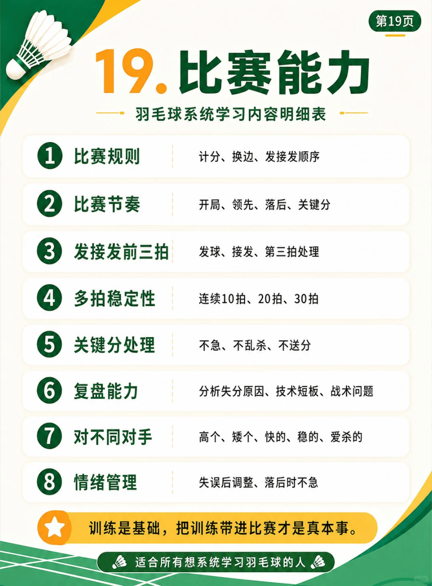

# 比赛能力

{width="50%"}
/// caption
比赛能力
///

## 1. 比赛规则

- 具体内容：计分、换边、发接发顺序

## 2. 比赛节奏

- 具体内容：开局、领先、落后、关键分

## 3. 发接发前三拍

- 具体内容：发球、接发、第三拍处理

## 4. 多拍稳定性

- 具体内容：连续10拍、20拍、30拍

## 5. 关键分处理

- 具体内容：不急、不乱杀、不送分

## 6. 复盘能力

- 具体内容：分析失分原因、技术短板、战术问题

## 7. 对不同对手

- 具体内容：高个、矮个、快的、稳的、爱杀的

## 8. 情绪管理

- 具体内容：失误后调整、落后时不急
