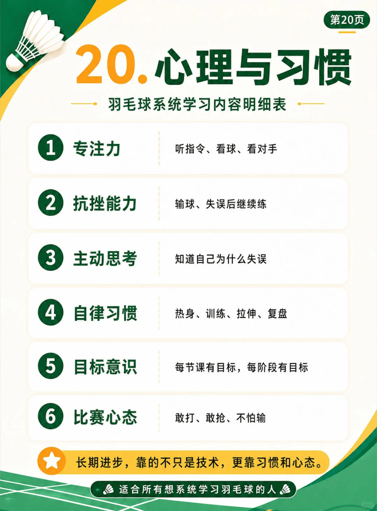

# 心理与习惯

{width="50%"}
/// caption
心理与习惯
///

## 1. 专注力

- 具体内容：听指令、看球、看对手

## 2. 抗挫能力

- 具体内容：输球、失误后继续练

## 3. 主动思考

- 具体内容：知道自己为什么失误

## 4. 自律习惯

- 具体内容：热身、训练、拉伸、复盘

## 5. 目标意识

- 具体内容：每节课有目标，每阶段有目标

## 6. 比赛心态

- 具体内容：敢打、敢抢、不怕输

