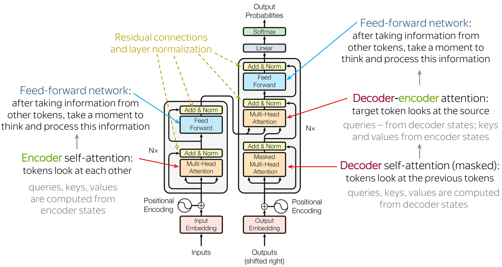
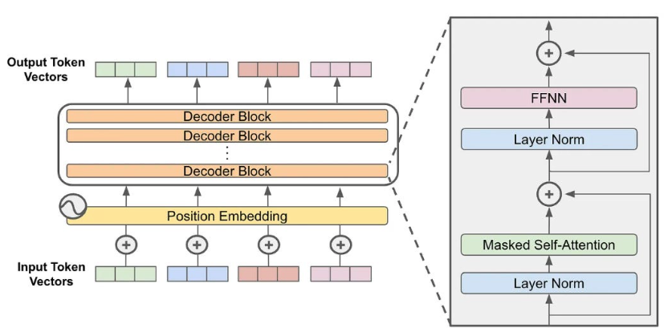
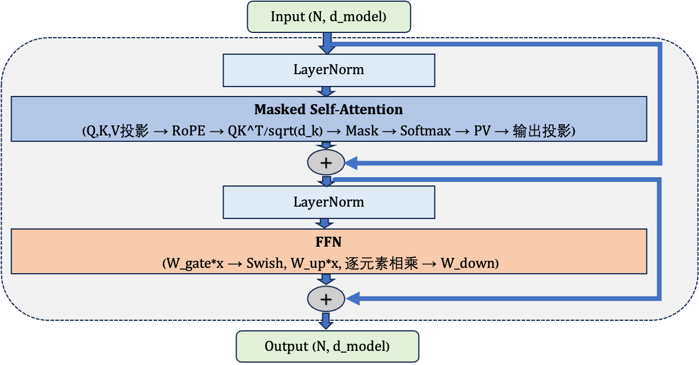
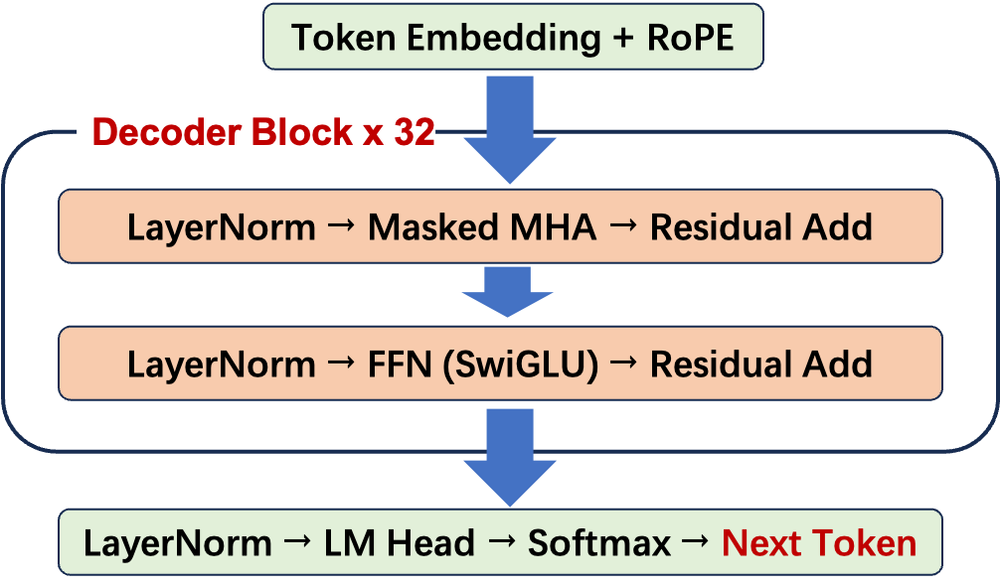
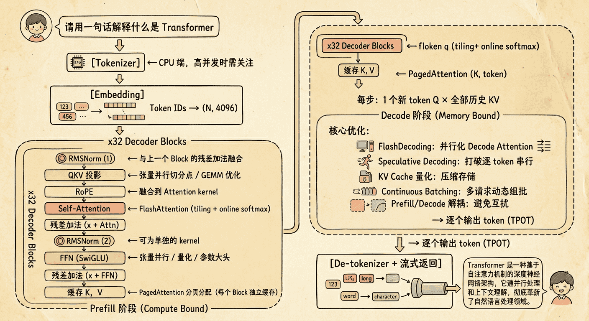
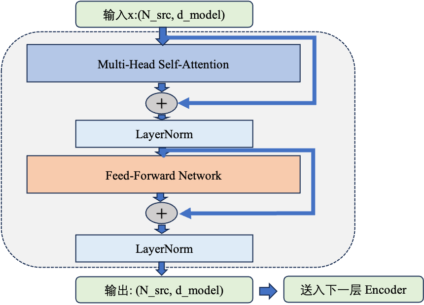
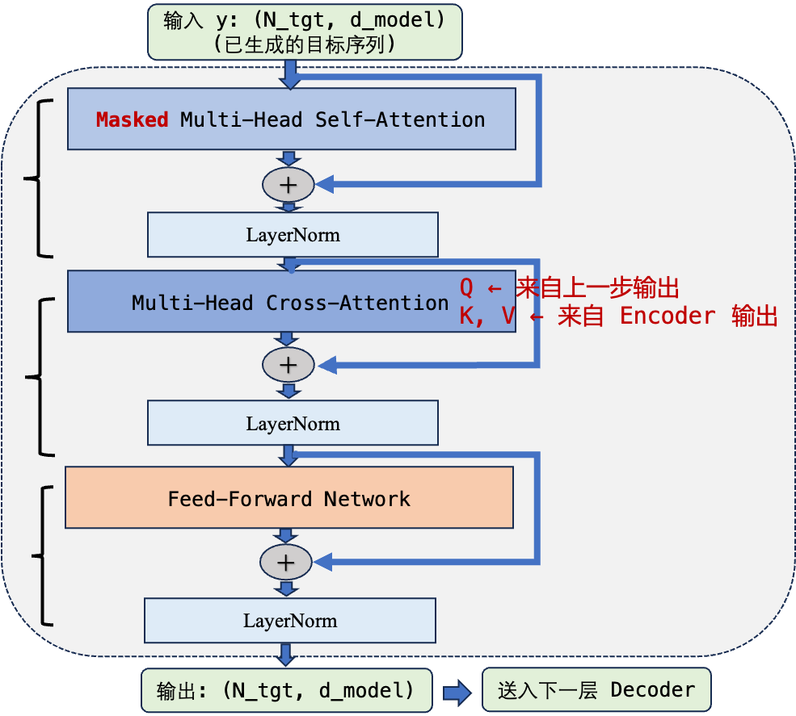
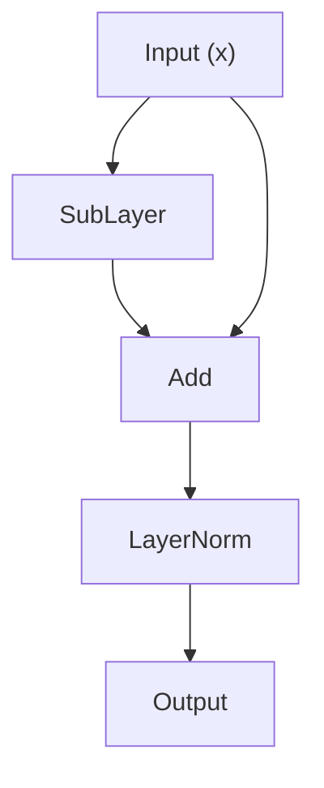
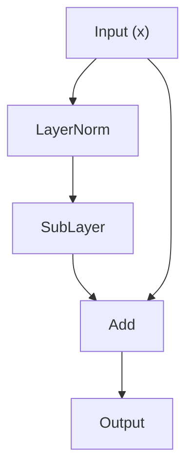

<a id="part1-ch3"></a>

# 第1部分 · 第3章：AI Infra工程师学Transformer

> 总索引 ｜ [本部分目录](README.md) ｜ [上一章](ch02-数学基础.md) ｜ [下一章](ch04-PyTorch框架.md)

## 本章目录

- [本章导读](#part1-ch3)
- [3.0 Transformer 架构快速入门](#part1-ch3-sec1)
- [3.1 AI Infra工程师为什么必须懂Transformer](#part1-ch3-sec2)
- [3.2 Transformer全貌及代码实现](#part1-ch3-sec3)
- [3.3 Self-Attention机制深入理解](#part1-ch3-sec4)
- [3.4 Transformer前馈网络FFN深入理解](#part1-ch3-sec5)
- [3.5 Transformer位置编码深入理解](#part1-ch3-sec6)
- [3.6 LayerNorm与残差连接深入理解](#part1-ch3-sec7)
- [3.7 Transformer Decoder Block完整解析](#part1-ch3-sec8)
- [3.8 从Transformer到LLM自回归生成深入理解](#part1-ch3-sec9)
- [3.9 Tokenization与词嵌入](#part1-ch3-sec10)

---

## 本章导读

> 发布 2026-04-16 · 标签 "Transformer", "Attention", "RoPE", "MoE", "模型架构" · 单篇原文

### 本章简介

Transformer 是大模型时代的核心架构，也是 AI Infra 工程师必须深入理解的对象——你优化的每一个算子、设计的每一种并行策略，最终都作用在 Transformer 的某个组件上。

本章从 **Self-Attention 机制**出发，详解 Q/K/V 投影、Attention 计算全流程及其 O(N²) 复杂度分析。接着覆盖 **FFN 与激活函数**（ReLU/GELU/SwiGLU）、**位置编码**（Sinusoidal/RoPE/ALiBi）、**归一化层**（LayerNorm/RMSNorm、Pre-Norm vs Post-Norm）。

**完整前向过程**部分将逐步追踪从 Token Embedding 到输出 Logits 的完整数据流，标注每一步的输入输出维度，并手算参数量。

最后从分布式与推理视角分析 **架构变种**：MHA → MQA → GQA → MLA 的演进动机，以及 FFN → GLU → MoE 的变化如何影响并行切分和推理优化。

<a id="part1-ch3-sec1"></a>

## 3.0 Transformer 架构快速入门

> 发布 2026-03-30 · 标签 "Transformer", "Attention", "LLM", "模型架构" · 单篇原文

Transformer 是大模型时代的"通用底座"——CUDA 层优化它的算子，分布式层切分它的参数，推理层加速它的生成。本文从 AI Infra 工程师的视角出发，带你理解这个"后续所有优化的对象"到底长什么样，为什么长这样，以及每个模块将在后续的哪些优化中被反复提及。


### 1. 为什么 AI Infra 工程师必须懂 Transformer

如果你准备深入 AI Infra——无论是写 CUDA kernel、搞分布式训练还是做推理部署——你面对的核心工作对象都是同一个东西：**Transformer 模型**。

这就像汽车工程师必须懂发动机结构一样。你不需要自己设计发动机（那是算法研究员的活），但你必须知道曲轴在哪、活塞怎么运动、油路怎么走——否则你怎么知道该优化哪个零件？

具体来说，AI Infra 各个层级的工作都直接对应 Transformer 的某个模块：

| AI Infra 层级 | 核心工作 | 对应的 Transformer 模块 |
|--------------|---------|----------------------|
| CUDA 算子优化 | FlashAttention、高效 GEMM kernel | Self-Attention 中的 $QK^T$/PV 矩阵乘法 |
| CUDA 算子优化 | Fused Softmax、Online Softmax | Attention 中的 softmax 计算 |
| CUDA 算子优化 | LayerNorm kernel 融合 | 每个 Block 中的归一化层 |
| 分布式训练 | 张量并行（Tensor Parallelism） | Attention 的多头切分、FFN 的矩阵切分 |
| 分布式训练 | 流水线并行（Pipeline Parallelism） | 模型的多层 Decoder Block 堆叠结构 |
| 分布式训练 | ZeRO 显存优化 | 所有参数矩阵的存储与通信 |
| 推理部署 | KV Cache 管理 | Self-Attention 中的 K、V 矩阵 |
| 推理部署 | PagedAttention | KV Cache 的显存碎片问题 |
| 推理部署 | 量化（INT4/INT8/FP8） | 所有权重矩阵和 KV Cache |

一句话总结：**不懂 Transformer，就不知道自己在优化什么。** 后续学习中遇到的每一个优化技术，都能在本文中找到它所作用的具体模块。

---

### 2. Transformer 网络结构全貌

在逐个拆解各模块之前，先从宏观视角看一眼 Transformer 的整体结构——就像拆装一台发动机之前，先看一眼总装图，知道有哪些零部件、它们如何连接。

#### 2.1 原始 Transformer：Encoder-Decoder 架构

2017 年 "Attention Is All You Need" 论文提出的原始 Transformer 由两大部分组成：



- **Encoder**：读取输入序列，生成上下文表示。每层包含一个 Self-Attention 和一个 FFN，所有 token 可以互相关注（双向注意力）
- **Decoder**：基于 Encoder 的输出，自回归地生成目标序列。每层包含一个带因果掩码的 Self-Attention（只能看到已生成的 token）、一个 Cross-Attention（关注 Encoder 输出）和一个 FFN

这种 Encoder-Decoder 结构最初是为机器翻译设计的——Encoder 理解源语言，Decoder 生成目标语言。

#### 2.2 当前大模型的主流：Decoder-only 架构

GPT 系列的成功证明了一个关键洞察：**只用 Decoder 就够了**。当前几乎所有主流大语言模型——GPT、LLaMA、Mistral、Qwen、DeepSeek——都采用 Decoder-only 架构，砍掉了 Encoder 和 Cross-Attention，只保留带因果掩码的 Self-Attention。

整体结构可以概括为三段式——**输入层、N 层 Decoder Block 堆叠、输出层**：



整个模型的核心就是中间那 N 层 Decoder Block 的反复堆叠。每个 Block 的结构完全相同，包含两个子模块：

- **Masked Self-Attention**：让每个 token 从前面的 token 中聚合信息（第 3 节详解）
- **FFN**：对每个 token 的信息做独立的非线性变换（第 4 节详解）

每个子模块前有 **LayerNorm** 归一化（第 6 节详解），后有**残差连接**把子模块输入直接加回来（第 6 节详解）。位置信息通过 **RoPE** 在 Attention 计算时注入（第 5 节详解）。

这里你可能会有个疑问：为啥这个 Decoder-only 架构中的 Decoder块 和 Encoder-Decoder 架构中的Decoder块不一样，这就是后面将会讲的 Pre-Norm vs Post-Norm 区别。

#### 2.3 三种架构变体的对比

| 架构 | 代表模型 | 注意力方式 | 典型应用 |
|------|---------|-----------|---------|
| Encoder-only | BERT、RoBERTa | 双向注意力（每个 token 看所有 token） | 文本分类、NER、信息抽取 |
| Encoder-Decoder | T5、BART、原始 Transformer | Encoder 双向 + Decoder 因果 + Cross-Attention | 翻译、摘要、Seq2Seq 任务 |
| Decoder-only | GPT、LLaMA、Mistral、Qwen | 因果注意力（每个 token 只看前面的 token） | 文本生成、对话、代码生成 |

Decoder-only 之所以成为大模型的主流选择，核心原因有两个：

1. **统一的训练目标**：所有任务都可以转化为"预测下一个 token"，不需要针对不同任务设计不同的架构
2. **工程简洁性**：只有一种 Block 结构，推理时的 KV Cache 管理、并行策略都更简单直接

> 本文后续所有内容都围绕 **Decoder-only 架构**展开——这正是 AI Infra 工程师日常打交道最多的结构。

---

### 3. Self-Attention 机制

Self-Attention 是 Transformer 的核心，也是计算量和显存消耗最密集的模块。几乎所有 AI Infra 的重量级优化——FlashAttention、KV Cache、张量并行——都围绕它展开。

#### 3.1 直觉理解：Attention 在做什么

先从一个真实的语言难题出发：

> 句子 A：*The bank of the river.*（河边）
> 句子 B：*Money in the bank.*（银行）

同一个词 "bank" 在两句话里含义截然不同。机器翻译时如何判断？答案是**看上下文中的其他词**：句子 A 里 "river"（河流）权重最高，句子 B 里 "money"（钱）权重最高。这种"让每个词去关注其他词、用相关程度加权汇总语义"的机制，就是 Self-Attention。

用大白话说：**Attention 就是让句子中的每个词去"关注"其他所有词，然后根据关注程度加权汇总信息，从而得到一个融合了上下文的"新含义"。**

更进一步，打个检索的比方：你在查一本百科全书里关于"苹果"的信息，你会先生成一个**查询**（Query）："苹果是什么？"，然后翻阅每一页的**标题**（Key）来判断相关性，最后把相关页面的**正文内容**（Value）按相关程度加权合并。Attention 做的正是这件事：

- **Query（Q）**：我想查什么——当前词想要获取的信息
- **Key（K）**：索引/标题——每个词用来被别人匹配的标识
- **Value（V）**：实际内容——匹配成功后要传递的信息

在 Self-Attention 中，序列里的每个 token 都**同时**扮演这三种角色：它既是提问者（生成 Q），也是被查询的索引（生成 K），还是信息的提供者（生成 V）。通过 Q 和 K 的匹配来计算"注意力权重"，再用这些权重对 V 做加权求和，就完成了信息的聚合。

💡 **提示**："银行"还是"河岸"的歧义问题，RNN 时代需要把前面所有词的信息按顺序一步步传递过来才能解决；Self-Attention 则让所有词在同一步内直接互相"比对"，长距离依赖不再衰减。

#### 3.2 计算过程：从输入到输出的完整流程

假设我们有一个长度为 $N$ 的序列，每个 token 用一个 $d$ 维向量表示，输入矩阵 $X$ 的形状为 $(N, d)$。

**第一步：线性投影生成 Q、K、V**

输入 X 分别乘以三个权重矩阵，得到 Query、Key、Value：

$$
Q = X W_Q, \quad K = X W_K, \quad V = X W_V
$$

其中 $X \in \mathbb{R}^{N \times d}$，$W_Q, W_K, W_V \in \mathbb{R}^{d \times d}$，输出均为 $(N, d)$。

其中 $W_Q$、$W_K$、$W_V$ 是可学习的参数矩阵，形状都是 $(d, d)$。这三次矩阵乘法就是三次 GEMM 操作——后续 CUDA 优化和张量并行的核心对象之一。

**第二步：计算注意力分数**

用 Q 和 K 的内积来衡量每对 token 之间的"匹配度"：

$$
S = QK^\top \in \mathbb{R}^{N \times N}
$$

得到的 $S$ 是一个 $N \times N$ 的矩阵，$S[i][j]$ 表示第 $i$ 个 token 对第 $j$ 个 token 的关注程度（原始分数）。

**第三步：缩放（Scale）**

将分数除以 $\sqrt{d_k}$（$d_k$ 是每个头的维度，后面会解释）：

$$
S_{\text{scaled}} = \frac{S}{\sqrt{d_k}}
$$

为什么要缩放？直觉上说，当维度 $d_k$ 很大时，Q 和 K 的内积值会变得很大（因为是 $d_k$ 个分量相加），导致 softmax 的输入值差异悬殊。softmax 对大数值非常敏感——输入差距一大，输出就会"极化"成接近 one-hot 的分布，梯度几乎为零，训练就卡住了。除以 $\sqrt{d_k}$ 能把方差拉回到 1 附近，让 softmax 工作在一个梯度比较健康的区间。

**第四步：Softmax 归一化**

对每一行做 softmax，把原始分数变成概率分布（每行之和为 1）：

$$
A = \text{softmax}(S_{\text{scaled}}) \in \mathbb{R}^{N \times N}
$$

$A[i][j]$ 现在表示：第 $i$ 个 token 分配给第 $j$ 个 token 的注意力权重，每行之和为 1。

> AI Infra 关联：Softmax 是一个看似简单但在高性能场景下需要精心优化的算子。标准实现需要对每行做两遍扫描（第一遍求最大值和指数和，第二遍归一化），Online Softmax 算法将其合并为一遍扫描，FlashAttention 正是基于此实现了 Attention 的高效融合。

**第五步：加权求和**

用注意力权重 A 对 Value 矩阵 V 做加权求和：

$$
\text{Output} = AV \in \mathbb{R}^{N \times d}
$$

最终每个 token 得到一个 $d$ 维向量，其中融合了它"应该关注"的所有其他 token 的信息。

**完整公式（一行总结）**

$$
\text{Attention}(Q, K, V) = \text{softmax}\left(\frac{QK^T}{\sqrt{d_k}}\right) V
$$

**第六步：输出投影**

最后还要过一个输出投影矩阵 $W_O$：

$$
\text{Final} = \text{Output} \cdot W_O \in \mathbb{R}^{N \times d}
$$

$W_O$ 将多头拼接后的结果映射回模型的隐藏维度（下一节详述）。

#### 3.3 为什么复杂度是 $O(N^2)$

从上面的计算过程可以直接看出瓶颈所在。

关键一步是 $QK^T$，形状为 $(N, d) \times (d, N)$，结果是一个 $(N, N)$ 矩阵。这一步的：

- **计算量**：$O(N^2 \cdot d)$——$N^2$ 个元素，每个元素需要 $d$ 次乘加
- **显存占用**：$O(N^2)$——需要存储完整的 $N \times N$ 注意力矩阵

类似地，$A \cdot V$ 的形状是 $(N, N) \times (N, d)$，计算量也是 $O(N^2 \cdot d)$。

所以 Self-Attention 的总复杂度是 $O(N^2 \cdot d)$，通常简写为 $O(N^2)$（因为 $d$ 是模型的固定常数）。

这意味着什么？当序列长度 $N$ 从 2K 增加到 128K 时，计算量和注意力矩阵的显存占用增长了 $(128K/2K)^2 =$ **4096 倍**。这就是为什么长上下文支持如此困难。

> AI Infra 关联：这个 $O(N^2)$ 的显存瓶颈直接催生了 **FlashAttention**。标准实现需要把完整的 $N \times N$ 注意力矩阵写入 HBM（GPU 的高带宽显存），而 FlashAttention 通过 tiling（分块计算）+ online softmax，每次只在片上 SRAM 中计算一小块注意力 tile，用完即丢弃，完整的 $N \times N$ 矩阵从不写回 HBM。这样额外显存从 $O(N^2)$ 降到 $O(N)$，HBM 访问量从 $\Theta(N^2)$ 降到 $\Theta(N^2 d^2 / M)$（$M$ 为 SRAM 大小，$d^2$ 远小于 $M$）——仍随 $N^2$ 增长，但常数大幅减小。计算量没变，但显存访问量大幅减少——这正是"Memory-aware"优化的核心思想。

#### 3.4 Multi-Head Attention：为什么要多头

上面描述的是单头 Attention。实际的 Transformer 使用 **Multi-Head Attention（MHA）**：把 Q、K、V 沿特征维度切分成多个"头"，每个头独立做 Attention，最后把结果拼接起来。

白话解释：一个头只能关注一种"关系模式"（比如语法依赖），多个头就能同时关注多种关系（语法、语义、位置关系等），就像多个人从不同角度看同一个问题，最后综合意见。

具体来说，假设模型隐藏维度 $d_{model} = 4096$，头数 $h = 32$，则每个头的维度 $d_k = d_{model} / h = 128$。

**数学定义（每个 head 拥有独立投影）**：从严谨的数学角度看，每个 head $i$ 都拥有自己一组独立的可学习投影矩阵 $W_Q^{(i)}, W_K^{(i)}, W_V^{(i)} \in \mathbb{R}^{4096 \times 128}$，分别计算：

$$
Q_i = X \cdot W_Q^{(i)} \in \mathbb{R}^{N \times 128}, \quad i = 1, 2, \ldots, 32
$$

每个 head 的投影矩阵不同，因此 32 个 head 是从同一个输入 $X$ 中学习到 **32 个不同的表示子空间**——而不是简单地把一个 $Q$ 切成 32 段。这是"多头"能捕捉多种关系模式的本质原因。

**工程实现（合并为一次大 GEMM）**：在实现时，为了让 GPU 一次 GEMM 同时算出所有 head 的 $Q$，会把 32 个 $W_Q^{(i)}$ 沿列方向拼接为一个大矩阵：

$$
W_Q = [W_Q^{(1)}, W_Q^{(2)}, \ldots, W_Q^{(32)}] \in \mathbb{R}^{4096 \times 4096}
$$

由分块矩阵乘法的性质，$X \cdot W_Q$ 的结果在列方向上正好就是 $[Q_1, Q_2, \ldots, Q_{32}]$，因此一次大矩阵乘法 + 一次 reshape，就等价于 32 次独立投影：

$$
Q = X \cdot W_Q \quad (N, 4096) \times (4096, 4096) = (N, 4096)
$$

$$
Q_{\text{heads}} = Q.\text{reshape}(N, 32, 128) \quad \text{拆回 32 个 head}
$$

> 关键点：reshape **不是**把一个统一的 $Q$ 简单切成 32 段，而是把"32 个 head 并行投影后被 GEMM 合并存放在一起的结果"重新拆开。数学上是 32 个独立投影，工程上合并成一次 GEMM——两者完全等价。

同理处理 K 和 V。每个头独立计算 Attention：

$$
\text{head}_i: (N, 128) \times (128, N) \to (N, N) \xrightarrow{\text{softmax}} (N, N) \times (N, 128) \to (N, 128)
$$

最后把 32 个头的输出拼接并投影：

$$
\text{Output} = \text{Concat}(\text{head}\_1, \text{head}\_2, \ldots, \text{head}\_{32})
$$

$$
\text{Final} = \text{Output} \cdot W_O
$$

**多头机制的参数组成**：

- $W_Q$：$(4096, 4096)$，即 $4096 \times 4096 = 16M$ 参数
- $W_K$：$(4096, 4096)$，$16M$ 参数
- $W_V$：$(4096, 4096)$，$16M$ 参数
- $W_O$：$(4096, 4096)$，$16M$ 参数
- 合计：$4 \cdot d_{model}^2 = 64M$ **参数**

> AI Infra 关联：多头结构天然适合**张量并行（Tensor Parallelism）**。32 个头可以均匀分配到多张 GPU 上——比如 4 张卡各处理 8 个头，每张卡只需要 1/4 的 QKV 权重和计算量。这就是 Megatron-LM 张量并行的核心思想：沿着"头"的维度切分 Attention 模块。切分之后只需要一次 AllReduce 通信就能将各卡的部分结果汇总。
>
> 此外，Attention 头数的变种——**MQA（Multi-Query Attention）** 让所有头共享一组 KV、**GQA（Grouped-Query Attention）** 让若干头共享一组 KV——直接影响 KV Cache 的大小和张量并行的切分方式，是推理优化中的核心概念。

---

### 4. 前馈网络（FFN）

Attention 负责"信息交互"——让 token 之间互相传递信息。但仅靠信息交互还不够，模型还需要对每个 token 的信息做"深度加工"。这就是前馈网络（Feed-Forward Network，FFN）的工作。

打个比方：Attention 像一场圆桌会议，大家互相交换意见；FFN 则是会后每个人回到自己工位上，独立消化吸收这些信息并形成自己的判断。FFN 对每个 token 独立地做非线性变换，不涉及 token 之间的交互。

#### 4.1 结构：两层线性变换 + 激活函数

标准 FFN 的结构非常简洁——先"升维"再"降维"，中间夹一个非线性激活函数：

$$
\text{FFN}(x) = \text{activation}(x W_1 + b_1) W_2 + b_2 = h W_2 + b_2
$$

其中：
- $W_1$：$(d_{model}, d_{ff})$，将维度从 $d_{model}$ 扩展到 $d_{ff}$（通常 $d_{ff} = 4 \cdot d_{model}$）
- 激活函数：引入非线性
- $W_2$：$(d_{ff}, d_{model})$，将维度从 $d_{ff}$ 压缩回 $d_{model}$

以 $d_{model} = 4096$ 为例：

$$x : (N,\ 4096)$$

$$x W_1 : (N, 4096) \times (4096, 11008) = (N, 11008) \quad \text{升维}$$

$$\text{activate} : (N,\ 11008) \quad \text{非线性变换}$$

$$h W_2 : (N, 11008) \times (11008, 4096) = (N, 4096) \quad \text{降维}$$

注意：实际的 LLaMA 等模型使用 `SwiGLU` 激活函数（下面会讲），中间维度是 $(2/3) \times 4 \times d_{model} = 11008$ 而非简单的 $4 \times d_{model}$，这是为了在引入门控机制后保持总参数量基本不变。

#### 4.2 参数量分析：为什么 FFN 是模型参数的大头

让我们算一笔账。对于一个 Transformer Block：

| 模块 | 参数矩阵 | 参数量 |
|------|---------|-------|
| Attention | $W_Q, W_K, W_V, W_O$ | $4  d_{model}^2$ |
| FFN（标准） | $W_1, W_2$ | $2  d_{model} \cdot d_{ff} = 8  d_{model}^2$ |
| FFN（SwiGLU） | $W_{gate}, W_{up}, W_{down}$ | $3  d_{model} \cdot (8/3 \cdot d_{model}) = 8  d_{model}^2$ |

粗略地看，FFN 的参数量大约是 Attention 的 **2 倍**。在整个 Transformer Block 中，FFN 贡献了约 **2/3** 的参数。

这个比例有重要的工程含义：

> AI Infra 关联：由于 FFN 的参数量占大头，在做张量并行时，FFN 的切分方式直接影响通信开销。Megatron-LM 将 $W_1$ 按列切分、$W_2$ 按行切分，使得中间结果不需要 AllReduce，只在最后做一次 AllReduce——这种切分方式正是利用了 FFN 的"先升维后降维"结构。在混合专家模型（MoE）中，FFN 进一步被拆分为多个"专家"，引入了 Expert Parallelism 这一新的并行维度。

#### 4.3 激活函数activation演进：ReLU → GELU → SwiGLU

激活函数看似是一个小细节，但它的选择直接影响模型的训练稳定性和最终效果。

**ReLU（Rectified Linear Unit）**

$$
\text{ReLU}(x) = \max(0, x)
$$

最经典的激活函数，简单高效。问题在于：当输入为负时输出恒为 0，对应的神经元"永久死亡"，丢失了信息。

**GELU（Gaussian Error Linear Unit）**

$$
\text{GELU}(x) = x \cdot \Phi(x)
$$

其中 $\Phi(x)$ 是标准正态分布的累积分布函数（CDF）。

直觉上说，GELU 不是像 ReLU 那样粗暴地"开/关"，而是根据输入值的大小给一个平滑的"通过概率"——值越大越可能通过，值越小越可能被抑制，但不会完全归零。GPT 系列和 BERT 都使用 GELU。

**SwiGLU（Swish-Gated Linear Unit）**

$$
\text{FFN}_\text{SwiGLU}(x) = \bigl(\text{Swish}(x W_\text{gate}) \odot (x W_\text{up})\bigr) W_\text{down}
$$

其中 $\text{Swish}(x) = x \cdot \sigma(x)$，$\sigma$ 为 sigmoid 函数，$\odot$ 表示逐元素乘法。

SwiGLU 是目前大模型的主流选择（LLaMA、Mistral 等均采用）。它引入了一个**门控机制**：用一个独立的"门"矩阵 $W_{gate}$ 来控制信息的通过量，而不是简单地对所有维度施加相同的激活函数。代价是多了一个 $W_{gate}$ 矩阵（因此 FFN 从两个矩阵变成三个：$W_{gate}$、$W_{up}$、$W_{down}$），但实验表明效果更好。

> AI Infra 关联：SwiGLU 的三矩阵结构（$W_{gate}$、$W_{up}$、$W_{down}$）与标准 FFN 的两矩阵结构不同，在做 CUDA kernel 融合和张量并行切分时需要单独处理。比如 $W_{gate}$ 和 $W_{up}$ 可以合并为一次 GEMM 来提升 GPU 利用率。

---

### 5. 位置编码

#### 5.1 为什么 Transformer 需要位置信息

这是一个容易被忽视但极其重要的问题。

回顾 Self-Attention 的计算过程：$QK^T$ 计算的是每对 token 之间的匹配分数，然后用这些分数对 V 做加权求和。注意——**这个过程完全不关心 token 的顺序**。

你可以做一个思想实验：把句子"猫追狗"中的三个 token 打乱成"狗猫追"，只要 Q、K、V 的值不变，Attention 的计算结果完全一样。用数学术语说，Attention 操作对输入序列是**排列等变的（permutation equivariant）**——你怎么打乱输入顺序，输出就跟着同样打乱，但每个 token 聚合到的信息不会变。

但语言显然是有顺序的！"猫追狗"和"狗追猫"意思完全不同。所以我们必须想办法把位置信息注入到 Transformer 中。

#### 5.2 Sinusoidal 位置编码：原始论文方案

"Attention Is All You Need" 论文提出了一种优雅的方案：用不同频率的正弦/余弦函数为每个位置生成一个独特的编码向量，**直接加到 token 的 embedding 上**。

$$
\text{PE}(\text{pos}, 2i) = \sin\left(\frac{\text{pos}}{10000^{2i/d}}\right)
$$

$$
\text{PE}(\text{pos}, 2i+1) = \cos\left(\frac{\text{pos}}{10000^{2i/d}}\right)
$$

其中 $\text{pos}$ 是 token 在序列中的位置（$0, 1, 2, \ldots$），$i$ 是维度索引。

直觉上理解：每个维度对应一个不同"频率"的时钟。低频维度变化缓慢（用来区分远距离位置），高频维度变化快速（用来区分近距离位置）。这就像用"年-月-日-时-分-秒"来编码时间——"年"变化最慢但能区分大时间跨度，"秒"变化最快但只能区分小时间跨度。所有维度组合起来，每个位置就有了唯一的"时间戳"。

**优点**：
- 不引入可学习参数，编码长度理论上可以任意扩展
- 相对位置信息可以通过线性变换得到（sin/cos 的加法公式）

**局限**：
- 位置信息是"加"在 embedding 上的，在深层网络中可能被逐渐稀释
- 难以有效外推到训练时未见过的长度

#### 5.3 RoPE（旋转位置编码）：当前大模型的主流选择

RoPE（Rotary Position Embedding，旋转位置编码）是目前几乎所有主流大模型（LLaMA、Mistral、Qwen、DeepSeek 等）采用的位置编码方案。

**核心思想**：不在 embedding 层注入位置信息，而是在计算 Attention 时，通过**旋转** Q 和 K 向量来编码位置。

具体做法是把 Q 和 K 向量的每两个相邻维度看作二维平面上的坐标，然后根据 token 的位置按特定角度旋转这个二维向量：

$$
q_{2i}^{\prime} = q_{2i} \cos(\text{pos} \cdot \theta_i) - q_{2i+1} \sin(\text{pos} \cdot \theta_i)
$$

$$
q_{2i+1}^{\prime} = q_{2i} \sin(\text{pos} \cdot \theta_i) + q_{2i+1} \cos(\text{pos} \cdot \theta_i)
$$

其中 $\theta_i = \dfrac{1}{10000^{2i/d}}$ 是与 Sinusoidal 类似的频率参数，K 向量做同样的旋转。

这样做的关键性质是：**旋转后的 Q 和 K 做内积时，结果只依赖于两个 token 的相对位置差**，而不是绝对位置。数学上可以证明：

$$
\langle \text{RoPE}(q\, m)\;  \text{RoPE}(k\, n) \rangle = f(q\, k\, m - n)
$$

这意味着 Attention 天然编码了相对位置信息，非常符合语言理解的需求（"第 3 个词和第 5 个词之间的关系"比"第 3 个词和第 5 个词各自的绝对位置"更重要）。

**为什么 RoPE 成为主流**：

- 相对位置编码，天然支持变长输入
- 不引入额外参数
- 与线性 Attention 等变种兼容
- 外推性优于 Sinusoidal（配合 NTK-aware 等插值方法可以扩展上下文长度）

> AI Infra 关联：RoPE 的旋转操作（本质是逐元素乘加）计算量不大但调用频繁，通常会被融合到 Attention kernel 中一并完成，避免单独 launch 一个 kernel 的开销。在长上下文场景中，RoPE 的频率参数调整（如 NTK-aware Scaling、YaRN 等）直接影响模型能支持的最大序列长度，这与 KV Cache 管理和显存规划密切相关。

---

### 6. LayerNorm 与残差连接

#### 6.1 残差连接：让梯度畅通无阻

残差连接（Residual Connection）的思想来自 ResNet，结构极其简单：

$$
\text{output} = x + \text{SubLayer}(x)
$$

其中 SubLayer 可以是 Attention 层或 FFN 层。

**直观理解：在原始信息基础上，只学习增量**

可以把残差连接理解为：输出 = 原始信息 + 学到的改动。举个直观例子：

假设 $x$ = "猫在桌子上"，Attention 学到的是 $F(x)$ = "强调'猫'和'桌子'的关系"，那么：

$$
y = x + F(x)
$$

相当于：保留原句，同时增强语义关系。

**为什么要这样设计？**

**1️⃣ 解决深层网络训练困难**

Transformer 通常有几十层（LLaMA-2 有 32 层，GPT-4 据传有上百层）。如果没有残差连接，信号传播路径为 $x \to F_1 \to F_2 \to F_3 \to \cdots$，梯度在反向传播时需要经过层层链式乘法，很容易衰减到接近零（梯度消失），深层网络就无法有效训练。

有残差连接后，传播路径变为 $x \to F \to +x \to F \to +x \to \cdots$，梯度可以直接"走捷径"：

$$
\frac{\partial y}{\partial x} = 1 + \frac{\partial F}{\partial x}
$$

由于恒等项 $1$ 的存在，梯度不会变成 $0$，训练更稳定。残差连接提供了一条"高速公路"——梯度可以直接沿残差路径流回浅层，不受中间层变换的影响。

**2️⃣ 让模型更容易学习恒等映射**

理想情况下，如果某一层不需要做任何变换，只要学到 $F(x) = 0$，输出就等于输入 $y = x$。这意味着网络可以自动"跳过"不需要的层，而不必费力学习一个恒等变换。

**3️⃣ 信息不丢失**

没有残差连接时，每一层都会"覆盖"原始信息；有残差连接后，原始信息始终被保留并逐层传递。这对 NLP 任务尤其关键——token 的语义信息在层层变换中不能丢失。

#### 6.2 LayerNorm：稳定训练的归一化操作

LayerNorm（Layer Normalization）对每个 token 的特征向量做归一化——减去均值、除以标准差，再通过可学习的缩放参数 $\gamma$ 和偏移参数 $\beta$ 恢复表达能力：

$$
\text{LayerNorm}(x) = \gamma \cdot \frac{x - \mu}{\sqrt{\sigma^2 + \epsilon}} + \beta
$$

其中 $\mu = \text{mean}(x)$，$\sigma^2 = \text{var}(x)$ 沿特征维度（$d_\text{model}$）计算，$\epsilon$ 是防止除以零的小常数（如 $10^{-5}$）。

直觉上说，LayerNorm 就像一个"信号调节器"——无论输入信号的绝对大小如何波动，都把它拉回到一个标准范围内，防止某些维度的值过大或过小影响后续计算。

#### 6.3 Pre-Norm vs Post-Norm

LayerNorm 放在子层的前面还是后面，是一个看似微小但影响深远的设计选择。

**Post-Norm（原始论文方案）**

$$
\text{output} = \text{LayerNorm}(x + \text{SubLayer}(x))
$$

先做子层计算和残差加法，再做归一化。

**Pre-Norm（当前大模型的主流选择）**

$$
\text{output} = x + \text{SubLayer}(\text{LayerNorm}(x))
$$

先做归一化，再做子层计算，最后做残差加法。

两者的关键区别在于**残差路径是否经过 LayerNorm**：

- Post-Norm 中，残差路径上有 LayerNorm，梯度回传时会被 LayerNorm 的导数"调制"
- Pre-Norm 中，残差路径是一条"干净"的直通通道，梯度可以无损地回传

**为什么大模型普遍用 Pre-Norm**：

| 维度 | Post-Norm | Pre-Norm |
|------|-----------|----------|
| 训练稳定性 | 深层模型容易梯度爆炸，需要精心的学习率 warmup | 梯度流更稳定，对超参数不敏感 |
| 最终效果 | 理论上略好（如果能训稳的话） | 略低但差距不大 |
| 工程友好度 | 需要更多调参经验 | "开箱即用"，适合大规模训练 |

实际工程中，当模型规模达到数十亿参数以上时，训练稳定性远比理论上 0.x% 的效果差异重要——训练一次的成本可能是数百万美元，任何导致 loss spike 或 diverge 的风险都不可接受。这就是 Pre-Norm 成为默认选择的原因。

> AI Infra 关联：LayerNorm 虽然计算量不大，但它是一个"读写密集"的操作——需要对整个特征向量做两遍扫描（第一遍算均值和方差，第二遍归一化），频繁访问 HBM。在 CUDA 优化中，LayerNorm 通常会与前后的算子融合（比如 Residual Add + LayerNorm 融合为一个 kernel），减少 HBM 读写次数。此外，一些大模型使用 **RMSNorm**（去掉了减均值的步骤，只做方差归一化）来进一步简化计算。

---

### 7. 详解 Transformer Decoder Block

前面我们分别拆解了 Self-Attention、FFN、位置编码、LayerNorm 和残差连接。现在让我们把它们组装起来，看看一个完整的 Transformer Decoder Block 长什么样（图可看前文）。

#### 7.1 数据流图解

以当前大模型主流的 Pre-Norm Decoder-only 架构为例，数据在一个 Block 内的流转如下：



注意这里的 **Masked** Self-Attention：在 Decoder 架构中，每个 token 只能看到自己和前面的 token，不能"偷看"后面的内容。这是通过在 Attention 分数矩阵上加一个上三角掩码（mask）实现的——把未来位置的分数设为负无穷，softmax 后这些位置的权重就变成 0。

#### 7.2 维度跟踪

让我们用 LLaMA-2-7B 的配置来具体跟踪每一步的张量维度：

- hidden_dim ($d_{model}$) = 4096
- num_heads ($h$) = 32
- head_dim ($d_k$) = 4096 / 32 = 128
- ffn_intermediate_dim = 11008（SwiGLU 的中间维度）
- 序列长度 $N$ = 2048（举例）
- batch_size $B$ = 1（简化讨论，省略 batch 维度）

```
Input:                     (2048, 4096)

── LayerNorm ──
LayerNorm(Input):          (2048, 4096)       # 形状不变

── Masked Self-Attention ──
Q = LN(x) * W_Q:          (2048, 4096) x (4096, 4096) = (2048, 4096)
  → reshape:              (2048, 32, 128)     # 32 个头，每头 128 维
K = LN(x) * W_K:          (2048, 4096) → (2048, 32, 128)
V = LN(x) * W_V:          (2048, 4096) → (2048, 32, 128)

Apply RoPE to Q, K:       形状不变，每头的 128 维做旋转

# 每个头独立计算 Attention（以 head_i 为例）：
S_i = Q_i * K_i^T:        (2048, 128) x (128, 2048) = (2048, 2048)
S_i = S_i / sqrt(128):    (2048, 2048)         # scale
S_i = S_i + mask:         (2048, 2048)         # 因果掩码
A_i = softmax(S_i):       (2048, 2048)         # 每行和为 1
O_i = A_i * V_i:          (2048, 2048) x (2048, 128) = (2048, 128)

# 32 个头的输出拼接：
O = concat(O_1,...,O_32):  (2048, 4096)
Output = O * W_O:          (2048, 4096) x (4096, 4096) = (2048, 4096)

── Residual Add ──
h = Input + Output:        (2048, 4096)

── LayerNorm ──
LayerNorm(h):              (2048, 4096)

── FFN (SwiGLU) ──
gate = LN(h) * W_gate:    (2048, 4096) x (4096, 11008) = (2048, 11008)
up   = LN(h) * W_up:      (2048, 4096) x (4096, 11008) = (2048, 11008)
mid  = Swish(gate) * up:   (2048, 11008)       # 逐元素相乘
down = mid * W_down:       (2048, 11008) x (11008, 4096) = (2048, 4096)

── Residual Add ──
Output = h + down:         (2048, 4096)
```

从头到尾，数据的形状始终保持 $(N, d_{model})$。这个性质非常重要——它意味着多个 Block 可以像积木一样堆叠，前一个 Block 的输出直接作为下一个 Block 的输入，维度完全兼容。

#### 7.3 参数量手算：LLaMA-2-7B 的参数都花在了哪里

给定配置：
- $d_{model} = 4096$
- num_heads = 32, head_dim = 128
- ffn_intermediate_dim = 11008
- num_layers = 32
- vocab_size = 32000

**单个 Decoder Block 的参数量：**

| 模块 | 参数矩阵 | 参数量 |
|------|---------|-------|
| Attention | $W_Q$ $(4096 \times 4096)$ | 16,777,216 |
| Attention | $W_K$ $(4096 \times 4096)$ | 16,777,216 |
| Attention | $W_V$ $(4096 \times 4096)$ | 16,777,216 |
| Attention | $W_O$ $(4096 \times 4096)$ | 16,777,216 |
| FFN | $W_{gate}$ $(4096 \times 11008)$ | 45,088,768 |
| FFN | $W_{up}$ $(4096 \times 11008)$ | 45,088,768 |
| FFN | $W_{down}$ $(11008 \times 4096)$ | 45,088,768 |
| LayerNorm x 2 | $\gamma, \beta$ 各 4096 | 16,384 |
| **单 Block 合计** | | **~201M** |

**整个模型的参数量：**

| 组件 | 计算方式 | 参数量 |
|------|---------|-------|
| Token Embedding | vocab_size $\times$ $d_{model}$ = $32000 \times 4096$ | ~131M |
| 32 层 Decoder Block | $32 \times 201M$ | ~6,432M |
| 最终 LayerNorm | $2 \times 4096$ | ~8K |
| 输出头（LM Head） | $d_{model} \times$ vocab_size = $4096 \times 32000$ | ~131M |
| **总计** | | **~6,738M ≈ 6.7B** |

注意：LLaMA-2 的 Token Embedding 和 LM Head 是两套独立权重（没有 weight tying），所以 6.7B 已包含两份 131M；如果像 GPT-2 那样共享权重，则会减去一个 131M，约 6.6B。官方标注的 "7B" 是取整后的近似值。

从参数分布可以看出：
- **FFN 占了约 67\%**（每层 135M / 201M）
- **Attention 占了约 33\%**（每层 67M / 201M）
- **Embedding 占比很小**（131M / 6738M ≈ 2%）

> AI Infra 关联：这个参数量的手算能力是显存规划的基础。按混合精度 + Adam 训练（ZeRO 论文口径，总计 16Ψ Bytes/param）：
>
> - **FP16 权重**：6.7B × 2 Bytes = **\~13.4 GB**
> - **FP16 梯度**：6.7B × 2 Bytes = **\~13.4 GB**
> - **Adam FP32 状态**（FP32 master 权重 + 一阶动量 m + 二阶动量 v，共 12 Bytes/param）：6.7B × 12 Bytes = **\~80.4 GB**
> - **合计**：6.7B × 16 Bytes ≈ **\~107 GB**
>
> 这就是为什么单张 80GB A100 训不动 7B 模型——光是静态显存就已经超出，再加上 Activation 存储，几乎必须依赖 ZeRO（切分优化器状态/梯度/参数）才能完成训练。

---

### 8. 从 Transformer 到 LLM：自回归生成

到目前为止，我们理解了 Transformer 的内部结构。但一个训练好的模型如何实际地生成文本？这一节讲的是 Transformer 在推理时的工作方式——这与推理优化直接相关。

#### 8.1 自回归生成：一次只输出一个 token

大语言模型（LLM）的文本生成是**自回归**的——每一步根据前面所有已有的 token，预测下一个最可能的 token。

```
用户输入: "人工智能的"
Step 1: "人工智能的"  → 模型预测下一个 token → "核"
Step 2: "人工智能的核" → 模型预测下一个 token → "心"
Step 3: "人工智能的核心" → 模型预测下一个 token → "是"
...
直到生成结束符 <EOS> 或达到最大长度
```

每一步的"预测"，其实就是把当前所有 token 送入 Transformer 做一次完整的前向传播，最后一层的输出经过 LM Head（一个 $(d_{model}, \text{vocab\_size})$ 的线性层）映射到词表大小的向量，再经过 softmax 得到每个 token 的概率分布，从中采样得到下一个 token。

这种逐 token 生成的方式有一个严重的效率问题：每生成一个新 token，都需要对所有历史 token 重新计算 Attention 中的 K 和 V。如果序列长度为 $N$，生成 $N$ 个 token 的总计算量是 $O(N^3)$——因为每一步的 Attention 复杂度是 $O(\text{step}^2)$，累加起来是 $1^2 + 2^2 + \ldots + N^2 = O(N^3)$。

这引出了 LLM 推理中最核心的优化：KV Cache。

#### 8.2 Prefill 和 Decode 两阶段

LLM 推理实际上分为两个特性截然不同的阶段：

**Prefill（预填充）阶段**

处理用户输入的整个 prompt。所有输入 token 可以并行计算，一次前向传播就生成所有 token 的 K、V，并缓存起来。

```
输入: "请解释什么是注意力机制"（假设 10 个 token）
→ 10 个 token 并行送入 Transformer
→ 每一层计算 Q, K, V 并缓存 K, V
→ 一次前向传播完成
→ 输出第一个生成 token
```

Prefill 阶段的矩阵运算 batch 维度大（$N$ 个 token 一起算），是典型的 **Compute Bound**（算力瓶颈）操作。它的耗时决定了 TTFT（Time To First Token，首 token 延迟）。

**Decode（解码）阶段**

逐个生成输出 token。每步只有 1 个新 token 的 Q 去和所有历史 K 做 Attention，新 token 的 K、V 追加到缓存中。

```
Step 1: 1 个新 token 的 Q × 10 个历史 K → Attention → 生成 "注"
Step 2: 1 个新 token 的 Q × 11 个历史 K → Attention → 生成 "意"
...
```

Decode 阶段每步只有 1 个 token 的计算量，矩阵乘法退化为矩阵-向量乘，GPU 的算力远远用不满，大部分时间花在从 HBM 搬运 KV Cache 数据上。这是典型的 **Memory Bound**（带宽瓶颈）操作。它的耗时决定了 TPOT（Time Per Output Token，每 token 延迟）。

> AI Infra 关联：Prefill 是 Compute Bound，Decode 是 Memory Bound——两个阶段的性能瓶颈截然不同，这直接催生了 **Prefill/Decode 解耦** 的系统架构（如 DistServe、Splitwise），把两种请求分配到不同的 GPU 池，各自针对性优化。

#### 8.3 KV Cache 的由来

KV Cache 的核心思想很朴素：**已经算过的 K 和 V 不需要重复计算**。

在 Decode 阶段，每生成一个新 token，Self-Attention 需要计算新 token 的 Q 与所有历史 token 的 K 的内积。如果不做缓存，每一步都要重新对所有历史 token 做 QKV 投影——这些投影在之前的步骤中已经算过了，纯粹是浪费。

KV Cache 的做法是：把每一层、每一步算出的 K 和 V 缓存在 GPU 显存中。Decode 时，新 token 只需要计算自己的 Q、K、V，然后把新的 K、V 追加到缓存中，Attention 计算使用完整的缓存 K、V。

**无 KV Cache**（每步重新算所有 KV）：Step $n$ 对 $n$ 个 token 全部重新计算 QKV，计算量 $O(n \cdot d^2)$；总计 $\sum_{n=1}^{N} n \cdot d^2 = O(N^2 \cdot d^2)$。

**有 KV Cache**（只算新 token 的 KV）：Step $n$ 只计算 1 个新 token 的 QKV（$O(d^2)$），Attention 用 1 个 Q 与 $n$ 个缓存 K 做内积（$O(n \cdot d)$）；总计 $O(N \cdot d^2 + N^2 \cdot d)$。

KV Cache 将 QKV 投影的总计算量从 $O(N^2 \cdot d^2)$ 降到了 $O(N \cdot d^2)$，代价是需要额外的显存来存储所有层、所有 token 的 K 和 V。

**KV Cache 的显存开销**：

以 LLaMA-2-7B 为例：
- 每个 token 需要缓存：2（K 和 V）x 32（层数）x 32（头数）x 128（head_dim）= 262,144 个元素
- FP16 下每个元素 2 Bytes → 每个 token 的 KV Cache = **512 KB**
- 序列长度 4096 → 单请求 KV Cache = 4096 x 512 KB = **2 GB**
- batch_size = 16 → 总 KV Cache = 16 x 2 GB = **32 GB**

32 GB 的 KV Cache 在 80 GB 显存中已经占了 40%，加上模型参数 13.4 GB，留给其他开销的空间非常有限。这就是为什么 KV Cache 管理是推理优化的核心议题——PagedAttention（虚拟内存分页管理）、KV Cache 量化（用更低精度存储）、GQA（减少 KV 头数）等技术，都是在解决这个"显存刺客"的问题。

> AI Infra 关联：KV Cache 是推理部署中最需要精细管理的资源。它引发的工程问题包括：显存碎片化（不同请求的序列长度不同，KV Cache 大小不一）、动态增长（Decode 过程中 KV Cache 持续增长）、多请求共享（系统 prompt 相同时的 Prefix Cache）。vLLM 的 PagedAttention、SGLang 的 RadixAttention 等推理引擎的核心创新，本质上都是在解决 KV Cache 的管理效率问题。

---

### 📝 总结

让我们回顾 Transformer Decoder Block 的完整结构，以及每个模块与 AI Infra 后续学习的关联：



| 模块 | 核心计算 | 后续 AI Infra 关联 |
|------|---------|-------------------|
| Self-Attention | $QK^T$, Softmax, PV | FlashAttention（CUDA 优化）、KV Cache（推理）、张量并行沿头切分 |
| Multi-Head | 多头独立计算再拼接 | 张量并行（TP）的切分点、GQA/MQA（推理优化） |
| FFN (SwiGLU) | 三次大矩阵乘法 | 参数量大头、张量并行的另一个切分点、MoE 专家并行 |
| LayerNorm | 均值/方差归一化 | Kernel 融合优化、RMSNorm 简化 |
| 残差连接 | 逐元素加法 | 与 LayerNorm 融合、梯度流分析 |
| 位置编码 (RoPE) | 旋转 Q/K 向量 | 融合到 Attention kernel、长上下文扩展 |
| KV Cache | 缓存历史 K、V | PagedAttention、KV 量化、Prefix Cache |
| 自回归生成 | Prefill + Decode | Prefill/Decode 解耦、Speculative Decoding |

学习 Transformer 架构不是目的，而是起点。理解了"优化对象长什么样"之后，你会发现后续的每一项 AI Infra 技术都不再是空中楼阁——FlashAttention 在优化 3.3 节的 $O(N^2)$ 显存问题，张量并行在切分 3.4 节的多头结构和 4.2 节的 FFN 矩阵，KV Cache 管理在解决 8.3 节的显存开销问题。

---

### 🎯 自我检验清单

完成本文学习后，检验自己是否真正理解了 Transformer 架构：

- 能不看资料，在白板上画出一个完整的 Decoder Block 结构图（Masked Self-Attention → Add & Norm → FFN → Add & Norm），标注每一步的输入输出维度
- 能说清 Encoder-Decoder、Encoder-only、Decoder-only 三种架构变体的区别，以及为什么当前大模型普遍采用 Decoder-only
- 能说清 Q、K、V 三个矩阵各自的含义，以及 Attention 分数矩阵 $(N, N)$ 中每个元素的物理意义
- 能默写 Attention 完整公式 $\text{softmax}(QK^T / \sqrt{d_k}) \cdot V$，并解释为什么要除以 $\sqrt{d_k}$
- 能推导 Self-Attention 的 $O(N^2)$ 复杂度，并解释这如何催生了 FlashAttention
- 能解释 Multi-Head Attention 为什么适合张量并行切分，以及 GQA 相比 MHA 在 KV Cache 上的优势
- 能手算 LLaMA-2-7B 的总参数量（误差不超过 20%），并说清 FFN 和 Attention 的参数比例
- 能解释 Prefill 和 Decode 两阶段的计算特性差异（Compute Bound vs Memory Bound），以及 KV Cache 的由来
- 能估算给定配置下 KV Cache 的显存占用（如 7B 模型、4096 序列长度、batch_size=16 下约 32 GB）

### 📚 参考资料

#### 论文

- **Attention Is All You Need** (Vaswani et al., 2017)：[https://arxiv.org/abs/1706.03762](https://arxiv.org/abs/1706.03762) -- Transformer 原始论文，必读
- **RoFormer: Enhanced Transformer with Rotary Position Embedding** (Su et al., 2021)：[https://arxiv.org/abs/2104.09864](https://arxiv.org/abs/2104.09864) -- RoPE 旋转位置编码
- **GLU Variants Improve Transformer** (Shazeer, 2020)：[https://arxiv.org/abs/2002.05202](https://arxiv.org/abs/2002.05202) -- SwiGLU 等门控激活函数
- **LLaMA: Open and Efficient Foundation Language Models** (Touvron et al., 2023)：[https://arxiv.org/abs/2302.13971](https://arxiv.org/abs/2302.13971) -- LLaMA 模型架构
- **LLaMA 2: Open Foundation and Fine-Tuned Chat Models** (Touvron et al., 2023)：[https://arxiv.org/abs/2307.09288](https://arxiv.org/abs/2307.09288) -- LLaMA-2 技术报告
- **FlashAttention: Fast and Memory-Efficient Exact Attention with IO-Awareness** (Dao et al., 2022)：[https://arxiv.org/abs/2205.14135](https://arxiv.org/abs/2205.14135) -- Memory-aware Attention 优化
- **GQA: Training Generalized Multi-Query Transformer Models from Multi-Head Checkpoints** (Ainslie et al., 2023)：[https://arxiv.org/abs/2305.13245](https://arxiv.org/abs/2305.13245) -- Grouped-Query Attention

#### 教程与博客

- **The Illustrated Transformer** (Jay Alammar)：[https://jalammar.github.io/illustrated-transformer/](https://jalammar.github.io/illustrated-transformer/) -- 图文并茂的 Transformer 入门
- **Andrej Karpathy: Let's build GPT from scratch**：[https://www.youtube.com/watch?v=kCc8FmEb1nY](https://www.youtube.com/watch?v=kCc8FmEb1nY) -- 从零手写 GPT，代码级理解每个模块
- **3Blue1Brown: But what is a GPT**：[https://www.youtube.com/watch?v=wjZofJX0v4M](https://www.youtube.com/watch?v=wjZofJX0v4M) -- 直觉级理解 Transformer
- **The Annotated Transformer** (Harvard NLP)：[https://nlp.seas.harvard.edu/annotated-transformer/](https://nlp.seas.harvard.edu/annotated-transformer/) -- 论文逐行对应 PyTorch 实现

---

<a id="part1-ch3-sec2"></a>

## 3.1 AI Infra工程师为什么必须懂Transformer

> 发布 2026-03-30 · 标签 "Transformer", "AI Infra", "LLM", "模型架构", "学习路线" · 单篇原文

Transformer 是当今所有大语言模型的共同骨架，而 AI Infra 工程师的全部工作——从底层算子到分布式训练再到推理服务——都围绕这个骨架展开。本文将系统阐述 AI Infra 的定义与技术栈定位、Transformer 如何成为"通用底座"、以及两者之间的精确映射关系，帮助读者建立"我到底在优化什么"的全局认知。


### 1. 什么是 AI Infra

#### 1.1 一句话定义

AI Infra（AI Infrastructure，人工智能基础设施）可以用一句话概括：**用系统工程的方法，把硬件算力高效地"喂"给模型**。

打个比方，如果把训练和运行大模型想象成举办一场万人宴席，那么算法研究员是菜单的设计者——他们决定做什么菜、用什么配方；而 AI Infra 工程师则是负责搭建厨房、调度厨师、管理食材供应链的后勤总指挥。菜做得好不好一半看配方，另一半看厨房运转是否顺畅——灶台够不够、传菜快不快、食材会不会在仓库里堆成山。AI Infra 就是这个"后勤体系"。

#### 1.2 AI Infra 在技术栈中的位置

要理解 AI Infra 的职责边界，可以把整个 AI 技术栈画成一个分层架构：


从图中可以看出，AI Infra 正好夹在"算法与模型层"和"硬件层"之间——它的使命是做好上下两层的**翻译官**：把上层模型的计算需求，翻译成下层硬件能够高效执行的指令。向上，它要理解模型长什么样、每个模块需要多少计算和显存；向下，它要理解 GPU 的存储层次、通信拓扑和并行能力。而这个"上层模型"，在当今几乎就等于 Transformer。

#### 1.3 AI Infra 工程师的日常工作

AI Infra 工程师的具体工作因团队而异，但核心任务可以归纳为以下几类：

**🍎 CUDA 算子开发与优化**

这一类工作最"底层"，直接和 GPU 硬件打交道。典型任务包括：为 Attention 计算编写高效的 CUDA kernel（如实现或改进 FlashAttention）、优化矩阵乘法（GEMM）以充分利用 Tensor Core、将多个小算子融合为一个大 kernel 减少显存读写。做这些工作的前提是你知道要优化的"对象"是什么——比如 FlashAttention 优化的是 Self-Attention 中 $QK^T$ 和 Softmax 的计算与显存访问模式，如果你不知道 Self-Attention 的计算流程，就无法理解 FlashAttention 在做什么。

**🍎 分布式训练**

当模型大到一张 GPU 装不下时，就需要把模型"切开"放到多张卡甚至多台机器上协同训练。这涉及张量并行（将矩阵乘法沿某个维度切分到多卡）、流水线并行（将模型的不同层分配到不同卡）、数据并行（每张卡处理不同的数据批次然后同步梯度）等策略。每种策略的"切分点"都直接取决于 Transformer 的结构——张量并行沿着 Attention 的多头维度切，流水线并行沿着 Decoder Block 的堆叠方向切。

**🍎 推理部署与优化**

训练完成后，如何让模型高效地服务用户请求是另一大类工作。核心挑战包括 KV Cache 的显存管理（每个请求需要缓存 Attention 计算中的 Key 和 Value）、Continuous Batching（动态组批提高 GPU 利用率）、量化（用更低精度表示权重和缓存以节省显存和带宽）、Speculative Decoding（用小模型"猜测"多个 token 再由大模型一次性验证）。这些优化的对象无一例外都是 Transformer 内部的某个具体模块。

**🍎 性能分析与系统调优**

使用 Nsight Systems、Nsight Compute、`torch.profiler` 等工具分析训练或推理的性能瓶颈，判断当前是计算受限还是带宽受限，找到最值得优化的热点算子。这同样要求你知道每个 kernel 对应 Transformer 的哪个模块，否则看到一个耗时很长的 kernel 名称，连它在做什么都搞不清楚。

---

### 2. Transformer 如何成为通用底座

#### 2.1 Transformer 之前的世界：RNN/LSTM 的困境

在 Transformer 出现之前，处理序列数据（文本、语音、时间序列）的主流架构是 RNN（循环神经网络）及其改进版本 LSTM（长短期记忆网络）。

RNN 的核心思想很直观：按顺序逐个处理序列中的元素，每一步将当前输入和上一步的"记忆"（隐藏状态）结合，产生新的"记忆"传递给下一步。这就像你读一本小说，逐字逐句地读，每读一句就在脑中更新对故事情节的理解。

这个设计有两个致命弱点：

**❌ 无法并行训练**。由于每一步的计算依赖上一步的输出，整个序列必须串行处理。对于一个包含 2048 个 token 的序列，RNN 需要顺序执行 2048 步，无法利用 GPU 数千个核心的并行能力。这就像一条单车道公路——不管你有多少辆车（GPU 核心），每次只能过一辆。

**❌ 长距离依赖的遗忘问题**。尽管 LSTM 通过门控机制缓解了原始 RNN 的梯度消失问题，但信息在长距离传递时仍然会衰减。想象你在听一段很长的演讲，演讲开头提到的一个关键定义，到了一小时后的结论部分，你可能已经记不太清了。LSTM 也面临类似的"遗忘"挑战，在处理数千 token 以上的长序列时效果明显下降。

这两个弱点共同构成了一个瓶颈：模型既不能高效训练，也不能有效利用长上下文信息。这正是 Transformer 要解决的问题。

#### 2.2 Attention Is All You Need：范式转换

2017 年，Vaswani 等人在论文"Attention Is All You Need"中提出了 Transformer 架构。这篇论文的核心贡献是用 **Self-Attention 机制完全取代了循环结构**，从根本上解决了上述两个问题。

Self-Attention 的做法是：让序列中的每个 token 直接和所有其他 token 进行"交互"——计算两两之间的"注意力权重"，然后根据权重聚合信息。这意味着第 1 个 token 和第 2000 个 token 之间的信息传递不需要经过中间 1999 步，而是一步到位。用前面的比方说，这就像从逐字逐句读小说变成了同时看到整页内容并自由跳转关注重点段落。

这带来了两个根本性的优势：

**⭕ 天然的并行性**。所有 token 对之间的注意力权重可以同时计算——本质上就是一次矩阵乘法 $QK^T$。矩阵乘法是 GPU 最擅长的操作，数千个 CUDA Core 和 Tensor Core 可以同时参与计算。这让训练速度相比 RNN 有了质的飞跃。

**⭕ 全局信息访问**。每个 token 可以直接"看到"序列中所有其他 token 的信息，不存在长距离传递的衰减。注意力机制让模型自主学习该关注哪些位置，而不是被迫按照固定的顺序传递信息。

当然，这种"全员互联"的设计也有代价——计算复杂度为 $O(N^2)$，其中 $N$ 是序列长度。但在实际的训练场景中，并行带来的加速远远超过了 $O(N^2)$ 带来的额外计算量，尤其是在 GPU 的强大矩阵运算能力支撑下。而 $O(N^2)$ 带来的显存和计算问题，恰恰成为了 AI Infra 优化的核心战场（FlashAttention、KV Cache 管理等）。

#### 2.3 从原始 Transformer 到 LLM 家族

原始的 Transformer 采用 Encoder-Decoder 结构，主要用于机器翻译。此后，研究者们在其基础上发展出了多个方向：

**✳️ BERT（2018）**：只使用 Encoder 部分，通过双向注意力（每个 token 能看到前后所有 token）和掩码语言模型预训练，在自然语言理解任务上取得突破。BERT 验证了"大规模预训练 + 下游微调"这一范式的有效性。

**✳️ GPT 系列（2018-2023）**：只使用 Decoder 部分，通过单向注意力（每个 token 只能看到前面的 token）和自回归预训练，在文本生成任务上不断突破。GPT-2 展示了大规模语言模型的文本生成能力，GPT-3 证明了 scaling law（更多参数 + 更多数据 = 更好的效果），GPT-4 则展示了大模型在多模态理解和复杂推理任务上的显著能力提升。

**✳️ LLaMA（2023）**：Meta 开源的 Decoder-only 大模型，在架构上采用了 Pre-Norm（RMSNorm）、SwiGLU 激活函数、RoPE 旋转位置编码等当前最佳实践。LLaMA 的开源让整个社区能够在统一的架构基础上进行研究和优化，极大地推动了 AI Infra 工具链的发展——vLLM、SGLang、Megatron-LM 等框架的默认支持对象首先就是 LLaMA 架构。

**✳️ 后续演进（Mistral、Qwen、DeepSeek 等）**：这些模型在 LLaMA 的基础上引入了 GQA（Grouped-Query Attention）、MoE（混合专家模型）、MLA（Multi-head Latent Attention）等架构变种，但它们的核心骨架始终是 Transformer Decoder。

纵观这段历史，一个关键事实浮现：**无论模型的名字如何变化、规模如何增长、应用场景如何拓展，底层的计算单元始终是 Transformer 的那几个核心模块——Self-Attention、FFN、LayerNorm、位置编码**。这就是 AI Infra 工程师必须懂 Transformer 的根本原因：你优化的对象几年来几乎没有变过，变的只是规模和细节。

---

### 3. AI Infra 各层级与 Transformer 模块的对应关系

理解了 AI Infra 的工作范围和 Transformer 的历史地位之后，现在来看最核心的问题：AI Infra 每一层的优化工作，具体对应 Transformer 的哪个模块？

下表给出了完整的映射关系，每一行代表一项具体的 AI Infra 优化技术与它作用的 Transformer 模块。

| AI Infra 层级 | 优化技术 | 对应的 Transformer 模块 |
|--------------|---------|----------------------|
| CUDA 算子优化 | FlashAttention / 高效 GEMM | Self-Attention（$QK^T$ 和 $PV$ 矩阵乘法） |
| CUDA 算子优化 | Fused Softmax / Online Softmax | Self-Attention（Softmax 归一化） |
| CUDA 算子优化 | LayerNorm kernel 融合 | 每个 Decoder Block 的归一化层 |
| CUDA 算子优化 | RoPE 融合到 Attention kernel | 位置编码（旋转 Q 和 K 向量） |
| 分布式训练 | 张量并行（TP） | Attention 的多头切分 + FFN 的矩阵切分 |
| 分布式训练 | 流水线并行（PP） | Decoder Block 的层级堆叠结构 |
| 分布式训练 | ZeRO 显存优化 | 所有参数矩阵的存储与梯度同步 |
| 分布式训练 | 混合精度（BF16/FP8） | 所有权重矩阵与激活值的数据类型 |
| 推理部署 | KV Cache 管理 | Self-Attention（K 和 V 缓存） |
| 推理部署 | PagedAttention | KV Cache 的显存分页与碎片管理 |
| 推理部署 | 量化（INT4/INT8/FP8） | 所有权重矩阵和 KV Cache |
| 推理部署 | Speculative Decoding | 自回归生成的串行瓶颈 |

下面逐一解读为什么存在这些对应关系。

#### 3.1 CUDA 算子优化层

**1️⃣ FlashAttention 与 Self-Attention 的 $QK^T$ / $PV$ 计算**

Self-Attention 需要计算一个 $N \times N$ 的注意力矩阵（$N$ 为序列长度），标准实现会把这个完整的矩阵写入 GPU 的高带宽显存（HBM），显存占用为 $O(N^2)$。当序列长度从 2K 增长到 128K 时，显存需求增长 4096 倍。FlashAttention 的核心贡献是将这个巨大的矩阵分块（tiling），每个小块在 GPU 的片上缓存（SRAM）中完成 $QK^T$、Softmax、$PV$ 的全部计算，避免将完整的 $N \times N$ 矩阵写入 HBM。这项优化直接作用于 Self-Attention 的两次核心矩阵乘法，因此要理解 FlashAttention 就必须先理解 Attention 的计算流程。

**2️⃣ Fused Softmax 与 Attention 的归一化步骤**

Softmax 操作需要对注意力分数矩阵的每一行先求最大值、再求指数和、最后归一化——标准实现需要三遍扫描（第一遍求 max，第二遍求 exp 之和，第三遍归一化）。Online Softmax 算法将前两遍合并，只需两遍扫描即可完成，这个优化被集成到 FlashAttention 中，并结合 tiling 技术进一步实现了分块意义上的单次 pass。Softmax 是 Attention 计算管线中的一个关键步骤，把它与前后的矩阵乘法融合在一起可以大幅减少中间结果的显存读写。

**3️⃣ LayerNorm kernel 融合**

每个 Transformer Decoder Block 包含两个 LayerNorm 操作（Pre-Norm 架构下分别在 Attention 和 FFN 之前）。LayerNorm 本身计算量不大，但需要对整个特征向量做两遍扫描（算均值/方差和归一化），是典型的 Memory Bound 操作。CUDA 优化中通常将 Residual Add + LayerNorm 融合为一个 kernel，减少一次完整的 HBM 读写——理解这个融合的前提是知道残差连接和 LayerNorm 在 Transformer Block 中的具体位置。

**4️⃣ RoPE 融合到 Attention kernel**

旋转位置编码（RoPE）的计算本质是对 Q 和 K 向量的每对相邻维度做旋转变换，计算量不大但调用频繁。将它融合到 Attention kernel 中可以避免为这个小操作单独启动一个 GPU kernel 的开销。这项优化的前提是理解 RoPE 在 Attention 计算流程中的位置——它作用于 Q 和 K 的线性投影之后、$QK^T$ 矩阵乘法之前。

#### 3.2 分布式训练层

**1️⃣ 张量并行（TP）与 Attention 多头 / FFN 矩阵**

张量并行的核心思想是将一个大矩阵乘法切分到多张 GPU 上并行计算。Transformer 中有两个天然的切分点。第一个是 Multi-Head Attention：比如 32 个 Attention 头可以均匀分配到 4 张 GPU 上，每张卡处理 8 个头，这种切分不需要卡间通信直到最后一步的输出投影。第二个是 FFN：Megatron-LM 将 FFN 的升维矩阵 $W_{up}$ 按列切分、降维矩阵 $W_{down}$ 按行切分，使得中间的激活值不需要跨卡通信。这两种切分策略都直接依赖于你对 Attention 多头结构和 FFN 升维-降维结构的理解。

**2️⃣ 流水线并行（PP）与 Decoder Block 堆叠**

一个大模型通常由几十层 Decoder Block 堆叠而成（如 LLaMA-2-7B 有 32 层）。流水线并行将这些层分成若干段，分配到不同的 GPU 上——比如前 8 层在 GPU 0，第 9-16 层在 GPU 1，以此类推。数据像流水线一样依次流过每段。这种策略之所以可行，根本原因在于每个 Decoder Block 的输入输出维度完全相同（都是 $(N, d_{model})$），前一个 Block 的输出可以直接作为下一个 Block 的输入，天然支持分段。

**3️⃣ ZeRO 显存优化与所有参数矩阵**

ZeRO 的策略是将训练过程中的"重复存储"消除——标准数据并行中，每张 GPU 都保存完整的模型参数、梯度和优化器状态，而 ZeRO 将这些按切片分摊到各卡上。这项优化作用于模型的所有参数矩阵——包括 Attention 的 $W_Q / W_K / W_V / W_O$ 和 FFN 的 $W_{gate} / W_{up} / W_{down}$。理解模型的参数量分布（FFN 约占 2/3，Attention 约占 1/3）对于评估 ZeRO 的显存节省效果和通信开销至关重要。

#### 3.3 推理部署层

**1️⃣ KV Cache 与 Self-Attention 的 K/V 矩阵**

LLM 的自回归生成每一步只输出一个 token，但 Attention 计算需要用新 token 的 Query 去和所有历史 token 的 Key 做内积。如果不缓存，每一步都要重新计算所有历史 token 的 K 和 V——纯粹的浪费。KV Cache 将每层、每步的 K 和 V 存储在显存中复用。这项优化直接作用于 Self-Attention 模块中 K 和 V 的生命周期管理。

**2️⃣ PagedAttention 与 KV Cache 的显存碎片**

不同请求的序列长度不同，KV Cache 的大小也不一样。传统的预分配方式会造成大量的显存碎片——短请求分配了过多空间浪费，长请求可能因为找不到足够的连续空间而被拒绝。PagedAttention 借鉴操作系统的虚拟内存分页机制，将 KV Cache 切成固定大小的"页"按需分配，彻底解决碎片问题。这个优化的根源在于 KV Cache 的动态增长特性——每生成一个新 token，KV Cache 就增加一"行"。

**3️⃣ 量化与所有权重矩阵 / KV Cache**

量化的本质是用更少的比特位表示数值——比如从 FP16（16 位）压缩到 INT4（4 位），权重占用的显存直接降为 1/4。这项技术作用于 Transformer 中所有的权重矩阵（$W_Q, W_K, W_V, W_O, W_{gate}, W_{up}, W_{down}$）以及 KV Cache。理解每个矩阵的数值分布特征（比如 FFN 的某些层是否有异常大的 activation outlier）对于选择合适的量化策略至关重要。

**4️⃣ Speculative Decoding 与自回归生成的串行瓶颈**

自回归生成的根本瓶颈在于每次只能生成一个 token，GPU 的大量算力被浪费。Speculative Decoding 的思路是用一个小而快的 Draft 模型先"猜"出多个 token，再由大模型一次性验证——猜对的直接用，猜错的重新采样。这项优化直接针对 Transformer Decoder 自回归生成的串行特性，本质上是用并行验证来加速串行生成。

---

### 4. 端到端案例：一次 LLM 推理请求的完整旅程

为了将上面的理论映射到实践，让我们追踪一个具体的推理请求，从用户发出提问到收到回答，看数据如何流经 Transformer 的每个模块，以及每个环节对应哪些 AI Infra 优化。

假设我们部署了一个 LLaMA-2-7B 模型（32 层 Decoder Block，$hiddendim = 4096$，32 个 Attention 头），使用 vLLM 推理引擎，用户发送了请求："请用一句话解释什么是 Transformer"。

#### 4.1 Tokenize 与 Embedding

```
用户输入 → Tokenizer → Token IDs: [3529, 671, 19, 13563, ...]（约 10 个 token）
Token IDs → Embedding 层 → 输入张量: (10, 4096)
```

**AI Infra 关联**：Tokenizer 在 CPU 上执行。如果并发量极大，CPU 端的 tokenize 开销可能成为瓶颈，需要用 Nsight Systems 检查是否存在 GPU idle gap。

#### 4.2 Prefill 阶段：并行处理整个 Prompt

所有 10 个 input token 同时进入模型，经过 32 层 Decoder Block。在每一层中：

**LayerNorm**：对输入做归一化。

```
(10, 4096) → RMSNorm → (10, 4096)
```

AI Infra 优化：Residual Add + RMSNorm 融合为一个 CUDA kernel，减少一次 HBM 读写。

**QKV 线性投影**：生成 Q、K、V 矩阵。

```
Q = X * W_Q: (10, 4096) x (4096, 4096) = (10, 4096) → reshape (10, 32, 128)
K = X * W_K: 同上
V = X * W_V: 同上
```

AI Infra 优化：三次 GEMM 操作是张量并行（TP）的切分点之一——如果使用 4 卡 TP，每张卡只计算 8 个头对应的 QKV。

**RoPE 位置编码**：对 Q 和 K 做旋转。

```
Q, K → 按位置旋转 → Q', K'  (形状不变)
```

AI Infra 优化：RoPE 计算量小但调用频繁，通常融合到后续的 Attention kernel 中。

**Self-Attention 计算**：

```
S = Q' * K'^T / sqrt(128): (10, 128) x (128, 10) = (10, 10)  [每个头独立]
A = softmax(mask(S)):       (10, 10)
O = A * V:                  (10, 10) x (10, 128) = (10, 128)  [每个头]
拼接 32 个头 → (10, 4096)
输出投影: (10, 4096) x (4096, 4096) = (10, 4096)
```

AI Infra 优化：FlashAttention 将 $QK^T$、Scale、Mask、Softmax、$PV$ 全部融合在一个 kernel 中，利用 tiling 技术在 SRAM 中完成计算。Prefill 阶段的 batch 维度较大（10 个 token），属于 Compute Bound 操作。

**缓存 K 和 V**：将本层的 K 和 V 存入 KV Cache。

AI Infra 优化：vLLM 的 PagedAttention 以"页"为单位分配 KV Cache 存储空间。这 10 个 token 的 KV 被写入预分配的物理页中。

**残差连接 + LayerNorm + FFN**：

```
残差加法: h = input + attention_output    (10, 4096)
RMSNorm(h):                                (10, 4096)
FFN (SwiGLU):
  gate = h * W_gate: (10, 4096) x (4096, 11008) = (10, 11008)
  up   = h * W_up:   (10, 4096) x (4096, 11008) = (10, 11008)
  mid  = Swish(gate) * up:                         (10, 11008)
  down = mid * W_down: (10, 11008) x (11008, 4096) = (10, 4096)
残差加法: output = h + down                 (10, 4096)
```

AI Infra 优化：FFN 的三个大矩阵（$W_{gate}$, $W_{up}$, $W_{down}$）是模型参数的大头（约占 2/3）。在 TP 中，$W_{gate}$ 和 $W_{up}$ 按列切分、$W_{down}$ 按行切分。在量化场景中，这三个矩阵是 INT4/INT8 量化的主要对象。

**经过全部 32 层后**：最终输出 + Final LayerNorm + LM Head → 词表概率分布 → 采样得到第一个输出 token。

至此，Prefill 阶段完成。用户从发出请求到看到第一个字的时间就是 **TTFT（Time To First Token）**。

#### 4.3 Decode 阶段：逐 Token 生成

从第二个输出 token 开始，进入 Decode 阶段。每一步只有 1 个新 token 参与计算：

```
每一步:
  新 token → Embedding → (1, 4096)
  每一层:
    LayerNorm → QKV 投影 → RoPE
    新 Q (1, 32, 128) × 缓存 K (n, 32, 128)^T → (1, n) 注意力分数 [n 为当前总长度]
    Softmax → 加权 V → 输出投影
    追加新 K, V 到 KV Cache
    残差 + LayerNorm + FFN + 残差
  LM Head → 采样 → 输出一个 token
```

与 Prefill 阶段的关键区别：

- 矩阵乘法退化为矩阵-向量乘（batch 维度只有 1），GPU 算力远远用不满
- 大部分时间花在从 HBM 搬运 KV Cache 数据，属于 **Memory Bound** 操作
- 每步完成后 KV Cache 增长一行

**这一阶段对应的 AI Infra 优化最为密集**：

| 环节 | 瓶颈 | 对应优化技术 |
|------|------|------------|
| 逐 token 串行 | GPU 利用率低 | Speculative Decoding（猜测+验证） |
| KV Cache 搬运 | HBM 带宽受限 | FlashDecoding（分块并行化 Decode Attention） |
| KV Cache 增长 | 显存消耗线性增长 | PagedAttention（分页管理） |
| KV Cache 大小 | 长序列/高并发下显存不够 | KV Cache 量化（INT4/INT8/FP8） |
| 并发请求混合 | 短请求被长请求拖累 | Continuous Batching（动态组批） |
| Prefill 与 Decode 互扰 | 尾延迟失控 | Prefill/Decode 解耦部署 |

#### 4.4 全链路示意

下面将整次请求的完整数据流与 AI Infra 优化的对应关系汇总为一张图：



从这个端到端案例中可以清楚看到：推理请求经过的每一个环节——从 Embedding 到 Attention 到 FFN 到自回归生成——都是某项 AI Infra 优化技术的"着力点"。如果你不理解 Transformer 的内部结构，就无法定位性能瓶颈出在哪个模块，也无法评估优化方案的效果。

---

### 5. 学习建议：如何构建完整的知识体系

理解了"为什么必须懂 Transformer"之后，下一步是如何高效地学习。以下是建议的学习路径，结合本系列文章的结构来构建完整的知识体系。

#### 5.1 先"见树"再"见林"

不建议一上来就去读 FlashAttention 或 Megatron-LM 的论文——那样你会发现到处都是你不认识的符号和概念。正确的顺序是：

1. **第一步：搞懂 Transformer 的每个模块**。参阅本系列的《Transformer架构-快速入门》一文，确保你能在白板上画出完整的 Decoder Block 结构、标注每一步的维度、默写 Attention 公式。这是所有后续学习的根基。

2. **第二步：建立"模块-优化"的映射关系**。也就是本文第三节的内容。每当你接触一项新的优化技术时，先问自己："它优化的是 Transformer 的哪个模块？那个模块的计算瓶颈是什么？"

3. **第三步：分层深入**。根据你的实际工作方向，选择 CUDA 算子优化、分布式训练、推理部署中的一个或多个方向深入学习。每个方向的深入都会反过来加深你对 Transformer 架构的理解。

#### 5.2 持续关注架构演进

Transformer 的核心骨架虽然稳定，但细节在持续演进：GQA 改变了 KV 头的数量、MoE 改变了 FFN 的激活方式、MLA 改变了 KV Cache 的压缩方式。每一项架构变种都会影响 AI Infra 的优化策略。建议关注主流模型（LLaMA、DeepSeek、Qwen、Mistral）的技术报告，留意它们在架构上的改动，并思考这些改动对训练和推理系统的影响。

---

### 🎯 自我检验清单

完成本文学习后，检验自己是否真正理解了 AI Infra 与 Transformer 的关系：

- 能用自己的语言解释什么是 AI Infra，它在 AI 技术栈中处于什么位置，上下游分别是什么
- 能说清 RNN/LSTM 的两个核心弱点（串行、遗忘），以及 Transformer 如何用 Self-Attention 解决它们
- 能列出至少 3 项 CUDA 算子优化技术及其对应的 Transformer 模块，并解释对应关系
- 能列出至少 3 项分布式训练技术及其对应的 Transformer 模块，并解释对应关系
- 能列出至少 3 项推理优化技术及其对应的 Transformer 模块，并解释对应关系
- 给定一个 LLM 推理请求，能追踪数据流经 Transformer 各模块的过程，并指出每个环节对应哪些 AI Infra 优化
- 能回答"为什么 AI Infra 工程师必须懂 Transformer"这个问题，给出至少两个具体理由（而不是空泛的"因为很重要"）

### 📚 参考资料

#### 论文

- **Attention Is All You Need** (Vaswani et al., 2017)：[https://arxiv.org/abs/1706.03762](https://arxiv.org/abs/1706.03762) -- Transformer 原始论文
- **BERT: Pre-training of Deep Bidirectional Transformers** (Devlin et al., 2018)：[https://arxiv.org/abs/1810.04805](https://arxiv.org/abs/1810.04805) -- Encoder-only 预训练范式
- **Language Models are Unsupervised Multitask Learners** (Radford et al., 2019, GPT-2)：[https://cdn.openai.com/better-language-models/language_models_are_unsupervised_multitask_learners.pdf](https://cdn.openai.com/better-language-models/language_models_are_unsupervised_multitask_learners.pdf) -- GPT-2 技术报告
- **Language Models are Few-Shot Learners** (Brown et al., 2020, GPT-3)：[https://arxiv.org/abs/2005.14165](https://arxiv.org/abs/2005.14165) -- 大规模语言模型的 Scaling Law 验证
- **LLaMA: Open and Efficient Foundation Language Models** (Touvron et al., 2023)：[https://arxiv.org/abs/2302.13971](https://arxiv.org/abs/2302.13971) -- 开源大模型的里程碑
- **FlashAttention: Fast and Memory-Efficient Exact Attention with IO-Awareness** (Dao et al., 2022)：[https://arxiv.org/abs/2205.14135](https://arxiv.org/abs/2205.14135) -- Memory-aware Attention 优化
- **Megatron-LM: Training Multi-Billion Parameter Language Models Using Model Parallelism** (Shoeybi et al., 2019)：[https://arxiv.org/abs/1909.08053](https://arxiv.org/abs/1909.08053) -- 张量并行与流水线并行
- **ZeRO: Memory Optimizations Toward Training Trillion Parameter Models** (Rajbhandari et al., 2019)：[https://arxiv.org/abs/1910.02054](https://arxiv.org/abs/1910.02054) -- 显存优化
- **Efficient Memory Management for Large Language Model Serving with PagedAttention** (Kwon et al., 2023)：[https://arxiv.org/abs/2309.06180](https://arxiv.org/abs/2309.06180) -- vLLM / PagedAttention

#### 教程与博客

- **The Illustrated Transformer** (Jay Alammar)：[https://jalammar.github.io/illustrated-transformer/](https://jalammar.github.io/illustrated-transformer/) -- 图文并茂的 Transformer 入门
- **Andrej Karpathy: Let's build GPT from scratch**：[https://www.youtube.com/watch?v=kCc8FmEb1nY](https://www.youtube.com/watch?v=kCc8FmEb1nY) -- 从零手写 GPT
- **3Blue1Brown: But what is a GPT**： [https://www.youtube.com/watch?v=wjZofJX0v4M](https://www.youtube.com/watch?v=wjZofJX0v4M) -- 直觉级理解 Transformer
- **The Annotated Transformer** (Harvard NLP)：[https://nlp.seas.harvard.edu/annotated-transformer/](https://nlp.seas.harvard.edu/annotated-transformer/) -- 论文逐行对应 PyTorch 实现

---

<a id="part1-ch3-sec3"></a>

## 3.2 Transformer全貌及代码实现

> 发布 2026-03-31 · 标签 "Transformer", "模型架构", "Encoder-Decoder", "Decoder-only", "PyTorch" · 单篇原文

在拆解 Transformer 的各个零部件之前，先站远一点看清整台"机器"的全貌。本文从 2017 年原始论文的 Encoder-Decoder 架构讲起，完整剖析 Encoder、Decoder 的内部结构与数据流，随后追溯架构演化的三条路线（Encoder-only、Encoder-Decoder、Decoder-only），聚焦当前大模型的主流选择——Decoder-only，最后用 PyTorch 从零实现完整的 Encoder-Decoder Transformer，将理论与代码一一对应。


### 1. 为什么需要先看全貌

学习 Transformer 最常见的误区是一上来就钻进 Self-Attention 的矩阵乘法细节，结果"只见树木不见森林"——知道 $QK^T$ 怎么算，却说不清整个模型从接收一句话到吐出下一个字经历了哪些步骤。

打个比方：你第一次走进一座陌生的工厂，最有效的方式不是立刻拆开流水线上某台机器的齿轮箱，而是先沿着车间走一圈——看看原材料从哪个口进来，经过几道工序，在哪里变成成品出去。有了这张"工厂地图"，之后再拆任何一台机器时，你都知道它在整条流水线上的位置和职责。

本文就是那张地图。读完之后，你会清楚：

- 原始 Transformer 的 Encoder 和 Decoder 各自负责什么，如何协作
- 三种架构变体（Encoder-only、Encoder-Decoder、Decoder-only）各自砍掉了什么、保留了什么
- 当前大语言模型从 token 输入到概率输出的完整数据流路径
- 每个组件在端到端流程中的角色，为后续深入学习各模块奠定坐标系

---

### 2. 原始 Transformer：Encoder-Decoder 架构

2017 年 Vaswani 等人发表的 "Attention Is All You Need" 提出了一种完全基于注意力机制的序列转换模型，彻底抛弃了此前占统治地位的 RNN/LSTM。这就是 Transformer 的起源。

#### 2.1 设计动机：为机器翻译而生

原始 Transformer 要解决的是**序列到序列（Seq2Seq）** 问题——给定一个输入序列（如英文句子），生成一个输出序列（如法文翻译）。这天然需要两个阶段：先**理解**输入，再**生成**输出。于是模型被分成了两个对称的部分：

- **Encoder（编码器）**：把输入序列压缩成一组"理解后的表示"
- **Decoder（解码器）**：基于这组表示，逐步生成输出序列

这就像人类翻译的工作方式：先把英文句子完整读一遍，在脑子里形成理解（编码），然后逐词写出法文译文（解码），写每个词时都会回头参考自己对原文的理解。

#### 2.2 整体架构图


原始论文中，Encoder 和 Decoder 各有 $N = 6$ 层，隐藏维度 $d_{model} = 512$，注意力头数 $h = 8$，FFN 中间维度 $d_{ff} = 2048$。

#### 2.3 三种注意力机制的分工

原始 Transformer 中一共用到了三种不同的注意力机制，它们虽然底层计算方式相同（都是 Scaled Dot-Product Attention），但 Q、K、V 的来源不同，扮演的角色也不同：

| 注意力类型 | 所在位置 | Q 来自 | K、V 来自 | 作用 |
|-----------|---------|--------|----------|------|
| Encoder Self-Attention | Encoder 层 | 输入序列 | 输入序列 | 输入 token 之间互相交换信息 |
| Masked Decoder Self-Attention | Decoder 层 | 已生成序列 | 已生成序列 | 已生成的 token 之间互相交换信息（不能看未来） |
| Cross-Attention | Decoder 层 | 已生成序列 | Encoder 输出 | 生成过程中"回头查看"输入序列 |

用翻译的比喻来理解：

- **Encoder Self-Attention** 就像读原文时反复揣摩每个词与其他词的关系
- **Masked Decoder Self-Attention** 就像写译文时回顾自己已经写了什么
- **Cross-Attention** 就像写译文时回头对照原文

---

### 3. Encoder 内部结构详解

Encoder 的职责是"读懂"输入序列。它接收 token 序列，输出同样长度的上下文表示序列——每个位置的输出向量都融合了整个输入序列的信息。

#### 3.1 输入处理

在进入 Encoder 层之前，原始输入需要经过两步处理：

**Token Embedding**：将每个 token ID 映射为一个 $d_{model}$ 维的稠密向量。这个映射通过一个可学习的嵌入矩阵 $W_{emb} \in \mathbb{R}^{V \times d_{model}}$ 实现，其中 $V$ 是词表大小。

**Positional Encoding**：由于 Attention 机制本身不包含位置信息（打乱 token 顺序，计算结果不变），需要显式注入位置信号。原始论文使用正弦/余弦函数生成位置编码，直接加到 token embedding 上：

$$
\text{Input} = \text{TokenEmbed}(x) + \text{PosEncode}(\text{position})
$$

处理后的输入形状为 $(N_{src}, d_{model})$，其中 $N_{src}$ 是源序列长度。

#### 3.2 单个 Encoder 层的数据流

每个 Encoder 层由两个子模块组成，每个子模块外面包裹着残差连接和 LayerNorm：



注意原始论文使用的是 **Post-Norm**（先子层计算，后 LayerNorm），即 $\text{LayerNorm}(x + \text{SubLayer}(x))$。当前大模型普遍切换到了 Pre-Norm（先 LayerNorm，后子层计算），但理解原始设计有助于把握演化脉络。

#### 3.3 Encoder Self-Attention 的关键特性

Encoder 中的 Self-Attention 是**双向的（Bidirectional）**——每个 token 可以关注序列中所有其他 token，包括它前面和后面的。

用注意力矩阵来表示（1 表示可以关注，形状 $N_{src} \times N_{src}$）：

```
     t0  t1  t2  t3  t4
t0 [  1   1   1   1   1 ]
t1 [  1   1   1   1   1 ]
t2 [  1   1   1   1   1 ]
t3 [  1   1   1   1   1 ]
t4 [  1   1   1   1   1 ]
```

完全的全连接——没有任何遮挡。这意味着即使在第一层 Encoder 中，序列末尾的 token 也能直接影响开头的 token 的表示。经过 N 层 Encoder 之后，每个位置的输出向量实际上聚合了整个输入序列的全局信息。

#### 3.4 多层堆叠的信息流动

原始论文使用 6 层 Encoder 堆叠。关键设计是：**每层的输入和输出维度完全相同**（都是 $(N_{src}, d_{model})$）。这使得各层可以像乐高积木一样自由堆叠——你可以用 6 层、12 层甚至 100 层，只要显存放得下。

直觉上理解多层堆叠的意义：每一层做一次"信息混合与加工"。浅层可能学到词法和句法关系（哪些词是搭配的、哪些词修饰哪些词），深层可能学到更抽象的语义关系（指代消解、隐含关系推理）。层数越多，模型捕捉复杂关系的能力越强，但计算成本也线性增长。

---

### 4. Decoder 内部结构详解

Decoder 的职责是"生成"输出序列。它比 Encoder 多一层注意力——Cross-Attention，用来"查阅" Encoder 的输出。

#### 4.1 单个 Decoder 层的数据流

每个 Decoder 层由三个子模块组成（比 Encoder 多一个 Cross-Attention）：



#### 4.2 Masked Self-Attention：不能偷看未来

Decoder 的 Self-Attention 带有因果掩码（Causal Mask），确保在生成第 $i$ 个 token 时只能看到位置 $0$ 到 $i$，不能看到 $i$ 之后的 token。

```
     t0  t1  t2  t3  t4
t0 [  1   0   0   0   0 ]    只能看自己
t1 [  1   1   0   0   0 ]    能看 t0 和自己
t2 [  1   1   1   0   0 ]    能看 t0, t1 和自己
t3 [  1   1   1   1   0 ]    能看前面所有
t4 [  1   1   1   1   1 ]    能看全部
```

这是一个下三角矩阵。实现上，在 Attention 分数矩阵上加一个上三角的负无穷掩码，softmax 后这些位置的权重就变成零。

为什么需要这个掩码？因为训练时为了效率，我们会把整个目标序列一次性送入 Decoder 并行计算（称为 Teacher Forcing）。如果不加掩码，模型在预测第 3 个词时就能看到第 4、5 个词——等于"开卷考试"，模型学不到任何预测能力。

#### 4.3 Cross-Attention：连接 Encoder 和 Decoder 的桥梁

Cross-Attention 是 Encoder-Decoder 架构中最关键的连接机制。它的计算方式与 Self-Attention 完全相同，唯一的区别是 **Q、K、V 的来源不同**：

- **Q（Query）** 来自 Decoder 当前层的输出——"我想要什么信息"
- **K（Key）和 V（Value）** 来自 Encoder 最后一层的输出——"源序列中有什么信息可供查阅"

$$
\text{CrossAttn}(Q_\text{dec}, K_\text{enc}, V_\text{enc}) = \text{softmax}\left(\frac{Q_\text{dec} K_\text{enc}^\top}{\sqrt{d_k}}\right) V_\text{enc}
$$

形状分析：如果源序列长度为 $N_{src}$，目标序列长度为 $N_{tgt}$，那么：

- $Q_\text{dec} \in \mathbb{R}^{N_{tgt} \times d_{model}}$
- $K_\text{enc}, V_\text{enc} \in \mathbb{R}^{N_{src} \times d_{model}}$
- 注意力分数矩阵：$(N_{tgt} \times N_{src})$——不是方阵！

这里的注意力矩阵不需要因果掩码，因为 Decoder 中的每个 token 应该能够关注 Encoder 输出的所有位置——翻译时你需要看到完整的原文。

#### 4.4 为什么 Decoder 层有三个子模块

把三个子模块串在一起看，每个子模块的职责分工非常清晰：

| 子模块 | 输入 | 作用 | 类比 |
|-------|------|------|------|
| Masked Self-Attention | 目标序列自身 | 已生成的词之间互相协调——确保语法通顺、前后一致 | 写作时回顾自己已写的段落 |
| Cross-Attention | 目标序列 + 源序列 | 生成过程中参考源信息——确保翻译忠实于原文 | 写译文时回头对照原文 |
| FFN | 当前 token | 对综合后的信息做深度非线性加工 | 消化理解后形成自己的表达 |

信息流动的顺序很有讲究：先通过 Self-Attention 整合"自己已有的上下文"，再通过 Cross-Attention 补充"来自输入的信息"，最后通过 FFN 做"深度加工"。这种顺序保证了每个 token 在做出预测时，既考虑了已生成的上文，也充分参考了源输入。

---

### 5. 架构演化：三条分岔路

原始 Transformer 发布后，研究者们很快发现：Encoder 和 Decoder 并不一定要捆绑在一起。根据任务特性，可以只保留其中一部分。由此演化出三条技术路线。

#### 5.1 Encoder-only：BERT 路线

2018 年，Google 发布 BERT（Bidirectional Encoder Representations from Transformers），只保留了 Transformer 的 Encoder 部分，砍掉了 Decoder 和 Cross-Attention。

**核心思想**：不做生成任务，专注于"理解"。BERT 通过 Masked Language Model（随机遮住一些 token，让模型预测被遮住的词）来预训练，获得对语言的双向理解能力。

```
输入: "The [MASK] sits on the mat"
      │
      ▼
  Encoder x 12 层 (双向注意力)
      │
      ▼
  每个位置输出一个上下文相关的表示向量
      │
      ▼
  [MASK] 位置 → 预测 "cat" (预训练)
  [CLS] 位置 → 分类标签 (微调)
```

**保留了什么**：双向 Self-Attention + FFN + 残差 + LayerNorm
**砍掉了什么**：因果掩码、Cross-Attention、自回归生成

**适用场景**：文本分类、命名实体识别（NER）、句子相似度、信息抽取——所有需要"理解"但不需要"生成"的任务。

#### 5.2 Encoder-Decoder：T5 路线

2019 年，Google 发布 T5（Text-to-Text Transfer Transformer），保留了完整的 Encoder-Decoder 架构，但做了一个重要的范式统一：**把所有 NLP 任务都转化为"文本到文本"的格式**。

```
分类任务:    "classify: The movie is great" → "positive"
翻译任务:    "translate English to German: Hello" → "Hallo"
摘要任务:    "summarize: [长文本]" → "[摘要]"
```

T5 证明了一个有趣的观点：只要输入输出格式统一，同一个 Encoder-Decoder 架构可以处理几乎所有 NLP 任务。后续的 BART、mBART、UL2 等模型也沿袭了这条路线。

**保留了什么**：完整的 Encoder + Decoder + Cross-Attention
**改进了什么**：统一的 text-to-text 训练格式

#### 5.3 Decoder-only：GPT 路线

2018 年，OpenAI 发布 GPT（Generative Pre-trained Transformer），只保留了 Transformer 的 Decoder 部分（去掉 Cross-Attention），通过纯粹的"预测下一个 token"来训练。

```
输入: "The cat sits on"
       │
       ▼
  Decoder x N 层 (因果注意力)
       │
       ▼
  最后一个位置的输出 → 预测 "the"
```

**保留了什么**：因果 Self-Attention + FFN + 残差 + LayerNorm
**砍掉了什么**：Encoder、Cross-Attention、双向注意力

从 GPT-1 到 GPT-4，从 LLaMA 到 Mistral、Qwen、DeepSeek，Decoder-only 路线最终成为大模型时代的绝对主流。下一节我们深入剖析它的完整结构。

---

### 6. Decoder-only：当前大模型的端到端结构

Decoder-only 架构砍掉了 Encoder 和 Cross-Attention，整个模型可以用一个极其简洁的公式描述：**输入 token → Embedding → N 层 Decoder Block → 预测下一个 token**。

#### 6.1 端到端数据流

以一次实际的 LLM 推理为例，跟踪数据从输入到输出的完整流程：

```
用户输入: "什么是注意力机制"

Step 1: Tokenizer 分词
────────────────────
"什么是注意力机制" → [1234, 567, 89, 2345, 678]  (5 个 token ID)

Step 2: Token Embedding
────────────────────
[1234, 567, 89, 2345, 678]
    │
    ▼
W_embed: (vocab_size, d_model)   查表得到每个 token 的向量
    │
    ▼
X: (5, d_model)                  5 个 d_model 维向量

Step 3: L 层 Decoder Block
────────────────────
┌─ Block 1 ─────────────────────────────────────────────┐
│                                                       │
│  x_norm = RMSNorm(X)                                  │
│  attn_out = MaskedSelfAttention(x_norm)  ← 含 RoPE    │
│  H = X + attn_out                        ← 残差连接    │
│                                                       │
│  h_norm = RMSNorm(H)                                  │
│  ffn_out = SwiGLU_FFN(h_norm)                         │
│  X = H + ffn_out                         ← 残差连接    │
│                                                       │
└───────────────────────────────────────────────────────┘
    │                          维度始终保持 (5, d_model)
    ▼
┌─ Block 2 ─────────── ... ───────── Block L ────────────┐
│                                                        │
│  完全相同的结构，重复 L 次                                 │
│                                                        │
└────────────────────────────────────────────────────────┘
    │
    ▼
X_final: (5, d_model)

Step 4: Final LayerNorm
────────────────────
X_norm = RMSNorm(X_final)        (5, d_model)

Step 5: LM Head（语言模型头）
────────────────────
logits = X_norm @ W_lm_head      (5, d_model) × (d_model, vocab_size)
                                 = (5, vocab_size)

Step 6: 取最后一个位置，Softmax → 采样
────────────────────
logits[-1]: (vocab_size,)         最后一个 token 位置的输出
    │
    ▼
probabilities = Softmax(logits[-1])
    │
    ▼
next_token = Sample(probabilities)  → 比如采样到"注"

Step 7: 自回归循环
────────────────────
将新 token 拼接到输入末尾，重复 Step 2-6
"什么是注意力机制" + "注" → "什么是注意力机制注"
继续生成... "意" → "力" → "机" → "制" → "是" → ...
```

整个过程的数学表达可以简洁地写成：

$$
P(\text{next\_token} \mid x_1, x_2, \ldots, x_n) = \text{Softmax}\left(\text{RMSNorm}\left(\text{DecoderBlocks}^{(L)}(\text{Embed}(x))\right) W_{lm}\right)
$$

#### 6.2 五大组件拆解

把 Decoder-only 模型从头到尾拆成五个功能模块：

**（1）Token Embedding**

作用如同一本"单词-向量"对照字典。模型维护一个嵌入矩阵 $W_{emb} \in \mathbb{R}^{V \times d_{model}}$，输入一个 token ID，输出对应行的向量。

- LLaMA-2-7B 的词表大小 $V = 32000$，$d_{model} = 4096$，所以 $W_{emb}$ 有 $32000 \times 4096 \approx 131M$ 参数
- 对比模型总参数 6.7B，Embedding 只占约 2%

**（2）Decoder Block 堆叠**

这是模型的"主体"，占据了 95%+ 的参数和计算量。每个 Block 内部的结构在入门篇和后续深入文章中详细讲解，这里只强调几个全局性质：

- **维度守恒**：每个 Block 的输入和输出形状严格相同，都是 $(N, d_{model})$，这使得 Block 可以任意堆叠
- **参数不共享**：每一层的 $W_Q, W_K, W_V, W_O, W_{gate}, W_{up}, W_{down}$ 都是独立的参数，不同层之间不共享权重
- **层数决定深度**：LLaMA-2-7B 有 32 层，LLaMA-2-70B 有 80 层，层数越多模型越"深"，理论上能捕捉更复杂的模式

**（3）Final LayerNorm**

最后一层 Decoder Block 输出后，还有一个单独的归一化层。它的作用是在送入 LM Head 之前稳定数值范围，防止深层网络中数值漂移导致输出分布不稳定。

**（4）LM Head（语言模型头）**

一个简单的线性层 $W_{lm} \in \mathbb{R}^{d_{model} \times V}$，将 $d_{model}$ 维的隐藏状态映射到词表大小 $V$ 的 logits 向量。

一个重要的工程优化：**Weight Tying（权重共享）**。一些模型（如 GPT-2）让 LM Head 的权重直接复用 Token Embedding 的权重矩阵（转置后使用），即 $W_{lm} = W_{emb}^\top$。以 LLaMA-2-7B 的规模计算，这能减少 131M 参数（不过 LLaMA-2 本身并没有共享，两者是独立权重），而且从语义上也合理——"把向量映射回 token"和"把 token 映射为向量"应该是互逆操作。

**（5）Softmax + 采样**

将 logits 转化为概率分布，再根据采样策略（Greedy、Top-k、Top-p、Temperature 等）选出下一个 token。不同的采样策略会显著影响生成质量和多样性——Temperature 越高输出越随机，越低越确定性。

#### 6.3 与原始 Encoder-Decoder 的结构对比

把两种架构并排对比，可以清晰看到 Decoder-only 简化了什么：

| 组件 | Encoder-Decoder | Decoder-only |
|------|----------------|--------------|
| Token Embedding | Encoder 和 Decoder 各有一个 | 只有一个 |
| Positional Encoding | 加法注入（Sinusoidal） | 旋转注入（RoPE，在 Attention 时应用） |
| Self-Attention | Encoder: 双向 / Decoder: 因果 | 只有因果掩码的 Self-Attention |
| Cross-Attention | 有（Decoder 每层都有） | 无 |
| FFN | Encoder 和 Decoder 各有 | 每层一个 |
| LayerNorm 位置 | Post-Norm | Pre-Norm（多数大模型） |
| 归一化方式 | LayerNorm | RMSNorm（多数大模型） |
| 输出头 | Linear + Softmax | Linear + Softmax（可能 Weight Tying） |

---

### 7. 从配置文件看真实模型结构

理解了架构之后，我们来看几个真实开源模型的配置，把抽象结构与具体数字对应起来。

#### 7.1 LLaMA-2 系列

| 配置项 | 7B | 13B | 70B |
|-------|-----|------|------|
| $d_{model}$（隐藏维度） | 4096 | 5120 | 8192 |
| $n_{layers}$（层数） | 32 | 40 | 80 |
| $n_{heads}$（注意力头数） | 32 | 40 | 64 |
| $d_k$（每头维度） | 128 | 128 | 128 |
| $d_{ff}$（FFN 中间维度） | 11008 | 13824 | 28672 |
| vocab_size | 32000 | 32000 | 32000 |
| 总参数量 | 6.7B | 13B | 70B |
| 位置编码 | RoPE | RoPE | RoPE |
| 归一化 | RMSNorm | RMSNorm | RMSNorm |
| FFN 激活 | SwiGLU | SwiGLU | SwiGLU |
| KV 头数 | 32 (MHA) | 40 (MHA) | 8 (GQA) |

注意 70B 模型的一个关键区别：它使用 **GQA（Grouped-Query Attention）**，KV 头数只有 8（而非 64），这意味着每 8 个 Q 头共享一组 KV，大幅减少了推理时的 KV Cache 开销。

#### 7.2 从配置反推模型结构

拿到一个模型的配置文件，就能完整还原它的计算图。以 LLaMA-2-7B 为例，逐层展开：

```
输入: token_ids (batch, seq_len)
  │
  ▼
Token Embedding: (32000, 4096)          ← 131M 参数
  │
  ▼
═══════════ Decoder Block × 32 层 ═══════════
  每层包含:
  ├─ RMSNorm_1: (4096,)                ← 4K 参数
  ├─ W_Q: (4096, 4096)                 ← 16.8M 参数
  ├─ W_K: (4096, 4096)                 ← 16.8M 参数
  ├─ W_V: (4096, 4096)                 ← 16.8M 参数
  ├─ W_O: (4096, 4096)                 ← 16.8M 参数
  ├─ RMSNorm_2: (4096,)                ← 4K 参数
  ├─ W_gate: (4096, 11008)             ← 45.1M 参数
  ├─ W_up:   (4096, 11008)             ← 45.1M 参数
  └─ W_down: (11008, 4096)             ← 45.1M 参数

  单层合计: ~201M 参数
  32 层合计: ~6,432M 参数
═══════════════════════════════════════════════
  │
  ▼
Final RMSNorm: (4096,)                  ← 4K 参数
  │
  ▼
LM Head: (4096, 32000)                  ← 131M 参数 (独立权重，不与 Embedding 共享)
  │
  ▼
输出: logits (batch, seq_len, 32000)
```

**参数分布**：32 层 Decoder Block 占 6,432M / 6,738M $\approx$ **95.5%** 的参数。模型的"智慧"几乎全部存储在这些 Block 的权重矩阵中。

#### 7.3 模型规模与层数/宽度的关系

扩大模型有两个维度——加深（增加层数 $L$）和加宽（增加隐藏维度 $d_{model}$）。参数量的粗略公式为：

$$
\text{Params} \approx L \times (12 \cdot d_{model}^2) + 2 \cdot V \cdot d_{model}
$$

其中 $12 \cdot d_{model}^2$ 是单层 Decoder Block 的参数量（4 个 Attention 矩阵 + SwiGLU 的 3 个矩阵约等于 $4d^2 + 3 \times \frac{8}{3}d^2 = 12d^2$），$2 \cdot V \cdot d_{model}$ 是 Embedding 与 LM Head 的参数量（LLaMA 系列两者不共享权重；若像 GPT-2、Gemma 那样 tie embedding，则只算一份 $V \cdot d_{model}$）。

从表中可以观察到一个规律：

- 7B → 13B：层数从 32 增到 40（+25%），宽度从 4096 增到 5120（+25%），参数量约翻倍
- 13B → 70B：层数从 40 增到 80（+100%），宽度从 5120 增到 8192（+60%），参数量增长 5.4 倍

参数量对宽度是二次方关系、对深度是线性关系，因此加宽比加深对参数增长的影响更大。

> AI Infra 关联：这个二次方关系直接影响显存规划和并行策略。宽度翻倍意味着每层参数量翻四倍，单张卡可能放不下一层——这时需要张量并行（Tensor Parallelism）在层内切分。层数翻倍则可以用流水线并行（Pipeline Parallelism）在层间切分。实际部署中往往需要两者结合。

---

### 8. 三种架构的工程特性对比

从 AI Infra 工程师的视角，三种架构在系统设计上有显著差异。

#### 8.1 计算特性对比

| 维度 | Encoder-only | Encoder-Decoder | Decoder-only |
|------|-------------|----------------|--------------|
| 注意力复杂度 | $O(N^2)$，N 为输入长度 | Encoder: $O(N_{src}^2)$ + Cross: $O(N_{tgt} \cdot N_{src})$ + Decoder: $O(N_{tgt}^2)$ | $O(N^2)$，N 为总序列长度 |
| 推理模式 | 单次前向传播（非自回归） | 自回归生成（Decoder 部分） | 自回归生成 |
| KV Cache | 不需要（不做生成） | Encoder KV + Decoder KV 两套 | 一套 Decoder KV |
| 典型推理延迟 | 毫秒级（分类任务） | 较高（两个组件） | 取决于生成长度 |

#### 8.2 并行策略差异

| 并行方式 | Encoder-Decoder | Decoder-only |
|---------|----------------|--------------|
| 张量并行（TP） | Encoder 和 Decoder 需要各自切分，Cross-Attention 的 KV 来自 Encoder，通信模式更复杂 | 每层结构一致，切分方式统一，通信模式简单 |
| 流水线并行（PP） | 需要决定 Encoder 和 Decoder 各占多少 stage，负载均衡更困难 | 所有层结构相同，均匀切分即可 |
| 序列并行（SP） | 两侧序列长度可能不同，需要分别处理 | 只有一个序列维度，处理统一 |

#### 8.3 为什么 Decoder-only 对工程最友好

除了模型效果之外，Decoder-only 成为大模型主流还有深刻的工程原因：

**架构统一性**。整个模型只有一种 Block 结构反复堆叠，这意味着：
- CUDA kernel 只需要优化一套（同样的 Attention kernel、同样的 FFN kernel 复用 L 次）
- 并行策略只需要设计一次（不需要 Encoder/Decoder 分别调度）
- 性能分析和瓶颈定位更简单（任意一层的特性代表所有层）

**KV Cache 管理简单**。只有一套 KV Cache 需要管理，PagedAttention 等优化技术可以直接应用，不需要处理 Encoder 输出的缓存和 Decoder KV Cache 的两套数据。

**Scaling 路径清晰**。想要更大的模型？增加层数、增加宽度、增加头数——三个旋钮，效果可预测。不需要纠结 Encoder 和 Decoder 的比例分配。

**训练数据利用率高**。"预测下一个 token" 的训练目标意味着每个 token 都产生一个训练信号（loss），数据利用率接近 100%。而 Encoder-Decoder 的训练信号只在 Decoder 部分产生，Encoder 的梯度全靠 Decoder 的 loss 回传。

---

### 9. PyTorch 代码实现：从零搭建 Transformer

理论看完之后，最好的检验方式是亲手写出来。本章用 PyTorch 从零实现完整的 Encoder-Decoder Transformer，每个模块都与前面章节中的结构图一一对应。

依赖导入：

```python
import numpy as np
import torch
import torch.nn as nn
```

#### 9.1 掩码机制：三种 Mask 的实现

掩码是实现中最容易出错的地方。一共有三种，对应第 2 节中描述的三种注意力机制。

**Encoder 长度 Mask**：同一 batch 中不同样本经过 padding 补齐，需要屏蔽 padding 位置的 Attention 权重。做法是将对应位置的 score 填为 `-1e4`，过 softmax 后权重趋近于 0。

```python
def get_len_mask(b: int, max_len: int, feat_lens: torch.Tensor, device: torch.device) -> torch.Tensor:
    """生成 Encoder 自注意力的长度掩码。
    Returns: shape (b, max_len, max_len)，True 表示该位置需要被屏蔽
    """
    attn_mask = torch.ones((b, max_len, max_len), device=device)
    for i in range(b):
        attn_mask[i, :, :feat_lens[i]] = 0
    return attn_mask.to(torch.bool)
```

**Decoder Causal Mask（因果掩码）**：训练时整个目标序列并行输入，但预测位置 $i$ 只能看到位置 $0$ 到 $i$，通过上三角掩码实现。

```python
def get_subsequent_mask(b: int, max_len: int, device: torch.device) -> torch.Tensor:
    """生成 Decoder 自注意力的因果掩码（上三角矩阵）。
    Returns: shape (b, max_len, max_len)，True 表示未来位置（需屏蔽）
    """
    return torch.triu(torch.ones((b, max_len, max_len), device=device), diagonal=1).to(torch.bool)
```

`torch.triu(..., diagonal=1)` 保留严格上三角（$j > i$ 的位置），第 $i$ 行只能 attend 到第 $0$ 到 $i$ 列。

**Encoder-Decoder Cross-Attention Mask**：Decoder 每层的 Cross-Attention 中，K/V 来自 Encoder，需屏蔽 Encoder 输出中 padding 的部分。

```python
def get_enc_dec_mask(
    b: int,
    max_feat_len: int,
    feat_lens: torch.Tensor,
    max_label_len: int,
    device: torch.device,
) -> torch.Tensor:
    """生成 Encoder-Decoder Cross-Attention 掩码。
    Returns: shape (b, max_label_len, max_feat_len)，True 表示 Encoder padding 位置
    """
    attn_mask = torch.zeros((b, max_label_len, max_feat_len), device=device)
    for i in range(b):
        attn_mask[i, :, feat_lens[i]:] = 1
    return attn_mask.to(torch.bool)
```

三种 Mask 的对比：

| Mask 类型 | 使用位置 | 形状 | 目的 |
|-----------|---------|------|------|
| 长度 Mask | Encoder 自注意力 | (b, enc\_len, enc\_len) | 屏蔽 Encoder padding |
| Causal Mask | Decoder 自注意力 | (b, dec\_len, dec\_len) | 防止看到未来 token |
| Cross-Attn Mask | Decoder Cross-Attention | (b, dec\_len, enc\_len) | 屏蔽 Encoder padding |

⚠️ **注意**：本文使用 `masked_fill_(mask, -1e4)`，`True` 表示需要屏蔽。PyTorch 2.0 的 `scaled_dot_product_attention` 在传入 bool 类型 mask 时语义一致（`True` 也表示屏蔽）；若传入 float 类型 mask，则直接加到 scores 上（用大负数起屏蔽效果）。

#### 9.2 Multi-Head Attention

对应第 3 节中的 Scaled Dot-Product Attention 公式：

$$
\text{Attention}(Q, K, V) = \text{softmax}\left(\frac{QK^\top}{\sqrt{d_k}}\right)V
$$

实现分四步：线性投影 → 拆分多头 → Scaled Dot-Product Attention → 合并输出。

```python
class MultiHeadAttention(nn.Module):
    def __init__(self, d_k, d_v, d_model, num_heads, p=0.):
        """
        Args:
            d_k: 每个注意力头的 Key/Query 维度
            d_v: 每个注意力头的 Value 维度
            d_model: 输入/输出的总维度
            num_heads: 注意力头数
        """
        super(MultiHeadAttention, self).__init__()
        self.d_k = d_k
        self.d_v = d_v
        self.d_model = d_model
        self.num_heads = num_heads
        self.dropout = nn.Dropout(p)

        # 四个线性投影：Q、K、V 投影和输出投影
        self.W_Q = nn.Linear(d_model, d_k * num_heads)
        self.W_K = nn.Linear(d_model, d_k * num_heads)
        self.W_V = nn.Linear(d_model, d_v * num_heads)
        self.W_out = nn.Linear(d_v * num_heads, d_model)

        # 权重初始化（参考 He initialization 思路）
        nn.init.normal_(self.W_Q.weight, mean=0, std=np.sqrt(2.0 / (d_model + d_k)))
        nn.init.normal_(self.W_K.weight, mean=0, std=np.sqrt(2.0 / (d_model + d_k)))
        nn.init.normal_(self.W_V.weight, mean=0, std=np.sqrt(2.0 / (d_model + d_v)))
        nn.init.normal_(self.W_out.weight, mean=0, std=np.sqrt(2.0 / (d_model + d_v)))

    def forward(self, Q, K, V, attn_mask):
        """
        Args:
            Q: (batch, q_len, d_model)
            K: (batch, k_len, d_model)
            V: (batch, v_len, d_model)  注意 k_len == v_len
            attn_mask: (batch, q_len, k_len) 或 None
        Returns:
            output: (batch, q_len, d_model)
        """
        N = Q.size(0)
        q_len, k_len = Q.size(1), K.size(1)
        d_k, d_v, num_heads = self.d_k, self.d_v, self.num_heads

        # Step 1: 线性投影 + 拆分多头
        # (N, q_len, d_model) -> (N, num_heads, q_len, d_k)
        Q = self.W_Q(Q).view(N, -1, num_heads, d_k).transpose(1, 2)
        K = self.W_K(K).view(N, -1, num_heads, d_k).transpose(1, 2)
        V = self.W_V(V).view(N, -1, num_heads, d_v).transpose(1, 2)

        # Step 2: 广播 Mask 到 head 维度
        if attn_mask is not None:
            assert attn_mask.size() == (N, q_len, k_len)
            attn_mask = attn_mask.unsqueeze(1).repeat(1, num_heads, 1, 1).bool()

        # Step 3: Scaled Dot-Product Attention
        scores = torch.matmul(Q, K.transpose(-1, -2)) / np.sqrt(d_k)
        if attn_mask is not None:
            scores.masked_fill_(attn_mask, -1e4)
        attns = torch.softmax(scores, dim=-1)
        attns = self.dropout(attns)

        # Step 4: 加权求和 + 合并多头 + 输出投影
        output = torch.matmul(attns, V)
        output = output.transpose(1, 2).contiguous().reshape(N, -1, d_v * num_heads)
        output = self.W_out(output)
        return output
```

💡 **提示**：原论文标准配置 $d_{model}=512$，$\text{num\_heads}=8$，$d_k=d_v=64$，此时 $d_{model} = d_k \times \text{num\_heads}$，输入输出维度一致。

#### 9.3 正弦位置编码

对应第 3.1 节中的 Positional Encoding 设计，实现原论文的正弦/余弦公式：

$$
\text{PE}(\text{pos}, 2i) = \sin\left(\frac{\text{pos}}{10000^{2i/d_{\text{model}}}}\right), \quad
\text{PE}(\text{pos}, 2i+1) = \cos\left(\frac{\text{pos}}{10000^{2i/d_{\text{model}}}}\right)
$$

```python
def pos_sinusoid_embedding(seq_len: int, d_model: int) -> torch.Tensor:
    """生成正弦/余弦位置编码矩阵（不可学习，冻结权重）。
    Returns: (seq_len, d_model)
    """
    embeddings = torch.zeros((seq_len, d_model))
    for i in range(d_model):
        f = torch.sin if i % 2 == 0 else torch.cos
        embeddings[:, i] = f(
            torch.arange(0, seq_len) / np.power(1e4, 2 * (i // 2) / d_model)
        )
    return embeddings.float()
```

在 Encoder/Decoder 中通过 `nn.Embedding.from_pretrained(..., freeze=True)` 将位置编码固定为不可学习参数，使用时直接按位置索引查表。

#### 9.4 Position-wise FFN

对应第 3.2 节中 Encoder 层的 FFN 子模块，本质是对每个 token 独立做两层 MLP：

$$
\text{FFN}(x) = \text{ReLU}(xW_1 + b_1)W_2 + b_2
$$

用 `nn.Linear` 实现，直接作用于最后一维，无需转置：

```python
class PoswiseFFN(nn.Module):
    def __init__(self, d_model: int, d_ff: int, p: float = 0.):
        """d_ff 通常为 4 * d_model（如 d_model=512 时 d_ff=2048）"""
        super(PoswiseFFN, self).__init__()
        self.fc1 = nn.Linear(d_model, d_ff)
        self.fc2 = nn.Linear(d_ff, d_model)
        self.relu = nn.ReLU(inplace=True)
        self.dropout = nn.Dropout(p=p)

    def forward(self, X):
        # X: (N, seq_len, d_model)
        out = self.fc1(X)          # -> (N, seq_len, d_ff)
        out = self.relu(out)
        out = self.fc2(out)        # -> (N, seq_len, d_model)
        return self.dropout(out)
```

#### 9.5 EncoderLayer 与 Encoder

**EncoderLayer** 对应第 3.2 节的数据流图：Multi-Head Self-Attention + FFN，每个子层外包残差连接和 LayerNorm（Post-Norm 风格）。

```python
class EncoderLayer(nn.Module):
    def __init__(self, dim: int, n: int, dff: int, dropout_posffn: float, dropout_attn: float):
        assert dim % n == 0
        super(EncoderLayer, self).__init__()
        hdim = dim // n  # 每个注意力头的维度

        self.norm1 = nn.LayerNorm(dim)
        self.norm2 = nn.LayerNorm(dim)
        self.multi_head_attn = MultiHeadAttention(hdim, hdim, dim, n, dropout_attn)
        self.poswise_ffn = PoswiseFFN(dim, dff, p=dropout_posffn)

    def forward(self, enc_in, attn_mask):
        # Self-Attention：Q=K=V=enc_in（对应第 3.3 节双向注意力）
        residual = enc_in
        context = self.multi_head_attn(enc_in, enc_in, enc_in, attn_mask)
        out = self.norm1(residual + context)   # 残差 + LayerNorm

        # FFN
        residual = out
        out = self.poswise_ffn(out)
        out = self.norm2(residual + out)       # 残差 + LayerNorm
        return out
```

**完整 Encoder**：N 个 EncoderLayer 之前先叠加位置编码。

```python
class Encoder(nn.Module):
    def __init__(self, dropout_emb, dropout_posffn, dropout_attn,
                 num_layers, enc_dim, num_heads, dff, tgt_len):
        super(Encoder, self).__init__()
        self.tgt_len = tgt_len
        # 固定的正弦位置编码（freeze=True 不参与梯度更新）
        self.pos_emb = nn.Embedding.from_pretrained(
            pos_sinusoid_embedding(tgt_len, enc_dim), freeze=True
        )
        self.emb_dropout = nn.Dropout(dropout_emb)
        self.layers = nn.ModuleList(
            [EncoderLayer(enc_dim, num_heads, dff, dropout_posffn, dropout_attn)
             for _ in range(num_layers)]
        )

    def forward(self, X, X_lens, mask=None):
        # X: (batch, seq_len, d_model)
        seq_len = X.size(1)
        out = X + self.pos_emb(torch.arange(seq_len, device=X.device))  # 叠加位置编码
        out = self.emb_dropout(out)
        for layer in self.layers:
            out = layer(out, mask)
        return out
```

#### 9.6 DecoderLayer 与 Decoder

**DecoderLayer** 对应第 4.1 节的数据流图：三个子层——Masked Self-Attention → Cross-Attention → FFN。

```python
class DecoderLayer(nn.Module):
    def __init__(self, dim: int, n: int, dff: int, dropout_posffn: float, dropout_attn: float):
        assert dim % n == 0
        super(DecoderLayer, self).__init__()
        hdim = dim // n

        self.norm1 = nn.LayerNorm(dim)
        self.norm2 = nn.LayerNorm(dim)
        self.norm3 = nn.LayerNorm(dim)
        self.poswise_ffn = PoswiseFFN(dim, dff, p=dropout_posffn)
        self.dec_attn = MultiHeadAttention(hdim, hdim, dim, n, dropout_attn)     # Masked Self-Attn
        self.enc_dec_attn = MultiHeadAttention(hdim, hdim, dim, n, dropout_attn) # Cross-Attn

    def forward(self, dec_in, enc_out, dec_mask, dec_enc_mask):
        """
        dec_in:       (batch, dec_len, d_model)  Decoder 当前层输入
        enc_out:      (batch, enc_len, d_model)  Encoder 最终输出
        dec_mask:     Causal Mask (batch, dec_len, dec_len)
        dec_enc_mask: Cross-Attn Mask (batch, dec_len, enc_len)
        """
        # 1. Masked Self-Attention（对应第 4.2 节）
        residual = dec_in
        context = self.dec_attn(dec_in, dec_in, dec_in, dec_mask)
        dec_out = self.norm1(residual + context)

        # 2. Cross-Attention（对应第 4.3 节）：Q 来自 Decoder，K/V 来自 Encoder
        residual = dec_out
        context = self.enc_dec_attn(dec_out, enc_out, enc_out, dec_enc_mask)
        dec_out = self.norm2(residual + context)

        # 3. FFN
        residual = dec_out
        out = self.poswise_ffn(dec_out)
        dec_out = self.norm3(residual + out)
        return dec_out
```

**完整 Decoder**：对目标序列做 Word Embedding，叠加位置编码后逐层解码。

```python
class Decoder(nn.Module):
    def __init__(self, dropout_emb, dropout_posffn, dropout_attn,
                 num_layers, dec_dim, num_heads, dff, tgt_len, tgt_vocab_size):
        super(Decoder, self).__init__()
        # Word Embedding：将 token ID 映射为 d_model 维向量
        self.tgt_emb = nn.Embedding(tgt_vocab_size, dec_dim)
        self.dropout_emb = nn.Dropout(p=dropout_emb)
        # 固定正弦位置编码
        self.pos_emb = nn.Embedding.from_pretrained(
            pos_sinusoid_embedding(tgt_len, dec_dim), freeze=True
        )
        self.layers = nn.ModuleList(
            [DecoderLayer(dec_dim, num_heads, dff, dropout_posffn, dropout_attn)
             for _ in range(num_layers)]
        )

    def forward(self, labels, enc_out, dec_mask, dec_enc_mask):
        # labels: (batch, dec_len) token ID 序列
        tgt_emb = self.tgt_emb(labels)
        pos_emb = self.pos_emb(torch.arange(labels.size(1), device=labels.device))
        dec_out = self.dropout_emb(tgt_emb + pos_emb)
        for layer in self.layers:
            dec_out = layer(dec_out, enc_out, dec_mask, dec_enc_mask)
        return dec_out
```

#### 9.7 组装完整 Transformer

将 Frontend（输入特征变换）、Encoder、Decoder 和 LM Head 组合为完整模型，对应第 2.2 节的整体架构图：

```python
class Transformer(nn.Module):
    def __init__(self, frontend: nn.Module, encoder: Encoder,
                 decoder: Decoder, dec_out_dim: int, vocab: int):
        """
        frontend:    输入特征变换（如从 fbank_dim → d_model 的线性层）
        dec_out_dim: Decoder 输出维度（= d_model）
        vocab:       目标词表大小
        """
        super().__init__()
        self.frontend = frontend
        self.encoder = encoder
        self.decoder = decoder
        self.linear = nn.Linear(dec_out_dim, vocab)  # LM Head

    def forward(self, X: torch.Tensor, X_lens: torch.Tensor, labels: torch.Tensor):
        """
        X:      (batch, enc_len, fbank_dim)  输入特征序列
        X_lens: (batch,)                      每个样本的实际输入长度
        labels: (batch, dec_len)              目标 token ID 序列
        Returns: logits (batch, dec_len, vocab_size)
        """
        X_lens, labels = X_lens.long(), labels.long()
        b, device = X.size(0), X.device

        # Frontend + Encoder（对应第 3 节 Encoder 结构）
        out = self.frontend(X)
        max_feat_len = out.size(1)
        enc_mask = get_len_mask(b, max_feat_len, X_lens, device)
        enc_out = self.encoder(out, X_lens, enc_mask)

        # Decoder（对应第 4 节 Decoder 结构）
        max_label_len = labels.size(1)
        dec_mask = get_subsequent_mask(b, max_label_len, device)
        dec_enc_mask = get_enc_dec_mask(b, max_feat_len, X_lens, max_label_len, device)
        dec_out = self.decoder(labels, enc_out, dec_mask, dec_enc_mask)

        # LM Head
        return self.linear(dec_out)
```

#### 9.8 前向验证

用随机 dummy 数据验证完整模型的前向过程：

```python
if __name__ == "__main__":
    batch_size    = 16
    max_feat_len  = 100    # Encoder 输入序列最大长度
    max_label_len = 50     # Decoder 目标序列最大长度
    fbank_dim     = 80     # 输入特征维度（如 80 维 Fbank）
    hidden_dim    = 512    # d_model
    vocab_size    = 26     # 词表大小

    fbank_feature = torch.randn(batch_size, max_feat_len, fbank_dim)
    feat_lens     = torch.randint(1, max_feat_len, (batch_size,))
    labels        = torch.randint(0, vocab_size, (batch_size, max_label_len))

    feature_extractor = nn.Linear(fbank_dim, hidden_dim)
    encoder = Encoder(
        dropout_emb=0.1, dropout_posffn=0.1, dropout_attn=0.,
        num_layers=6, enc_dim=hidden_dim, num_heads=8, dff=2048, tgt_len=2048,
    )
    decoder = Decoder(
        dropout_emb=0.1, dropout_posffn=0.1, dropout_attn=0.,
        num_layers=6, dec_dim=hidden_dim, num_heads=8, dff=2048,
        tgt_len=2048, tgt_vocab_size=vocab_size,
    )
    model = Transformer(feature_extractor, encoder, decoder, hidden_dim, vocab_size)

    logits = model(fbank_feature, feat_lens, labels)
    print(f"logits shape: {logits.shape}")
    # 输出：logits shape: torch.Size([16, 50, 26])
```

输出 `logits` 形状为 `(batch_size, dec_len, vocab_size)`，对应每个解码步骤在词表上的概率分布，接上交叉熵损失即可训练。

---

### 📝 总结

让我们用一张表回顾本文的核心内容：

| 主题 | 要点 |
|------|------|
| 原始 Transformer | Encoder-Decoder 架构，为 Seq2Seq 任务（翻译）设计 |
| 三种注意力 | Encoder Self-Attention（双向）、Masked Decoder Self-Attention（因果）、Cross-Attention（跨序列） |
| Encoder | 双向注意力 + FFN，输出输入序列的上下文表示 |
| Decoder | 因果 Self-Attention + Cross-Attention + FFN，自回归生成 |
| 三条演化路线 | Encoder-only（BERT）、Encoder-Decoder（T5）、Decoder-only（GPT/LLaMA） |
| Decoder-only 结构 | Embedding → L 层 Decoder Block → Final Norm → LM Head → Softmax |
| Decoder-only 优势 | 统一训练目标、工程简洁、Scaling 清晰、KV Cache 管理简单 |
| 代码实现 | 三种 Mask → MultiHeadAttention → 正弦 PE → FFN → EncoderLayer → DecoderLayer → Transformer |

从全貌视角看，整个 Transformer 的设计哲学可以归纳为三句话：

1. **Attention 负责信息交互**——让 token 之间互相传递信息
2. **FFN 负责信息加工**——对每个 token 独立做非线性变换
3. **残差 + 归一化负责训练稳定**——确保深层网络能有效训练

这三个支柱加上"堆叠"的思想（把相同的 Block 重复 N 次），就构成了 Transformer 的全部精髓。后续深入学习各模块时，请随时回来翻看这张全貌图，确认你研究的零件在整台机器中的位置。

---

### 🎯 自我检验清单

- 能画出原始 Transformer 的 Encoder-Decoder 整体结构图，标注三种注意力的位置和 Q/K/V 来源
- 能解释 Encoder Self-Attention、Masked Decoder Self-Attention、Cross-Attention 各自的作用和区别
- 能说清 Encoder-only、Encoder-Decoder、Decoder-only 三种架构分别保留和砍掉了原始 Transformer 的哪些组件
- 能从头到尾描述 Decoder-only LLM 的完整推理数据流：token ID → Embedding → N 层 Block → Norm → LM Head → Softmax → 采样
- 能默写 Decoder-only 模型的五大组件（Embedding、Block 堆叠、Final Norm、LM Head、Softmax）及各自职责
- 能根据给定的配置参数（$d_{model}$、$n_{layers}$、vocab_size 等）估算模型的总参数量
- 能解释 Weight Tying 的含义和工程价值
- 能从工程角度说出至少三个 Decoder-only 对 AI Infra 更友好的原因
- 能说清三种 Mask 的名称、使用场景和 shape（`(b, q_len, k_len)`）
- 能解释 Causal Mask 为什么用上三角矩阵，以及 `torch.triu(..., diagonal=1)` 的含义
- 能描述 Multi-Head Attention 的四个步骤：线性投影 → 拆分多头 → Scaled Dot-Product Attention → 合并输出
- 能写出正弦位置编码的公式，并解释为什么 Transformer 需要显式位置编码而 RNN 不需要
- 能运行完整的前向验证代码，并解释输出 `logits` 的维度含义

### 📚 参考资料

- [Attention Is All You Need (Vaswani et al., 2017)](https://arxiv.org/abs/1706.03762) — Transformer 原始论文，Encoder-Decoder 架构与正弦位置编码的完整描述
- [BERT: Pre-training of Deep Bidirectional Transformers (Devlin et al., 2018)](https://arxiv.org/abs/1810.04805) — Encoder-only 路线的开创性工作
- [Exploring the Limits of Transfer Learning with a Unified Text-to-Text Transformer (Raffel et al., 2019)](https://arxiv.org/abs/1910.10683) — T5 论文，Encoder-Decoder 的统一范式
- [Language Models are Unsupervised Multitask Learners (Radford et al., 2019)](https://cdn.openai.com/better-language-models/language_models_are_unsupervised_multitask_learners.pdf) — GPT-2 论文，Decoder-only 路线的奠基
- [LLaMA: Open and Efficient Foundation Language Models (Touvron et al., 2023)](https://arxiv.org/abs/2302.13971) — LLaMA 模型架构与配置详解
- [Sequence to Sequence Learning with Neural Networks (Sutskever et al., 2014)](https://arxiv.org/abs/1409.3215) — Encoder-Decoder 框架的奠基论文
- [Are Sixteen Heads Really Better than One? (Michel et al., 2019)](https://arxiv.org/abs/1905.10650) — 对多头注意力有效性的实验分析
- [The Illustrated Transformer (Jay Alammar)](https://jalammar.github.io/illustrated-transformer/) — 图文并茂的 Transformer 入门教程
- [The Annotated Transformer (Harvard NLP)](https://nlp.seas.harvard.edu/annotated-transformer/) — 论文逐行对应 PyTorch 实现
- [PyTorch nn.MultiheadAttention](https://pytorch.org/docs/stable/generated/torch.nn.MultiheadAttention.html) — PyTorch 官方 Multi-Head Attention 实现文档

---

<a id="part1-ch3-sec4"></a>

## 3.3 Self-Attention机制深入理解

> 发布 2026-04-18 · 标签 "Transformer", "Self-Attention", "Multi-Head Attention", "FlashAttention", "GQA" · 单篇原文

Self-Attention 是 Transformer 的心脏，也是当代大模型中计算量最集中、优化手段最丰富的模块。无论你是想理解 FlashAttention 背后的 IO 优化思想，还是想搞清楚 GQA、MLA 这些 Attention 变种为什么能减少推理开销，都绕不开对 Self-Attention 机制的深入理解。本文将从 Attention 的历史起源讲起，逐步拆解 Scaled Dot-Product Attention 的每一步数学原理，手写 PyTorch 实现，分析计算瓶颈，最后延伸到 FlashAttention 和各种 Attention 变种，力求让读者建立从直觉到公式再到工程实现的完整认知链条。


### 1. Attention 的历史演进

在 2017 年 Transformer 横空出世之前，Attention 机制已经在序列建模领域酝酿了好几年。理解它的演进脉络，有助于我们把握 Self-Attention 到底解决了什么问题，以及为什么它的设计长成今天这个样子。

#### 1.1 Bahdanau Attention (2014)：开山之作

传统的 Encoder-Decoder 架构（比如用 RNN 做机器翻译）有一个致命缺陷：Encoder 把整个输入序列压缩成一个固定长度的向量，再交给 Decoder 去生成输出。当输入序列很长时，这个固定向量根本装不下所有信息，翻译质量会急剧下降。

Bahdanau 等人在 2014 年提出了一个关键改进：**别硬压缩了，让 Decoder 在生成每个词的时候，自己回头"看"Encoder 的所有隐状态，按需取用**。具体做法是，Decoder 当前时刻的隐状态作为"查询"，跟 Encoder 每个时刻的隐状态做"匹配"（通过一个小型前馈网络计算匹配分数），然后用匹配分数对 Encoder 的隐状态加权求和，得到一个"上下文向量"，作为当前解码步的额外输入。

这就是 Attention 的雏形：**让模型学会"注意"输入序列的不同部分**。不过 Bahdanau Attention 的匹配函数是一个额外的前馈网络（additive attention），计算效率不高。

#### 1.2 Luong Attention (2015)：简化计算

Luong 在 2015 年对 Bahdanau Attention 做了两个关键简化：一是提出了更高效的匹配函数（直接用点积代替前馈网络），二是探索了多种对齐方式（全局 vs 局部）。其中，**点积 Attention** 的计算方式——两个向量直接做内积来衡量相似度——后来成为了 Transformer 的基础。

点积的计算效率远高于前馈网络：它可以被表示为矩阵乘法，天然适合 GPU 并行加速。这个看似简单的改进，为后来 Self-Attention 的大规模应用铺平了道路。

#### 1.3 Self-Attention (2017)：Attention Is All You Need

2017 年的 Transformer 论文做了一个大胆的决定：**完全抛弃 RNN，只用 Attention 来建模序列**。

之前的 Attention 都是"跨序列"的——Decoder 去关注 Encoder。而 Self-Attention 是"自关注"——序列中的每个位置去关注同一个序列中的所有位置（包括自己）。这样做有两大优势：

- **并行性**：RNN 必须逐步计算（第 $t$ 步依赖第 $t-1$ 步的结果），而 Self-Attention 中所有位置可以同时计算，天然适合 GPU 并行。
- **长距离依赖**：RNN 中距离较远的两个词需要通过多步传递才能交互信息，信号会逐步衰减。Self-Attention 中任意两个位置之间只需要一步就能直接交互，理论上不存在距离衰减问题。

代价是什么？Self-Attention 的计算复杂度是 $O(N^2)$——序列中每对位置都需要计算匹配分数，而 RNN 的复杂度是 $O(N)$。这个平方复杂度成为后续无数优化工作的出发点。

---

### 2. 从信息检索角度理解 QKV

Attention 中最核心的三个概念是 Query（Q）、Key（K）和 Value（V）。这三个词直接借鉴了信息检索领域的术语，用一个日常场景来类比可以帮助建立直觉。

#### 2.1 图书馆检索的类比

想象你走进一座图书馆，你脑子里有一个模糊的需求："我想了解关于并行计算的内容"。这个需求就是你的 **Query**。

图书馆里每一本书的书脊上都贴着标签——"操作系统"、"计算机网络"、"并行计算导论"、"数据结构"等等。这些标签就是每本书的 **Key**。

你拿着自己的 Query，去和每本书的 Key 做比对。"并行计算导论"这个 Key 和你的 Query 高度匹配，匹配分数最高；"操作系统"可能有一些相关性，分数中等；"数据结构"和你的需求关系不大，分数很低。

确定了匹配分数之后，你不是把书脊标签（Key）拿走，而是把每本书的**实际内容**（Value）按照匹配分数加权汇总。"并行计算导论"的内容占大比重，"操作系统"的内容占一点，"数据结构"几乎不占——最终你得到的就是一份以并行计算为主、兼顾一点操作系统知识的综合信息。

#### 2.2 三元组的形式化定义

回到 Self-Attention 的语境。给定输入序列 $X$（形状为 $(N, d_{model})$），三个线性变换将 $X$ 映射到不同的空间：

- **$Q = X \cdot W_Q$**：每个 token 生成自己的"查询向量"——"我需要什么信息"
- **$K = X \cdot W_K$**：每个 token 生成自己的"索引向量"——"我能提供什么信息的线索"
- **$V = X \cdot W_V$**：每个 token 生成自己的"内容向量"——"我实际携带的信息"

Q、K、V 之所以要从同一个 $X$ 做三次不同的线性变换，而不是直接用 $X$ 本身，原因在于**解耦不同的角色**。一个 token "需要什么"和它"能提供什么"往往是不同的。比如在一个句子里，动词可能需要关注它的主语和宾语（Query 的方向），但它作为被别人关注的对象时，提供的是动作语义（Key/Value 的方向）。三个独立的投影矩阵让模型有自由度去学习这些不同的映射。

---

### 3. Scaled Dot-Product Attention 详解

有了 Q、K、V 之后，Attention 的计算过程可以分解为清晰的五步。

#### 3.1 第一步：线性投影

输入 $X$ 的形状为 $(N, d_{model})$。三个权重矩阵 $W_Q$、$W_K$、$W_V$ 的形状都是 $(d_{model}, d_{model})$（以单头为例）：

$$
\begin{aligned}
Q &= X \cdot W_Q \quad & (N, d_{model}) \times (d_{model}, d_{model}) = (N, d_{model}) \\
\end{aligned}
$$
$$
\begin{aligned}
K &= X \cdot W_K \quad & (N, d_{model}) \times (d_{model}, d_{model}) = (N, d_{model}) \\
\end{aligned}
$$
$$
\begin{aligned}
V &= X \cdot W_V \quad & (N, d_{model}) \times (d_{model}, d_{model}) = (N, d_{model})
\end{aligned}
$$

这三次矩阵乘法是三次独立的 GEMM（General Matrix Multiply）操作。在实际实现中，为了提高 GPU 利用率，通常会把 $W_Q$、$W_K$、$W_V$ 合并成一个大矩阵 $W_{QKV}$（形状 $(d_{model}, 3 \times d_{model})$），做一次 GEMM 然后 split，这样能更好地利用 GPU 的算力。

#### 3.2 第二步：计算原始注意力分数

用 $Q$ 和 $K$ 的转置做矩阵乘法，衡量每对 token 之间的匹配程度：

$$
S = Q K^\top \quad (N, d_{model}) \times (d_{model}, N) = (N, N)
$$

结果矩阵 $S$ 的每个元素 $S[i][j]$ 是第 $i$ 个 token 的查询向量和第 $j$ 个 token 的索引向量的点积，代表 token $i$ 对 token $j$ 的原始关注程度。

这一步产生了一个 $N \times N$ 的矩阵，这就是 Self-Attention 平方复杂度的根源。

#### 3.3 第三步：缩放

将原始分数除以 $\sqrt{d_k}$（$d_k$ 是 Key 向量的维度）：

$$
S_{\text{scaled}} = \frac{S}{\sqrt{d_k}}
$$

为什么需要缩放？简单来说，当维度 $d_k$ 较大时，点积的结果会变得很大，导致后续 Softmax 的梯度趋近于零。详细的数学推导见第 6 节。

#### 3.4 第四步：Softmax 归一化

对缩放后的分数矩阵按行做 Softmax，将原始分数转换为概率分布：

$$
A = \text{softmax}(S_{\text{scaled}}) \quad \in \mathbb{R}^{N \times N}, \text{ 每行和为 1}
$$

Softmax 的作用是双重的：一方面把任意实数映射到 $(0, 1)$ 区间，使其可以作为权重；另一方面保证每行的权重之和为 1，形成一个合法的概率分布。

#### 3.5 第五步：加权求和

用注意力权重对 Value 矩阵做加权求和：

$$
\text{Output} = A \cdot V \quad (N, N) \times (N, d_{model}) = (N, d_{model})
$$

最终每个 token 位置得到一个 $d_{model}$ 维的向量，里面融合了它所"关注"的所有 token 的信息，关注程度由 $A$ 的权重决定。

#### 3.6 完整公式

将以上步骤合并，Self-Attention 的计算可以用一行公式概括：

$$
\text{Attention}(Q, K, V) = \text{softmax}\left(\frac{QK^T}{\sqrt{d_k}}\right) V
$$

最后还要再过一个输出投影矩阵 $W_O$（形状 $(d_{model}, d_{model})$），将结果映射回模型的隐藏空间。这个投影在 Multi-Head Attention 中尤其重要——它负责将多个头拼接后的表示重新混合。

---

### 4. PyTorch 手动实现

理论讲得再多，不如亲手写一遍代码。下面分别实现 Single-Head 和 Multi-Head Self-Attention。

#### 4.1 Single-Head Self-Attention

```python
import torch
import torch.nn as nn
import torch.nn.functional as F
import math

class SingleHeadSelfAttention(nn.Module):
    """手动实现单头 Self-Attention，不依赖 PyTorch 内置的 MHA 模块"""
    def __init__(self, d_model: int):
        super().__init__()
        self.d_model = d_model
        # 三个线性投影：输入维度 d_model，输出维度 d_model
        self.W_Q = nn.Linear(d_model, d_model, bias=False)
        self.W_K = nn.Linear(d_model, d_model, bias=False)
        self.W_V = nn.Linear(d_model, d_model, bias=False)
        # 输出投影
        self.W_O = nn.Linear(d_model, d_model, bias=False)

    def forward(self, x: torch.Tensor, mask: torch.Tensor = None):
        # x: (batch, seq_len, d_model)
        # Step 1: 线性投影得到 Q, K, V
        Q = self.W_Q(x)  # (batch, seq_len, d_model)
        K = self.W_K(x)  # (batch, seq_len, d_model)
        V = self.W_V(x)  # (batch, seq_len, d_model)

        # Step 2: 计算注意力分数 = Q @ K^T
        scores = torch.matmul(Q, K.transpose(-2, -1))  # (batch, seq_len, seq_len)

        # Step 3: 缩放，防止点积值过大导致 softmax 梯度消失
        scores = scores / math.sqrt(self.d_model)

        # Step 4: 如果提供了 mask，将被遮蔽位置的分数设为负无穷
        if mask is not None:
            scores = scores.masked_fill(mask == 0, float('-inf'))

        # Step 5: Softmax 归一化，得到注意力权重
        attn_weights = F.softmax(scores, dim=-1)  # (batch, seq_len, seq_len)

        # Step 6: 用权重对 V 加权求和
        context = torch.matmul(attn_weights, V)  # (batch, seq_len, d_model)

        # Step 7: 输出投影
        output = self.W_O(context)  # (batch, seq_len, d_model)
        return output
```

#### 4.2 Multi-Head Self-Attention

```python
class MultiHeadSelfAttention(nn.Module):
    """手动实现多头 Self-Attention：将 d_model 切分为 num_heads 个子空间"""
    def __init__(self, d_model: int, num_heads: int):
        super().__init__()
        assert d_model % num_heads == 0, "d_model 必须能被 num_heads 整除"
        self.d_model = d_model
        self.num_heads = num_heads
        self.head_dim = d_model // num_heads  # 每个头的维度

        # QKV 投影：输入 d_model，输出 d_model（内部包含所有头的投影）
        self.W_Q = nn.Linear(d_model, d_model, bias=False)
        self.W_K = nn.Linear(d_model, d_model, bias=False)
        self.W_V = nn.Linear(d_model, d_model, bias=False)
        self.W_O = nn.Linear(d_model, d_model, bias=False)

    def forward(self, x: torch.Tensor, mask: torch.Tensor = None):
        batch_size, seq_len, _ = x.shape

        # Step 1: 线性投影
        Q = self.W_Q(x)  # (batch, seq_len, d_model)
        K = self.W_K(x)
        V = self.W_V(x)

        # Step 2: 重塑为多头形状，并转置使 head 维度在 seq_len 前面
        # (batch, seq_len, d_model) -> (batch, seq_len, num_heads, head_dim)
        # -> (batch, num_heads, seq_len, head_dim)
        Q = Q.view(batch_size, seq_len, self.num_heads, self.head_dim).transpose(1, 2)
        K = K.view(batch_size, seq_len, self.num_heads, self.head_dim).transpose(1, 2)
        V = V.view(batch_size, seq_len, self.num_heads, self.head_dim).transpose(1, 2)

        # Step 3: 每个头独立计算注意力分数
        # Q @ K^T: (batch, num_heads, seq_len, head_dim)
        #        @ (batch, num_heads, head_dim, seq_len)
        #        = (batch, num_heads, seq_len, seq_len)
        scores = torch.matmul(Q, K.transpose(-2, -1)) / math.sqrt(self.head_dim)

        # Step 4: 可选的因果遮蔽
        if mask is not None:
            scores = scores.masked_fill(mask == 0, float('-inf'))

        # Step 5: Softmax + 加权求和
        attn_weights = F.softmax(scores, dim=-1)
        # (batch, num_heads, seq_len, seq_len) @ (batch, num_heads, seq_len, head_dim)
        # = (batch, num_heads, seq_len, head_dim)
        context = torch.matmul(attn_weights, V)

        # Step 6: 多头拼接——先转回 (batch, seq_len, num_heads, head_dim)，再合并最后两维
        context = context.transpose(1, 2).contiguous().view(batch_size, seq_len, self.d_model)

        # Step 7: 输出投影，将拼接后的多头表示混合
        output = self.W_O(context)  # (batch, seq_len, d_model)
        return output
```

上面的代码完整展示了从输入到输出的每一步。值得注意的是，`.transpose(1, 2)` 这一步将 `(batch, seq_len, num_heads, head_dim)` 变成 `(batch, num_heads, seq_len, head_dim)`，这样后续的矩阵乘法就能在每个头内部独立进行，利用 batch 维度的并行性一次算完所有头。

---

### 5. 详细维度推导

抽象的维度符号容易让人迷糊。下面用一组具体数值，完整跟踪 Multi-Head Self-Attention 中每一步的张量形状。

#### 5.1 参数设定

```
seq_len   = 6        # 序列长度（6 个 token）
d_model   = 512      # 模型隐藏维度
num_heads = 8        # 注意力头数
head_dim  = 512 / 8 = 64   # 每个头的维度
batch     = 1        # 简化为 batch=1
```

#### 5.2 逐步跟踪

**输入**

```
X: (1, 6, 512)    # 1 个样本，6 个 token，每个 token 512 维
```

**线性投影**

```
W_Q: (512, 512)    # nn.Linear 的权重矩阵
Q = X @ W_Q^T:  (1, 6, 512) @ (512, 512) = (1, 6, 512)
K = X @ W_K^T:  (1, 6, 512) @ (512, 512) = (1, 6, 512)
V = X @ W_V^T:  (1, 6, 512) @ (512, 512) = (1, 6, 512)
```

**切分多头 + 转置**

```
Q.view(1, 6, 8, 64):         (1, 6, 8, 64)
Q.transpose(1, 2):           (1, 8, 6, 64)    # 8 个头，每个头看到 6 个 token 的 64 维向量

K reshape 同理:              (1, 8, 6, 64)
V reshape 同理:              (1, 8, 6, 64)
```

**计算注意力分数**

```
K.transpose(-2, -1):         (1, 8, 64, 6)    # 转置最后两维
Q @ K^T:                     (1, 8, 6, 64) @ (1, 8, 64, 6) = (1, 8, 6, 6)
                             # 每个头产生一个 6x6 的注意力分数矩阵
```

**缩放**

```
scores / sqrt(64):           (1, 8, 6, 6)    # sqrt(64) = 8，每个分数除以 8
```

**Softmax**

```
softmax(scores, dim=-1):     (1, 8, 6, 6)    # 每行（最后一维）归一化为概率分布
                             # 每个 6 维行的元素之和为 1
```

**加权求和**

```
attn_weights @ V:            (1, 8, 6, 6) @ (1, 8, 6, 64) = (1, 8, 6, 64)
                             # 每个头输出 6 个 token 的 64 维表示
```

**多头拼接**

```
transpose(1, 2):             (1, 6, 8, 64)    # 把 head 维度挪回去
view(1, 6, 512):             (1, 6, 512)      # 8 * 64 = 512，拼接回 d_model
```

**输出投影**

```
W_O: (512, 512)
context @ W_O^T:             (1, 6, 512) @ (512, 512) = (1, 6, 512)
```

**最终输出**

```
Output: (1, 6, 512)    # 与输入 X 形状完全一致
```

从头到尾，输入和输出的形状都是 $(batch, seq\_len, d_{model})$，这保证了多个 Transformer Block 可以像积木一样层层堆叠。

---

### 6. 为什么要除以 $\sqrt{d_k}$：方差稳定性的数学推导

除以 $\sqrt{d_k}$ 这一步在直觉上容易被当作"调参技巧"一笔带过，但它背后有严格的数学原因。

#### 6.1 问题提出

假设 $Q$ 和 $K$ 的每个分量都是均值为 0、方差为 1 的独立随机变量。我们来计算点积 $q \cdot k$ 的方差。

设 $q = (q_1, q_2, \ldots, q_{d_k})$，$k = (k_1, k_2, \ldots, k_{d_k})$，其中每个 $q_i$ 和 $k_j$ 独立同分布，满足 $E[q_i] = 0$，$\text{Var}(q_i) = 1$。

点积的定义是：

$$
q \cdot k = \sum_{i=1}^{d_k} q_i \cdot k_i
$$

#### 6.2 推导过程

首先，单个分量乘积的期望和方差：

$$
E[q_i \cdot k_i] = E[q_i] \cdot E[k_i] = 0 \times 0 = 0
$$

$$
\text{Var}(q_i \cdot k_i) = E[q_i^2 \cdot k_i^2] - (E[q_i \cdot k_i])^2
$$

由于 $q_i$ 和 $k_i$ 独立：

$$
E[q_i^2 \cdot k_i^2] = E[q_i^2] \cdot E[k_i^2] = \text{Var}(q_i) \cdot \text{Var}(k_i) = 1 \times 1 = 1
$$

所以：

$$
\text{Var}(q_i \cdot k_i) = 1 - 0 = 1
$$

点积是 $d_k$ 个独立随机变量之和，根据方差的可加性：

$$
\text{Var}(q \cdot k) = \sum_{i=1}^{d_k} \text{Var}(q_i \cdot k_i) = d_k
$$

#### 6.3 结论

点积 $q \cdot k$ 的方差是 $d_k$。这意味着当 $d_k = 64$ 时，点积值的标准差大约是 8；当 $d_k = 128$ 时，标准差大约是 11.3。维度越大，点积值的绝对值越大，分布越分散。

Softmax 函数 $\text{softmax}(z_i) = \exp(z_i) / \sum \exp(z_j)$ 对输入值的量级非常敏感。当输入值之间的差距很大时（比如一个值是 50，另一个是 -10），Softmax 的输出会极度集中在最大值上，接近 one-hot 分布。此时梯度几乎为零，参数无法更新，训练陷入停滞。

除以 $\sqrt{d_k}$ 之后：

$$
\text{Var}\left(\frac{q \cdot k}{\sqrt{d_k}}\right) = \frac{\text{Var}(q \cdot k)}{d_k} = \frac{d_k}{d_k} = 1
$$

方差被拉回到 1，无论 $d_k$ 取什么值，Softmax 的输入始终在一个合理的范围内波动，梯度保持健康。这就是 Scaled Dot-Product Attention 名字中 "Scaled" 一词的由来。

---

### 7. Softmax 的数值稳定性

Softmax 看起来是一个简单的公式，但在实际的 GPU 实现中，它隐藏着一个容易导致数值溢出的陷阱。

#### 7.1 溢出问题

标准 Softmax 公式：

$$
\text{softmax}(z_i) = \frac{e^{z_i}}{\sum_{j=1}^{N} e^{z_j}}
$$

问题在于 $\exp$ 函数增长极快。当 $z_i$ 值较大时（比如 $z_i = 1000$），$\exp(1000)$ 直接超出 float32 甚至 float16 的表示范围，得到 inf。即使分子分母同时溢出，inf / inf 会得到 NaN，整个计算就废了。

#### 7.2 减最大值技巧

解决方案是利用 Softmax 的平移不变性：对所有输入减去最大值，不改变结果。

$$
\text{softmax}(z_i) = \frac{e^{z_i - \max(z)}}{\sum_{j=1}^{N} e^{z_j - \max(z)}}
$$

数学证明很简单——分子分母同乘以 $\exp(-\max(z))$，等价于分子分母各自除以 $\exp(\max(z))$，值不变。减去最大值后，最大的指数输入是 0，所以 $\exp$ 的结果最大为 1，不会溢出。

但这带来了一个效率问题：标准实现需要对数据做**三遍扫描**：

1. 第一遍：遍历所有元素，找最大值 $m$
2. 第二遍：遍历所有元素，计算 $\exp(z_i - m)$ 和它们的总和 $\text{sum}$
3. 第三遍：遍历所有元素，每个 $\exp(z_i - m)$ 除以 $\text{sum}$

每遍扫描都要从 HBM（高带宽显存）读取数据，三遍就是三次 HBM 读取。当 $N$ 很大时（比如 128K 的序列长度），这个 IO 开销非常大。

#### 7.3 Online Softmax

Milakov 和 Gimelshein 在 2018 年提出了 Online Softmax 算法，将三遍扫描合并为**一遍扫描**，核心思想是在遍历数据的同时动态维护最大值和归一化分母。

算法流程如下。在遍历到第 $i$ 个元素时，维护两个变量：

- $m_i$：前 $i$ 个元素的最大值
- $d_i$：前 $i$ 个元素的指数和（以 $m_i$ 为基准）

递推公式：

$$
\begin{aligned}
m_i &= \max(m_{i-1}, z_i)
\end{aligned}
$$

$$
\begin{aligned}
d_i &= d_{i-1} \cdot e^{m_{i-1} - m_i} + e^{z_i - m_i}
\end{aligned}
$$

关键技巧在第二行：当最大值从 $m_{i-1}$ 更新到 $m_i$ 时，之前累积的指数和 $d_{i-1}$ 需要乘以一个修正因子 $\exp(m_{i-1} - m_i)$ 来"换基"。这样只需一遍扫描就能同时得到最大值和指数和，然后再做一遍扫描完成归一化——总共两遍，比标准实现少一遍。

这个思想对 FlashAttention 至关重要：FlashAttention 将 Attention 矩阵分成小块（tile）逐块处理，每处理一块就需要更新 Softmax 的中间结果。如果不能在线更新 Softmax，就必须把整个 $N \times N$ 矩阵写入 HBM 后再做全局 Softmax，那就失去了分块计算的意义。Online Softmax 让分块计算和精确 Softmax 得以兼容。

---

### 8. Multi-Head Attention

#### 8.1 为什么需要多头

单头 Attention 只有一组 QKV 投影，意味着模型只能学习一种"关注模式"。但语言中 token 之间的关系是多维度的——同一个词和其他词之间可能同时存在句法关系（主谓一致）、语义关系（同义替换）、位置关系（相邻词的局部模式）等。

打个比方：在一次项目评审会议上，只派一个评审员去审阅整个项目，他只能从自己擅长的角度提出意见。如果派出一个评审团——一位看技术架构，一位看代码质量，一位看测试覆盖率，一位看文档完整性——每个人独立给出评分和建议，最后汇总成一份综合评审报告，覆盖面就远比单人评审要全面得多。

Multi-Head Attention 就是这个"评审团"机制。每个头有自己独立的 $W_Q$、$W_K$、$W_V$ 投影参数，在不同的子空间中捕捉不同类型的关系。

#### 8.2 数学原理

假设 $d_{model} = 512$，$num\_heads = 8$，则 $head\_dim = 64$。

Multi-Head Attention 的完整公式：

$$
\text{MultiHead}(Q, K, V) = \text{Concat}(\text{head}_1, \ldots, \text{head}_h) \cdot W_O
$$

$$
\text{head}_i = \text{Attention}(Q \cdot W_Q^i, K \cdot W_K^i, V \cdot W_V^i)
$$

其中每个头的投影矩阵 $W_Q^i$、$W_K^i$、$W_V^i$ 的形状是 $(d_{model}, head\_dim) = (512, 64)$。但实际实现中，并不会真的维护 $h$ 组小矩阵——而是用一个大矩阵 $W_Q$（形状 $(512, 512)$）做一次投影，然后 reshape 成 $(seq\_len, 8, 64)$ 来切分。这样做是等价的：大矩阵可以看作 8 个小矩阵纵向拼接。

#### 8.3 参数量分析

以 $d_{model} = 512$ 为例：

| 参数矩阵 | 形状 | 参数量 |
|---------|------|--------|
| $W_Q$ | $(512, 512)$ | 262,144 |
| $W_K$ | $(512, 512)$ | 262,144 |
| $W_V$ | $(512, 512)$ | 262,144 |
| $W_O$ | $(512, 512)$ | 262,144 |
| **合计** | | **$4 \times 512^2 = 1{,}048{,}576$** |

通用公式：MHA 的参数量为 $4 \times d_{model}^2$（不算 bias 的情况）。不管有多少个头，总参数量不变——头数只影响切分方式，不影响总参数。这是因为每增加一个头，每个头的维度相应减小，两者乘积（即总投影维度）始终等于 $d_{model}$。

#### 8.4 多头的工程意义

多头结构天然适合并行化。8 个头的计算完全独立，可以：

- **GPU 内并行**：利用 batch 维度，在一次 CUDA kernel 启动中同时处理所有头
- **多卡张量并行（Tensor Parallelism）**：将不同头分配到不同 GPU 上，每张 GPU 只计算自己负责的若干头。比如 8 个头分到 4 张 GPU，每张处理 2 个头。最后通过一次 AllReduce 通信汇总输出投影的结果

---

### 9. MHA vs MQA vs GQA vs MLA

随着大模型进入推理效率至上的时代，Attention 头的结构也在不断演化。核心驱动力是一个问题：**KV Cache 太大了**。

#### 9.1 MHA (Multi-Head Attention)

标准的 MHA 中，每个注意力头都有独立的 Q、K、V。如果有 $h$ 个头，那就有 $h$ 组 K 和 $h$ 组 V 需要缓存。

- $h$ 个 Q 头，$h$ 个 K 头，$h$ 个 V 头
- 每组 Q/K/V 独立，互不共享

#### 9.2 MQA (Multi-Query Attention)

Shazeer 在 2019 年提出：**所有 Q 头共享同一组 K 和 V**。也就是说，只有 1 个 K 头和 1 个 V 头，但仍然有 $h$ 个 Q 头。

- $h$ 个 Q 头，1 个 K 头，1 个 V 头
- 所有 Q 头共享同一份 K 和 V

好处是 KV Cache 缩小为原来的 $1/h$，推理速度大幅提升。代价是模型表达能力下降——所有头被迫从同一组 KV 中提取信息，多样性受限。

#### 9.3 GQA (Grouped-Query Attention)

GQA 是 MHA 和 MQA 的折中方案（Ainslie et al., 2023）。将 $h$ 个 Q 头分成 $g$ 个组（每组 $h/g$ 个 Q 头），每组共享一组 K 和 V。

- $h$ 个 Q 头，$g$ 个 K 头，$g$ 个 V 头
- 每 $h/g$ 个 Q 头共享一组 K 和 V
- 当 $g = h$ 时退化为 MHA，当 $g = 1$ 时退化为 MQA

GQA 在模型质量和推理效率之间取得了更好的平衡。LLaMA-2-70B、Mistral-7B 等主流模型都采用了 GQA。

#### 9.4 对比表格

以 $d_{model} = 4096$，num_heads = 32，head_dim = 128 为例，假设序列长度 $N = 4096$，FP16 精度：

| 指标 | MHA ($g=32$) | GQA ($g=8$) | MQA ($g=1$) |
|------|-----------|-----------|-----------|
| Q 头数 | 32 | 32 | 32 |
| KV 头数 | 32 | 8 | 1 |
| $W_K$ 参数量 | $32 \times 128 \times 4096 = 16\text{M}$ | $8 \times 128 \times 4096 = 4\text{M}$ | $1 \times 128 \times 4096 = 0.5\text{M}$ |
| $W_V$ 参数量 | $16\text{M}$ | $4\text{M}$ | $0.5\text{M}$ |
| 单 token KV Cache | $2 \times 32 \times 128 \times 2\text{B} = 16\text{KB}$ | $2 \times 8 \times 128 \times 2\text{B} = 4\text{KB}$ | $2 \times 1 \times 128 \times 2\text{B} = 0.5\text{KB}$ |
| 4096 token KV Cache / 层 | $64\text{MB}$ | $16\text{MB}$ | $2\text{MB}$ |
| 模型质量 | 最好 | 接近 MHA | 有下降 |

注：Cache size = 2 × B × L × num_heads × head_dim × d_type_bytes （其中 2 是 K 和 V，B 是 batch_size，L 是已生成序列长度）
可以看到，从 MHA 到 GQA($g=8$)，KV Cache 缩小为 1/4，参数量减少，但模型质量几乎不受影响。这就是 GQA 成为主流选择的原因。

#### 9.5 MLA (Multi-Latent Attention)

DeepSeek-V2 提出了 MLA（Multi-Latent Attention），代表了另一种压缩 KV Cache 的思路。

MLA 的核心思想是：不直接缓存完整的 K 和 V 向量，而是将它们**压缩到一个低维潜在空间**（latent space），只缓存这个低维表示。推理时再将低维表示解压回完整的 K 和 V。

- **标准 MHA**：$X \to W_K \to K$（缓存 $K$，维度 = num\_kv\_heads $\times$ head\_dim）
- **MLA**：$X \to W_{DKV} \to c$（缓存 $c$，维度远小于 $K$ 的维度），推理时 $c \to W_{UK} \to K$ 按需解压

MLA 通过低秩压缩将 KV Cache 大幅缩小（DeepSeek-V2 报告了约 93.3% 的压缩率），同时通过精心设计的上投影矩阵保持了模型质量。它与 GQA 的思路不同——GQA 是减少 KV 头的数量，MLA 是降低每个表示的维度——但目标一致：让推理时的 KV Cache 尽可能小。

---

### 10. Causal Mask 的作用与实现

#### 10.1 为什么需要遮蔽

在自回归语言模型（如 GPT 系列、LLaMA 系列）中，模型的训练目标是"根据前文预测下一个 token"。这要求在计算 Attention 时，每个位置的 token 只能看到自己和它之前的 token，不能"偷看"未来的信息。否则，模型在训练时就能看到答案，学不到任何有意义的预测能力。

#### 10.2 实现方式

Causal Mask（因果遮蔽）是一个上三角矩阵，覆盖在注意力分数矩阵上，将未来位置的分数设为负无穷：

```python
# 构造因果遮蔽矩阵
def create_causal_mask(seq_len: int) -> torch.Tensor:
    """
    生成一个下三角矩阵（含对角线），上三角部分为 False。
    为 True 的位置保留，为 False 的位置在 Attention 分数中被设为 -inf。
    """
    mask = torch.tril(torch.ones(seq_len, seq_len, dtype=torch.bool))
    return mask

# 使用示例：seq_len = 4
# mask:
# [[True,  False, False, False],
#  [True,  True,  False, False],
#  [True,  True,  True,  False],
#  [True,  True,  True,  True ]]
#
# 被遮蔽后的 Attention 分数矩阵（上三角为 -inf）：
# [[s00,  -inf, -inf, -inf],
#  [s10,  s11,  -inf, -inf],
#  [s20,  s21,  s22,  -inf],
#  [s30,  s31,  s32,  s33 ]]
#
# Softmax 之后，-inf 位置的权重变为 0，未来信息被完全屏蔽
```

Causal Mask 的另一个工程意义在于：它使得 Attention 矩阵只有下三角部分有效，理论上可以跳过上三角部分的计算。FlashAttention-2 正是利用了这一点——在处理上三角区域的 tile 时直接跳过，减少了接近一半的计算量。

---

### 11. Self-Attention 的计算瓶颈分析

理解 Self-Attention 的性能瓶颈，需要区分两种不同的场景。

#### 11.1 计算量分析

Self-Attention 中有四次主要的矩阵乘法：

| 运算 | 形状 | FLOPs |
|------|------|-------|
| $Q = X \cdot W_Q$ | $(N, d) \times (d, d)$ | $2Nd^2$ |
| $K = X \cdot W_K$ | $(N, d) \times (d, d)$ | $2Nd^2$ |
| $V = X \cdot W_V$ | $(N, d) \times (d, d)$ | $2Nd^2$ |
| $S = Q \cdot K^T$ | $(N, d) \times (d, N)$ | $2N^2d$ |
| $O = S \cdot V$ | $(N, N) \times (N, d)$ | $2N^2d$ |
| $Final = O \cdot W_O$ | $(N, d) \times (d, d)$ | $2Nd^2$ |

总计：$8Nd^2 + 4N^2d$。

当 $N$ 较小（比如 $N < d$）时，$8Nd^2$ 项主导——瓶颈在 QKV 投影的 GEMM 运算。当 $N$ 较大（比如 $N > d$）时，$4N^2d$ 项主导——瓶颈在 Attention 矩阵的计算。

#### 11.2 Compute Bound vs Memory Bound

GPU 的性能受两个指标限制：

- **算力**（Compute）：每秒能做多少次浮点运算（FLOPS）
- **带宽**（Memory Bandwidth）：每秒能从 HBM 读写多少数据（GB/s）

一个运算是 Compute Bound 还是 Memory Bound，取决于它的**算术强度**（Arithmetic Intensity）= FLOPs / Bytes。

- 如果算术强度 > GPU 的算力/带宽比值，运算是 **Compute Bound**——GPU 算力满载，大部分时间在做计算
- 如果算术强度 < GPU 的算力/带宽比值，运算是 **Memory Bound**——GPU 算力用不满，大部分时间在等数据搬运

以 A100 为例：FP16 算力约 312 TFLOPS，HBM 带宽约 2 TB/s，算力/带宽比值约 156 FLOP/Byte。

**Prefill 阶段**（处理完整 prompt）：

QKV 投影是大矩阵乘法，batch 维度（seq_len）很大，算术强度高，通常是 **Compute Bound**。Attention 的 $Q \cdot K^T$ 也是大矩阵乘，同样是 Compute Bound。

**Decode 阶段**（逐 token 生成）：

每步只有 1 个 token，QKV 投影退化为矩阵-向量乘法（GEMV），算术强度极低，是 **Memory Bound**。Attention 退化为一个向量和整个 KV Cache 的运算，同样 Memory Bound。大部分时间花在从 HBM 搬运模型权重和 KV Cache 上。

#### 11.3 $O(N^2)$ 的显存瓶颈

标准 Attention 实现需要显式地计算并存储完整的 $N \times N$ 注意力矩阵。以 seq_len = 128$\text{K}$、num_heads = 32 为例：

$$
32 \times 128\text{K} \times 128\text{K} \times 2\text{B} = 32 \times 16{,}384\text{M} \times 2 = 1{,}048{,}576\text{ MB} = 1\text{ TB}
$$

这显然远超任何单张 GPU 的显存容量。即使序列长度"只有"8K，注意力矩阵也需要 $32 \times 8\text{K} \times 8\text{K} \times 2\text{B} = 4\text{ GB}$，已经是一个不可忽视的开销。

这个 $O(N^2)$ 的显存瓶颈，正是 FlashAttention 要解决的核心问题。

---

### 12. FlashAttention 的核心思想

FlashAttention（Dao et al., 2022）是过去几年 Attention 优化领域最具影响力的工作。它不改变 Attention 的计算结果（是精确计算，不是近似），但通过重新编排计算顺序，大幅减少了对 HBM 的访问量。

#### 12.1 GPU 存储层次回顾

要理解 FlashAttention，需要先了解 GPU 的存储层次：

- **HBM（High Bandwidth Memory）**：GPU 的主显存，容量大（如 A100 的 80 GB）但访问速度相对慢（2 TB/s）
- **SRAM（片上缓存）**：每个 SM（Streaming Multiprocessor）上的共享内存和寄存器，容量很小（如 A100 每个 SM 约 192 KB 共享内存，全部 SM 合计约 20 MB）但访问速度极快（约 19 TB/s）

标准 Attention 的流程是：在 HBM 中完成 $Q \cdot K^T$，把完整的 $N \times N$ 注意力矩阵写回 HBM；然后从 HBM 读取注意力矩阵做 Softmax，结果写回 HBM；最后从 HBM 读取 Softmax 结果和 $V$ 做矩阵乘法。每一步都涉及对 $N \times N$ 大矩阵的 HBM 读写——这是巨大的带宽浪费。

#### 12.2 Tiling：分块计算

FlashAttention 的第一个关键技术是 **Tiling（分块）**：不一次性计算完整的 $N \times N$ 注意力矩阵，而是将 Q、K、V 分成若干小块（tile），每次只加载一小块 Q 和一小块 K、V 到 SRAM 中，在 SRAM 内完成该块的 Attention 计算，然后将结果写回 HBM。

```
标准实现：
  Q, K 全部加载到 HBM → 计算完整 N x N 矩阵 → 写回 HBM → 读取做 Softmax → 写回 HBM → ...

FlashAttention：
  将 Q 分成 T_r 块，K/V 分成 T_c 块
  For 每一块 Q_i:
    For 每一块 K_j, V_j:
      从 HBM 加载 Q_i, K_j, V_j 到 SRAM（每块很小，能装下）
      在 SRAM 内计算 Q_i @ K_j^T → 局部 Softmax → 乘以 V_j
      累积到该块 Q_i 对应的输出中
    将 Q_i 块的最终输出写回 HBM
```

每次只处理一个 tile，注意力矩阵的这一小块始终驻留在 SRAM 中，永远不需要把完整的 $N \times N$ 矩阵写入 HBM。

#### 12.3 Online Softmax 的关键作用

Tiling 带来一个棘手的问题：Softmax 需要对每一行的所有元素做归一化（需要全局最大值和全局求和），但分块计算时每次只看到一行的一部分——怎么在只看到局部数据的情况下计算全局 Softmax？

这就是 Online Softmax 派上用场的地方。回忆第 7.3 节的 Online Softmax 递推公式：当新数据块到来时，可以动态更新全局最大值和归一化分母，并修正之前块的计算结果。

具体来说，处理 $Q_i$ 对 $K_1$ 块的 Attention 后，得到一个局部输出 $O_1$ 和对应的 Softmax 统计量（局部最大值 $m_1$ 和局部分母 $l_1$）。当继续处理 $Q_i$ 对 $K_2$ 块时，会得到新的局部统计量 $m_2$ 和 $l_2$。通过 Online Softmax 的修正：

$$
\begin{aligned}
m_{\text{new}} &= \max(m_1, m_2)
\end{aligned}
$$
$$
\begin{aligned}
l_{\text{new}} &= l_1 \cdot e^{m_1 - m_{\text{new}}} + l_2 \cdot e^{m_2 - m_{\text{new}}}
\end{aligned}
$$
$$
\begin{aligned}
O_{\text{new}} &= \frac{O_1 \cdot l_1 \cdot e^{m_1 - m_{\text{new}}} + O_2^{\text{local}} \cdot l_2 \cdot e^{m_2 - m_{\text{new}}}}{l_{\text{new}}}
\end{aligned}
$$

不断累积，直到所有 $K$ 块处理完毕，最终结果与标准 Attention 的全局 Softmax 在数学上完全一致。

#### 12.4 为什么能减少 HBM 访问

标准 Attention 的 HBM 访问量：

- 写入 $S$ ($N \times N$)：$O(N^2)$ 次写
- 读取 $S$ 做 Softmax：$O(N^2)$ 次读
- 写入 $P = \text{Softmax}(S)$：$O(N^2)$ 次写
- 读取 $P$ 做 $P \cdot V$：$O(N^2)$ 次读
- **总 HBM 访问量：** $O(N^2)$（加上 Q, K, V 本身的 $O(Nd)$ 读取）

FlashAttention 的 HBM 访问量：

- 读取 Q, K, V：$O(Nd)$
- 写入最终输出 O：$O(Nd)$
- 中间的注意力矩阵每次只在 SRAM 中算一块 tile，用完即丢弃，完整的 $N \times N$ 矩阵从不写入 HBM
- 但 Q、K、V、O 的分块需要被反复读写：以 V1 为例，外循环遍历 $T_c = O(Nd/M)$ 个 K/V 块，每次都要扫一遍完整的 Q 和 O（$O(Nd)$）
- **总 HBM 访问量：$\Theta(N^2 d^2 / M)$**（$M$ 为 SRAM 大小，以元素计）

由于 $d^2$ 远小于 $M$（如 $d = 128$ 时 $d^2 = 16384$，而 192KB SRAM 约可容纳 98304 个 FP16 元素），HBM 访问量比标准实现的 $\Theta(N^2)$ 小数倍。它仍随 $N^2$ 增长，只是常数大幅减小；真正降到 $O(N)$ 的是**额外显存占用**（不再存 $N \times N$ 矩阵）。注意，计算量（FLOPs）没有变——仍然是 $O(N^2d)$——改变的只是 IO 模式。FlashAttention 的加速本质上来自于**减少了对慢速 HBM 的访问，让计算尽可能在快速 SRAM 中完成**。

#### 12.5 FlashAttention-2 和 FlashAttention-3

FlashAttention-2（Dao, 2023）在 FlashAttention 的基础上进一步优化了并行策略和 warp 调度：

- 调整了内外循环的顺序（外循环遍历 Q 块，内循环遍历 K/V 块），减少了共享内存的读写
- 更好的 warp 级工作分配，提升了 GPU 的占用率
- 利用 Causal Mask 跳过全零的 tile，进一步减少计算量

FlashAttention-3（Dao et al., 2024）则针对 Hopper 架构（H100）进行了优化，利用了 TMA（Tensor Memory Accelerator）和 wgmma（Warp Group MMA）指令，进一步提升了硬件利用率。

目前 FlashAttention 已经是所有主流推理和训练框架的标配——PyTorch 2.0+ 内置了 `torch.nn.functional.scaled_dot_product_attention`，底层默认调用 FlashAttention kernel。

---

### 🎯 自我检验清单

完成本文学习后，用以下问题检验自己的理解深度：

- 能从 Bahdanau Attention 到 Self-Attention 梳理出 Attention 机制的演进脉络，说清每一步解决了什么问题
- 能默写 Scaled Dot-Product Attention 的完整公式，并解释 Q、K、V 三元组各自的作用
- 能从零推导 "除以 $\sqrt{d_k}$" 的数学原因：假设 $q_i, k_i$ 独立标准正态，推出点积方差为 $d_k$
- 能手写 Single-Head 和 Multi-Head Self-Attention 的 PyTorch 实现，能说清每一步的张量维度变化
- 能解释 Softmax 为什么要减最大值，以及 Online Softmax 的核心递推思想
- 给定 seq_len、$d_{model}$、num_heads 的具体数值，能完整跟踪每一步的张量形状
- 能画出 MHA / MQA / GQA 的结构差异，并估算各自的 KV Cache 大小
- 能说清 Causal Mask 的作用和实现方式（上三角设为负无穷，Softmax 后归零）
- 能区分 Compute Bound 和 Memory Bound，并说清 Prefill 和 Decode 阶段各自的瓶颈类型
- 能说清 FlashAttention 的核心思想：Tiling + Online Softmax 如何将额外显存从 $O(N^2)$ 降到 $O(N)$、HBM 访问从 $\Theta(N^2)$ 降到 $\Theta(N^2 d^2 / M)$

### 📚 参考资料

#### 论文

- **Neural Machine Translation by Jointly Learning to Align and Translate** (Bahdanau et al., 2014)：[https://arxiv.org/abs/1409.0473](https://arxiv.org/abs/1409.0473) -- Bahdanau Attention，注意力机制的开山之作
- **Effective Approaches to Attention-based Neural Machine Translation** (Luong et al., 2015)：[https://arxiv.org/abs/1508.04025](https://arxiv.org/abs/1508.04025) -- Luong Attention，引入点积注意力
- **Attention Is All You Need** (Vaswani et al., 2017)：[https://arxiv.org/abs/1706.03762](https://arxiv.org/abs/1706.03762) -- Transformer 原始论文
- **Fast Transformer Decoding: One Write-Head is All You Need** (Shazeer, 2019)：[https://arxiv.org/abs/1911.02150](https://arxiv.org/abs/1911.02150) -- Multi-Query Attention
- **GQA: Training Generalized Multi-Query Transformer Models from Multi-Head Checkpoints** (Ainslie et al., 2023)：[https://arxiv.org/abs/2305.13245](https://arxiv.org/abs/2305.13245) -- Grouped-Query Attention
- **DeepSeek-V2: A Strong, Economical, and Efficient Mixture-of-Experts Language Model** (DeepSeek-AI, 2024)：[https://arxiv.org/abs/2405.04434](https://arxiv.org/abs/2405.04434) -- Multi-Latent Attention
- **FlashAttention: Fast and Memory-Efficient Exact Attention with IO-Awareness** (Dao et al., 2022)：[https://arxiv.org/abs/2205.14135](https://arxiv.org/abs/2205.14135) -- FlashAttention v1
- **FlashAttention-2: Faster Attention with Better Parallelism and Work Partitioning** (Dao, 2023)：[https://arxiv.org/abs/2307.08691](https://arxiv.org/abs/2307.08691) -- FlashAttention v2
- **Online Normalizer Calculation for Softmax** (Milakov & Gimelshein, 2018)：[https://arxiv.org/abs/1805.02867](https://arxiv.org/abs/1805.02867) -- Online Softmax 算法

#### 教程与博客

- **The Illustrated Transformer** (Jay Alammar)：[https://jalammar.github.io/illustrated-transformer/](https://jalammar.github.io/illustrated-transformer/) -- 图文并茂的 Transformer 入门
- **The Annotated Transformer** (Harvard NLP)：[https://nlp.seas.harvard.edu/annotated-transformer/](https://nlp.seas.harvard.edu/annotated-transformer/) -- 论文逐行对应 PyTorch 实现
- **Andrej Karpathy: Let's build GPT from scratch**：[https://www.youtube.com/watch?v=kCc8FmEb1nY](https://www.youtube.com/watch?v=kCc8FmEb1nY) -- 从零手写 GPT
- **ELI5: FlashAttention** (Aleksa Gordic)：[https://gordicaleksa.medium.com/eli5-flash-attention-5c44017022ad](https://gordicaleksa.medium.com/eli5-flash-attention-5c44017022ad) -- FlashAttention 通俗讲解

---

<a id="part1-ch3-sec5"></a>

## 3.4 Transformer前馈网络FFN深入理解

> 发布 2026-04-20 · 标签 "Transformer", "FFN", "SwiGLU", "激活函数", "MoE" · 单篇原文

前馈网络（FFN）是 Transformer 中参数量最大的模块，占据单个 Block 约 2/3 的参数。它负责对每个 token 进行独立的非线性变换，是模型"记忆知识"和"深度推理"的核心载体。本文从 FFN 的结构设计出发，深入剖析激活函数演进、参数量计算、SwiGLU 门控机制，并延伸到张量并行切分、MoE 专家并行和 CUDA kernel 融合等 AI Infra 工程实践。


### 1. FFN 在 Transformer 中的角色定位

要理解 FFN 的作用，先回顾一下 Transformer Block 的整体结构。每个 Block 包含两个核心子模块：Self-Attention 和 FFN，两者通过残差连接和 LayerNorm 串联起来。

Self-Attention 的职责是**信息交互**——让序列中的每个 token 能够"看见"其他 token 并汇聚相关信息。打个比方，如果把一个 Transformer Block 看作一家工厂的生产流水线，Self-Attention 就是流水线上的"原料分拣站"：它根据订单需求（Query）从仓库中各个货架（Key）上挑选相关原料（Value），把需要的材料汇集到一起。

而 FFN 则是紧随其后的"加工车间"。原料分拣完毕后，需要在加工车间里对每份原料进行独立的深加工——切割、熔炼、塑形——把粗加工的信息变成精细的、有结构的产出。关键在于：加工车间里的每条生产线是独立运作的，每个 token 各走各的生产线，彼此之间不再交互。

用更技术性的语言来说：

- **Self-Attention** 是 token 间的运算——输出依赖于序列中所有 token 的组合关系
- **FFN** 是 token 内的运算——对每个 token 的表示向量独立施加相同的非线性变换

这种"先交互、后加工"的两步设计有深层次的意义。仅靠线性的信息汇聚（Attention 本质上是加权求和，是一种线性运算），模型的表达能力会受到严重限制。FFN 引入的非线性变换赋予了模型逼近任意复杂函数的能力——根据万能近似定理（Universal Approximation Theorem），一个带有非线性激活函数的两层前馈网络可以逼近任意连续函数。

近年来的研究还发现，FFN 在大模型中扮演着"知识库"的角色。大量的事实性知识（"巴黎是法国的首都"、"水的分子式是 H2O"）被编码在 FFN 的参数中，而 Attention 层更多负责组织和提取这些知识。这也解释了为什么 FFN 占据了模型大部分的参数量——它需要足够大的"存储容量"来记忆海量知识。

---

### 2. FFN 的"展开-压缩"结构

#### 2.1 基本结构

标准 FFN 的数学表达式非常简洁：

$$
\text{FFN}(x) = \sigma(xW_1 + b_1)W_2 + b_2
$$

其中：
- $x$ 是输入向量，维度为 $(N, d_{model})$
- $W_1$ 的形状为 $(d_{model}, d_{ff})$，将维度从 $d_{model}$ **升高**到 $d_{ff}$
- $\sigma$ 是非线性激活函数
- $W_2$ 的形状为 $(d_{ff}, d_{model})$，将维度从 $d_{ff}$ **压缩回** $d_{model}$
- $b_1, b_2$ 是偏置项（现代大模型通常省略偏置）

以 $d_{model} = 4096$ 为例，如果 $d_{ff} = 4 \times d_{model} = 16384$，数据流的维度变化为：

| 阶段 | 维度 | 说明 |
|------|------|------|
| 输入 | $(N, 4096)$ | 原始表示空间 |
| 升维 | $(N, 16384)$ | 高维展开空间 |
| 激活 | $(N, 16384)$ | 非线性变换 |
| 降维 | $(N, 4096)$ | 压缩回原始维度 |

#### 2.2 为什么采用"先升维后降维"的瓶颈结构

这个"展开-压缩"的设计模式并非随意之举，背后有清晰的信息处理逻辑。

**✅ 高维空间中线性可分性更好。** 这是统计学习中的经典原理。想象你有一堆红球和蓝球混在一条线上（一维），很难找到一个点把它们完美分开。但如果你把这些球抛到一个三维空间中（升维），它们就更容易被一个平面分开。FFN 的第一层 $W_1$ 就是在做这件事——把信息投射到一个更高维的空间，让不同的特征模式在高维空间中更容易被区分和操作。

**✅ 激活函数在高维空间中更有效。** 非线性激活函数的作用是选择性地保留或抑制某些信息通道。在高维空间中，每个维度可以被看作一个独立的"特征检测器"，激活函数决定哪些检测器被激活、哪些被关闭。维度越高，可以同时检测的特征模式越多，模型的表达能力就越强。

**✅ 降维是信息蒸馏。** 第二层 $W_2$ 将高维空间中被激活函数筛选过的信息压缩回原始维度。这个过程迫使模型只保留最重要的信息——就像把一锅汤熬浓，去掉多余的水分，留下精华。

**✅ 与 Autoencoder 的类比。** 如果你熟悉自编码器（Autoencoder），FFN 的结构正好是反过来的。Autoencoder 先压缩再还原（编码-解码），用来学习数据的低维表示；FFN 先展开再压缩（展开-蒸馏），用来在高维空间中进行复杂的非线性变换后提取有用信息。

#### 2.3 PyTorch 实现：标准 FFN

下面是一个带注释的标准 FFN 实现：

```python
import torch
import torch.nn as nn
import torch.nn.functional as F

class StandardFFN(nn.Module):
    """标准前馈网络：升维 -> 激活 -> 降维"""

    def __init__(self, d_model: int, d_ff: int, activation: str = "relu"):
        """
        Args:
            d_model: 模型隐藏维度，如 4096
            d_ff: FFN 中间维度，通常为 4 * d_model，如 16384
            activation: 激活函数类型，可选 "relu" 或 "gelu"
        """
        super().__init__()

        # 升维投影：(d_model, d_ff)，将表示从原始空间映射到高维空间
        self.w_up = nn.Linear(d_model, d_ff, bias=False)

        # 降维投影：(d_ff, d_model)，将高维空间中处理后的信息压缩回原始维度
        self.w_down = nn.Linear(d_ff, d_model, bias=False)

        # 选择激活函数
        if activation == "relu":
            self.activation = nn.ReLU()
        elif activation == "gelu":
            self.activation = nn.GELU()
        else:
            raise ValueError(f"不支持的激活函数: {activation}")

    def forward(self, x: torch.Tensor) -> torch.Tensor:
        """
        前向传播
        Args:
            x: 输入张量，形状 (batch_size, seq_len, d_model)
        Returns:
            输出张量，形状 (batch_size, seq_len, d_model)
        """
        # Step 1: 升维 (batch_size, seq_len, d_model) -> (batch_size, seq_len, d_ff)
        h = self.w_up(x)

        # Step 2: 非线性激活，在高维空间中进行特征筛选
        h = self.activation(h)

        # Step 3: 降维 (batch_size, seq_len, d_ff) -> (batch_size, seq_len, d_model)
        output = self.w_down(h)

        return output

# 使用示例
d_model = 4096
d_ff = 4 * d_model  # 16384

ffn = StandardFFN(d_model, d_ff, activation="gelu")
x = torch.randn(2, 128, d_model)  # batch=2, seq_len=128
out = ffn(x)  # 输出形状: (2, 128, 4096)
print(f"输入形状: {x.shape}, 输出形状: {out.shape}")
# 参数量: 4096*16384 + 16384*4096 = 134,217,728 (约 134M)
print(f"参数量: {sum(p.numel() for p in ffn.parameters()):,}")
```

---

### 3. 激活函数详解

激活函数是 FFN 中至关重要的组件。没有激活函数，两层线性变换的复合仍然是线性变换（$xW_1 W_2$ 等价于一个 $x(W_1 W_2)$ 的单层线性变换），FFN 就失去了存在的意义。激活函数引入的非线性是模型表达能力的关键来源。

#### 3.1 ReLU（Rectified Linear Unit）

**✴️ 数学公式**

$$
\text{ReLU}(x) = \max(0, x)
$$

**💬 直觉解释**

ReLU 是最朴素的"开关"函数——输入为正就原样通过，输入为负就直接关闭。你可以把它想象成一个单向阀门：水（信号）只能从正方向流过，负方向完全截断。

**输出范围和特性**

- 输出范围：$[0, +\infty)$
- 正半轴梯度恒为 1，不存在梯度衰减问题
- 负半轴梯度恒为 0，输出恒为 0
- 计算极其高效：只需一次比较操作

**✅ 优点**

- 计算简单，硬件友好——在 GPU 上只需一个 max 操作
- 正半轴梯度为 1，缓解了深层网络的梯度消失问题（相比 sigmoid/tanh）
- 引入稀疏性：负值被置零，激活后的向量通常有大量零元素，有利于特征的稀疏表示

**❌ 缺点：神经元死亡问题（Dying ReLU）**

这是 ReLU 最严重的缺陷，值得详细讨论。

当某个神经元的输入在训练过程中恰好落入负区间，ReLU 的输出为 0，梯度也为 0。零梯度意味着该神经元的权重在反向传播时得不到任何更新信号。而权重没有更新，下一轮前向传播时输入大概率仍然为负——于是这个神经元永久性地"死亡"了，不再对模型的计算做出任何贡献。

这个问题在学习率较大时尤为严重。一次大幅度的梯度更新可能把权重推到一个"坏"的区域，使得该神经元对所有训练样本的输出都为负，从此一蹶不振。在实际训练中，有时候会观察到超过 40% 的 ReLU 神经元处于"死亡"状态，这意味着模型有效容量大幅缩水。

LeakyReLU 通过给负半轴一个微小的斜率（如 0.01x）来缓解这个问题，但这只是打了个补丁，并没有从根本上解决激活函数在零点处不光滑、不可微的问题。

#### 3.2 GELU（Gaussian Error Linear Unit）

**✴️ 数学公式**

$$
\text{GELU}(x) = x \cdot \Phi(x) = x \cdot \frac{1}{2}\left[1 + \text{erf}\left(\frac{x}{\sqrt{2}}\right)\right]
$$

其中 $\Phi(x)$ 是标准正态分布的累积分布函数（CDF），$\text{erf}$ 是误差函数。

实际计算中常用近似公式：

$$
\text{GELU}(x) \approx 0.5x\left[1 + \tanh\left(\sqrt{\frac{2}{\pi}}(x + 0.044715x^3)\right)\right]
$$

**💬 直觉解释：概率化门控**

GELU 的核心思想是把激活看作一种"概率性门控"。对于输入 $x$，GELU 计算的是"以概率 $\Phi(x)$ 保留 $x$，以概率 $1-\Phi(x)$ 将其置零"的期望值。

为什么用正态分布的 CDF 作为保留概率？这基于一个直觉假设：如果我们认为神经网络中的输入信号近似服从正态分布（根据中心极限定理，多个随机变量之和趋向正态分布），那么一个输入值越大（越偏离均值向右），它越可能是"有意义的信号"而非噪声，就越应该被保留。$\Phi(x)$ 恰好提供了这样一个随输入值单调递增的保留概率。

与 ReLU 的硬切换（0 或全通过）相比，GELU 实现了一种"软门控"——接近零的输入不会被完全截断，而是按照一个与其大小成正比的概率被保留。

**输出范围和特性**

- 输出范围：约 $[-0.17, +\infty)$——负半轴有一个很小的负值区域
- 处处光滑可微，没有 ReLU 在零点处的不可微问题
- 负值区域输出非零但极小，梯度也非零，不存在神经元死亡问题
- 近似于 ReLU 但更平滑：大正值时 GELU(x) 趋近 x，大负值时趋近 0

**✅ 优点：**
- 平滑可微，训练更稳定
- 概率化门控使信息保留更加精细
- 在 BERT、GPT-2 等模型中被验证效果优于 ReLU

**❌ 缺点：**
- 计算量比 ReLU 大（涉及 erf 函数或 tanh 近似）
- 但在现代 GPU 上，计算开销差异相对于 GEMM 而言几乎可忽略

#### 3.3 Swish

**✴️ 数学公式**

$$
\text{Swish}(x) = x \cdot \sigma(\beta x) = \frac{x}{1 + e^{-\beta x}}
$$

其中 $\sigma$ 是 sigmoid 函数，$\beta$ 是一个可学习或固定的参数。当 $\beta=1$ 时，通常简写为 $\text{SiLU}(x) = x \cdot \sigma(x)$。

**💬 直觉解释**

Swish 可以看作是 ReLU 和线性函数之间的一种自适应插值。sigmoid 函数 $\sigma(x)$ 输出一个 0 到 1 之间的"门控值"，乘以 $x$ 本身，就实现了"用输入自身来控制信息通过量"的效果——这就是所谓的"自门控"（self-gating）。

当 $x$ 为大正值时，$\sigma(x)$ 趋近 1，$\text{Swish}(x) \approx x$，行为接近线性；当 $x$ 为大负值时，$\sigma(x)$ 趋近 0，$\text{Swish}(x) \approx 0$，行为接近截断。有趣的是，当 $x$ 在零附近的小负值时，Swish 的输出会略低于零——它有一个小的"凹坑"，最小值约为 $-0.278$（在 $x \approx -1.278$ 处取到）。

**输出范围和特性**

- 输出范围：约 $[-0.278, +\infty)$
- 处处光滑可微
- 非单调函数——在负半轴有一个小的下凹区域
- 当 $\beta \to \infty$ 时，Swish 退化为 ReLU；当 $\beta = 0$ 时，退化为线性函数 $x/2$

**✅ 平滑性优势**

Swish 的平滑性在训练中带来了实质性的好处。ReLU 在 $x=0$ 处梯度不连续（左导数为 0，右导数为 1），这意味着优化过程中的损失曲面（loss landscape）存在"棱角"。梯度下降算法在这些不光滑的点附近容易产生震荡。

Swish 的处处可微性质使损失曲面更加光滑，梯度信号在整个定义域上连续变化，优化过程更加稳定。Google Brain 的研究表明，Swish 在深层网络中的表现一致优于 ReLU，尤其是在网络深度超过 40 层时优势更为明显。

#### 3.4 对比总结

| 特性 | ReLU | GELU | Swish/SiLU |
|------|------|------|------------|
| 公式 | $\max(0,x)$ | $x \cdot \Phi(x)$ | $x \cdot \sigma(x)$ |
| 输出范围 | $[0,+\infty)$ | $\approx[-0.17,+\infty)$ | $\approx[-0.278,+\infty)$ |
| 零点可微 | 否 | 是 | 是 |
| 单调性 | 是 | 否（近似单调） | 否 |
| 负值输出 | 无 | 极小 | 小 |
| 神经元死亡 | 有 | 无 | 无 |
| 计算成本 | 最低 | 中 | 中 |
| 典型应用 | 原始 Transformer | BERT, GPT-2 | LLaMA (SwiGLU 中) |

---

### 4. SwiGLU：当前大模型的主流选择

#### 4.1 GLU 门控机制的思想

在讲 SwiGLU 之前，先理解 GLU（Gated Linear Unit，门控线性单元）的思想。

标准 FFN 对输入施加的是"统一的"激活函数——所有维度经过相同的非线性变换。GLU 提出了一种不同的思路：**让模型自己学习"哪些信息该通过、哪些该被抑制"。**

✴️ GLU 的核心公式是：

$$
\text{GLU}(x) = (xW_{up}) \otimes \sigma(xW_{gate})
$$

其中 $\otimes$ 表示逐元素相乘，$\sigma$ 是 sigmoid 函数。

这里引入了两个独立的线性投影：
- $xW_{up}$：生成"候选内容"——这些信息准备通过
- $\sigma(xW_{gate})$：生成"门控信号"——每个维度的通过概率（0 到 1 之间）

两者逐元素相乘，门控信号大的维度信息被保留，门控信号小的维度信息被抑制。这比统一施加一个激活函数要灵活得多——模型可以针对不同的输入内容，学习不同的门控策略。

#### 4.2 SwiGLU 的完整定义

SwiGLU 是 Noam Shazeer 在 2020 年的论文"GLU Variants Improve Transformer"中提出的 GLU 变体，将门控中的 sigmoid 替换为 Swish 函数：

$$
\text{SwiGLU}(x) = (\text{Swish}(xW_{gate})) \otimes (xW_{up})
$$

完整的 SwiGLU FFN 包含三个权重矩阵：

$$
\text{FFN}_{SwiGLU}(x) = \left[\text{Swish}(xW_\text{gate}) \otimes (xW_\text{up})\right] W_\text{down}
$$

其中：
- $W_{gate}$：形状 $(d_{model}, d_{ff})$，门控投影，其输出经过 Swish 激活后产生门控信号
- $W_{up}$：形状 $(d_{model}, d_{ff})$，内容投影，生成候选通过的信息
- $W_{down}$：形状 $(d_{ff}, d_{model})$，降维投影，将结果压缩回原始维度

#### 4.3 为什么门控机制有效

门控机制的有效性可以从几个角度理解。

**✅ 更精细的信息筛选。** 标准 FFN 中，激活函数对升维后的每个维度施加相同的变换规则——一个全局的非线性函数。SwiGLU 的门控机制则允许模型对每个维度施加不同的"通过/抑制"决策。这意味着模型可以学到更加条件化的计算——"当输入具有特征 A 时，保留这些维度；当输入具有特征 B 时，保留那些维度。"

**✅ 更丰富的梯度信号。** 由于门控路径和内容路径是两个独立的线性投影，反向传播时梯度可以沿着两条路径分别回传，参数的更新信号更加丰富。这可以理解为一种隐式的"梯度高速公路"——与残差连接的思想异曲同工。

**✅ 实验验证。** Shazeer 的论文在相同参数量的条件下对比了多种 GLU 变体，SwiGLU 在多个下游任务上一致地取得了最佳表现。后来 LLaMA、Mistral、Qwen、DeepSeek 等主流大模型纷纷采用 SwiGLU，在工业实践中进一步验证了其有效性。

#### 4.4 PyTorch 实现：SwiGLU FFN

```python
import torch
import torch.nn as nn
import torch.nn.functional as F

class SwiGLUFFN(nn.Module):
    """SwiGLU 前馈网络：门控投影 + 内容投影 -> 逐元素相乘 -> 降维"""

    def __init__(self, d_model: int, d_ff: int):
        """
        Args:
            d_model: 模型隐藏维度，如 4096
            d_ff: FFN 中间维度，SwiGLU 通常使用 (8/3) * d_model，如 11008
        """
        super().__init__()

        # 门控投影：(d_model, d_ff)
        # 输出经过 Swish 激活后，作为门控信号控制信息通过量
        self.w_gate = nn.Linear(d_model, d_ff, bias=False)

        # 内容投影：(d_model, d_ff)
        # 生成候选通过的信息内容
        self.w_up = nn.Linear(d_model, d_ff, bias=False)

        # 降维投影：(d_ff, d_model)
        # 将门控筛选后的高维信息压缩回原始维度
        self.w_down = nn.Linear(d_ff, d_model, bias=False)

    def forward(self, x: torch.Tensor) -> torch.Tensor:
        """
        前向传播
        Args:
            x: 输入张量，形状 (batch_size, seq_len, d_model)
        Returns:
            输出张量，形状 (batch_size, seq_len, d_model)
        """
        # Step 1: 门控路径 — 投影到高维空间后经 Swish 激活
        # (batch_size, seq_len, d_model) -> (batch_size, seq_len, d_ff)
        gate = F.silu(self.w_gate(x))  # silu 即 Swish(x) = x * sigmoid(x)

        # Step 2: 内容路径 — 投影到高维空间（不经过激活函数）
        # (batch_size, seq_len, d_model) -> (batch_size, seq_len, d_ff)
        up = self.w_up(x)

        # Step 3: 门控乘法 — 门控信号与内容逐元素相乘
        # 门控值大的维度保留信息，门控值小的维度抑制信息
        # (batch_size, seq_len, d_ff)
        hidden = gate * up

        # Step 4: 降维 — 压缩回原始维度
        # (batch_size, seq_len, d_ff) -> (batch_size, seq_len, d_model)
        output = self.w_down(hidden)

        return output

# 使用示例：LLaMA-2-7B 配置
d_model = 4096
d_ff = 11008  # (8/3) * 4096，取整到 256 的倍数

swiglu_ffn = SwiGLUFFN(d_model, d_ff)
x = torch.randn(2, 128, d_model)  # batch=2, seq_len=128
out = swiglu_ffn(x)  # 输出形状: (2, 128, 4096)
print(f"输入形状: {x.shape}, 输出形状: {out.shape}")
# 参数量: 4096*11008 * 2 (gate + up) + 11008*4096 (down) = 135,266,304 (约 135M)
print(f"参数量: {sum(p.numel() for p in swiglu_ffn.parameters()):,}")
```

---

### 5. 参数量计算与对比

FFN 的参数量在整个 Transformer Block 中占据主导地位。准确计算参数量是显存规划和并行策略设计的基础。

#### 5.1 标准 FFN vs SwiGLU FFN 参数量对比

以 $d_{model} = 4096$ 为例，分别计算两种 FFN 结构的参数量。

**标准 FFN（$d_{ff} = 4 \times d_{model} = 16384$）**

| 参数矩阵 | 形状 | 参数量 |
|---------|------|-------|
| $W_{up}$ | (4096, 16384) | 67,108,864 |
| $W_{down}$ | (16384, 4096) | 67,108,864 |
| **合计** | | **134,217,728 (134M)** |

**SwiGLU FFN（$d_{ff} = \frac{8}{3} \times d_{model} \approx 10922$，实际取 11008）**

| 参数矩阵 | 形状 | 参数量 |
|---------|------|-------|
| $W_{gate}$ | (4096, 11008) | 45,088,768 |
| $W_{up}$ | (4096, 11008) | 45,088,768 |
| $W_{down}$ | (11008, 4096) | 45,088,768 |
| **合计** | | **135,266,304 (135M)** |

#### 5.2 对比分析

| 对比维度 | 标准 FFN | SwiGLU FFN |
|---------|---------|-----------|
| 权重矩阵数量 | 2 | 3 |
| 中间维度 | $4 \times d_{model}$ | $\frac{8}{3} \times d_{model}$ |
| 总参数量 | $8 \times d_{model}^2$ | $3 \times d_{model} \times \frac{8}{3} d_{model} = 8 \times d_{model}^2$ |
| 以 $d_{model}=4096$ 计算 | 134M | 135M |
| GEMM 次数（前向） | 2 | 3 |
| 激活函数 | 全局施加 | 门控选择性施加 |

关键发现：**两种结构的总参数量几乎相同**（$8 \times d_{model}^2$），但 SwiGLU 通过门控机制实现了更好的效果。代价是前向传播需要 3 次 GEMM 而非 2 次，计算量略有增加。

#### 5.3 与 Attention 模块的参数量对比

| 模块 | 参数量 | 占 Block 比例 |
|------|-------|-------------|
| Self-Attention ($W_Q, W_K, W_V, W_O$) | $4 \times d_{model}^2 = 67M$ | ~33% |
| FFN（标准或 SwiGLU） | $8 \times d_{model}^2 = 135M$ | ~67% |
| LayerNorm $\times 2$ | $4 \times d_{model} = 16K$ | <0.01% |
| **单 Block 合计** | | **~201M** |

FFN 的参数量约为 Attention 的 2 倍，占单个 Block 参数总量的约 2/3。这意味着任何针对 FFN 的优化（并行切分、量化、专家化）都将对整体效率产生显著影响。

---

### 6. FFN 中间维度的选择：为什么是 4x 和 8/3x

#### 6.1 标准 FFN 为什么选择 4 倍扩展

$d_{ff} = 4 \times d_{model}$ 的选择来自原始 Transformer 论文"Attention Is All You Need"。Vaswani 等人设定 $d_{model}=512, d_{ff}=2048$，形成了 4 倍扩展比。这个比例后来成为了事实上的标准。

为什么是 4 倍而不是 2 倍或 8 倍？这在很大程度上是经验性的选择。从直觉上说：

- **太小（如 2x）**：高维空间不够大，非线性变换的表达能力受限，模型效果下降
- **太大（如 8x）**：参数量急剧膨胀，但效果提升边际递减，参数效率降低
- **4x 是一个平衡点**：在模型效果和参数效率之间取得较好的折中

后续研究（如 Kaplan 等人关于 Scaling Laws 的工作）也表明，在固定总参数量的前提下，$d_{ff} / d_{model}$ 的比值在 4 附近是近似最优的。这个比值过大或过小都会导致模型在同等参数量下表现变差。

#### 6.2 SwiGLU 为什么用 8/3 倍扩展

SwiGLU 将标准 FFN 的 2 个矩阵变成了 3 个矩阵。如果继续使用 $d_{ff} = 4 \times d_{model}$，总参数量会变成：

$$
3 \times d_{model} \times 4d_{model} = 12 \times d_{model}^2
$$

这比标准 FFN 的 $8 \times d_{model}^2$ 多了 50% 的参数。为了在引入门控机制的同时保持总参数量不变，需要调整中间维度：

$$
3 \times d_{model} \times d_{ff} = 8 \times d_{model}^2
$$

$$
d_{ff} = \frac{8}{3} \times d_{model} \approx 2.667 \times d_{model}
$$

以 $d_{model} = 4096$ 计算：$d_{ff} = \frac{8}{3} \times 4096 = 10922.67$。

在工程实现中，$d_{ff}$ 通常会被取整到特定数值的倍数（如 128 或 256 的倍数），以确保矩阵维度能够被 GPU 的 Tensor Core 高效处理。Tensor Core 在执行矩阵乘法时要求维度满足特定对齐要求（例如 FP16 下通常是 8 的倍数，实践中对齐到 128 或 256 可以获得更好的利用率）。

以 LLaMA-2-7B 为例：$10922.67$ 取整到 $11008$（$= 43 \times 256$），这就是我们看到的 LLaMA 配置中 $d_{ff} = 11008$ 的由来。

---

### 7. 张量并行切分 FFN

当模型规模大到单张 GPU 放不下时，需要将模型参数切分到多张 GPU 上——这就是张量并行（Tensor Parallelism, TP）。FFN 占据 Block 参数的 2/3，如何高效切分 FFN 直接决定了张量并行的整体效率。

#### 7.1 Megatron-LM 的列切分 + 行切分策略

Megatron-LM 提出了一种精巧的切分方案，核心思想是：**$W_{up}$（和 $W_{gate}$）按列切分，$W_{down}$ 按行切分**，使得中间结果不需要通信，只在最终输出时做一次 AllReduce。

以 2 张 GPU 为例，标准 FFN 的切分如下：

**第一步：$W_{up}$ 列切分**

将 $W_{up}$ 的列（输出维度）均匀分配给两张 GPU：

```
GPU 0: W_up[:, :d_ff/2]    形状 (d_model, d_ff/2)
GPU 1: W_up[:, d_ff/2:]    形状 (d_model, d_ff/2)
```

每张 GPU 各自计算自己那部分的升维结果：

```
GPU 0: h_0 = activation(x @ W_up_0)    形状 (N, d_ff/2)
GPU 1: h_1 = activation(x @ W_up_1)    形状 (N, d_ff/2)
```

注意：这里 $x$ 需要在两张 GPU 上各有一份完整拷贝（通过前一步的 AllReduce 或广播获得）。列切分的关键优势在于：**激活函数可以在切分后独立施加**——因为激活函数是逐元素操作，不依赖其他维度的值，所以对完整向量施加激活等价于对各部分分别施加激活。

**第二步：$W_{down}$ 行切分**

将 $W_{down}$ 的行（输入维度）均匀分配：

```
GPU 0: W_down[:d_ff/2, :]    形状 (d_ff/2, d_model)
GPU 1: W_down[d_ff/2:, :]    形状 (d_ff/2, d_model)
```

每张 GPU 用自己的中间结果乘以自己的 $W_{down}$ 部分：

```
GPU 0: out_0 = h_0 @ W_down_0    形状 (N, d_model)
GPU 1: out_1 = h_1 @ W_down_1    形状 (N, d_model)
```

**第三步：AllReduce 求和**

最终输出等于两张 GPU 的部分结果之和：

```
output = AllReduce(out_0, out_1) = out_0 + out_1    形状 (N, d_model)
```

这是因为（行向量视角，$h$ 拆分列维度、$W_{down}$ 拆分行维度）：

$$
h W_{down} = \begin{bmatrix} h_0 & h_1 \end{bmatrix} \begin{bmatrix} W_{down,0} \\ W_{down,1} \end{bmatrix} = h_0 W_{down,0} + h_1 W_{down,1}
$$

#### 7.2 SwiGLU 的切分

对于 SwiGLU FFN，$W_{gate}$ 和 $W_{up}$ 都按列切分，$W_{down}$ 按行切分。逻辑完全一致：

```
GPU 0: gate_0 = Swish(x @ W_gate_0)    # (N, d_ff/2)
        up_0  = x @ W_up_0              # (N, d_ff/2)
        mid_0 = gate_0 * up_0           # 逐元素相乘，(N, d_ff/2)
        out_0 = mid_0 @ W_down_0        # (N, d_model)

GPU 1: gate_1 = Swish(x @ W_gate_1)    # (N, d_ff/2)
        up_1  = x @ W_up_1              # (N, d_ff/2)
        mid_1 = gate_1 * up_1           # (N, d_ff/2)
        out_1 = mid_1 @ W_down_1        # (N, d_model)

output = AllReduce(out_0, out_1)        # (N, d_model)
```

整个 FFN 在前向传播中只需要**一次 AllReduce**。而每张 GPU 上的三次 GEMM（gate/up/down）和逐元素操作都是本地计算，不需要通信。这使得张量并行在 FFN 上的通信开销非常低——每个 Block 的 FFN 只贡献一次 AllReduce（Attention 也贡献一次，所以每个 Block 共两次 AllReduce）。

#### 7.3 工程考量

在实际部署中，$d_{ff}$ 需要能被 TP 的 GPU 数量整除。例如，$d_{ff} = 11008$ 在 TP=2 时切分为每卡 5504，TP=4 时每卡 2752，TP=8 时每卡 1376——都能整除。这也是 $d_{ff}$ 选取时会优先考虑 2 的幂次或者 128/256 倍数的原因之一。

---

### 8. MoE：将 FFN 拆分为多个专家

#### 8.1 核心思想

混合专家模型（Mixture of Experts, MoE）是一种扩大模型容量而不等比例增加计算量的技术，其核心改造对象正是 FFN 层。

基本思路非常直观：与其使用一个巨大的 FFN，不如将其拆分为多个较小的"专家"（Expert），每个专家都是一个独立的 FFN。对于每个输入 token，只激活其中少数几个专家进行计算，其余专家保持"休眠"。

例如，一个 MoE 层可能包含 64 个专家 FFN，但每个 token 只选择其中 2 个专家（Top-2）进行前向计算。这意味着：
- **模型总参数量** = 64 个专家的参数量之和（很大）
- **每个 token 的计算量** = 2 个专家的计算量（很小）

这就实现了"参数量大但计算量小"的目标——模型有足够的容量存储知识，但推理和训练时的计算成本可控。

#### 8.2 路由机制（Router）

MoE 的关键组件是**路由器**（Router / Gate），它决定每个 token 应该被发送到哪些专家。

最常见的路由方式是 Top-K 路由：

$$
g(x) = \text{softmax}(x W_r)
$$

$$
\text{TopK}(g(x)) \to \text{选出概率最大的 K 个专家}
$$

其中 $W_r$ 是路由器的权重矩阵，形状为 (d_model, n_experts)。路由器将每个 token 的表示向量映射到一个 n_experts 维的概率分布，概率最大的 K 个专家被选中。

最终输出是被选中专家输出的加权和：

$$
\text{MoE}(x) = \sum_{i \in \text{TopK}} g_i(x) \cdot \text{Expert}_i(x)
$$

权重 $g_i(x)$ 经过 re-normalize（重归一化为和为 1），确保输出的尺度与单个 FFN 一致。

#### 8.3 负载均衡

MoE 训练中的一个棘手问题是**负载不均衡**——路由器可能倾向于把大部分 token 都发送给少数几个"明星专家"，导致其他专家得不到训练、逐渐退化，进而加剧不均衡，形成恶性循环。

常用的缓解策略包括：

**✅ 辅助损失（Auxiliary Loss / Load Balancing Loss）**

在训练目标中加入一项额外的损失函数，惩罚负载不均匀的情况。常见形式是：

$$
L_{aux} = \alpha \cdot n_{experts} \cdot \sum_{i=1}^{n_{experts}} f_i \cdot p_i
$$

其中 $f_i$ 是专家 $i$ 实际接收的 token 比例，$p_i$ 是路由器分配给专家 $i$ 的平均概率，$\alpha$ 是平衡系数。当所有专家的负载均匀时，该损失取最小值。

**✅ 容量因子（Capacity Factor）**

为每个专家设定一个最大接收 token 数。超出容量的 token 会被丢弃（送入残差路径）或重新路由到其他专家。这从硬性约束的角度防止单个专家过载。

**✅ Expert Choice 路由**

与传统的 token-choose-expert（由 token 选择专家）不同，Expert Choice 让每个专家主动选择要处理的 top-k 个 token。这天然保证每个专家处理相同数量的 token，从根本上解决负载不均衡的问题。

#### 8.4 AI Infra 关联：Expert Parallelism

MoE 引入了一种新的并行维度——**专家并行（Expert Parallelism, EP）**。由于每个专家是独立的 FFN，可以将不同的专家放置在不同的 GPU 上。

这带来了独特的通信模式：传统的张量并行使用 AllReduce（所有卡都参与），而 MoE 的专家并行使用 **All-to-All** 通信——每个 GPU 需要把分配给其他 GPU 上专家的 token 发送过去，同时接收分配给本地专家的 token。这种通信模式对网络拓扑和通信库的要求与 AllReduce 截然不同，是 MoE 系统设计中的核心挑战。

Mixtral 8x7B、DeepSeek-V2 等模型的成功部署，背后都需要精心设计的 EP 调度策略和通信优化。

---

### 9. CUDA Kernel 融合在 FFN 中的应用

#### 9.1 为什么需要 Kernel 融合

GPU 执行计算的基本单位是 kernel——每次从 CPU 调度一个 kernel 到 GPU 上执行。每次 kernel 启动（launch）都有固定的调度开销（通常几微秒），而且每个独立的 kernel 都需要从 HBM（高带宽显存）读取输入、写回输出。

FFN 的前向传播包含多个步骤：GEMM、激活函数、逐元素乘法等。如果每个步骤都作为独立的 kernel 执行，中间结果就需要反复在 HBM 和寄存器/SRAM 之间搬运。对于 SwiGLU FFN，一次前向传播的逐元素操作包括：

1. Swish 激活：$\text{gate} = x\_{gate} \cdot \sigma(x\_{gate})$（涉及 sigmoid 和逐元素乘法）
2. 门控乘法：$\text{hidden} = \text{gate} \otimes \text{up}$

如果分开执行，gate 向量需要写入 HBM 后再读回来做乘法。融合后，这些操作可以在一个 kernel 内完成——gate 的中间结果驻留在寄存器中，直接与 up 相乘，完全不经过 HBM。

#### 9.2 FFN 中的典型融合场景

**🔶 场景一：Swish 激活 + 门控乘法融合**

将 `Swish(gate) * up` 融合为一个 kernel。两个 $(N, d_{ff})$ 的输入产生一个 $(N, d_{ff})$ 的输出，HBM 访问量从 5 次降为 3 次：未融合时读取 `gate` 和 `up`、写入并再次读取 Swish 的中间结果，最后写出 `hidden`；融合后只读取两个输入并写出一个输出，省去了中间结果的写入和读回。

**🔶 场景二：GEMM + 激活融合（Epilogue Fusion）**

在 GEMM kernel 的"收尾阶段"（epilogue）中嵌入激活函数。以 $W_{gate}$ 的 GEMM 为例，标准流程是：

1. kernel A: $x_{\text{gate}} = x W_{gate}$，写入 HBM
2. kernel B: $\text{gate} = \text{Swish}(x_{\text{gate}})$，从 HBM 读出 $x_{\text{gate}}$ 并写回 gate

融合后，在 GEMM kernel 的最后一步（将结果写回 HBM 之前），直接在寄存器中对每个输出元素施加 Swish，然后写入 HBM。这样只需一个 kernel 和一次 HBM 写入。

cuBLAS 和 CUTLASS 等 GEMM 库都提供了 epilogue fusion 的接口，支持在 GEMM 输出后拼接自定义的逐元素操作。

**🔶 场景三：$W_{gate}$ 和 $W_{up}$ 的 GEMM 合并**

$W_{gate}$ 和 $W_{up}$ 的输入都是同一个 $x$，可以将两个矩阵沿列方向拼接为一个 $(d_{model}, 2 \times d_{ff})$ 的大矩阵，执行一次大 GEMM，然后将输出切分为 gate 和 up 两部分。这将两次 GEMM 合并为一次，减少 kernel launch 开销，同时大 GEMM 的 GPU 利用率通常优于两个小 GEMM。

```
# 分开执行（2 次 GEMM launch）：
gate = x @ W_gate    # (N, d_model) x (d_model, d_ff) = (N, d_ff)
up   = x @ W_up      # (N, d_model) x (d_model, d_ff) = (N, d_ff)

# 合并执行（1 次 GEMM launch）：
W_fused = concat(W_gate, W_up, dim=1)  # (d_model, 2*d_ff)
fused_out = x @ W_fused                 # (N, 2*d_ff)
gate, up = split(fused_out, d_ff, dim=1)
```

**🔶 场景四：偏置加法 + 残差加法 + LayerNorm 融合**

FFN 的输出通常要经过残差加法和后续的 LayerNorm。将这些逐元素操作融合为一个 kernel，可以将 FFN 输出、残差输入和 LayerNorm 参数一次性读入，在片上完成加法和归一化后写回，避免多次 HBM 往返。

#### 9.3 性能影响

在实际大模型推理中，FFN 的 kernel 融合带来的加速效果因场景而异：

- **Decode 阶段**（每次只处理 1 个 token）：GEMM 退化为矩阵-向量乘法，计算量小，kernel launch 和 HBM 带宽是主要瓶颈，融合收益显著（可达 20-40% 的加速）
- **Prefill 阶段**（处理整段 prompt）：GEMM 的计算量占主导，逐元素操作的 HBM 开销占比较小，融合收益相对有限（通常 5-15%）

---

### 🎯 自我检验清单

完成本文学习后，检验自己是否真正理解了 FFN 模块：

- 能说清 FFN 在 Transformer Block 中的角色——为什么 Attention 之后还需要 FFN，FFN 负责什么
- 能在白板上画出标准 FFN 和 SwiGLU FFN 的结构图，标注每个矩阵的维度和数据流方向
- 能手算标准 FFN 和 SwiGLU FFN 的参数量，并解释为什么两者参数量几乎相同
- 能解释为什么 FFN 的中间维度选择 4x（标准）和 8/3x（SwiGLU），以及 LLaMA 中 11008 这个数值的由来
- 能分别说清 ReLU、GELU、Swish 三种激活函数的数学定义、直觉含义和各自优缺点
- 能解释 ReLU 的神经元死亡问题为什么会发生，以及 GELU 和 Swish 如何避免这个问题
- 能解释 SwiGLU 的门控机制——$W_{gate}$ 和 $W_{up}$ 各自的作用，为什么门控比统一激活更有效
- 能描述 Megatron-LM 对 FFN 做张量并行的切分方式——列切分 $W_{up}$/$W_{gate}$，行切分 $W_{down}$，为什么这样切分只需要一次 AllReduce
- 能概述 MoE 的基本思想——多个专家 FFN、路由机制、负载均衡，以及 Expert Parallelism 的通信模式
- 能举出至少两个 FFN 中 CUDA kernel 融合的具体场景

### 📚 参考资料

#### 论文

- **Attention Is All You Need** (Vaswani et al., 2017): [https://arxiv.org/abs/1706.03762](https://arxiv.org/abs/1706.03762) -- Transformer 原始论文，FFN 结构的来源
- **GLU Variants Improve Transformer** (Shazeer, 2020): [https://arxiv.org/abs/2002.05202](https://arxiv.org/abs/2002.05202) -- SwiGLU 等门控激活函数的提出与实验对比
- **Gaussian Error Linear Units (GELUs)** (Hendrycks & Gimpel, 2016): [https://arxiv.org/abs/1606.08415](https://arxiv.org/abs/1606.08415) -- GELU 激活函数
- **Searching for Activation Functions** (Ramachandran et al., 2017): [https://arxiv.org/abs/1710.05941](https://arxiv.org/abs/1710.05941) -- Swish 激活函数的发现
- **Megatron-LM: Training Multi-Billion Parameter Language Models Using Model Parallelism** (Shoeybi et al., 2019): [https://arxiv.org/abs/1909.08053](https://arxiv.org/abs/1909.08053) -- 张量并行的切分策略
- **Switch Transformers: Scaling to Trillion Parameter Models with Simple and Efficient Sparsity** (Fedus et al., 2022): [https://arxiv.org/abs/2101.03961](https://arxiv.org/abs/2101.03961) -- MoE 架构的简化与大规模应用
- **LLaMA: Open and Efficient Foundation Language Models** (Touvron et al., 2023): [https://arxiv.org/abs/2302.13971](https://arxiv.org/abs/2302.13971) -- SwiGLU 在 LLaMA 中的应用
- **Mixtral of Experts** (Jiang et al., 2024): [https://arxiv.org/abs/2401.04088](https://arxiv.org/abs/2401.04088) -- 稀疏 MoE 架构

#### 教程与博客

- **The Illustrated Transformer** (Jay Alammar): [https://jalammar.github.io/illustrated-transformer/](https://jalammar.github.io/illustrated-transformer/) -- 图文并茂的 Transformer 入门
- **Andrej Karpathy: Let's build GPT from scratch**: [https://www.youtube.com/watch?v=kCc8FmEb1nY](https://www.youtube.com/watch?v=kCc8FmEb1nY) -- 从零手写 GPT
- **The Annotated Transformer** (Harvard NLP): [https://nlp.seas.harvard.edu/annotated-transformer/](https://nlp.seas.harvard.edu/annotated-transformer/) -- 论文逐行对应 PyTorch 实现

---

<a id="part1-ch3-sec6"></a>

## 3.5 Transformer位置编码深入理解

> 发布 2026-04-20 · 标签 "Transformer", "位置编码", "RoPE", "Sinusoidal", "ALiBi" · 单篇原文

位置编码是 Transformer 架构中一个看似不起眼却至关重要的组件。没有它，Transformer 无法区分"猫吃鱼"和"鱼吃猫"的区别。本文从"为什么需要位置信息"这个根本问题出发，系统讲解 Sinusoidal 编码、可学习编码、RoPE、ALiBi 等主流方案的原理与实现，并深入探讨长上下文扩展中的位置编码外推技术，最终关联到 AI Infra 工程实践中的 CUDA kernel 融合与 KV Cache 管理。


### 1. 为什么 Transformer 需要位置信息

#### 1.1 语序对语义的决定性影响

自然语言是一种高度依赖顺序的符号系统。同样的几个词，仅仅调换顺序就可能产生截然不同的含义。

来看几组例子：

- "他借给我一本书" vs "我借给他一本书" -- 借出者和借入者互换了
- "只有你理解我" vs "只有我理解你" -- 主客关系完全相反
- "他不知道她来了" vs "她不知道他来了" -- 知情方与不知情方颠倒

甚至在更细微的层面，词序的变化也会影响修饰关系和语气强弱：

- "非常好的结果" vs "好的非常结果" -- 后者不合语法
- "我今天特别开心" vs "今天我特别开心" -- 微妙的语气差异（前者强调"我"，后者强调"今天"）

这些例子说明一个基本事实：**词序是语义的一部分**，任何忽略词序的语言模型都无法正确理解自然语言。

#### 1.2 Attention 的排列等变性：数学视角

现在我们来严格说明为什么原始的 Self-Attention 无法感知位置信息。

回顾 Self-Attention 的核心计算。给定输入矩阵 $X \in \mathbb{R}^{N \times d}$（N 个 token，每个 d 维），计算过程是：

$$
Q = XW_Q, \quad K = XW_K, \quad V = XW_V
$$

$$
\text{Attention}(Q, K, V) = \text{softmax}\left(\frac{QK^T}{\sqrt{d_k}}\right) V
$$

现在考虑对输入做一个任意的排列操作。设 $\Pi$ 是一个 $N \times N$ 的排列矩阵（每行每列恰好有一个 1，其余为 0），$\Pi X$ 表示把 X 的行打乱重排。排列后的 Q、K、V 为：

$$
Q' = \Pi X W_Q = \Pi Q, \quad K' = \Pi K, \quad V' = \Pi V
$$

那么排列后的 Attention 输出为：

$$
\text{softmax}\left(\frac{Q' K'^T}{\sqrt{d_k}}\right) V' = \text{softmax}\left(\frac{\Pi Q K^T \Pi^T}{\sqrt{d_k}}\right) \Pi V
$$

由于 softmax 是逐行操作的，而 $\Pi$ 只是重新排列了行，因此：

$$
\text{softmax}\left(\frac{\Pi Q K^T \Pi^T}{\sqrt{d_k}}\right) = \Pi \cdot \text{softmax}\left(\frac{Q K^T}{\sqrt{d_k}}\right) \cdot \Pi^T
$$

最终结果：

$$
\Pi \cdot \text{softmax}\left(\frac{Q K^T}{\sqrt{d_k}}\right) \cdot \Pi^T \cdot \Pi V = \Pi \cdot \text{softmax}\left(\frac{Q K^T}{\sqrt{d_k}}\right) V
$$

这就是**排列等变性**（permutation equivariance）的含义：输入打乱后，输出只是做了同样的打乱，但每个 token 聚合到的信息内容完全不变。换句话说，原始 Attention 把输入当作一个**集合**而非**序列**处理 -- 位置 0 的 token 和位置 99 的 token 在它眼中没有任何区别。

这就是为什么我们必须额外引入位置编码：**Attention 本身是"位置盲"的，需要外部注入位置信号才能区分不同词序。**

---

### 2. 绝对位置编码 vs 相对位置编码

在介绍具体方案之前，有必要先区分两大设计思路。

#### 2.1 绝对位置编码

绝对位置编码为序列中的每个位置分配一个固定的编码向量 $p_i$，然后将其加到（或拼接到）对应 token 的词嵌入上：

$$
x_i' = x_i + p_i
$$

这种方案的思路很直接：第 0 个位置有一个"身份证号"$p_0$，第 1 个位置有另一个"身份证号"$p_1$，以此类推。模型通过学习这些身份证号之间的关系来间接感知相对位置。

代表方案：Sinusoidal 编码（固定的）、BERT/GPT-2 的可学习编码（学出来的）。

#### 2.2 相对位置编码

相对位置编码不给每个位置一个固定标签，而是在计算 Attention 分数时直接注入"两个 token 之间距离多远"的信息。

打个比方：绝对位置编码像给每个人发一个门牌号（"我住 301，你住 305"），然后靠门牌号之间的差值来推断距离；相对位置编码则直接在两个人交谈时告诉他们"你们之间隔了 4 个房间"。

代表方案：RoPE（旋转位置编码）、ALiBi（线性偏置）。

#### 2.3 两种思路的对比

| 维度 | 绝对位置编码 | 相对位置编码 |
|------|-------------|-------------|
| 信息注入点 | 输入层（加到 embedding 上） | Attention 计算过程中 |
| 位置信息的持久性 | 随着网络深度增加可能逐渐稀释 | 每层 Attention 都重新注入 |
| 外推能力 | 通常较弱 | 通常较强 |
| 长度泛化 | 难以处理训练时未见的长度 | 相对容易扩展到更长序列 |

当前大模型几乎全部采用相对位置编码方案（以 RoPE 为主），原因将在后文详细分析。

---

### 3. Sinusoidal 位置编码

#### 3.1 数学公式

"Attention Is All You Need" 论文提出了一种不需要任何可学习参数的位置编码方案。对于位置 $pos$ 和维度索引 $i$，编码值定义为：

$$
PE(pos, 2i) = \sin\left(\frac{pos}{10000^{2i/d}}\right)
$$

$$
PE(pos, 2i+1) = \cos\left(\frac{pos}{10000^{2i/d}}\right)
$$

其中 $pos$ 是 token 在序列中的位置（从 0 开始），$i$ 是维度对的索引（$0 \leq i < d/2$），$d$ 是模型的隐藏维度。

每一对相邻维度 $(2i, 2i+1)$ 共享同一个频率 $\omega_i = 1 / 10000^{2i/d}$，分别用正弦和余弦函数编码。随着 $i$ 从 0 增大到 $d/2 - 1$，频率从 1（$i=0$ 时分母为 $10000^0 = 1$）指数衰减到 $1/10000$（$i = d/2 - 1$ 时）。

#### 3.2 多频率信号的直觉：收音机调谐的比喻

这个公式初看很抽象，但其背后的直觉非常自然。

想象一下你面前有一排收音机旋钮，从左到右排列。最左边的旋钮调到极高频率 -- 指针转得飞快，每移动一个位置就几乎转一整圈。最右边的旋钮调到极低频率 -- 指针转得极慢，走过一百个位置才转动一小角度。中间的旋钮频率依次递减。

现在给你一个位置编号（比如 pos=42），你让每个旋钮根据这个编号转到对应的角度。由于每个旋钮的频率不同，最终所有旋钮指针组成的角度图案对于 pos=42 来说是独一无二的。换一个位置编号（比如 pos=43），所有指针都会有不同程度的偏转，形成另一个独一无二的图案。

这正是 Sinusoidal 编码的工作方式：

- **高频维度**（小 $i$）变化快速，能精确区分相邻位置（pos=42 和 pos=43 在这些维度上差异明显）
- **低频维度**（大 $i$）变化缓慢，能区分相距遥远的位置（pos=0 和 pos=1000 在这些维度上差异明显，而 pos=42 和 pos=43 在这些维度上几乎一样）

所有频率联合起来，为每个位置提供了一个独特的"频谱指纹"。

#### 3.3 Python 实现：生成并可视化 Sinusoidal 位置编码

以下代码生成 Sinusoidal 位置编码矩阵并将其可视化为热力图：

```python
import numpy as np
import matplotlib.pyplot as plt

def sinusoidal_position_encoding(max_len, d_model):
    """
    生成 Sinusoidal 位置编码矩阵。

    参数:
        max_len: 最大序列长度
        d_model: 模型隐藏维度

    返回:
        PE: 形状为 (max_len, d_model) 的位置编码矩阵
    """
    PE = np.zeros((max_len, d_model))
    position = np.arange(max_len)[:, np.newaxis]          # (max_len, 1)
    dim_pair_index = np.arange(0, d_model, 2)[np.newaxis, :]  # (1, d_model/2)

    # 计算频率：omega_i = 1 / 10000^(2i/d_model)
    # 等价于 exp(-2i/d_model * ln(10000))
    div_term = np.exp(dim_pair_index * -(np.log(10000.0) / d_model))

    # 偶数维度用 sin，奇数维度用 cos
    PE[:, 0::2] = np.sin(position * div_term)
    PE[:, 1::2] = np.cos(position * div_term)

    return PE

# 生成位置编码
max_len = 128
d_model = 64
PE = sinusoidal_position_encoding(max_len, d_model)

# 可视化
fig, axes = plt.subplots(1, 2, figsize=(16, 6))

# 热力图：展示完整编码矩阵
im = axes[0].imshow(PE, aspect='auto', cmap='RdBu_r', interpolation='nearest')
axes[0].set_xlabel('Dimension Index')
axes[0].set_ylabel('Position')
axes[0].set_title('Sinusoidal Position Encoding Matrix')
plt.colorbar(im, ax=axes[0])

# 曲线图：展示几个选定维度的编码值随位置的变化
dims_to_plot = [0, 1, 10, 11, 30, 31]
for dim in dims_to_plot:
    label = f'dim {dim} ({"sin" if dim % 2 == 0 else "cos"}, freq_idx={dim // 2})'
    axes[1].plot(PE[:, dim], label=label, alpha=0.8)
axes[1].set_xlabel('Position')
axes[1].set_ylabel('Encoding Value')
axes[1].set_title('Encoding Values at Selected Dimensions')
axes[1].legend(fontsize=8)
axes[1].grid(True, alpha=0.3)

plt.tight_layout()
plt.savefig('sinusoidal_pe.png', dpi=150)
plt.show()
```

运行这段代码你会看到：热力图中，左侧列（高频维度）呈现密集的条纹，右侧列（低频维度）呈现宽阔的色带，直观反映了不同频率的特征。曲线图中，低索引维度震荡剧烈，高索引维度变化平缓。

#### 3.4 相对位置可通过线性变换得到

Sinusoidal 编码有一个精巧的数学性质：**任意两个位置之间的偏移量，可以通过一个固定的线性变换来表示。** 这意味着模型有能力学习到相对位置信息。

具体来说，对于任意固定偏移量 $k$，存在一个只依赖 $k$ 的矩阵 $M_k$，使得：

$$
PE(pos + k) = M_k \cdot PE(pos)
$$

这背后的数学原理是三角函数的和角公式。对于单个频率 $\omega_i$，考虑维度对 $(2i, 2i+1)$：

$$
\begin{bmatrix} \sin(\omega_i (pos + k)) \\ \cos(\omega_i (pos + k)) \end{bmatrix} = 
$$
$$
\begin{bmatrix} \cos(\omega_i k) & \sin(\omega_i k) \\ -\sin(\omega_i k) & \cos(\omega_i k) \end{bmatrix} \begin{bmatrix} \sin(\omega_i \cdot pos) \\ \cos(\omega_i \cdot pos) \end{bmatrix}
$$

右边的旋转矩阵只依赖偏移量 $k$ 和频率 $\omega_i$，与绝对位置 $pos$ 无关。对所有维度对组合起来，就得到了一个分块对角矩阵 $M_k$。

这意味着，虽然 Sinusoidal 编码是一种"绝对位置编码"，但它内含的三角函数结构使得模型有可能通过学习线性变换来提取相对位置信息。不过这种能力是间接的 -- 模型需要自己从数据中学会利用这一数学性质，而非显式地被注入相对位置信号。

#### 3.5 局限性

尽管设计精巧，Sinusoidal 编码在大模型时代逐渐被取代，主要原因包括：

1. **信息稀释**：位置编码在输入层以加法的形式注入到词嵌入中。经过数十层网络的非线性变换后，这个加性信号可能被逐渐"淹没"，导致深层网络难以有效利用位置信息。

2. **外推困难**：虽然理论上可以为任意长度的位置生成编码，但模型在训练时只见过有限长度的序列。对于超出训练长度的位置，虽然编码值本身是有定义的，但模型从未在这些位置上训练过，Attention 模式的泛化效果往往很差。

3. **相对位置的间接性**：如 3.4 节所述，模型需要自行学会通过线性变换来提取相对位置，这增加了学习负担，不如直接在 Attention 计算中显式注入相对位置来得高效。

---

### 4. 可学习位置编码

#### 4.1 基本思路

既然固定的三角函数编码有局限性，一个自然的想法是：**让模型自己学习每个位置的编码向量。** 这就是可学习位置编码（Learned Positional Embedding）的方案。

具体做法是维护一个形状为 $(L_{max}, d)$ 的可学习嵌入表，其中 $L_{max}$ 是支持的最大序列长度，$d$ 是模型维度。位置 $pos$ 的编码就是从这个嵌入表中查找第 $pos$ 行的向量，然后加到对应 token 的词嵌入上：

$$
x_i' = x_i + E_{pos}[i]
$$

这与词嵌入的机制完全一致 -- 词嵌入是用 token ID 查表，位置嵌入是用位置 ID 查表。

#### 4.2 代表模型

**BERT**：使用可学习位置编码，最大序列长度 512。位置嵌入矩阵的参数量为 512 x 768 = 393,216，相比 BERT-base 1.1 亿的总参数量微乎其微。

**GPT-2**：同样使用可学习位置编码，最大序列长度 1024。位置嵌入矩阵为 1024 x 768（GPT-2 Small）或 1024 x 1600（GPT-2 XL）。

#### 4.3 优势与不足

**优势**：
- 实现极其简单，就是一次嵌入表查找加法
- 模型可以自由学习任意位置模式，不受预设函数形式的约束
- 在训练长度范围内，表现通常不逊于甚至略优于 Sinusoidal 编码

**不足**：
- **硬性长度限制**：最大序列长度在模型定义时就确定了。如果要支持更长的序列，需要重新训练或做复杂的插值处理
- **无法外推**：对于超出嵌入表范围的位置，根本没有对应的编码向量
- **与绝对位置编码共享的缺陷**：信息在深层同样可能被稀释，相对位置同样需要间接学习

正是这些局限性，推动了研究者去寻找能在 Attention 计算中直接编码相对位置的方案 -- RoPE 就是其中最成功的答案。

---

### 5. RoPE：旋转位置编码

RoPE（Rotary Position Embedding）是苏剑林在 2021 年提出的位置编码方案，目前被 LLaMA、Mistral、Qwen、DeepSeek 等几乎所有主流大模型采用。它的核心思想可以用一句话概括：**通过旋转 Q 和 K 向量来编码位置，使得 Attention 分数天然包含相对位置信息。**

#### 5.1 从二维旋转说起：指南针的比喻

在进入数学推导之前，先建立一个几何直觉。

想象你手中有一个指南针，指针指向某个方向，用一个二维向量 $(x, y)$ 来表示。现在你把指南针旋转一个角度 $\theta$，指针就指向了新的方向 $(x', y')$。旋转操作不改变指针的长度（模长不变），只改变方向。

二维旋转的数学表达是：

$$
\begin{bmatrix} x' \\ y' \end{bmatrix} = \begin{bmatrix} \cos\theta & -\sin\theta \\ \sin\theta & \cos\theta \end{bmatrix} \begin{bmatrix} x \\ y \end{bmatrix}
$$

RoPE 的核心创意在于：**用 token 的位置来决定旋转角度。** 位置 0 的 token 不旋转，位置 1 的 token 旋转 $\theta$ 度，位置 2 的 token 旋转 $2\theta$ 度，以此类推。位置 $m$ 的 token 旋转 $m\theta$ 度。

现在考虑两个 token：位置 $m$ 的 Q 向量被旋转了 $m\theta$ 度，位置 $n$ 的 K 向量被旋转了 $n\theta$ 度。当我们计算它们的内积（Attention 分数）时，由于旋转是刚性变换，两个向量的内积只取决于它们之间的角度差 $(m - n)\theta$，而非各自的绝对旋转角度。

这就是 RoPE 能编码相对位置的几何本质：**两个向量各自旋转后的内积，只取决于旋转角度之差。**

#### 5.2 二维情形的数学推导

现在严格推导。考虑二维情形，设 Q 和 K 分别是位置 $m$ 和 $n$ 的查询和键向量。RoPE 对它们施加位置相关的旋转：

$$
\tilde{q} = R(m\theta) \cdot q = \begin{bmatrix} \cos(m\theta) & -\sin(m\theta) \\ \sin(m\theta) & \cos(m\theta) \end{bmatrix} \begin{bmatrix} q_0 \\ q_1 \end{bmatrix}
$$

$$
\tilde{k} = R(n\theta) \cdot k = \begin{bmatrix} \cos(n\theta) & -\sin(n\theta) \\ \sin(n\theta) & \cos(n\theta) \end{bmatrix} \begin{bmatrix} k_0 \\ k_1 \end{bmatrix}
$$

计算旋转后 Q 和 K 的内积：

$$
\tilde{q}^T \tilde{k} = q^T R(m\theta)^T R(n\theta) k
$$

由于旋转矩阵的性质 $R(\alpha)^T = R(-\alpha)$，因此：

$$
R(m\theta)^T R(n\theta) = R(-m\theta) R(n\theta) = R((n-m)\theta)
$$

最终：

$$
\tilde{q}^T \tilde{k} = q^T R((n-m)\theta) k
$$

结果只依赖 $(n - m)$，即两个 token 的**相对位置差**，与绝对位置 $m$、$n$ 的具体值无关。这正是我们想要的性质。

#### 5.3 推广到高维

实际模型的头维度 $d_k$ 远大于 2（通常为 64 或 128）。RoPE 的推广方式非常自然：**把 $d_k$ 维向量拆分成 $d_k / 2$ 个二维子空间，在每个子空间内独立做旋转，但使用不同的频率。**

对于第 $i$ 个二维子空间（$0 \leq i < d_k / 2$），旋转角度为 $m \cdot \theta_i$，其中频率参数为：

$$
\theta_i = \frac{1}{10000^{2i / d_k}}
$$

注意这个频率参数与 Sinusoidal 编码中的完全一致。

将所有子空间的旋转矩阵拼在一起，形成一个分块对角矩阵：

$$
R_m = \begin{bmatrix} R(m\theta_0) & & & \\ & R(m\theta_1) & & \\ & & \ddots & \\ & & & R(m\theta_{d_k/2 - 1}) \end{bmatrix}
$$

其中每个 $R(m\theta_i)$ 是一个 $2 \times 2$ 的旋转矩阵。

RoPE 的完整操作就是：

$$
\tilde{q}_m = R_m \cdot q_m, \quad \tilde{k}_n = R_n \cdot k_n
$$

#### 5.4 为什么内积只依赖相对位置差：高维情形的证明

在高维情形下，证明同样简洁。旋转后 Q 和 K 的内积为：

$$
\tilde{q}_m^T \tilde{k}_n = q_m^T R_m^T R_n k_n
$$

由于 $R_m$ 是分块对角矩阵，$R_m^T$ 也是分块对角矩阵（每个块取转置），因此：

$$
R_m^T R_n = \begin{bmatrix} R(m\theta_0)^T R(n\theta_0) & & \\ & \ddots & \\ & & R(m\theta_{d_k/2-1})^T R(n\theta_{d_k/2-1}) \end{bmatrix}
$$

每个对角块为：

$$
R(m\theta_i)^T R(n\theta_i) = R(-m\theta_i) R(n\theta_i) = R((n-m)\theta_i)
$$

所以：

$$
R_m^T R_n = R_{n-m}
$$

最终结果：

$$
\tilde{q}_m^T \tilde{k}_n = q_m^T R\_{n-m} k_n = f(q_m, k_n, n - m)
$$

内积只依赖向量本身和相对位置差 $n - m$，与绝对位置无关。证毕。

#### 5.5 高效实现：避免显式构造旋转矩阵

在实际工程中，我们不会真的构造一个 $d_k \times d_k$ 的分块对角矩阵再做矩阵乘法。二维旋转可以用逐元素乘法和加法高效实现：

$$
\tilde{q}_{2i} = q_{2i} \cos(m\theta_i) - q_{2i+1} \sin(m\theta_i)
$$

$$
\tilde{q}_{2i+1} = q_{2i} \sin(m\theta_i) + q_{2i+1} \cos(m\theta_i)
$$

以下是 RoPE 核心操作的 Python 实现：

```python
import numpy as np

def precompute_freqs(dim, max_seq_len, base=10000.0):
    """
    预计算 RoPE 所需的频率参数和三角函数值。

    参数:
        dim: 每个注意力头的维度 (d_k)
        max_seq_len: 最大序列长度
        base: 频率基数，默认 10000

    返回:
        cos_cached: (max_seq_len, dim/2) 的余弦值
        sin_cached: (max_seq_len, dim/2) 的正弦值
    """
    # 频率参数: theta_i = 1 / base^(2i / dim), i = 0, 1, ..., dim/2 - 1
    freq_indices = np.arange(0, dim, 2, dtype=np.float32)  # [0, 2, 4, ..., dim-2]
    freqs = 1.0 / (base ** (freq_indices / dim))            # (dim/2,)

    # 位置序列
    positions = np.arange(max_seq_len, dtype=np.float32)     # [0, 1, 2, ..., max_seq_len-1]

    # 外积得到每个 (position, freq_pair) 的角度
    angles = np.outer(positions, freqs)  # (max_seq_len, dim/2)

    cos_cached = np.cos(angles)
    sin_cached = np.sin(angles)

    return cos_cached, sin_cached

def apply_rope(q, cos, sin):
    """
    对查询或键向量施加 RoPE 旋转。

    参数:
        q: (seq_len, dim) 的向量，dim 必须是偶数
        cos: (seq_len, dim/2) 的预计算余弦值
        sin: (seq_len, dim/2) 的预计算正弦值

    返回:
        q_rotated: 旋转后的向量，形状与输入相同
    """
    dim = q.shape[-1]
    assert dim % 2 == 0, "维度必须是偶数"

    # 将向量拆分为偶数和奇数维度
    q_even = q[:, 0::2]   # (seq_len, dim/2) -- 取 q_0, q_2, q_4, ...
    q_odd  = q[:, 1::2]   # (seq_len, dim/2) -- 取 q_1, q_3, q_5, ...

    # 对每个二维子空间施加旋转
    q_even_rotated = q_even * cos - q_odd * sin
    q_odd_rotated  = q_even * sin + q_odd * cos

    # 重新交错合并
    q_rotated = np.zeros_like(q)
    q_rotated[:, 0::2] = q_even_rotated
    q_rotated[:, 1::2] = q_odd_rotated

    return q_rotated

# 使用示例
dim = 128        # 头维度
seq_len = 64     # 序列长度

# 预计算三角函数值（只需在初始化时做一次）
cos_cached, sin_cached = precompute_freqs(dim, seq_len)

# 模拟 Q 和 K 向量
q = np.random.randn(seq_len, dim).astype(np.float32)
k = np.random.randn(seq_len, dim).astype(np.float32)

# 施加 RoPE
q_rotated = apply_rope(q, cos_cached, sin_cached)
k_rotated = apply_rope(k, cos_cached, sin_cached)

# 验证：旋转后的内积只依赖相对位置
# 取位置 10 的 Q 和位置 15 的 K
dot1 = np.dot(q_rotated[10], k_rotated[15])

# 取位置 20 的 Q 和位置 25 的 K（相对位置差同样是 5）
# 注意：这里 Q 和 K 的原始值不同，所以内积值不同
# 但如果给定相同的 q, k 向量，放在不同绝对位置上，
# 只要相对位置差相同，内积就相同
print(f"dot(q_rotated[10], k_rotated[15]) = {dot1:.4f}")
```

**注意：两种维度配对方式。** 上面的实现把相邻两维 $(q_{2i}, q_{2i+1})$ 配成一对旋转，这是 Meta 原版 LLaMA 和 GPT-J 的风格。HuggingFace transformers 的 LLaMA 实现采用的是前后半配对，即 $(q_i, q_{i+d/2})$ 配成一对，通过 `rotate_half` 实现，属于 GPT-NeoX 风格：

```python
def rotate_half(x):
    x1, x2 = x[..., : x.shape[-1] // 2], x[..., x.shape[-1] // 2 :]
    return np.concatenate((-x2, x1), axis=-1)

# HF 风格：cos/sin 需扩展为 (seq_len, dim)，即 dim/2 的表在最后一维上重复两次
q_rotated = q * cos + rotate_half(q) * sin
```

两种方式数学上等价，但各自要求 $W_q$、$W_k$ 的输出维度按对应顺序排列。HF 的转换脚本（`convert_llama_weights_to_hf.py`）在把 Meta 原版权重转成 HF 格式时，会对 $W_q$、$W_k$ 做一次 permute。因此移植模型或自己写 RoPE kernel 时，必须确认权重格式和配对方式一致：两者一旦错配，程序不会报错，但模型输出会完全错误。这是移植模型时常见的坑。

#### 5.6 RoPE 与 Sinusoidal 的联系和区别

RoPE 和 Sinusoidal 编码之间存在深刻的联系，但工作方式截然不同。

**联系**：
- 两者使用**完全相同的频率参数** $\theta_i = 1 / 10000^{2i/d}$
- 两者都利用了三角函数的周期性和和角公式
- Sinusoidal 编码中相对位置的线性变换性质（3.4 节）本质上就是一个旋转操作，RoPE 可以看作是将这一性质显式化

**区别**：

| 维度 | Sinusoidal | RoPE |
|------|-----------|------|
| 注入方式 | 加到词嵌入上 | 旋转 Q 和 K 向量 |
| 注入位置 | 输入层（只注入一次） | 每层 Attention（每层都注入） |
| 编码类型 | 绝对位置编码 | 相对位置编码 |
| 对 V 的影响 | 间接影响（V 的输入包含了位置信息） | 不影响（只旋转 Q 和 K） |
| 深层保持性 | 位置信号可能在深层网络中衰减 | 每层重新注入，不会衰减 |
| 外推能力 | 较弱 | 较强（配合插值方法） |

一个关键差异值得强调：RoPE **不对 V 向量做任何变换**。这意味着位置信息只影响"谁该关注谁"（Attention 权重的计算），而不影响"关注后传递什么信息"（V 向量的内容）。这种设计更加干净 -- 位置影响的是信息流动的路由，而非信息本身。

---

### 6. ALiBi：带线性偏置的注意力

ALiBi（Attention with Linear Biases）是 Press et al. 在 2022 年提出的另一种位置编码方案，思路与 RoPE 截然不同。

#### 6.1 核心思想

ALiBi 完全不修改 Q 和 K 向量，而是在计算出 Attention 分数后，直接给分数加上一个与距离成正比的负偏置：

$$
\text{Attention}(Q, K, V) = \text{softmax}\left(\frac{QK^T}{\sqrt{d_k}} + m \cdot \text{Bias}\right) V
$$

其中 Bias 矩阵的元素为：

$$
\text{Bias}[i][j] = -|i - j|
$$

$m$ 是一个头相关的标量斜率，不同头使用不同的 $m$ 值（通常按几何级数设置，如 $1/2, 1/4, 1/8, \ldots$）。

白话解释：ALiBi 给 Attention 分数施加了一个"距离惩罚" -- 两个 token 距离越远，Attention 分数被减去的值越大，从而倾向于关注近处的 token。不同的头有不同的衰减速率：有些头几乎只关注紧邻的 token（大斜率），有些头仍然能关注远处的 token（小斜率）。

#### 6.2 优势与局限

**优势**：
- 实现极其简单，只需要在 Attention 分数上做一次加法
- 不引入可学习参数
- 外推能力强：论文证明在 1024 长度上训练的模型可以在推理时外推到 2048 甚至更长
- 计算几乎零开销

**局限**：
- 位置信息的表达能力较为有限（只有线性距离衰减这一种模式）
- 在非常长的上下文中，线性惩罚可能过度压制远距离 token 的注意力
- 在实际的大模型竞赛中，ALiBi 的采用率远低于 RoPE

ALiBi 目前主要被 BLOOM 等少数模型采用。在大模型的位置编码方案中，RoPE 以其优秀的表达能力和外推扩展性成为了事实上的标准。

---

### 7. 长上下文扩展技术

大模型在训练时通常使用固定长度的上下文窗口（如 4096 或 8192 个 token），但用户往往需要处理更长的输入 -- 一本小说、一段长代码、一整场会议记录。这就引出了一个核心工程挑战：**如何让模型在推理时处理超出训练长度的序列？**

#### 7.1 位置编码外推的挑战

以 RoPE 为例，如果模型在训练时最大序列长度为 4096，那么 RoPE 的旋转角度 $m \cdot \theta_i$ 中的 $m$ 最大为 4095。当推理时遇到位置 $m = 8000$ 时，某些高频维度的旋转角度会远超训练时见过的范围，导致 Attention 模式发生剧烈变化。

具体来说，高频维度（小 $i$，大 $\theta_i$）在训练时已经"转了很多圈"，再多转一些不会有太大影响；但低频维度（大 $i$，小 $\theta_i$）在训练时可能只转了不到一圈，突然要求它转两圈就会进入"未知领域"。这种频率维度之间的不均匀外推是问题的根源。

#### 7.2 位置插值（Position Interpolation）

最朴素的解决方案是**位置插值**：将位置索引按比例缩小，使得新的最大位置对应原来训练的最大位置。

如果要将上下文长度从 $L_{train}$ 扩展到 $L_{target}$，缩放因子为 $s = L_{target} / L_{train}$，则位置 $m$ 的 RoPE 角度变为：

$$
m' \cdot \theta_i = \frac{m}{s} \cdot \theta_i
$$

直觉上说，原来位置 0 到 4095 的编码被"压缩"到了 0 到 $4095/s$ 的范围内，空出的编码空间用来容纳更长的序列。

**问题**：这种均匀缩放对所有频率维度一视同仁，但实际上高频维度不需要缩放（它们的外推性已经很好），低频维度才需要大幅缩放。均匀插值会损害高频维度对近距离位置的区分能力。

#### 7.3 NTK-aware Scaling

NTK-aware Scaling（Neural Tangent Kernel-aware Scaling）的核心洞察是：**不应该对所有频率维度做均匀的缩放，而应该让不同频率的维度有不同的缩放策略。**

具体做法是修改 RoPE 的 base 参数（原始值为 10000），将其放大为：

$$
\text{base}' = \text{base} \cdot s^{d/(d-2)}
$$

其中 $s$ 是扩展因子。这一修改的效果是：

- **高频维度**（小 $i$）：频率几乎不变，保持对相邻位置的区分能力
- **低频维度**（大 $i$）：频率被显著降低，波长被拉长，从而能覆盖更大的位置范围

这个名字中的"NTK"来源于其理论动机：在 Neural Tangent Kernel 框架下，傅里叶特征的频率分布对模型的泛化能力有关键影响，NTK-aware Scaling 正是从这个角度出发来设计频率调整策略。

#### 7.4 YaRN 的改进

YaRN（Yet another RoPE extensioN）在 NTK-aware Scaling 的基础上做了两项关键改进：

**第一项改进：分段策略。** YaRN 根据频率的高低将维度分为三组，对每组采用不同的处理：

- **高频维度**（波长短于原始训练长度 / 某个阈值）：不做任何缩放，完全保留原始 RoPE 的行为
- **低频维度**（波长长于训练长度 x 某个阈值）：做完整的线性插值缩放
- **中间频段**：在"不缩放"和"完整缩放"之间做平滑过渡

这种分段策略比 NTK-aware 的连续调整更精细，能在保留近距离分辨率的同时更好地扩展远距离能力。

**第二项改进：注意力分布的温度修正。** 扩展上下文长度后，Attention 分数的分布会发生变化（因为求和的 token 数量增多了），YaRN 引入一个与扩展比例相关的温度系数来校正这种分布偏移。

#### 7.5 动态 NTK

上述方法在推理前需要预先确定目标长度并设置缩放参数。但在实际部署中，输入长度是动态变化的 -- 有些请求很短，有些很长。为短请求也施加长度扩展的缩放是不必要的，甚至会损害性能。

**动态 NTK** 的思想是：**根据当前实际序列长度动态调整 base 参数。**

具体来说，在推理过程中，当前序列长度 $L_{current}$ 会随着 token 的生成不断增长。如果 $L_{current} \leq L_{train}$，使用原始的 base 参数（不做缩放）；如果 $L_{current} > L_{train}$，则根据 $L_{current} / L_{train}$ 的比值动态计算新的 base 值。

这种方法的优势在于：
- 短序列不受影响，保持原始精度
- 长序列自动获得合适的缩放
- 无需预先知道最大长度

---

### 8. AI Infra 工程实践

位置编码的选择和实现对 AI Infra 工程有直接影响。本节讨论几个关键的工程关联。

#### 8.1 RoPE 在 CUDA kernel 中的融合

RoPE 的核心操作是对 Q 和 K 向量做逐元素的乘加运算（5.5 节）。从计算量角度看，这个操作非常轻量（$O(N \cdot d)$），远小于 Attention 中的矩阵乘法（$O(N^2 \cdot d)$）。但如果把它作为一个独立的 CUDA kernel 来执行，kernel launch 的开销和额外的显存读写就会成为瓶颈。

因此，在高性能推理引擎中，RoPE 通常被**融合（fuse）**到 Attention kernel 的前端：

1. **与 QKV 投影融合**：在完成 QKV 的线性投影后，直接在同一个 kernel 中对 Q 和 K 施加旋转，避免将中间结果写回 HBM 再读取
2. **与 FlashAttention 融合**：在 FlashAttention 的分块（tiling）循环中，当每个 block 的 Q、K 数据加载到 SRAM 后，原地施加 RoPE 旋转，然后立即做 Attention 计算

融合后的好处：
- 减少一次 kernel launch（节省约 5-10 微秒的启动开销，在 Decode 阶段每步只处理 1 个 token 时这个开销占比不小）
- 减少一次 HBM 读写往返（对于 Memory Bound 的 Decode 阶段尤其重要）

此外，RoPE 的三角函数值（$\cos(m\theta_i)$ 和 $\sin(m\theta_i)$）通常会预计算并缓存为一个查找表，避免在每次推理时重复计算三角函数。主流实现中这张表是一个普通张量，放在 GPU 全局显存（HBM）里——例如 vLLM 的 `cos_sin_cache`，形状为 `(max_position, rotary_dim)`；kernel 按每个 token 的 position 从全局显存读取对应行。

#### 8.2 长上下文对 KV Cache 的影响

位置编码的外推能力直接决定了模型能支持多长的上下文，而上下文长度的增加对 KV Cache 管理产生了巨大压力。

以 LLaMA-2-7B 为例（参考原始 Transformer 入门一文的计算）：

| 上下文长度 | 单请求 KV Cache（FP16） | batch=16 总计 |
|-----------|------------------------|--------------|
| 4K | 2 GB | 32 GB |
| 32K | 16 GB | 256 GB |
| 128K | 64 GB | 1024 GB |

可以看到，当上下文长度从 4K 扩展到 128K 时，KV Cache 的显存需求增长了 32 倍。这意味着：

- **单请求即可能耗尽显存**：128K 上下文的单请求 KV Cache（64 GB）就已经接近一张 A100 的全部容量
- **并发能力急剧下降**：即使有足够的显存，能同时处理的请求数也会大幅减少
- **PagedAttention 的重要性凸显**：在长上下文场景中，KV Cache 的动态增长和碎片化问题更加严重，需要更精细的内存管理

因此，位置编码的长上下文扩展技术（7.2-7.5 节）不仅仅是模型能力的问题，更是系统层面的核心挑战。工程上需要同时解决：

1. **位置编码层面**：选择合适的外推/插值方案（如 YaRN、动态 NTK），确保模型在长序列上的注意力质量
2. **KV Cache 管理层面**：采用分页管理、KV Cache 量化（如 FP8/INT4）、KV Cache 淘汰策略等技术控制显存开销
3. **计算层面**：FlashAttention 的 $O(N)$ 显存特性在长上下文场景中至关重要（否则 $O(N^2)$ 的注意力矩阵将消耗天量显存）

#### 8.3 不同位置编码方案的工程对比

| 方案 | 推理额外计算 | 额外参数 | 实现复杂度 | 长上下文友好度 |
|------|------------|---------|-----------|--------------|
| Sinusoidal | 预计算查表 + 向量加法 | 无 | 低 | 差 |
| Learned PE | 嵌入查表 + 向量加法 | $L_{max} \times d$ | 极低 | 差（硬性上限） |
| RoPE | 逐元素旋转（可融合） | 无 | 中等 | 好（配合插值） |
| ALiBi | Attention 分数加偏置 | 无 | 低 | 好（天然外推） |

从工程实践角度，RoPE 成为事实标准的原因不仅在于其理论优雅，更在于其工程友好性：不引入额外参数（对模型并行无影响）、可以无缝融合到现有 Attention kernel 中、有成熟的长上下文扩展方案生态。

---

### 🎯 自我检验清单

完成本文学习后，检验自己是否真正理解了位置编码：

- 能解释为什么原始 Self-Attention 无法区分词序，并能简述排列等变性的数学含义
- 能区分绝对位置编码和相对位置编码的设计思路差异，说出各自的代表方案
- 能默写 Sinusoidal 编码的公式，并解释不同频率维度各自的作用
- 能用三角函数和角公式说明为什么 Sinusoidal 编码中的相对位置可以通过线性变换得到
- 能说清 RoPE 的核心操作（二维旋转），并推导为什么旋转后的内积只依赖相对位置差
- 能写出 RoPE 的逐元素实现代码，解释 cos/sin 预计算的作用
- 能说清 RoPE、Sinusoidal、Learned PE、ALiBi 四种方案的核心区别
- 能解释 NTK-aware Scaling 为什么比均匀位置插值更好（高频保留，低频拉伸）
- 能估算长上下文扩展对 KV Cache 显存的影响，并说出至少两种应对策略
- 能解释为什么 RoPE 通常会被融合到 Attention kernel 中执行

### 📚 参考资料

#### 论文

- **Attention Is All You Need** (Vaswani et al., 2017)：[https://arxiv.org/abs/1706.03762](https://arxiv.org/abs/1706.03762) -- Transformer 原始论文，Sinusoidal 编码的出处
- **RoFormer: Enhanced Transformer with Rotary Position Embedding** (Su et al., 2021)：[https://arxiv.org/abs/2104.09864](https://arxiv.org/abs/2104.09864) -- RoPE 旋转位置编码
- **Train Short, Test Long: Attention with Linear Biases Enables Input Length Extrapolation** (Press et al., 2022)：[https://arxiv.org/abs/2108.12409](https://arxiv.org/abs/2108.12409) -- ALiBi
- **Extending Context Window of Large Language Models via Positional Interpolation** (Chen et al., 2023)：[https://arxiv.org/abs/2306.15595](https://arxiv.org/abs/2306.15595) -- 位置插值（PI）
- **YaRN: Efficient Context Window Extension of Large Language Models** (Peng et al., 2023)：[https://arxiv.org/abs/2309.00071](https://arxiv.org/abs/2309.00071) -- YaRN 长上下文扩展
- **BERT: Pre-training of Deep Bidirectional Transformers for Language Understanding** (Devlin et al., 2019)：[https://arxiv.org/abs/1810.04805](https://arxiv.org/abs/1810.04805) -- 可学习位置编码
- **Language Models are Unsupervised Multitask Learners** (Radford et al., 2019)：[https://cdn.openai.com/better-language-models/language_models_are_unsupervised_multitask_learners.pdf](https://cdn.openai.com/better-language-models/language_models_are_unsupervised_multitask_learners.pdf) -- GPT-2

#### 博客与教程

- **苏剑林: 让研究人员绝望的 Rotary Position Embedding**：[https://kexue.fm/archives/8265](https://kexue.fm/archives/8265) -- RoPE 作者的中文博客，从零推导
- **苏剑林: Transformer 升级之路**：[https://kexue.fm/archives/8130](https://kexue.fm/archives/8130) -- 位置编码系列文章
- **Eleuther AI: Rotary Embeddings**：[https://blog.eleuther.ai/rotary-embeddings/](https://blog.eleuther.ai/rotary-embeddings/) -- RoPE 的英文详解
- **The Illustrated Transformer** (Jay Alammar)：[https://jalammar.github.io/illustrated-transformer/](https://jalammar.github.io/illustrated-transformer/) -- 图文并茂的 Transformer 入门（含位置编码的可视化）

---

<a id="part1-ch3-sec7"></a>

## 3.6 LayerNorm与残差连接深入理解

> 发布 2026-04-21 · 标签 "Transformer", "LayerNorm", "RMSNorm", "残差连接", "Pre-Norm" · 单篇原文

在 Transformer 架构中，Self-Attention 和 FFN 负责"学什么"，而 LayerNorm 和残差连接决定了"能不能学会"。一个没有残差连接的 100 层网络几乎无法训练，一个没有归一化的深层网络则像一辆刹车失灵的卡车——要么冲出路面（梯度爆炸），要么熄火在半路（梯度消失）。本文从深度网络训练的根本困难出发，逐步拆解残差连接和归一化技术的原理、实现与工程优化，帮助你建立对这两个"幕后功臣"的系统认知。


### 1. 深度网络训练的根本挑战

在讨论残差连接和归一化之前，我们必须先理解它们要解决的核心问题：**深度网络为什么难训练？**

#### 1.1 梯度消失与梯度爆炸

神经网络的训练依赖反向传播（Backpropagation），其本质是链式法则（Chain Rule）的递归应用。假设一个 $L$ 层的网络，每层的变换为 $f_l$，那么损失函数 Loss 对第 1 层参数的梯度涉及从第 $L$ 层到第 1 层的连续偏导数相乘：

$$
\frac{\partial \text{Loss}}{\partial W_1} = \frac{\partial \text{Loss}}{\partial f_L} \cdot \frac{\partial f_L}{\partial f_{L-1}} \cdots \frac{\partial f_2}{\partial f_1} \cdot \frac{\partial f_1}{\partial W_1}
$$

这是一连串乘法。想象你在玩一个"传话游戏"：消息从队尾传到队首，每个人都会对消息做一次"缩放"处理再传给下一个人。如果每个人都把消息音量缩小 10%，经过 50 个人之后，消息几乎听不见了——这就是**梯度消失**。反过来，如果每个人都把音量放大 10%，经过 50 个人之后就变成了震耳欲聋的噪声——这就是**梯度爆炸**。

用数学来说，假设每层的雅可比矩阵的谱范数（最大奇异值）为 $\sigma$。经过 $L$ 层的连乘后：

- 若 $\sigma < 1$，梯度以 $\sigma^L$ 的速度指数衰减，深层参数几乎收不到有意义的更新信号
- 若 $\sigma > 1$，梯度以 $\sigma^L$ 的速度指数增长，参数更新剧烈震荡甚至变为 NaN
- 只有 $\sigma$ 恰好等于 1 的理想情况下，梯度才能稳定传播——但这在实际训练中几乎不可能自然满足

这个问题随着网络深度的增加而急剧恶化。在 Transformer 出现之前，LSTM 通过门控机制部分缓解了梯度消失；但对于动辄几十上百层的 Transformer 来说，我们需要更根本、更直接的解决方案。

#### 1.2 退化问题（Degradation Problem）

2015 年，何恺明等人在训练深层卷积网络时发现了一个反直觉的现象：**更深的网络反而比浅层网络表现更差**——不是因为过拟合（训练误差也更高），而是因为优化本身出了问题。理论上，一个 56 层网络至少不应该比 20 层网络差，因为多出来的 36 层只要学成恒等映射（identity mapping），就能保持 20 层的效果。但实际训练中，让网络"学会什么都不做"远比我们想象的困难。

这个观察直接催生了残差连接的诞生。

---

### 2. 残差连接：梯度的高速公路

#### 2.1 从 ResNet 到 Transformer：残差连接的历史

2015 年底，何恺明等人提出了 ResNet（Residual Network），用一个极其简洁的结构解决了上述退化问题：

$$
\text{output} = x + F(x)
$$

其中 $x$ 是层的输入，$F(x)$ 是需要学习的变换（称为"残差函数"）。这个加号看似平淡无奇，却彻底改变了深度学习的格局——ResNet 把网络从几十层成功推进到了 152 层乃至上千层，并赢得了 2015 年 ImageNet 竞赛冠军。

**为什么学"残差"比学"完整映射"容易？**

换一个比喻来理解。假设你是一个建筑设计师，甲方给了你一份初版设计图，让你出终版。有两种工作方式：

- **方式 A**（无残差）：从零开始画一份全新的终版图纸。你需要重新考虑所有细节，压力巨大。
- **方式 B**（有残差）：在初版图纸上用红笔标注修改意见。你只需要关注"哪里需要改"，大部分不需要改的内容自动保留。

显然方式 B 的认知负担小得多。当网络某一层确实不需要做太多变换时，$F(x)$ 只需要趋近于零——而学习一个趋近零的函数远比学习一个恒等映射容易。在初始化阶段，权重通常被设为接近零的小值，这意味着 $F(x)$ 天然就接近零，output 接近 $x$，网络自动具备了"什么都不做"的能力作为起点，然后再从这个起点慢慢学习有意义的变换。

2017 年，Vaswani 等人在设计 Transformer 时直接采用了残差连接。在 Transformer 的每个 Decoder Block 中，Attention 子层和 FFN 子层各有一条残差连接：

$$
\begin{aligned}
h &= x + \text{Attention}(x)
\end{aligned}
$$
$$
\begin{aligned}
\text{output} &= h + \text{FFN}(h)
\end{aligned}
$$

对于一个包含 32 个 Block 的 LLaMA-7B 模型，信号从第 1 层到第 32 层需要经过 64 个子层。没有残差连接，梯度几乎不可能穿越这么多层而不消失。

#### 2.2 数学分析：为什么残差连接能保证梯度流

让我们从反向传播的角度，严格地看看残差连接为什么有效。

**无残差连接的情况：**

假设每一层的计算为 $x_{l+1} = f_l(x_l)$，那么损失 $L$ 对某中间层 $x_l$ 的梯度为：

$$
\frac{\partial L}{\partial x_l} = \frac{\partial L}{\partial x_L} \cdot \frac{\partial f_{L-1}}{\partial x_{L-1}} \cdot \frac{\partial f_{L-2}}{\partial x_{L-2}} \cdots \frac{\partial f_l}{\partial x_l}
$$

这是一连串雅可比矩阵的**乘法**。任何一个因子的谱范数偏离 1，经过多层累乘都会导致梯度消失或爆炸。

**有残差连接的情况：**

每一层的计算变为 $x_{l+1} = x_l + F_l(x_l)$，对 $x_l$ 求导：

$$
\frac{\partial x_{l+1}}{\partial x_l} = I + \frac{\partial F_l}{\partial x_l}
$$

其中 $I$ 是单位矩阵。展开从第 $L$ 层到第 $l$ 层的梯度：

$$
\frac{\partial L}{\partial x_l} = \frac{\partial L}{\partial x_L} \cdot \left(I + \frac{\partial F_{L-1}}{\partial x_{L-1}}\right) \cdot \left(I + \frac{\partial F_{L-2}}{\partial x_{L-2}}\right) \cdots \left(I + \frac{\partial F_l}{\partial x_l}\right)
$$

把这个连乘展开后，其中**必然包含一项恒为 $I^{(L-l)} = I$ 的乘积**（即所有括号都选 $I$ 那一项），这意味着：

$$
\frac{\partial L}{\partial x_l} = \frac{\partial L}{\partial x_L} \cdot (I + \text{其他交叉项})
$$

关键在于这个 $I$。无论中间各层的 $\partial F_l / \partial x_l$ 有多小甚至趋近于零，梯度 $\partial L / \partial x_L$ 都可以通过这条"恒等通道"**原封不动地**传递到第 $l$ 层。这就是残差连接被称为"梯度高速公路"的原因——它在反向传播的计算图中开辟了一条短路路径，梯度不必被逼着走那条经过所有非线性变换的崎岖小路，而是可以直达目的地。

从另一个角度看，残差连接把反向传播中的纯"乘法链"变成了"加法 + 乘法"的混合结构。纯乘法链对数值极其敏感（想想连续乘以 0.9 五十次的结果），而加法的引入让梯度有了一个"保底值"，大幅提升了数值稳定性。

#### 2.3 PyTorch 实现：带残差连接的 Transformer 子层

以下是一个带残差连接的 Transformer 子层的实现示例（采用 Pre-Norm 风格，先归一化再进子层，残差连接包裹在外面）：

```python
import torch
import torch.nn as nn

class ResidualSubLayer(nn.Module):
    """
    通用的残差子层包装器。
    将任意子层（Attention 或 FFN）包装为：output = x + SubLayer(LayerNorm(x))
    """

    def __init__(self, d_model: int, sublayer: nn.Module, dropout: float = 0.1):
        super().__init__()
        self.norm = nn.LayerNorm(d_model)
        self.sublayer = sublayer
        self.dropout = nn.Dropout(dropout)

    def forward(self, x: torch.Tensor) -> torch.Tensor:
        # Pre-Norm: 先归一化，再送入子层
        normed = self.norm(x)
        # 子层计算
        sub_output = self.sublayer(normed)
        # Dropout 正则化
        sub_output = self.dropout(sub_output)
        # 残差连接：直接加上原始输入
        return x + sub_output

class SimpleFeedForward(nn.Module):
    """简单的两层 FFN，用于演示"""

    def __init__(self, d_model: int, d_ff: int):
        super().__init__()
        self.w1 = nn.Linear(d_model, d_ff)
        self.w2 = nn.Linear(d_ff, d_model)
        self.activation = nn.GELU()

    def forward(self, x: torch.Tensor) -> torch.Tensor:
        return self.w2(self.activation(self.w1(x)))

# 使用示例
d_model = 512
d_ff = 2048
ffn = SimpleFeedForward(d_model, d_ff)
residual_ffn = ResidualSubLayer(d_model, ffn)

# 模拟输入：batch_size=2, seq_len=10, d_model=512
x = torch.randn(2, 10, d_model)
output = residual_ffn(x)
print(output.shape)  # torch.Size([2, 10, 512])

# 验证：输出与输入的差值就是子层学到的"残差"
residual = output - x
print(f"残差的均值: {residual.mean().item():.6f}")
print(f"残差的标准差: {residual.std().item():.6f}")
```

这段代码清晰地展示了残差连接的核心模式：`return x + sub_output`。无论 `sublayer` 内部多复杂，外层的加法确保了梯度能直达输入。

---

### 3. 归一化方法全景

残差连接解决了梯度能否传回去的问题，但还有另一个同样严峻的挑战：**特征分布的漂移（Internal Covariate Shift）**。随着训练进行，每一层的输入分布不断变化，后续层必须不断适应前面层的"新脾气"，导致训练不稳定且收敛缓慢。归一化技术的目标就是把每一层的输入拉回到一个稳定的分布区间，让各层能安心学自己的参数。

#### 3.1 BatchNorm：开山之作，但不适合 NLP

$$\text{BatchNorm}(x) = \gamma \cdot \frac{x - \mu}{\sqrt{\sigma^2 + \epsilon}} + \beta$$

**✳️ 原理：**

BatchNorm（Batch Normalization，2015 年 Ioffe 和 Szegedy 提出）沿 batch 维度 对每个特征做归一化。对于一个形状为 $(B, d)$ 的输入（$B$ 是 batch size，$d$ 是特征维度），对每个特征维度 $j$：

$$
\begin{aligned}
\mu_j &= \frac{1}{B} \sum\_{i=1}^{B} x_{i,j}
\end{aligned}
$$
$$
\begin{aligned}
\sigma_j^2 &= \frac{1}{B} \sum\_{i=1}^{B} (x\_{i,j} - \mu_j)^2
\end{aligned}
$$
$$
\begin{aligned}
y\_{i,j} &= \gamma_j \cdot \frac{x\_{i,j} - \mu_j}{\sqrt{\sigma_j^2 + \epsilon}} + \beta_j
\end{aligned}
$$

即：对每个特征通道，统计这个 batch 内所有样本在该通道上的均值和方差，然后做标准化。$\gamma$ 和 $\beta$ 是可学习的参数，用于恢复表达能力。

BatchNorm 在 CV 领域取得了巨大成功——它让 CNN 的训练速度和稳定性都有了质的飞跃。但把它搬到 NLP 和 Transformer 中时，会遇到几个根本性的困难：

**❓ 为什么 BatchNorm 不适合 NLP？**

1. **序列长度不等**：NLP 中同一个 batch 内的句子长度通常不同。即使做了 padding，短句 padding 位置的特征值是无意义的，将其纳入均值/方差的计算会引入噪声。
2. **Batch 维度统计不稳定**：在大模型训练中，受显存限制，单卡的 micro batch size 可能很小（比如 1-4）。用极少的样本去估计 batch 统计量，方差本身就很大，归一化的效果很不可靠。
3. **推理时的不一致性**：训练时用 batch 统计量，推理时用指数移动平均（running mean/variance），两个分布可能不完全匹配，造成训练-推理不一致。
4. **自回归生成不友好**：Decoder 模型在推理时逐 token 生成，此时 batch size 为 1，batch 统计量完全没有意义。

#### 3.2 LayerNorm：Transformer 的标准配置

$$\text{LayerNorm}(x) = \gamma \cdot \frac{x - \mu}{\sqrt{\sigma^2 + \epsilon}} + \beta$$

**✳️ 原理：**

LayerNorm（Layer Normalization，2016 年 Jimmy Ba 等人提出）转换了归一化的方向：不是沿 batch 维度，而是沿**特征维度**对每个样本独立做归一化。对于一个形状为 $(B, N, d)$ 的输入（$B$ 是 batch size，$N$ 是序列长度，$d$ 是特征维度），对每个 token 的 $d$ 维特征向量独立归一化。对于位置 $(b, n)$ 的 token，其特征向量 $x$ 维度为 $d$：

$$
\begin{aligned}
\mu &= \frac{1}{d} \sum_{j=1}^{d} x_j
\end{aligned}
$$
$$
\begin{aligned}
\sigma^2 &= \frac{1}{d} \sum_{j=1}^{d} (x_j - \mu)^2
\end{aligned}
$$
$$
\begin{aligned}
y_j &= \gamma_j \cdot \frac{x_j - \mu}{\sqrt{\sigma^2 + \epsilon}} + \beta_j
\end{aligned}
$$

**❓ 为什么 LayerNorm 适合 Transformer？**

1. **完全独立于 batch**：每个 token 的归一化只依赖自身的 $d$ 维特征，与 batch 中其他样本无关，避免了 BatchNorm 的所有问题。
2. **不受序列长度影响**：不同长度的句子中的 token 各自独立归一化，长度不等完全不是问题。
3. **训练和推理行为一致**：没有 running mean/variance，训练和推理时的计算逻辑完全相同。
4. **自回归友好**：逐 token 生成时，每个 token 可以独立归一化，不需要依赖其他 token。

**PyTorch 手动实现 LayerNorm**

```python
import torch
import torch.nn as nn

class ManualLayerNorm(nn.Module):
    """
    手动实现的 LayerNorm，与 nn.LayerNorm 行为一致。
    目的是让你清楚每一步在做什么。
    """

    def __init__(self, normalized_shape: int, eps: float = 1e-5):
        super().__init__()
        self.eps = eps
        # 可学习的缩放参数 gamma，初始化为 1
        self.gamma = nn.Parameter(torch.ones(normalized_shape))
        # 可学习的偏移参数 beta，初始化为 0
        self.beta = nn.Parameter(torch.zeros(normalized_shape))

    def forward(self, x: torch.Tensor) -> torch.Tensor:
        # x 的形状: (..., normalized_shape)
        # 沿最后一个维度计算均值
        mean = x.mean(dim=-1, keepdim=True)
        # 沿最后一个维度计算方差（无偏估计不重要，这里用有偏）
        var = x.var(dim=-1, keepdim=True, unbiased=False)
        # 标准化：减均值，除标准差
        x_norm = (x - mean) / torch.sqrt(var + self.eps)
        # 仿射变换：用可学习参数恢复表达能力
        return self.gamma * x_norm + self.beta

# 验证：与 PyTorch 官方实现对比
d_model = 768
manual_ln = ManualLayerNorm(d_model)
official_ln = nn.LayerNorm(d_model)

# 让两者使用相同的参数
with torch.no_grad():
    manual_ln.gamma.copy_(official_ln.weight)
    manual_ln.beta.copy_(official_ln.bias)

x = torch.randn(2, 10, d_model)
out_manual = manual_ln(x)
out_official = official_ln(x)
print(f"最大差异: {(out_manual - out_official).abs().max().item():.2e}")
# 输出约为 1e-7 量级，来自浮点精度差异
```

#### 3.3 RMSNorm：大模型时代的新宠

$$\text{RMSNorm}(x) = \gamma \cdot \frac{x}{\text{RMS}(x)}$$

**✳️ 动机与原理**

2019 年，Biao Zhang 和 Rico Sennrich 提出了 RMSNorm（Root Mean Square Layer Normalization）。他们提出了一个大胆的假设：**LayerNorm 的效果主要来自"重新缩放（re-scaling）"而非"重新中心化（re-centering）\"**。也就是说，减去均值那一步或许并不是必需的。

RMSNorm 去掉了均值的计算，只保留了基于均方根（Root Mean Square）的缩放：

$$
\begin{aligned}
\text{RMS}(x) &= \sqrt{\frac{1}{d} \sum_{j=1}^{d} x_j^2}
\end{aligned}
$$
$$
\begin{aligned}
y_j &= \gamma_j \cdot \frac{x_j}{\text{RMS}(x)}
\end{aligned}
$$

注意两个关键简化：

1. **去掉了均值的计算**：不做 re-centering，直接用 RMS 归一化
2. **通常去掉了 $\beta$ 参数**：没有 re-centering 也就不需要偏移项

从数学上看，$\text{RMS}(x)$ 和标准差 $\text{std}(x)$ 的关系为：

$$
\text{RMS}(x)^2 = \text{mean}(x^2) = \text{Var}(x) + \text{mean}(x)^2
$$

当 $\text{mean}(x)$ 接近 0 时，$\text{RMS}(x)$ 近似等于 $\text{std}(x)$，RMSNorm 和 LayerNorm 的行为基本一致。实验表明，在深层 Transformer 中，各层特征向量的均值确实通常接近于零（尤其在 Pre-Norm 架构中，因为残差连接会不断累加，均值的相对比重越来越小），这为 RMSNorm 的有效性提供了直觉解释。

**❓ 为什么效果相当？**

核心原因在于：归一化的本质作用是**控制激活值的尺度（scale）**，防止某些维度的数值过大或过小导致梯度不稳定。这个目标通过除以 RMS 就已经基本达成了。减去均值（re-centering）提供的"去除直流分量"效果，在深度网络的上下文中并非不可或缺——每一层的可学习参数已经足以隐式地处理均值偏移。

**计算量优势**

RMSNorm 比 LayerNorm 节省的计算量看似不多（少了一次求均值和一次减法），但在实际工程中，这个差异不可忽视：

- LayerNorm 需要**两遍扫描**特征向量：第一遍算均值，第二遍用均值算方差，第三遍用均值和方差做归一化（实际实现中通常合并为两遍：第一遍同时算 $\sum x$ 和 $\sum x^2$，第二遍归一化）
- RMSNorm 天然只需要**一遍扫描**算 $\sum x^2$，然后一遍做归一化

在 GPU 上，这类操作是 memory-bound 的（瓶颈在显存带宽而非计算能力），减少一次全局扫描意味着少一次 HBM 读取，对性能有实实在在的提升。

**PyTorch 手动实现 RMSNorm**

```python
import torch
import torch.nn as nn

class ManualRMSNorm(nn.Module):
    """
    手动实现的 RMSNorm。
    相比 LayerNorm，去掉了均值计算和 beta 参数。
    """

    def __init__(self, normalized_shape: int, eps: float = 1e-6):
        super().__init__()
        self.eps = eps
        # 只有缩放参数 gamma（通常称为 weight），没有偏移 beta
        self.weight = nn.Parameter(torch.ones(normalized_shape))

    def forward(self, x: torch.Tensor) -> torch.Tensor:
        # 计算均方根 RMS(x) = sqrt(mean(x^2))
        rms = torch.sqrt(x.pow(2).mean(dim=-1, keepdim=True) + self.eps)
        # 归一化
        x_norm = x / rms
        # 缩放
        return self.weight * x_norm

# 使用示例
d_model = 4096
rms_norm = ManualRMSNorm(d_model)

x = torch.randn(2, 128, d_model)
output = rms_norm(x)
print(output.shape)  # torch.Size([2, 128, 4096])

# 验证归一化效果：输出的 RMS 应接近 1（受 weight 参数影响）
rms_after = torch.sqrt(output.pow(2).mean(dim=-1))
print(f"归一化后 RMS 的均值: {rms_after.mean().item():.4f}")
# 初始化时 weight 全为 1，所以 RMS 约为 1.0
```

#### 3.4 三种归一化方法对比

| 对比维度 | BatchNorm | LayerNorm | RMSNorm |
|---------|-----------|-----------|---------|
| **归一化维度** | Batch 维度（对每个特征通道跨样本统计） | 特征维度（对每个样本独立统计） | 特征维度（对每个样本独立统计） |
| **是否有 Mean Shift（去均值）** | 是 | 是 | 否 |
| **可学习参数** | $\gamma$ + $\beta$ | $\gamma$ + $\beta$ | 仅 $\gamma$ |
| **Batch 依赖** | 强依赖，小 batch 不稳定 | 无依赖 | 无依赖 |
| **训练/推理一致性** | 不一致（需 running stats） | 完全一致 | 完全一致 |
| **计算量（相对）** | 较高（需跨 batch 通信） | 中等（两遍扫描） | 较低（可一遍扫描） |
| **主要适用场景** | CV（CNN + 大 batch） | NLP / Transformer | 大规模 LLM |
| **代表使用者** | ResNet, EfficientNet | GPT-2, GPT-3, BERT | LLaMA, Mistral, Qwen |

---

### 4. Pre-Norm vs Post-Norm：一个影响深远的设计选择

LayerNorm 放在子层的前面还是后面，看起来只是一个微不足道的顺序调整，但对大模型的训练稳定性有着决定性的影响。

#### 4.1 两种架构的数据流对比

**Post-Norm（原始 Transformer 论文，Vaswani et al. 2017）**


计算公式：`output = LayerNorm(x + SubLayer(x))`

**Pre-Norm（GPT-2 开始采用，现已成为主流）**



计算公式：`output = x + SubLayer(LayerNorm(x))`

#### 4.2 梯度流分析：为什么 Pre-Norm 更稳定

两种架构的根本区别在于**残差路径是否"干净\"**。

**🍎 Post-Norm 的梯度流**

在 Post-Norm 中，残差加法的结果要再经过一次 LayerNorm。从反向传播的角度看，梯度从第 $L$ 层回传到第 $l$ 层时，每经过一个 Block 都要被 LayerNorm 的雅可比矩阵"调制"一次：

$$
\frac{\partial L}{\partial x_l} = \frac{\partial L}{\partial x_L} \prod_{k=l}^{L-1} \left[\frac{\partial \text{LN}_k}{\partial(x_k + F_k)} \cdot \left(I + \frac{\partial F_k}{\partial x_k}\right)\right]
$$

LayerNorm 的雅可比矩阵并不是单位阵——它涉及均值和方差的梯度，会对回传的梯度做一次非平凡的线性变换。这些变换累乘起来，可能导致梯度的方向和大小发生显著变化。在深层网络中（比如 96 层的 GPT-3），这种累积效应可能引发梯度爆炸，需要精心设计学习率 warmup 策略来抑制。

**🍎 Pre-Norm 的梯度流**

在 Pre-Norm 中，残差加法之后**没有**任何操作，输出直接传入下一层。梯度从第 $L$ 层到第 $l$ 层的传播为：

$$
\frac{\partial L}{\partial x_l} = \frac{\partial L}{\partial x_L} \prod_{k=l}^{L-1} \left[I + \frac{\partial\big(F_k(\text{LN}_k(x_k))\big)}{\partial x_k}\right]
$$

注意这里每个因子都是 "$I$ + 某个东西" 的形式。和前面第 2.2 节的分析一样，展开这个连乘后必然包含 $I$ 项——梯度可以通过恒等路径直达任意浅层，不经过任何 LayerNorm。LayerNorm 的雅可比矩阵只出现在"交叉项"中，不会阻塞主梯度通路。

✳️ 一句话总结：**Pre-Norm 让残差路径保持"纯净\"**，梯度可以无损地穿越任意多层，训练自然更加稳定。

#### 4.3 训练稳定性：实验证据

多篇论文的实验结果指向一致的结论：

1. **Pre-Norm 对学习率更鲁棒**：Xiong et al.（2020, "On Layer Normalization in the Transformer Architecture"）通过理论分析证明，Post-Norm 在初始化时各层输出的方差会随深度线性增长，必须用较小的学习率和较长的 warmup 来抑制；而 Pre-Norm 各层方差天然保持稳定，可以省略 warmup 直接使用较大的学习率。
2. **Post-Norm 的理论优势在实践中很难兑现**：有研究表明 Post-Norm 在训练充分收敛时效果略好于 Pre-Norm（约 0.1-0.5 BLEU 点），但这需要极其精细的超参数调优。当模型规模增大到数十亿参数以上，Post-Norm 经常出现 loss spike（损失突然飙升）甚至训练发散，而 Pre-Norm 则稳如泰山。
3. **大规模训练零容忍不稳定**：训练一个 175B 参数的模型可能需要花费数百万美元的算力成本。一次训练发散意味着前功尽弃，重新来过。在这种约束下，Pre-Norm 提供的稳定性保障远比 Post-Norm 可能带来的微小效果提升更有工程价值。

#### 4.4 为什么大模型时代 Pre-Norm 成为默认选择

总结以上分析，Pre-Norm 胜出的逻辑链条是：

```
大模型 → 层数多（64-128层） → 梯度流路径长
→ 需要极其稳定的梯度传播 → 残差路径必须干净
→ Pre-Norm 不在残差路径上放 LayerNorm → 梯度直通
→ 训练更稳定，超参数更好调 → 工程友好 → 成为默认选择
```

从 GPT-2（2019）开始，到 GPT-3、PaLM、LLaMA、Mistral、Qwen 等几乎所有主流大模型，Pre-Norm 都是标准配置。

#### 4.5 DeepNorm：一种混合方案

尽管 Pre-Norm 已经是主流，研究者仍在探索能否兼得两者优点。2022 年，微软提出的 DeepNorm 是一种值得注意的混合方案：

$$
\text{output} = \text{LayerNorm}(\alpha \cdot x + \text{SubLayer}(x))
$$

其中 $\alpha$ 是一个与网络深度相关的常数（大于 1），用于放大残差路径的贡献。关键设计是：

- 残差路径乘以 $\alpha$ 进行放大
- SubLayer 的参数按特定规则缩小初始化（乘以 $\beta$，$\beta < 1$）
- $\alpha$ 和 $\beta$ 的取值由模型深度 $L$ 决定

这样做的效果是：在形式上采用 Post-Norm 的结构（可能获得更好的最终效果），但通过放大残差路径和缩小子层输出，实现了类似 Pre-Norm 的梯度稳定性。微软用 DeepNorm 成功训练了 1000 层的 Transformer。

不过在实际的开源大模型中，DeepNorm 的采用率远不如 Pre-Norm。原因很简单：Pre-Norm 足够好用，工程实现简单，社区验证充分，没有引入额外超参数的必要。

---

### 5. CUDA 优化视角：工程落地的关键考量

对 AI Infra 工程师而言，理解 LayerNorm 和残差连接不仅需要知道"做什么"，还需要知道"在 GPU 上怎么高效地做"。

#### 5.1 LayerNorm Kernel 的实现挑战

LayerNorm 的计算在数学上并不复杂，但在 GPU 上高效实现却有讲究。核心挑战在于它是一个 **reduction 操作**——需要对整个特征维度做求和（算均值和方差），而 GPU 擅长的是大规模并行的逐元素计算。

**🔴 两遍扫描问题**

最朴素的 LayerNorm 实现需要两遍扫描输入数据：

```
第一遍：遍历 d 个元素，计算 sum(x) 和 sum(x²)，进而得到 mean 和 variance
第二遍：再次遍历 d 个元素，用 mean 和 variance 对每个元素做归一化
```

这意味着特征向量的数据需要从 HBM（高带宽显存）被读取**两次**。对于 $d_{model} = 4096$ 甚至 8192 的大模型，每个 token 的特征向量有 4096-8192 个 float16 元素，虽然绝对大小不算大（8-16 KB），但 LayerNorm 在每个 Transformer Block 中被调用两次（Attention 前一次，FFN 前一次），而模型有几十个 Block，加上 batch 和序列长度，累计的 HBM 访问量相当可观。

**🔵 Welford 算法与在线计算**

一种优化是使用 Welford 在线算法，一遍扫描同时计算均值和方差，避免数值不稳定的 $\frac{1}{N}\sum x_i^2 - \left(\frac{1}{N}\sum x_i\right)^2$ 公式（*平方的均值 - 均值的平方*）。但这种方法的累加操作是顺序的，在 GPU 的并行 reduction 框架下实现起来需要仔细处理。


**✳️ RMSNorm 的优势在这里体现**

RMSNorm 去掉了均值计算，只需要计算 $\sum x^2$。这**不仅减少了计算量**，更重要的是简化了 reduction 操作——只需要一个 reduction（sum of squares）而非两个（sum 和 sum of squares），kernel 实现更简单，**数值稳定性问题也更少**。

#### 5.2 Residual Add + LayerNorm 融合

在 Pre-Norm 架构中，残差加法和 LayerNorm 在数据流上紧密相连：

```
h = x + SubLayer_output    # Residual Add
next_input = LayerNorm(h)  # 下一个子层的输入需要先归一化
```

如果分开实现，`h` 需要先写回 HBM，然后 LayerNorm kernel 再把 `h` 从 HBM 读出来。这意味着 `h` 的数据被写一次、读一次，两次 HBM 访问完全可以避免。

**融合 kernel 的思路：**

将 Residual Add 和 LayerNorm 合并为一个 kernel（fused kernel），在 GPU 的寄存器或 shared memory 中直接完成加法后立即做归一化，省去中间结果写回 HBM 的开销：

```
一个 fused kernel 内部：
1. 从 HBM 读取 x 和 SubLayer_output
2. 在寄存器中计算 h = x + SubLayer_output
3. 在寄存器/shared memory 中对 h 做 reduction（求 mean 和 var）
4. 对 h 做归一化，得到 LayerNorm(h)
5. 将 h（用于后续残差）和 LayerNorm(h)（用于下一个子层）写回 HBM
```

这种融合是 NVIDIA Apex、Megatron-LM 等框架中的标准优化。实测显示，Residual Add + LayerNorm 融合可以为整个 Transformer 带来约 5-10% 的端到端推理加速。

#### 5.3 FP16/BF16 下的数值精度问题

大模型训练和推理普遍使用半精度浮点数（FP16 或 BF16）来节省显存和提升吞吐。但归一化操作对数值精度格外敏感：

**FP16 的精度陷阱**

FP16 的有效精度约 3.3 位十进制数（11 位尾数），可表示的最小正数约 6e-8，最大值约 65504。在归一化计算中：

1. **求和时的精度损失**：当 $d_{model} = 4096$ 时，$\sum x$ 涉及 4096 个数的累加。如果这些数的量级相近且符号一致，累加结果可能远大于单个元素，导致精度不足。更严重的是，$\sum x^2$ 中的平方操作会放大数值范围，可能溢出 FP16 的表示范围（65504）。
2. **方差计算的灾难性抵消**：$\text{Var}(x) = \text{mean}(x^2) - \text{mean}(x)^2$，当方差较小时，这是一个"大数减大数"的操作，会导致灾难性的精度损失。

**工程解决方案**

主流的做法是在 reduction 操作（求均值和方差）时**提升到 FP32 精度**进行累加，计算完 mean 和 variance 后再转回 FP16/BF16 做归一化。这在 CUDA kernel 的实现中通常表现为：

```cpp
// 伪代码
float sum = 0.0f;      // FP32 累加器
float sum_sq = 0.0f;   // FP32 累加器
for (int i = 0; i < d; i++) {
    float val = (float)input[i];   // FP16 → FP32
    sum += val;
    sum_sq += val * val;
}
float mean = sum / d;
float var = sum_sq / d - mean * mean;
float inv_std = rsqrtf(var + eps);
for (int i = 0; i < d; i++) {
    float val = (float)input[i];
    output[i] = (half)((val - mean) * inv_std * gamma[i] + beta[i]);  // FP32 → FP16
}
```

这种"输入输出半精度、中间计算全精度"的混合精度策略，是所有主流框架的标准做法。

**BF16 vs FP16**

BF16（Brain Floating Point 16）的指数位更多（8 位 vs FP16 的 5 位），动态范围与 FP32 一致，大幅降低了溢出风险。代价是尾数位更少（7 位 vs FP16 的 10 位），单个数值的精度略低。在归一化场景中，BF16 的优势很明显——不容易溢出，减少了 FP32 fallback 的需要。这也是为什么越来越多的大模型训练选择 BF16 而非 FP16。

---

### 6. 大模型的归一化选择一览

不同的大模型在归一化方案上做出了不同的选择，反映了各自的工程权衡。以下是主流模型的归一化配置：

| 模型 | 归一化方法 | Norm 位置 | 备注 |
|------|-----------|----------|------|
| **原始 Transformer**（2017） | LayerNorm | Post-Norm | 论文原始设计 |
| **BERT**（2018） | LayerNorm | Post-Norm | 沿用原始设计 |
| **GPT-2**（2019） | LayerNorm | Pre-Norm | 首个转向 Pre-Norm 的大模型 |
| **GPT-3**（2020） | LayerNorm | Pre-Norm | 沿用 GPT-2 的设计 |
| **PaLM**（2022） | LayerNorm | Pre-Norm | 并行 Attention + FFN |
| **LLaMA / LLaMA-2**（2023） | RMSNorm | Pre-Norm | 开源标杆，确立 RMSNorm 主流地位 |
| **Mistral**（2023） | RMSNorm | Pre-Norm | 沿用 LLaMA 架构 |
| **Qwen**（2023） | RMSNorm | Pre-Norm | 沿用 LLaMA 架构 |
| **DeepSeek**（2024） | RMSNorm | Pre-Norm | 沿用 LLaMA 架构 |
| **Gemma**（2024） | RMSNorm | Pre-Norm | Google 的开源模型 |

可以看到一个清晰的演进趋势：

1. **2017-2018**：Post-Norm + LayerNorm（原始设计）
2. **2019-2022**：Pre-Norm + LayerNorm（训练稳定性驱动的转变）
3. **2023 至今**：Pre-Norm + RMSNorm（效率驱动的进一步简化）

LLaMA 系列在这个演进中起到了关键作用。Meta 在 LLaMA 论文中系统性地验证了 RMSNorm 在大规模模型上的有效性，加上其开源的示范效应，使得 RMSNorm + Pre-Norm 迅速成为事实标准。

此外，值得注意的是部分模型在最后一个 Decoder Block 之后、语言模型 head 之前还会加一个额外的 LayerNorm/RMSNorm（称为 Final Norm）。这个 Final Norm 的作用是在最终输出之前做一次最后的分布稳定化，确保送入 softmax 之前的 logits 在合理的数值范围内。

---

### 🎯 自我检验清单

#### 自检清单

学完本文后，你应该能回答以下问题：

- **基础概念**：梯度消失和梯度爆炸的根本原因是什么？为什么深度与这个问题正相关？
- **残差连接**：写出残差连接的反向传播公式，解释为什么它包含一个"恒等捷径"。
- **归一化对比**：BatchNorm 和 LayerNorm 的归一化维度有什么区别？为什么 BatchNorm 不适合 Transformer？
- **RMSNorm**：RMSNorm 相比 LayerNorm 省略了什么？为什么在大模型中效果不受影响？
- **Pre-Norm vs Post-Norm**：画出两种架构的数据流图，解释为什么 Pre-Norm 的梯度流更稳定。
- **工程实践**：为什么 Residual Add 和 LayerNorm 通常融合为一个 kernel？FP16 下归一化需要注意什么？

#### 动手练习

1. 用本文提供的 `ManualLayerNorm` 和 `ManualRMSNorm` 代码，对比两者在相同输入上的输出差异，观察当输入均值接近 0 时两者的近似程度。
2. 实现一个完整的 Pre-Norm Transformer Block（包含 Attention + FFN + 两个残差连接），用随机数据跑一次前向传播和反向传播，打印每层的梯度范数。
3. 把练习 2 改为 Post-Norm 架构，对比两者在深层网络（比如 48 层堆叠）下的梯度范数变化趋势。

### 📚 参考资料

- **Deep Residual Learning for Image Recognition** (He et al., 2016)：[https://arxiv.org/abs/1512.03385](https://arxiv.org/abs/1512.03385) -- ResNet 原始论文
- **Layer Normalization** (Ba et al., 2016)：[https://arxiv.org/abs/1607.06450](https://arxiv.org/abs/1607.06450) -- LayerNorm 原始论文
- **Root Mean Square Layer Normalization** (Zhang & Sennrich, 2019)：[https://arxiv.org/abs/1910.07467](https://arxiv.org/abs/1910.07467) -- RMSNorm 原始论文
- **On Layer Normalization in the Transformer Architecture** (Xiong et al., 2020)：[https://arxiv.org/abs/2002.04745](https://arxiv.org/abs/2002.04745) -- Pre-Norm vs Post-Norm 理论分析
- **DeepNet: Scaling Transformers to 1,000 Layers** (Wang et al., 2022)：[https://arxiv.org/abs/2203.00555](https://arxiv.org/abs/2203.00555) -- DeepNorm 方案
- **LLaMA: Open and Efficient Foundation Language Models** (Touvron et al., 2023)：[https://arxiv.org/abs/2302.13971](https://arxiv.org/abs/2302.13971) -- LLaMA 架构选择
- **Batch Normalization: Accelerating Deep Network Training** (Ioffe & Szegedy, 2015)：[https://arxiv.org/abs/1502.03167](https://arxiv.org/abs/1502.03167) -- BatchNorm 原始论文
- **Attention Is All You Need** (Vaswani et al., 2017)：[https://arxiv.org/abs/1706.03762](https://arxiv.org/abs/1706.03762) -- Transformer 原始论文

---

<a id="part1-ch3-sec8"></a>

## 3.7 Transformer Decoder Block完整解析

> 发布 2026-04-21 · 标签 "Transformer", "Decoder Block", "参数量计算", "显存规划" · 单篇原文

大语言模型的核心计算单元是 Transformer Decoder Block。无论你在做 CUDA 算子优化、分布式训练还是推理部署，最终操作的对象都是这个 Block 里面的矩阵乘法、归一化和注意力计算。本文将这个 Block 彻底拆开，从架构选型的历史原因讲起，逐步深入到因果掩码的实现、完整的 PyTorch 代码、参数量与计算量的手算方法，最后落地到显存规划的工程实践。目标是读完之后，你能拿着纸笔算清楚任意一个开源模型"能不能装进某张卡"。


### 1. 架构选型：为什么 Decoder-only 成为主流

#### 1.1 三种 Transformer 架构回顾

2017 年的原始论文 "Attention Is All You Need" 提出的是一个 **Encoder-Decoder** 架构：Encoder 负责理解输入，Decoder 负责生成输出。此后演化出三条路线：

| 架构 | 代表模型 | 核心特点 | 典型任务 |
|------|---------|---------|---------|
| Encoder-only | BERT, RoBERTa | 双向注意力，看到完整上下文 | 分类、NER、句子相似度 |
| Encoder-Decoder | T5, BART, mBART | Encoder 双向理解，Decoder 自回归生成 | 翻译、摘要、问答 |
| Decoder-only | GPT 系列, LLaMA, Mistral, Qwen | 单向因果注意力，自回归生成 | 通用文本生成、对话、推理 |

打个比方：Encoder-only 像一个阅读理解专家，擅长"读懂"但不会"写作"；Encoder-Decoder 像一个翻译官，需要先完整理解原文再逐句翻译；Decoder-only 则像一个即兴演讲者，边想边说，每句话只基于前面已经说过的内容。

#### 1.2 Decoder-only 胜出的原因

进入大模型时代后，Decoder-only 几乎一统天下。这并非巧合，背后有多重原因：

**✅ 统一的训练范式**。Decoder-only 的训练目标极其简单——预测下一个 token。无论输入是什么语言、什么任务，训练信号都是统一的。相比之下，Encoder-Decoder 需要设计"输入-输出"对，数据构造更复杂。当你有数万亿 token 的无标注文本时，"预测下一个词"是最自然、最高效的利用方式。

**✅ 规模扩展（Scaling）更简单**。Decoder-only 架构只有一种 Block 不断堆叠，想扩大模型只需增加层数或隐藏维度。Encoder-Decoder 架构需要同时扩展两个组件，还得平衡二者的比例，调参空间更大。OpenAI 的 Scaling Laws 研究表明，在固定计算预算下，Decoder-only 架构的参数效率与 Encoder-Decoder 基本相当，但工程复杂度低得多。

**✅ 推理效率的优势**。Decoder-only 架构在推理时只需维护一套 KV Cache，而 Encoder-Decoder 需要维护 Encoder 侧的输出和 Decoder 侧的 KV Cache 两套数据。对于长上下文的对话场景，简单的 KV Cache 管理意味着更高的系统吞吐量。

**✅ 涌现能力的经验观察**。实践中发现，当模型参数量超过一定阈值后，Decoder-only 架构在 few-shot 和 zero-shot 场景下展现出显著的涌现能力（如 chain-of-thought 推理）。这些能力在 Encoder-only 和 Encoder-Decoder 架构上不那么明显。

✳️ 总结一句话：**Decoder-only 在大规模场景下，以最简洁的架构获得了最好的通用能力，同时对工程系统最友好。** 从 GPT-3 到 LLaMA，再到 Mistral、Qwen、DeepSeek，全部采用这一路线。

---

### 2. Decoder Block 完整数据流

一个 Pre-Norm Decoder-only Block 内部的数据流转可以用下面的图来表示。


几个值得注意的细节：

**🍎 RMSNorm 而非 LayerNorm**。LLaMA 系列及后续大多数模型使用 RMSNorm（Root Mean Square Normalization），省去了减均值的步骤，只保留除以均方根的操作。计算更简单，效果相当。

**🍎 RoPE 只作用于 Q 和 K**。旋转位置编码的作用是让 Q 和 K 的内积包含相对位置信息，V 不需要旋转，因为 V 承载的是"内容信息"而非"位置匹配信号"。

**🍎 Pre-Norm 的残差路径是干净的**。注意图中两条残差路径都是从 Add 节点直接拉过来的，中间没有经过任何变换。这保证了梯度可以无损地沿残差路径回传，是深层模型训练稳定的关键。

---

### 3. Causal Mask：因果掩码详解

#### 3.1 为什么需要因果掩码

Decoder-only 模型的训练目标是"给定前面的 token，预测下一个 token"。这意味着在计算第 i 个 token 的 Attention 时，它只能看到位置 0 到 i 的信息，不能"偷看"位置 i+1 及之后的 token——否则预测任务就变成了"开卷考试"，模型学不到任何东西。

这个约束在自然语言生成中是合理的：你在说第五个字的时候，确实不知道第六个字会是什么。模型必须遵守同样的因果顺序。

在训练时，为了效率，我们把整个序列一次性送入模型并行计算（而非逐 token 送入）。但并行计算意味着所有 token 的 Attention 是同时算的，如果不加限制，每个 token 都会"看到"整个序列。因果掩码（Causal Mask）就是用来在并行计算的同时强制执行"只能看过去"的约束。

#### 3.2 掩码矩阵的可视化

假设序列长度为 5，Attention 分数矩阵 S 的形状是 (5, 5)。S[i][j] 表示第 i 个 token 对第 j 个 token 的原始注意力分数。因果掩码要求：当 j > i（即 j 在 i 后面）时，S[i][j] 必须被屏蔽。

掩码矩阵 M 长这样（0 表示保留，-inf 表示屏蔽）：

```
Token:   t0    t1    t2    t3    t4
t0  [  0   -inf  -inf  -inf  -inf ]
t1  [  0     0   -inf  -inf  -inf ]
t2  [  0     0     0   -inf  -inf ]
t3  [  0     0     0     0   -inf ]
t4  [  0     0     0     0     0  ]
```

将 M 加到 S 上之后，被屏蔽的位置变成负无穷。接下来做 softmax 时，$e^{-\infty} = 0$，这些位置的注意力权重就变成了零。

用另一种直观的方式表示——哪些位置能被"看到"（用 1 表示可见，0 表示不可见）：

```
Token:   t0   t1   t2   t3   t4
t0  [  1    0    0    0    0  ]    t0 只能看自己
t1  [  1    1    0    0    0  ]    t1 能看 t0 和自己
t2  [  1    1    1    0    0  ]    t2 能看 t0, t1 和自己
t3  [  1    1    1    1    0  ]    t3 能看前面所有和自己
t4  [  1    1    1    1    1  ]    t4 能看全部
```

这是一个下三角矩阵，因此因果掩码也被称为"下三角掩码"或"上三角掩码"（取决于你说的是保留区域还是屏蔽区域）。

#### 3.3 实现方式

在代码层面，因果掩码的实现非常简洁：

```python
import torch

def create_causal_mask(seq_len, device='cuda'):
    """创建因果掩码：上三角区域为 -inf，其余为 0"""
    # torch.triu 取上三角，diagonal=1 表示从主对角线上方一行开始
    mask = torch.triu(
        torch.full((seq_len, seq_len), float('-inf'), device=device),
        diagonal=1
    )
    return mask

# 示例：seq_len = 4
# tensor([[  0., -inf, -inf, -inf],
#         [  0.,   0., -inf, -inf],
#         [  0.,   0.,   0., -inf],
#         [  0.,   0.,   0.,   0.]])
```

使用时直接加到 Attention 分数上：

```python
scores = torch.matmul(Q, K.transpose(-2, -1)) / math.sqrt(d_k)
scores = scores + create_causal_mask(seq_len, device=scores.device)
attn_weights = torch.softmax(scores, dim=-1)
```

在实际的高性能实现中（如 FlashAttention），因果掩码不是显式地构造一个 N x N 矩阵然后相加，而是在 tiled 计算过程中通过索引判断来跳过不需要计算的上三角区域，既节省显存又减少无效计算。

---

### 4. PyTorch 实现：从零搭建 Decoder Block

下面是一个完整的、可运行的 Transformer Decoder Block 实现，包含 Pre-Norm（RMSNorm）、Masked Multi-Head Attention（带 RoPE）、SwiGLU FFN 和残差连接。

```python
import torch
import torch.nn as nn
import torch.nn.functional as F
import math

class RMSNorm(nn.Module):
    """RMSNorm: 只做均方根归一化，省去减均值步骤"""

    def __init__(self, d_model: int, eps: float = 1e-6):
        super().__init__()
        self.eps = eps
        self.weight = nn.Parameter(torch.ones(d_model))

    def forward(self, x: torch.Tensor) -> torch.Tensor:
        # x: (batch, seq_len, d_model)
        rms = torch.sqrt(x.pow(2).mean(dim=-1, keepdim=True) + self.eps)
        return x / rms * self.weight

def precompute_rope_freqs(d_k: int, max_seq_len: int, theta: float = 10000.0):
    """预计算 RoPE 的旋转频率"""
    # 频率: theta_i = 1 / (theta ^ (2i / d_k)), i = 0, 1, ..., d_k/2 - 1
    freqs = 1.0 / (theta ** (torch.arange(0, d_k, 2).float() / d_k))
    # 位置索引: 0, 1, ..., max_seq_len - 1
    positions = torch.arange(max_seq_len).float()
    # 外积: (max_seq_len, d_k // 2)
    angles = torch.outer(positions, freqs)
    # 返回 cos 和 sin，形状均为 (max_seq_len, d_k // 2)
    return torch.cos(angles), torch.sin(angles)

def apply_rope(x: torch.Tensor, cos: torch.Tensor, sin: torch.Tensor):
    """
    对 Q 或 K 施加旋转位置编码
    x: (batch, seq_len, num_heads, d_k)
    cos, sin: (seq_len, d_k // 2)
    """
    seq_len = x.shape[1]
    cos = cos[:seq_len].unsqueeze(0).unsqueeze(2)  # (1, seq, 1, d_k//2)
    sin = sin[:seq_len].unsqueeze(0).unsqueeze(2)

    # 将 x 的最后一维拆成两半
    x1 = x[..., : x.shape[-1] // 2]
    x2 = x[..., x.shape[-1] // 2 :]

    # 旋转公式：(x1 * cos - x2 * sin, x1 * sin + x2 * cos)
    rotated = torch.cat([x1 * cos - x2 * sin, x1 * sin + x2 * cos], dim=-1)
    return rotated

class MaskedMultiHeadAttention(nn.Module):
    """带因果掩码的多头注意力"""

    def __init__(self, d_model: int, num_heads: int):
        super().__init__()
        assert d_model % num_heads == 0
        self.d_model = d_model
        self.num_heads = num_heads
        self.d_k = d_model // num_heads

        self.W_Q = nn.Linear(d_model, d_model, bias=False)
        self.W_K = nn.Linear(d_model, d_model, bias=False)
        self.W_V = nn.Linear(d_model, d_model, bias=False)
        self.W_O = nn.Linear(d_model, d_model, bias=False)

    def forward(self, x: torch.Tensor, rope_cos: torch.Tensor,
                rope_sin: torch.Tensor) -> torch.Tensor:
        batch, seq_len, _ = x.shape

        # 线性投影
        Q = self.W_Q(x)  # (batch, seq, d_model)
        K = self.W_K(x)
        V = self.W_V(x)

        # 切分为多头: (batch, seq, num_heads, d_k)
        Q = Q.view(batch, seq_len, self.num_heads, self.d_k)
        K = K.view(batch, seq_len, self.num_heads, self.d_k)
        V = V.view(batch, seq_len, self.num_heads, self.d_k)

        # 施加 RoPE（仅对 Q 和 K）
        Q = apply_rope(Q, rope_cos, rope_sin)
        K = apply_rope(K, rope_cos, rope_sin)

        # 转置为 (batch, num_heads, seq, d_k) 便于批量矩阵乘
        Q = Q.transpose(1, 2)
        K = K.transpose(1, 2)
        V = V.transpose(1, 2)

        # 计算注意力分数: (batch, num_heads, seq, seq)
        scores = torch.matmul(Q, K.transpose(-2, -1)) / math.sqrt(self.d_k)

        # 因果掩码
        causal_mask = torch.triu(
            torch.full((seq_len, seq_len), float('-inf'), device=x.device),
            diagonal=1
        )
        scores = scores + causal_mask.unsqueeze(0).unsqueeze(0)

        # Softmax + 加权求和
        attn_weights = F.softmax(scores, dim=-1)
        output = torch.matmul(attn_weights, V)  # (batch, heads, seq, d_k)

        # 合并多头: (batch, seq, d_model)
        output = output.transpose(1, 2).contiguous().view(batch, seq_len, -1)

        # 输出投影
        return self.W_O(output)

class SwiGLUFFN(nn.Module):
    """SwiGLU 前馈网络：三个线性层 + 门控激活"""

    def __init__(self, d_model: int, ffn_dim: int):
        super().__init__()
        self.W_gate = nn.Linear(d_model, ffn_dim, bias=False)
        self.W_up = nn.Linear(d_model, ffn_dim, bias=False)
        self.W_down = nn.Linear(ffn_dim, d_model, bias=False)

    def forward(self, x: torch.Tensor) -> torch.Tensor:
        # gate 路径: 通过 SiLU (= Swish with beta=1) 激活
        gate = F.silu(self.W_gate(x))    # (batch, seq, ffn_dim)
        # up 路径: 线性变换，不加激活
        up = self.W_up(x)                # (batch, seq, ffn_dim)
        # 门控相乘 + 降维
        return self.W_down(gate * up)    # (batch, seq, d_model)

class TransformerDecoderBlock(nn.Module):
    """完整的 Pre-Norm Transformer Decoder Block"""

    def __init__(self, d_model: int, num_heads: int, ffn_dim: int,
                 norm_eps: float = 1e-6):
        super().__init__()
        self.norm1 = RMSNorm(d_model, eps=norm_eps)
        self.attn = MaskedMultiHeadAttention(d_model, num_heads)
        self.norm2 = RMSNorm(d_model, eps=norm_eps)
        self.ffn = SwiGLUFFN(d_model, ffn_dim)

    def forward(self, x: torch.Tensor, rope_cos: torch.Tensor,
                rope_sin: torch.Tensor) -> torch.Tensor:
        # 第一个子层: RMSNorm -> Masked MHA -> 残差
        h = x + self.attn(self.norm1(x), rope_cos, rope_sin)
        # 第二个子层: RMSNorm -> SwiGLU FFN -> 残差
        out = h + self.ffn(self.norm2(h))
        return out

# ---------- 验证：用 LLaMA-2-7B 配置实例化 ----------
if __name__ == "__main__":
    d_model = 4096
    num_heads = 32
    ffn_dim = 11008
    max_seq_len = 4096
    d_k = d_model // num_heads  # 128

    block = TransformerDecoderBlock(d_model, num_heads, ffn_dim)

    # 预计算 RoPE
    rope_cos, rope_sin = precompute_rope_freqs(d_k, max_seq_len)

    # 模拟输入: batch=2, seq_len=128
    x = torch.randn(2, 128, d_model)
    output = block(x, rope_cos, rope_sin)

    print(f"Input shape:  {x.shape}")       # (2, 128, 4096)
    print(f"Output shape: {output.shape}")   # (2, 128, 4096)

    # 统计参数量
    total_params = sum(p.numel() for p in block.parameters())
    print(f"Single block params: {total_params:,}")  # ~201M
```

代码说明几个关键点：

1. **RMSNorm** 只有一个可学习参数 `weight`（即 $\gamma$），没有 bias。它对每个 token 的特征向量计算均方根，然后归一化。
2. **RoPE** 是预计算的，不引入额外可学习参数。只对 Q 和 K 旋转，V 保持不变。
3. **SwiGLU FFN** 有三个权重矩阵，其中 $W_{gate}$ 的输出经过 SiLU 激活后与 $W_{up}$ 的输出逐元素相乘，形成门控机制，最后由 $W_{down}$ 降维。
4. **残差连接**在 Block 的 `forward` 中用简单的加法实现：`h = x + self.attn(self.norm1(x), ...)`。

---

### 5. 主流模型维度配置对比

不同规模的模型本质上是同一套 Decoder Block 结构，只是维度配置不同。下表汇总了几个标志性模型的关键参数：

| 模型 | $d_{model}$ | $h$ | $h_{kv}$ | $d_k$ | $L$ | $d_{ff}$ | $V$ | max_seq_len |
|------|---------|-----------|-------------|-----|------------|---------|------------|-------------|
| LLaMA-2-7B | 4096 | 32 | 32 (MHA) | 128 | 32 | 11008 | 32000 | 4096 |
| LLaMA-2-13B | 5120 | 40 | 40 (MHA) | 128 | 40 | 13824 | 32000 | 4096 |
| LLaMA-2-70B | 8192 | 64 | 8 (GQA) | 128 | 80 | 28672 | 32000 | 4096 |
| GPT-3 175B | 12288 | 96 | 96 (MHA) | 128 | 96 | 49152 | 50257 | 2048 |
| Mistral-7B | 4096 | 32 | 8 (GQA) | 128 | 32 | 14336 | 32000 | 32768 |

几个值得注意的规律：

**🍎 $d_k$（每头维度）基本恒定为 128**。无论模型多大，每个注意力头处理的维度都是 128。模型变大时增加的是头的数量（$h$）和层数（$L$），而非单头维度。这是因为 128 维已经足以让每个头捕捉一种有意义的注意力模式。

**🍎 $d_{ff}$ 与 $d_{model}$ 的比例**。标准 Transformer 中 $d_{ff} = 4 \times d_{model}$。但使用 SwiGLU 后，为了保持总参数量不变（三个矩阵 vs 两个矩阵），通常取 $d_{ff} = (8/3) \times d_{model}$，再向上取整到某个方便的数。比如 LLaMA-2-7B 的 $(8/3) \times 4096 = 10922.67$，取整到 11008（256 的倍数，有利于 GPU 计算对齐）。Mistral-7B 的 $d_{ff} = 14336$ 略大，因为其设计选择了更大的 FFN。

**🍎 GQA 的引入**。LLaMA-2-70B 和 Mistral-7B 使用了 Grouped-Query Attention：KV 头数少于 Q 头数。LLaMA-2-70B 用 8 个 KV 头服务 64 个 Q 头（每组 8 个 Q 头共享 1 组 KV），这将 KV Cache 减少到 MHA 的 1/8，大幅降低推理时的显存消耗。

---

### 6. 参数量手算教学

能手算模型参数量是 AI Infra 工程师的基本功。知道参数量，才能估算显存需求、通信开销和训练成本。

#### 6.1 通用公式推导

一个标准的 Decoder-only 模型由以下部分组成：

**（1）❇️ Token Embedding 层**

将 token ID 映射为向量：

$$P_{embed} = V \times d$$

其中 $V$ 是词表大小，$d$ 是 $d_{model}$。

**（2）❇️ 单个 Decoder Block**

对于使用 MHA（所有头独立的 KV）和 SwiGLU FFN 的 Block：

**Attention** 部分四个投影矩阵（不含 bias）：

$$P_{attn} = 4 \times d^2$$

为什么是 $4d^2$？$W_Q$、$W_K$、$W_V$、$W_O$ 每个都是 $(d, d)$ 的矩阵，每个有 $d^2$ 个参数。

如果使用 GQA（KV 头数为 $h_{kv}$，Q 头数为 $h_q$，每头维度 $d_k$）：

$$P_{attn} = d \times (h_q \cdot d_k) + 2 \times d \times (h_{kv} \cdot d_k) + (h_q \cdot d_k) \times d$$

$$= d^2 + 2 \times d \times h_{kv} \times d_k + d^2$$

**SwiGLU FFN** 部分三个矩阵（不含 bias）：

$$P_{ffn} = 3 \times d \times d_{ff}$$

其中 $d_{ff}$ 是 FFN 中间维度。

**RMSNorm** 部分（两个，每个有 $d$ 个参数）：

$$P_{norm} = 2 \times d$$

单个 Block 合计：

$$P_{block} = 4d^2 + 3 \times d \times d_{ff} + 2d \quad (\text{MHA 情况})$$

**（3）❇️ 最终的 RMSNorm + 输出头（LM Head）**

$$P_{final} = d + V \times d$$

第一项是最终 RMSNorm 的参数，第二项是 LM Head 的参数（将 $d_{model}$ 映射到 $V$）。

**（4）❇️ 模型总参数量**

$$P_{total} = V \times d + L \times P_{block} + d + V \times d$$

其中 $L$ 是层数。如果 Embedding 和 LM Head 共享权重（Weight Tying），则减去一个 $V \times d$。

#### 6.2 详细计算：以 LLaMA-2-7B 为例

配置回顾：$d = 4096$, $h = 32$, $d_k = 128$, $d_{ff} = 11008$, $L = 32$, $V = 32000$

**🍓 Attention 参数量（单 Block）：**

| 矩阵 | 形状 | 参数量 |
|-------|------|--------|
| $W_Q$ | 4096 x 4096 | 16,777,216 |
| $W_K$ | 4096 x 4096 | 16,777,216 |
| $W_V$ | 4096 x 4096 | 16,777,216 |
| $W_O$ | 4096 x 4096 | 16,777,216 |
| **Attention 小计** | | **67,108,864 (67.1M)** |

验证：$4 \times 4096^2 = 4 \times 16{,}777{,}216 = 67{,}108{,}864$

**🍓 FFN 参数量（单 Block）：**

| 矩阵 | 形状 | 参数量 |
|-------|------|--------|
| $W_{gate}$ | 4096 x 11008 | 45,088,768 |
| $W_{up}$ | 4096 x 11008 | 45,088,768 |
| $W_{down}$ | 11008 x 4096 | 45,088,768 |
| **FFN 小计** | | **135,266,304 (135.3M)** |

验证：$3 \times 4096 \times 11008 = 3 \times 45{,}088{,}768 = 135{,}266{,}304$

**🍓 RMSNorm 参数量（单 Block）：**

$2 \times 4096 = 8{,}192$

**🍓 单 Block 合计：**

$67{,}108{,}864 + 135{,}266{,}304 + 8{,}192$ = **202,383,360 (~202M)**

其中 FFN 占比 = 135.3M / 202.4M = **66.8%**，Attention 占比 = 67.1M / 202.4M = **33.2%**

**🍓 整个模型：**

| 组件 | 计算 | 参数量 |
|------|------|--------|
| Token Embedding | $32000 \times 4096$ | 131,072,000 |
| 32 层 Block | $32 \times 202{,}383{,}360$ | 6,476,267,520 |
| 最终 RMSNorm | 4096 | 4,096 |
| LM Head | $4096 \times 32000$ | 131,072,000 |
| **总计** | | **6,738,415,616 (~6.74B)** |

LLaMA-2 的 Embedding 和 LM Head 是两套独立权重（不共享），所以 6.74B 已包含两份 131M，与官方公布的参数量一致；假如共享权重，则需减去 131M，约 **6.61B**。官方标注 "7B" 是近似值。

#### 6.3 练习：LLaMA-2-13B 参数量

配置：$d = 5120$, $h = 40$, $d_k = 128$, $d_{ff} = 13824$, $L = 40$, $V = 32000$

读者可以先自己算，再对照下面的答案：

**单 Block：**
- Attention: $4 \times 5120^2 = 4 \times 26{,}214{,}400 = 104{,}857{,}600$ (104.9M)
- FFN: $3 \times 5120 \times 13824 = 3 \times 70{,}778{,}880 = 212{,}336{,}640$ (212.3M)
- RMSNorm: $2 \times 5120 = 10{,}240$
- 单 Block 合计: $317{,}204{,}480$ (~317M)

**整个模型：**
- Embedding: $32000 \times 5120 = 163{,}840{,}000$
- 40 层 Block: $40 \times 317{,}204{,}480 = 12{,}688{,}179{,}200$
- 最终 RMSNorm: $5{,}120$
- LM Head: $5120 \times 32000 = 163{,}840{,}000$
- 总计: **$13{,}015{,}864{,}320$ (~13.0B)**

与官方标注的 13B 吻合。

#### 6.4 Weight Tying 技术

不少模型会让 Token Embedding 和 LM Head 共享同一个权重矩阵。这个技巧叫做 **Weight Tying**，最早在 2017 年由 Press 和 Wolf 提出。

直觉上可以这样理解：Embedding 层的工作是"将 token ID 映射为语义向量"（从离散空间到连续空间），LM Head 的工作是"将语义向量映射回 token 概率"（从连续空间到离散空间）。这两个操作是互逆的，使用相同的权重矩阵（一个用正矩阵，一个用其转置）是合理的。

Weight Tying 的好处：
- **节省参数**：对于 $V=32000$, $d=4096$ 的模型，节省 131M 参数，约占 7B 模型的 2%
- **正则化效果**：共享权重相当于一种隐式的约束，防止 Embedding 空间和输出空间"漂移"
- **减少显存**：少存储一个 $(V, d)$ 矩阵

GPT-2 使用了 Weight Tying，而 LLaMA-2 系列没有使用（HuggingFace 配置中 `tie_word_embeddings: false`）。是否使用取决于词表大小与模型大小的比例——当词表相对于模型较小时（如 32000 vs 7B），共享带来的参数节省比例很小，但正则化效果仍然有意义。

---

### 7. 计算量（FLOPs）估算

知道参数量可以算显存，而知道计算量（FLOPs）则可以估算训练时间和硬件利用率。

#### 7.1 矩阵乘法的 FLOPs

计算量估算的基础是矩阵乘法。一个 $(M, K) \times (K, N)$ 的矩阵乘法：
- 结果矩阵有 $M \times N$ 个元素
- 每个元素需要 $K$ 次乘法和 $K-1$ 次加法
- 总 FLOPs 约为 $2 \times M \times K \times N$（乘法和加法各算一次浮点操作）

#### 7.2 单次前向传播的 FLOPs

对于一个有 $N$ 个参数的 Transformer 模型，处理长度为 $s$ 的序列时，前向传播的计算量近似为：

$$FLOPs_{forward} \approx 2 \times N \times s$$

这就是 "$2N$" 经验法则。这里的直觉是：模型的主要计算都是矩阵乘法，每个参数在前向传播中恰好参与一次矩阵乘法，贡献约 2 FLOPs（一次乘法一次加法），再乘以序列中的 $s$ 个 token。

更精确地说，这个 $2Ns$ 只计算了线性层（GEMM）的 FLOPs，忽略了 Attention 中 $QK^T$ 和 $AV$ 的计算量（这部分与序列长度的平方成正比）。完整的公式是：

$$FLOPs_{forward} \approx 2Ns + 4 \times L \times h \times s^2 \times d_k$$

其中第二项是 Attention 的计算量（每层每个头有两个 $(s, d_k) \times (d_k, s)$ 的矩阵乘法，每次贡献 $2s^2 d_k$，共 $4s^2 d_k$）。当序列长度 $s$ 较短时（比如 2048），第二项远小于第一项，"$2Ns$" 是一个好的近似。当 $s$ 很长（如 128K）时，Attention 的计算量可能接近甚至超过线性层。

#### 7.3 训练 vs 推理的 FLOPs

**✳️ 训练时的 FLOPs**

训练包括前向传播和反向传播。经验上，反向传播的计算量约为前向传播的 2 倍（需要计算对权重和对输入的梯度）。因此：

$$FLOPs_{train} \approx 3 \times FLOPs_{forward} = 6Ns \quad (\text{per token})$$

对于整个训练过程，如果训练了 $T$ 个 token：

$$FLOPs_{total} = 6 \times N \times T$$

举个例子：LLaMA-2-7B 用 2 万亿 token 训练：
- FLOPs $= 6 \times 6.7\text{B} \times 2\text{T} = 6 \times 6.7 \times 10^9 \times 2 \times 10^{12} = 8.04 \times 10^{22}$

如果使用 1000 张 A100（BF16 峰值算力 312 TFLOPS 每张，假设 MFU=50%）：
- 有效算力 $= 1000 \times 312 \times 10^{12} \times 0.5 = 1.56 \times 10^{17}$ FLOPS
- 训练时间 $= 8.04 \times 10^{22} / 1.56 \times 10^{17} = 515{,}385$ 秒 = 约 6 天

这与实际公开的训练时间量级相符。

**✳️ 推理时的 FLOPs**

推理只有前向传播，per token 约 $2N$ FLOPs。但推理的特殊之处在于 Decode 阶段每步只处理 1 个 token，矩阵乘法退化为矩阵-向量乘（GEMV），GPU 的算力远远用不满，瓶颈变成了显存带宽而非计算能力。所以推理优化更关注显存带宽（Memory Bound）而非峰值算力。

#### 7.4 估算实例

以 LLaMA-2-7B 推理为例，在 A100-80GB 上：
- 单 token Decode FLOPs $= 2 \times 6.7\text{B} = 13.4$ GFLOPs
- A100 FP16 峰值算力 $= 312$ TFLOPS
- 理论上 FLOPs 只需 $13.4\text{G} / 312\text{T} = 0.043\text{ms}$

但实际一个 token 的 Decode 时间约为 10-20ms。为什么差了几百倍？因为 Decode 是 Memory Bound：需要从 HBM 搬运全部模型权重（13.4 GB FP16），A100 的 HBM 带宽是 2 TB/s，光搬权重就需要 13.4 GB / 2 TB/s = 6.7ms，再加上 KV Cache 的搬运和其他开销，10-20ms 就合理了。

---

### 8. 显存规划详解

显存规划是 AI Infra 工程中最常见的实操问题：给定一个模型和一张（或多张）GPU，判断能不能放下，如果放不下该怎么办。

#### 8.1 模型权重显存

模型权重的显存取决于参数量和存储精度：

| 精度格式 | 每个参数占用 | 7B 模型权重大小 | 13B 模型权重大小 | 70B 模型权重大小 |
|---------|------------|---------------|----------------|----------------|
| FP32 | 4 Bytes | 26.8 GB | 52.0 GB | 280.0 GB |
| FP16 / BF16 | 2 Bytes | 13.4 GB | 26.0 GB | 140.0 GB |
| INT8 | 1 Byte | 6.7 GB | 13.0 GB | 70.0 GB |
| INT4 | 0.5 Bytes | 3.35 GB | 6.5 GB | 35.0 GB |

计算公式：`显存 = 参数量 x 每参数字节数`

FP16 和 BF16 都是 16 位浮点数，占用相同的显存。BF16 的指数位更多（8 位 vs FP16 的 5 位），数值范围更大，训练时更不容易溢出，是目前训练的主流选择。

#### 8.2 训练态显存：四大组成部分

训练一个模型需要的显存远大于存储权重本身。以混合精度训练（BF16 权重 + FP32 优化器）为例：

**（1）模型权重：2 Bytes/param**

训练时模型以 BF16 存储，即 $2N$ Bytes（$N$ 为参数量）。

**（2）梯度：2 Bytes/param**

梯度与权重形状相同，BF16 存储，$2N$ Bytes。

**（3）优化器状态：视优化器而定**

这是显存消耗的大头。以最常用的 Adam/AdamW 优化器为例，它需要维护三样东西：

- **FP32 参数副本（Master Weights）**：$4N$ Bytes。为什么需要 FP32 副本？BF16 只有约 3-4 位有效数字，在更新权重时，如果学习率乘以梯度的值很小（比如 1e-5），BF16 的精度不够表示这个微小的增量，更新就会被"四舍五入"掉。FP32 有约 7 位有效数字，能捕捉这些微小更新。
- **一阶动量（First Moment, m）**：$4N$ Bytes。Adam 维护梯度的指数移动平均，用于估计梯度的均值。
- **二阶动量（Second Moment, v）**：$4N$ Bytes。Adam 维护梯度平方的指数移动平均，用于估计梯度的方差，实现自适应学习率。

优化器状态合计：$4N + 4N + 4N$ = **$12N$ Bytes**。

所以人们说"Adam 需要 4x 参数量的显存"，指的就是 $12N / (2N + 2N)$ = 大约 3-4 倍额外显存：优化器状态 $12N$ 本身就是 BF16 权重 $2N$ 的 6 倍。

**（4）Activation Memory（激活值显存）**

前向传播中间的激活值需要保存下来供反向传播使用。激活值显存与 batch_size 和序列长度成正比，粗略估算公式为：

$$M_{act} \approx s \times b \times d \times L \times k$$

其中 $s$ 是序列长度，$b$ 是 batch_size，$d$ 是 $d_{model}$，$L$ 是层数，$k$ 是一个常数（约 10-14，取决于是否使用 Activation Checkpointing）。

对于 LLaMA-2-7B，seq_len=2048, batch_size=4, 不使用 Activation Checkpointing：
- 粗估 $M_{act} \approx 2048 \times 4 \times 4096 \times 32 \times 12 \times 2$ Bytes (BF16)
- $\approx 2048 \times 4 \times 4096 \times 32 \times 24 = 25.8$ GB

使用 Activation Checkpointing（只保存每层输入，反向时重新计算中间值）可以将激活值显存减少到约 1/3 到 1/5，代价是增加约 33% 的计算量。

**✳️ 训练态显存汇总（LLaMA-2-7B，6.7B 参数）：**

| 组件 | 计算方式 | 显存 |
|------|---------|------|
| BF16 模型权重 | $6.7\text{B} \times 2$ | 13.4 GB |
| BF16 梯度 | $6.7\text{B} \times 2$ | 13.4 GB |
| FP32 Master Weights | $6.7\text{B} \times 4$ | 26.8 GB |
| Adam 一阶动量 (FP32) | $6.7\text{B} \times 4$ | 26.8 GB |
| Adam 二阶动量 (FP32) | $6.7\text{B} \times 4$ | 26.8 GB |
| **静态合计** | | **107.2 GB** |
| Activation (估算) | batch=4, seq=2048 | ~25.8 GB |
| **总计** | | **~133 GB** |

133 GB 已经超过了一张 A100-80GB 的显存。这就是为什么训练 7B 模型看起来规模不大，但实际上需要分布式训练（ZeRO、张量并行等）才能跑起来。

#### 8.3 推理态显存：权重 + KV Cache

推理不需要梯度和优化器状态，显存需求简单很多：

**（1）模型权重**

以 FP16 推理为例：6.7B x 2 = 13.4 GB

**（2）KV Cache**

每个 token 在每一层需要缓存 K 和 V 各一个向量：

$$M_{kv} = 2 \times L \times h_{kv} \times d_k \times s \times b \times \text{bytes\_per\_element}$$

以 LLaMA-2-7B（MHA, $h_{kv} = 32$）为例：
- 单个 token：$2 \times 32 \times 32 \times 128 \times 2 = 524{,}288$ Bytes = 512 KB
- seq_len = 4096：$4096 \times 512$ KB = 2 GB
- batch_size = 16：$16 \times 2$ GB = 32 GB

**✳️ 推理态显存汇总：**

| 组件 | LLaMA-2-7B (FP16) | LLaMA-2-7B (INT4) |
|------|-------------------|-------------------|
| 模型权重 | 13.4 GB | 3.35 GB |
| KV Cache (seq=4096, batch=16) | 32 GB | 32 GB (KV 通常仍用 FP16) |
| 其他开销 (框架, buffer) | ~1 GB | ~1 GB |
| **总计** | **~46.4 GB** | **~36.4 GB** |

注意：即使模型权重量化到 INT4，KV Cache 通常仍然使用 FP16，因为量化 KV Cache 对精度影响较大。近年来有 KV Cache 量化的研究（如 KIVI、KVQuant），可以将 KV Cache 压缩到 INT4 甚至 INT2，但需要额外的校准和精度评估。

#### 8.4 完整规划案例

**场景：用单张 A100-80GB 部署 LLaMA-2-13B 进行推理，目标 batch_size=8，最大序列长度 4096，能否装下？**

第一步，计算模型权重：
- 13B 参数 $\times$ 2 Bytes (FP16) = 26 GB

第二步，计算 KV Cache：
- LLaMA-2-13B 配置：$L=40$, $h_{kv}=40$ (MHA), $d_k=128$
- 单 token KV：$2 \times 40 \times 40 \times 128 \times 2 = 819{,}200$ Bytes = 800 KB
- seq=4096, batch=8：$4096 \times 800\text{KB} \times 8 = 25.6$ GB

第三步，加上框架开销：
- CUDA 上下文 + 框架 buffer + 临时空间 约 2 GB

第四步，汇总：
- 26 + 25.6 + 2 = 53.6 GB

**✳️ 结论：53.6 GB < 80 GB，可以装下**，还有约 26 GB 的余量。

但如果想把 batch_size 提高到 16 呢？
- KV Cache 翻倍：$25.6 \times 2 = 51.2$ GB
- 总计：$26 + 51.2 + 2 = 79.2$ GB

非常接近 80 GB 上限，几乎没有余量，实际运行大概率 OOM。此时的选择：
1. 使用 INT8 量化模型权重：$13\text{B} \times 1 = 13$ GB，总计 66.2 GB，可行
2. 使用 GQA 模型（如 Mistral）减少 KV Cache
3. 使用 KV Cache 量化
4. 减少最大序列长度

这就是显存规划的实际价值——不是拍脑袋说"应该能跑"，而是精确地算出每一项开销，找到瓶颈，选择合适的优化策略。

---

### 9. 主流开源模型架构对比

最后用一张表对比当前主流开源 LLM 的架构选择，帮助建立全局视野：

| 特性 | LLaMA-2 | LLaMA-3 | Mistral-7B | Qwen-2.5 | DeepSeek-V3 |
|------|---------|---------|------------|----------|-------------|
| Attention 类型 | MHA (7B/13B) / GQA (70B) | GQA | GQA | GQA | MLA (Multi-head Latent Attention) |
| KV 头数 (7B 级) | 32 (MHA) | 8 | 8 | 4 | -- (MLA 压缩 KV) |
| 位置编码 | RoPE | RoPE | RoPE | RoPE | RoPE |
| 归一化 | RMSNorm (Pre-Norm) | RMSNorm (Pre-Norm) | RMSNorm (Pre-Norm) | RMSNorm (Pre-Norm) | RMSNorm (Pre-Norm) |
| FFN 类型 | SwiGLU | SwiGLU | SwiGLU | SwiGLU | SwiGLU + MoE |
| 是否 MoE | 否 | 否 | Mixtral 版是 | 部分版本是 | 是 (256 专家, Top-8) |
| 词表大小 | 32000 | 128256 | 32000 | 151936 | 129280 |
| 最大上下文 | 4096 | 8192 (可扩展) | 32768 (Sliding Window) | 32768+ | 128K+ |
| 特殊设计 | -- | 更大词表、更长上下文 | Sliding Window Attention | 按需扩展 | MLA + MoE 组合 |

几个关键趋势：

**GQA 成为标配**。从 LLaMA-2 的 MHA 到后续模型几乎全部采用 GQA，核心驱动力是降低推理时的 KV Cache 显存。KV 头数从 32 一路减少到 8 甚至 4，KV Cache 减少了 4-8 倍。

**词表持续扩大**。LLaMA-2 的 32000 到 LLaMA-3 的 128256，更大的词表意味着更好的多语言支持和更高的 token 效率（同样的文本用更少的 token 表示），但也增加了 Embedding 层的参数量。

**MoE 架构兴起**。DeepSeek-V3 和 Mixtral 采用混合专家模型，用更大的总参数量但更少的激活参数量（每个 token 只激活少数专家）来提升效果。这给分布式训练和推理带来了新的工程挑战（Expert Parallelism、负载均衡等）。

**MLA 的创新**。DeepSeek-V3 的 Multi-head Latent Attention 将 KV 投影到低维潜在空间再恢复，在保持模型能力的同时大幅压缩 KV Cache，是对 GQA 思路的进一步发展。

---

### 🎯 自我检验清单

学完本文后，检验以下能力：

- 能解释 Decoder-only 架构为什么在大模型时代胜出，至少说出三个理由
- 能在白板上画出完整的 Decoder Block 数据流图，标注 RMSNorm、Masked MHA、SwiGLU FFN、残差连接的位置和顺序
- 能画出因果掩码矩阵（给定序列长度 $N$），解释上三角 $-\infty$ 的作用
- 能手算 LLaMA-2-7B 和 13B 的参数量（误差不超过 5%），说清 FFN 和 Attention 的参数比例
- 能用 "$6Ns$" 公式估算训练 FLOPs，用 "$2Ns$" 估算推理 FLOPs
- 能计算给定模型在 FP16、INT8、INT4 下的权重显存
- 能算出 Adam 优化器需要多少显存，并解释为什么需要 FP32 Master Weights
- 给定一个模型配置和 GPU 型号，能完成完整的显存规划（权重 + KV Cache 或 权重 + 梯度 + 优化器 + Activation），判断是否能装下

### 📚 参考资料

#### 论文

- **Attention Is All You Need** (Vaswani et al., 2017): [https://arxiv.org/abs/1706.03762](https://arxiv.org/abs/1706.03762) -- Transformer 原始论文
- **LLaMA 2: Open Foundation and Fine-Tuned Chat Models** (Touvron et al., 2023): [https://arxiv.org/abs/2307.09288](https://arxiv.org/abs/2307.09288) -- LLaMA-2 技术报告
- **Mistral 7B** (Jiang et al., 2023): [https://arxiv.org/abs/2310.06825](https://arxiv.org/abs/2310.06825) -- Mistral 架构与 Sliding Window Attention
- **GLU Variants Improve Transformer** (Shazeer, 2020): [https://arxiv.org/abs/2002.05202](https://arxiv.org/abs/2002.05202) -- SwiGLU 激活函数
- **Using the Output Embedding to Improve Language Models** (Press & Wolf, 2017): [https://arxiv.org/abs/1608.05859](https://arxiv.org/abs/1608.05859) -- Weight Tying 技术
- **Scaling Laws for Neural Language Models** (Kaplan et al., 2020): [https://arxiv.org/abs/2001.08361](https://arxiv.org/abs/2001.08361) -- 模型规模与性能的缩放规律
- **ZeRO: Memory Optimizations Toward Training Trillion Parameter Models** (Rajbhandari et al., 2020): [https://arxiv.org/abs/1910.02054](https://arxiv.org/abs/1910.02054) -- ZeRO 显存优化
- **DeepSeek-V3 Technical Report** (DeepSeek-AI, 2024): [https://arxiv.org/abs/2412.19437](https://arxiv.org/abs/2412.19437) -- MLA + MoE 架构

#### 教程与博客

- **The Illustrated Transformer** (Jay Alammar): [https://jalammar.github.io/illustrated-transformer/](https://jalammar.github.io/illustrated-transformer/)
- **Transformer Math 101** (EleutherAI): [https://blog.eleuther.ai/transformer-math/](https://blog.eleuther.ai/transformer-math/) -- 参数量和计算量的详细推导
- **LLM Training: FSDP vs DeepSpeed** (Hugging Face): [https://huggingface.co/docs/transformers/main/en/perf_train_gpu_many](https://huggingface.co/docs/transformers/main/en/perf_train_gpu_many)

---

<a id="part1-ch3-sec9"></a>

## 3.8 从Transformer到LLM自回归生成深入理解

> 发布 2026-04-21 · 标签 "Transformer", "自回归生成", "KV Cache", "PagedAttention" · 单篇原文

理解 Transformer 的内部结构只是第一步，真正让大语言模型"说话"的是自回归生成过程。本文深入剖析 LLM 推理的完整链路——从条件概率到 Token 采样，从 Prefill/Decode 两阶段特性到 KV Cache 管理，再到 PagedAttention、Speculative Decoding 等前沿优化技术，帮助 AI Infra 工程师建立推理优化的全局视野。


### 1. 语言模型的本质：预测下一个词

#### 1.1 条件概率视角

从数学上看，一个语言模型本质上是在建模一个条件概率分布。给定前面已经出现的所有词（token），模型输出下一个词的概率分布：

$$
P(x_t \mid x_1, x_2, \ldots, x_{t-1})
$$

整句话的联合概率就是各位置条件概率的连乘：

$$
P(x_1, x_2, \ldots, x_T) = \prod_{t=1}^{T} P(x_t \mid x_1, \ldots, x_{t-1})
$$

想象你在玩一个填字游戏。每一步你都只能看到前面已经填好的字，然后从所有候选字中选一个最合理的填进去。语言模型做的就是同一件事——只不过它面对的"候选字表"是整个词表（通常 32000-128000 个 token），它给每个候选都打一个概率分。

#### 1.2 从 Transformer 输出到概率分布

具体来说，当一个 token 序列通过 Transformer 的所有 Decoder Block 后，最后一层输出的是每个位置的隐藏状态向量，形状为 $(N, d_{model})$。要把这个向量变成"下一个词的概率"，还需要两步操作：

**1️⃣ LM Head（语言模型头）**：一个线性层，将 $d_{model}$ 维的隐藏状态映射到 $vocab\_size$ 维的向量，称为 **logits**：

```python
# hidden_state: (N, d_model), 如 (N, 4096)
# lm_head.weight: (vocab_size, d_model), 如 (32000, 4096)
logits = hidden_state @ lm_head.weight.T  # (N, vocab_size), 如 (N, 32000)
```

**2️⃣ Softmax**：将 logits 归一化为概率分布：

```python
probs = softmax(logits[-1])  # 取最后一个位置，得到 (vocab_size,) 的概率分布
```

这里只取最后一个位置是因为自回归模型关心的是"下一个词"——而序列中最后一个 token 位置的输出就包含了对下一个 token 的预测。

#### 1.3 自回归 vs 非自回归

自回归生成（Autoregressive Generation）是逐个 token 生成的方式——每一步基于所有已有 token 预测下一个，预测结果追加到序列末尾，再进行下一步预测。这就像写作：你写完一个字才能决定下一个字是什么。

与之对应的是**非自回归生成**（Non-Autoregressive Generation，NAR），一次性并行生成所有 token。非自回归方法速度更快（所有位置可以并行计算），但由于各位置之间缺乏依赖，生成质量往往不如自回归方式。好比让一群人同时独立写一个句子的不同部分，很难保证整体连贯。

目前主流的 LLM（GPT 系列、LLaMA、Mistral、Qwen 等）全部采用自回归生成。非自回归主要用在机器翻译等质量要求可以适度放松的场景。

---

### 2. 自回归生成的工作机制

#### 2.1 生成循环

自回归生成的核心是一个循环：每一步用已有的 token 序列做一次完整的 Transformer 前向传播，取最后一个位置的输出预测下一个 token，然后把新 token 追加到序列中，重复此过程直到满足停止条件。

```python
def autoregressive_generate(model, prompt_tokens, max_new_tokens, temperature=1.0):
    """自回归生成的核心循环（简化版，无 KV Cache）"""
    generated = list(prompt_tokens)

    for _ in range(max_new_tokens):
        # 将当前完整序列送入模型
        input_ids = torch.tensor([generated])  # (1, current_len)
        logits = model(input_ids)              # (1, current_len, vocab_size)

        # 取最后一个位置的 logits
        next_logits = logits[0, -1, :]         # (vocab_size,)

        # 温度缩放 + 采样
        probs = softmax(next_logits / temperature)
        next_token = torch.multinomial(probs, num_samples=1).item()

        # 追加到序列
        generated.append(next_token)

        # 停止条件
        if next_token == eos_token_id:
            break

    return generated
```

注意上面的代码有一个严重的效率问题：每一步都把完整序列送入模型重新计算。当序列越来越长时，重复计算量急剧增加。这正是 KV Cache 要解决的问题，我们在第 6 节详细讨论。

#### 2.2 停止条件

自回归生成需要明确的停止条件，否则模型会一直生成下去。常见的停止方式包括：

- **EOS Token**：模型生成了特殊的结束标记 `<eos>`（或 `<|endoftext|>` 等），表示自然结束
- **最大长度**：生成的 token 数达到了预设上限 `max_new_tokens`
- **停止字符串**：生成了特定的字符串模式（如对话场景中的 `\n\nHuman:`）

---

### 3. Token 采样策略

模型输出的是一个概率分布，从中选取下一个 token 的方式有多种。不同策略直接影响生成文本的质量和多样性。

#### 3.1 Greedy Decoding（贪心解码）

每一步都选概率最大的 token：

```python
next_token = torch.argmax(probs)
```

优点是确定性强、速度快；缺点是容易陷入重复循环（同一个短语反复出现），生成内容单调。适合需要确定性输出的场景（如代码补全、格式化输出）。

#### 3.2 Temperature 缩放

在 softmax 之前对 logits 除以一个温度参数 $T$：

```python
probs = softmax(logits / T)
```

温度的作用像一个"旋钮"，控制概率分布的"尖锐程度"：

| 温度值 | 效果 | 类比 |
|--------|------|------|
| $T < 1$（如 0.3） | 分布变尖锐，高概率 token 更突出 | 谨慎保守的作者，倾向选最安全的词 |
| $T = 1$ | 原始分布，不做调整 | 正常发挥 |
| $T > 1$（如 1.5） | 分布变平坦，低概率 token 被拉高 | 天马行空的创作者，更愿意冒险选"意外"的词 |
| $T \to 0$ | 退化为 greedy decoding | 只选最确定的那个 |
| $T \to \infty$ | 退化为均匀分布 | 完全随机 |

#### 3.3 Top-K 采样

只保留概率最高的 $K$ 个 token，将其余 token 的概率置零后重新归一化：

```python
topk_probs, topk_indices = torch.topk(probs, k=50)
topk_probs = topk_probs / topk_probs.sum()  # 重新归一化
next_token = topk_indices[torch.multinomial(topk_probs, 1)]
```

Top-K 的问题在于 $K$ 是固定的。有时候概率分布很集中（只有 2-3 个合理选项），$K=50$ 就引入了太多噪声；有时候分布很分散（很多 token 都合理），$K=50$ 又太限制了。

#### 3.4 Top-P 采样（Nucleus Sampling）

一种自适应的方案：按概率从大到小排列 token，累加概率直到超过阈值 $P$（如 0.9），只在这个"核"内采样：

```python
sorted_probs, sorted_indices = torch.sort(probs, descending=True)
cumsum_probs = torch.cumsum(sorted_probs, dim=0)
# 找到累积概率刚好超过 p 的位置
cutoff = (cumsum_probs > p).nonzero(as_tuple=True)[0][0]
# 只保留 cutoff 之前的 token
nucleus_probs = sorted_probs[:cutoff + 1]
nucleus_probs = nucleus_probs / nucleus_probs.sum()
next_token = sorted_indices[torch.multinomial(nucleus_probs, 1)]
```

Top-P 的优势在于自适应性：分布集中时自动缩小候选集，分布分散时自动扩大候选集。这就像点菜——如果菜单上有一道特别想吃的（概率集中），你直接点就好；如果好几道都不错（概率分散），你可以从更大的范围里挑。

实际使用中，Temperature + Top-P 的组合最为常见，比如 `temperature=0.7, top_p=0.9`。

---

### 4. Prefill 阶段：一次吃下整个 Prompt

#### 4.1 Prefill 的计算过程

当用户发送一个请求给 LLM，推理过程首先进入 **Prefill（预填充）阶段**。这个阶段的任务是处理用户输入的整个 prompt，计算出所有 prompt token 的 Key 和 Value 并缓存起来，同时输出第一个生成 token。

假设 prompt 有 1000 个 token。Prefill 阶段将这 1000 个 token 一次性送入 Transformer，所有 token 并行经过每一层的 Self-Attention 和 FFN 计算：

```
Prompt: [t_1, t_2, ..., t_1000]  （1000 个 token）
→ 一次前向传播
→ 每一层计算 Q, K, V（都是 1000 个 token 的）
→ 缓存所有层的 K, V
→ 输出位置 1000 的 logits → 采样得到第一个生成 token
```

#### 4.2 为什么 Prefill 是 Compute Bound

Prefill 阶段的核心操作是大矩阵乘法。以 Attention 中的 `Q @ K^T` 为例：

```
Q: (1000, 128)  K^T: (128, 1000)  → 结果: (1000, 1000)
```

这是一个真正的"大"矩阵乘法，GPU 的计算核心（Tensor Core）可以满载运行。矩阵乘法的计算量大，GPU 在计算上花的时间远超从显存搬运数据的时间，因此性能瓶颈在算力（compute），而非带宽（memory bandwidth）。

用 Roofline 模型的术语说，Prefill 的**算术强度（Arithmetic Intensity）** 很高——每从显存搬一个字节的数据，能做很多次运算。这恰好是 GPU 擅长的领域。

#### 4.3 TTFT：用户感知的第一个指标

Prefill 阶段的耗时决定了 **TTFT（Time To First Token，首 Token 延迟）**——从用户发出请求到看到第一个输出字符的时间。

对于长 prompt（如上传一篇论文让模型总结），TTFT 可能达到数秒甚至十几秒。优化 TTFT 的思路包括：

- **Chunked Prefill**：将长 prompt 分成多个 chunk 分批处理，而不是一次性吃下。这样可以在处理 prompt 的同时穿插其他请求的 Decode 步骤，提升整体系统吞吐。但注意，Chunked Prefill 不会让单个请求的 TTFT 更快——它更多是系统级的调度优化
- **Prefix Cache / Prompt Cache**：如果多个请求共享相同的 system prompt（如"你是一个有帮助的助手"），可以预计算并缓存这部分的 KV，后续请求直接复用，跳过这段 prompt 的 Prefill 计算

---

### 5. Decode 阶段：逐字蹦出答案

#### 5.1 Decode 的计算过程

Prefill 完成后，模型进入 **Decode（解码）阶段**，开始逐个生成输出 token。每一步只处理 1 个新 token：

```
Step 1: 新 token 的 Q (1, 128) × 缓存的 1001 个 K → Attention → 生成 token_1001
Step 2: 新 token 的 Q (1, 128) × 缓存的 1002 个 K → Attention → 生成 token_1002
...
```

每一步只需要计算新 token 的 Q、K、V（1 个 token 的线性投影），然后用新 Q 和所有历史 K 做 Attention，新的 K、V 追加到缓存中。

#### 5.2 为什么 Decode 是 Memory Bound

Decode 阶段最核心的变化是：矩阵乘法退化为**矩阵-向量乘法**。

```
Prefill: Q (1000, 128) × K^T (128, 1000) = 矩阵 × 矩阵 → GPU 满载
Decode:  Q (1, 128)    × K^T (128, 1001) = 向量 × 矩阵 → GPU 空转
```

矩阵-向量乘法的计算量很小，但需要从显存中搬运的数据量并没有按比例减少——整个 K 矩阵 `(1001, 128)` 和权重矩阵仍然需要从 HBM 搬到计算核心。GPU 的计算核心在等数据到来的过程中大部分时间处于空闲状态。

打个比方，Prefill 阶段像一条高速运转的流水线，原材料（数据）源源不断地到来，工人（计算核心）忙个不停；Decode 阶段像只有一件零件需要加工，工人只干了一下就得等下一件零件从仓库搬过来，大部分时间在等待。

这就是为什么 Decode 的瓶颈在**显存带宽（Memory Bandwidth）** 而非算力——我们称之为 **Memory Bound**。

#### 5.3 TPOT：决定用户体验的流畅度

Decode 阶段每一步的耗时决定了 **TPOT（Time Per Output Token，每 Token 延迟）**——用户看到输出文字"蹦出来"的速度。

人类的阅读速度大约是每秒 5-10 个词（约 7-15 个 token），因此 TPOT 在 50-100ms 以内就能给用户"实时输出"的流畅感。如果 TPOT 超过 200ms，用户会明显感到卡顿。

#### 5.4 Continuous Batching

传统的 static batching 要求同一 batch 内所有请求同时开始、同时结束。长请求没结束前，短请求完成后的 GPU 资源就浪费了。

**Continuous Batching（连续批处理）** 的思想是：不再以请求为单位进行 batching，而是以 iteration（单步 Decode）为单位。每一步 Decode 结束后，完成的请求立即释放资源，新请求可以立即加入。

这就像银行叫号系统：传统方式是等一批人全办完才叫下一批，连续批处理是一个窗口空了就立刻叫下一个号。

Continuous Batching 由 Orca 系统首先提出，后来被 vLLM、SGLang、TensorRT-LLM 等推理引擎广泛采用，极大地提升了 GPU 的利用率和系统吞吐。

---

### 6. KV Cache 深度解析

#### 6.1 为什么需要 KV Cache

回顾自回归生成的过程：每一步 Decode，新 token 的 Q 需要和所有历史 token 的 K 做内积来计算 Attention 权重。如果不做任何缓存，每一步都需要重新对所有历史 token 做 QKV 线性投影——但这些投影在之前的步骤中已经算过了。

打个比方，你在银行办理业务，每换一个窗口都要重新排队、重新提交所有材料。KV Cache 的做法是：你第一次提交的材料都存了档，之后换窗口只需报个编号就能调档，不必重新准备。

把已经计算好的 K 和 V 缓存在 GPU 显存中，每步 Decode 只需计算新 token 自己的 K、V 并追加到缓存，就把 QKV 投影的重复计算从 $O(N)$ 降到了 $O(1)$。

#### 6.2 有无 KV Cache 的计算量对比

用一个简单的数学对比来说明 KV Cache 的价值。设当前已生成序列长度为 $n$，每个 token 经过 QKV 投影的单 token 计算量为 $3 d_{model}^2$（三个矩阵乘法），单个 Query 与所有缓存 Key/Value 交互的 Attention 计算量为 $O(n \cdot d_{model})$。下面对比生成 $N$ 个 token 的累计代价（忽略层数 $L$ 这个公共因子）。

**❌ 无 KV Cache——每步把整个前缀（$n$ 个 token）重新喂入模型**：

每步有 $n$ 个 Query，每个 Query 又要对 $n$ 个 Key 做注意力，因此 Attention 计算量是 $n^2 \cdot d$。

| 步骤 | QKV 投影计算量 | Attention 计算量 |
|------|---------------|-----------------|
| Step 1 | $1 \cdot 3d^2$ | $1^2 \cdot d$ |
| Step 2 | $2 \cdot 3d^2$ | $2^2 \cdot d$ |
| Step n | $n \cdot 3d^2$ | $n^2 \cdot d$ |
| 总计（$N$ 步） | $3d^2 \cdot N(N+1)/2 = O(N^2 d^2)$ | $\sum_{n=1}^{N} n^2 d = O(N^3 d)$ |

**⭕ 有 KV Cache——每步只计算 1 个新 token 的 QKV**：

每步只有 1 个 Query，与已缓存的 $n$ 个 K/V 做注意力。

| 步骤 | QKV 投影计算量 | Attention 计算量 |
|------|---------------|-----------------|
| Step n | $1 \cdot 3d^2$ | $n \cdot d$（仍需和所有缓存 K 做内积） |
| 总计（$N$ 步） | $N \cdot 3d^2 = O(Nd^2)$ | $O(N^2 d)$ |

KV Cache 将 QKV 投影的总计算量从 $O(N^2 d^2)$ 降到了 $O(N d^2)$，节省 $N$ 倍；Attention 总计算量从 $O(N^3 d)$ 降到了 $O(N^2 d)$，同样节省 $N$ 倍。在长序列下这是数量级的差异。

#### 6.3 KV Cache 的数据结构

KV Cache 本质上是一组张量，为模型的每一层存储所有已处理 token 的 Key 和 Value。数据结构如下：

```python
# 对每一层 layer_i，维护两个张量：
kv_cache = {
    layer_0: {
        'key':   tensor of shape (batch_size, num_kv_heads, current_seq_len, head_dim),
        'value': tensor of shape (batch_size, num_kv_heads, current_seq_len, head_dim),
    },
    layer_1: { ... },
    ...
    layer_31: { ... },
}
```

每一步 Decode 时，新 token 的 K 和 V 追加到 `current_seq_len` 维度上：

```python
# 计算新 token 的 K, V
new_k = linear_k(new_hidden_state)  # (batch, num_kv_heads, 1, head_dim)
new_v = linear_v(new_hidden_state)  # (batch, num_kv_heads, 1, head_dim)

# 追加到缓存
kv_cache[layer_i]['key'] = torch.cat([kv_cache[layer_i]['key'], new_k], dim=2)
kv_cache[layer_i]['value'] = torch.cat([kv_cache[layer_i]['value'], new_v], dim=2)

# Attention 使用完整缓存
attn_output = attention(new_q, kv_cache[layer_i]['key'], kv_cache[layer_i]['value'])
```

#### 6.4 KV Cache 显存计算

KV Cache 的显存占用可以用一个通用公式计算：

$$
\text{KV Cache 显存} = 2 \times L \times n_{kv} \times d_h \times N \times B \times b_e
$$

其中：
- $2$：K 和 V 各一份
- $L$：层数（num_layers）
- $n_{kv}$：KV 的头数（MHA 等于 num_heads，GQA 等于 num_kv_groups）
- $d_h$：每个头的维度（head_dim）
- $N$：序列长度（seq_len）
- $B$：批大小（batch_size）
- $b_e$：每个元素的字节数，FP16 为 2 字节，FP8 为 1 字节

以几种典型配置为例：

| 模型 | 层数 | KV 头数 | $d_h$ | 每 token KV Cache (FP16) | 4K 序列长度 | 128K 序列长度 |
|------|------|--------|----------|------------------------|------------|--------------|
| LLaMA-2-7B (MHA) | 32 | 32 | 128 | 512 KB | 2 GB | 64 GB |
| LLaMA-2-7B (GQA-8) | 32 | 8 | 128 | 128 KB | 0.5 GB | 16 GB |
| LLaMA-3-8B (GQA-8) | 32 | 8 | 128 | 128 KB | 0.5 GB | 16 GB |
| LLaMA-2-70B (GQA-8) | 80 | 8 | 128 | 320 KB | 1.25 GB | 40 GB |

从表格中可以直观地看到：

1. **GQA 大幅减少 KV Cache**：从 MHA 的 32 个 KV 头减少到 8 个，KV Cache 缩小 4 倍
2. **长上下文是显存杀手**：128K 序列长度下，单请求的 KV Cache 就可能吃掉一整张 GPU 的显存
3. **Batch 放大效应**：如果同时服务 16 个请求，上表数字再乘以 16

#### 6.5 显存碎片化问题

KV Cache 有一个棘手的工程问题：**动态增长导致的显存碎片化**。

不同请求的序列长度不同，KV Cache 大小不一。随着请求不断到来和完成，显存中会出现大量"空洞"——总空闲显存足够，但没有一块连续区域能放下新请求的 KV Cache。这就像停车场里车位很多，但都是零散的单个车位，无法停进一辆需要两个连续车位的大车。

传统做法是为每个请求预分配最大序列长度的 KV Cache 空间，但这会造成极大的浪费——大多数请求远远用不满最大长度。这正是 PagedAttention 要解决的核心问题。

---

### 7. KV Cache 优化技术全景

#### 7.1 PagedAttention：借鉴操作系统的虚拟内存

PagedAttention 是 vLLM 推理引擎的核心创新，其思想直接来源于操作系统的**虚拟内存分页机制**。

操作系统面对的问题和 KV Cache 管理几乎一模一样：不同进程需要不同大小的内存，随着进程的创建和销毁，物理内存中出现碎片。操作系统的解决方案是：不再给每个进程分配连续的物理内存，而是把物理内存划分为固定大小的"页"（page），通过页表将虚拟地址映射到不连续的物理页。

PagedAttention 做的是同一件事：

1. **分页**：将 GPU 显存划分为固定大小的 Block（如每个 Block 存储 16 个 token 的 KV）
2. **按需分配**：请求开始时只分配少量 Block，随着生成过程推进逐步追加新 Block
3. **不要求连续**：同一个请求的 KV Cache 可以分散在不连续的显存 Block 中，通过一个 Block Table（类似页表）记录映射关系
4. **内存回收**：请求完成后立即释放 Block，供其他请求使用

```
传统方式（预分配连续显存）：
请求 A: [████████░░░░░░░░]  ← 预分配 max_len，大量浪费
请求 B: [██████████░░░░░░]

PagedAttention（分页管理）：
Block 池: [A1][B1][A2][B2][A3][空][B3][空][空]...
Block Table A: [1, 3, 5]   ← 请求 A 的 KV 分散在 Block 1, 3, 5
Block Table B: [2, 4, 7]   ← 请求 B 的 KV 分散在 Block 2, 4, 7
```

PagedAttention 的效果非常显著：实验表明它可以将 KV Cache 的显存利用率从约 20-40% 提升到接近 100%，在相同显存下支持 2-4 倍的并发请求数。

#### 7.2 Prefix Cache / Prompt Cache

很多场景下，多个请求共享相同的前缀——比如相同的 system prompt（"你是一个有帮助的 AI 助手，请......"）。为每个请求都重新计算这段前缀的 KV 是浪费的。

Prefix Cache 的做法是：将公共前缀的 KV Cache 计算一次并缓存，后续有相同前缀的请求直接复用这份缓存，只需要对各自不同的后缀部分做 Prefill。

SGLang 的 **RadixAttention** 更进一步，用一棵 Radix Tree（基数树）来管理所有请求的前缀共享关系，实现了更精细的缓存复用。

#### 7.3 KV Cache 量化

既然 KV Cache 是显存大户，一个直接的优化思路是用更低精度存储：

| 精度 | 每个元素字节数 | 相对于 FP16 的压缩比 | 精度损失 |
|------|-------------|---------------------|---------|
| FP16 | 2 | 1x（基线） | 无 |
| FP8 (E4M3) | 1 | 2x | 极小 |
| INT8 | 1 | 2x | 小 |
| INT4 | 0.5 | 4x | 中等 |

KV Cache 量化的挑战在于：Attention 计算对 Key 的数值精度比较敏感（因为 Q 和 K 的内积直接决定了注意力权重的分配），而对 Value 的精度相对宽容一些。因此一些方案会对 K 和 V 使用不同的量化策略。

#### 7.4 GQA / MQA 减少 KV 头数

从模型架构层面减少 KV Cache 的大小：

- **MHA（Multi-Head Attention）**：每个注意力头都有独立的 K 和 V，KV 头数等于总头数
- **MQA（Multi-Query Attention）**：所有注意力头共享一组 K 和 V，KV 头数为 1
- **GQA（Grouped-Query Attention）**：每 $G$ 个头共享一组 K 和 V，KV 头数为 总头数/$G$

以 32 头模型为例：MHA 有 32 组 KV，GQA-8 有 4 组 KV（减少 8 倍），MQA 有 1 组 KV（减少 32 倍）。KV Cache 的大小与 KV 头数成正比，因此 GQA/MQA 对推理的显存节省效果非常显著。

#### 7.5 Sliding Window Attention

Mistral 模型引入了**滑动窗口注意力**：每个 token 只关注最近 $W$ 个 token（如 $W=4096$），而非全部历史。这意味着 KV Cache 只需要保留最近 $W$ 个 token 的 K、V，超出窗口的可以丢弃。

KV Cache 从 $O(N)$ 变为 $O(W)$，对超长序列的显存节省巨大。但代价是模型无法直接访问窗口之外的远距离信息（需要依靠多层堆叠间接传递）。

#### 7.6 Token Eviction / Token Dropping

更激进的策略：在 KV Cache 达到容量上限时，主动丢弃一些"不重要"的 token 的 KV。

判断 token 重要性的方法包括：
- **基于 Attention 分数**：累积 Attention 权重较低的 token 可能不太重要（H2O: Heavy-Hitter Oracle）
- **基于位置**：保留开头的 token（通常是 system prompt，有"attention sink"现象）和最近的 token，丢弃中间的
- **基于语义**：保留关键的实体、数字等 token

---

### 8. 系统级推理优化

#### 8.1 Prefill/Decode 解耦

前面分析过，Prefill 是 Compute Bound，Decode 是 Memory Bound——两者对硬件的需求截然不同。把它们放在同一组 GPU 上运行，意味着硬件配置只能"折中"，两边都不是最优。

**Prefill/Decode 解耦**的思想（DistServe、Splitwise 等提出）是：将 Prefill 和 Decode 分别部署在不同的 GPU 池上：

- **Prefill 池**：配置高算力 GPU，专门处理输入 prompt 的计算
- **Decode 池**：配置高带宽 GPU（或更多更便宜的 GPU），专门处理逐 token 生成

Prefill 完成后，将 KV Cache 传输到 Decode 池继续生成。这样两个池各自针对性优化，整体效率更高。

#### 8.2 Speculative Decoding（投机解码）

自回归生成的根本瓶颈是串行——每步必须等前一步完成才能开始。投机解码试图打破这个限制：

1. 用一个**小模型**（Draft Model，如 7B 对应的 1B 蒸馏版本）快速生成 $K$ 个候选 token（如 $K=5$）
2. 将这 $K$ 个候选 token 一次性送入**大模型**（Target Model）做并行验证
3. 大模型检查每个位置小模型的预测是否与自己一致：
   - 一致的 token 直接接受
   - 不一致的地方由大模型重新采样，后续候选全部丢弃

如果小模型的猜测准确率较高（比如 70-80% 的 token 能被接受），一次验证就能确认多个 token，等效于一步生成了多个 token，将 Decode 吞吐提升数倍。

关键约束是：投机解码必须保证生成结果与大模型独立生成完全一致（从概率分布意义上），不会牺牲质量。

#### 8.3 Tensor Parallelism 在推理中的应用

推理时的张量并行与训练时的切分方式相同（沿 Attention 头和 FFN 矩阵切分），但目标不同：

- 训练时：切分是为了让大模型装进多张卡（显存限制）
- 推理时：切分是为了降低单步延迟（多卡并行计算，减少 TPOT）

但张量并行也带来了通信开销（每一步 Decode 都需要 AllReduce），因此通常限制在同一节点内的 GPU 之间（NVLink 高速互连），跨节点更适合用流水线并行。

---

### 9. 推理性能指标体系

理解推理性能需要一套完整的指标体系，不同角色关心不同指标：

#### 9.1 延迟指标（用户视角）

| 指标 | 全称 | 含义 | 典型目标 |
|------|------|------|---------|
| TTFT | Time To First Token | 从请求发出到收到第一个输出 token | < 500ms |
| TPOT | Time Per Output Token | 每个输出 token 的生成间隔 | < 100ms |
| E2E Latency | End-to-End Latency | 从请求发出到完整响应返回 | 取决于生成长度 |

关系：`E2E Latency = TTFT + TPOT * (output_length - 1)`

#### 9.2 吞吐指标（系统视角）

| 指标 | 含义 | 优化方向 |
|------|------|---------|
| Tokens/s | 系统每秒处理的总 token 数 | 增大 batch_size、提升 GPU 利用率 |
| Requests/s | 系统每秒完成的请求数 | Continuous Batching、减少排队等待 |
| GPU Utilization | GPU 计算核心的利用率 | 增大 batch_size（Decode 阶段往往很低） |

#### 9.3 效率指标（成本视角）

| 指标 | 含义 | 计算方式 |
|------|------|---------|
| $/1K tokens | 每千 token 的推理成本 | GPU 成本 / 总处理 token 数 |
| Tokens/$/hour | 每美元每小时处理的 token 数 | 吞吐量 / GPU 小时成本 |

延迟和吞吐往往存在权衡（trade-off）：增大 batch_size 能提升吞吐（更多请求并行处理），但会增加单请求的 TPOT（每步需要处理更多 token 的 KV Cache）。推理系统的调优本质上是在延迟 SLA 约束下最大化吞吐。

---

### 📝 总结

本文从语言模型的数学本质出发，完整剖析了 LLM 自回归生成的全链路：

1. **语言模型本质**：建模条件概率分布 $P(x_t \mid x_1,\ldots,x_{t-1})$
2. **自回归循环**：逐步预测 + 采样 + 追加，直到停止条件
3. **采样策略**：Temperature 控制随机性，Top-K/Top-P 控制候选范围
4. **Prefill 阶段**：并行处理 prompt，Compute Bound，决定 TTFT
5. **Decode 阶段**：逐 token 生成，Memory Bound，决定 TPOT
6. **KV Cache**：避免重复计算 K/V，以空间换时间
7. **KV Cache 优化**：PagedAttention（分页管理）、Prefix Cache（前缀复用）、量化（低精度存储）、GQA（减少头数）
8. **系统级优化**：Continuous Batching、Prefill/Decode 解耦、Speculative Decoding

对于 AI Infra 工程师来说，理解这些推理机制是设计和优化推理系统的基础。每一项优化技术都源于对推理过程某个环节的深入分析——Prefill 的 Compute Bound 催生了 Chunked Prefill，Decode 的 Memory Bound 催生了 Speculative Decoding，KV Cache 的显存压力催生了 PagedAttention 和量化技术。

---

### 🎯 自我检验清单

- 能解释自回归生成的数学本质，写出联合概率的链式分解公式
- 能说清 Prefill 和 Decode 两阶段的计算特性差异，以及为什么一个是 Compute Bound 另一个是 Memory Bound
- 能用通用公式计算给定模型配置下的 KV Cache 显存占用
- 能估算 LLaMA-2-7B 在 4096 序列长度、batch_size=16 下的 KV Cache 显存（约 32 GB）
- 能解释 PagedAttention 的核心思想，以及它如何解决显存碎片化问题
- 能区分 Temperature、Top-K、Top-P 三种采样策略的作用和适用场景
- 能解释 Speculative Decoding 如何在不牺牲质量的前提下加速生成
- 能说出 TTFT、TPOT、Throughput 三个指标的含义和它们之间的关系

### 📚 参考资料

- [Attention Is All You Need](https://arxiv.org/abs/1706.03762) -- Transformer 原始论文
- [Efficient Memory Management for Large Language Model Serving with PagedAttention](https://arxiv.org/abs/2309.06180) -- vLLM 和 PagedAttention
- [Fast Inference from Transformers via Speculative Decoding](https://arxiv.org/abs/2211.17192) -- 投机解码
- [Orca: A Distributed Serving System for Transformer-Based Generative Models](https://www.usenix.org/conference/osdi22/presentation/yu) -- Continuous Batching
- [DistServe: Disaggregating Prefill and Decoding for Goodput-optimized Large Language Model Serving](https://arxiv.org/abs/2401.09670) -- Prefill/Decode 解耦
- [GQA: Training Generalized Multi-Query Transformer Models from Multi-Head Checkpoints](https://arxiv.org/abs/2305.13245) -- Grouped-Query Attention
- [The Curious Case of Neural Text Degeneration](https://arxiv.org/abs/1904.09751) -- Top-P（Nucleus）采样
- [H2O: Heavy-Hitter Oracle for Efficient Generative Inference of Large Language Models](https://arxiv.org/abs/2306.14048) -- KV Cache Token Eviction
- [vLLM - GitHub](https://github.com/vllm-project/vllm) -- 高性能 LLM 推理引擎
- [SGLang - GitHub](https://github.com/sgl-project/sglang) -- 结构化生成和 RadixAttention

---

<a id="part1-ch3-sec10"></a>

## 3.9 Tokenization与词嵌入

> 发布 2026-04-24 · 标签 "Transformer", "Word Embedding", "Tokenization", "词向量" · 单篇原文

Transformer 处理的不是原始文字，而是向量。在一段文字变成模型输入之前，需要先经过两道关键变换：**Tokenization（分词）** 和 **Embedding（词嵌入）**。这两步看似简单，却决定了模型能"看到"什么、能"理解"什么——是整个 Transformer 流水线的起点，也是语言建模的基础认知。


### 1. 为什么需要把文字变成向量

计算机只认识数字，不认识文字。"猫"、"cat"、"Katze"——这些对计算机来说都是无意义的符号串，它不知道"猫"和"狗"都是动物，也不知道"happy"和"joyful"意思相近。

但神经网络的输入必须是数字矩阵。所以在文字进入 Transformer 之前，需要解决两个问题：

1. **切分问题**：怎么把一段连续文字拆成一个个可以处理的"单元"（Tokenization）？
2. **编码问题**：怎么把每个"单元"表示成一个能捕捉语义关系的数字向量（Embedding）？

这两个问题的解决方案，深刻影响着模型的理解能力和推理效率。

---

### 2. Tokenization：把文字切分成基本单元

#### 2.1 Token 是什么

**Token** 是 Transformer 处理语言的最小单元——不是字，也不是词，而是介于两者之间的"词元"。

根据不同的切分策略，同一段文字会产生不同的 token 序列：

```
输入: "Tokenization"

字符级切分:  T / o / k / e / n / i / z / a / t / i / o / n      (12 tokens)
词级切分:    Tokenization                       (1 token)
子词切分:    Token / ization                    (2 tokens)  ← 主流大模型采用
```

#### 2.2 子词切分：大模型的实际选择

现代大模型普遍采用**子词（Subword）切分**策略，最常用的是 **BPE（Byte Pair Encoding）**。

📌 **关键点**：BPE 从字符出发，把高频的字符组合逐步合并成更大的 token，最终得到一个覆盖常用词、生词用子词拼接的词表。

直觉上理解：BPE 把高频组合合并为单一 token，把低频组合保留为子词拼接。常见词（"play"、"run"）通常作为完整 token 存在；生僻词或新词（如 "tokenization"）可能被拆成 "token" + "ization"，用已有子词拼接表示，不会出现未知词（OOV）问题。需要注意的是，BPE 的切分是**纯数据驱动**的统计结果，不一定按语言学意义上的词根/后缀切分，具体结果取决于训练词表。

实际大模型的词表规模：

| 模型 | 词表大小 | 分词策略 |
|------|---------|---------|
| GPT-2 / GPT-3 | 50,257 | BPE |
| LLaMA-2 | 32,000 | SentencePiece BPE |
| LLaMA-3 | 128,256 | Tiktoken BPE |
| GPT-4 | ~100,000 | Tiktoken cl100k |

⚠️ **注意**：词表越大，覆盖越好，但 Embedding 矩阵（下文讲）也越大。LLaMA-3 把词表从 32K 扩到 128K，直接让 Embedding 层参数量增加了 4 倍。

#### 2.3 Tokenization 的中文处理

中文没有天然的空格分隔，处理方式与英文不同：

- 大多数大模型对中文做**字符级 Tokenization**（每个汉字一个 token），或者将汉字的 UTF-8 字节序列作为切分依据
- 专门优化中文的模型（如 Qwen、ChatGLM 系列）通常有更大的词表，包含更多中文词组作为单独 token，生成效率更高

---

### 3. 独热编码：第一次尝试的失败

有了 Token ID，最简单的向量化方法是**独热编码（One-Hot Encoding）**：假设词表有 $V$ 个 token，每个 token 用一个长度为 $V$ 的向量表示，对应位置为 1，其余全为 0。

举例：假设词表 = ["猫", "狗", "鱼", "河", "银行"]，词表大小 $V = 5$：

$$
\text{猫} = [1, 0, 0, 0, 0] \qquad \text{狗} = [0, 1, 0, 0, 0] \qquad \text{鱼} = [0, 0, 1, 0, 0]
$$

看起来可以用，但有两个致命问题：

**问题一：维度爆炸**

真实词表有数万个 token，每个 token 的向量就有数万维，存储和计算开销极大。更严重的是，把这个稀疏向量作为神经网络输入，后续层需要极大的权重矩阵才能处理它——效率极差。

**问题二：语义丢失**

独热向量之间完全正交——"猫"和"狗"的向量内积为 0，"猫"和"鱼"的内积也是 0。从数学上看，所有 token 的距离完全相等，彼此之间毫无关联。这意味着模型无法从编码中学到任何语义关系："猫"和"狗"都是宠物、都是动物，这个信息在独热编码里完全不存在。

$$
\text{猫} \cdot \text{狗} = 0, \quad \text{猫} \cdot \text{鱼} = 0 \quad \Rightarrow \text{模型看来"猫狗"关系 = "猫鱼"关系}
$$

---

### 4. Word Embedding：几何空间里的语义地图

#### 4.1 核心思想：语义相似的词距离相近

Word Embedding（词嵌入）的核心思想是：**把每个 token 映射到一个低维连续向量空间，使得语义相似的词在这个空间里距离相近**。

从独热编码的 $V$ 维稀疏向量，压缩到 $d_{model}$ 维稠密向量（通常 $d_{model} \ll V$）：

| 模型 | 词表大小 $V$ | 向量维度 $d_{model}$ | 压缩比 |
|------|------------|-------------------|-------|
| BERT-base | 30,522 | 768 | ~40:1 |
| LLaMA-2-7B | 32,000 | 4,096 | ~8:1 |
| GPT-3 | 50,257 | 12,288 | ~4:1 |

用一个二维示意图来理解（真实 Embedding 空间维度远高于此）：

```
         动物类
    狗 ●   ● 猫
             ● 兔
       ● 鸟
                   金融类
              ● 银行  ● 钱
                    ● 贷款

         ● 河流   地理类
    ● 湖泊
```

可以看到，"猫"和"狗"在这个空间里距离很近（都是常见宠物）。需要注意：在静态 Word Embedding（如 Word2Vec）中，"银行"这个 token 只有**一个**固定向量，位置由它在所有语料中的平均共现模式决定——金融语境和河岸语境各占一部分，向量会落在两者之间。真正消除歧义是 **Self-Attention** 的工作：它根据上下文中其他词（"money" 或 "river"）动态调整每个 token 的表示，为"银行"在不同语境中生成不同的上下文向量。Embedding 层提供的是起点，Self-Attention 完成动态消歧。

#### 4.2 Embedding 空间的神奇属性

经过大量语料训练的 Word Embedding 会涌现出令人惊叹的几何属性：

**词语类比关系**：

$$
\text{king} - \text{man} + \text{woman} \approx \text{queen}
$$

这意味着在 Embedding 空间里，"王"→"女王"的方向向量，和"男人"→"女人"的方向向量几乎平行！语义关系被编码成了几何关系。

**语法变形的平行性**：

$$
\text{walking} - \text{walk} \approx \text{swimming} - \text{swim} \approx \text{running} - \text{run}
$$

所有动词从原形到进行时的位移向量几乎相同——"时态变化"这个语法规律变成了一个统一的位移方向。

💡 **提示**：这些属性不是人工设计的，而是模型从海量文本中自动学习到的。正是因为全人类几百年的文字记录里，"狗追猫"、"猫抓鱼"这类共现关系远多于"猫追猫"，这些词语的空间位置才逐渐形成了今天的格局。

#### 4.3 Embedding 矩阵：一张可学习的查找表

在 Transformer 中，Word Embedding 实现为一个**可学习的查找矩阵** $W_{emb}$：

$$
W_{emb} \in \mathbb{R}^{V \times d_{model}}
$$

输入一个 Token ID，直接取对应行，得到 $d_{model}$ 维的向量：

```
Token ID = 1234  →  W_emb[1234, :]  →  [0.12, -0.34, 0.07, ..., 0.91]  (d_model 维)
```

这等价于一个输入为独热向量的线性层，但实现为查表（index lookup）操作，计算效率远高于实际的矩阵乘法。

**Embedding 层的参数量**：$V \times d_{model}$

以 LLaMA-2-7B 为例：$32000 \times 4096 \approx 131M$ 参数。看起来不少，但在 6.7B 总参数中只占约 2%，原因是其余参数都在 32 层 Decoder Block 里。

---

### 5. 位置信息的空缺：为什么还需要 Positional Encoding

Word Embedding 解决了"语义编码"的问题，但留下了一个关键缺陷：**它不包含任何位置信息**。

把句子 "猫追狗" 的三个 token 打乱为 "狗猫追"，它们的 Embedding 向量完全不变——模型根本分不清顺序。但语言的意思高度依赖词序："猫追狗"和"狗追猫"意思截然相反。

这就是为什么 Transformer 在输入层还需要额外加上 **Positional Encoding（位置编码）**：

$$
\text{Input}_{i} = W\_{emb}[\text{token}_i] + \text{PE}(\text{pos}_i)
$$

Word Embedding 提供语义信息，Positional Encoding 提供位置信息，两者相加，才构成 Transformer 的完整输入。Positional Encoding 的详细设计（Sinusoidal 和 RoPE）在 [3.6 位置编码深入理解](/AIInfraGuide/prerequisites/模块一-前置知识/transformer/36-transformer位置编码深入理解) 中详细讲解。

---

### 6. 从 Token ID 到输入矩阵：Transformer 的输入层

把上面的流程串起来，看一个完整的例子：

```
用户输入: "猫在桌子上"

Step 1: Tokenization
────────────────────────────────────────────────────
"猫在桌子上" → Tokenizer → [3421, 528, 11082, 319] (4 个 Token ID)
                             猫    在   桌子    上

Step 2: Embedding Lookup
────────────────────────────────────────────────────
Token 3421 (猫)  → W_emb[3421]  → e_1: (d_model,)
Token 528  (在)  → W_emb[528]   → e_2: (d_model,)
Token 11082(桌子)→ W_emb[11082] → e_3: (d_model,)
Token 319  (上)  → W_emb[319]   → e_4: (d_model,)

组合成输入矩阵 X: (4, d_model)

Step 3: 加 Positional Encoding
────────────────────────────────────────────────────
X[0] = e_1 + PE(0)   ← "猫" 在位置 0
X[1] = e_2 + PE(1)   ← "在" 在位置 1
X[2] = e_3 + PE(2)   ← "桌子" 在位置 2
X[3] = e_4 + PE(3)   ← "上" 在位置 3

最终输入矩阵 X: (4, d_model)  ← 送入第 1 层 Decoder Block
```

最终，4 个 token 变成一个 $(4, d_{model})$ 的矩阵，每行是一个 token 的向量表示（包含语义 + 位置信息）。这个矩阵就是 Transformer Block 的输入。

**AI Infra 视角**：Embedding 层的 $W_{emb}$ 矩阵有时会和输出层的 LM Head 共享权重（称为 Weight Tying），这样可以节省 $V \times d_{model}$ 的显存。例如 GPT-2 就采用了 Weight Tying（$V=50257$, $d_{model}=768$，共享后只存一份约 38.6M 的矩阵）；而 LLaMA-2 没有共享，Embedding 和 LM Head 是两套独立权重（HuggingFace 配置中 `tie_word_embeddings: false`），合计 $2 \times 32000 \times 4096 \approx 262M$。在做量化时，Embedding 层通常不量化（因为它是查表操作，量化收益有限但精度损失较大）。

---

### 🎯 自我检验清单

- 能说清 Tokenization 的三种粒度（字符级、词级、子词级），以及现代大模型为什么选择子词切分
- 能解释独热编码的两大缺陷：维度爆炸和语义丢失
- 能说清 Word Embedding 的几何直觉：语义相近的词在 Embedding 空间中距离相近
- 能说出 king - man + woman ≈ queen 这类类比关系背后的几何含义
- 能写出 Embedding 层的参数量计算公式（$V \times d_{model}$），并用 LLaMA-2-7B 实例验证
- 能解释为什么 Word Embedding 之上还需要 Positional Encoding（位置信息缺失）
- 能完整描述 "文字" → Token ID → Embedding → 加位置编码 → 输入矩阵的完整流程

### 📚 参考资料

- [Attention Is All You Need](https://arxiv.org/abs/1706.03762) — Transformer 原始论文，输入层设计见第 3.4 节
- [Neural Machine Translation of Rare Words with Subword Units](https://arxiv.org/abs/1508.07909) — BPE 分词算法原论文（Sennrich et al., 2016）
- [Efficient Estimation of Word Representations in Vector Space](https://arxiv.org/abs/1301.3781) — Word2Vec 原始论文（Mikolov et al., 2013），Word Embedding 的奠基性工作
- [LLaMA 2: Open Foundation and Fine-Tuned Chat Models](https://arxiv.org/abs/2307.09288) — LLaMA-2 模型细节，包含 Tokenizer 和 Embedding 层设计
- [tiktoken](https://github.com/openai/tiktoken) — OpenAI 开源的 BPE 分词库，GPT 系列的实际使用工具
