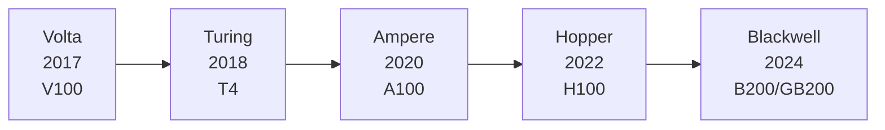
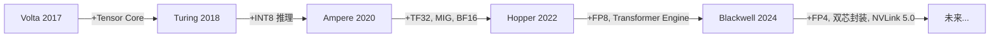

<a id="part1-ch5"></a>

# 第1部分 · 第5章：GPU 硬件概论

> [总索引](../README.md) ｜ [本部分目录](README.md) ｜ [上一章](ch04-PyTorch框架.md) ｜ [下一章](ch06-集合通信基础.md)

## 本章目录

- [本章导读](#part1-ch5)
- [5.1 GPU 硬件基础与体系结构](#part1-ch5-sec1)
- [5.2 NVIDIA GPU 架构演进](#part1-ch5-sec2)

---

## 本章导读

> 发布 2026-04-16 · 标签 "GPU", "硬件架构", "NVLink", "Roofline", "存储层次" · [单篇原文](../articles/part1/第5章-GPU硬件概论.md)

### 本章简介

在动手写 CUDA 代码之前，必须先搞清楚"工厂怎么布局"——GPU 的硬件架构直接决定了你写出的代码能跑多快。

**GPU 架构总览**对比 CPU vs GPU 的设计哲学差异（延迟优化 vs 吞吐优化），介绍 SM、CUDA Core、Tensor Core 的层次结构，以及 Warp（32 线程最小调度单位）的概念。

**GPU 存储层次**详解从寄存器到 HBM 再到主机内存的完整存储层次，包括各级存储的容量、带宽、延迟量级，以及 Memory Wall 问题——为什么显存带宽往往比算力先成为瓶颈。

**主流 GPU 规格对比**列出 A100/H100/H200/B200 的关键参数，引入 Arithmetic Intensity 和 Roofline Model 的概念。

**互联拓扑**介绍单机 NVLink/NVSwitch 和多机 InfiniBand 网络，解读 `nvidia-smi topo -m` 输出，理解为什么互联带宽直接决定并行策略的选择。

<a id="part1-ch5-sec1"></a>

## 5.1 GPU 硬件基础与体系结构

> 发布 2026-04-26 · 标签 "GPU", "CUDA", "硬件架构", "AI计算", "显存" · [单篇原文](../articles/part1/gpu/gpu-basics.md)

GPU 是大模型时代的"发动机"——训练一个千亿参数的 LLM 可能需要数千块 GPU 运行数月，而推理服务的吞吐量和延迟也直接取决于 GPU 的利用效率。对于 AI Infra 工程师来说，理解 GPU 不是选修课，而是所有后续优化（算子、并行、调度）的硬件基础。

本文将从最基本的问题出发——GPU 为什么适合 AI 计算？它内部长什么样？程序是如何在上面运行的？——帮你建立一套完整的 GPU 认知框架。

### 1. CPU vs GPU：为什么深度学习选择了 GPU

要理解 GPU 的价值，最好的方式是把它和 CPU 放在一起对比。

想象你要批改 10000 份选择题试卷。CPU 的做法是请一位经验丰富的阅卷老师，他速度快、能处理各种复杂题型，但一次只能改一份；GPU 的做法是请 10000 个临时工，每人只会对答案这一件事，但所有人同时开工——1 秒就全部改完了。

这就是 **延迟导向**（Latency-oriented）与 **吞吐导向**（Throughput-oriented）的核心区别。

#### 1.1 架构哲学的根本差异

| 📊 对比维度 | CPU | GPU |
|---|---|---|
| 设计目标 | 低延迟处理复杂任务 | 高吞吐处理大量简单任务 |
| 核心数量 | 几个到几十个"大核" | 数千到上万个"小核" |
| 单核能力 | 强（复杂分支预测、乱序执行） | 弱（简单 ALU，按序执行） |
| 缓存占比 | 芯片面积的大部分 | 芯片面积的小部分 |
| 控制逻辑 | 复杂（乱序执行、分支预测器） | 简单（大量核心共享控制单元） |
| 内存带宽 | 较低（DDR5 ~100 GB/s） | 极高（HBM3 ~3 TB/s） |
| 适合任务 | 串行逻辑、操作系统、网络服务 | 矩阵运算、数据并行、图形渲染 |

#### 1.2 深度学习为什么天然适合 GPU

深度学习的计算核心是什么？拆到最底层，就是海量的矩阵乘法和逐元素运算：

- **前向传播**：每一层都是 $Y = XW + b$，本质是矩阵乘法
- **反向传播**：计算梯度依然是矩阵乘法（$\frac{\partial L}{\partial W} = X^\top \cdot \frac{\partial L}{\partial Y}$）
- **Attention 计算**：$\text{Attention}(Q, K, V) = \text{softmax}\left(\frac{QK^\top}{\sqrt{d_k}}\right)V$，核心还是矩阵乘法

这些运算有两个关键特征：

1. **数据并行度极高**：矩阵中每个元素的计算相互独立，天然可以分配给不同的计算核心
2. **计算模式规则**：不需要复杂的分支判断，所有线程执行相同的指令

这恰好是 GPU 的长项——用成千上万个简单核心同时处理，吞吐量远超 CPU。

💡 **提示**：一块 H100 GPU 的 FP16 算力约为 989 TFLOPS，而高端服务器 CPU（如 Intel Xeon w9-3595X）的 FP16 算力通常在个位数 TFLOPS 级别。差距在两个数量级以上。

---

### 2. GPU 硬件架构剖析

了解了 GPU "为什么快"之后，我们来看看它"内部长什么样"。以 NVIDIA GPU 为例，从外到内可以分为三个层次：

#### 2.1 GPC → TPC → SM 的层级结构


NVIDIA GPU 的计算核心按层级组织，就像一家大公司的组织架构：

```
GPU 芯片
├── GPC (Graphics Processing Cluster)  ← "事业部"
│   ├── TPC (Texture Processing Cluster)  ← "部门"
│   │   ├── SM (Streaming Multiprocessor)  ← "小组"，GPU 的基本调度单元
│   │   │   ├── CUDA Core × N  ← "组员"，执行 FP32/INT32 运算
│   │   │   ├── Tensor Core × M  ← "专家"，执行矩阵运算
│   │   │   ├── SFU (Special Function Unit)  ← 执行 sin/cos/exp 等
│   │   │   ├── Register File  ← 寄存器堆（速度最快的存储）
│   │   │   ├── Shared Memory  ← 共享内存（SM 内所有线程共享）
│   │   │   └── L1 Cache
│   │   └── SM ...
│   └── TPC ...
├── GPC ...
├── L2 Cache（全局共享）
└── Memory Controller → HBM（显存）
```

#### 2.2 SM：GPU 的基本调度单元

SM（Streaming Multiprocessor）是理解 GPU 架构的关键，所有的线程调度和执行都发生在 SM 层面。

以 H100 的 SM 为例，每个 SM 内部包含：

| 🔧 组件 | 数量 | 功能 |
|---|---|---|
| CUDA Core（FP32） | 128 | 执行浮点和整数运算 |
| Tensor Core（第四代） | 4 | 执行矩阵乘累加（MMA）运算 |
| Load/Store Unit | 32 | 负责内存读写 |
| SFU | 16 | 执行超越函数（sin、cos、exp 等） |
| Warp Scheduler | 4 | 每周期调度 4 个 Warp |
| Register File | 256 KB | 线程私有寄存器 |
| Shared Memory / L1 Cache | 228 KB（可配置） | SM 内共享的高速存储 |

📌 **关键点**：SM 是资源分配的最小粒度。当你编写 CUDA Kernel 时，一个 Thread Block 会被调度到一个 SM 上执行。SM 内的寄存器、共享内存等资源由这个 SM 上的所有 Thread Block 共同分配。

#### 2.3 Warp：GPU 执行的最小单位

GPU 不是一个线程一个线程执行的，而是以 **Warp**（线程束）为单位，32 个线程锁步执行同一条指令。这就像军队齐步走——32 个士兵听同一声号令，迈出同一只脚。

```
Warp（32 个线程）
├── Thread 0:  执行 add r1, r2, r3
├── Thread 1:  执行 add r1, r2, r3  (同一条指令，不同数据)
├── Thread 2:  执行 add r1, r2, r3
├── ...
└── Thread 31: 执行 add r1, r2, r3
```

这种执行模式叫做 **SIMT**（Single Instruction, Multiple Threads），是 NVIDIA 对 SIMD 的扩展。

⚠️ **注意**：如果 Warp 内的线程遇到分支（if-else），走不同分支的线程会被 **掩码**（mask），导致部分线程空转。这就是所谓的 **Warp Divergence**，是 GPU 编程中需要极力避免的性能杀手。

---

### 3. 显存层次与带宽

GPU 的计算再快，如果数据"喂"不上来也白搭。在 AI 工作负载中，显存带宽往往比算力更先成为瓶颈——这就是为什么 AI Infra 领域有句话叫 **"Memory is the new compute\"**。

#### 3.1 GPU 存储层级金字塔

GPU 的存储层级和 CPU 类似，越靠近计算核心速度越快、容量越小。下表以 H100 SXM 为例，带宽为整卡聚合值：

| 📊 层级 | 容量 | 带宽 | 延迟 | 作用域 | 说明 |
|---|---|---|---|---|---|
| Register（寄存器） | 每线程 ~255 个 | — | ~0 cycle | 单线程私有 | 最快，但容量极有限 |
| Shared Memory | 每 SM ~228 KB | ~31 TB/s | ~30 cycle | SM 内所有线程 | 程序员显式管理的"L1 级别"缓存 |
| L1 Cache | 与 Shared Memory 共享 | 与 Shared Memory 合计 ~31 TB/s | ~30 cycle | SM 内 | 硬件自动管理 |
| L2 Cache | 整卡 ~50 MB | ~9.45 TB/s | ~200 cycle | 全局 | 所有 SM 共享 |
| HBM（显存） | 80 GB | 3.35 TB/s | ~600 cycle | 全局 | 主存储，带宽决定吞吐上限 |

带宽数据说明：

- Shared Memory 的 ~31 TB/s 是理论估算，按每 SM 32 个 bank × 4 B/cycle = 128 B/cycle 计算，即 132 SM × 128 B × 1.83 GHz ≈ 31 TB/s，前提是没有 Bank Conflict。
- L1 和 Shared Memory 是同一块物理 SRAM，带宽共享。TileLang 论文给出的 30.92 TB/s 是两者合并的口径，不能当作 L1 单独的带宽。
- L2 的 9.45 TB/s 取自 TileLang 论文附录 D 的 Table 2。不同测试方法得到的 L2 实测值差异较大，这里只作量级参考。
- HBM3 的 3.35 TB/s 是 NVIDIA 官方给出的理论峰值。

#### 3.2 HBM：高带宽显存

传统 GDDR 显存就像一条单车道公路——传输速率有限。HBM（High Bandwidth Memory）则是把几千条车道堆叠在一起，通过硅中介层（Silicon Interposer）直接和 GPU 芯片互联，实现数倍的带宽提升。

| 📊 显存类型 | 代表 GPU | 带宽 | 容量 |
|---|---|---|---|
| GDDR6X | RTX 4090 | 1,008 GB/s | 24 GB |
| HBM2e | A100 | 2,039 GB/s | 80 GB |
| HBM3 | H100 | 3,350 GB/s | 80 GB |
| HBM3e | B200 | 8,000 GB/s | 192 GB |

💡 **提示**：从 A100 到 B200，显存带宽增长了近 4 倍。这对 LLM 推理意义重大——推理阶段的 decode 是典型的 **Memory-bound** 任务，带宽每提升 1 倍，理论吞吐量就能接近翻倍。

#### 3.3 Roofline 模型：算力 vs 带宽的平衡点

判断一个计算任务是 **Compute-bound**（受算力限制）还是 **Memory-bound**（受带宽限制），可以用 **算术强度**（Arithmetic Intensity）这个指标：

$$
\text{算术强度} = \frac{\text{浮点运算量 (FLOPs)}}{\text{内存访问量 (Bytes)}}
$$

当算术强度低于 GPU 的 **ops:byte 比**（即算力 / 带宽）时，任务是 Memory-bound；反之是 Compute-bound。

以 H100 SXM 为例：
- FP16 算力：989 TFLOPS
- HBM3 带宽：3,350 GB/s
- ops:byte 比 = $\frac{989 \times 10^{12}}{3,350 \times 10^9} \approx 295$ FLOPs/Byte

这意味着：如果你的 Kernel 每从显存读取 1 Byte 数据，需要执行至少 295 次 FP16 浮点运算才能让算力充分跑满。否则 GPU 会"闲着等数据"。

📌 **关键点**：大多数深度学习算子（尤其是 Attention、LayerNorm、激活函数等）的算术强度远低于 295，这就是为什么 FlashAttention、Kernel Fusion 等优化技术如此重要——它们的核心思路就是减少显存访问、提升算术强度。

---

### 4. Tensor Core：AI 加速的核心引擎

CUDA Core 执行标量算术指令；以支持每周期一次 FP32 FMA（fused multiply-add）的执行单元为例，其峰值吞吐量为每周期 2 FLOPs。Tensor Core 则是专门执行矩阵乘累加的单元，每周期可完成多次标量乘加等价运算，具体吞吐量取决于架构、输入精度、累加精度及是否使用结构化稀疏。

#### 4.1 工作原理

Tensor Core 执行的基本操作是 **矩阵乘累加**（MMA, Matrix Multiply-Accumulate）：

$$
D = A \times B + C
$$

其中 $A$、$B$、$C$、$D$ 是小尺寸矩阵（具体尺寸取决于精度和架构代次）。

以 PTX 指令 `mma.sync.aligned.m16n8k16.row.col.f32.f16.f16.f32` 为例，$16 \times 8 \times 16$ 表示逻辑矩阵尺寸 $m \times n \times k$：

- 矩阵 A：形状 16 × 16，FP16。
- 矩阵 B：形状 16 × 8，FP16。
- 矩阵 C 和 D：形状 16 × 8，FP32，用于累加及输出。
- 一次完整 MMA 的计算量为 $2mnk = 2 \times 16 \times 8 \times 16 = 4096$ FLOPs，按一次标量乘加计 2 FLOPs。

**指令形状不等于单个 Tensor Core 每周期的吞吐量。** 上述 `mma.sync` 由整个 Warp 的线程协同执行，4096 FLOPs 是这次 Warp 级操作的总计算量，不能再乘以 32，也不能直接当作单个 Tensor Core 一个周期完成的计算量。PTX 描述的是指令语义；硬件执行吞吐量和指令延迟需要另查目标架构资料，不能仅由 $m,n,k$ 推出。[NVIDIA PTX ISA：mma](https://docs.nvidia.com/cuda/parallel-thread-execution/index.html#warp-level-matrix-instructions-mma)

#### 4.2 精度格式演进

不同精度格式在算力、精度、显存占用之间做了不同的取舍：

| 📊 精度 | 位宽 | 动态范围 | 首次 Tensor Core 支持 | 典型应用 |
|---|---|---|---|---|
| FP32 | 32 bit | 高 | — | 基准精度、loss 累加 |
| TF32 | 19 bit | 同 FP32 | Ampere（A100） | 训练（Ampere 上的默认 FP32 路径） |
| FP16 | 16 bit | 较窄 | Volta（V100） | 混合精度训练（需 loss scaling） |
| BF16 | 16 bit | 同 FP32 | Ampere（A100） | 混合精度训练（推荐，无需 loss scaling） |
| FP8（E4M3/E5M2） | 8 bit | 可选 | Hopper（H100） | 训练 + 推理 |
| INT8 | 8 bit | 整数 | Turing（T4） | 推理量化 |
| FP4 | 4 bit | 极窄 | Blackwell（B200） | 推理量化 |

💡 **提示**：BF16 和 FP16 都是 16 位，但 BF16 保留了和 FP32 相同的 8 位指数位，因此动态范围更大，训练时更不容易溢出。现代大模型训练几乎都用 BF16 而非 FP16。

#### 4.3 Tensor Core 的算力倍增

不同计算路径的峰值差异很大。以 H100 SXM 为例，下表统一采用稠密（Dense）口径，Tensor Core 行采用 FP32 累加：

| 📊 计算路径 | 理论峰值算力（约） |
|---|---|
| CUDA Core，FP32 FMA | 67 TFLOPS |
| Tensor Core，TF32 输入 | 495 TFLOPS |
| Tensor Core，FP16 / BF16 输入 | 989 TFLOPS |
| Tensor Core，FP8 输入 | 1,979 TFLOPS |

这些是不同精度和执行路径的硬件峰值，不能直接当作应用加速比；尤其 TF32 不具有完整 FP32 的尾数精度。NVIDIA H100 产品页中带星号的 Tensor Core 数值包含稀疏加速，上表将其除以 2 后取近似值。[NVIDIA H100 规格及稀疏脚注](https://www.nvidia.com/en-us/data-center/h100/)

📌 **关键点**：要触发 Tensor Core 加速，矩阵的维度必须满足对齐要求（通常是 8 或 16 的倍数）。在实际工程中，如果模型的 hidden_size 不是 8 的倍数，Tensor Core 可能无法被充分利用。

---

### 5. CUDA 编程模型

CUDA 是 NVIDIA 提供的并行计算编程框架，是连接"软件算法"和"硬件执行"的桥梁。即使你日常用 PyTorch 而不直接写 CUDA，理解它的编程模型也有助于理解底层发生了什么。

#### 5.1 线程层级：Grid → Block → Thread

CUDA 程序以 **Kernel** 为单位在 GPU 上执行。Kernel 的线程按三级层次组织：


| 📊 层级 | 说明 | 硬件对应 |
|---|---|---|
| Grid | 一次 Kernel 启动的所有线程 | 整个 GPU |
| Block（线程块） | 一组协作的线程（最多 1024 个） | 调度到一个 SM |
| Thread（线程） | 最小执行单元 | CUDA Core |
| Warp（线程束） | 32 个连续线程（隐式分组） | SM 中的 Warp Scheduler |

#### 5.2 一个简单的 CUDA Kernel 示例

下面是一个向量加法的 CUDA Kernel，展示 CUDA 的基本编程范式：

```c
// 向量加法 Kernel：C[i] = A[i] + B[i]
__global__ void vecAdd(float *A, float *B, float *C, int N) {
    // 计算当前线程负责的全局索引
    int idx = blockIdx.x * blockDim.x + threadIdx.x;

    // 边界检查
    if (idx < N) {
        C[idx] = A[idx] + B[idx];
    }
}

// 主机端启动 Kernel
int main() {
    int N = 1000000;
    int threadsPerBlock = 256;
    int blocksPerGrid = (N + threadsPerBlock - 1) / threadsPerBlock;

    // <<<Grid 维度, Block 维度>>>
    vecAdd<<<blocksPerGrid, threadsPerBlock>>>(d_A, d_B, d_C, N);
    return 0;
}
```

执行流程：📥 Host 分配显存并拷贝数据 → ⚙️ 启动 Kernel，GPU 将 Block 分配到各 SM → 📤 Kernel 执行完毕，结果拷回 Host。

#### 5.3 内存模型与存储对应

CUDA 编程中不同的变量声明对应不同的硬件存储：

| 📊 CUDA 内存类型 | 声明方式 | 硬件位置 | 作用域 | 生命周期 |
|---|---|---|---|---|
| Register | 局部变量 | SM 寄存器堆 | 单线程 | Kernel |
| Local Memory | 溢出的局部变量 | HBM（显存） | 单线程 | Kernel |
| Shared Memory | `__shared__` | SM 片上存储 | Block 内 | Kernel |
| Global Memory | `__device__` / cudaMalloc | HBM（显存） | 所有线程 | 应用 |
| Constant Memory | `__constant__` | HBM + 缓存 | 所有线程 | 应用 |

⚠️ **注意**：Local Memory 虽然名字里有"Local"，但实际存储在 HBM 上，访问速度和 Global Memory 一样慢。当寄存器不够用时，编译器会自动将变量溢出到 Local Memory，这叫做 **Register Spilling**，是需要警惕的性能问题。

#### 5.4 用 PyTorch 感受 GPU 计算

大多数 AI Infra 工程师日常并不直接写 CUDA C，而是通过 PyTorch 等框架间接调用。理解底层 CUDA 有助于写出更高效的 PyTorch 代码：

```python
import torch
import time

# 检查 GPU 信息
if torch.cuda.is_available():
    gpu = torch.cuda.get_device_properties(0)
    print(f"GPU: {gpu.name}")
    print(f"SM 数量: {gpu.multi_processor_count}")
    print(f"显存: {gpu.total_memory / 1024**3:.1f} GB")

# CPU vs GPU 矩阵乘法性能对比
N = 4096
A_cpu = torch.randn(N, N)
B_cpu = torch.randn(N, N)
A_gpu = A_cpu.cuda()
B_gpu = B_cpu.cuda()

# 预热
torch.mm(A_gpu, B_gpu)
torch.cuda.synchronize()

# 计时
start = time.perf_counter()
C_cpu = torch.mm(A_cpu, B_cpu)
cpu_time = time.perf_counter() - start

torch.cuda.synchronize()
start = time.perf_counter()
C_gpu = torch.mm(A_gpu, B_gpu)
torch.cuda.synchronize()
gpu_time = time.perf_counter() - start

print(f"CPU: {cpu_time*1000:.2f} ms | GPU: {gpu_time*1000:.2f} ms | 加速比: {cpu_time/gpu_time:.1f}x")
```

---

### 6. GPU 关键性能指标

评估一块 GPU 的 AI 计算能力，需要关注以下核心指标：

#### 6.1 四大核心指标

| 📊 指标 | 含义 | 为什么重要 |
|---|---|---|
| **算力**（TFLOPS） | 每秒浮点运算次数 | 决定 Compute-bound 任务的上限 |
| **显存带宽**（GB/s） | 每秒显存读写数据量 | 决定 Memory-bound 任务的上限 |
| **显存容量**（GB） | 可存储的数据总量 | 决定能跑多大的模型 |
| **互联带宽**（GB/s） | GPU 间通信速度 | 决定多卡并行的扩展效率 |

#### 6.2 算力计算公式

计算理论峰值前，必须明确 **GPU 型号、执行路径、输入与累加精度、稠密或稀疏口径、时钟频率**。单说“FP16 算力”不足以确定数值，CUDA Core 和 Tensor Core 的 FP16 吞吐量并不相同。

**通用公式：计算单元数 × 每单元每周期运算量 × 每秒周期数。**

$$
P_{\text{peak}} = N_{\text{SM}} \times U_{\text{SM}} \times q \times f
$$

- $N_{\text{SM}}$：该 GPU 实际启用的 SM 数量。
- $U_{\text{SM}}$：每个 SM 中所选类型的计算单元数。
- $q$：指定精度与计算模式下，每个单元每周期可完成的浮点运算数，单位为 FLOPs/(单元·周期)。
- $f$：与该吞吐规格匹配的核心时钟频率，单位为 Hz；结果为 FLOP/s，除以 $10^{12}$ 得到 TFLOPS。这里不使用显存频率，也不能把不适用于该执行路径的最高频率直接代入。

**CUDA Core：乘以 2 是 FMA 的计数约定。** 一次标量 FMA（$a \times b + c$）计作一次乘法加一次加法，即 2 FLOPs；它并不意味着所有计算单元每周期都只完成 2 FLOPs。若某 FP32 执行单元的峰值为每周期一次标量 FMA，则 $q=2$；换成 FP16、FP64 或其他指令时，应重新查该架构的吞吐规格。`half2` 一条指令可表达两个 FP16 元素的运算，但其每周期执行率仍取决于硬件，不能笼统地用“FP16 Core 数 × 2”推算。[CUDA 编程指南：算术指令吞吐量](https://docs.nvidia.com/cuda/archive/12.6.3/cuda-c-programming-guide/index.html#arithmetic-instructions)

**Tensor Core：必须计入每周期的多次乘加。** 设 $r_{\text{TC}}$ 为单个 Tensor Core 每周期完成的标量 FMA 等价次数，则稠密峰值为：

$$
P_{\text{TC,dense}} = N_{\text{SM}} \times N_{\text{TC/SM}} \times r_{\text{TC}} \times 2 \times f
$$

这里的 $r_{\text{TC}}$ 是硬件的持续吞吐量，不能用一条 MMA 的 $mnk$ 直接替代，也不能由单条指令的延迟简单取倒数得到；流水线允许多条独立操作重叠执行。若资料已给出 FLOPs/周期，则已经包含乘加的 $\times 2$，不要重复乘。

**计算实例：A100 的 FP16 输入、FP32 累加、稠密 Tensor Core 峰值。** NVIDIA 白皮书给出 A100 有 108 个 SM，每个 SM 有 4 个 Tensor Core；每个 Tensor Core 每周期完成 256 次 FP16 乘加，即 $256 \times 2 = 512$ FLOPs。取规格表中的 1.41 GHz Boost 频率：

$$
P_{\text{TC,dense}} = 108 \times 4 \times 256 \times 2 \times 1.41 \times 10^9
\approx 312 \times 10^{12}\ \text{FLOP/s} = 312\ \text{TFLOPS}
$$

同一 A100 的常规 FP32 路径，每 SM 有 64 个 FP32 CUDA Core，按每单元每周期一次 FMA 计算并换算单位，得到 $108 \times 64 \times 2 \times 1.41 \times 10^9 / 10^{12} \approx 19.5$ TFLOPS。两者说明了为何只数“核心数”或只看数据位宽无法比较算力。[NVIDIA A100 架构白皮书，第 20、24 页及规格表](https://images.nvidia.com/aem-dam/en-zz/Solutions/data-center/nvidia-ampere-architecture-whitepaper.pdf)

**稀疏峰值与实测性能要分开。** A100 在满足 2:4 结构化稀疏要求并使用对应稀疏 Tensor Core 指令时，FP16 的稠密等价峰值可达约 624 TFLOPS，是上述稠密峰值的 2 倍。该数字按等价稠密矩阵的运算量计数；普通稠密矩阵或任意分布的零值不会自动获得这一倍增。阅读厂商规格时，应逐项确认是否标注“with sparsity”，不能默认所有 TFLOPS 都包含稀疏加速。[NVIDIA Ampere 架构说明](https://developer.nvidia.com/blog/nvidia-ampere-architecture-in-depth/)

实际吞吐量应按“完成的计算量 / 实测耗时”计算，例如稠密 GEMM 常按 $2MNK/t$ 估算，并与相同精度、执行路径和计数口径的峰值比较。矩阵形状、访存、指令混合、并行度及功耗/温度导致的频率变化都会影响利用率，不存在普遍适用的“峰值的 30%~60%”范围；GPU 计算为异步执行，计时还需正确同步或使用 CUDA Events。

---

### 7. 主流 AI GPU 横向对比

下面是截至 2025 年主流 NVIDIA AI GPU 的核心参数对比：

| 📊 型号 | 架构 | SM 数 | 显存 | 带宽 | FP16 算力 | FP8 算力 | TDP | 典型用途 |
|---|---|---|---|---|---|---|---|---|
| V100 | Volta | 80 | 32 GB HBM2 | 900 GB/s | 125 TFLOPS | — | 300W | 经典训练卡 |
| A100 SXM | Ampere | 108 | 80 GB HBM2e | 2,039 GB/s | 312 TFLOPS | — | 400W | 训练 + 推理 |
| H100 SXM | Hopper | 132 | 80 GB HBM3 | 3,350 GB/s | 989 TFLOPS | 1,979 TFLOPS | 700W | 大规模训练 |
| H200 | Hopper | 132 | 141 GB HBM3e | 4,800 GB/s | 989 TFLOPS | 1,979 TFLOPS | 700W | 长序列推理 |
| B200 | Blackwell | 160 | 192 GB HBM3e | 8,000 GB/s | 2,250 TFLOPS | 4,500 TFLOPS | 1000W | 下一代旗舰 |
| L40S | Ada | 142 | 48 GB GDDR6 | 864 GB/s | 366 TFLOPS | — | 350W | 推理 / 多媒体 |

⚠️ **注意**：同一架构可能有 SXM 和 PCIe 两种封装。SXM 版本通常功耗更高、频率更高、且支持 NVLink 互联，性能显著强于 PCIe 版本。选型时务必确认封装类型。

---

### 8. 显存管理：AI Infra 的核心挑战

训练大模型时，显存往往是最先遇到的瓶颈。一个 7B 参数的模型（FP16），仅模型参数就需要约 14 GB 显存；加上优化器状态、梯度、激活值，实际显存占用可达 4~8 倍参数量。

#### 8.1 训练时显存都用在哪里

以 Adam 优化器 + FP16 混合精度训练为例，每个参数需要的显存：

| 📊 组成部分 | 每参数字节 | 说明 |
|---|---|---|
| FP16 参数 | 2 B | 前向 / 反向计算使用 |
| FP32 参数副本 | 4 B | Adam 需要维护 FP32 master weights |
| FP32 梯度 | 4 B | 反向传播产生 |
| Adam 一阶动量（m） | 4 B | 梯度的指数移动平均 |
| Adam 二阶动量（v） | 4 B | 梯度平方的指数移动平均 |
| **合计** | **18 B** | — |

一个 7B 模型的固定显存 = $7 \times 10^9 \times 18 = 126$ GB，这还不算激活值（Activation）。

#### 8.2 常用显存优化策略

面对显存不够用的困境，AI Infra 领域发展出了一系列经典策略：

| 📊 策略 | 原理 | 显存节省 | 代价 |
|---|---|---|---|
| **混合精度训练** | 用 FP16/BF16 做前向反向，FP32 做参数更新 | ~50% 参数显存 | 需要 loss scaling（FP16） |
| **梯度累积** | 用多个 micro-batch 累积梯度，等效大 batch | 减少激活值峰值 | 增加训练步数 |
| **梯度检查点** | 前向时只保留部分激活，反向时重新计算 | 激活显存降至 $O(\sqrt{N})$ | 增加约 33% 计算量 |
| **ZeRO 优化** | 将优化器状态 / 梯度 / 参数分片到多卡 | 线性降低每卡显存 | 增加通信量 |
| **Offloading** | 将部分数据卸载到 CPU 内存或 NVMe | 突破单卡显存上限 | PCIe 带宽成为瓶颈 |

💡 **提示**：这些策略并非互斥，实践中通常组合使用。例如 DeepSpeed ZeRO Stage 2 + 混合精度 + 梯度检查点是训练中大模型（7B~70B）的常见配置。

---

### 9. 多卡互联：从单机到集群

当单卡显存和算力无法满足需求时，就需要多卡并行。GPU 之间的互联带宽和拓扑直接决定了并行训练的效率。

#### 9.1 互联技术对比

| 📊 互联技术 | 带宽 | 场景 | 说明 |
|---|---|---|---|
| PCIe 5.0 | 128 GB/s（双向） | 跨卡（通用） | 普遍但带宽较低 |
| NVLink 4.0（Hopper） | 900 GB/s（全双工） | 机内 GPU 互联 | 专用高速互联，H100 使用 |
| NVLink 5.0（Blackwell） | 1,800 GB/s（全双工） | 机内 GPU 互联 | B200 使用 |
| NVSwitch | 连接所有 NVLink | 机内全互联 | 实现 All-to-All 全带宽通信 |
| InfiniBand NDR | 400 Gb/s（50 GB/s） | 跨机互联 | 大规模集群标配 |

#### 9.2 典型多卡拓扑

以 DGX H100（8 卡）为例：
- 8 块 H100 通过 NVSwitch 实现全互联，任意两卡之间 900 GB/s
- 每台机器通过 8 张 ConnectX-7 InfiniBand 网卡与集群相连
- 机内通信 >> 机间通信，这个带宽差异直接影响并行策略的选择

📌 **关键点**：在设计分布式训练策略时，应该让通信量大的并行维度（如张量并行）放在高带宽的机内 NVLink 上，通信量相对较小的并行维度（如数据并行、流水线并行）放在机间 InfiniBand 上。

```bash
# 查看 GPU 拓扑信息
nvidia-smi topo -m

# 查看 NVLink 状态
nvidia-smi nvlink -s
```

---

### 📝 总结

本文从 CPU 与 GPU 的架构差异出发，逐步深入到 GPU 的内部结构，涵盖了以下核心知识点：

- **为什么选择 GPU**：深度学习的矩阵运算天然适合 GPU 的大规模并行架构
- **硬件架构**：GPC → TPC → SM → CUDA Core / Tensor Core 的层级组织，Warp 是执行的最小调度单位
- **显存层次**：Register → Shared Memory → L1/L2 Cache → HBM 的金字塔结构，带宽往往比算力更先成为瓶颈
- **Tensor Core**：专为矩阵乘累加设计的加速单元，BF16/FP8 等低精度格式持续推动算力增长
- **CUDA 编程模型**：Grid → Block → Thread 的线程组织，以及存储类型与硬件的对应关系
- **性能评估**：算力、带宽、显存容量、互联带宽四大核心指标
- **显存管理**：混合精度、梯度累积、梯度检查点、ZeRO 等经典优化策略
- **多卡互联**：NVLink、NVSwitch、InfiniBand 构成从机内到集群的通信基础

掌握这些基础知识后，你将具备阅读后续 CUDA 编程、分布式训练、推理优化等进阶文章的硬件认知基础。

---

### 🎯 自我检验清单

- 能说出 CPU 和 GPU 在架构设计哲学上的核心区别
- 能画出 GPU 的层级结构（GPC → SM → CUDA Core / Tensor Core）
- 能解释 Warp 的概念以及 Warp Divergence 为什么影响性能
- 能说出 GPU 存储层级（Register → Shared Memory → L2 → HBM）各自的容量和速度量级
- 能用 Roofline 模型判断一个算子是 Compute-bound 还是 Memory-bound
- 能解释 BF16 和 FP16 的区别，以及为什么大模型训练更推荐 BF16
- 能列举 3 种以上显存优化策略及其原理
- 能用 `nvidia-smi` 查看 GPU 状态、拓扑信息
- 能说出 NVLink 和 PCIe 在带宽上的数量级差异
- 能估算一个 7B 参数模型使用 Adam + FP16 混合精度训练时的显存占用

---

### 📚 参考资料

- [NVIDIA CUDA C++ Programming Guide](https://docs.nvidia.com/cuda/cuda-c-programming-guide/)
- [NVIDIA H100 Tensor Core GPU Architecture Whitepaper](https://resources.nvidia.com/en-us-tensor-core)
- [NVIDIA A100 Tensor Core GPU Architecture Whitepaper](https://images.nvidia.com/aem-dam/en-zz/Solutions/data-center/nvidia-ampere-architecture-whitepaper.pdf)
- [NVIDIA Blackwell Architecture Whitepaper](https://resources.nvidia.com/en-us-blackwell-architecture)
- [Mixed Precision Training - NVIDIA Developer Blog](https://developer.nvidia.com/blog/mixed-precision-training-deep-neural-networks/)
- [ZeRO: Memory Optimizations Toward Training Trillion Parameter Models](https://arxiv.org/abs/1910.02054)
- [Roofline: An Insightful Visual Performance Model](https://people.eecs.berkeley.edu/~kubitron/cs252/handouts/papers/RooflineVyworientalModel.pdf)

---

<a id="part1-ch5-sec2"></a>

## 5.2 NVIDIA GPU 架构演进

> 发布 2026-04-27 · 标签 "GPU", "NVIDIA", "Tensor Core", "架构演进", "AI硬件" · [单篇原文](../articles/part1/gpu/nvidia-gpu-evolution.md)

### 1. 为什么要了解 GPU 架构演进

做 AI Infra 工程，经常会碰到这样的问题：训练跑不动该升级什么卡？推理延迟高是卡在哪里？FP8 和 BF16 到底选哪个？这些问题的答案往往藏在 GPU 架构本身的设计决策里。

理解 NVIDIA GPU 的代际演进，本质上是在理解**AI 硬件和 AI 算法的协同进化**——每一代架构都在回应上一代暴露出来的瓶颈，每一个新特性都有其针对的工作负载场景。掌握这些演进脉络，才能在硬件选型、性能调优、系统架构设计中做出合理的判断。

### 2. 架构演进全景图

先看全局。NVIDIA 从 2017 年至今推出了五代面向 AI 的 GPU 架构，可以把它们想象成一条不断拓宽、提速的高速公路——每一代都在扩展车道（算力）、提升路面质量（精度支持）和建造更高效的立交桥（互联带宽）。



| 📊 架构 | 📅 年份 | 🖥️ 代表产品 | ⚡ 核心突破 |
|---------|---------|-------------|------------|
| Volta | 2017 | V100 | 首次引入 Tensor Core |
| Turing | 2018 | T4 | INT8/INT4 推理加速、RT Core |
| Ampere | 2020 | A100 | 第三代 Tensor Core、MIG、TF32、BF16 |
| Hopper | 2022 | H100 | FP8、Transformer Engine、NVLink 4.0 |
| Blackwell | 2024 | B200 / GB200 | 第五代 Tensor Core、NVLink 5.0、双芯封装 |

下面逐代展开，重点关注每一代**解决了什么问题**和**引入了什么关键技术**。

### 3. Volta 架构（2017）——AI 加速的开端

#### 3.1 背景：GPU 凭什么做 AI？

在 Volta 之前，深度学习训练主要依赖 GPU 的 CUDA Core 做通用浮点运算。CUDA Core 是"万金油"——什么都能算，但没有针对深度学习中最核心的操作（矩阵乘法）做专门优化。这就好比用菜刀切面包，能用，但远不如面包刀好使。

#### 3.2 关键创新：Tensor Core

Volta 最重要的贡献是引入了 **Tensor Core**——一种专门为矩阵乘累加运算（Matrix Multiply-Accumulate, MMA）设计的硬件单元。

传统 CUDA Core 每个时钟周期处理一次标量的乘加运算（FMA），而一个 Tensor Core 在每个时钟周期内可以完成一个 $4 \times 4 \times 4$ 的混合精度矩阵乘累加：

$$
D = A \times B + C
$$

其中 $A$、$B$ 为 FP16 矩阵，$C$、$D$ 为 FP16 或 FP32 矩阵。这意味着一次操作就完成了 64 次乘加，相比 CUDA Core 的逐元素计算，效率提升了一个数量级。

#### 3.3 V100 关键规格

| 参数 | 规格 |
|------|------|
| Tensor Core 数量 | 640 个 |
| FP16 Tensor 算力 | 125 TFLOPS |
| FP32 CUDA 算力 | 15.7 TFLOPS |
| 显存 | 16 GB / 32 GB HBM2 |
| 显存带宽 | 900 GB/s |
| NVLink | NVLink 2.0，300 GB/s（双向） |

💡 **提示**：V100 是第一块真正意义上的"AI 训练卡"。即使在今天，理解 V100 的 Tensor Core 设计仍然是学习后续架构的基础。

#### 3.4 实践意义

Volta 开启了一个重要的编程范式转变：要想充分利用 Tensor Core，你的矩阵维度需要是 8 的倍数（后续架构进一步放宽），数据类型需要使用混合精度（FP16 计算 + FP32 累加）。这也是 NVIDIA 混合精度训练（AMP）的硬件基础。

```python
# PyTorch 中使用混合精度训练（Volta 时代开始受益）
import torch
from torch.cuda.amp import autocast, GradScaler

scaler = GradScaler()
for data, target in dataloader:
    optimizer.zero_grad()
    with autocast():  # 自动选择 FP16/FP32
        output = model(data)
        loss = criterion(output, target)
    scaler.scale(loss).backward()
    scaler.step(optimizer)
    scaler.update()
```

### 4. Turing 架构（2018）——RT Core 与推理加速

#### 4.1 解决的问题

Volta 主要面向训练场景。但到了模型部署阶段，推理对延迟和吞吐量的要求更加苛刻，且推理负载通常不需要 FP16 那么高的精度——很多模型用 INT8 就能保持足够的准确率。Volta 的 Tensor Core 只支持 FP16，在推理场景下算力利用不够充分。

#### 4.2 关键创新

- **INT8 / INT4 Tensor Core 支持**：第二代 Tensor Core 新增了整数精度运算能力，推理吞吐量相比 FP16 可再翻倍
- **RT Core**：光线追踪加速单元（主要面向图形渲染，AI Infra 领域较少涉及）
- **更高效的推理定位**：T4 卡的 TDP 仅 70W，适合部署在推理服务器中

#### 4.3 T4 关键规格

| 参数 | 规格 |
|------|------|
| Tensor Core 数量 | 320 个 |
| FP16 Tensor 算力 | 65 TFLOPS |
| INT8 Tensor 算力 | 130 TOPS |
| 显存 | 16 GB GDDR6 |
| 显存带宽 | 320 GB/s |
| TDP | 70W |

📌 **关键点**：T4 虽然绝对算力不如 V100，但其低功耗、高 INT8 吞吐的特性使它成为推理部署的经典选择。很多云厂商的推理实例至今仍在使用 T4。

#### 4.4 实践意义

Turing 架构推动了 **模型量化（Quantization）** 在工业界的普及。TensorRT 的 INT8 量化 pipeline 正是以 Turing 架构为目标设计的：

```bash
# 使用 TensorRT 进行 INT8 量化推理的典型流程
# 1. 导出 ONNX 模型
python export_onnx.py --model resnet50 --output model.onnx

# 2. 用 trtexec 构建 INT8 engine（需要校准数据集）
trtexec --onnx=model.onnx --int8 --calib=calibration_cache.bin --saveEngine=model_int8.engine
```

### 5. Ampere 架构（2020）——数据中心 AI 的分水岭

#### 5.1 解决的问题

到 2020 年，AI 模型规模急剧膨胀（GPT-3 有 1750 亿参数），训练所需的算力和显存同步增长。Volta/Turing 时代的两个痛点变得突出：

1. **精度格式不够灵活**：FP16 在某些模型上存在数值溢出问题，FP32 又太慢
2. **单卡利用率不高**：一块 GPU 只能跑一个任务，多租户场景下资源浪费严重

#### 5.2 关键创新

##### TF32 —— "不用改代码的加速"

Ampere 引入了 **TF32（TensorFloat-32）** 精度格式。TF32 使用 FP32 的 8 位指数位（保持相同的数值范围）加上 FP16 的 10 位尾数位，在不修改任何代码的情况下，对 FP32 运算自动提速：

| 格式 | 符号位 | 指数位 | 尾数位 | 总位宽 |
|------|--------|--------|--------|--------|
| FP32 | 1 | 8 | 23 | 32 |
| TF32 | 1 | 8 | 10 | 19 |
| FP16 | 1 | 5 | 10 | 16 |
| BF16 | 1 | 8 | 7 | 16 |

💡 **提示**：TF32 在 Ampere 上默认开启。当你在 A100 上跑 `torch.matmul` 时，如果输入是 FP32，Tensor Core 会自动使用 TF32 加速，不需要你显式开启混合精度。

##### MIG —— 一卡多用

**MIG（Multi-Instance GPU）** 允许将一块 A100 物理隔离为最多 7 个独立的 GPU 实例，每个实例拥有独立的显存、缓存和计算资源。这就像把一套大房子隔成多个独立的公寓，每户有自己的水电表，互不干扰。

```bash
# 查看 A100 支持的 MIG 配置
nvidia-smi mig -lgip

# 创建一个 MIG 实例（以 3g.20gb 为例：3 个 Compute Slice + 20GB 显存）
sudo nvidia-smi mig -cgi 9,9 -C

# 查看已创建的实例
nvidia-smi mig -lgi
```

MIG 的典型应用场景：
- ✅ 多个推理服务共享一块 A100，各自隔离互不影响
- ✅ 开发/调试阶段，多人共用一块卡
- ❌ 不适合需要完整 GPU 算力的大模型训练

##### 第三代 Tensor Core

支持的精度矩阵大幅扩展：FP16、**BF16**、TF32、INT8、INT4、Binary（1-bit），覆盖从训练到推理的全场景。

#### 5.3 A100 关键规格

| 参数 | 规格 |
|------|------|
| Tensor Core 数量 | 432 个（第三代） |
| FP16 / BF16 Tensor 算力 | 312 TFLOPS |
| TF32 Tensor 算力 | 156 TFLOPS |
| FP32 CUDA 算力 | 19.5 TFLOPS |
| 显存 | 40 GB / 80 GB HBM2e |
| 显存带宽 | 2.0 TB/s |
| NVLink | NVLink 3.0，600 GB/s（双向） |

#### 5.4 实践意义

Ampere 架构让 **BF16 混合精度训练**成为主流。BF16 与 FP32 有相同的数值范围（8 位指数），避免了 FP16 常见的溢出问题，同时将显存占用和通信量减半。大部分 LLM 训练从 Ampere 时代起使用 BF16 作为默认训练精度：

```python
# 在 A100 上使用 BF16 训练（PyTorch 原生支持）
model = model.to(dtype=torch.bfloat16, device="cuda")

# 或使用 PyTorch 的 autocast
with torch.autocast(device_type="cuda", dtype=torch.bfloat16):
    output = model(input_ids)
    loss = criterion(output, labels)
```

### 6. Hopper 架构（2022）——为大模型而生

#### 6.1 解决的问题

大语言模型（LLM）时代到来后，模型训练面临双重压力：

1. **算力饥渴**：百亿、千亿参数模型训练需要成百上千块 GPU 并行
2. **通信瓶颈**：多卡并行训练中，GPU 之间的数据同步（All-Reduce、All-to-All）成为重要瓶颈

Hopper 架构几乎每个重要特性都在回应这两个挑战。

#### 6.2 关键创新

##### FP8 训练 —— 精度再压一刀

Hopper 的第四代 Tensor Core 支持 **FP8** 精度（E4M3 和 E5M2 两种格式），将训练精度从 BF16 的 16 位进一步压缩到 8 位。

| 格式 | 符号位 | 指数位 | 尾数位 | 适用场景 |
|------|--------|--------|--------|----------|
| E4M3 | 1 | 4 | 3 | 前向传播（精度优先） |
| E5M2 | 1 | 5 | 2 | 反向传播（范围优先） |

FP8 的理论算力是 BF16 的两倍。但精度降低了，模型质量不会受损吗？这就引出了 Hopper 的另一个核心技术。

##### Transformer Engine —— 自动驾驶级精度管理

**Transformer Engine** 是一个软硬件协同的机制：它在每一层的计算前，动态分析张量的数值分布，自动决定这一层用 FP8 还是 BF16/FP16。可以理解为一个"自动挡"——在直路上（数值稳定的层）挂高速档（FP8），在弯道上（数值敏感的层）自动降档（BF16）。

```python
# 使用 Transformer Engine 的 FP8 训练
import transformer_engine.pytorch as te

# 替换标准 Linear 层为 TE 的 FP8 版本
model.layer = te.Linear(hidden_size, hidden_size)

# 启用 FP8 自动混合精度
with te.fp8_autocast(enabled=True):
    output = model(input_data)
```

##### NVLink 4.0 与 NVSwitch

| 📊 指标 | Ampere (A100) | Hopper (H100) | 提升 |
|---------|---------------|---------------|------|
| NVLink 带宽（双向） | 600 GB/s | 900 GB/s | 1.5x |
| All-Reduce 带宽 | 600 GB/s | 900 GB/s | 1.5x |
| NVSwitch 支持 | 节点内 8 卡 | 节点内 8 卡 + 跨节点 NVLink Network | 全新 |

⚠️ **注意**：H100 有两个版本——PCIe 版和 SXM 版。SXM 版通过 NVSwitch 支持 8 卡全互联，NVLink 4.0 总带宽 900 GB/s；PCIe 版虽然也有 NVLink 4.0，但仅支持 2 卡桥接互联。选型时务必注意这一区别。

##### 其他重要特性

- **Thread Block Cluster**：CUDA 编程模型新增一层层次结构，允许多个 Thread Block 协作，更好地利用 SM 间的共享存储
- **TMA（Tensor Memory Accelerator）**：硬件异步内存拷贝单元，将数据搬运从计算流水线中解耦出来，减少 SM 空闲等待

#### 6.3 H100 关键规格

| 参数 | 规格 |
|------|------|
| Tensor Core 数量 | 528 个（第四代） |
| FP8 Tensor 算力 | 1,979 TFLOPS（Dense）/ 3,958 TFLOPS（稀疏） |
| FP16 / BF16 Tensor 算力 | 989 TFLOPS（Dense）/ 1,979 TFLOPS（稀疏） |
| TF32 Tensor 算力 | 495 TFLOPS（Dense）/ 989 TFLOPS（稀疏） |
| 显存 | 80 GB HBM3 |
| 显存带宽 | 3.35 TB/s |
| NVLink | NVLink 4.0，900 GB/s（双向，SXM 版） |

💡 **提示**：NVIDIA 从 Ampere 架构起支持结构化稀疏性（2:4 Structured Sparsity），可将 Tensor Core 吞吐翻倍。但开启稀疏性需要模型权重经过专门的剪枝处理，实际大多数工作负载使用的是 Dense 算力。

#### 6.4 实践意义

Hopper 是当前大模型训练的主力架构。在实际的千卡训练集群中，以下特性的价值最为显著：

1. **FP8 + Transformer Engine** 将训练吞吐提升 30%-60%（取决于模型结构）
2. **NVLink 4.0** 大幅降低了多卡 All-Reduce 的通信延迟
3. **HBM3 的 3.35 TB/s 带宽** 缓解了 Attention 计算的访存瓶颈

```bash
# 查看 H100 的 NVLink 拓扑
nvidia-smi topo -m

# 查看当前 GPU 的 NVLink 状态
nvidia-smi nvlink -s
```

### 7. Blackwell 架构（2024）——万亿参数时代的基石

#### 7.1 解决的问题

进入万亿参数模型时代，单块 GPU 的算力增长已经跟不上模型膨胀的速度。Blackwell 的设计哲学是：与其一味堆晶体管提升单 die 性能，不如在芯片互联层面做革命性突破。

#### 7.2 关键创新

##### 双芯封装（Dual-Die）

B200 的核心由**两块 die 通过 10 TB/s 的片间互联**封装在同一块芯片上。对外表现为一块完整的 GPU，但实际上拥有两块 die 的算力。这就像把两匹马套在一起拉车，对车夫来说操作方式不变，但拉力翻倍。

##### 第五代 Tensor Core

FP8 Dense 算力相比 H100 提升约 14%（双 die 加持），含稀疏性加速后可达 4,500 TFLOPS。**FP4 精度首次获得硬件级支持**，Dense 算力 4,500 TOPS，开启稀疏性后可达 9,000 TOPS。FP4 的引入为推理场景提供了更极致的算力密度。

##### NVLink 5.0

| 📊 指标 | Hopper (H100) | Blackwell (B200) | 提升 |
|---------|---------------|------------------|------|
| NVLink 带宽（双向） | 900 GB/s | 1,800 GB/s | 2x |
| NVLink 连接的 GPU 数 | 8 | 72（通过 NVLink Switch） | 9x |

1.8 TB/s 的互联带宽意味着 GPU 之间的通信速度已经接近单块 GPU 的显存带宽。这从根本上改变了分布式训练的通信格局——过去需要精心设计通信拓扑来规避的瓶颈，现在可以用"暴力"带宽直接碾过。

##### 其他亮点

- **HBM3e 显存**：单卡最高 192 GB，显存带宽 8 TB/s
- **第二代 Transformer Engine**：更智能的 FP8/FP4 动态精度调度
- **机密计算（Confidential Computing）**：硬件级 GPU TEE，保护训练数据隐私

#### 7.3 B200 / GB200 关键规格

| 参数 | B200 | GB200（Grace-Blackwell） |
|------|------|--------------------------|
| FP8 Tensor 算力 | 2,250 TFLOPS（Dense）/ 4,500 TFLOPS（稀疏） | 同左（GPU 部分） |
| FP4 Tensor 算力 | 4,500 TOPS（Dense）/ 9,000 TOPS（稀疏） | 同左（GPU 部分） |
| 显存 | 192 GB HBM3e | 192 GB HBM3e + 480 GB LPDDR5x（CPU） |
| 显存带宽 | 8 TB/s | 8 TB/s（GPU 部分） |
| NVLink | NVLink 5.0，1,800 GB/s | NVLink 5.0，1,800 GB/s |
| 芯片设计 | 双 die 封装 | Grace CPU + Blackwell GPU 紧耦合 |

📌 **关键点**：GB200 是一个 **CPU-GPU 超级芯片**，将 NVIDIA 自研的 Grace ARM CPU 与 Blackwell GPU 通过高速 NVLink-C2C 互联封装在一起。这种设计消除了传统 PCIe 的 CPU-GPU 通信瓶颈。

### 8. 核心技术纵向对比

#### 8.1 Tensor Core 算力演进

下表数据统一使用 **Dense（非稀疏）** 算力。Ampere 及之后的架构支持 2:4 结构化稀疏性加速，开启后吞吐可翻倍。V100 / T4 不支持稀疏性。

| 精度 | V100 | T4 | A100 | H100 | B200 |
|------|------|----|------|------|------|
| FP16 / BF16 | 125 TFLOPS | 65 TFLOPS | 312 TFLOPS | 989 TFLOPS | ~1,125 TFLOPS |
| TF32 | — | — | 156 TFLOPS | 495 TFLOPS | ~563 TFLOPS |
| FP8 | — | — | — | 1,979 TFLOPS | ~2,250 TFLOPS |
| INT8 | — | 130 TOPS | 624 TOPS | 1,979 TOPS | ~2,250 TOPS |
| FP4 | — | — | — | — | ~4,500 TOPS |

#### 8.2 显存与带宽演进

| 📊 指标 | V100 | A100 | H100 | B200 |
|---------|------|------|------|------|
| 显存容量 | 32 GB | 80 GB | 80 GB | 192 GB |
| 显存类型 | HBM2 | HBM2e | HBM3 | HBM3e |
| 显存带宽 | 900 GB/s | 2.0 TB/s | 3.35 TB/s | 8 TB/s |
| NVLink 带宽 | 300 GB/s | 600 GB/s | 900 GB/s | 1,800 GB/s |

可以看到一个清晰的趋势：**显存带宽的增长速度慢于算力增长**。这反映了 AI 工作负载（尤其是 LLM 推理）的 **memory-bound** 特性——当模型足够大时，瓶颈不在计算而在访存。

#### 8.3 关键特性引入时间线



### 9. 如何选择合适的 GPU

选 GPU 不是选最新最贵的就好。要根据具体的工作负载来决策：

#### 训练场景

| 场景 | 推荐 | 理由 |
|------|------|------|
| 中小模型训练（< 10B） | A100 80GB | 性价比高，生态成熟 |
| 大模型训练（10B-100B） | H100 SXM | FP8 + NVLink 4.0 大幅提升多卡训练效率 |
| 超大模型训练（> 100B） | B200 / GB200 | 192GB 显存 + 1.8TB/s NVLink 支撑万亿参数 |

#### 推理场景

| 场景 | 推荐 | 理由 |
|------|------|------|
| 低成本在线推理 | T4 | 70W 低功耗，INT8 够用 |
| 中等规模 LLM 推理 | A100 / L40S | 显存够大，生态支持完善 |
| 大规模 LLM 推理 | H100 / H200 | FP8 吞吐高，HBM3 带宽充足 |
| 极致推理性能 | B200 | FP4 支持，显存 192GB 容纳更大模型 |

⚠️ **注意**：除了单卡性能，还需要考虑集群网络拓扑（NVLink vs PCIe vs InfiniBand）、功耗散热、供应链交付周期等因素。硬件选型从来不是一个纯技术问题。

### 📝 总结

回顾五代架构的演进，可以提炼出三条主线：

1. **精度格式不断下探**：FP32 → FP16 → BF16/TF32 → FP8 → FP4。每压缩一级精度，理论算力翻一倍，同时需要配套的数值稳定性方案（AMP、Transformer Engine）
2. **互联带宽持续翻倍**：NVLink 从 300 GB/s 一路攀升到 1,800 GB/s，连接范围从节点内 8 卡扩展到跨节点 72 卡。这是分布式训练效率提升的硬件基础
3. **软硬件协同深化**：从 Tensor Core 的硬件加速，到 Transformer Engine 的自动精度调度，再到 MIG 的虚拟化隔离——纯堆算力的时代过去了，体系化的软硬件协同才是竞争力所在

理解这些演进趋势，不仅帮助你做出更好的硬件选型决策，也为后续学习 CUDA 编程、分布式训练、推理优化等主题奠定了必要的硬件认知基础。

### 🎯 自我检验清单

- 能说出 NVIDIA 五代 AI GPU 架构的名称、年份和代表产品
- 能解释 Tensor Core 与 CUDA Core 的本质区别
- 能说明 FP32、TF32、BF16、FP16、FP8 各自的位宽和适用场景
- 能解释 MIG 的作用和适用场景，并用 `nvidia-smi` 命令查看/创建 MIG 实例
- 能说明 Transformer Engine 的工作原理（FP8/BF16 动态切换）
- 能比较 NVLink 各代的带宽差异，理解其对分布式训练的意义
- 能根据训练/推理场景的不同需求推荐合适的 GPU 型号
- 能解释 Blackwell 双芯封装和 GB200 CPU-GPU 紧耦合设计的价值

### 📚 参考资料

- [NVIDIA V100 Tensor Core GPU Architecture Whitepaper](https://images.nvidia.com/content/volta-architecture/pdf/volta-architecture-whitepaper.pdf)
- [NVIDIA A100 Tensor Core GPU Architecture Whitepaper](https://images.nvidia.com/aem-dam/en-zz/Solutions/data-center/nvidia-ampere-architecture-whitepaper.pdf)
- [NVIDIA H100 Tensor Core GPU Architecture Whitepaper](https://resources.nvidia.com/en-us-tensor-core/gtc22-whitepaper-hopper)
- [NVIDIA Blackwell Architecture Technical Brief](https://www.nvidia.com/en-us/data-center/technologies/blackwell-architecture/)
- [NVIDIA Transformer Engine Documentation](https://docs.nvidia.com/deeplearning/transformer-engine/user-guide/index.html)
- [NVIDIA Multi-Instance GPU User Guide](https://docs.nvidia.com/datacenter/tesla/mig-user-guide/)
- [NVIDIA NVLink and NVSwitch](https://www.nvidia.com/en-us/data-center/nvlink/)
