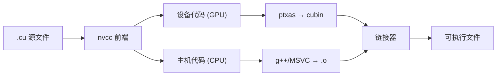
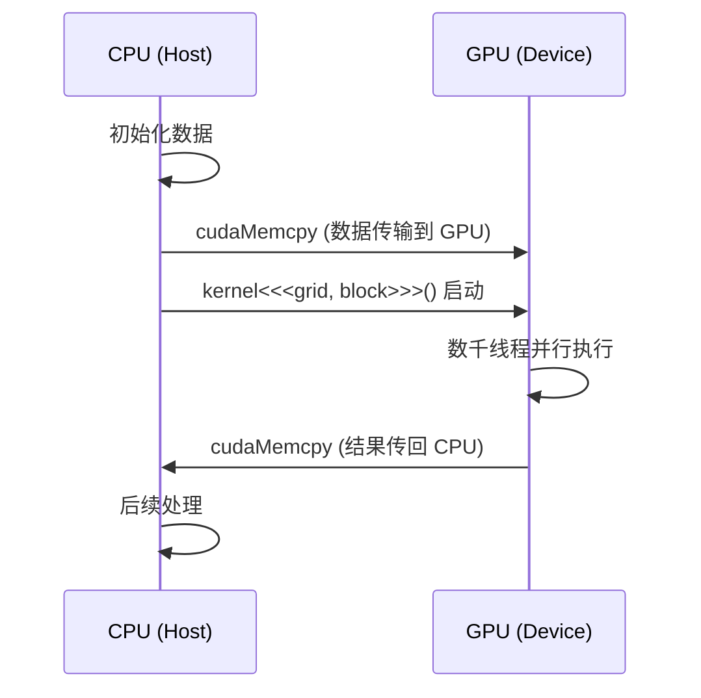
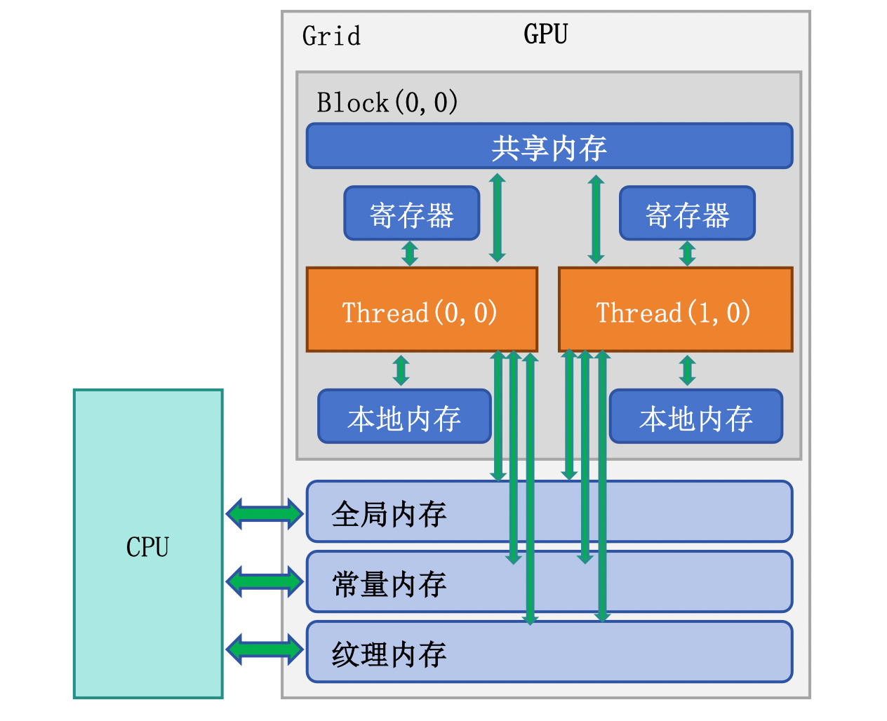
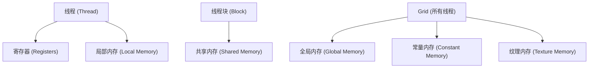
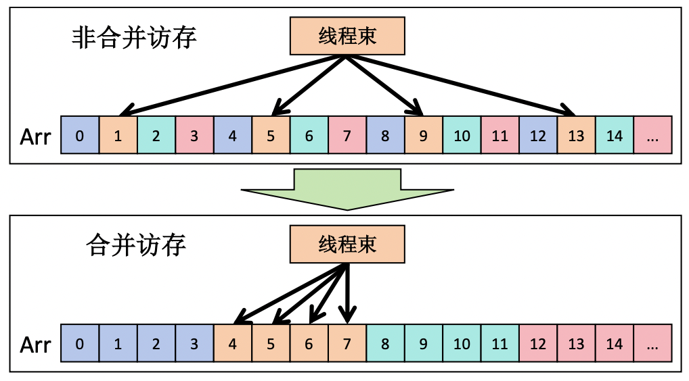
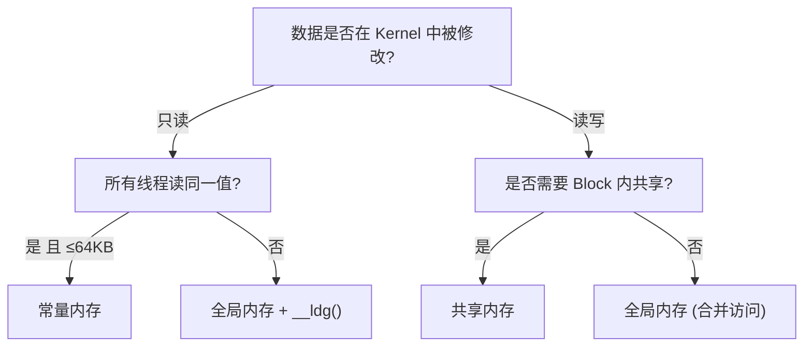

<a id="part2-ch1"></a>

# 第2部分 · 第1章：CUDA 编程入门

> [总索引](../README.md) ｜ [本部分目录](README.md) ｜ [下一章](ch02-CUDA性能优化基础.md)

## 本章目录

- [本章导读](#part2-ch1)
- [1.1 CUDA 开发环境搭建](#part2-ch1-sec1)
- [1.2 CUDA 编程模型](#part2-ch1-sec2)
- [1.3 CUDA 内存模型](#part2-ch1-sec3)
- [1.4 第一个实用 Kernel：向量加法](#part2-ch1-sec4)

---

## 本章导读

> 发布 2026-04-16 · 标签 "CUDA", "编程模型", "内存模型", "Kernel" · [单篇原文](../articles/part2/第1章-CUDA编程入门.md)

### 本章简介

本章是 CUDA 编程的起点，带你从零搭建开发环境并写出第一个高性能 Kernel。

**开发环境搭建**涵盖 CUDA Toolkit 安装与版本管理、nvcc 编译工具链和 CMake 集成，以及编写第一个 Hello World kernel。

**编程模型**部分详解 Grid/Block/Thread 三级线程层次、线程索引计算（threadIdx/blockIdx/blockDim/gridDim）、Kernel Launch 语法 `<<<gridDim, blockDim>>>` 以及 Block 大小的选择策略。

**内存模型**部分介绍全局内存、共享内存、寄存器、常量内存和统一内存的特性与适用场景。

**第一个实用 Kernel**以向量加法为例，走通 cudaMalloc → cudaMemcpy → kernel launch → 错误检查的完整流程，并对比 CPU 和 GPU 耗时。

<a id="part2-ch1-sec1"></a>

## 1.1 CUDA 开发环境搭建

> 发布 2026-05-08 · 标签 "CUDA", "环境搭建", "nvcc", "CUDA Toolkit", "CMake" · [单篇原文](../articles/part2/1.1-CUDA开发环境搭建.md)

从零搭建一套完整的 CUDA 开发环境，包括驱动安装、Toolkit 配置、编译工具链和 IDE 集成，让你在 10 分钟内写出并运行第一个 GPU 程序。


### 1. GPU 驱动与 CUDA Toolkit 的关系

很多初学者搞不清"驱动"和"CUDA Toolkit"到底是什么关系。打个比方：驱动就像是你手机的操作系统固件——它让硬件能正常工作；而 CUDA Toolkit 则是你在这个操作系统上安装的开发工具包——它提供编译器、库和调试器，让你能写出在 GPU 上跑的程序。

#### 1.1 版本兼容性规则

NVIDIA 采用**前向兼容**的设计：新版驱动可以运行旧版 CUDA Toolkit 编译的程序，但反过来不行。核心规则：

- 每个 CUDA Toolkit 版本都有**最低驱动版本要求**
- 驱动版本 ≥ Toolkit 要求即可，不必精确匹配
- `nvidia-smi` 显示的 "CUDA Version" 是驱动**最高支持**的 Toolkit 版本，不是当前安装的 Toolkit 版本

| CUDA Toolkit 版本 | 最低 Linux 驱动版本 | 最低 Windows 驱动版本 |
|-------------------|--------------------|--------------------|
| CUDA 12.6 | ≥ 560.28 | ≥ 560.70 |
| CUDA 12.4 | ≥ 550.54 | ≥ 551.61 |
| CUDA 12.2 | ≥ 535.54 | ≥ 536.25 |
| CUDA 11.8 | ≥ 520.61 | ≥ 520.06 |

💡 **提示**：始终优先升级驱动到最新稳定版，它既能向后兼容旧 Toolkit，也为后续升级 Toolkit 留出空间。

#### 1.2 CUDA Toolkit 包含的组件

| 📦 组件 | 📝 作用 |
|---------|---------|
| nvcc | CUDA C/C++ 编译器 |
| cuBLAS | 线性代数运算库 |
| cuDNN | 深度学习原语库（需单独下载） |
| cuFFT | 快速傅里叶变换库 |
| cuRAND | 随机数生成库 |
| Nsight Systems | 系统级性能分析工具 |
| Nsight Compute | Kernel 级性能分析工具 |
| CUDA Runtime (libcudart) | 运行时 API 库 |
| cuda-gdb | GPU 调试器 |

---

### 2. 安装 NVIDIA 驱动

#### 2.1 Linux（Ubuntu）

```bash
# 方法 1：使用 apt 包管理器（推荐）
sudo apt update
sudo apt install nvidia-driver-560

# 安装完成后重启
sudo reboot

# 验证安装
nvidia-smi
```

```bash
# 方法 2：使用官方 .run 安装包
# 先禁用 nouveau 开源驱动
sudo bash -c "echo 'blacklist nouveau' >> /etc/modprobe.d/blacklist.conf"
sudo update-initramfs -u
sudo reboot

# 下载并执行安装脚本
chmod +x NVIDIA-Linux-x86_64-560.35.03.run
sudo ./NVIDIA-Linux-x86_64-560.35.03.run
```

⚠️ **注意**：使用 `.run` 安装包前必须禁用 `nouveau` 驱动并切换到文本模式（tty），否则安装会失败。对于生产服务器，建议使用包管理器安装以便后续自动更新。

#### 2.2 Windows

Windows 用户直接从 [NVIDIA 驱动下载页面](https://www.nvidia.com/Download/index.aspx) 选择对应 GPU 型号下载安装即可。安装后在命令行运行 `nvidia-smi` 验证。

#### 2.3 验证驱动安装

```bash
$ nvidia-smi
+-----------------------------------------------------------------------------------------+
| NVIDIA-SMI 560.35.03              Driver Version: 560.35.03      CUDA Version: 12.6     |
|-----------------------------------------+------------------------+----------------------+
| GPU  Name                 Persistence-M | Bus-Id          Disp.A | Volatile Uncorr. ECC |
| Fan  Temp   Perf          Pwr:Usage/Cap |           Memory-Usage | GPU-Util  Compute M. |
|=========================================+========================+======================|
|   0  NVIDIA GeForce RTX 4090       Off | 00000000:01:00.0  Off |                  Off |
|  0%   35C    P8              12W / 450W |       1MiB / 24564MiB |      0%      Default |
+-----------------------------------------+------------------------+----------------------+
```

关注三个信息：
- **Driver Version**：当前驱动版本
- **CUDA Version**：驱动支持的最高 CUDA 版本
- **Memory-Usage**：显存使用情况

---

### 3. 安装 CUDA Toolkit

#### 3.1 Linux 安装（推荐 runfile 方式）

```bash
# 下载 CUDA 12.6 runfile
wget https://developer.download.nvidia.com/compute/cuda/12.6.0/local_installers/cuda_12.6.0_560.28.03_linux.run

# 执行安装（注意：取消勾选 Driver，避免覆盖已有驱动）
sudo sh cuda_12.6.0_560.28.03_linux.run
```

安装时选择界面中：
- ❌ 取消 Driver（已经单独安装过）
- ✅ 勾选 CUDA Toolkit
- ✅ 勾选 CUDA Samples（学习用，可选）

💡 **提示**：如果你用 `apt` 安装，可以用 `sudo apt install cuda-toolkit-12-6`，这样不会捆绑驱动安装。

#### 3.2 Windows 安装

从 [CUDA Toolkit Archive](https://developer.nvidia.com/cuda-toolkit-archive) 下载对应版本的 `.exe` 安装包，选择"Custom"安装模式，按需勾选组件。

#### 3.3 conda 安装（适用于 Python 开发者）

```bash
# 仅安装 CUDA 运行时和编译器（不含驱动）
conda install -c nvidia cuda-toolkit=12.6
```

这种方式适合在已有系统驱动的前提下，为特定 conda 环境配置独立的 CUDA 版本。

---

### 4. 环境变量配置

安装完成后，需要将 CUDA 的路径加入系统环境变量。

#### 4.1 Linux

在 `~/.bashrc` 或 `~/.zshrc` 中添加：

```bash
# CUDA 路径配置
export CUDA_HOME=/usr/local/cuda-12.6
export PATH=$CUDA_HOME/bin:$PATH
export LD_LIBRARY_PATH=$CUDA_HOME/lib64:$LD_LIBRARY_PATH
```

```bash
# 使配置生效
source ~/.bashrc

# 验证
nvcc --version
which nvcc
```

#### 4.2 Windows

系统环境变量中添加：
- `CUDA_PATH` = `C:\Program Files\NVIDIA GPU Computing Toolkit\CUDA\v12.6`
- `PATH` 中添加 `%CUDA_PATH%\bin`

#### 4.3 验证安装

```bash
$ nvcc --version
nvcc: NVIDIA (R) Cuda compiler driver
Copyright (c) 2005-2024 NVIDIA Corporation
Built on ...
Cuda compilation tools, release 12.6, V12.6.20
Build cuda_12.6.r12.6/compiler.34431801_0
```

```bash
# 编译并运行官方 CUDA Samples（需从 GitHub 单独下载）
git clone https://github.com/NVIDIA/cuda-samples.git
cd cuda-samples/Samples/1_Utilities/deviceQuery
make
./deviceQuery
```

如果 `deviceQuery` 输出 `Result = PASS`，说明整个环境（驱动 + Toolkit + GPU）工作正常。

⚠️ **注意**：从 CUDA 11.6 起，Samples 不再随 Toolkit 安装包附带，需要从 [GitHub](https://github.com/NVIDIA/cuda-samples) 单独下载。

---

### 5. nvcc 编译工具链

nvcc 是 CUDA 程序的编译器驱动程序。它不是一个独立的编译器，而是一个**编译协调器**：将 `.cu` 文件中的设备代码和主机代码分离，分别用 NVIDIA PTX 编译器和系统 C++ 编译器处理，最终链接成可执行文件。

#### 5.1 编译流程



#### 5.2 常用编译选项

```bash
# 基本编译
nvcc hello.cu -o hello

# 指定 GPU 架构（为 RTX 4090 的 sm_89 编译）
nvcc -arch=sm_89 hello.cu -o hello

# 生成多架构兼容的 fatbinary
nvcc -gencode arch=compute_80,code=sm_80 \
     -gencode arch=compute_89,code=sm_89 \
     hello.cu -o hello

# 开启调试信息（用于 cuda-gdb）
nvcc -g -G hello.cu -o hello_debug

# 开启优化
nvcc -O3 hello.cu -o hello_opt

# 显示编译过程的详细信息
nvcc --verbose hello.cu -o hello
```

#### 5.3 关键编译选项说明

| 选项 | 作用 |
|------|------|
| `-arch=sm_XX` | 指定目标 GPU 架构的计算能力 |
| `-gencode` | 生成多架构代码，适配不同 GPU |
| `-G` | 生成设备代码调试信息 |
| `-lineinfo` | 在优化代码中保留行号信息（性能分析用） |
| `-Xcompiler` | 将后续选项传递给主机编译器 |
| `-std=c++17` | 指定 C++ 标准版本 |
| `-maxrregcount=N` | 限制每个线程使用的寄存器数量 |
| `--ptxas-options=-v` | 显示每个 kernel 的寄存器和共享内存用量 |

#### 5.4 GPU 架构代号速查

| 架构代号 | 代表 GPU | 计算能力 |
|---------|---------|---------|
| sm_70 | V100 | 7.0 |
| sm_75 | T4, RTX 2080 | 7.5 |
| sm_80 | A100 | 8.0 |
| sm_86 | RTX 3090 | 8.6 |
| sm_89 | RTX 4090, L40 | 8.9 |
| sm_90 | H100 | 9.0 |

---

### 6. CMake 集成 CUDA

在实际项目中，很少直接手动调用 `nvcc`，而是使用 CMake 作为构建系统来管理编译过程。CMake 从 3.8 版本开始原生支持 CUDA 作为一等语言。

#### 6.1 最小 CMakeLists.txt

```cmake
cmake_minimum_required(VERSION 3.18)
project(MyCUDAProject LANGUAGES CXX CUDA)

# 设置 C++ 和 CUDA 标准
set(CMAKE_CXX_STANDARD 17)
set(CMAKE_CUDA_STANDARD 17)

# 指定目标 GPU 架构
set(CMAKE_CUDA_ARCHITECTURES 80 89 90)

# 添加可执行文件
add_executable(main src/main.cu)

# 链接 CUDA 运行时库
target_link_libraries(main PRIVATE CUDA::cudart)
```

#### 6.2 混合 C++ 和 CUDA 源文件

```cmake
cmake_minimum_required(VERSION 3.18)
project(HybridProject LANGUAGES CXX CUDA)

set(CMAKE_CXX_STANDARD 17)
set(CMAKE_CUDA_STANDARD 17)
set(CMAKE_CUDA_ARCHITECTURES 80 89)

# CUDA 源文件
add_library(kernels STATIC
    src/kernels/vector_add.cu
    src/kernels/matrix_mul.cu
)

# C++ 主程序链接 CUDA 库
add_executable(app src/main.cpp)
target_link_libraries(app PRIVATE kernels CUDA::cudart)
```

#### 6.3 构建和运行

```bash
mkdir build && cd build
cmake .. -DCMAKE_BUILD_TYPE=Release
make -j$(nproc)
./main
```

💡 **提示**：使用 `CMAKE_CUDA_ARCHITECTURES` 变量代替在代码中硬编码 `-arch`，这样切换目标 GPU 时只需改一处配置。

---

### 7. Hello World：第一个 CUDA 程序

现在万事俱备，让我们写一个完整的 Hello World 来验证整个工具链。

#### 7.1 源代码 `hello_cuda.cu`

```cpp
#include <cstdio>

// __global__ 修饰符表明这是一个 GPU 上执行的 kernel 函数
__global__ void helloKernel() {
    // threadIdx.x 是当前线程在 Block 内的编号
    printf("Hello from GPU thread %d in block %d!\n",
           threadIdx.x, blockIdx.x);
}

int main() {
    printf("Launching kernel...\n");

    // <<<2, 4>>> 表示启动 2 个 Block，每个 Block 有 4 个线程
    helloKernel<<<2, 4>>>();

    // 等待 GPU 上所有操作完成
    cudaDeviceSynchronize();

    printf("Done!\n");
    return 0;
}
```

#### 7.2 编译并运行

```bash
$ nvcc hello_cuda.cu -o hello_cuda
$ ./hello_cuda
Launching kernel...
Hello from GPU thread 0 in block 0!
Hello from GPU thread 1 in block 0!
Hello from GPU thread 2 in block 0!
Hello from GPU thread 3 in block 0!
Hello from GPU thread 0 in block 1!
Hello from GPU thread 1 in block 1!
Hello from GPU thread 2 in block 1!
Hello from GPU thread 3 in block 1!
Done!
```

📌 **关键点**：线程的实际执行顺序并不确定——两个 Block 的输出可能交替出现。并行程序的执行顺序由 GPU 硬件调度器决定。

#### 7.3 代码解析

| 要素 | 含义 |
|------|------|
| `__global__` | 标记函数为 kernel，由 CPU 调用、GPU 执行 |
| `<<<2, 4>>>` | 启动配置：2 个 Block，每 Block 4 个线程 |
| `threadIdx.x` | 线程在所属 Block 内的索引 |
| `blockIdx.x` | Block 在 Grid 内的索引 |
| `cudaDeviceSynchronize()` | CPU 阻塞等待 GPU 完成所有任务 |

---

### 8. 多版本 CUDA 管理

实际开发中，你可能需要同时维护多个 CUDA 版本（比如项目 A 用 CUDA 11.8，项目 B 用 CUDA 12.6）。NVIDIA 的设计允许多版本共存。

#### 8.1 多版本安装

每个版本安装到独立目录：
```
/usr/local/cuda-11.8/
/usr/local/cuda-12.4/
/usr/local/cuda-12.6/
```

#### 8.2 使用符号链接切换

```bash
# 切换到 CUDA 12.6
sudo rm -f /usr/local/cuda
sudo ln -s /usr/local/cuda-12.6 /usr/local/cuda

# 切换到 CUDA 11.8
sudo rm -f /usr/local/cuda
sudo ln -s /usr/local/cuda-11.8 /usr/local/cuda
```

环境变量统一指向 `/usr/local/cuda`：
```bash
export CUDA_HOME=/usr/local/cuda
export PATH=$CUDA_HOME/bin:$PATH
export LD_LIBRARY_PATH=$CUDA_HOME/lib64:$LD_LIBRARY_PATH
```

#### 8.3 使用 module 系统（集群环境）

在 HPC 集群上通常使用 Environment Modules：
```bash
module avail cuda
module load cuda/12.6
module list
```

#### 8.4 写一个快速切换脚本

```bash
#!/bin/bash
# 保存为 ~/bin/switch-cuda.sh
# 用法：source switch-cuda.sh 12.6

CUDA_VERSION=$1
if [ -d "/usr/local/cuda-$CUDA_VERSION" ]; then
    export CUDA_HOME=/usr/local/cuda-$CUDA_VERSION
    export PATH=$CUDA_HOME/bin:$PATH
    export LD_LIBRARY_PATH=$CUDA_HOME/lib64:$LD_LIBRARY_PATH
    echo "Switched to CUDA $CUDA_VERSION"
    nvcc --version
else
    echo "CUDA $CUDA_VERSION not found!"
fi
```

---

### 9. IDE 配置建议

#### 9.1 VS Code（推荐）

安装以下扩展：
- **NVIDIA Nsight Visual Studio Code Edition**：语法高亮、调试支持
- **C/C++（Microsoft）**：IntelliSense 补全
- **CMake Tools**：CMake 集成

`.vscode/settings.json` 配置示例：
```json
{
    "files.associations": {
        "*.cu": "cuda-cpp",
        "*.cuh": "cuda-cpp"
    },
    "C_Cpp.default.includePath": [
        "/usr/local/cuda/include"
    ]
}
```

#### 9.2 CLion

CLion 原生支持 CUDA（通过 CMake）：
- 确保 CMakeLists.txt 正确配置 `LANGUAGES CXX CUDA`
- CLion 会自动识别 `.cu` 文件并提供补全和调试
- 在 Settings → Build → CMake 中配置 `-DCMAKE_CUDA_COMPILER=/usr/local/cuda/bin/nvcc`

#### 9.3 Nsight Visual Studio Edition（Windows）

Windows 上 CUDA Toolkit 自带 Nsight 插件可集成到 Visual Studio 中，提供 GPU 调试和性能分析功能。Linux 上建议使用命令行工具 Nsight Systems/Compute 配合 VS Code 或 CLion。

💡 **提示**：Nsight Eclipse Edition 从 CUDA 12.0 起已被移除，不再随 Toolkit 附带。Linux 开发者建议使用 VS Code + Nsight 扩展。

---

### 10. 常见安装问题排查

| ❌ 问题 | ✅ 解决方案 |
|--------|------------|
| `nvidia-smi` 报 "command not found" | 驱动未安装或未加入 PATH |
| `nvidia-smi` 报 "driver/library version mismatch" | 驱动被更新但未重启，执行 `sudo reboot` |
| `nvcc` 报 "command not found" | CUDA Toolkit 未安装或环境变量未配置 |
| 编译报 "unsupported gpu architecture sm_XX" | nvcc 版本太旧不支持你的 GPU，升级 Toolkit |
| 链接报 "cannot find -lcudart" | `LD_LIBRARY_PATH` 未包含 CUDA lib64 目录 |
| CMake 报 "No CUDA toolset found" | 设置 `CMAKE_CUDA_COMPILER` 显式指向 nvcc 路径 |
| 运行时报 "CUDA error: no CUDA-capable device" | 驱动问题或 GPU 未被系统识别，检查 `lspci \| grep NVIDIA` |

⚠️ **注意**：安装过程中遇到问题时，优先查看 `/var/log/nvidia-installer.log`（Linux）中的详细错误日志。

---

### 📝 总结

本文覆盖了 CUDA 开发环境搭建的完整流程：

1. **驱动是基础**：先装驱动，确保 `nvidia-smi` 正常
2. **Toolkit 是工具箱**：提供编译器、库和调试器
3. **环境变量是桥梁**：让系统找到 nvcc 和 CUDA 库
4. **CMake 是生产力**：实际项目中必用的构建系统
5. **多版本管理**：符号链接切换，灵活应对不同项目需求

整个安装流程总结为一句话：**装驱动 → 装 Toolkit → 配环境变量 → 跑 deviceQuery 验证**。

### 🎯 自我检验清单

- 能区分 GPU 驱动和 CUDA Toolkit 的作用及版本兼容关系
- 能在 Linux 上独立完成驱动和 CUDA Toolkit 的安装
- 能正确配置 `CUDA_HOME`、`PATH`、`LD_LIBRARY_PATH` 环境变量
- 能使用 `nvcc` 编译一个 `.cu` 文件并指定目标架构
- 能编写一个包含 CUDA 的 CMakeLists.txt 并成功构建项目
- 能在同一台机器上管理和切换多个 CUDA 版本
- 能根据错误信息定位常见的安装和编译问题

### 📚 参考资料

- [NVIDIA CUDA Toolkit 官方文档](https://docs.nvidia.com/cuda/)
- [CUDA Toolkit Archive（历史版本下载）](https://developer.nvidia.com/cuda-toolkit-archive)
- [NVIDIA Driver Downloads](https://www.nvidia.com/Download/index.aspx)
- [CMake CUDA 支持文档](https://cmake.org/cmake/help/latest/manual/cmake-compile-features.7.html#supported-compilers)
- [CUDA Compatibility Guide](https://docs.nvidia.com/deploy/cuda-compatibility/)

---

<a id="part2-ch1-sec2"></a>

## 1.2 CUDA 编程模型

> 发布 2026-05-08 · 标签 "CUDA", "编程模型", "Grid", "Block", "Thread", "Warp" · [单篇原文](../articles/part2/1.2-CUDA编程模型.md)

深入理解 CUDA 的 Grid/Block/Thread 三级线程层次结构、线程索引计算方法和 Kernel 启动配置策略，这是编写高效 GPU 程序的核心基础。


### 1. 异构计算模型概览

CUDA 程序运行在一个**异构系统**上：CPU（Host）负责控制逻辑和串行代码，GPU（Device）负责大规模并行计算。想象一个工厂——CPU 是厂长，负责下达指令、调配资源；GPU 是拥有上万工人的车间，一旦接到任务就全员并行开工。

#### 1.1 程序执行流程



#### 1.2 三种函数修饰符

CUDA 用修饰符来标记函数在哪里执行、由谁调用：

| 修饰符 | 执行位置 | 调用方 | 用途 |
|--------|---------|--------|------|
| `__global__` | GPU | CPU（或 GPU 动态并行） | Kernel 入口函数 |
| `__device__` | GPU | GPU | Kernel 内部调用的辅助函数 |
| `__host__` | CPU | CPU | 普通 CPU 函数（默认） |

```cpp
// 可以组合使用：同时为 CPU 和 GPU 编译
__host__ __device__ float square(float x) {
    return x * x;
}
```

---

### 2. Grid/Block/Thread 三级线程层次

CUDA 的核心设计哲学是**层次化并行**：将海量线程组织为三级结构，既方便程序员思考，也贴合 GPU 硬件的物理布局。

#### 2.1 概念模型

打个比方：
- **Grid（网格）** = 整个学校——一次 Kernel 启动产生的所有线程的集合
- **Block（线程块）** = 一个班级——Block 内线程可以协作（共享内存、同步）
- **Thread（线程）** = 一个学生——最小的执行单位


#### 2.2 维度与索引

Grid 和 Block 都可以是 1D、2D 或 3D 的：

```cpp
// 1D：处理向量
dim3 grid(256);        // 256 个 Block
dim3 block(256);       // 每个 Block 256 个线程

// 2D：处理图像/矩阵
dim3 grid(16, 16);     // 16x16 = 256 个 Block
dim3 block(16, 16);    // 每个 Block 16x16 = 256 个线程

// 3D：处理体数据
dim3 grid(8, 8, 8);    // 8x8x8 = 512 个 Block
dim3 block(8, 8, 4);   // 每个 Block 8x8x4 = 256 个线程
```

#### 2.3 硬件限制

| 限制项 | 最大值（Compute Capability ≥ 8.0） |
|--------|-------------------------------------|
| Block 每维最大线程数 | x:1024, y:1024, z:64 |
| Block 内最大线程总数 | 1024 |
| Grid 每维最大 Block 数 | x:$2^{31}-1$, y:65535, z:65535 |
| 每个 SM 最大活跃线程数 | 2048（sm\_80）/ 1536（sm\_89） |
| 每个 SM 最大活跃 Block 数 | 16~32（取决于架构） |

⚠️ **注意**：Block 内线程总数不能超过 1024，即 `blockDim.x * blockDim.y * blockDim.z ≤ 1024`。

---

### 3. 线程索引计算

每个线程都能通过内置变量获取自身在层次结构中的位置，进而计算出它应该处理哪一份数据。

#### 3.1 内置变量

| 变量 | 类型 | 含义 |
|------|------|------|
| `threadIdx` | `dim3` | 线程在所属 Block 内的索引 |
| `blockIdx` | `dim3` | Block 在 Grid 内的索引 |
| `blockDim` | `dim3` | 每个 Block 的维度（线程数） |
| `gridDim` | `dim3` | Grid 的维度（Block 数） |

#### 3.2 一维索引计算

最常用的模式——将线程映射到一维数组：

```cpp
// 全局线程 ID = Block 编号 × Block 大小 + Block 内线程编号
int globalIdx = blockIdx.x * blockDim.x + threadIdx.x;
```

对于一个 `gridDim=4, blockDim=8` 的配置，全局索引分布如下：

```
Block 0: [ 0  1  2  3  4  5  6  7]
Block 1: [ 8  9 10 11 12 13 14 15]
Block 2: [16 17 18 19 20 21 22 23]
Block 3: [24 25 26 27 28 29 30 31]
```

#### 3.3 二维索引计算

处理矩阵时，通常使用 2D Grid 和 2D Block：

```cpp
int col = blockIdx.x * blockDim.x + threadIdx.x;
int row = blockIdx.y * blockDim.y + threadIdx.y;

// 转换为一维线性索引（行主序）
int linearIdx = row * width + col;
```

#### 3.4 Grid-stride Loop 模式

当数据量大于线程总数时，使用循环让每个线程处理多个元素：

```cpp
__global__ void processLargeArray(float* data, int N) {
    int idx = blockIdx.x * blockDim.x + threadIdx.x;
    int stride = blockDim.x * gridDim.x;  // 总线程数

    // 每个线程以 stride 为步长遍历
    for (int i = idx; i < N; i += stride) {
        data[i] = data[i] * 2.0f;
    }
}
```

💡 **提示**：Grid-stride loop 是 CUDA 编程的**最佳实践**——它既能正确处理任意大小的数据，又能让你自由选择 Grid 大小来优化性能。

---

### 4. Kernel 函数与启动语法

#### 4.1 Kernel 定义规则

```cpp
__global__ void myKernel(float* input, float* output, int N) {
    int idx = blockIdx.x * blockDim.x + threadIdx.x;
    if (idx < N) {
        output[idx] = input[idx] * 2.0f;
    }
}
```

Kernel 函数的约束：
- 返回类型必须是 `void`
- 不能使用可变参数（variadic）
- 不能是类的虚函数
- 不能递归（Compute Capability < 2.0，现代 GPU 均已支持）
- 参数通过值传递，指针必须指向设备内存

#### 4.2 启动语法 `<<<...>>>`

```cpp
kernel<<<gridDim, blockDim, sharedMemBytes, stream>>>(args...);
```

| 参数 | 类型 | 必填 | 说明 |
|------|------|------|------|
| `gridDim` | `dim3` 或 `int` | 是 | Grid 中 Block 的数量 |
| `blockDim` | `dim3` 或 `int` | 是 | 每个 Block 中线程的数量 |
| `sharedMemBytes` | `size_t` | 否 | 动态共享内存大小（默认 0） |
| `stream` | `cudaStream_t` | 否 | 执行流（默认 0，即默认流） |

#### 4.3 计算启动配置

给定数据大小 N 和 Block 大小，计算需要多少个 Block：

```cpp
int N = 1000000;
int blockSize = 256;
int gridSize = (N + blockSize - 1) / blockSize;  // 向上取整

myKernel<<<gridSize, blockSize>>>(input, output, N);
```

📌 **关键点**：`(N + blockSize - 1) / blockSize` 是整数除法向上取整的标准写法。当 N 不是 blockSize 整数倍时，最后一个 Block 中会有一些线程"越界"，因此 Kernel 内必须做边界检查 `if (idx < N)`。

#### 4.4 错误检查

Kernel 启动是异步的，错误不会立即被捕获：

```cpp
myKernel<<<grid, block>>>(args);

// 检查启动错误
cudaError_t err = cudaGetLastError();
if (err != cudaSuccess) {
    printf("Kernel launch error: %s\n", cudaGetErrorString(err));
}

// 等待执行完成并检查运行时错误
err = cudaDeviceSynchronize();
if (err != cudaSuccess) {
    printf("Kernel execution error: %s\n", cudaGetErrorString(err));
}
```

---

### 5. Block 大小选择策略

Block 大小的选择直接影响 GPU 利用率和性能。没有放之四海皆准的最优值，但有一些实用的经验法则。

#### 5.1 基本原则

| ✅ 推荐做法 | ❌ 不推荐做法 | 📝 原因 |
|-------------|--------------|---------|
| Block 大小为 32 的倍数 | 使用非 32 倍数的大小 | Warp 以 32 线程为单位调度 |
| 128~512 线程/Block | < 64 或 > 1024 | 平衡寄存器压力和并行度 |
| 根据 Kernel 寄存器用量调整 | 一律使用 256 | 寄存器多时需减小 Block |

#### 5.2 为什么必须是 32 的倍数

GPU 的执行以 **Warp**（32 个连续线程）为最小调度单位。如果 Block 大小不是 32 的倍数，最后一个 Warp 中的部分线程会被浪费：

```
Block 大小 = 100 → 4 个 Warp，但第 4 个 Warp 中只有 4 个线程活跃
Block 大小 = 128 → 4 个 Warp，全部线程都活跃 ✅
```

#### 5.3 Occupancy API（自动选择）

CUDA 提供 API 来自动计算最优 Block 大小：

```cpp
int blockSize;
int minGridSize;

// 自动计算使占用率最大化的 Block 大小
cudaOccupancyMaxPotentialBlockSize(
    &minGridSize,
    &blockSize,
    myKernel,       // kernel 函数指针
    0,              // 动态共享内存大小
    0               // Block 大小上限（0 = 不限制）
);

int gridSize = (N + blockSize - 1) / blockSize;
myKernel<<<gridSize, blockSize>>>(args);
```

#### 5.4 实用选择指南

| 场景 | 建议 Block 大小 | 理由 |
|------|----------------|------|
| 简单逐元素操作 | 256 或 512 | 寄存器少，可以承受大 Block |
| 使用大量共享内存 | 128 或 256 | 共享内存限制了活跃 Block 数 |
| 寄存器用量大的 Kernel | 128 | 减少 Block 大小释放寄存器压力 |
| 需要 Block 内同步 | 256 | 平衡同步开销和并行度 |

---

### 6. Warp：硬件调度的基本单位

#### 6.1 什么是 Warp

如果说 Block 是逻辑上的协作单位，那 Warp 就是**物理上的执行单位**。SM（Streaming Multiprocessor）以 Warp 为粒度调度执行——一个 Warp 包含 32 个连续线程，它们在同一时钟周期内执行同一条指令（SIMT，Single Instruction Multiple Threads）。

#### 6.2 Warp 分歧（Divergence）

当 Warp 内的线程走不同的分支路径时，发生 **Warp 分歧**——GPU 不得不串行执行两个分支：

```cpp
// ❌ 容易导致分歧
if (threadIdx.x % 2 == 0) {
    // 偶数线程执行这里
    result = pathA(data);
} else {
    // 奇数线程执行这里
    result = pathB(data);
}

// ✅ 以 Warp 为边界分支，避免分歧
if (threadIdx.x / 32 < 2) {
    // 前两个 Warp 执行 pathA
    result = pathA(data);
} else {
    // 后续 Warp 执行 pathB
    result = pathB(data);
}
```

💡 **提示**：只要同一个 Warp 内的 32 个线程走相同分支，就不会有分歧惩罚。分歧发生在 Warp 内部，不同 Warp 之间走不同分支完全没有代价。

#### 6.3 Warp 级原语

现代 CUDA 提供 Warp 级操作，允许线程在 Warp 内直接交换数据：

```cpp
// Warp 内广播：将 lane 0 的值广播给整个 Warp
float val = __shfl_sync(0xffffffff, data, 0);

// Warp 内规约求和
for (int offset = 16; offset > 0; offset >>= 1) {
    val += __shfl_down_sync(0xffffffff, val, offset);
}
```

---

### 7. 多维索引与实际应用

#### 7.1 图像处理：2D Grid + 2D Block

```cpp
__global__ void grayscaleKernel(unsigned char* rgb, unsigned char* gray,
                                 int width, int height) {
    int col = blockIdx.x * blockDim.x + threadIdx.x;
    int row = blockIdx.y * blockDim.y + threadIdx.y;

    if (col < width && row < height) {
        int rgbIdx = (row * width + col) * 3;
        int grayIdx = row * width + col;
        // ITU-R BT.601 标准灰度转换
        gray[grayIdx] = (unsigned char)(
            0.299f * rgb[rgbIdx] +
            0.587f * rgb[rgbIdx + 1] +
            0.114f * rgb[rgbIdx + 2]
        );
    }
}

// 启动配置
dim3 block(16, 16);  // 每个 Block 16x16 = 256 线程
dim3 grid((width + 15) / 16, (height + 15) / 16);
grayscaleKernel<<<grid, block>>>(d_rgb, d_gray, width, height);
```

#### 7.2 矩阵运算：行列映射

```cpp
__global__ void matrixAdd(float* A, float* B, float* C,
                          int rows, int cols) {
    int col = blockIdx.x * blockDim.x + threadIdx.x;
    int row = blockIdx.y * blockDim.y + threadIdx.y;

    if (row < rows && col < cols) {
        int idx = row * cols + col;
        C[idx] = A[idx] + B[idx];
    }
}
```

#### 7.3 批处理：3D Grid

```cpp
// 第三个维度表示 batch
__global__ void batchProcess(float* data, int batchSize,
                             int height, int width) {
    int col = blockIdx.x * blockDim.x + threadIdx.x;
    int row = blockIdx.y * blockDim.y + threadIdx.y;
    int batch = blockIdx.z;

    if (col < width && row < height && batch < batchSize) {
        int idx = batch * height * width + row * width + col;
        data[idx] = data[idx] * 2.0f;
    }
}

dim3 block(16, 16, 1);
dim3 grid((width + 15) / 16, (height + 15) / 16, batchSize);
batchProcess<<<grid, block>>>(d_data, batchSize, height, width);
```

---

### 8. 占用率与性能

#### 8.1 什么是占用率（Occupancy）

占用率 = SM 上实际活跃的 Warp 数 / SM 理论支持的最大 Warp 数。

$$
\text{Occupancy} = \frac{\text{Active Warps per SM}}{\text{Max Warps per SM}}
$$

占用率越高不一定性能越好，但过低的占用率通常意味着 GPU 资源闲置。

#### 8.2 影响占用率的因素

| 📊 因素 | 📝 影响方式 |
|---------|------------|
| Block 大小 | Block 太小则活跃 Warp 少 |
| 寄存器用量/线程 | 寄存器多则 SM 能容纳的线程少 |
| 共享内存用量/Block | 共享内存多则 SM 能容纳的 Block 少 |
| SM 的硬件限制 | 不同架构的最大 Block 数和线程数不同 |

#### 8.3 用 Occupancy Calculator 分析

```bash
# 编译时输出寄存器和共享内存用量
nvcc --ptxas-options=-v mykernel.cu -o mykernel
```

输出示例：
```
ptxas info    : Used 32 registers, 4096 bytes smem, 368 bytes cmem[0]
```

然后用 [CUDA Occupancy Calculator](https://docs.nvidia.com/cuda/cuda-occupancy-calculator/) 或 `cudaOccupancyMaxActiveBlocksPerMultiprocessor` API 来计算占用率。

---

### 📝 总结

CUDA 编程模型的核心要点：

1. **三级层次结构**：Grid → Block → Thread，逻辑清晰、硬件友好
2. **索引计算公式**：`globalIdx = blockIdx.x * blockDim.x + threadIdx.x`
3. **Grid-stride loop**：通用的数据遍历模式，处理任意规模数据
4. **Block 大小选择**：32 的倍数，通常 128~512，可用 Occupancy API 自动选择
5. **Warp 是执行单位**：理解 Warp 分歧，对齐访问模式
6. **边界检查**：Kernel 内必须检查索引是否越界

掌握编程模型就掌握了 CUDA 并行编程的"地图"——之后学习内存模型、同步原语和优化技巧时，都要回到这个层次结构上来思考。

### 🎯 自我检验清单

- 能画出 Grid/Block/Thread 的层次结构示意图
- 能根据数据维度选择合适的 Grid 和 Block 维度
- 能手算给定配置下任意线程的全局索引
- 能编写 Grid-stride loop 处理超大数组
- 能使用 Occupancy API 自动计算最优 Block 大小
- 能识别 Warp 分歧并重构代码避免分歧
- 能为矩阵运算和图像处理配置 2D Grid/Block
- 能根据 `--ptxas-options=-v` 的输出分析占用率瓶颈

### 📚 参考资料

- [NVIDIA CUDA C++ Programming Guide - Programming Model](https://docs.nvidia.com/cuda/cuda-c-programming-guide/index.html#programming-model)
- [CUDA C++ Best Practices Guide](https://docs.nvidia.com/cuda/cuda-c-best-practices-guide/)
- [CUDA Occupancy Calculator](https://docs.nvidia.com/cuda/cuda-occupancy-calculator/)
- [Professional CUDA C Programming (Cheng et al.)](https://www.wiley.com/en-us/Professional+CUDA+C+Programming-p-9781118739327)

---

<a id="part2-ch1-sec3"></a>

## 1.3 CUDA 内存模型

> 发布 2026-05-09 · 标签 "CUDA", "内存模型", "共享内存", "全局内存", "统一内存" · [单篇原文](../articles/part2/1.3-CUDA内存模型.md)

理解 CUDA 的多层内存层次是写出高性能 Kernel 的关键。本文详解全局内存、共享内存、寄存器、常量内存和统一内存的特性、适用场景及优化技巧。


### 1. 为什么内存模型如此重要

GPU 的计算能力极强——一块 A100 的峰值算力为 312 TFLOPS（FP16，Tensor Core 含稀疏加速），但它的显存带宽只有约 2 TB/s。做一道简单的算术：一次浮点乘加（FMA）需要读 2 个 float（8 Bytes）产生 2 个 FLOP，那么 2 TB/s 带宽最多喂饱 500 GFLOPS 的计算——不到峰值算力的 0.2%。

这意味着：**绝大多数 Kernel 的性能瓶颈不是计算，而是内存访问**。理解 CUDA 的多层内存层次，学会把数据放在"离计算最近的地方"，是优化 GPU 程序的第一课。

---

### 2. 内存层次总览

GPU 的内存层次就像城市的交通系统——寄存器是办公桌上的文件（最快但最小），共享内存是同一办公室的文件柜（快速且可共享），全局内存是城市外的大仓库（容量大但来回需要时间）。

#### 2.1 内存层次架构图





#### 2.2 各级内存对比

| 📊 内存类型 | 位置 | 容量 | 延迟 | 带宽 | 作用域 | 生命周期 |
|------------|------|------|------|------|--------|---------|
| 寄存器 | SM 芯片上 | ~256KB/SM | 1 cycle | 最高 | 单线程 | 线程生命周期 |
| 共享内存 | SM 芯片上 | 48~228KB/SM（因架构而异） | ~20 cycles | ~19 TB/s | Block 内 | Block 生命周期 |
| L1 Cache | SM 芯片上 | 128~256KB/SM | ~30 cycles | ~19 TB/s | 自动 | 自动管理 |
| L2 Cache | GPU 芯片上 | 6~50MB | ~200 cycles | ~5 TB/s | 所有 SM | 自动管理 |
| 全局内存 (HBM) | 芯片外 | 16~80GB | ~400 cycles | 1~3.4 TB/s | 全局 | 应用生命周期 |
| 常量内存 | 芯片外+缓存 | 64KB | 1~400 cycles | 有缓存时极高 | 全局只读 | 应用生命周期 |

---


### 3. 全局内存

全局内存（Global Memory）是 GPU 的"主存"，对应物理上的 HBM（高带宽内存）。它容量最大但延迟最高，是 CPU-GPU 数据交换的枢纽。

#### 3.1 基本操作

```cpp
// 分配设备内存
float* d_data;
size_t size = N * sizeof(float);
cudaMalloc(&d_data, size);

// Host → Device 传输
cudaMemcpy(d_data, h_data, size, cudaMemcpyHostToDevice);

// Device → Host 传输
cudaMemcpy(h_result, d_data, size, cudaMemcpyDeviceToHost);

// 释放设备内存
cudaFree(d_data);
```

#### 3.2 合并访问（Coalesced Access）

全局内存的访问效率取决于**一个 Warp 内 32 个线程的访问模式是否连续对齐**。GPU 以 32B/64B/128B 的粒度从全局内存取数据（一次"事务"），如果 Warp 内线程访问的地址连续，一次事务就能满足所有线程——这就是**合并访问**。

```cpp
// ✅ 合并访问：连续线程访问连续地址
// Thread 0 → data[0], Thread 1 → data[1], ...
float val = data[threadIdx.x + blockIdx.x * blockDim.x];

// ❌ 跨步访问：效率低
// Thread 0 → data[0], Thread 1 → data[stride], ...
float val = data[(threadIdx.x + blockIdx.x * blockDim.x) * stride];
```



#### 3.3 访问模式对性能的影响

| 访问模式 | 事务数（Warp 访问 32 个 float） | 有效带宽利用率 |
|---------|-------------------------------|--------------|
| 完美合并（连续对齐） | 1 次 128B 事务 | 100% |
| 连续但未对齐 | 2 次 128B 事务 | 50% |
| 随机散列访问 | 最多 32 次 32B 事务 | ~3% |

💡 **提示**：在设计数据结构时，优先选择 **Structure of Arrays (SoA)** 而非 **Array of Structures (AoS\)**，因为 SoA 更容易实现合并访问。

#### 3.4 SoA vs AoS 示例

```cpp
// ❌ AoS（Array of Structures）— 相邻线程访问不连续
struct Particle {
    float x, y, z;
    float vx, vy, vz;
};
Particle particles[N];
// Thread i 访问 particles[i].x → 间隔 sizeof(Particle) = 24 bytes

// ✅ SoA（Structure of Arrays）— 相邻线程访问连续
struct Particles {
    float x[N], y[N], z[N];
    float vx[N], vy[N], vz[N];
};
Particles p;
// Thread i 访问 p.x[i] → 间隔 sizeof(float) = 4 bytes，完美合并
```

---

### 4. 共享内存

共享内存（Shared Memory）位于 SM 芯片上，48~228KB/SM（因架构而异），是 Block 内所有线程共享的高速暂存。把它想象成一个团队的白板——团队成员都可以快速读写，但其他团队看不到。

#### 4.1 声明与使用
静态声明：

```cpp
__global__ void sharedMemDemo(float* input, float* output, int N) {
    // 静态声明：编译时确定大小
    __shared__ float tile[256];

    int idx = blockIdx.x * blockDim.x + threadIdx.x;
    if (idx < N) {
        // 将全局内存数据加载到共享内存
        tile[threadIdx.x] = input[idx];

        // 同步：确保所有线程都完成加载
        __syncthreads();

        // 现在可以安全地访问 tile 中其他线程加载的数据
        int partner = blockDim.x - 1 - threadIdx.x;
        output[idx] = tile[partner];
    }
}
```
动态声明：

```cpp
// 动态声明：运行时确定大小
__global__ void dynamicSharedMem(float* data, int N) {
    extern __shared__ float sharedData[];  // 大小在启动时指定

    int idx = blockIdx.x * blockDim.x + threadIdx.x;
    if (idx < N) {
        sharedData[threadIdx.x] = data[idx];
    }
    __syncthreads();
    // ...
}

// 启动时通过第三个参数指定动态共享内存大小
int sharedMemSize = blockSize * sizeof(float);
dynamicSharedMem<<<grid, block, sharedMemSize>>>(data, N);
```

#### 4.2 Bank Conflict

共享内存被划分为 32 个 **Bank**（对应 32 个 Warp 线程），每个 Bank 宽度为 4 bytes。当一个 Warp 中多个线程同时访问同一个 Bank 的不同地址时，访问必须串行化——这就是 **Bank Conflict**。

```
Bank 编号 = (地址 / 4 bytes) % 32
```

```cpp
// ✅ 无 Bank Conflict：每个线程访问不同 Bank
float val = shared[threadIdx.x];         // 线程 i → Bank i

// ❌ 2-way Bank Conflict：步长为 2，线程 0 和 16 冲突
float val = shared[threadIdx.x * 2];     // 线程 0 → Bank 0, 线程 16 → Bank 0

// ✅ 广播无冲突：所有线程读同一地址
float val = shared[0];                   // 广播，无冲突
```

#### 4.3 避免 Bank Conflict 的技巧

对于矩阵转置等场景，经典方法是添加 padding：

```cpp
// 原始：2D 共享内存，列访问时会有 Bank Conflict
__shared__ float tile[32][32];

// 优化：加 1 列 padding，错开 Bank 对齐
__shared__ float tile[32][32 + 1];  // 33 列
```

#### 4.4 共享内存配置

现代 GPU（sm\_80+）的 L1 Cache 和共享内存**共享同一块物理 SRAM**，可以通过 API 配置比例：

```cpp
// 优先分配更多共享内存（最大 164KB on A100）
cudaFuncSetAttribute(myKernel,
    cudaFuncAttributeMaxDynamicSharedMemorySize, 164 * 1024);

// 设置 L1/Shared Memory 偏好
cudaFuncSetCacheConfig(myKernel, cudaFuncCachePreferShared);
```

---

### 5. 寄存器与局部内存

#### 5.1 寄存器

寄存器是每个线程私有的最快存储。Kernel 中的局部变量默认存放在寄存器中：

```cpp
__global__ void compute(float* data, int N) {
    int idx = blockIdx.x * blockDim.x + threadIdx.x;  // 存在寄存器
    float temp = 0.0f;                                  // 存在寄存器
    float acc = 0.0f;                                   // 存在寄存器

    for (int i = 0; i < 10; i++) {
        temp = data[idx + i * N];
        acc += temp * temp;
    }
    data[idx] = acc;
}
```

#### 5.2 寄存器溢出（Register Spilling）

每个 SM 的寄存器总量有限（如 A100 为 65536 个 32-bit 寄存器/SM）。当一个线程使用的寄存器超过 SM 能分配给它的数量时，多出的变量会"溢出"到**局部内存**（实际是全局内存的一块区域，有 L1/L2 缓存加速但延迟仍然高）。

```bash
# 查看 Kernel 的寄存器用量
nvcc --ptxas-options=-v mykernel.cu
# ptxas info: Used 48 registers, 0 bytes smem

# 限制最大寄存器数（可能导致溢出但提高占用率）
nvcc --maxrregcount=32 mykernel.cu
```

#### 5.3 寄存器使用建议

| ✅ 推荐做法 | ❌ 不推荐做法 |
|-------------|--------------|
| 复用临时变量 | 声明大量独立变量 |
| 循环展开适度（`#pragma unroll`） | 展开因子过大导致寄存器爆炸 |
| 用 `--ptxas-options=-v` 监控 | 盲目追求零溢出 |

⚠️ **注意**：寄存器使用是一个**权衡**——用更多寄存器可以减少计算中的内存访问，但也会降低 SM 上能同时驻留的 Warp 数量（降低占用率）。需要根据具体 Kernel 找平衡点。

---

### 6. 常量内存

常量内存（Constant Memory）是一块 64KB 的**只读**全局内存区域，配有专用的常量缓存。当 Warp 内所有线程读取同一地址时，一次缓存读取就能广播给 32 个线程。

#### 6.1 声明与使用

```cpp
// 在全局作用域声明常量内存
__constant__ float coefficients[256];

// 主机端拷贝数据到常量内存
float h_coeff[256];
// ... 填充 h_coeff ...
cudaMemcpyToSymbol(coefficients, h_coeff, sizeof(h_coeff));

// Kernel 中直接读取（像全局变量一样）
__global__ void applyFilter(float* data, float* output, int N) {
    int idx = blockIdx.x * blockDim.x + threadIdx.x;
    if (idx < N) {
        float result = 0.0f;
        for (int i = 0; i < 256; i++) {
            result += data[idx + i] * coefficients[i];  // 所有线程读同一个 coefficients[i]
        }
        output[idx] = result;
    }
}
```

#### 6.2 适用场景

| ✅ 适合常量内存 | ❌ 不适合常量内存 |
|----------------|-----------------|
| 所有线程读相同值（卷积核、系数表） | 每个线程读不同地址 |
| 数据量 ≤ 64KB | 数据量超过 64KB |
| 数据在 Kernel 执行期间不变 | 数据需要被 GPU 修改 |

📌 **关键点**：如果 Warp 内不同线程访问常量内存的不同地址，访问会被串行化为 32 次读取，性能反而比全局内存更差。

---

### 7. 纹理内存

纹理内存（Texture Memory）通过专用的纹理缓存访问全局内存，它针对**二维空间局部性**做了优化。在深度学习时代，纹理内存使用较少，但在图像处理和某些插值场景中仍有价值。

#### 7.1 特点

- 针对 2D 空间局部性优化的缓存策略
- 支持硬件插值（线性/双线性）
- 支持自动边界处理（Clamp/Wrap）
- 对不规则访问模式比全局内存表现更好

#### 7.2 现代替代

在 CUDA 12+ 中，L1/L2 缓存的优化已经覆盖了大部分纹理内存的使用场景。对于新代码，建议：
- 规则访问模式 → 直接使用全局内存 + L1 缓存
- 只读数据 → 使用 `__ldg()` 内置函数走只读缓存路径
- 需要硬件插值 → 仍然使用纹理

```cpp
// __ldg() 走只读缓存路径，无需配置纹理对象
float val = __ldg(&input[idx]);
```

---

### 8. 统一内存

统一内存（Unified Memory）是 CUDA 6.0 引入的编程抽象——它提供一个**单一地址空间**，CPU 和 GPU 都可以通过相同的指针访问数据，系统自动在两者之间迁移页面。

#### 8.1 基本用法

```cpp
// 分配统一内存
float* data;
cudaMallocManaged(&data, N * sizeof(float));

// CPU 端初始化——直接用指针
for (int i = 0; i < N; i++) {
    data[i] = (float)i;
}

// GPU 端计算——同一个指针
myKernel<<<grid, block>>>(data, N);
cudaDeviceSynchronize();

// CPU 端读取结果——还是同一个指针
printf("Result: %f\n", data[0]);

// 释放
cudaFree(data);
```

#### 8.2 页面迁移机制

统一内存的"魔法"背后是操作系统级别的**按需页面迁移**：
1. CPU 首次写入时，页面驻留在系统内存
2. GPU Kernel 访问时触发缺页中断，驱动将页面迁移到显存
3. Kernel 执行完后 CPU 再次访问，页面迁回系统内存

#### 8.3 性能优化：预取

自动按需迁移有延迟开销，可以通过预取（Prefetch）提前触发迁移：

```cpp
// 在 Kernel 启动前，预取数据到 GPU
int device;
cudaGetDevice(&device);
cudaMemPrefetchAsync(data, N * sizeof(float), device);

myKernel<<<grid, block>>>(data, N);
cudaDeviceSynchronize();

// Kernel 完成后，预取结果到 CPU
cudaMemPrefetchAsync(data, N * sizeof(float), cudaCpuDeviceId);
```

#### 8.4 适用场景分析

| ✅ 适合统一内存 | ❌ 不适合统一内存 |
|----------------|-----------------|
| 原型开发和快速迭代 | 极致性能要求的生产代码 |
| CPU/GPU 交替访问的复杂数据结构 | 大块数据的单向传输 |
| 链表、树等指针结构 | 简单的输入→计算→输出模式 |
| 不确定 GPU 会访问哪些数据 | 明确知道数据使用模式 |

⚠️ **注意**：统一内存简化了编程但可能牺牲性能。对于性能敏感的代码，显式使用 `cudaMemcpy` 通常比统一内存快，因为你可以精确控制数据传输时机并与计算重叠。

---

### 9. 内存选型决策指南

面对一个新 Kernel，如何决定把数据放在哪里？



#### 9.1 快速参考卡片

| 需求 | 首选方案 | 次选方案 |
|------|---------|---------|
| Block 内线程间数据交换 | 共享内存 + `__syncthreads()` | Warp Shuffle（同 Warp 内） |
| 全局只读广播 | 常量内存 | `__ldg()` |
| 大数组逐元素处理 | 全局内存（合并访问） | — |
| 局部累加器/计数器 | 寄存器 | — |
| 复杂数据结构快速原型 | 统一内存 | — |
| 减少全局内存事务 | Tiling + 共享内存 | L1 缓存 |

#### 9.2 典型优化模式：Tiling

Tiling 是最经典的内存优化模式——将全局内存数据分块加载到共享内存，在共享内存上做多次计算，从而用少量全局内存访问换取大量快速的共享内存访问：

```cpp
__global__ void matmulTiled(float* A, float* B, float* C,
                            int M, int N, int K) {
    __shared__ float As[TILE][TILE];
    __shared__ float Bs[TILE][TILE];

    int row = blockIdx.y * TILE + threadIdx.y;
    int col = blockIdx.x * TILE + threadIdx.x;
    float sum = 0.0f;

    for (int t = 0; t < (K + TILE - 1) / TILE; t++) {
        // 协作加载 tile 到共享内存
        if (row < M && t * TILE + threadIdx.x < K)
            As[threadIdx.y][threadIdx.x] = A[row * K + t * TILE + threadIdx.x];
        else
            As[threadIdx.y][threadIdx.x] = 0.0f;

        if (col < N && t * TILE + threadIdx.y < K)
            Bs[threadIdx.y][threadIdx.x] = B[(t * TILE + threadIdx.y) * N + col];
        else
            Bs[threadIdx.y][threadIdx.x] = 0.0f;

        __syncthreads();

        // 在共享内存上计算
        for (int k = 0; k < TILE; k++) {
            sum += As[threadIdx.y][k] * Bs[k][threadIdx.x];
        }
        __syncthreads();
    }

    if (row < M && col < N) {
        C[row * N + col] = sum;
    }
}
```

💡 **提示**：Tiling 的核心思想——"搬一次数据，用多次"——在 FlashAttention、GEMM 优化等高级场景中反复出现，是 GPU 编程最重要的优化范式之一。

---

### 📝 总结

CUDA 内存模型的核心认知：

1. **算力远大于带宽**：内存访问是大多数 Kernel 的性能瓶颈
2. **层次化设计**：越靠近计算单元的存储越快、越小
3. **合并访问**：全局内存的首要优化原则——连续线程访问连续地址
4. **共享内存**：Block 内协作的高速中转站，注意 Bank Conflict
5. **Tiling**：最通用的优化范式——分块加载、本地计算、减少全局访问
6. **寄存器**：单线程最快存储，但有限，需权衡占用率
7. **统一内存**：编程简便但性能次优，适合原型和复杂数据结构

### 🎯 自我检验清单

- 能列出 CUDA 五种主要内存类型及其容量、延迟、作用域
- 能解释合并访问的条件，并判断给定访问模式是否合并
- 能将一个 AoS 数据结构改造为 SoA 以实现合并访问
- 能正确使用 `__shared__` 声明共享内存并配合 `__syncthreads()`
- 能识别 Bank Conflict 的成因并使用 padding 解决
- 能用 Tiling 模式优化矩阵乘法 Kernel
- 能根据场景选择正确的内存类型（常量/共享/全局/统一）
- 能使用 `cudaMemPrefetchAsync` 优化统一内存的性能

### 📚 参考资料

- [NVIDIA CUDA C++ Programming Guide - Memory Hierarchy](https://docs.nvidia.com/cuda/cuda-c-programming-guide/index.html#memory-hierarchy)
- [CUDA C++ Best Practices Guide - Memory Optimizations](https://docs.nvidia.com/cuda/cuda-c-best-practices-guide/index.html#memory-optimizations)
- [An Even Easier Introduction to CUDA (NVIDIA Blog)](https://developer.nvidia.com/blog/even-easier-introduction-cuda/)
- [Unified Memory in CUDA 6](https://developer.nvidia.com/blog/unified-memory-in-cuda-6/)

---

<a id="part2-ch1-sec4"></a>

## 1.4 第一个实用 Kernel：向量加法

> 发布 2026-05-09 · 标签 "CUDA", "Kernel", "向量加法", "cudaMemcpy", "性能对比" · [单篇原文](../articles/part2/1.4-第一个实用Kernel.md)

通过一个完整的向量加法案例，走通 CUDA 编程的全流程：内存分配、数据传输、Kernel 编写、错误检查和性能测量，并对比 CPU 与 GPU 的执行效率。


### 1. 从 CPU 到 GPU：一个完整的开发流程

将计算任务从 CPU 搬到 GPU 就像把工作从一个能干的员工交给一支千人团队——你需要准备材料、分配任务、等待完成、收回成果。对应到 CUDA 编程，完整流程是：


每一步都有对应的 CUDA API：

| 步骤 | API | 说明 |
|------|-----|------|
| 分配 GPU 内存 | `cudaMalloc()` | 类似 CPU 的 `malloc()` |
| Host→Device 传输 | `cudaMemcpy(..., HostToDevice)` | CPU 数据拷贝到 GPU |
| 启动 Kernel | `kernel<<<grid, block>>>(args)` | GPU 并行执行 |
| Device→Host 传输 | `cudaMemcpy(..., DeviceToHost)` | 结果拷回 CPU |
| 释放 GPU 内存 | `cudaFree()` | 类似 CPU 的 `free()` |

---

### 2. 向量加法 Kernel 实现

向量加法是最简单的并行问题——每个元素的计算完全独立，天然适合 GPU。给定两个长度为 N 的向量 A 和 B，计算：

$$
C[i] = A[i] + B[i], \quad i = 0, 1, \ldots, N-1
$$

#### 2.1 Kernel 函数

```cpp
__global__ void vectorAdd(const float* A, const float* B, float* C, int N) {
    // 计算全局线程索引
    int idx = blockIdx.x * blockDim.x + threadIdx.x;

    // 边界检查：防止越界访问
    if (idx < N) {
        C[idx] = A[idx] + B[idx];
    }
}
```

代码解析：
- `const float*`：A 和 B 是只读输入
- `int idx`：每个线程计算一个唯一的全局索引
- `if (idx < N)`：最后一个 Block 可能有多余线程，必须检查边界
- `C[idx] = A[idx] + B[idx]`：每个线程独立完成一个元素的加法

#### 2.2 为什么需要边界检查

假设 N = 1000，Block 大小 = 256：
- 需要 Block 数 = $\lceil 1000/256 \rceil = 4$
- 总线程数 = 4 × 256 = 1024
- 多出 24 个线程的索引为 1000~1023，超出数组范围

没有 `if (idx < N)` 检查，这些线程会访问非法内存地址，导致未定义行为或程序崩溃。

---

### 3. 主机端完整代码

#### 3.1 内存管理

```cpp
#include <cstdio>
#include <cstdlib>
#include <cuda_runtime.h>

int main() {
    int N = 1 << 20;  // 约 100 万个元素
    size_t size = N * sizeof(float);

    // 1. 分配主机内存
    float* h_A = (float*)malloc(size);
    float* h_B = (float*)malloc(size);
    float* h_C = (float*)malloc(size);

    // 初始化输入数据
    for (int i = 0; i < N; i++) {
        h_A[i] = (float)i;
        h_B[i] = (float)(i * 2);
    }

    // 2. 分配设备内存
    float *d_A, *d_B, *d_C;
    cudaMalloc(&d_A, size);
    cudaMalloc(&d_B, size);
    cudaMalloc(&d_C, size);

    // 3. 将输入数据从 Host 拷贝到 Device
    cudaMemcpy(d_A, h_A, size, cudaMemcpyHostToDevice);
    cudaMemcpy(d_B, h_B, size, cudaMemcpyHostToDevice);

    // 4. 配置并启动 Kernel
    int blockSize = 256;
    int gridSize = (N + blockSize - 1) / blockSize;
    vectorAdd<<<gridSize, blockSize>>>(d_A, d_B, d_C, N);

    // 5. 将结果从 Device 拷回 Host
    cudaMemcpy(h_C, d_C, size, cudaMemcpyDeviceToHost);

    // 6. 验证结果
    for (int i = 0; i < N; i++) {
        if (fabsf(h_C[i] - (h_A[i] + h_B[i])) > 1e-5f) {
            printf("Verification FAILED at index %d!\n", i);
            break;
        }
    }
    printf("Verification PASSED!\n");

    // 7. 释放内存
    cudaFree(d_A);
    cudaFree(d_B);
    cudaFree(d_C);
    free(h_A);
    free(h_B);
    free(h_C);

    return 0;
}
```

#### 3.2 编译与运行

```bash
$ nvcc vectorAdd.cu -o vectorAdd
$ ./vectorAdd
Verification PASSED!
```

---

### 4. CUDA 错误检查

CUDA API 调用可能失败（内存不足、参数错误等），生产代码中必须检查每个调用的返回值。

#### 4.1 宏定义

```cpp
#define CUDA_CHECK(call)                                                      \
    do {                                                                       \
        cudaError_t err = call;                                                \
        if (err != cudaSuccess) {                                              \
            fprintf(stderr, "CUDA error at %s:%d - %s\n",                     \
                    __FILE__, __LINE__, cudaGetErrorString(err));              \
            exit(EXIT_FAILURE);                                                \
        }                                                                      \
    } while (0)
```

#### 4.2 使用方式

```cpp
CUDA_CHECK(cudaMalloc(&d_A, size));
CUDA_CHECK(cudaMemcpy(d_A, h_A, size, cudaMemcpyHostToDevice));

// Kernel 启动的错误检查需要两步
vectorAdd<<<gridSize, blockSize>>>(d_A, d_B, d_C, N);
CUDA_CHECK(cudaGetLastError());          // 检查启动参数是否正确
CUDA_CHECK(cudaDeviceSynchronize());     // 检查执行过程是否有错误
```

#### 4.3 常见错误码

| 错误码 | 含义 | 常见原因 |
|--------|------|---------|
| `cudaErrorMemoryAllocation` | 内存分配失败 | 显存不足 |
| `cudaErrorInvalidValue` | 参数无效 | size=0 或空指针 |
| `cudaErrorInvalidConfiguration` | 启动配置无效 | Block 超过 1024 线程 |
| `cudaErrorIllegalAddress` | 非法内存访问 | 越界/野指针 |
| `cudaErrorLaunchTimeout` | Kernel 执行超时 | 死循环或计算量过大 |

💡 **提示**：开发阶段建议在每个 CUDA API 后都加上错误检查。发布时可以用编译宏控制，在 Release 模式下去掉检查开销。

---

### 5. 性能测量：CPU vs GPU

#### 5.1 CPU 基线实现

```cpp
void vectorAddCPU(const float* A, const float* B, float* C, int N) {
    for (int i = 0; i < N; i++) {
        C[i] = A[i] + B[i];
    }
}
```

#### 5.2 使用 CUDA Event 计时

CUDA Event 是 GPU 端精确计时的标准方法，精度达微秒级：

```cpp
cudaEvent_t start, stop;
cudaEventCreate(&start);
cudaEventCreate(&stop);

// 计时开始
cudaEventRecord(start);

// 要计时的操作
vectorAdd<<<gridSize, blockSize>>>(d_A, d_B, d_C, N);

// 计时结束
cudaEventRecord(stop);
cudaEventSynchronize(stop);

// 计算耗时
float milliseconds = 0;
cudaEventElapsedTime(&milliseconds, start, stop);
printf("GPU Kernel time: %.4f ms\n", milliseconds);

// 清理
cudaEventDestroy(start);
cudaEventDestroy(stop);
```

#### 5.3 包含数据传输的端到端计时

```cpp
cudaEventRecord(start);

cudaMemcpy(d_A, h_A, size, cudaMemcpyHostToDevice);
cudaMemcpy(d_B, h_B, size, cudaMemcpyHostToDevice);
vectorAdd<<<gridSize, blockSize>>>(d_A, d_B, d_C, N);
cudaMemcpy(h_C, d_C, size, cudaMemcpyDeviceToHost);

cudaEventRecord(stop);
cudaEventSynchronize(stop);

float totalTime = 0;
cudaEventElapsedTime(&totalTime, start, stop);
printf("GPU total (with memcpy): %.4f ms\n", totalTime);
```

#### 5.4 性能结果对比（参考值）

在 RTX 4090 上，N = $2^{24}$（约 1600 万元素）的典型结果：

| 📊 指标 | CPU (单核) | GPU (仅 Kernel) | GPU (含传输) |
|---------|-----------|-----------------|-------------|
| 耗时 | ~25 ms | ~0.3 ms | ~8 ms |
| 有效带宽 | ~5 GB/s | ~400 GB/s | ~15 GB/s |

⚠️ **注意**：向量加法是**内存密集型**操作（每个元素只做 1 次加法但需要读 2 个 float、写 1 个 float）。包含数据传输时，PCIe 带宽成为瓶颈。GPU 的优势在数据已经在显存上时最明显。

---

### 6. 完整可运行代码

将以上所有部分整合为一个完整的、可直接编译运行的程序：

```cpp
#include <cstdio>
#include <cstdlib>
#include <cmath>
#include <chrono>
#include <cuda_runtime.h>

// 错误检查宏
#define CUDA_CHECK(call)                                                      \
    do {                                                                       \
        cudaError_t err = call;                                                \
        if (err != cudaSuccess) {                                              \
            fprintf(stderr, "CUDA error at %s:%d - %s\n",                     \
                    __FILE__, __LINE__, cudaGetErrorString(err));              \
            exit(EXIT_FAILURE);                                                \
        }                                                                      \
    } while (0)

// GPU Kernel
__global__ void vectorAdd(const float* A, const float* B, float* C, int N) {
    int idx = blockIdx.x * blockDim.x + threadIdx.x;
    if (idx < N) {
        C[idx] = A[idx] + B[idx];
    }
}

// CPU 基线
void vectorAddCPU(const float* A, const float* B, float* C, int N) {
    for (int i = 0; i < N; i++) {
        C[i] = A[i] + B[i];
    }
}

int main() {
    const int N = 1 << 24;  // 约 1600 万元素
    const size_t size = N * sizeof(float);
    printf("Vector size: %d elements (%.1f MB)\n", N, size / (1024.0 * 1024.0));

    // ========== 分配主机内存 ==========
    float* h_A = (float*)malloc(size);
    float* h_B = (float*)malloc(size);
    float* h_C_cpu = (float*)malloc(size);
    float* h_C_gpu = (float*)malloc(size);

    // 初始化数据
    for (int i = 0; i < N; i++) {
        h_A[i] = sinf(i * 0.001f);
        h_B[i] = cosf(i * 0.001f);
    }

    // ========== CPU 计算 ==========
    auto cpu_start = std::chrono::high_resolution_clock::now();
    vectorAddCPU(h_A, h_B, h_C_cpu, N);
    auto cpu_end = std::chrono::high_resolution_clock::now();
    float cpu_ms = std::chrono::duration<float, std::milli>(cpu_end - cpu_start).count();
    printf("CPU time: %.4f ms\n", cpu_ms);

    // ========== GPU 计算 ==========
    float *d_A, *d_B, *d_C;
    CUDA_CHECK(cudaMalloc(&d_A, size));
    CUDA_CHECK(cudaMalloc(&d_B, size));
    CUDA_CHECK(cudaMalloc(&d_C, size));

    // 创建 CUDA Event 计时器
    cudaEvent_t start, stop, kernel_start, kernel_stop;
    cudaEventCreate(&start);
    cudaEventCreate(&stop);
    cudaEventCreate(&kernel_start);
    cudaEventCreate(&kernel_stop);

    // 端到端计时（含传输）
    cudaEventRecord(start);

    CUDA_CHECK(cudaMemcpy(d_A, h_A, size, cudaMemcpyHostToDevice));
    CUDA_CHECK(cudaMemcpy(d_B, h_B, size, cudaMemcpyHostToDevice));

    int blockSize = 256;
    int gridSize = (N + blockSize - 1) / blockSize;

    // 仅 Kernel 计时
    cudaEventRecord(kernel_start);
    vectorAdd<<<gridSize, blockSize>>>(d_A, d_B, d_C, N);
    cudaEventRecord(kernel_stop);

    CUDA_CHECK(cudaGetLastError());
    CUDA_CHECK(cudaMemcpy(h_C_gpu, d_C, size, cudaMemcpyDeviceToHost));

    cudaEventRecord(stop);
    cudaEventSynchronize(stop);

    float gpu_total_ms = 0, kernel_ms = 0;
    cudaEventElapsedTime(&gpu_total_ms, start, stop);
    cudaEventElapsedTime(&kernel_ms, kernel_start, kernel_stop);

    printf("GPU kernel time: %.4f ms\n", kernel_ms);
    printf("GPU total time (with memcpy): %.4f ms\n", gpu_total_ms);
    printf("Speedup (kernel only): %.1fx\n", cpu_ms / kernel_ms);
    printf("Speedup (end-to-end): %.1fx\n", cpu_ms / gpu_total_ms);

    // ========== 结果验证 ==========
    int errors = 0;
    for (int i = 0; i < N; i++) {
        if (fabsf(h_C_gpu[i] - h_C_cpu[i]) > 1e-5f) {
            if (errors < 5) {
                printf("Mismatch at %d: CPU=%.6f, GPU=%.6f\n",
                       i, h_C_cpu[i], h_C_gpu[i]);
            }
            errors++;
        }
    }
    if (errors == 0) {
        printf("Verification PASSED!\n");
    } else {
        printf("Verification FAILED: %d mismatches\n", errors);
    }

    // ========== 计算有效带宽 ==========
    // 向量加法读 2 个 float、写 1 个 float = 12 bytes/element
    float bandwidth_gb = (3.0f * size) / (kernel_ms * 1e-3f) / 1e9f;
    printf("Effective bandwidth: %.1f GB/s\n", bandwidth_gb);

    // ========== 清理 ==========
    cudaEventDestroy(start);
    cudaEventDestroy(stop);
    cudaEventDestroy(kernel_start);
    cudaEventDestroy(kernel_stop);
    CUDA_CHECK(cudaFree(d_A));
    CUDA_CHECK(cudaFree(d_B));
    CUDA_CHECK(cudaFree(d_C));
    free(h_A);
    free(h_B);
    free(h_C_cpu);
    free(h_C_gpu);

    return 0;
}
```

```bash
# 编译
nvcc -O3 -arch=sm_89 vectorAdd.cu -o vectorAdd

# 运行
./vectorAdd
```

---

### 7. 性能分析与讨论

#### 7.1 向量加法的算术强度

**算术强度**（Arithmetic Intensity）= 计算量 / 内存访问量：

$$
\text{AI} = \frac{\text{FLOPs}}{\text{Bytes}} = \frac{1 \text{ FLOP}}{12 \text{ Bytes}} \approx 0.083 \text{ FLOP/Byte}
$$

这个值极低，说明向量加法是**典型的内存密集型**操作，性能受限于内存带宽而非计算能力。

#### 7.2 带宽利用率分析

如果 Kernel 时间为 0.3 ms，处理 $3 \times 2^{24} \times 4$ Bytes = 201 MB 数据：

$$
\text{有效带宽} = \frac{201 \text{ MB}}{0.3 \text{ ms}} \approx 670 \text{ GB/s}
$$

对比 RTX 4090 的理论峰值带宽 1008 GB/s，利用率约 66%——对于如此简单的 Kernel 来说已经不错。

#### 7.3 PCIe 传输的开销

| 📊 环节 | 典型耗时 | 占比 |
|---------|---------|------|
| H2D 传输 (64MB × 2) | ~5 ms | ~60% |
| Kernel 执行 | ~0.3 ms | ~4% |
| D2H 传输 (64MB) | ~3 ms | ~36% |

📌 **关键点**：对于简单的逐元素操作，数据传输往往是主要瓶颈。实际应用中应尽量让数据"留在 GPU 上"——多个 Kernel 串联处理同一批数据，避免反复搬运。

#### 7.4 何时值得用 GPU

| 场景 | CPU 更好 | GPU 更好 |
|------|---------|---------|
| 数据量小（< 10K 元素） | ✅ | ❌ |
| 单次简单操作 + 数据不在 GPU | ✅ | ❌ |
| 大数据 + 数据已在 GPU | ❌ | ✅ |
| 大数据 + 多步串联计算 | ❌ | ✅ |
| 计算密集型（如矩阵乘法） | ❌ | ✅ |

---

### 8. 进阶练习

完成向量加法后，尝试以下练习来巩固所学：

#### 8.1 练习 1：向量点积

实现两个向量的点积 $\text{result} = \sum_{i=0}^{N-1} A[i] \times B[i]$。

提示：这需要**规约**（Reduction）——每个线程计算部分乘积，然后在 Block 内用共享内存累加。

#### 8.2 练习 2：SAXPY

实现 SAXPY 操作：$Y[i] = \alpha \times X[i] + Y[i]$

这是 BLAS 的基础操作，比向量加法多一个标量乘法。

#### 8.3 练习 3：Grid-stride Loop 版本

将向量加法改为 Grid-stride loop 写法，启动固定数量的线程处理任意大小的数组：

```cpp
__global__ void vectorAddStride(const float* A, const float* B,
                                float* C, int N) {
    int idx = blockIdx.x * blockDim.x + threadIdx.x;
    int stride = blockDim.x * gridDim.x;
    for (int i = idx; i < N; i += stride) {
        C[i] = A[i] + B[i];
    }
}

// 启动时不再需要 gridSize = (N + 255) / 256
// 可以选择任意合理的 Grid 大小
vectorAddStride<<<128, 256>>>(d_A, d_B, d_C, N);
```

#### 8.4 练习 4：异步传输与计算重叠

使用 CUDA Stream 让数据传输和计算并行执行：

```cpp
cudaStream_t stream;
cudaStreamCreate(&stream);

// 异步传输和计算可以重叠
cudaMemcpyAsync(d_A, h_A, size, cudaMemcpyHostToDevice, stream);
cudaMemcpyAsync(d_B, h_B, size, cudaMemcpyHostToDevice, stream);
vectorAdd<<<gridSize, blockSize, 0, stream>>>(d_A, d_B, d_C, N);
cudaMemcpyAsync(h_C, d_C, size, cudaMemcpyDeviceToHost, stream);

cudaStreamSynchronize(stream);
cudaStreamDestroy(stream);
```

💡 **提示**：要实现真正的重叠，主机端内存必须使用 `cudaMallocHost()`（Pinned Memory）分配。

---

### 📝 总结

通过向量加法这个完整案例，我们掌握了 CUDA 编程的核心流程：

1. **五步标准流程**：cudaMalloc → cudaMemcpy(H2D) → Kernel Launch → cudaMemcpy(D2H) → cudaFree
2. **Kernel 编写三要素**：全局索引计算 + 边界检查 + 并行计算
3. **错误检查**：用 `CUDA_CHECK` 宏包裹每个 API 调用
4. **性能度量**：CUDA Event 计时 + 有效带宽计算
5. **性能认知**：简单操作的瓶颈在内存传输，GPU 优势在数据驻留和计算密集场景

向量加法虽然简单，但它建立起了 CUDA 编程的完整框架。后续学习矩阵乘法、卷积、规约等高级 Kernel 时，都是在这个框架上增加复杂度。

### 🎯 自我检验清单

- 能独立写出 CUDA 向量加法的完整代码（含内存管理和错误检查）
- 能解释为什么 Kernel 中需要 `if (idx < N)` 边界检查
- 能使用 CUDA Event 精确测量 Kernel 执行时间
- 能计算给定 Kernel 的有效内存带宽并与理论峰值对比
- 能判断一个操作是计算密集型还是内存密集型
- 能解释为什么包含数据传输的端到端时间远大于纯 Kernel 时间
- 能使用 Grid-stride loop 模式处理任意大小的数据
- 能使用 `CUDA_CHECK` 宏编写健壮的 CUDA 代码

### 📚 参考资料

- [NVIDIA CUDA Samples - vectorAdd](https://github.com/NVIDIA/cuda-samples/tree/master/Samples/0_Introduction/vectorAdd)
- [An Even Easier Introduction to CUDA (NVIDIA Blog)](https://developer.nvidia.com/blog/even-easier-introduction-cuda/)
- [CUDA C++ Programming Guide - Performance Guidelines](https://docs.nvidia.com/cuda/cuda-c-programming-guide/index.html#performance-guidelines)
- [CUDA C++ Best Practices Guide - Bandwidth](https://docs.nvidia.com/cuda/cuda-c-best-practices-guide/index.html#memory-optimizations)
