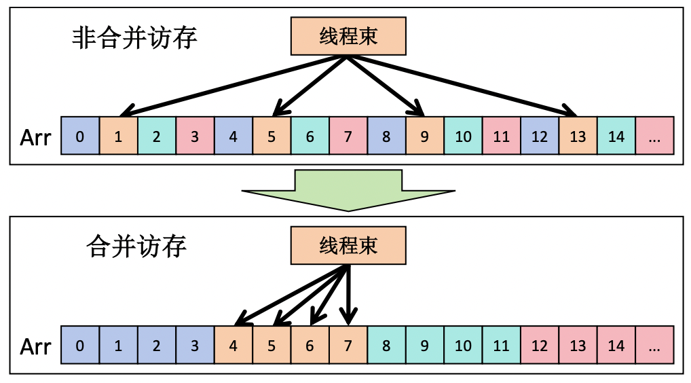
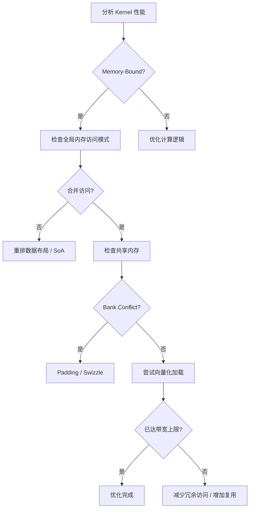
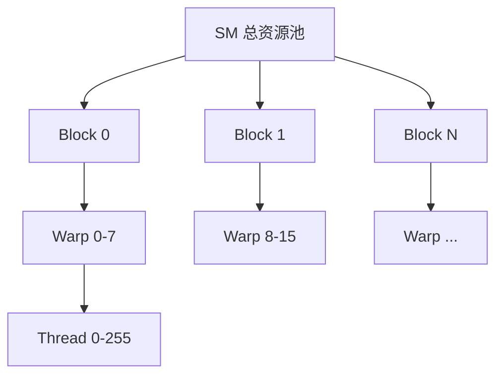
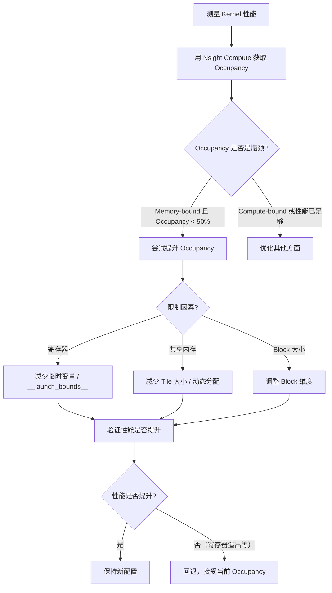
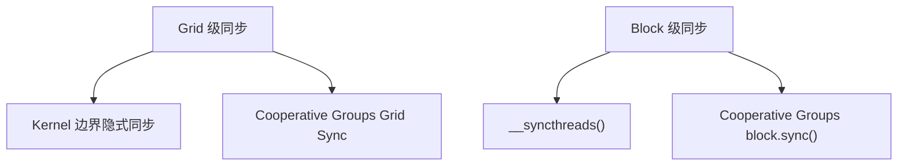
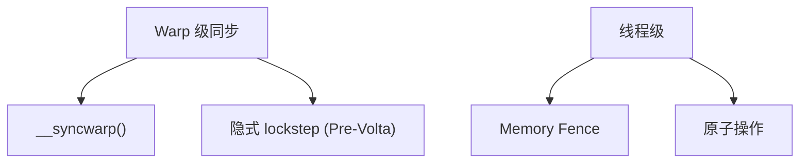

<a id="part2-ch2"></a>

# 第2部分 · 第2章：CUDA 性能优化基础

> [总索引](../README.md) ｜ [本部分目录](README.md) ｜ [上一章](ch01-CUDA编程入门.md) ｜ [下一章](ch03-经典算子实现-Reduce.md)

## 本章目录

- [本章导读](#part2-ch2)
- [2.1 Warp 与执行模型](#part2-ch2-sec1)
- [2.2 内存访问优化](#part2-ch2-sec2)
- [2.3 Occupancy 与资源分配](#part2-ch2-sec3)
- [2.4 同步与原子操作](#part2-ch2-sec4)

---

## 本章导读

> 发布 2026-04-16 · 标签 "CUDA", "Warp", "合并访问", "Occupancy", "性能优化" · [单篇原文](../articles/part2/第2章-CUDA性能优化基础.md)

### 本章简介

写出能跑的 CUDA 代码只是起点，写出跑得快的代码才是 AI Infra 工程师的核心能力。本章建立 CUDA 性能优化的核心方法论。

**Warp 与执行模型**详解 SIMT 执行模式、Warp Divergence 导致的性能损失，以及 Warp Shuffle 指令实现线程间高效数据交换。

**内存访问优化**是性能提升最大的杠杆：Coalesced Access（合并访问）决定全局内存效率，Bank Conflict 影响共享内存性能（Padding 技巧解决），向量化加载（float4/int4）进一步提升带宽利用率。

**Occupancy 与资源分配**解释 Occupancy 的定义与意义，分析影响因素（寄存器数、共享内存、Block 大小），强调 Occupancy 不是越高越好——需要在 Latency Hiding 和 Resource Utilization 之间找平衡。

**同步与原子操作**涵盖 `__syncthreads()` 块内同步和原子操作的使用与性能影响。

<a id="part2-ch2-sec1"></a>

## 2.1 Warp 与执行模型

> 发布 2026-05-09 · 标签 "CUDA", "Warp", "Warp Shuffle", "Warp Divergence", "SIMT" · [单篇原文](../articles/part2/2.1-Warp与执行模型.md)

深入理解 GPU 最核心的执行单元——Warp。本文从 SIMT 执行模型出发，详解 Warp Divergence 的性能代价与规避策略，掌握 Warp Shuffle 实现线程间零延迟数据交换，为编写高效 CUDA Kernel 奠定执行层面的认知基础。


### 1. 从硬件视角认识 Warp

想象一个教室里有 32 个学生（线程），老师（调度器）每次发出一条指令，所有学生同时执行同一个动作。这就是 Warp 的核心概念——GPU 硬件调度和执行的最小单位，固定包含 **32 个连续线程**。

#### 1.1 Warp 的形成规则

当一个 Thread Block 被分配到 SM 上时，硬件会自动将其中的线程按 `threadIdx` 顺序分组为 Warp：

| Block 中的线程 ID | 所属 Warp |
|------------------|-----------|
| 0 ~ 31 | Warp 0 |
| 32 ~ 63 | Warp 1 |
| 64 ~ 95 | Warp 2 |
| ... | ... |

📌 **关键点**：Warp 的划分是硬件行为，程序员无法干预。一个包含 256 个线程的 Block 会被拆为 8 个 Warp。如果 Block 大小不是 32 的整数倍（如 48 个线程），最后一个 Warp 中多余的线程位置会被"填充"但不执行有效工作——这会浪费硬件资源。

#### 1.2 Warp Scheduler

每个 SM 配备若干 Warp Scheduler（现代架构通常 4 个），每个时钟周期能从就绪的 Warp 中选择一个发射指令。这带来一个关键的延迟隐藏机制：

```
Warp A 发射内存读取指令 → 等待数据返回（~400 cycles）
Warp Scheduler 切换到 Warp B → 执行计算指令
切换到 Warp C → 执行计算指令
...
Warp A 数据就绪 → 重新调度执行
```

💡 **提示**：Warp 之间的切换是零开销的（zero-overhead context switch），因为每个 Warp 的寄存器状态始终驻留在 SM 上，不需要保存/恢复。这与 CPU 的线程切换有本质区别。

---

### 2. SIMT 执行模型

#### 2.1 SIMT vs SIMD

NVIDIA 将其执行模型称为 **SIMT**（Single Instruction, Multiple Threads），而非传统的 SIMD（Single Instruction, Multiple Data）。两者有微妙但重要的区别：

| 📊 对比维度 | SIMD（如 AVX-512） | SIMT（CUDA Warp） |
|------------|-------------------|--------------------|
| 编程视角 | 程序员显式操作向量寄存器 | 每个线程拥有独立的程序计数器和栈 |
| 分支处理 | 使用掩码（mask）跳过特定 lane | 硬件自动序列化分支路径 |
| 寻址灵活性 | 所有 lane 通常访问连续数据 | 每个线程可独立寻址 |
| 编程难度 | 需手动向量化 | 标量代码自动在 32 线程上并行 |

SIMT 的核心理念是：程序员写的是单线程的标量代码，硬件将相同指令广播到 32 个线程上并行执行。这大大降低了并行编程的门槛，但也引入了一个性能陷阱——分支分歧。

#### 2.2 执行流水线

一个 Warp 的指令执行流程：


关键特征：
- **同步执行**：一个 Warp 内的 32 个线程在同一时钟周期执行相同的指令
- **独立状态**：每个线程拥有自己的寄存器文件和程序计数器（逻辑上）
- **lockstep 执行**：在没有分支时，所有线程步调一致

---

### 3. Warp Divergence：分支的代价

#### 3.1 什么是 Warp Divergence

当同一个 Warp 中的线程遇到条件分支（`if/else`、`switch`、循环次数不同）时，不同线程需要走不同的执行路径。由于硬件在同一时刻只能发射一条指令，它必须**串行执行所有分支路径**，不走该路径的线程被暂时禁用（masked off）。

这就像全班同学被要求"会游泳的做俯卧撑，不会游泳的做仰卧起坐"——但体育课规定所有人必须同时做动作。结果是：所有人先做俯卧撑（不会游泳的人只是站着不动），然后所有人再做仰卧起坐（会游泳的人站着不动）。时间消耗是两个动作的总和，而非各做各的并行时间。

#### 3.2 Divergence 的性能影响

考虑以下代码：

```cpp
__global__ void divergent_kernel(float* data, int N) {
    int tid = threadIdx.x + blockIdx.x * blockDim.x;
    if (tid % 2 == 0) {
        // 偶数线程：路径A（10条指令）
        data[tid] = expf(data[tid]);
    } else {
        // 奇数线程：路径B（10条指令）
        data[tid] = logf(data[tid]);
    }
}
```

⚠️ **注意**：在上述代码中，每个 Warp 的 32 个线程中一半走 `if`、一半走 `else`。硬件需要先执行路径A（16线程活跃，16线程空闲），再执行路径B（16线程活跃，16线程空闲），总执行时间约为无分支情况的 **2倍**。

如果分支条件更细碎（如 32 个线程走 32 条不同路径），性能退化可达 **32倍**。

#### 3.3 Divergence 的量化

可以用 **Branch Efficiency** 来衡量：

$$
\text{Branch Efficiency} = \frac{\text{Non-Divergent Branches}}{\text{Total Branches}} \times 100\%
$$

使用 Nsight Compute 可以观察到每条分支指令的 Warp 活跃线程占比。理想情况下，每个分支的活跃率都是 100%（32/32）。

#### 3.4 规避策略

**策略一：让分支条件按 Warp 对齐**

```cpp
// ❌ 不推荐：相邻线程走不同分支
if (threadIdx.x % 2 == 0) { ... }

// ✅ 推荐：同一 Warp 内的线程走相同分支
if (threadIdx.x / 32 % 2 == 0) { ... }
// 或按 warpId 分支
int warpId = threadIdx.x / 32;
if (warpId < 4) { ... }
```

**策略二：用算术运算替代分支**

```cpp
// ❌ 不推荐：条件分支
if (x > 0) {
    y = x;
} else {
    y = 0;
}

// ✅ 推荐：无分支实现 ReLU
y = x * (x > 0);  // 利用 bool → int 隐式转换
// 或使用内建函数
y = fmaxf(x, 0.0f);
```

**策略三：数据重排**

将需要走同一路径的数据提前聚集到连续位置，保证同一 Warp 内的线程执行相同路径：

```cpp
// 预处理：将正数和负数分别聚集
// 正数放 data[0..pos_count-1]
// 负数放 data[pos_count..N-1]
// 这样处理正数的 Warp 不会有分支分歧
```

**策略四：循环退出条件统一化**
简单说：把"线程何时退出循环"的不确定性，转化为"循环体内是否执行"的 predication，所有线程走完全相同的循环结构，分支预测更友好，指令缓存利用率更高，对 GPU 的 SIMT 执行模型更友好。

```cpp
// ❌ 不推荐：每个线程循环次数不同
for (int i = 0; i < array_length[tid]; i++) {
    // 处理逻辑
}

// ✅ 推荐：统一循环次数，内部用条件屏蔽
int max_len = block_max_length;  // 块内最大值
for (int i = 0; i < max_len; i++) {
    if (i < array_length[tid]) {
        // 处理逻辑
    }
}
```

#### 3.5 Independent Thread Scheduling（Volta+）

从 Volta 架构开始，NVIDIA 引入了**独立线程调度**（Independent Thread Scheduling）。每个线程拥有真正独立的程序计数器和调用栈，这意味着：

- 分支分歧时，硬件可以更灵活地交错执行不同路径
- 支持线程级的同步原语（如 `__syncwarp()`）
- Warp 内的线程可以在不同代码位置

⚠️ **注意**：独立线程调度**并不消除** Divergence 的性能代价，它只是让调度更灵活。要获得最佳性能，仍然应尽量避免同一 Warp 内的分支分歧。

---

### 4. Warp Shuffle：线程间数据交换利器

#### 4.1 为什么需要 Warp Shuffle

传统的线程间数据交换需要通过共享内存：

```
线程A写入共享内存 → __syncthreads() → 线程B读取共享内存
```

这有两个问题：(1) 需要消耗宝贵的共享内存资源；(2) 需要同步屏障带来延迟。

Warp Shuffle 让同一 Warp 内的线程可以**直接读取彼此的寄存器值**，无需经过任何共享内存，也不需要显式同步——就像同学之间直接传纸条，不用先放到讲台上再取。

#### 4.2 四种 Shuffle 指令

所有 Shuffle 指令的签名形式：

```cpp
T __shfl_sync(unsigned mask, T var, int srcLane, int width=32);
T __shfl_up_sync(unsigned mask, T var, unsigned delta, int width=32);
T __shfl_down_sync(unsigned mask, T var, unsigned delta, int width=32);
T __shfl_xor_sync(unsigned mask, T var, int laneMask, int width=32);
```

| 📊 指令 | 功能 | 源 Lane 计算 |
|---------|------|-------------|
| `__shfl_sync` | 从指定 lane 读取 | `srcLane` |
| `__shfl_up_sync` | 从低编号 lane 读取 | `laneId - delta` |
| `__shfl_down_sync` | 从高编号 lane 读取 | `laneId + delta` |
| `__shfl_xor_sync` | 与 XOR 配对的 lane 交换 | `laneId ^ laneMask` |

参数说明：
- `mask`：参与 Shuffle 的线程掩码，通常用 `0xFFFFFFFF` 表示所有 32 个线程参与
- `var`：当前线程要分享的值
- `width`：逻辑子 Warp 宽度（可以是 2、4、8、16、32）

#### 4.3 图解 Shuffle 操作

以 8 线程为例（实际是 32 线程，此处简化演示）：

```
初始状态：Lane[0]=A  Lane[1]=B  Lane[2]=C  Lane[3]=D  Lane[4]=E  Lane[5]=F  Lane[6]=G  Lane[7]=H

__shfl_down_sync(mask, var, 2):
  Lane[0] 得到 Lane[2] 的值 C
  Lane[1] 得到 Lane[3] 的值 D
  Lane[2] 得到 Lane[4] 的值 E
  ...

__shfl_xor_sync(mask, var, 1):  （相邻两两交换）
  Lane[0] ↔ Lane[1]
  Lane[2] ↔ Lane[3]
  Lane[4] ↔ Lane[5]
  Lane[6] ↔ Lane[7]
```

#### 4.4 实用示例：Warp 内广播

```cpp
__device__ float warp_broadcast(float val, int srcLane) {
    // 所有线程获取 srcLane 线程的 val 值
    return __shfl_sync(0xFFFFFFFF, val, srcLane);
}

// 使用：让 Warp 内所有线程知道 lane 0 的计算结果
float result = compute_something();
float broadcast_val = warp_broadcast(result, 0);
```

#### 4.5 实用示例：Warp 内求和

```cpp
__device__ float warp_reduce_sum(float val) {
    // 蝶形归约：log2(32) = 5 步完成
    for (int offset = 16; offset > 0; offset >>= 1) {
        val += __shfl_down_sync(0xFFFFFFFF, val, offset);
    }
    return val;  // 只有 lane 0 持有正确结果
}
```

归约过程可视化（以 8 线程为例）：

```
初始: [1] [2] [3] [4] [5] [6] [7] [8]

Step 1 (offset=4): 每个线程加上偏移4处线程的值
       [1+5] [2+6] [3+7] [4+8] [5] [6] [7] [8]
       = [6]  [8]  [10]  [12]

Step 2 (offset=2): 每个线程加上偏移2处线程的值
       [6+10] [8+12] [10] [12] ...
       = [16]  [20]

Step 3 (offset=1): 每个线程加上偏移1处线程的值
       [16+20] [20] ...
       = [36]    ← lane 0 持有所有元素之和
```

---

### 5. Warp 级原语与进阶技巧

#### 5.1 Warp Vote 函数

Warp Vote 函数让整个 Warp 对一个布尔条件进行"投票"：

```cpp
// 所有线程的 predicate 都为 true 时返回 true
int __all_sync(unsigned mask, int predicate);

// 任意线程的 predicate 为 true 时返回 true
int __any_sync(unsigned mask, int predicate);

// 返回一个 32-bit 位图，每个 bit 对应一个 lane 的 predicate 值
unsigned __ballot_sync(unsigned mask, int predicate);
```

实用场景——提前退出优化：

```cpp
__global__ void search_kernel(int* data, int target, int* found) {
    int tid = threadIdx.x + blockIdx.x * blockDim.x;
    int pred = (data[tid] == target);

    // 如果 Warp 内所有线程都没找到，整个 Warp 可以跳过后续处理
    if (__any_sync(0xFFFFFFFF, pred)) {
        // 至少一个线程找到了目标
        if (pred) {
            atomicExch(found, tid);
        }
    }
}
```

#### 5.2 __activemask() 与 __syncwarp()

```cpp
// 获取当前活跃线程的掩码（Volta+ 才有意义）
unsigned mask = __activemask();

// Warp 内同步屏障（确保指定线程完成前序操作）
__syncwarp(0xFFFFFFFF);
```

💡 **提示**：`__syncwarp()` 在 Volta 之前的架构上通常是空操作（因为 Warp 天然是 lockstep 的），但从 Volta 开始由于独立线程调度，显式的 Warp 同步变得必要。

#### 5.3 Warp Match 函数（Volta+）

```cpp
// 返回具有相同 val 值的线程掩码
unsigned __match_any_sync(unsigned mask, T val);

// 如果所有参与线程的 val 相同，返回全体掩码；否则返回 0
unsigned __match_all_sync(unsigned mask, T val, int* pred);
```

应用：自动分组具有相同 key 的线程，用于 warp 级的 group-by 操作。

#### 5.4 `width` 参数的妙用

Shuffle 指令的 `width` 参数可以将一个 Warp 逻辑划分为多个子 Warp：

```cpp
// 将 32 线程的 Warp 视为 4 个独立的 8 线程子组
// 每个子组内独立进行归约
float sub_warp_sum(float val) {
    for (int offset = 4; offset > 0; offset >>= 1) {
        val += __shfl_down_sync(0xFFFFFFFF, val, offset, 8);
    }
    return val;
}
// Lane 0, 8, 16, 24 分别持有各自子组的累加和
```

---

### 6. 实战案例：Warp 级归约

#### 6.1 完整的 Block 级归约实现

结合 Warp Shuffle 与共享内存实现一个高效的 Block 级求和：

```cpp
__device__ float warp_reduce_sum(float val) {
    for (int offset = 16; offset > 0; offset >>= 1) {
        val += __shfl_down_sync(0xFFFFFFFF, val, offset);
    }
    return val;
}

__global__ void block_reduce_kernel(float* input, float* output, int N) {
    int tid = threadIdx.x + blockIdx.x * blockDim.x;

    // 每个线程加载一个元素
    float val = (tid < N) ? input[tid] : 0.0f;

    // 第一步：Warp 内归约
    val = warp_reduce_sum(val);

    // 第二步：每个 Warp 的 lane 0 将结果写入共享内存
    __shared__ float warp_sums[32];  // 最多 32 个 Warp（1024线程/32）
    int laneId = threadIdx.x % 32;
    int warpId = threadIdx.x / 32;

    if (laneId == 0) {
        warp_sums[warpId] = val;
    }
    __syncthreads();

    // 第三步：第一个 Warp 对 warp_sums 做最终归约
    int numWarps = blockDim.x / 32;
    val = (threadIdx.x < numWarps) ? warp_sums[threadIdx.x] : 0.0f;

    if (warpId == 0) {
        val = warp_reduce_sum(val);
    }

    // lane 0 写出本 Block 的归约结果
    if (threadIdx.x == 0) {
        output[blockIdx.x] = val;
    }
}
```

#### 6.2 性能对比

| 📊 归约方式 | 共享内存用量 | 同步次数 | 指令数（256线程Block） |
|------------|-------------|---------|----------------------|
| 纯共享内存（逐步折半） | 1024B | 8 次 `__syncthreads()` | ~64 |
| Warp Shuffle + 共享内存 | 128B（32个float） | 1 次 `__syncthreads()` | ~13 |

Warp Shuffle 版本的优势：
- ✅ 大幅减少共享内存消耗（释放给其他用途）
- ✅ 减少同步屏障开销
- ✅ 利用寄存器到寄存器的通信，延迟极低

---

### 📝 总结

| 核心概念 | 要点 |
|---------|------|
| Warp 基础 | 32 线程为一组的硬件调度单元，零开销上下文切换实现延迟隐藏 |
| SIMT 模型 | 标量代码 + 32 路并行，编程简单但需注意分支 |
| Warp Divergence | 同一 Warp 内走不同分支时串行执行，最坏 32x 性能退化 |
| 规避策略 | 按 Warp 对齐分支、用算术替代 if、数据重排、统一循环 |
| Warp Shuffle | 寄存器级的线程间通信，零延迟无需共享内存 |
| Warp Vote | `__all_sync` / `__any_sync` / `__ballot_sync`，集体决策 |
| 实战归约 | Shuffle 归约 + 少量共享内存 = 最优 Block 级归约 |

---

### 🎯 自我检验清单

- 能解释 Warp 的大小为什么是 32 以及 Warp 的形成规则
- 能说明 SIMT 与 SIMD 的核心区别
- 能识别代码中的 Warp Divergence 并估算其性能影响
- 能将含有 `if/else` 的 Kernel 改写为无分支或 Warp 对齐的版本
- 能正确使用四种 Warp Shuffle 指令（`shfl`/`shfl_up`/`shfl_down`/`shfl_xor`）
- 能用 Warp Shuffle 实现 Warp 级归约（sum/max/min）
- 能解释 `width` 参数的作用并实现子 Warp 归约
- 能结合 Shuffle 和共享内存完成 Block 级归约
- 能使用 `__ballot_sync` 实现 Warp 级的条件筛选
- 能说明 Volta 独立线程调度对编程的影响

---

### 📚 参考资料

- [NVIDIA CUDA C++ Programming Guide - Warp Shuffle Functions](https://docs.nvidia.com/cuda/cuda-c-programming-guide/index.html#warp-shuffle-functions)
- [NVIDIA CUDA C++ Programming Guide - SIMT Architecture](https://docs.nvidia.com/cuda/cuda-c-programming-guide/index.html#simt-architecture)
- [NVIDIA Volta Architecture Whitepaper](https://images.nvidia.com/content/volta-architecture/pdf/volta-architecture-whitepaper.pdf)
- [Using CUDA Warp-Level Primitives - NVIDIA Developer Blog](https://developer.nvidia.com/blog/using-cuda-warp-level-primitives/)
- [Faster Parallel Reductions on Kepler - NVIDIA Developer Blog](https://developer.nvidia.com/blog/faster-parallel-reductions-kepler/)

---

<a id="part2-ch2-sec2"></a>

## 2.2 内存访问优化

> 发布 2026-05-12 · 标签 "CUDA", "合并访问", "Bank Conflict", "向量化加载", "内存优化" · [单篇原文](../articles/part2/2.2-内存访问优化.md)

内存访问效率是 CUDA Kernel 性能最大的杠杆。本文深入讲解合并访问（Coalesced Access）的原理与判定方法、共享内存 Bank Conflict 的成因与 Padding 解决方案，以及向量化加载（float4/int4）提升带宽利用率的实战技巧。


### 1. 为什么内存访问是性能瓶颈

GPU 像一个巨大的工厂——车间里有几千台机器（计算核心）同时运转，但原料仓库（显存）只有一条搬运通道（内存总线）。无论工厂的机器多快，如果搬运通道被堵住，整条生产线都只能等着。

做一道算术：A100 的峰值计算能力为 312 TFLOPS（FP16 Tensor Core），而 HBM2e 带宽约 2 TB/s。对于一个简单的向量加法 `c[i] = a[i] + b[i]`：

$$
\text{Arithmetic Intensity} = \frac{\text{1 FLOP}}{\text{12 Bytes (读2写1)}} \approx 0.083 \text{ FLOP/Byte}
$$

$$
\text{带宽可支撑的计算量} = 2 \text{ TB/s} \times 0.083 = 166 \text{ GFLOPS}
$$

只有峰值算力的 0.05%。因此，**优化内存访问模式往往比优化计算逻辑更能提升性能**。

#### 1.1 Roofline 模型快速回顾

Roofline 模型将 Kernel 分为两类：

- **Memory-Bound**：受带宽限制，优化方向是减少内存访问、提高访问效率
- **Compute-Bound**：受计算限制，优化方向是提高计算并行度

大多数 Kernel（特别是 Elementwise、归约、矩阵转置等）都是 Memory-Bound。对它们而言，合并访问和高效的内存使用模式才是性能关键。

---

### 2. 全局内存与合并访问

#### 2.1 合并访问的原理

全局内存的访问以 **Warp** 为单位进行事务（transaction）合并。当一个 Warp 的 32 个线程同时发起内存读写时，硬件会尝试将这些请求合并为最少的内存事务。

每个内存事务的粒度为 **32 Bytes**（一个 cache line sector）。L1 cache line 为 128 Bytes，由 4 个 32B sector 组成。

💡 **提示**：合并访问的核心原则很简单——让 Warp 内的连续线程访问连续的内存地址。



#### 2.2 合并 vs 非合并的性能差异

```cpp
// ✅ 合并访问：连续线程访问连续地址
// 1个 Warp 的 32 线程访问连续 128B，恰好落在 1 条 cache line 内
__global__ void coalesced_read(float* data, float* out, int N) {
    int tid = threadIdx.x + blockIdx.x * blockDim.x;
    if (tid < N) {
        out[tid] = data[tid];  // data[0], data[1], ..., data[31] 连续
    }
}

// ❌ 非合并（跳跃访问）：连续线程访问间隔地址
// stride=32 时，每个线程的地址相差 128B，需 32 个事务
__global__ void strided_read(float* data, float* out, int N, int stride) {
    int tid = threadIdx.x + blockIdx.x * blockDim.x;
    if (tid < N) {
        out[tid] = data[tid * stride];  // data[0], data[32], data[64], ...
    }
}
```

性能对比（A100，读取 1GB 数据）：

| 📊 访问模式 | 内存事务数 | 有效带宽利用率 | 相对耗时 |
|------------|-----------|--------------|---------|
| 连续对齐（stride=1） | 1x | ~95% | 1x |
| stride=2 | 2x | ~50% | 2x |
| stride=4 | 4x | ~25% | 4x |
| stride=32 | 32x | ~3% | 32x |
| 完全随机 | 32x | ~3% | 32x |

#### 2.3 对齐要求

除了连续性，对齐也很重要：

```cpp
// ✅ 对齐访问：起始地址是 128B 的倍数
float* aligned_ptr = data;  // cudaMalloc 保证 256B 对齐
out[tid] = aligned_ptr[tid];

// ⚠️ 偏移访问：起始地址未对齐，可能多出一个事务
out[tid] = data[tid + 1];  // 起始地址偏移 4B，不再 128B 对齐
```

好消息是 `cudaMalloc` 分配的内存始终 256 Bytes 对齐，所以只要从头开始连续访问通常不会有对齐问题。需要注意的是手动指针偏移的情况。

#### 2.4 结构体数组 vs 数组结构体

这是经典的 AoS vs SoA 问题：

```cpp
// ❌ AoS（Array of Structures）：不利于合并访问
struct Particle {
    float x, y, z, w;
};
Particle particles[N];
// 访问所有 x：particles[0].x, particles[1].x, ...
// 地址跳跃：0, 16, 32, 48, ... （stride=4）

// ✅ SoA（Structure of Arrays）：利于合并访问
struct ParticlesSoA {
    float x[N], y[N], z[N], w[N];
};
ParticlesSoA particles;
// 访问所有 x：particles.x[0], particles.x[1], ...
// 地址连续：0, 4, 8, 12, ... （stride=1）
```

📌 **关键点**：在 GPU 编程中，**SoA 几乎总是优于 AoS**，因为 GPU 的 Warp 并行模式天然适合连续线程访问连续字段。

#### 2.5 二维数组的行列访问

```cpp
// 二维数组按行存储（Row-Major），element[row][col] 在地址 row*cols+col
// ✅ 行方向遍历：连续线程访问同一行的连续列
int col = threadIdx.x + blockIdx.x * blockDim.x;
int row = blockIdx.y;
float val = matrix[row * cols + col];  // 合并

// ❌ 列方向遍历：连续线程访问同一列的连续行
int row2 = threadIdx.x + blockIdx.x * blockDim.x;
int col2 = blockIdx.y;
float val2 = matrix[row2 * cols + col2];  // stride = cols，极差
```

---

### 3. 共享内存与 Bank Conflict

#### 3.1 共享内存的 Bank 结构

共享内存被划分为 **32 个 Bank**（与 Warp 大小一致），每个 Bank 宽 4 Bytes（32 bits）。连续的 4 Byte 字被分配到连续的 Bank：

```
地址 0~3:   Bank 0
地址 4~7:   Bank 1
地址 8~11:  Bank 2
...
地址 124~127: Bank 31
地址 128~131: Bank 0  （循环）
...
```

每个时钟周期，每个 Bank 只能服务一次读或写请求。如果同一个 Warp 中有多个线程访问**同一个 Bank 的不同地址**，这些访问必须串行化——这就是 Bank Conflict。

#### 3.2 Bank Conflict 的类型与代价

| 📊 冲突类型 | 含义 | 性能影响 |
|------------|------|---------|
| 无冲突（No Conflict） | 32 线程访问 32 个不同 Bank | 1 个周期完成 |
| 2-way Conflict | 2 个线程访问同一 Bank | 2 个周期（串行化） |
| N-way Conflict | N 个线程访问同一 Bank | N 个周期 |
| 广播（Broadcast） | 多个线程访问同一 Bank 的**同一地址** | 1 个周期（免费） |

⚠️ **注意**：广播是特殊情况——如果多个线程读的是同一个地址（完全相同），硬件会广播该值给所有请求线程，不算冲突。只有"同一 Bank，不同地址"才会产生冲突。

#### 3.3 经典冲突场景：矩阵转置

```cpp
// 朴素矩阵转置（Naive Transpose）
__shared__ float tile[32][32];

// 写入时：连续线程写同一行的不同列 → 无冲突
tile[threadIdx.y][threadIdx.x] = input[gy * N + gx];

// 读取时：连续线程读同一列的不同行
output[gx * N + gy] = tile[threadIdx.x][threadIdx.y];
// threadIdx.x=0 → tile[0][ty], 地址= (0*32+ty)*4 = ty*4 → Bank = ty%32
// threadIdx.x=1 → tile[1][ty], 地址= (1*32+ty)*4 → Bank = (32+ty)%32 = ty%32
// threadIdx.x=2 → tile[2][ty], 地址= (2*32+ty)*4 → Bank = (64+ty)%32 = ty%32
// 所有线程的 Bank 相同（= ty%32）→ 32-way Bank Conflict！
```

#### 3.4 解决方案一：Padding

在共享内存声明中额外加一列，打破 32 的倍数对齐：

```cpp
// ✅ 添加 1 列 Padding
__shared__ float tile[32][32 + 1];  // 33 列

// 原本 tile[row][col] 地址 = (row * 32 + col) * 4
// 现在 tile[row][col] 地址 = (row * 33 + col) * 4
// Bank = (row * 33 + col) % 32

// 读取 tile[threadIdx.x][ty]：
// threadIdx.x=0 → Bank = (0*33+ty)%32 = ty%32
// threadIdx.x=1 → Bank = (1*33+ty)%32 = (33+ty)%32 = (1+ty)%32
// threadIdx.x=2 → Bank = (2*33+ty)%32 = (66+ty)%32 = (2+ty)%32
// 每个线程访问不同的 Bank → 无冲突！
```

Padding 的代价是每行多浪费 4 Bytes 共享内存，但带来的性能提升通常远超这点开销。

#### 3.5 解决方案二：Swizzle（高级）

对于某些访问模式，可以使用地址变换（Swizzle）来避免冲突：

```cpp
// Swizzle 思路：将线性索引通过 XOR 变换打乱 Bank 分布
__device__ int swizzle_index(int row, int col) {
    return row * 32 + (col ^ row);  // XOR 变换
}

// 写入
tile[row][col ^ row] = input_val;
// 读取
float val = tile[col][row ^ col];
```

Swizzle 不浪费额外空间，但增加了索引计算的复杂度。在高性能 GEMM 实现（如 CUTLASS）中广泛使用。

#### 3.6 如何检测 Bank Conflict

使用 **Nsight Compute** 观察共享内存指标：

```
l1tex__data_bank_conflicts_pipe_lsu_mem_shared_op_ld  # 加载冲突
l1tex__data_bank_conflicts_pipe_lsu_mem_shared_op_st  # 存储冲突
```

如果这两个计数器不为零，说明存在 Bank Conflict，需要检查共享内存的访问模式。

---

### 4. 向量化加载

#### 4.1 什么是向量化加载

向量化加载指的是用一条指令读取多个连续元素（如 `float4` 一次读 4 个 float，16 Bytes）。好处是：

1. **减少指令数**：4 次 `LDG.32` → 1 次 `LDG.128`
2. **提高带宽利用率**：单次事务传输更多有效数据
3. **减少调度开销**：更少的内存指令排队

#### 4.2 常用向量类型

| 📊 类型 | 大小 | 等价 |
|---------|------|------|
| `float2` | 8 Bytes | 2 个 float |
| `float4` | 16 Bytes | 4 个 float |
| `int4` | 16 Bytes | 4 个 int |
| `double2` | 16 Bytes | 2 个 double |

💡 **提示**：GPU 一条 cache line 为 128 Bytes。一个 Warp 的 32 个线程每人加载一个 `float4`（16B）= 512B，需要请求 4 条 cache line。对比每人加载一个 `float`（4B）= 128B 只需 1 条 cache line。虽然 cache line 请求数增多了，但每条加载指令处理的数据量是 4 倍，总指令数减少 75%。

#### 4.3 基本用法

```cpp
// 标量版本：每个线程加载 1 个 float
__global__ void scalar_copy(float* dst, float* src, int N) {
    int tid = threadIdx.x + blockIdx.x * blockDim.x;
    if (tid < N) {
        dst[tid] = src[tid];
    }
}

// 向量化版本：每个线程加载 4 个 float
__global__ void vectorized_copy(float* dst, float* src, int N) {
    int tid = threadIdx.x + blockIdx.x * blockDim.x;
    int idx = tid * 4;  // 每个线程负责4个元素

    if (idx + 3 < N) {
        // 将 float* 强制转换为 float4*，一条指令读取 16B
        float4 val = reinterpret_cast<float4*>(src)[tid];
        reinterpret_cast<float4*>(dst)[tid] = val;
    }
}
```

#### 4.4 对齐要求

向量化加载有严格的对齐要求：

```cpp
// float4 要求 16B 对齐
// cudaMalloc 分配的地址是 256B 对齐的 → 满足

// 但如果有偏移，需要特殊处理
float* base = ...; // 256B 对齐
float* offset_ptr = base + 3;  // 偏移 12B，不满足 16B 对齐

// ✅ 安全做法：先标量处理头部未对齐部分，再向量化处理主体
__global__ void safe_vectorized(float* data, int offset, int N) {
    // 处理头部未对齐的元素
    int align_offset = (4 - (offset % 4)) % 4;
    // ... 标量处理前 align_offset 个元素

    // 主体向量化处理
    float4* aligned_ptr = reinterpret_cast<float4*>(data + offset + align_offset);
    // ...
}
```

#### 4.5 实用模式：向量化归约

```cpp
__global__ void vectorized_sum(float* input, float* output, int N) {
    int tid = threadIdx.x + blockIdx.x * blockDim.x;
    int stride = blockDim.x * gridDim.x;

    float sum = 0.0f;

    // 每次迭代处理4个元素
    int vec_N = N / 4;
    float4* vec_input = reinterpret_cast<float4*>(input);

    for (int i = tid; i < vec_N; i += stride) {
        float4 val = vec_input[i];
        sum += val.x + val.y + val.z + val.w;
    }

    // 处理尾部不足4个的元素
    int tail_start = vec_N * 4;
    for (int i = tail_start + tid; i < N; i += stride) {
        sum += input[i];
    }

    // 后续做 Block 归约...
    output[blockIdx.x] = sum;  // 简化，实际需要归约
}
```

#### 4.6 何时使用向量化加载

| ✅ 适合场景 | ❌ 不适合场景 |
|------------|-------------|
| Elementwise 操作（加减乘除） | 复杂的索引模式（gather/scatter） |
| 大规模数据拷贝/初始化 | 数据量不是 4 的倍数且无法处理尾部 |
| 带宽受限的 Kernel | 计算密集型 Kernel（瓶颈不在访存） |
| 数据地址可保证对齐 | 起始地址无法对齐 |

---

### 5. 内存访问优化实战

#### 5.1 案例：矩阵转置优化

矩阵转置是内存访问优化的经典教科书案例，因为它不涉及任何计算，性能完全取决于内存访问效率。

**朴素版本**：

```cpp
__global__ void transpose_naive(float* out, float* in, int width, int height) {
    int col = threadIdx.x + blockIdx.x * blockDim.x;
    int row = threadIdx.y + blockIdx.y * blockDim.y;
    if (col < width && row < height) {
        out[col * height + row] = in[row * width + col];
        // 读取：合并（连续线程访问连续列）
        // 写入：不合并（stride = height）
    }
}
```

**共享内存优化版本**：

```cpp
// 每个线程处理 TILE_DIM / BLOCK_ROWS 个元素
#define TILE_DIM 32
#define BLOCK_ROWS 8

__global__ void transpose_shared(float* out, float* in, int width, int height) {
    __shared__ float tile[TILE_DIM][TILE_DIM + 1];  // +1 Padding 消除 Bank Conflict

    int x = blockIdx.x * TILE_DIM + threadIdx.x;
    int y = blockIdx.y * TILE_DIM + threadIdx.y;

    // 合并读取：每个 warp 读取连续元素
    for (int j = 0; j < TILE_DIM; j += BLOCK_ROWS) {
        if (x < width && (y + j) < height) {
            tile[threadIdx.y + j][threadIdx.x] = in[(y + j) * width + x];
        }
    }

    __syncthreads();

    // 合并写入：转置后的索引，连续线程写连续地址
    x = blockIdx.y * TILE_DIM + threadIdx.x;
    y = blockIdx.x * TILE_DIM + threadIdx.y;

    for (int j = 0; j < TILE_DIM; j += BLOCK_ROWS) {
        if (x < height && (y + j) < width) {
            out[(y + j) * height + x] = tile[threadIdx.x][threadIdx.y + j];
        }
    }
}

// 调用方式：
// dim3 block(TILE_DIM, BLOCK_ROWS);
// dim3 grid((width + TILE_DIM - 1) / TILE_DIM, (height + TILE_DIM - 1) / TILE_DIM);
```

核心思路：用共享内存做"中转站"，将全局内存的非合并写入转化为共享内存的列读取（通过 Padding 消除 Bank Conflict），再以合并方式写出。

#### 5.2 案例：归约操作中的内存优化

```cpp
// ❌ 朴素归约：交错访问导致 Bank Conflict 和低带宽利用
__global__ void reduce_interleaved(float* input, float* output, int N) {
    int tid = threadIdx.x;
    int idx = blockIdx.x * blockDim.x + tid;
    __shared__ float sdata[256];
    sdata[tid] = (idx < N) ? input[idx] : 0.0f;
    __syncthreads();

    for (int s = 1; s < blockDim.x; s *= 2) {
        if (tid % (2 * s) == 0) {
            sdata[tid] += sdata[tid + s];
        }
        __syncthreads();
    }
    if (tid == 0) output[blockIdx.x] = sdata[0];
}

// ✅ 优化归约：连续线程操作连续地址
__global__ void reduce_sequential(float* input, float* output, int N) {
    int tid = threadIdx.x;
    int idx = blockIdx.x * blockDim.x + tid;
    __shared__ float sdata[256];
    sdata[tid] = (idx < N) ? input[idx] : 0.0f;
    __syncthreads();

    for (int s = blockDim.x / 2; s > 0; s >>= 1) {
        if (tid < s) {
            sdata[tid] += sdata[tid + s];
        }
        __syncthreads();
    }
    if (tid == 0) output[blockIdx.x] = sdata[0];
}
```

---

### 6. 高级技巧与工具

#### 6.1 缓存提示（Cache Hints）

CUDA 提供内存访问的缓存策略控制：

```cpp
// 使用 __ldg() 通过只读数据缓存（texture cache）加载
// 适合只读数据，可避免 L1 缓存污染
float val = __ldg(&input[tid]);

// PTX 级别的缓存控制（通过 inline asm 或编译器 flag）
// .ca (cache all levels) — 默认，缓存到 L1 和 L2
// .cg (cache global) — 只缓存到 L2，跳过 L1
// .cs (cache streaming) — 标记为流式数据，优先级低
// .cv (cache volatile) — 不缓存，每次都从显存读
```

#### 6.2 内存访问分析工具

使用 Nsight Compute 的关键指标：

```
# 全局内存效率
sm__sass_average_data_bytes_per_sector_mem_global_op_ld  # 理想128B
l1tex__t_sectors_pipe_lsu_mem_global_op_ld  # 实际事务数

# 计算带宽利用率
gpu__compute_memory_throughput  # 实际吞吐
dram__bytes_read + dram__bytes_write  # 实际传输量
```

#### 6.3 优化决策流程图



---

### 📝 总结

| 优化技术 | 核心要点 | 收益 |
|---------|---------|------|
| 合并访问 | 连续线程访问连续地址，SoA 优于 AoS | 最高 32x 带宽差异 |
| 对齐访问 | 起始地址对齐到 128B 边界 | 避免额外事务 |
| Padding | 共享内存 `[N][N+1]` 打破 Bank 周期 | 消除 Bank Conflict |
| 向量化加载 | `float4` / `int4` 一次读 16B | 减少 75% 指令数 |
| 缓存提示 | `__ldg()`、cache policy 控制 | 减少缓存污染 |
| 数据布局 | AoS → SoA，行列互换 | 结构性解决合并问题 |

---

### 🎯 自我检验清单

- 能判断给定的内存访问模式是否满足合并访问条件
- 能计算一个 Warp 的全局内存访问需要多少个 32B 事务
- 能将 AoS 数据结构改写为 SoA 以实现合并访问
- 能解释共享内存 Bank 的编址方式及 Bank Conflict 的产生原因
- 能对存在 32-way Bank Conflict 的代码添加 Padding 解决冲突
- 能正确使用 `float4` 向量类型实现向量化加载和存储
- 能处理向量化加载中的对齐问题和尾部元素
- 能使用共享内存将非合并的全局内存写入转化为合并写入
- 能用 Nsight Compute 识别内存效率相关的性能指标
- 能对矩阵转置 Kernel 应用完整的内存访问优化链

---

### 📚 参考资料

- [NVIDIA CUDA C++ Programming Guide - Memory Hierarchy](https://docs.nvidia.com/cuda/cuda-c-programming-guide/index.html#memory-hierarchy)
- [NVIDIA CUDA C++ Best Practices Guide - Memory Optimizations](https://docs.nvidia.com/cuda/cuda-c-best-practices-guide/index.html#memory-optimizations)
- [An Efficient Matrix Transpose in CUDA C/C++ - NVIDIA Developer Blog](https://developer.nvidia.com/blog/efficient-matrix-transpose-cuda-cc/)
- [How to Access Global Memory Efficiently in CUDA C/C++ Kernels - NVIDIA Developer Blog](https://developer.nvidia.com/blog/how-access-global-memory-efficiently-cuda-c-kernels/)
- [CUTLASS: CUDA Templates for Linear Algebra Subroutines - GitHub](https://github.com/NVIDIA/cutlass)

---

<a id="part2-ch2-sec3"></a>

## 2.3 Occupancy 与资源分配

> 发布 2026-05-12 · 标签 "CUDA", "Occupancy", "寄存器", "共享内存", "延迟隐藏" · [单篇原文](../articles/part2/2.3-Occupancy与资源分配.md)

Occupancy 衡量 SM 上实际活跃 Warp 数与理论最大值的比例，是调优 CUDA Kernel 的核心指标之一。本文讲解 Occupancy 的定义、计算方法、三大限制因素（寄存器/共享内存/Block 大小），以及为什么 Occupancy 并非越高越好——真正的目标是在延迟隐藏与资源利用之间找到平衡点。


### 1. Occupancy 是什么

想象一个停车场有 64 个车位（SM 最大可驻留的 Warp 数），如果当前只有 32 辆车停着，停车场利用率就是 50%。Occupancy 就是 GPU 中 SM 的"停车场利用率"——它告诉你硬件资源被用了多少。

#### 1.1 正式定义

$$
\text{Occupancy} = \frac{\text{每个 SM 上活跃 Warp 数}}{\text{每个 SM 支持的最大 Warp 数}}
$$

例如在 A100（Compute Capability 8.0）上：
- 每个 SM 最大支持 64 个 Warp（2048 个线程）
- 如果你的 Kernel 由于资源限制只能在每个 SM 上运行 32 个 Warp
- 那么 Occupancy = 32/64 = 50%

#### 1.2 为什么 Occupancy 重要

Occupancy 的核心价值在于**延迟隐藏**（Latency Hiding）。GPU 的执行模型依赖 Warp 切换来掩盖内存访问延迟：

```
时间线：
Warp 0: [计算] [等待内存...400cycles...] [计算]
Warp 1:        [计算] [等待内存...400cycles...] [计算]
Warp 2:               [计算] [等待内存...400cycles...]
...

如果活跃 Warp 足够多，调度器总能找到就绪的 Warp 来填充等待期
```

需要多少 Warp 才能完全隐藏延迟？一个粗略估算：

$$
\text{所需 Warp 数} \geq \frac{\text{内存延迟（cycles）}}{\text{每条指令的执行周期}} = \frac{400}{4} = 100
$$

但由于一个 SM 最多 64 个 Warp，实际中无法完全隐藏延迟——这正是为什么要让 Occupancy 尽可能高（但不是唯一目标）。

---

### 2. SM 的资源清单

每个 SM 有一组固定的硬件资源，所有驻留在其上的 Block 共享这些资源。理解资源上限是计算 Occupancy 的基础。

#### 2.1 主要架构资源对比

| 📊 资源 | Ampere (A100) | Ada (RTX 4090) | Hopper (H100) |
|---------|---------------|----------------|---------------|
| 每 SM 最大线程数 | 2048 | 1536 | 2048 |
| 每 SM 最大 Warp 数 | 64 | 48 | 64 |
| 每 SM 最大 Block 数 | 32 | 16 | 32 |
| 每 SM 寄存器总数 | 65536 | 65536 | 65536 |
| 每线程最大寄存器数 | 255 | 255 | 255 |
| 每 SM 共享内存上限 | 164 KB | 100 KB | 228 KB |
| 每 Block 最大共享内存 | 163 KB | 99 KB | 227 KB |
| 每 Block 最大线程数 | 1024 | 1024 | 1024 |

#### 2.2 资源分配的层级关系



📌 **关键点**：资源以 **Block 为单位**分配。一个 Block 要么完整进入 SM，要么完全不进入——不存在半个 Block 驻留的情况。因此，如果一个 Block 占用的资源刚好超过 SM 剩余资源的一半多一点，那整个剩余空间就浪费了。

---

### 3. 影响 Occupancy 的三大因素

#### 3.1 因素一：寄存器用量

每个线程使用的寄存器数量是最常见的 Occupancy 限制因素。

**计算逻辑**：

$$
\text{每 SM 可驻留线程数} = \lfloor \frac{\text{SM 寄存器总数}}{\text{每线程寄存器数}} \rfloor
$$

但实际分配要满足粒度约束。寄存器以 **256 个为一组**（Allocation Granularity）分配给一个 Warp。即每个 Warp 的寄存器分配量 = $\lceil \frac{\text{每线程寄存器数} \times 32}{256} \rceil \times 256$。

**示例**（A100，65536 寄存器/SM）：

| 每线程寄存器数 | 每 Warp 实际分配 | SM 可容纳 Warp 数 | Occupancy |
|--------------|-----------------|-------------------|-----------|
| 32 | 32×32=1024 | 65536/1024=64 | 100% |
| 48 | 48×32=1536 | 65536/1536=42 | 42/64≈65% |
| 64 | 64×32=2048 | 65536/2048=32 | 50% |
| 128 | 128×32=4096 | 65536/4096=16 | 25% |
| 255 | 255×32=8160 → 对齐到 8192 | 65536/8192=8 | 12.5% |

💡 **提示**：可以使用 `__launch_bounds__` 或 `maxrregcount` 编译选项限制寄存器用量：

```cpp
// 方式一：通过 __launch_bounds__(maxThreadsPerBlock, minBlocksPerMultiprocessor) 提示编译器
访存密集（带宽瓶颈）  __launch_bounds__(N, 大值)  → 提升 occupancy
计算密集（FLOP瓶颈）  __launch_bounds__(N, 1)     → 保留寄存器

__global__ void __launch_bounds__(256, 2)  // 每 Block 最多256线程，目标每SM 2个Block
my_kernel(...) { ... }

// 编译器行为
SM 寄存器总量（A100）= 65536 个/SM
maxThreadsPerBlock=256, minBlocksPerMultiprocessor=2
↓
需要同时驻留：256线程 × 2block = 512线程
↓
每线程最大寄存器数：65536 / 512 = 128个
↓
编译器将寄存器上限设为 128（通常会更激进压缩）
↓
溢出的变量 spill 到 Local Memory（显存）

// 方式二：编译时全局限制
// nvcc -maxrregcount=32 my_kernel.cu
```

⚠️ **注意**：强制限制寄存器数可能导致编译器将变量溢出到局部内存（register spilling），反而降低性能。需要用 profiler 实际验证效果。

#### 3.2 因素二：共享内存用量

每个 Block 声明的共享内存总量（静态 + 动态）会限制 SM 能容纳的 Block 数。

**计算逻辑**：

$$
\text{每 SM 可驻留 Block 数} = \lfloor \frac{\text{SM 共享内存总量}}{\text{每 Block 共享内存用量}} \rfloor
$$

**示例**（A100，164KB 共享内存/SM）：

| 每 Block 共享内存 | SM 可容纳 Block 数 | 每 Block 256线程时总线程 | Occupancy |
|-----------------|-------------------|------------------------|-----------|
| 8 KB | 20（但受最大 Block 数 32 限制） | min(20,32)×256=5120→cap at 2048 | 100% |
| 32 KB | 5 | 5×256=1280 | 62.5% |
| 64 KB | 2 | 2×256=512 | 25% |
| 164 KB | 1 | 1×256=256 | 12.5% |

共享内存的分配粒度也不是字节级的，而是以 **128 Bytes**（或 256 Bytes，因架构而异）为单位。

#### 3.3 因素三：Block 大小

Block 大小同时受两个限制：
1. 每 Block 最大 1024 个线程
2. 每 SM 最大 Block 数量（A100 为 32）

**一个容易被忽视的限制**：如果你的 Block 大小很小（如 32 个线程 = 1 个 Warp），即使每个 Block 资源消耗很低，也可能被"每 SM 最大 Block 数"限制：

| Block 大小 | 每 SM Block 数上限 | 总 Warp 数 | Occupancy |
|-----------|-------------------|-----------|-----------|
| 32 (1 Warp) | 32（Block 数限制） | 32 | 50% |
| 64 (2 Warps) | 32（Block 数限制） | 64 | 100% |
| 128 (4 Warps) | 16（2048/128） | 64 | 100% |
| 256 (8 Warps) | 8（2048/256） | 64 | 100% |
| 512 (16 Warps) | 4（2048/512） | 64 | 100% |
| 1024 (32 Warps) | 2（2048/1024） | 64 | 100% |

📌 **关键点**：Block 大小建议至少 128 或 256，既能避免被 Block 数限制，又能让编译器有更多优化空间。通常 **256** 是个不错的默认选择。

---

### 4. Occupancy 计算实例

#### 4.1 综合示例

已知条件（A100 架构）：
- Kernel 每个线程使用 40 个寄存器
- Block 大小：256 线程 = 8 个 Warp
- 每 Block 使用 16 KB 共享内存

**步骤一：寄存器限制**

$$
\text{每 Warp 寄存器} = 40 \times 32 = 1280 \rightarrow \text{对齐到} 1280
$$

$$
\text{SM 可容纳 Warp} = \lfloor \frac{65536}{1280} \rfloor = 51 \text{ Warps}
$$

**步骤二：共享内存限制**

$$
\text{SM 可容纳 Block} = \lfloor \frac{164\text{KB}}{16\text{KB}} \rfloor = 10 \text{ Blocks}
$$

$$
\text{对应 Warp 数} = 10 \times 8 = 80 \text{ Warps}
$$

**步骤三：Block 数限制**

每 SM 最多 32 个 Block，10 Block 未触达上限。

**步骤四：线程数限制**

每 SM 最多 2048 线程 = 64 Warps。

**综合取最小值**：

$$
\text{实际 Warp 数} = \min(51, 80, 64) = 51 \text{ Warps}
$$

但由于 Block 是整体分配的（每 Block 8 Warp），实际为：

$$
\lfloor \frac{51}{8} \rfloor \times 8 = 6 \times 8 = 48 \text{ Warps}
$$

$$
\text{Occupancy} = \frac{48}{64} = 75\%
$$

#### 4.2 使用 CUDA Occupancy API

```cpp
#include <cuda_runtime.h>

int main() {
    int blockSize = 256;
    int minGridSize, gridSize;

    // 自动计算最佳 Block 大小
    cudaOccupancyMaxPotentialBlockSize(
        &minGridSize, &blockSize,
        my_kernel,  // kernel 函数指针
        0,          // 动态共享内存大小
        0           // Block 大小上限（0=无限制）
    );

    // 查询给定配置的 Occupancy
    int maxActiveBlocks;
    cudaOccupancyMaxActiveBlocksPerMultiprocessor(
        &maxActiveBlocks,
        my_kernel,
        blockSize,
        0  // 动态共享内存
    );

    int device;
    cudaGetDevice(&device);
    cudaDeviceProp prop;
    cudaGetDeviceProperties(&prop, device);

    float occupancy = (float)(maxActiveBlocks * blockSize) /
                      prop.maxThreadsPerMultiProcessor;
    printf("Occupancy: %.1f%%\n", occupancy * 100);
    return 0;
}
```

---

### 5. Occupancy 不是越高越好

这是 CUDA 优化中最重要的认知之一：**高 Occupancy 不等于高性能**。

#### 5.1 反直觉的例子

考虑两个版本的矩阵乘法 Kernel：

| 📊 版本 | 寄存器/线程 | 共享内存/Block | Occupancy | 实际 GFLOPS |
|---------|------------|--------------|-----------|------------|
| Version A | 32 | 8 KB | 100% | 800 |
| Version B | 96 | 48 KB | 33% | 1200 |

Version B 的 Occupancy 更低，但性能更高！原因是它使用更多寄存器和共享内存来**增加数据复用**，每次从全局内存加载的数据被反复使用多次，减少了总的内存访问量。

#### 5.2 高 Occupancy 的代价

盲目追求高 Occupancy 可能导致：

1. **寄存器溢出（Register Spilling）**：为降低寄存器用量强制限制 `maxrregcount`，编译器将变量溢出到局部内存（实质是全局内存 + L1 缓存），速度慢数十倍

2. **共享内存复用不足**：使用更少的共享内存意味着 Tile 更小，数据复用率降低，总的全局内存访问量反而增加

3. **缓存抖动（Cache Thrashing）**：太多活跃 Warp 争抢有限的 L1/L2 缓存，导致 cache miss 率上升

#### 5.3 何时 Occupancy 是关键

Occupancy 对**内存访问密集且复用度低**的 Kernel 最重要：

- ✅ Elementwise 操作（向量加法、激活函数等）：几乎无数据复用，纯靠延迟隐藏
- ✅ 归约操作：每个元素只被读一次
- ✅ 简单的 Stencil 操作

#### 5.4 何时可以接受低 Occupancy

低 Occupancy 在以下场景是合理的：

- ✅ GEMM / 矩阵乘法：大量数据复用，寄存器和共享内存换来计算效率
- ✅ FlashAttention：用更多共享内存减少 HBM 访问
- ✅ 计算密集型 Kernel：瓶颈在计算而非访存

#### 5.5 黄金法则

$$
\text{性能} = f(\text{Occupancy}, \text{ILP}, \text{数据复用率}, \text{访存效率}, ...)
$$

💡 **提示**：不要设定一个固定的 Occupancy 目标（如"必须达到 75%"），而是用 profiler 实际测量吞吐量。如果降低 Occupancy 但提升了数据复用或 ILP（Instruction-Level Parallelism），整体性能可能更好。

---

### 6. 调优策略与工具

#### 6.1 CUDA Occupancy Calculator

NVIDIA 提供 Excel 版本的 Occupancy Calculator，输入架构和资源使用量即可计算理论 Occupancy 和限制因素。

也可以使用命令行工具：

```bash
# 编译时查看每个 Kernel 的资源使用
nvcc -Xptxas -v my_kernel.cu
# 输出示例：
# ptxas info: Used 40 registers, 16384 bytes smem, 380 bytes cmem[0]
```

#### 6.2 Nsight Compute 中的 Occupancy 分析

```
# 关键指标
sm__warps_active.avg.pct_of_peak_sustained_active   # 实际活跃 Warp 占比
launch__occupancy                                    # 理论 Occupancy
launch__registers_per_thread                         # 每线程寄存器
launch__shared_mem_per_block_allocated               # 每 Block 共享内存
```

Nsight Compute 还会显示 Occupancy 的瓶颈来源：

```
Occupancy Limiters:
  Registers:        50%  ← 瓶颈
  Shared Memory:    75%
  Block Size:       100%
  Theoretical:      50%
```

#### 6.3 实用调优流程



#### 6.4 Block 大小选择建议

| 📊 场景 | 推荐 Block 大小 | 原因 |
|---------|----------------|------|
| Memory-bound Kernel | 256 或 512 | 需要高 Occupancy 隐藏延迟 |
| Compute-bound Kernel | 128 或 256 | 足够 Occupancy 即可，优先保证寄存器 |
| 使用大量共享内存 | 128 或 256 | Block 小→SM 容纳更多 Block |
| 归约操作 | 256 或 512 | 更多线程参与归约，减少归约步骤 |

---

### 7. 实战案例分析

#### 7.1 案例：SGEMM Tile 大小权衡

对于矩阵乘法 Kernel，Tile 大小直接决定了寄存器和共享内存用量：

```cpp
// Tile 配置对比
// Config A: 小 Tile
// TILE_M=64, TILE_N=64, TILE_K=8
// 每线程计算 4x4 = 16 个输出 → ~48 寄存器
// 共享内存: (64+64)*8*4 = 4 KB
// Occupancy: ~75%

// Config B: 大 Tile
// TILE_M=128, TILE_N=128, TILE_K=8
// 每线程计算 8x8 = 64 个输出 → ~128 寄存器
// 共享内存: (128+128)*8*4 = 8 KB
// Occupancy: ~25%

// Config B 虽然 Occupancy 低，但：
// - 每次从 Global 加载数据被复用 8 次（vs Config A 的 4 次）
// - 每线程计算量更大，ILP 更充分
// - 实际性能通常 Config B > Config A
```

#### 7.2 案例：动态共享内存灵活调优

```cpp
// 使用动态共享内存，可在 launch 时按需分配
__global__ void flexible_kernel(float* data, int N) {
    extern __shared__ float smem[];
    // ...
}

// 运行时根据设备能力选择最佳配置
int smem_size;
if (occupancy_at_16kb > 0.5) {
    smem_size = 16 * 1024;
} else {
    smem_size = 8 * 1024;  // 退而求其次
}

// 可配置共享内存与 L1 的比例（Volta+）
cudaFuncSetAttribute(
    flexible_kernel,
    cudaFuncAttributeMaxDynamicSharedMemorySize,
    smem_size
);

flexible_kernel<<<grid, block, smem_size>>>(data, N);
```

---

### 📝 总结

| 核心概念 | 要点 |
|---------|------|
| Occupancy 定义 | 活跃 Warp 数 / SM 最大 Warp 数 |
| 延迟隐藏 | Occupancy 越高，越能通过 Warp 切换掩盖内存延迟 |
| 寄存器限制 | 每线程寄存器越多 → Occupancy 越低；可用 `__launch_bounds__` 控制 |
| 共享内存限制 | Block 共享内存越大 → SM 容纳 Block 越少 → Occupancy 越低 |
| Block 大小限制 | 太小的 Block 可能被"每 SM 最大 Block 数"限制 |
| 非越高越好 | Compute-bound Kernel 中低 Occupancy + 高数据复用可能性能更优 |
| 调优方法 | Nsight Compute 定位瓶颈 → 针对性调整 → 实测验证 |

---

### 🎯 自我检验清单

- 能从寄存器数、共享内存大小和 Block 大小三个维度手算 Occupancy
- 能解释为什么 Occupancy 100% 的 Kernel 不一定比 50% 的快
- 能使用 `cudaOccupancyMaxPotentialBlockSize` 自动选择 Block 大小
- 能用 `__launch_bounds__` 限制寄存器用量并理解其副作用（spilling）
- 能解释 Register Spilling 发生的条件及对性能的影响
- 能判断一个 Kernel 是 Memory-bound 还是 Compute-bound，并据此决定 Occupancy 优先级
- 能从 Nsight Compute 报告中读出 Occupancy 限制因素
- 能对 GEMM 类 Kernel 合理权衡 Tile 大小与 Occupancy
- 能使用动态共享内存和 `cudaFuncSetAttribute` 灵活配置共享内存
- 能为不同类型的 Kernel 选择合适的 Block 大小

---

### 📚 参考资料

- [NVIDIA CUDA C++ Programming Guide - Hardware Multithreading](https://docs.nvidia.com/cuda/cuda-c-programming-guide/index.html#hardware-multithreading)
- [NVIDIA CUDA C++ Best Practices Guide - Occupancy](https://docs.nvidia.com/cuda/cuda-c-best-practices-guide/index.html#occupancy)
- [CUDA Occupancy Calculator](https://docs.nvidia.com/cuda/cuda-occupancy-calculator/index.html)
- [Achieved Occupancy - NVIDIA Developer Blog](https://developer.nvidia.com/blog/better-performance-at-lower-occupancy/)
- [CUTLASS: Fast Linear Algebra in CUDA C++ - GitHub](https://github.com/NVIDIA/cutlass)

---

<a id="part2-ch2-sec4"></a>

## 2.4 同步与原子操作

> 发布 2026-05-13 · 标签 "CUDA", "同步", "原子操作", "__syncthreads", "Memory Fence" · [单篇原文](../articles/part2/2.4-同步与原子操作.md)

正确的同步机制是编写无 Bug 并行程序的基础。本文详解 CUDA 中的块内同步 `__syncthreads()`、Warp 级同步、Memory Fence，以及原子操作的使用场景、性能代价与优化技巧，帮助你在保证正确性的前提下写出高性能的并行代码。


### 1. 为什么并行需要同步

在串行程序中，语句按顺序执行，后面的语句总能看到前面语句的结果。但在并行世界中，数千个线程同时运行，如果不加控制，就像一群人同时抢着往同一块白板上写字——结果必然混乱不堪。

同步机制解决两个核心问题：

1. **执行顺序**：确保线程 A 写入的数据在线程 B 读取之前已经完成
2. **内存可见性**：确保一个线程的写入对其他线程"可见"（不被缓存遮挡）

#### 1.1 CUDA 同步层级





---

### 2. Block 内同步：\_\_syncthreads()

#### 2.1 基本语义

`__syncthreads()` 是 CUDA 中最常用的同步原语，其语义为：

> Block 内的所有线程都到达此屏障点后，才能继续向下执行。同时保证屏障前的所有内存写入对 Block 内所有线程可见。

这就像一群人约好在路口集合，所有人到齐之后才一起出发。

#### 2.2 典型使用场景

```cpp
__global__ void shared_memory_example(float* input, float* output, int N) {
    __shared__ float smem[256];
    int tid = threadIdx.x;
    int gid = blockIdx.x * blockDim.x + tid;

    // 阶段一：所有线程将数据从全局内存加载到共享内存
    smem[tid] = (gid < N) ? input[gid] : 0.0f;

    // 必须同步！确保所有线程的写入完成后再读取
    __syncthreads();

    // 阶段二：每个线程读取其他线程写入的数据
    float left = (tid > 0) ? smem[tid - 1] : 0.0f;
    float right = (tid < blockDim.x - 1) ? smem[tid + 1] : 0.0f;
    output[gid] = left + smem[tid] + right;
}
```

⚠️ **注意**：如果删除 `__syncthreads()`，线程可能读到未初始化的共享内存值（其他线程尚未完成写入），导致结果错误且难以调试（因为行为取决于时序，可能偶尔正确）。

#### 2.3 使用规则与陷阱

**规则一：所有线程必须到达同一个 `__syncthreads()`**

```cpp
// ❌ 致命错误：条件分支中使用 __syncthreads()
if (threadIdx.x < 128) {
    __syncthreads();  // 只有前128个线程到达这里
}
// 后128个线程永远不会到达 → 程序死锁或未定义行为

// ✅ 正确做法：同步放在条件外部
if (threadIdx.x < 128) {
    // 做一些工作
}
__syncthreads();  // 所有线程都到达这里
```

**规则二：在循环中使用时，确保所有线程循环次数相同**

```cpp
// ❌ 危险：不同线程循环次数不同
for (int i = 0; i < array_len[threadIdx.x]; i++) {
    smem[threadIdx.x] = data[i];
    __syncthreads();  // 如果有线程提前退出循环 → 死锁
    // ...
}

// ✅ 正确做法：统一循环次数
int max_len = MAX_ARRAY_LEN;  // 编译时常量或块内最大值
for (int i = 0; i < max_len; i++) {
    if (i < array_len[threadIdx.x]) {
        smem[threadIdx.x] = data[i];
    }
    __syncthreads();
    // ...
}
```

#### 2.4 __syncthreads() 的性能代价

`__syncthreads()` 本身的硬件开销很低（通常几个时钟周期），真正的代价在于：

1. **等待最慢的线程**：如果一些线程需要更长时间才能到达屏障（比如因为分支分歧或内存延迟不均），其他线程只能空等
2. **流水线断裂**：屏障点会打断编译器的指令重排优化

💡 **提示**：尽量减少 `__syncthreads()` 的使用次数。如果 Kernel 中有多个阶段的共享内存读写，考虑能否重新组织算法，将多次同步合并为一次。

---

### 3. Warp 级同步

#### 3.1 隐式同步（Pre-Volta）

在 Volta 之前的架构（Pascal、Maxwell 等），同一 Warp 内的线程以 lockstep 方式执行——硬件保证它们始终在同一条指令上。因此 Warp 内的线程天然同步，不需要显式屏障。

```cpp
// Pre-Volta：Warp 内无需同步即可安全通信
// （但这是未定义行为，不推荐依赖）
__shared__ float smem[256];
smem[threadIdx.x] = value;
// 同 Warp 内的线程此刻已经全部完成写入
float neighbor = smem[threadIdx.x ^ 1];  // Warp 内安全（但不规范）
```

#### 3.2 显式 Warp 同步（Volta+）

从 Volta 开始引入独立线程调度，同一 Warp 内的线程**可能**不再步调一致。因此需要显式同步：

```cpp
__shared__ float smem[256];
smem[threadIdx.x] = value;

// Volta+ 架构必须显式同步
__syncwarp(0xFFFFFFFF);  // 确保 Warp 内 32 个线程都完成写入

float neighbor = smem[threadIdx.x ^ 1];
```

`__syncwarp(mask)` 的参数是参与同步的线程掩码。通常使用 `0xFFFFFFFF`（所有 32 个线程），但如果你知道只有部分线程参与，可以使用更精确的掩码。

#### 3.3 何时需要 __syncwarp()

| 场景 | Pre-Volta | Volta+ |
|------|-----------|--------|
| Warp 内通过共享内存通信 | 隐式安全（但不推荐） | 必须 `__syncwarp()` |
| Warp Shuffle 前后 | 不需要 | 不需要（Shuffle 自带同步语义） |
| Warp Vote 前后 | 不需要 | 不需要 |
| Warp 内的归约循环 | 不需要额外同步 | Shuffle 版本不需要 |

---

### 4. Memory Fence 与内存可见性

#### 4.1 为什么需要 Memory Fence

`__syncthreads()` 解决了 Block 内的同步问题，但跨 Block 通信怎么办？GPU 没有全局屏障（传统意义上），但提供了 Memory Fence 保证内存写入的可见性。

Memory Fence 不会阻塞线程执行，它只保证：**Fence 之前的内存写入在 Fence 之后对目标范围内的其他线程可见**。

#### 4.2 三个层级的 Fence

```cpp
// Block 级：确保写入对同一 Block 内的线程可见
__threadfence_block();

// Device 级：确保写入对同一 GPU 上所有线程可见
__threadfence();

// System 级：确保写入对系统内所有设备（包括 CPU、其他 GPU）可见
__threadfence_system();
```

#### 4.3 经典用例：跨 Block 归约中的标志位

```cpp
__device__ unsigned int block_counter = 0;

__global__ void multi_block_reduce(float* input, float* output,
                                    float* partial, int N) {
    // 步骤1：每个 Block 做局部归约，结果写入 partial[blockIdx.x]
    float block_sum = block_level_reduce(input, N);
    if (threadIdx.x == 0) {
        partial[blockIdx.x] = block_sum;

        // 确保 partial 的写入对其他 Block 可见
        __threadfence();

        // 原子递增计数器，最后一个完成的 Block 负责最终归约
        unsigned int ticket = atomicInc(&block_counter, gridDim.x);

        // 判断是否是最后一个完成的 Block
        if (ticket == gridDim.x - 1) {
            // 这个 Block 是最后一个，可以安全读取所有 partial 值
            float total = 0.0f;
            for (int i = 0; i < gridDim.x; i++) {
                total += partial[i];
            }
            output[0] = total;
            block_counter = 0;  // 重置
        }
    }
}
```

📌 **关键点**：`__threadfence()` 确保 `partial[blockIdx.x]` 的写入在 `atomicInc` 之前对全局可见。没有这道 Fence，最后一个 Block 可能读到其他 Block 的旧值。

---

### 5. 原子操作

#### 5.1 什么是原子操作

原子操作（Atomic Operation）是不可分割的读-修改-写操作。就像银行柜台一次只处理一个客户——在一个线程的原子操作完成之前，其他线程对同一地址的访问会被排队等候。

```cpp
// 非原子操作（data race！）
// 线程A：读 counter=5, 加1, 写回6
// 线程B：读 counter=5, 加1, 写回6  ← 丢失了线程A的更新！
counter += 1;

// 原子操作（正确）
// 硬件保证 读→改→写 在一条不可中断的操作中完成
atomicAdd(&counter, 1);
```

#### 5.2 CUDA 原子操作清单

| 📊 操作 | 函数 | 支持类型 |
|---------|------|---------|
| 加法 | `atomicAdd(addr, val)` | int, unsigned, float, double |
| 减法 | `atomicSub(addr, val)` | int, unsigned |
| 最小值 | `atomicMin(addr, val)` | int, unsigned |
| 最大值 | `atomicMax(addr, val)` | int, unsigned |
| 交换 | `atomicExch(addr, val)` | int, unsigned, float |
| CAS | `atomicCAS(addr, compare, val)` | int, unsigned, unsigned long long |
| 按位与 | `atomicAnd(addr, val)` | int, unsigned |
| 按位或 | `atomicOr(addr, val)` | int, unsigned |
| 按位异或 | `atomicXor(addr, val)` | int, unsigned |
| 递增 | `atomicInc(addr, val)` | unsigned |
| 递减 | `atomicDec(addr, val)` | unsigned |

#### 5.3 原子操作的性能代价

原子操作的代价取决于**冲突程度**——多少个线程同时竞争同一个地址：

| 📊 场景 | 性能影响 |
|---------|---------|
| 所有线程原子操作不同地址 | 接近非原子操作的速度 |
| 同一 Warp 内多线程竞争同一地址 | 串行化，最差 32x 慢 |
| 跨 Block 大量线程竞争同一地址 | 极慢，可能成为严重瓶颈 |

**全局内存上的原子操作**延迟约 400\~600 cycles（需要一路走到 L2 或 DRAM 完成操作）。**共享内存上的原子操作**延迟约 20~100 cycles（在 SM 内部完成）。

#### 5.4 atomicCAS：万能原子操作

`atomicCAS`（Compare-And-Swap）是最底层的原子原语，其他所有原子操作都可以用它实现：

```cpp
// atomicCAS 语义：
// old = *addr;
// if (old == compare) *addr = val;
// return old;

// 用 CAS 实现 atomicAdd for double（旧架构不直接支持 double atomicAdd）
__device__ double atomicAddDouble(double* addr, double val) {
    unsigned long long int* addr_as_ull = (unsigned long long int*)addr;
    unsigned long long int old = *addr_as_ull;
    unsigned long long int assumed;

    do {
        assumed = old;
        old = atomicCAS(addr_as_ull, assumed,
                       __double_as_longlong(
                           __longlong_as_double(assumed) + val));
    } while (assumed != old);
    // CAS 失败意味着其他线程修改了值，需要重试

    return __longlong_as_double(old);
}
```

⚠️ **注意**：CAS 循环在高竞争下可能重试多次，性能急剧下降。这是为什么应该尽量减少原子冲突的根本原因。

---

### 6. 原子操作的性能优化

#### 6.1 策略一：分层归约减少冲突

最经典的优化模式——不要让所有线程直接 `atomicAdd` 到同一地址，而是分层聚合：

```cpp
__global__ void hierarchical_reduce(float* input, float* output, int N) {
    __shared__ float block_sum;
    if (threadIdx.x == 0) block_sum = 0.0f;
    __syncthreads();

    int gid = blockIdx.x * blockDim.x + threadIdx.x;
    float val = (gid < N) ? input[gid] : 0.0f;

    // 第一层：Warp 内归约（无需原子操作）
    for (int offset = 16; offset > 0; offset >>= 1) {
        val += __shfl_down_sync(0xFFFFFFFF, val, offset);
    }

    // 第二层：每个 Warp 的 lane 0 原子加到共享内存
    // 只有 blockDim.x/32 个线程竞争 → 冲突很小
    if (threadIdx.x % 32 == 0) {
        atomicAdd(&block_sum, val);
    }
    __syncthreads();

    // 第三层：每个 Block 的 thread 0 原子加到全局结果
    // 只有 gridDim.x 个线程竞争（远少于总线程数）
    if (threadIdx.x == 0) {
        atomicAdd(output, block_sum);
    }
}
```

冲突分析：
- 直接全局原子：N 个线程竞争 1 个地址
- 分层后：Warp 归约无冲突 + 8 个线程/Block 竞争共享内存 + gridDim.x 个线程竞争全局地址

#### 6.2 策略二：共享内存原子代替全局内存原子

```cpp
// ❌ 每个线程直接对全局内存做 atomicAdd
__global__ void histogram_naive(int* data, int* hist, int N) {
    int tid = threadIdx.x + blockIdx.x * blockDim.x;
    if (tid < N) {
        atomicAdd(&hist[data[tid]], 1);  // 全局内存原子，慢
    }
}

// ✅ 先在共享内存聚合，再写回全局
__global__ void histogram_shared(int* data, int* hist, int N, int numBins) {
    __shared__ int local_hist[256];  // 假设 bin 数 <= 256

    // 初始化局部直方图
    if (threadIdx.x < numBins) {
        local_hist[threadIdx.x] = 0;
    }
    __syncthreads();

    // 在共享内存上做原子加（快得多）
    int tid = threadIdx.x + blockIdx.x * blockDim.x;
    if (tid < N) {
        atomicAdd(&local_hist[data[tid]], 1);
    }
    __syncthreads();

    // 将局部结果原子加回全局（只有 numBins 次全局原子操作）
    if (threadIdx.x < numBins) {
        atomicAdd(&hist[threadIdx.x], local_hist[threadIdx.x]);
    }
}
```

#### 6.3 策略三：私有化（Privatization）

每个线程或每个 Warp 维护私有副本，最后再合并：

```cpp
__global__ void privatized_histogram(int* data, int* hist, int N) {
    // 每个线程维护私有计数器（适用于 bin 数很少的情况）
    int private_hist[4] = {0, 0, 0, 0};  // 假设只有4个 bin

    int tid = threadIdx.x + blockIdx.x * blockDim.x;
    int stride = blockDim.x * gridDim.x;

    for (int i = tid; i < N; i += stride) {
        private_hist[data[i]]++;  // 纯寄存器操作，无冲突
    }

    // 最终写回（大幅减少原子操作次数）
    for (int bin = 0; bin < 4; bin++) {
        if (private_hist[bin] > 0) {
            atomicAdd(&hist[bin], private_hist[bin]);
        }
    }
}
```

#### 6.4 策略四：Warp 聚合原子（CUDA 9+）

在某些场景下，同一 Warp 的多个线程要对同一地址做 `atomicAdd`。可以利用 Warp 级归约先求和，再由一个线程执行一次原子操作：

```cpp
__device__ int atomicAggInc(int* counter) {
    // 找出 Warp 内所有要做 +1 的线程
    unsigned int active = __activemask();
    int leader = __ffs(active) - 1;  // 选出领导者（最低位的活跃线程）
    int lane = threadIdx.x % 32;

    int num_peers = __popc(active);  // 活跃线程数

    int old_val;
    if (lane == leader) {
        old_val = atomicAdd(counter, num_peers);  // 一次原子操作代替多次
    }
    old_val = __shfl_sync(active, old_val, leader);

    // 每个线程得到自己的唯一递增值
    int rank = __popc(active & ((1 << lane) - 1));  // 在活跃线程中的排名
    return old_val + rank;
}
```

---

### 7. 协作组（Cooperative Groups）

#### 7.1 为什么需要 Cooperative Groups

传统的 `__syncthreads()` 和 `__syncwarp()` 是固定粒度的同步——要么整个 Block，要么整个 Warp。Cooperative Groups（CUDA 9+）提供了灵活的线程分组和同步机制：

```cpp
#include <cooperative_groups.h>
namespace cg = cooperative_groups;
```

#### 7.2 常用线程组类型

```cpp
__global__ void cg_example() {
    // 获取当前 Block 的线程组
    cg::thread_block block = cg::this_thread_block();

    // 获取当前 Warp 的线程组
    cg::coalesced_group active = cg::coalesced_threads();

    // 将 Block 分成固定大小的 Tile（Size 必须是 2 的幂，最大可到 1024）。
    // 其中 1/2/4/8/16/32 是硬件原生尺寸，可直接使用；更大的尺寸（64/128/256/512…）
    // 也支持，但需额外预留 block_tile_memory，且 CC 7.5 及更低架构有额外步骤，CC 8.0+ 无此开销。
    cg::thread_block_tile<16> tile16 = cg::tiled_partition<16>(block);

    // 在任意线程组上同步
    block.sync();    // 等价于 __syncthreads()
    tile16.sync();   // 只同步 16 线程的 Tile
}
```

#### 7.3 Cooperative Groups 归约

```cpp
__device__ float cg_reduce_sum(cg::thread_block_tile<32>& warp, float val) {
    // 使用 cooperative groups 的 shfl_down
    for (int offset = warp.size() / 2; offset > 0; offset >>= 1) {
        val += warp.shfl_down(val, offset);
    }
    return val;
}

__global__ void cg_kernel(float* input, float* output, int N) {
    cg::thread_block block = cg::this_thread_block();
    cg::thread_block_tile<32> warp = cg::tiled_partition<32>(block);

    int gid = block.group_index().x * block.group_dim().x + block.thread_rank();
    float val = (gid < N) ? input[gid] : 0.0f;

    // Warp 级归约
    float warp_sum = cg_reduce_sum(warp, val);

    // ... 后续 Block 级归约
}
```

#### 7.4 Grid 级同步

Cooperative Groups 甚至支持跨所有 Block 的 Grid 级同步（需要所有 Block 同时驻留在 GPU 上）：

```cpp
__global__ void grid_sync_kernel(float* data, int N) {
    cg::grid_group grid = cg::this_grid();

    // 第一阶段：所有 Block 处理数据
    int gid = grid.thread_rank();
    if (gid < N) data[gid] *= 2.0f;

    // Grid 级同步：等待所有 Block 完成第一阶段
    grid.sync();

    // 第二阶段：可以安全读取其他 Block 写入的数据
    if (gid < N && gid > 0) {
        data[gid] += data[gid - 1];
    }
}

// 启动时需要使用 cooperative launch
cudaLaunchCooperativeKernel(
    (void*)grid_sync_kernel, grid, block, args, 0, stream);
```

⚠️ **注意**：Grid Sync 要求所有 Block 能同时驻留（Occupancy 允许），否则会死锁。因此 Grid 的大小有上限。

---

### 📝 总结

| 同步机制 | 作用范围 | 使用场景 | 性能代价 |
|---------|---------|---------|---------|
| `__syncthreads()` | Block 内所有线程 | 共享内存读写之间 | 低（等待最慢线程） |
| `__syncwarp()` | Warp 内 32 线程 | Volta+ 架构 Warp 内通信 | 极低 |
| `__threadfence()` | Device 全局 | 跨 Block 的标志位/信号 | 中等（刷新缓存） |
| 原子操作 | 特定地址 | 多线程竞争更新同一值 | 高（取决于冲突度） |
| Cooperative Groups | 灵活分组 | 任意粒度的同步和归约 | 取决于组大小 |

原子操作优化策略速查：

| 策略 | 方法 | 收益 |
|------|------|------|
| 分层归约 | Warp→Block→Grid 逐层聚合 | 冲突从 N 降到 gridDim.x |
| 共享内存原子 | 先在 smem 聚合再写全局 | 延迟从 400cy 降到 20cy |
| 私有化 | 每线程/Warp 维护副本，最终合并 | 消除运行时冲突 |
| Warp 聚合 | Warp 内归约后一次原子操作 | 冲突减少 32x |

---

### 🎯 自我检验清单

- 能正确使用 `__syncthreads()` 并避免死锁陷阱（条件分支、不等循环）
- 能解释 `__syncwarp()` 在 Volta+ 架构中为何必要
- 能区分 `__threadfence_block()`、`__threadfence()`、`__threadfence_system()` 的适用范围
- 能使用原子操作 + Memory Fence 实现跨 Block 的全局归约
- 能正确使用 `atomicCAS` 实现自定义原子操作
- 能将"所有线程 atomicAdd 到同一地址"优化为分层归约方案
- 能使用共享内存原子操作实现高效直方图
- 能解释原子操作的性能与冲突度的关系
- 能使用 Cooperative Groups 实现灵活粒度的同步
- 能判断 Grid Sync 的适用条件和 Block 数量限制

---

### 📚 参考资料

- [NVIDIA CUDA C++ Programming Guide - Synchronization Functions](https://docs.nvidia.com/cuda/cuda-c-programming-guide/index.html#synchronization-functions)
- [NVIDIA CUDA C++ Programming Guide - Atomic Functions](https://docs.nvidia.com/cuda/cuda-c-programming-guide/index.html#atomic-functions)
- [NVIDIA CUDA C++ Programming Guide - Cooperative Groups](https://docs.nvidia.com/cuda/cuda-c-programming-guide/index.html#cooperative-groups)
- [CUDA Pro Tip: Optimized Filtering with Warp-Aggregated Atomics - NVIDIA Developer Blog](https://developer.nvidia.com/blog/cuda-pro-tip-optimized-filtering-warp-aggregated-atomics/)
- [Cooperative Groups: Flexible CUDA Thread Programming - NVIDIA Developer Blog](https://developer.nvidia.com/blog/cooperative-groups/)
