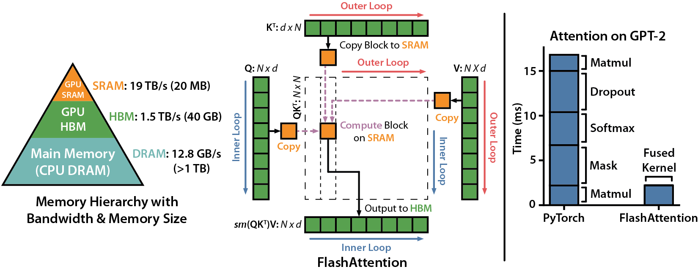
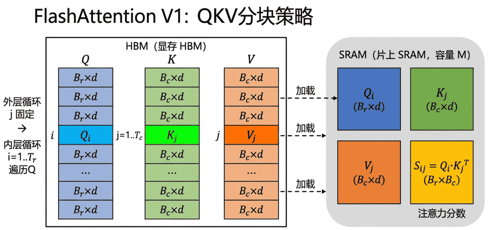

<a id="part2-ch6"></a>

# 第2部分 · 第6章：Attention 算子

> 总索引 ｜ [本部分目录](README.md) ｜ [上一章](ch05-经典算子实现-Softmax与算子融合.md) ｜ [下一章](ch07-AI编译器.md)

## 本章目录

- [本章导读](#part2-ch6)
- [6.1 FlashAttention V1详解](#part2-ch6-sec1)
- [6.2 FlashAttention V2详解](#part2-ch6-sec2)

---

## 本章导读

> 发布 2026-04-16 · 标签 "FlashAttention", "Attention", "Flash-Decoding", "PagedAttention", "CUDA" · 单篇原文

### 本章简介

Attention 是 Transformer 的核心计算，也是 AI Infra 优化的重中之重。本章从标准 Attention 的性能问题出发，深入 FlashAttention 系列和 Decode 阶段加速技术。

**标准 Attention 的性能问题**分析朴素实现的 O(N²) 显存占用和计算/显存瓶颈。

**FlashAttention V1**详解核心思想：Tiling + Online Softmax 避免物化 N×N 矩阵，将额外显存从 O(N²) 降到 O(N)、HBM 读写从 Θ(N²) 降到 Θ(N²d²/M)（M 为 SRAM 大小），以及反向传播中的重计算策略。

**FlashAttention V2** 改进的并行策略（沿 Q 序列维度并行）和 Causal Mask 优化。

**FlashAttention-3** 利用 Hopper 架构特性（WGMMA、TMA、FP8）的异步流水线优化。

**Decode 阶段加速**覆盖 Flash-Decoding、FlashDecoding++、FlashInfer 等面向 Serving 的 Attention 引擎。

**PagedAttention CUDA 实现**解读 vLLM 中虚拟页到物理页映射在 GPU 上的实现。

**动手实验**：白板推导 FlashAttention Tiling 过程，用 Triton 实现简化版 FlashAttention。

<a id="part2-ch6-sec1"></a>

## 6.1 FlashAttention V1详解

> 发布 2026-06-25 · 标签 "CUDA", "GPU", "FlashAttention", "Attention", "FlashAttention", "算子优化" · 单篇原文

本文深入剖析 FlashAttention V1 的核心原理与实现细节，理解如何通过 Tiling + Online Softmax 将 Attention 的额外显存占用从 $O(N^2)$ 降至 $O(N)$，同时大幅减少 HBM 访问量，实现无精度损失的加速。


### 1. 标准 Attention 的性能瓶颈

#### 1.1 标准 Attention 计算流程

标准的 Scaled Dot-Product Attention 按以下步骤执行：

$$
S = QK^\top / \sqrt{d}
$$

$$
P = \text{softmax}(S)
$$

$$
O = PV
$$

其中 $Q, K, V \in \mathbb{R}^{N \times d}$，$N$ 是序列长度，$d$ 是 head dimension。

#### 1.2 显存瓶颈分析

标准实现的关键问题在于中间矩阵 $S$ 和 $P$ 的大小为 $N \times N$：

| 📊 指标 | 📝 数值 | 💡 说明 |
|---------|---------|---------|
| 中间矩阵大小 | $O(N^2)$ | S 和 P 各需 $N \times N$ 存储 |
| HBM 读写量 | $O(N^2)$ | 需要反复读写 $N \times N$ 矩阵 |
| 计算量 | $O(N^2 d)$ | 两次矩阵乘法 |

当序列长度 $N = 4096$、$d = 128$ 时，单个 head 的 $S$ 矩阵就需要 $4096 \times 4096 \times 2 = 32$ MB（FP16）。对于多 head 和 batch 的场景，显存开销极为可观。

#### 1.3 计算强度不足

标准 Attention 的算术强度（Arithmetic Intensity）为：

$$
\text{AI} = \frac{O(N^2 d)}{O(N^2 + Nd)} \approx O(d)
$$

由于 $d$ 通常只有 64 或 128，算术强度较低，运算瓶颈在于显存带宽而非算力。这意味着大量时间花在数据搬运上，GPU 的计算单元处于饥饿状态。

💡 **提示**：就像一个厨师做菜的速度很快，但食材从仓库搬到厨房的速度太慢，导致厨师大部分时间在等食材——标准 Attention 的核心瓶颈就是 HBM 和 SRAM 之间的数据搬运。

---

### 2. FlashAttention 核心思想



#### 2.1 IO-Awareness：关注数据搬运

FlashAttention 的核心洞察是：**在现代 GPU 上，Attention 是一个 Memory-Bound 操作，优化的关键不在于减少浮点运算，而在于减少 HBM 访问次数。**

传统优化思路专注于减少 FLOPs（如稀疏 Attention），但 FlashAttention 另辟蹊径——通过精巧的分块计算策略，让数据尽可能留在 SRAM（Shared Memory）中完成计算，避免中间结果落地到 HBM。

#### 2.2 两个关键技术

FlashAttention V1 依赖两个核心技术的组合：

1. **Tiling（分块）**：将 Q、K、V 切成小块，每次只加载一小块到 SRAM 中计算
2. **Online Softmax**：在不知道全局最大值的情况下，边加载新块边修正 Softmax 结果

📌 **关键点**：这两个技术缺一不可——Tiling 解决了"如何不生成完整的 $N \times N$ 矩阵"的问题，Online Softmax 解决了"分块计算时 Softmax 依赖全局信息"的问题。

#### 2.3 直觉类比

想象你在做一道需要全班考试成绩来计算每个人排名百分比的题目。传统方法是先收齐所有人的分数（全部写在黑板上），再统一计算。FlashAttention 的做法相当于：每收到一组学生的分数，就立刻更新当前的统计量（最大值、求和），并修正之前的计算结果——最终得到的答案和收齐后统一计算完全相同。

---

### 3. Online Softmax 算法

#### 3.1 标准 Softmax 的三遍扫描

为保证数值稳定性，标准（safe）Softmax 需要三遍扫描输入向量 $x \in \mathbb{R}^N$：

**第一遍**：求全局最大值用于数值稳定性

$$
m = \max_{i=1}^{N} x_{i}
$$

**第二遍**：计算归一化分母（指数和）

$$
\ell = \sum_{j=1}^{N} e^{x_j - m}
$$

**第三遍**：计算每个元素的归一化输出

$$
\text{softmax}(x_i) = \frac{e^{x_i - m}}{\ell}
$$

第二、三遍都依赖第一遍得到的全局最大值 $m$，第三遍又依赖第二遍得到的 $\ell$，这要求我们必须先完整扫描一次才能开始下一遍，显然与分块策略矛盾。

> 📖 **延伸**：Online Softmax（NVIDIA, 2018）将上述三遍合并为两遍——边扫描边同步维护 $m$ 和 $\ell$；FlashAttention 在此基础上进一步把"乘 $V$ 求输出"也融合进来。

#### 3.2 Online Softmax 的递推公式

Online Softmax 的关键创新在于：维护一个**可修正**的局部统计量，随着新数据块的到来逐步更新。

假设我们已经处理了前 $j-1$ 块数据，维护了局部最大值 $m^{(j-1)}$ 和局部指数和 $l^{(j-1)}$。当第 $j$ 块数据 $x^{(j)}$ 到来时：

**步骤 1**：更新最大值

$$
m^{(j)} = \max(m^{(j-1)}, \max(x^{(j)}))
$$

**步骤 2**：修正并更新指数和

$$
l^{(j)} = l^{(j-1)} \cdot e^{m^{(j-1)} - m^{(j)}} + \sum_{i} e^{x^{(j)}_i - m^{(j)}}
$$

**步骤 3**：修正已有输出

$$
O^{(j)} = O^{(j-1)} \cdot \frac{l^{(j-1)} \cdot e^{m^{(j-1)} - m^{(j)}}}{l^{(j)}} + \frac{\sum_i e^{x^{(j)}_i - m^{(j)}} \cdot V^{(j)}_i}{l^{(j)}}
$$

#### 3.3 正确性保证

Online Softmax 的数学正确性来源于一个简单的恒等式：

$$
e^{x_i - m_{\text{new}}} = e^{x_i - m_{\text{old}}} \cdot e^{m_{\text{old}} - m_{\text{new}}}
$$

每当全局最大值更新时，之前所有的指数项都可以通过乘以一个修正因子 $e^{m_{\text{old}} - m_{\text{new}}}$ 来得到正确结果。这个操作是精确的，**没有任何近似**。

⚠️ **注意**：Online Softmax 产生的结果与标准 Softmax 在数学上完全等价（除了浮点运算顺序不同可能带来的微小舍入差异），这不是一种近似算法。

---

### 4. Tiling 分块计算策略

#### 4.1 分块方案

将 $Q$、$K$、$V$ 沿序列维度分成大小为 $B_r$（Q 的块大小）和 $B_c$（K/V 的块大小）的小块：

- $Q$ 被分成 $T_r = \lceil N / B_r \rceil$ 个块
- $K, V$ 被分成 $T_c = \lceil N / B_c \rceil$ 个块



块大小的选择取决于 SRAM 容量 $M$（单位：元素个数，可理解为 `M = SRAM字节数 / sizeof(dtype)`）和注意力头维度 $d$（即每个 token 的特征维度，例如 LLaMA-7B 中 $d = 128$）：

$$
B_c = \left\lceil \frac{M}{4d} \right\rceil, \quad B_r = \min\left(\left\lceil \frac{M}{4d} \right\rceil, d\right)
$$

**为什么是 $\dfrac{M}{4d}$？** 

计算一个块时，SRAM 需要同时驻留 $Q_i, K_j, V_j, O_i$ 四块大小约为 $B \times d$ 的张量（参见 4.2 节），合计约 $4 B d$ 个元素。要求 $4 B d \le M$，即可解出每块最多放 $\dfrac{M}{4d}$ 行。这里忽略了相对较小的 $S_{ij}$（$B_r \times B_c$）和统计量 $m_i, l_i$（$2B_r$），因为在 $B \ll d$ 量级下它们不主导 SRAM 占用。

**为什么 $B_r$ 还要再和 $d$ 取 $\min$？** 

Online Softmax 的修正系数 $e^{m^{(j-1)} - m^{(j)}}$ 是 **逐行** 标量（每行一个），原论文为简化分析约束 $B_r \le d$，避免行数显著超过列维度时统计量管理变复杂；这一约束在 V2 中被放宽。

#### 4.2 SRAM 使用规划

在计算过程中，SRAM 需要同时容纳：

| 📊 数据 | 大小 | 📝 用途 |
|---------|------|---------|
| $Q_i$ 块 | $B_r \times d$ | 当前 Query 块 |
| $K_j$ 块 | $B_c \times d$ | 当前 Key 块 |
| $V_j$ 块 | $B_c \times d$ | 当前 Value 块 |
| $S_{ij}$ 块 | $B_r \times B_c$ | 局部注意力分数 |
| $O_i$ 块 | $B_r \times d$ | 累积输出块 |
| $m_i, l_i$ | $2 B_r$ | 行最大值、行指数和（每行一个标量） |

总 SRAM 需求约为 $(2B_r + 2B_c) \times d + B_r \times B_c + 2B_r$，主导项是 $(2B_r + 2B_c) \times d$，这也是块大小公式中分母出现 $4d$ 的来源——需确保不超过 GPU 的 Shared Memory 容量 $M$。

#### 4.3 外循环与内循环

FlashAttention V1 采用**外循环遍历 K/V 块，内循环遍历 Q 块**的策略：

```
外循环: for j = 1 to T_c (遍历 K/V 块)
    从 HBM 加载 K_j, V_j 到 SRAM
    内循环: for i = 1 to T_r (遍历 Q 块)
        从 HBM 加载 Q_i, O_i, m_i, l_i 到 SRAM
        计算局部注意力分数 S_ij = Q_i * K_j^T
        更新统计量和输出
        将更新后的 O_i, m_i, l_i 写回 HBM
```

💡 **提示**：外循环遍历 K/V 的设计意味着每个 K/V 块只从 HBM 加载一次，而 Q 和 O 会被多次加载。这在 V1 中是一个可以改进的点（V2 将改为外循环遍历 Q）。

---

### 5. 前向传播完整流程

#### 5.1 逐步推导

以处理第 $i$ 个 Q 块、第 $j$ 个 K/V 块为例：

**Step 1**：计算局部注意力分数

$$
S_{ij} = Q_i K_j^\top / \sqrt{d} \in \mathbb{R}^{B_r \times B_c}
$$

**Step 2**：计算当前块的行最大值

$$
\tilde{m}_{ij} = \text{rowmax}(S_{ij}) \in \mathbb{R}^{B_r}
$$

**Step 3**：更新全局行最大值

$$
m_i^{\text{new}} = \max(m_i, \tilde{m}_{ij})
$$

**Step 4**：计算修正因子并更新指数和

$$
\alpha = e^{m_i - m_i^{\text{new}}}
$$

$$
l_i^{\text{new}} = \alpha \cdot l_i + \text{rowsum}\left(e^{S_{ij} - m_i^{\text{new}}}\right)
$$

修正因子 $\alpha$ 的作用是把旧的指数和 $l_i$（基于旧最大值 $m_i$）"重缩放"到新最大值 $m_i^{\text{new}}$ 下。

**Step 5**：更新输出

$$
O_i^{\text{new}} = \frac{\alpha \cdot l_i}{l_i^{\text{new}}} \cdot O_i + \frac{1}{l_i^{\text{new}}} \cdot e^{S_{ij} - m_i^{\text{new}}} \cdot V_j
$$


#### 5.2 算法伪代码

```python
# FlashAttention V1 前向传播伪代码
def flash_attention_forward(Q, K, V, B_r, B_c):
    N, d = Q.shape
    O = zeros(N, d)
    m = full(N, -inf)  # 行最大值
    l = zeros(N)        # 行指数和

    # 外循环：遍历 K/V 块
    for j in range(0, N, B_c):
        K_j = K[j:j+B_c]  # 从 HBM 加载
        V_j = V[j:j+B_c]  # 从 HBM 加载

        # 内循环：遍历 Q 块
        for i in range(0, N, B_r):
            Q_i = Q[i:i+B_r]          # 从 HBM 加载
            O_i = O[i:i+B_r]          # 从 HBM 加载
            m_i = m[i:i+B_r]          # 从 HBM 加载
            l_i = l[i:i+B_r]          # 从 HBM 加载

            # 计算局部注意力分数
            S_ij = Q_i @ K_j.T / sqrt(d)  # [B_r, B_c]

            # 更新统计量
            m_new = max(m_i, rowmax(S_ij))
            l_new = l_i * exp(m_i - m_new) + rowsum(exp(S_ij - m_new))

            # 更新输出
            O_new = O_i * (l_i * exp(m_i - m_new) / l_new).unsqueeze(1)
            O_new += (exp(S_ij - m_new) / l_new.unsqueeze(1)) @ V_j

            # 写回 HBM
            O[i:i+B_r] = O_new
            m[i:i+B_r] = m_new
            l[i:i+B_r] = l_new

    return O
```

#### 5.3 数值稳定性

整个计算过程通过减去最大值来保证数值稳定性：

- 所有指数运算的输入都经过减去当前已知最大值的处理，确保 $e^x$ 的参数 $x \leq 0$
- 修正因子 $e^{m_{\text{old}} - m_{\text{new}}}$ 也满足 $m_{\text{old}} \leq m_{\text{new}}$，因此 $\leq 1$

这保证了整个计算过程不会出现数值溢出。

---

### 6. 反向传播与重计算

#### 6.1 反向传播的挑战

标准 Attention 的反向传播需要中间矩阵 $S$ 和 $P$（大小为 $N \times N$），用来计算梯度。其中 $S = QK^\top / \sqrt{d}$ 是注意力分数（pre-softmax logits），$P = \text{softmax}(S)$ 是 softmax 之后的注意力权重矩阵，最终输出 $O = PV$：

$$
dV = P^\top dO
$$

$$
dP = dO \cdot V^\top
$$

$$
dS = P \odot \left(dP - \text{rowsum}(dP \odot P) \cdot \mathbf{1}^\top\right)
$$

其中 FlashAttention 论文利用恒等式 $\text{rowsum}(dP \odot P) = \text{rowsum}(dO \odot O)$（记作 $D_i$），从而避免显式构造完整的 $dP$ 矩阵。

如果保存这些中间矩阵，前向传播省下的显存就白费了。

#### 6.2 重计算策略

FlashAttention V1 的解决方案是**不保存 $S$ 和 $P$，反向传播时重新计算它们**：

- 前向传播只保存：$Q, K, V, O, m, l$（输入、输出和统计量）
- 反向传播时：利用保存的 $m$ 和 $l$，重新加载 $Q_i, K_j$ 计算 $S_{ij}$，再恢复 $P_{ij}$

$$
P_{ij} = \text{diag}(l_i)^{-1} \cdot e^{S_{ij} - m_i}
$$

#### 6.3 重计算的代价

重计算引入了额外的 FLOPs（相当于多做一次前向中的矩阵乘），但由于减少了 HBM 访问：

| ✅ 收益 | ❌ 代价 |
|---------|---------|
| 显存从 $O(N^2)$ 降到 $O(N)$ | 额外的 FLOP 开销（约 50\% 前向计算量） |
| HBM 访问大幅减少 | SRAM 需要同时存放更多数据 |
| 可以训练更长序列 | 反向传播核函数更复杂 |

由于 Attention 是 Memory-Bound 的，额外的计算可以被 HBM 访问的减少所"隐藏"，实际 wall-clock 时间反而更短。

---

### 7. IO 复杂度分析

#### 7.1 标准 Attention 的 IO 复杂度

$$
\text{HBM 访问量} = O(Nd + N^2) = O(N^2)
$$

其中 $Nd$ 来自读写 $Q, K, V, O$ 等大小为 $N \times d$ 的张量，$N^2$ 来自读写中间矩阵 $S$ 和 $P$（各 $N \times N$）。当 $N \gg d$ 时，$N^2$ 项主导，因此整体为 $O(N^2)$。

#### 7.2 FlashAttention 的 IO 复杂度

FlashAttention 的 HBM 访问量为：

$$
\text{HBM 访问量} = O\left(\frac{N^2 d^2}{M}\right)
$$

这个量级可以这样拆解：

- 由 4.1 节的块大小约束 $B_c = O(M/d)$，总共 $T_c = N / B_c = O(Nd/M)$ 次外循环
- 每次外循环要遍历完整的 $Q 和 O$（共 $O(Nd)$ 个元素），所以 $Q 和 O$ 的总访问量为 $T_c \cdot Nd = O(N^2 d^2 / M)$
- $K, V$ 整体只读一次，访问量为 $O(Nd)$，相对前者可忽略

合计即 $O(N^2 d^2 / M)$。直观上：**SRAM 越大（$M$ 越大），每次能装下的块越大，外循环次数越少，对 $Q/O$ 的重复读写也越少。**

其中 $M$ 是 SRAM 大小（以元素为单位）。由于 $d^2 < M$（典型值 $d = 128$，$M$ 对应约 $192 \text{KB} / 2 = 98304$ 个 FP16 元素，而 $d^2 = 16384$），这比 $O(N^2)$ 小得多。

#### 7.3 下界证明

论文还证明了对于任何精确 Attention 算法，HBM 访问量的下界为 $\Omega(N^2 d^2 / M)$，这意味着 FlashAttention 的 IO 复杂度在渐近意义上是最优的。

#### 7.4 实际加速效果

在 A100 GPU 上的典型性能对比：

| 📊 序列长度 | 标准 Attention | FlashAttention V1 | 加速比 |
|------------|---------------|-------------------|--------|
| 1024 | 1.0x | 2.4x | 2.4x |
| 2048 | 1.0x | 2.8x | 2.8x |
| 4096 | 1.0x | 3.5x | 3.5x |
| 8192 | OOM | 可运行 | - |

---

### 8. 实现要点与代码示例

#### 8.1 张量形状贯穿全过程

输入 $Q, K, V$ 都是 4 维张量，前两维是 batch 与 head（作为"批次"维度原样传递），最后两维做矩阵运算：

```bash
Q: [B, H, N, D]
K: [B, H, N, D]   →  K^T (最后两维转置): [B, H, D, N]
V: [B, H, N, D]

Step 1  注意力分数：
  S = Q @ K^T / sqrt(D)
    = [B, H, N, D] @ [B, H, D, N]
    = [B, H, N, N]

Step 2  Softmax（沿最后一维 N，逐行归一化）：
  P = softmax(S, dim=-1)
    形状: [B, H, N, N]

Step 3  输出：
  O = P @ V
    = [B, H, N, N] @ [B, H, N, D]
    = [B, H, N, D]   （与 Q 同形）
```

辅助张量（FlashAttention 专属）：

- `M: [B, H, N]` —— 每行的最大值（数值稳定 + Online Softmax 修正）
- `L: [B, H, N]` —— 每行的指数和（softmax 分母）

#### 8.2 Kernel 设计要点

> 📌 **关于并行划分（grid 与 block 设计）**：
> - **grid（program 粒度）=（B, H）**：每个 program 负责一个 `(batch, head)` 切片下完整的注意力计算，program 之间完全独立、无通信。
> - **block 内部线程**：在一个 program 内部，Triton 会把 `tl.dot`、`tl.max`、`tl.sum` 等向量化操作自动拆分到一个 thread block 的若干 warp 上。块大小由 `BLOCK_M`（Q 的行数 $B_r$）、`BLOCK_N`（K/V 的行数 $B_c$）、`BLOCK_D`（D 维向量化宽度）共同决定。
> - **program 内部串行**：外循环遍历 K/V 块、内循环遍历 Q 块
>
> 由于不同 Q 块在不同外循环迭代之间共享统计量 $m_i, l_i$ 与累积输出 $O_i$，单个 program 的寄存器装不下"所有 Q 块"的 m/l/O，必须借助 HBM 的辅助张量 `M, L` 在迭代之间持久化（这正是 V1 IO 较多的根本原因——V2 通过交换循环顺序，把 Q 提到 grid 上并行，让 m/l/O 全程留在寄存器中，从而消除了这部分 HBM 访问）。
>
> ⚠️ **V1 并行度的天然瓶颈**：grid 大小 $B \times H$ 在推理场景常常只有几十（如 batch=1、heads=32 → 仅 32 个 program），而现代 GPU 通常有 80~140 个 SM（A100=108，H100=132），SM 利用率只有约 30%。这是 V1 的主要短板，也是 V2 必然出现的动因。


1. **Thread Block 映射**：V1 中每个 Thread Block 对应外循环的一个 K/V 块（即一个 $j$），内部遍历所有 Q 块
2. **Shared Memory 分配**：为 $K_j$、$V_j$（外循环常驻）以及 $Q_i$、$S_{ij}$ 预分配 SRAM
3. **寄存器使用**：统计量 $m_i$、$l_i$ 和累积输出 $O_i$ 尽量放在寄存器中
4. **循环结构**：外循环加载 K/V 块，内部完成 GEMM 和 Softmax 更新

#### 8.3 Triton 简化实现

```python
import math
import torch
import triton
import triton.language as tl

@triton.jit
def flash_attn_v1_kernel(
    Q, K, V, O,    # [B, H, N, D]
    M, L,          # 行最大值与行指数和
    stride_qb, stride_qh, stride_qn, stride_qd,
    stride_kb, stride_kh, stride_kn, stride_kd,
    stride_vb, stride_vh, stride_vn, stride_vd,
    stride_ob, stride_oh, stride_on, stride_od,
    stride_mb, stride_mh,
    N,
    D: tl.constexpr,        # 注意力头维度（head dimension），即每个 token 的特征长度，用在 scale = 1/sqrt(D)
    BLOCK_M: tl.constexpr,  # Q 块行数 B_r
    BLOCK_N: tl.constexpr,  # K/V 块行数 B_c
    BLOCK_D: tl.constexpr,  # 头维度上加载/计算的块宽度，当D本身就是2的幂时，BLOCK_D==D；否则 BLOCK_D > D，多出来的位置用 mask 屏蔽掉
):
    # ========== V1 并行划分：grid = (batch, head) ==========
    # 每个 program 串行扫完整个 (batch, head) 的所有 K/V 块和 Q 块
    batch_id = tl.program_id(0)
    head_id = tl.program_id(1)

    # 当前 (batch, head) 在各张量上的起始偏移
    qkvo_bh_q = batch_id * stride_qb + head_id * stride_qh
    qkvo_bh_k = batch_id * stride_kb + head_id * stride_kh
    qkvo_bh_v = batch_id * stride_vb + head_id * stride_vh
    qkvo_bh_o = batch_id * stride_ob + head_id * stride_oh
    ml_bh = batch_id * stride_mb + head_id * stride_mh

    d_range = tl.arange(0, BLOCK_D)
    scale = 1.0 / math.sqrt(D)

    # ============ 外循环：遍历 K/V 块（V1 关键设计） ============
    for kv_start in range(0, N, BLOCK_N):
        kv_range = kv_start + tl.arange(0, BLOCK_N)
        kv_mask = kv_range < N

        # K_j, V_j 一次加载，常驻寄存器/SRAM，被所有 Q 块复用
        k = tl.load(K + qkvo_bh_k + kv_range[:, None] * stride_kn + d_range[None, :] * stride_kd,
                    mask=kv_mask[:, None] & (d_range[None, :] < D), other=0.0)
        v = tl.load(V + qkvo_bh_v + kv_range[:, None] * stride_vn + d_range[None, :] * stride_vd,
                    mask=kv_mask[:, None] & (d_range[None, :] < D), other=0.0)

        # ============ 内循环：遍历 Q 块 ============
        for q_start in range(0, N, BLOCK_M):
            q_range = q_start + tl.arange(0, BLOCK_M)
            q_mask = q_range < N

            # 加载 Q_i, O_i, m_i, l_i —— V1 中每个外循环都要从 HBM 重新读
            q = tl.load(Q + qkvo_bh_q + q_range[:, None] * stride_qn + d_range[None, :] * stride_qd,
                        mask=q_mask[:, None] & (d_range[None, :] < D), other=0.0)
            o_i = tl.load(O + qkvo_bh_o + q_range[:, None] * stride_on + d_range[None, :] * stride_od,
                          mask=q_mask[:, None] & (d_range[None, :] < D), other=0.0).to(tl.float32)
            m_i = tl.load(M + ml_bh + q_range, mask=q_mask, other=float('-inf'))
            l_i = tl.load(L + ml_bh + q_range, mask=q_mask, other=0.0)

            # S_ij = Q_i @ K_j^T / sqrt(d)
            s = tl.dot(q, tl.trans(k)) * scale
            # 屏蔽 K/V 越界列，防止假 0 污染 softmax 分母
            s = tl.where(kv_mask[None, :], s, float('-inf'))

            # Online Softmax 更新
            m_new = tl.maximum(m_i, tl.max(s, axis=1))
            alpha = tl.exp(m_i - m_new)
            p = tl.exp(s - m_new[:, None])
            l_new = alpha * l_i + tl.sum(p, axis=1)

            # 输出修正 + 累加（与 5.1 Step 5 公式一致）
            o_new = o_i * (alpha * l_i / l_new)[:, None] \
                    + tl.dot(p.to(v.dtype), v) / l_new[:, None]

            # 把更新后的 O_i, m_i, l_i 写回 HBM，供下次外循环使用
            tl.store(O + qkvo_bh_o + q_range[:, None] * stride_on + d_range[None, :] * stride_od,
                     o_new.to(O.dtype.element_ty),
                     mask=q_mask[:, None] & (d_range[None, :] < D))
            tl.store(M + ml_bh + q_range, m_new, mask=q_mask)
            tl.store(L + ml_bh + q_range, l_new, mask=q_mask)


def flash_attn_v1(Q, K, V, BLOCK_M=64, BLOCK_N=64):
    # Q, K, V: [B, H, N, D]
    B, H, N, D = Q.shape
    O = torch.zeros_like(Q)
    M = torch.full((B, H, N), float('-inf'), device=Q.device, dtype=torch.float32)
    L = torch.zeros((B, H, N), device=Q.device, dtype=torch.float32)

    BLOCK_D = triton.next_power_of_2(D)
    grid = (B, H)  # V1 并行：仅在 batch×head 维度上
    flash_attn_v1_kernel[grid](
        Q, K, V, O, M, L,
        Q.stride(0), Q.stride(1), Q.stride(2), Q.stride(3),
        K.stride(0), K.stride(1), K.stride(2), K.stride(3),
        V.stride(0), V.stride(1), V.stride(2), V.stride(3),
        O.stride(0), O.stride(1), O.stride(2), O.stride(3),
        M.stride(0), M.stride(1),
        N, D=D, BLOCK_M=BLOCK_M, BLOCK_N=BLOCK_N, BLOCK_D=BLOCK_D,
    )
    return O
```

📌 **代码要点回顾**：

1. **V1 并行划分**：grid 为 `(batch, head)`，K/V 在外、Q 在内——每个 K/V 块只从 HBM 加载一次，但 Q/O/m/l 会被 $T_c$ 次外循环反复读写
2. **辅助张量 M, L**：因为不同外循环迭代之间需要共享 Q 的统计量 $m_i, l_i$，必须在 HBM 中开辟 `[B, H, N]` 的张量持久化
3. **K/V 越界屏蔽**（`tl.where(kv_mask, s, -inf)`）是正确性的关键，遗漏会让 softmax 分母被假 0 污染
4. **`m, l` 初值** 分别为 `-inf` 和 `0`，配合 `alpha = exp(-inf - m_new) = 0`，让首次迭代自然退化为正常累加
5. **V1 的局限**：`(batch, head)` 通常远小于 GPU 上的 SM 数（典型 A100 有 108 个 SM，而 batch×head 在推理时常只有几十），SM 利用率不足；V2 把 Q 提到 grid 上并行，正是为了解决这一点

---

### 📝 总结

FlashAttention V1 通过 **IO-Awareness** 的视角重新审视 Attention 计算，提出了 Tiling + Online Softmax 的组合方案：

1. **不生成完整的 $N \times N$ 中间矩阵**，通过分块流式计算避免 $O(N^2)$ 的显存开销
2. **Online Softmax 保证精确性**，通过维护和修正局部统计量，实现与标准 Softmax 完全等价的结果
3. **重计算替代存储**，反向传播时重算 $S$ 和 $P$，用少量额外计算换取巨大的显存节省
4. **IO 复杂度渐近最优**，HBM 访问量从 $O(N^2)$ 降至 $O(N^2 d^2 / M)$

---

### 🎯 自我检验清单

- 能解释标准 Attention 为什么是 Memory-Bound 而非 Compute-Bound
- 能手动推导 Online Softmax 的递推更新公式
- 能说明 Tiling 块大小 $B_r$、$B_c$ 如何根据 SRAM 容量确定
- 能描述 FlashAttention 前向传播中外循环和内循环各遍历什么
- 能解释为什么重计算策略不会让 wall-clock 时间变长
- 能推导 FlashAttention 的 HBM IO 复杂度为 $O(N^2 d^2 / M)$
- 能用 Triton 或 CUDA 实现简化版 FlashAttention 前向 Kernel
- 能说明 FlashAttention V1 中外循环遍历 K/V 的局限性

---

### 📚 参考资料

- [FlashAttention: Fast and Memory-Efficient Exact Attention with IO-Awareness](https://arxiv.org/abs/2205.14135)
- [Online Normalizer Calculation for Softmax](https://arxiv.org/abs/1805.02867)
- [FlashAttention 官方实现 - GitHub](https://github.com/Dao-AILab/flash-attention)
- [Tri Dao - FlashAttention 论文解读](https://tridao.me/publications/flash2/flash2.html)
- [NVIDIA CUDA C++ Programming Guide](https://docs.nvidia.com/cuda/cuda-c-programming-guide/)

---

<a id="part2-ch6-sec2"></a>

## 6.2 FlashAttention V2详解

> 发布 2026-06-26 · 标签 "CUDA", "GPU", "FlashAttention", "Attention", "FlashAttention", "算子优化" · 单篇原文

本文深入剖析 FlashAttention V2 相比 V1 的核心改进：调换内外循环顺序、优化线程块内的工作分配、减少非矩阵乘运算，最终在 A100 上达到理论 FLOPS 的 50-73%。


### 1. V1 的性能瓶颈回顾

#### 1.1 V1 的实际利用率

FlashAttention V1 在 A100 上只达到了理论 FLOPS 的 25-40%。对于一个理应是 Compute-Bound（通过减少 IO 后）的算子来说，这个利用率并不理想。

瓶颈主要来自三个方面（按对性能影响从大到小排序）：

| 📊 问题 | 📝 原因 | 💡 影响 |
|---------|---------|---------|
| 循环顺序不佳 | 外循环遍历 K/V，导致 O 块被反复读写、Q 块被重复加载 | 大量额外的 HBM 流量，且无法跨 Q 并行 |
| 非 GEMM 运算占比高 | Softmax rescaling 中有大量逐元素操作 | Tensor Core 利用率低 |
| Warp 切分维度不当 | V1 沿 K/V 维度切分给 Warp，多个 Warp 共同更新同一行 O，需要合并部分 Softmax 结果 | 频繁的 Warp 间通信与同步，并行效率低 |

#### 1.2 硬件特性分析

A100 GPU 的关键参数：

- **FP16 Tensor Core 峰值**：312 TFLOPS
- **HBM 带宽**：2 TB/s
- **SRAM 容量**：192 KB/SM（Shared Memory，可配置最大 164 KB 供用户使用）
- **Warp 数量**：每个 Thread Block 可包含多个 Warp（通常 4-8 个）

要充分利用 Tensor Core，需要确保计算流水线不被非 GEMM 操作打断。

---

### 2. 核心改进一：调换循环顺序

#### 2.1 V1 的循环结构问题

V1 中外循环遍历 K/V 块，内循环遍历 Q 块。这带来两个问题：

1. **Q 和 O 的重复读写**：每处理一个新的 K/V 块，所有 Q 块和对应的输出 O 都需要重新加载和写回 HBM
2. **并行度受限**：外循环 K/V 块之间因 online softmax 的 running max/sum 累积存在串行依赖，V1 只能在 batch × heads 维度上并行。当 batch 和 heads 较小、序列较长时（长上下文场景），无法利用序列维度的并行性，SM 利用率不足

#### 2.2 V2 的新循环结构

V2 将循环顺序调换为**外循环遍历 Q 块，内循环遍历 K/V 块**：

```
外循环: for i = 1 to T_r (遍历 Q 块) — 分配给不同 Thread Block
    从 HBM 加载 Q_i 到 SRAM（只加载一次）
    初始化 O_i = 0, m_i = -inf, l_i = 0
    内循环: for j = 1 to T_c (遍历 K/V 块)
        从 HBM 加载 K_j, V_j 到 SRAM
        计算 S_ij，更新统计量和 O_i（全在 SRAM 中）
    将最终 O_i 写回 HBM（只写一次）
```

#### 2.3 收益分析

这个看似简单的调换带来了三重收益：

**收益 1**：O 只在最后写回一次

在 V1 中，每处理一个 K/V 块，O 都要被读取再写回，共 $2T_c$ 次 HBM 访问（$T_c$ 次读 + $T_c$ 次写）。V2 中 O 只在内循环结束后写回一次。

**收益 2**：外循环天然可并行

不同的 Q 块之间完全独立（每个 Q 块计算自己的输出行），可以直接映射到不同的 Thread Block，实现 GPU 级别的并行。

**收益 3**：Q 只加载一次

每个 Thread Block 只负责一个 Q 块，Q 在 Shared Memory 中驻留整个内循环的过程。

📌 **关键点**：V1 选择 K/V 外循环源自 online softmax 的累积逻辑（每扫完一列 K/V 块就更新一次 O 的归一化），代价是 O 必须反复读+写。V2 发现：让 Q 只加载一次更优，因为减少 O 的读写比减少 K/V 的读收益更大。

---

### 3. 核心改进二：减少非矩阵乘运算

#### 3.1 问题：非 GEMM 指令的瓶颈

在 Attention 的 Tiling 计算中，除了两次矩阵乘法（$QK^\top$ 和 $PV$），还有大量逐元素操作：

- 减去最大值：$S_{ij} - m_i$
- 求指数：$\exp(\cdot)$
- 行求和：$\text{rowsum}(\cdot)$
- Rescaling：乘以修正因子

这些操作无法使用 Tensor Core，只能用 CUDA Core，成为计算流水线中的瓶颈。

#### 3.2 V2 的优化：延迟 Rescaling

V2 将 Softmax 的 rescaling 步骤延迟到内循环结束后统一执行：

**V1 的做法**（每个 K/V 块都 rescale）：

$$
O_i^{(j)} = \frac{l_i^{(j-1)} \cdot e^{m_i^{(j-1)} - m_i^{(j)}}}{l_i^{(j)}} \cdot O_i^{(j-1)} + \frac{e^{S_{ij} - m_i^{(j)}}}{l_i^{(j)}} \cdot V_j
$$

**V2 的做法**（只维护未归一化的累积）：

$$
\tilde{O}_i^{(j)} = e^{m_i^{(j-1)} - m_i^{(j)}} \cdot \tilde{O}_i^{(j-1)} + e^{S_{ij} - m_i^{(j)}} \cdot V_j
$$

最终一次性归一化：

$$
O_i = \tilde{O}_i^{(T_c)} / l_i^{(T_c)}
$$

#### 3.3 收益量化

这个优化减少了内循环中每次迭代的三次逐元素操作：

- 旧 O 的反归一化：乘以 $l^{(j-1)}$
- 旧 O 的重新归一化：除以 $l^{(j)}$
- 新贡献的归一化：除以 $l^{(j)}$

V2 把这「2 次除法 + 1 次乘法」全部从内循环移除，只在最后做一次除法。当内循环迭代次数 $T_c$ 较大时，节省相当可观。

---

### 4. 核心改进三：Warp 级工作分配优化

#### 4.1 V1 的 Warp 分配方案：沿 K/V 维度划分

V1 中，Thread Block 内的多个 Warp 沿 **K/V 维度**切分同一个 $S_{ij}$ 块。

假设 Thread Block 有 4 个 Warp，K/V 块大小为 $B_c = 128$：
- Warp 0 负责 K/V 的第 0-31 列
- Warp 1 负责 K/V 的第 32-63 列
- Warp 2 负责 K/V 的第 64-95 列
- Warp 3 负责 K/V 的第 96-127 列

每个 Warp 只能算出 $S_{ij}$ 的**一部分列**，因此：
- 计算 row-max / row-sum 时，必须跨 Warp 合并各自的局部结果
- 计算 $P \cdot V$ 时，多个 Warp 都会向同一行 O 累加贡献，需要再次同步

这种「split-K」式分配导致频繁的 Warp 间同步与 shared memory 通信。

#### 4.2 V2 的 Warp 分配：沿 Q 维度划分

V2 将 Q 块进一步细分给不同的 Warp：

假设 Thread Block 有 4 个 Warp，Q 块大小为 $B_r = 128$：
- Warp 0 负责 Q 的第 0-31 行
- Warp 1 负责 Q 的第 32-63 行
- Warp 2 负责 Q 的第 64-95 行
- Warp 3 负责 Q 的第 96-127 行

每个 Warp 独立计算自己负责的 Q 行与完整 K/V 块的注意力，互不干扰。

#### 4.3 对比两种分配策略

| ❌ 沿 K/V 分 Warp（V1 方案） | ✅ 沿 Q 分 Warp（V2 方案） |
|--------------------------|-------------------|
| 多个 Warp 需要合并部分 Softmax 结果 | 每个 Warp 独立完成 Softmax |
| 需要 shared memory 或 shuffle 通信 | 无需 Warp 间同步 |
| 输出 O 的同一行被多个 Warp 共同更新 | 输出 O 的不同行由不同 Warp 独占 |

💡 **提示**：如果沿 K/V 维度分割给不同 Warp，每个 Warp 只看到 Softmax 输入的一部分，必须在 Warp 间通信来合并最大值和求和，这正是 V1 性能低下的原因之一。

---

### 5. Causal Mask 优化

#### 5.1 Causal Mask 的作用

在自回归模型（如 GPT）中，第 $i$ 个 token 在生成时只能"看到"自己以及前面的 token，不能窥探未来——即位置 $i$ 只能 attend 到位置 $j \leq i$。这是自回归语言模型训练时保持「**因果性**（causality）」的关键约束：模型必须基于历史预测下一个 token，而不能直接抄答案。

在实现上，这通过一个**下三角掩码矩阵** 来实现，掩码在 Softmax 之前加到注意力分数上：$\tilde{S} = QK^\top / \sqrt{d} + M$。被屏蔽的位置加上 $-\infty$ 后，经 $\exp$ 变为 0，从而对 Softmax 输出无贡献。

形象地看，这个 mask 让 $N \times N$ 的注意力矩阵**只有下三角（含对角线）有效**，上三角全部置零。这意味着理论上**约一半的计算是无用的**，这正是 V2 块级跳过策略要利用的结构。

#### 5.2 朴素实现的浪费

如果不做特殊处理，即使 mask 为 0 的位置也会执行完整的 GEMM 和 Softmax 计算，浪费约一半的算力。

#### 5.3 V2 的块级跳过策略

V2 引入了块级（Block-level）的 Causal Mask 优化：

对于第 $i$ 个 Q 块（行范围 $[iB_r, (i+1)B_r)$）和第 $j$ 个 K 块（列范围 $[jB_c, (j+1)B_c)$）：

1. **完全在 mask 下方**（$(i+1)B_r - 1 \geq (j+1)B_c - 1$ 且 $iB_r \geq (j+1)B_c - 1$，即 Q 块最小行号 ≥ K 块最大列号）：块内所有位置都满足 row ≥ col，完全可见，正常计算
2. **完全在 mask 上方**（$(i+1)B_r - 1 < jB_c$，即 Q 块最大行号 < K 块最小列号）：块内所有位置都满足 row < col，完全不可见，直接跳过
3. **跨越对角线**：块内既有可见位置也有不可见位置，需要逐元素应用 mask

```
对角线以下（全可见）    对角线块（部分mask）    对角线以上（全跳过）
┌─────────────┐      ┌─────────────┐      ┌─────────────┐
│ ■ ■ ■ ■ ■ ■ │      │ ■ ■ ■ □ □ □ │      │ □ □ □ □ □ □ │
│ ■ ■ ■ ■ ■ ■ │      │ ■ ■ ■ ■ □ □ │      │ □ □ □ □ □ □ │
│ ■ ■ ■ ■ ■ ■ │      │ ■ ■ ■ ■ ■ □ │      │ □ □ □ □ □ □ │
└─────────────┘      └─────────────┘      └─────────────┘
```

#### 5.4 加速效果

对于 Causal Attention，V2 的块跳过可以减少约 50% 的无效计算。结合循环顺序调换后的外循环沿 Q 分配，每个 Thread Block 只需遍历 K/V 到对角线位置即可提前退出内循环。

---

### 6. 前向传播完整算法

#### 6.1 算法伪代码

```python
def flash_attention_v2_forward(Q, K, V, B_r, B_c, causal=False):
    N, d = Q.shape
    O = zeros(N, d)
    L = zeros(N)  # logsumexp，用于反向传播

    # 外循环（并行化到不同 Thread Block）
    parallel for i in range(0, N, B_r):
        Q_i = Q[i:i+B_r]  # 加载到 SRAM，整个内循环驻留

        # 初始化累积量（SRAM/寄存器）
        m_i = full(B_r, -inf)
        l_i = zeros(B_r)
        O_tilde = zeros(B_r, d)  # 未归一化的累积输出

        # 内循环：遍历 K/V 块
        kv_end = min(N, (i + B_r)) if causal else N
        for j in range(0, kv_end, B_c):
            K_j = K[j:j+B_c]  # 从 HBM 加载
            V_j = V[j:j+B_c]  # 从 HBM 加载

            # 计算局部注意力分数
            S_ij = Q_i @ K_j.T / sqrt(d)

            # 应用 causal mask（仅对角线块需要）
            # i, j 已是绝对起始坐标；当 K 块最大列号(j+B_c-1) > Q 块最小行号(i) 时本块跨对角线
            if causal and i < j + B_c - 1:
                apply_causal_mask(S_ij, i, j, B_r, B_c)

            # 更新统计量
            m_new = max(m_i, rowmax(S_ij))
            P_ij = exp(S_ij - m_new[:, None])
            l_new = exp(m_i - m_new) * l_i + rowsum(P_ij)

            # 更新未归一化输出
            O_tilde = exp(m_i - m_new)[:, None] * O_tilde + P_ij @ V_j

            m_i = m_new
            l_i = l_new

        # 最终归一化并写回
        O[i:i+B_r] = O_tilde / l_i[:, None]
        L[i:i+B_r] = m_i + log(l_i)  # 保存 logsumexp 给反向

    return O, L
```

#### 6.2 与 V1 的关键差异

| 📊 方面 | V1 | V2 |
|---------|----|----|
| 外循环 | K/V 块 | Q 块（并行） |
| O 的 HBM 访问次数 | $2T_c$ 次（$T_c$ 读 + $T_c$ 写） | 1 次（仅最终写回） |
| 内循环归一化 | 每步反归一化+重新归一化（2 除 + 1 乘） | 仅做指数缩放，最后统一除一次 |
| Warp 切分维度 | 沿 K/V（split-K，Warp 间需通信） | 沿 Q（每 Warp 独占若干行，无需通信） |
| Causal 优化 | 无 | 块级跳过 |
| 保存的统计量 | $m$ 和 $l$ | $L = m + \log(l)$（合并为 logsumexp） |

---

### 7. 反向传播优化

#### 7.1 保存 logsumexp 而非分离的 m 和 l

V2 在前向传播中保存 $L_i = m_i + \log(l_i)$（即行级 logsumexp），而非分别保存 $m_i$ 和 $l_i$。这有两个好处：
- 减少一半的统计量存储
- 反向传播中可以直接恢复 $P_{ij}$，$P_{ij} = \exp(S_{ij} - L_i)$

#### 7.2 反向传播的并行策略

V2 的反向传播采用**外循环遍历 K/V 块**的策略（这一点 V1 反向也相同，但与 V2 前向的 Q 块外循环相反），确保 $dK$ 和 $dV$ 的更新不需要原子操作：

- $dK_j$ 和 $dV_j$ 由单个 Thread Block 独占累积（该 Block 遍历所有 Q 块来累积梯度）
- $dQ_i$ 需要跨 Thread Block 累加（通过原子加或分两遍扫描实现）

#### 7.3 反向传播中的 D 向量

反向传播的 Softmax 梯度需要 $dS_{ij} = P_{ij} \odot (dP_{ij} - D_i)$，其中

$$
D_i = \text{rowsum}(dP_i \odot P_i) = \text{rowsum}(dO_i \odot O_i) \in \mathbb{R}^N
$$

这个等式变换在 V1 论文中即已提出（附录 B.3）：左式要对长度 $N$ 的整行做归约，$P_i$、$dP_i$ 可能装不进 SRAM；换成右式后只需对长度 $d$ 的向量做点积，代价与序列长度无关。

V2 的改进在工程实现层面——把 $D$ 提到一个独立的 preprocess kernel 中，一次性算完整个 $\mathbb{R}^N$ 向量，反向主循环直接读取；而 V1 是在反向主循环里逐块现算。

---

### 8. 性能分析与对比

#### 8.1 A100 上的性能

| 📊 序列长度 | V1 TFLOPS | V2 TFLOPS | V2 利用率 |
|------------|-----------|-----------|-----------|
| 1024 | 124 | 196 | 63\% |
| 2048 | 136 | 218 | 70\% |
| 4096 | 141 | 227 | 73\% |
| 8192 | 138 | 222 | 71\% |

V2 相比 V1 实现了约 1.6x 的加速。

#### 8.2 与其他实现的对比

在 A100-80GB 上，序列长度 2048，head dim 128 的基准测试：

| 📊 实现 | 前向速度 | 反向速度 |
|---------|---------|---------|
| PyTorch 标准 | 1.0x | 1.0x |
| FlashAttention V1 | 2.8x | 2.5x |
| FlashAttention V2 | 4.3x | 3.9x |
| xFormers (cutlass) | 3.1x | 2.8x |

#### 8.3 长序列的显存优势（训练激活总占用估算）

下表估算的是训练时与 attention 相关的**激活显存总量**（含中间张量与梯度缓存，按典型多头配置粗估，便于看出 N² vs N 的缩放差异），非单一矩阵的存储成本：

| 📊 序列长度 | 标准 Attention 显存 | FlashAttention V2 显存 |
|------------|-------------------|---------------------|
| 4K | 128 MB | 4 MB |
| 16K | 2 GB | 16 MB |
| 64K | 32 GB (OOM) | 64 MB |

---

### 📝 总结

FlashAttention V2 通过三个核心改进 + 一项附加优化将 A100 上的效率从 25-40% 提升到 50-73%：

1. **调换循环顺序**：外循环遍历 Q 块（并行），内循环遍历 K/V 块，减少 O 的 HBM 读写并实现天然并行
2. **延迟归一化（减少非 GEMM 运算）**：内循环中只做指数缩放不做除法，最终统一归一化减少非 GEMM 操作
3. **Warp 级优化**：每个 Warp 负责 Q 的不同行，避免 Warp 间同步和通信
4. **附加：Causal 块跳过**：利用 mask 的三角结构跳过无效块，对 Causal Attention 额外减少约 50% 计算量

---

### 🎯 自我检验清单

- 能解释 V2 为什么要把外循环从 K/V 改为 Q
- 能说明 V2 中 O 的 HBM 访问次数从 $2T_c$ 降到 1 的原因
- 能描述 V2 的 Warp 分配策略及其相对于 V1 的优势
- 能推导延迟归一化的正确性（未归一化累积最终除以 $l$ 等价于每步归一化）
- 能画出 Causal Mask 下块级跳过的三种情况
- 能解释 logsumexp $L = m + \log(l)$ 如何简化反向传播
- 能对比 V1 和 V2 在 A100 上的 TFLOPS 利用率差异

---

### 📚 参考资料

- [FlashAttention-2: Faster Attention with Better Parallelism and Work Partitioning](https://arxiv.org/abs/2307.08691)
- [FlashAttention-1: Fast and Memory-Efficient Exact Attention with IO-Awareness](https://arxiv.org/abs/2205.14135)
- [FlashAttention 官方实现 - GitHub](https://github.com/Dao-AILab/flash-attention)
- [Tri Dao - FlashAttention-2 Blog Post](https://tridao.me/publications/flash2/flash2.html)
- [NVIDIA A100 Tensor Core GPU Architecture](https://www.nvidia.com/content/dam/en-zz/Solutions/Data-Center/a100/pdf/nvidia-a100-datasheet.pdf)
