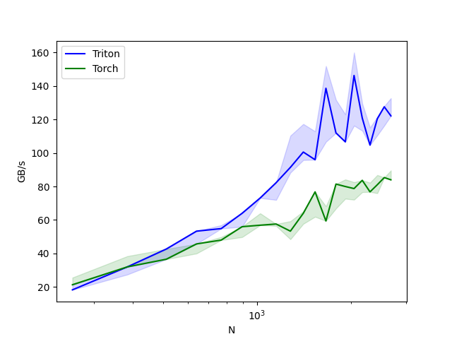

<a id="part2-ch7"></a>

# 第2部分 · 第7章：AI 编译器

> [总索引](../README.md) ｜ [本部分目录](README.md) ｜ [上一章](ch06-Attention算子.md) ｜ [下一章](ch08-性能分析工具链.md)

## 本章目录

- [本章导读](#part2-ch7)
- [7.1 Triton 编程框架介绍](#part2-ch7-sec1)

---

## 本章导读

> 发布 2026-04-16 · 标签 "Triton", "torch.compile", "AI编译器", "TorchInductor", "TVM" · [单篇原文](../articles/part2/第7章-AI编译器.md)

### 本章简介

手写 CUDA Kernel 性能极致但开发成本高，AI 编译器通过更高层的抽象在开发效率和性能之间找到平衡。本章覆盖三种主流方案。

**Triton**是目前最受关注的 AI Kernel 编程框架，采用 Block-level 编程模型（对比 CUDA 的 Thread-level），大幅降低了 GPU 编程门槛。本节介绍 Triton 基础语法（tl.load/tl.store/tl.dot/tl.where）并复现官方 Fused Softmax 教程。

**torch.compile**是 PyTorch 2.x 的编译模式，包含 TorchDynamo（Python 字节码级图捕获）和 TorchInductor（后端代码生成）。重点分析 Graph Break 问题（什么情况打断编译、如何避免）和性能收益评估。

**TVM / XLA（概述\）**介绍两者的定位差异：TVM 面向跨硬件编译优化，XLA 面向计算图整体优化，以及它们与 Triton、torch.compile 的关系。

<a id="part2-ch7-sec1"></a>

## 7.1 Triton 编程框架介绍

> 发布 2026-10-17 · 标签 "Triton", "AI编译器",  · [单篇原文](../articles/part2/7.1-Triton编程框架.md)

本文结合官方 Fused Softmax 算子的实现，介绍 Triton 的编程模型和基础语法。与 CUDA 通常从 thread 的视角编写计算逻辑不同，Triton 让开发者以 tile（数据块）为单位描述加载、计算和存储操作，将大量线程与 warp 级别的实现细节交给编译器。


Softmax 是深度学习和大模型中的常用算子，在 PyTorch、TensorFlow 等框架中均有对应实现。本文用 Triton 实现按行计算的 Softmax，并与多个 PyTorch 操作组合而成的 `naive_softmax` 和原生的 `torch.sofrmax` 对比，观察算子融合如何减少中间张量的访存和 kernel 启动开销。

### 1-Triton 编程模型

在介绍 Triton 编程模型之前，我们先回顾一下之前的 CUDA 算子是怎么写的？

以 Softmax 算子为例，我们通常从单个 thread 的视角编写计算逻辑，如下面的 warp-sum 规约代码所示：

```cuda
// warp 内 Sum 规约
__device__ __forceinline__ float warpReduceSum(float val){
    for(int i = 1 ; i < 32 ; i <<= 1)
        val += __shfl_xor_sync(0xffffffff, val ,i) ;
    return val ;
}

__device__ __forceinline__ float blockReduceSum(float val){
    __shared__ float smem[32] ;

    int lane_ID = threadIdx.x % 32 ;
    int warp_ID = threadIdx.x / 32 ;

    val = warpReduceSum(val) ;
    if(lane_ID == 0) smem[warp_ID] = val ;
    __syncthreads() ;

    val = (lane_ID < blockDim.x / 32) ? smem[lane_ID] : 0.0f ;
    if(warp_ID == 0) val = warpReduceSum(val) ;

    __shared__ float block_res ;
    if(threadIdx.x == 0) block_res = val ;
    __syncthreads() ;
    return block_res ;
}
```

其中每个 thread 先通过 shuffle 完成 warp 内规约，再由各 warp 将局部结果写入共享内存，交给第一个 warp 完成 block 内的最终规约。开发者需要显式处理线程间通信、共享内存和同步。这样的 CUDA 代码便于实现对内存和数据的精细控制，但也增加了实现和调试的难度；相比之下，Triton 将这一些繁杂的工作进行优化，让编译器来承担其中的大量实现细节。

Triton 最早由 Philippe Tillet、H. T. Kung 和 David Cox 于 2019 年提出，其目标是为深度学习算子提供一种比 CUDA 更高层、同时又能够保持较高性能的 GPU 编程方式。2021 年，OpenAI 发布了基于 Python 的 Triton 1.0，并继续推动其发展。

与 CUDA 以 thread 和 warp 为中心的 SIMT 编程模型不同，Triton 采用以 tile（数据块） 为核心的编程模型。开发者主要描述一个 Triton program instance 需要处理的数据块，以及该数据块上的加载、计算和存储操作，而不再显式管理每个 CUDA thread 的行为。随后，编译器负责将这些块级操作映射到具体的线程和 warp，并根据访问模式进行访存合并、共享内存分配、必要的线程同步和指令组织等优化。运行时具体由哪个 SM 执行某个 block、何时发射某个 warp 的指令，仍由 GPU 硬件调度；编译器也不能保证任意访问模式都能高效合并访存。

Triton 的目标并不是完全隐藏 GPU 并行计算，而是在算法表达和底层硬件之间提供一个更合适的抽象层：开发者仍然需要决定算子的分块方式、program grid 和整体算法结构，但可以将大量线程级实现细节交给编译器。这样既降低了编写和调试自定义 GPU 算子的难度，又尽可能保留接近手写 CUDA 实现的性能。


### 2-Torch Softmax 算子实现

考虑输入矩阵 $X \in \mathbb{R}^{M \times N}$，其中 $M$ 和 $N$ 分别为矩阵的行数和列数，对矩阵的每一行进行 softmax 计算，其公式如下：

$$
y_{i,j} = \operatorname{softmax}(X_{i,:})_j = \frac{e^{x_{i,j}}}{\sum_{k=0}^{N-1} e^{x_{i,k}}}
$$

其中 $x_{i,j}$ 表示第 $i$ 行第 $j$ 列的元素，$k$ 是分母求和使用的独立索引。实际计算时，先减去每行的最大值 $m_i$，得到数值更稳定、数学上等价的形式：

下面的 `naive_softmax` 实现使用了这一稳定化处理：

```python
import torch

def naive_softmax(x) :

    x_max = x.max(dim=1)[0]

    z = x - x_max[:, None]

    numerator = torch.exp(z)

    denominator = numerator.sum(dim=1)

    ret = numerator / denominator[:, None]

    return ret

M, N = 10, 10
x = torch.rand(size=(M, N,), dtype=torch.float32, device='cuda')
y_torch = naive_softmax(x)

```

### 3-Triton 基础语法介绍

Triton kernel 中的大部分操作并不是只处理一个标量，而是同时处理一个数据块。理解 Triton 代码时，可以按照下面的顺序分析：

- 使用 tl.program_id 确定当前 program 负责的数据区域；
- 使用 tl.arange 生成一个数据块内部的元素偏移；
- 通过指针运算得到一组内存地址；
- 使用 tl.load 将数据加载为 Triton 张量；
- 对张量执行逐元素运算、规约或矩阵乘法；
- 使用 tl.store 将结果写回显存。

需要注意的是，**Triton kernel 中无法使用 Python 原生数据结构（如 list、dict 等）或 PyTorch 操作（如 torch.max、torch.relu 等）**，因此接下来将介绍几个 Triton kernel 中常用的基础语法：

#### tl.program_id

`tl.program_id` 返回当前 program instance 在启动 grid 指定维度上的编号，作用类似于 CUDA 中的 blockIdx：

```python
# Triton 的启动 grid 最多可以包含三个维度，因此 axis 的取值为 0、1、2
# 类似 cuda 中的 blockIdx.x / blockIdx.y / blockIdx.z 
pid = tl.program_id(axis=0)
```

#### tl.num_programs

`tl.num_programs(axis)` 返回启动 grid 在指定维度上的 program 数量，作用类似于 CUDA 中的 gridDim：

```python 

# 类似地 axis 的取值为 0、1、2
# 对应 cuda 中的 gridDim.x / gridDim.y / gridDim.z
num_programs = tl.num_programs(axis=0)

```


#### tl.arange

`tl.arange(start, end)` 用于创建连续的逻辑索引：

```python

offsets = tl.arange(0, BLOCK_SIZE)

```
其中 `BLOCK_SIZE` 通常是通过 `tl.constexpr` 传入的 2 的幂。


#### tl.range

`tl.range` 用法类似于原生 python 中的 range 迭代器，常用于循环遍历中：

```python

@triton.jit
def kernel(M, num_stages):
    for idx in tl.range(0, M, num_stages=num_stages) :
        ...

```
其中 `num_stages` 参数表示软件流水线级数，具体的使用案例可参考随后的 Triton Softmax 实现。

#### tl.load

`tl.load` 根据一个指针或一组指针从显存中读取数据：

```python

values = tl.load(ptrs)

```

如果 `ptrs` 是一个形状为 `[BLOCK_SIZE]` 的指针张量，那么返回的 values 也具有相同形状。\
对于可能越界的位置，可以使用 mask 屏蔽：

```python

values = tl.load(
    ptrs,
    mask=offsets < n_elements,
    other=0.0,
)

```

对于 `mask=False` 的位置，代码不会访问对应的内存位置，而是使用 `other` 来填充返回，如果使用了 `mask`，通常应当显式指定 `other`。否则，被屏蔽位置的返回值是未定义的，可能污染后续计算


#### tl.store

`tl.store` 将标量或 Triton 张量写入指定的内存位置，同样可以使用 mask 避免越界写入：

```python

tl.store(output_ptrs, output, mask=mask)

```

#### tl.where

`tl.where(condition, x, y)` 根据条件逐元素选择结果：

```python

output = tl.where(condition, x, y)

```

它的语义类似于：`output[i] = x[i] if condition[i] else y[i]`，一个常见的例子是 `ReLU` 的实现：

```python

output = tl.where(x > 0.0, x, 0.0)

```

需要特别注意：`tl.where` 的 `x` 和 `y` 两个分支都会被计算。**它只是根据条件选择最终结果，并不会阻止某个分支中的计算或内存访问**，例如下面的例子：

```python

# 不安全的分支，可能出现除零错误
result = tl.where(denominator != 0, numerator / denominator, 0.0)

# 安全分支
safe_denominator = tl.where(denominator != 0, denominator, 1.0)
result = numerator / safe_denominator
result = tl.where(denominator != 0, result, 0.0)

```

因此，tl.where 适合表达逐元素选择，但不应将它理解为能够跳过某个分支的控制流语句。

#### tl.dot

Triton 提供了大量类似 NumPy 和 PyTorch 的逐元素数学函数，例如：

```python
y = tl.exp(x)
y = tl.log(x)
y = tl.sqrt(x)
y = tl.abs(x)
y = tl.maximum(x, 0.0)
y = tl.dot(x, y)
```

其中 `tl.dot` 用于计算两个二维或三维数据块的矩阵乘法，在 GEMM kernel 中，`tl.dot` 用于沿 $K$ 维分块逐步做乘法求和：

```python

# 创建指定形状和数据类型的全零张量
accumulator = tl.zeros(
    (BLOCK_SIZE_M, BLOCK_SIZE_N),
    dtype=tl.float32,
)

for k in range(0, K, BLOCK_SIZE_K):
    a = tl.load(a_ptrs, mask=a_mask, other=0.0)
    b = tl.load(b_ptrs, mask=b_mask, other=0.0)

    accumulator = tl.dot(a, b, accumulator)

    a_ptrs += BLOCK_SIZE_K * stride_ak
    b_ptrs += BLOCK_SIZE_K * stride_bk

```

参数 `accumulator` 表示将本次矩阵乘法结果累加到已有的张量上。


### 4-Triton Softmax 算子实现

Triton kernel 会在 grid 上启动多个 program instance，可以将一个 program instance 类比为一个 CUDA thread block：它由多个 thread/warp 协作执行，处理一个或多个数据块。

与 cuda kernel 类似，triton 需要声明 kernel 函数，triton 通过 `@triton.jit` 定义 kernel。下面三个代码块依次拼接，组成完整的 `_softmax` 函数；函数签名后面的两段代码都属于它的函数体：

```python
import triton
import triton.language as tl
from triton.runtime import driver

# 声明这是一个 triton kernel
@triton.jit
def _softmax(
    input_ptr,                    # 输入矩阵的首指针
    output_ptr,                   # 输出矩阵的首指针
    input_row_stride,             # 输入矩阵中，相邻两行起点的间隔
    output_row_stride,            # 输出矩阵中，相邻两行起点的间隔
    n_rows,                       # 矩阵的行数
    n_cols,                       # 矩阵的列数
    BLOCK_SIZE: tl.constexpr,     # 每次循环的逻辑元素数，编译期常量
    num_stages: tl.constexpr      # 传给 tl.range 的软件流水线级数
) :

```
其中，`BLOCK_SIZE` 表示本例每次循环处理的逻辑元素数。`tl.constexpr` 表示该参数的值在编译时已知，编译器可据此确定张量形状并生成特化代码，它可以类比 C++ 的编译期常量。

本文案例中让一个 program 通过循环处理若干行的 softmax 计算，因此需要获取当前 program 的 id 和启动的 program 数量：

```python
    # 一个 Triton program 类似于一个 CUDA thread block
    # tl.program_id(0) 类似 blockIdx.x，axis=0/1/2 对应 grid 的 x/y/z 维
    row_start = tl.program_id(axis=0)

    # 类似 CUDA 的 gridDim.x，返回 grid 第 0 维的 program 数量
    row_step = tl.num_programs(axis=0)

```

假设启动了 $P$ 个 program，编号为 $p$ 的 program 依次处理行 $p, p+P, p+2P, \ldots$，直到行号达到 $M$，每次循环只计算其中一行。

对于每一行，先计算各列元素的指针，再通过 `tl.load` 加载数据、完成规约和逐元素运算，最后通过 `tl.store` 写回结果：

```python

    # 步长为 row_step；row_idx 表示当前 program 所处理的行数据索引
    for row_idx in tl.range(row_start, n_rows, row_step, num_stages=num_stages) :
        # 当前所处理的行数据的首指针
        row_start_ptr = input_ptr + row_idx * input_row_stride

        # col_offset: [0, 1, 2, ..., BLOCK_SIZE-1]
        # 此处 BLOCK_SIZE 必须是编译期已知的 2 的幂
        col_offset = tl.arange(0, BLOCK_SIZE)

        # 构造 BLOCK_SIZE 个逻辑位置的指针，越界位置由下面的 mask 屏蔽
        input_ptrs = row_start_ptr + col_offset

        # 实际矩阵的列数不一定是2的幂数，需要掩码来控制读取的范围
        mask = col_offset < n_cols

        # mask=False 的位置不读取内存，填 -inf；行最大值有限时，这些位置的 exp 为 0
        row = tl.load(input_ptrs, mask=mask, other=-float('inf'))

        # softmax 计算
        row_minus_max = row - tl.max(row, axis=0)
        numerator = tl.exp(row_minus_max)
        denominator = tl.sum(numerator, axis=0)
        softmax_output = numerator / denominator

        # 计算写入的行起始指针
        output_row_ptr = output_ptr + row_idx * output_row_stride
        # 计算每一个数据的具体指针偏移
        output_ptrs = output_row_ptr + col_offset
        tl.store(output_ptrs, softmax_output, mask=mask)
```

注意，这里的 `row` 是长度为 `BLOCK_SIZE` 的一维 Triton 张量，因此 `tl.max(row, axis=0)` 和 `tl.sum(..., axis=0)` 都沿当前行的逻辑列位置规约，得到一个标量。

`tl.range(..., num_stages=num_stages)` 为编译器提供软件流水线级数的提示，尝试让不同循环迭代的加载与计算重叠，提升资源利用率。级数越高，共享内存和寄存器的压力越大。

与 CUDA 类似，Triton kernel 也需要指定启动 grid。下面沿用官方教程的思路：先预编译，查询资源占用，再估算要启动的 program 数量。program 在循环中继续处理后续行，这种写法通常称为 persistent kernel（可持久内核）。


```python
DEVICE = torch.cuda.current_device()
properties = driver.active.utils.get_device_properties(DEVICE)
NUM_SM = properties['multiprocessor_count']   # SM 数量
NUM_REGS = properties['max_num_regs']         # 寄存器容量预算，以 32 位寄存器计
SIZE_SMEM = properties['max_shared_mem']      # 共享内存容量预算，单位为字节
WARP_SIZE = properties['warpSize']            # NVIDIA GPU 上为 32
kernels = {}

def softmax(x):
    assert x.is_cuda

    n_rows, n_cols = x.shape
    y = torch.empty_like(x)

    # 向上取到不小于 n_cols 的最小 2 的幂
    BLOCK_SIZE = triton.next_power_of_2(n_cols)
    num_warps = 8       # 一个 program 使用 8 个 warp，即 256 个 CUDA 线程
    num_stages = 4 if SIZE_SMEM > 200000 else 2       # 流水线的级数
    kernel, num_programs = kernels.get(BLOCK_SIZE, (None, 0))

    if kernel is None:
        # warmup 只编译、不真正执行。返回一个编译好的 kernel 对象
        kernel = _softmax.warmup(
            y, x, 
            x.stride(0), y.stride(0), 
            n_rows, n_cols, BLOCK_SIZE=BLOCK_SIZE, 
            num_stages=num_stages, num_warps=num_warps, 
            grid=(1,))

        # 初始化 CUDA kernel 句柄，以便查询编译产物的资源占用。
        kernel._init_handles()
        n_regs = kernel.n_regs
        size_smem = kernel.metadata.shared
        occupancy = NUM_REGS // (n_regs * WARP_SIZE * num_warps)
        occupancy = min(occupancy, SIZE_SMEM // size_smem)
        num_programs = NUM_SM * occupancy
        kernels[BLOCK_SIZE] = (kernel, num_programs)

    num_programs = min(num_programs, n_rows)

    # 启动 softmax kernel
    # 其中 x 和 y 会被隐式地转换成矩阵的首地址
    kernel[(num_programs, 1, 1)](
        x,
        y,
        x.stride(0),   # 矩阵同列相邻元素的地址差
        y.stride(0),
        n_rows,
        n_cols,
    )

    return y
```


### 5-性能对比

Triton 中提供了便利的 benchmark 对比函数，通过指定不同的参数配置和 benchmark 实现，可以快速地判断不同方法实现下的算子性能。

结合[前文](https://caomaolufei.github.io/AIInfraGuide/cuda/%E6%A8%A1%E5%9D%97%E4%BA%8C-cuda%E7%BC%96%E7%A8%8B%E4%B8%8E%E7%AE%97%E5%AD%90%E4%BC%98%E5%8C%96/51-cuda-softmax%E6%9C%B4%E7%B4%A0%E5%AE%9E%E7%8E%B0%E4%BC%98%E5%8C%96/)的介绍，Softmax 在数据量足够大时的提升瓶颈常表现为访存受限。因此，下面用**有效带宽**作为统一口径比较两种实现：

$$
B_{\mathrm{eff}} = \frac{2MN \cdot s}{t_{\mathrm{ms}}} \times 10^{-6} \quad (\mathrm{GB/s})
$$

其中 $s$ 为每个元素的字节数；$t_{\mathrm{ms}}$ 为毫秒计的耗时。

```python

# triton 所提供的 benchmark 修饰器
@triton.testing.perf_report(
    triton.testing.Benchmark(
        x_names=['N'],                               # 考虑不同配置的参数 N
        x_vals=[128 * i for i in range(2, 17)],      # N=256, 384, ..., 2048
        x_log=True,
        line_arg='provider',                         # 用 provider 参数选择曲线对应的实现
        line_vals=['triton', 'torch'],               # 两种被测实现
        line_names=['Triton', 'Torch'],              # 对比曲线的名称
        styles=[('blue', '-'), ('green', '-')],      # 对比曲线的颜色
        ylabel='Effective bandwidth (GB/s)',
        plot_name='fused-softmax-performance',
        args={'M': 64},                              # 固定 M 为 64
    )
)
def benchmark(M, N, provider):
    # 在同一个当前 CUDA stream 上生成输入并执行被测操作
    x = torch.rand(M, N, device=DEVICE, dtype=torch.float32)

    # 按顺序返回耗时的中位数、20% 分位数和 80% 分位数
    quantiles = [0.5, 0.2, 0.8]

    # 对比原生的 torch 实现
    if provider == 'torch':
        ms, min_ms, max_ms = triton.testing.do_bench(
            lambda: torch.softmax(x, axis=-1), 
            quantiles=quantiles)

    # 测试 Triton Softmax 算子
    if provider == 'triton':
        ms, min_ms, max_ms = triton.testing.do_bench(
            lambda: softmax(x), 
            quantiles=quantiles)

    # 以相同的有效读写字节数计算 GB/s
    gbps = lambda ms: 2 * x.numel() * x.element_size() / ms * 1e-6
    return gbps(ms), gbps(max_ms), gbps(min_ms)

if __name__ == '__main__':
    torch.manual_seed(0)
    # 同时覆盖小尺寸、非 2 的幂列数，以及同一 BLOCK_SIZE 下的不同形状
    for M, N in [(1, 1), (128, 256), (129, 255), (1823, 781)]:
        x = torch.randn(M, N, device=DEVICE, dtype=torch.float32)
        y_torch = naive_softmax(x)
        y_triton = softmax(x)
        torch.testing.assert_close(y_triton, y_torch, rtol=1e-5, atol=1e-7)
    print('Correctness checks passed.')

    # 对比 Triton 与 Torch 实现的有效带宽
    benchmark.run(print_data=True, show_plots=True)

```

其中 `do_bench` 函数会执行预热和重复计时。设置 `quantiles=[0.5, 0.2, 0.8]` 时，返回的依次是耗时的中位数、第 20 百分位数和第 80 百分位数。

运行得到的对比结果如下：

```
the max error is 1.862645149230957e-09
fused-softmax-performance:
         N      Triton      Torch
0    256.0   18.285714   6.736842
1    384.0   27.428571   9.142857
2    512.0   42.666665  12.190476
3    640.0   53.333331  15.238095
4    768.0   54.857142  17.454545
5    896.0   63.999999  18.666666
6   1024.0   73.142856  20.480001
7   1152.0   82.285713  21.735849
8   1280.0  106.666663  24.615385
9   1408.0  117.333329  26.074074
10  1536.0  127.999995  26.482758
11  1664.0  104.000000  28.689654
12  1792.0  149.333328  28.000000
13  1920.0  159.999994  30.967742
14  2048.0  146.285712  30.117647
```



从上述的对比结果，我们可以看到： 

- 随着数据量的增大，Triton Softmax 相对 Torch 原生方法的优势愈发明显，说明这一组测试中 Triton kernel 的融合实现减少开销是有效的。
- Triton 的访存效率更高，且算子实现也更加简单、更易于维护。

### 📝 总结

从 CUDA 的线程级实现到 Triton 的块级表达，本文的核心内容可以归纳为三条主线：

1. **以数据块描述并行计算**：从显式编写 thread/warp 的规约、通信和同步，转向描述一个 program 要处理的数据与操作。开发者仍需决定分块、grid 和寻址方式，编译器负责将块级运算映射到线程和 warp。
2. **用基础语法实现正确的算子**：用 `tl.program_id`、`tl.num_programs` 和循环分配矩阵行，用 `tl.arange` 构造列偏移，通过 `mask` 与 `-inf` 处理补齐位置，再用 `tl.max`、`tl.exp` 和 `tl.sum` 完成稳定的 Softmax。
3. **通过融合减少开销，用测量判断收益**：将多个操作融合进一个 kernel，减少中间张量的全局内存访问和启动次数；同时结合资源占用选择启动规模，并在正确性验证后，以明确的基线和有效带宽口径比较性能。

Triton 简化的是线程级实现细节，算子性能仍取决于算法、数据布局、资源压力和输入规模。掌握本例后，可以借助[官方文档](https://triton.hyper.ai/)继续学习向量加法、LayerNorm 和矩阵乘法，逐步练习更复杂的分块与调优方法。

### 🎯 自我检验清单

- 能说明 Triton 的 tile、program、grid 分别表示什么，以及 program 与 CUDA thread block 的类比条件；
- 能描述 Triton Softmax 算子的大致实现流程，从确定 program_id、计算数据指针、加载并进行计算到写回内存，理解每个步骤的代码实现；
- 能区分本文中 `BLOCK_SIZE` 参数在 Triton 和 CUDA 两种编程模型中所代表的含义（前者指的是一个 program 所处理的数据数量，后者指代一个 block 中所包含的线程个数）
- 能理解 `tl.where` 函数的使用及其分支选择的过程；
- 能根据 `row_start`、`row_step` 和 `tl.range`，列出每个 program 实际处理的行号；
- 能理解为什么要传入 `input_row_stride`，理解 triton kernel 中的地址计算方式；
- 能理解 Triton kernel 启动过程中动态计算 num_programs 的做法和实现；
- 能说明为什么将列数补齐到 2 的幂，以及 load 和 store 为什么都需要 mask；
- 能说明为什么随着数据量的增加，Softmax 的不同实现方式的出现效率差异，理解其优化瓶颈所在；
- 尝试使用 Triton 实现其他算子（LayerNorm、GEMM 等），并与原生的 Torch 实现进行对比分析；

### 📚 参考资料

- [Triton 中文站](https://triton.hyper.ai/)
- [Triton 官方教程：Fused Softmax](https://triton-lang.org/main/getting-started/tutorials/02-fused-softmax.html)
- [OpenAI Triton](https://openai.com/index/triton/)
- [Triton 编程极简入门](https://zhuanlan.zhihu.com/p/1902778199261291694)
- [Triton Kernel Compilation Stages](https://pytorch.org/blog/triton-kernel-compilation-stages/)
- [Triton Kernels-Fused Softmax](https://www.kapilsharma.dev/posts/triton-kernels-softmax/)
- [Triton API：triton.testing.do_bench](https://triton-lang.org/main/python-api/generated/triton.testing.do_bench.html)
