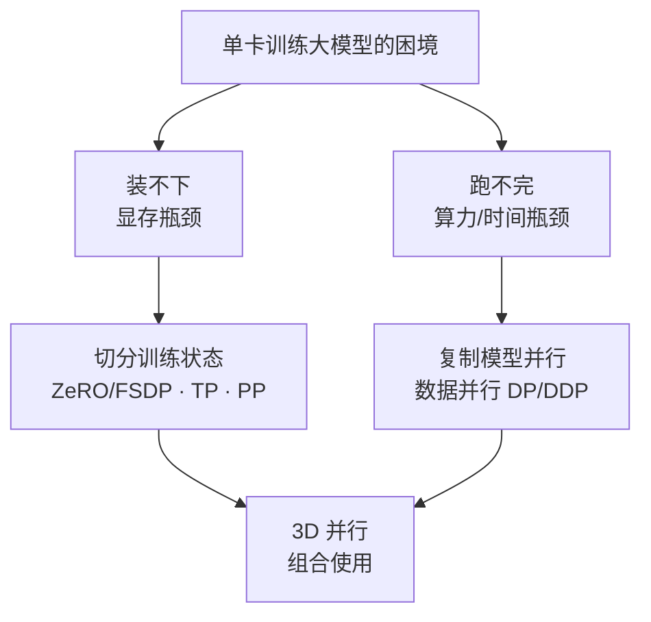
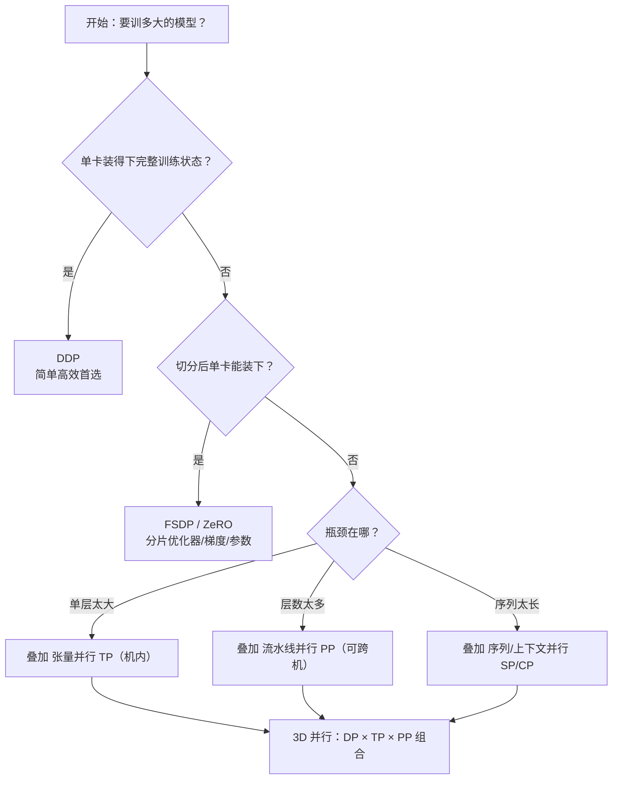
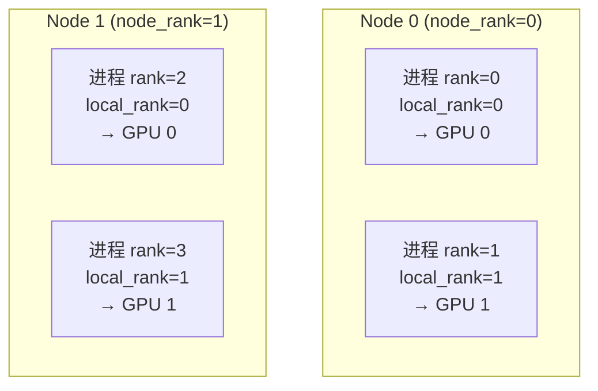
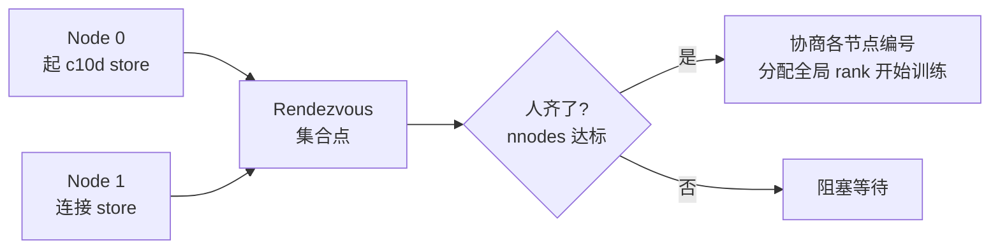
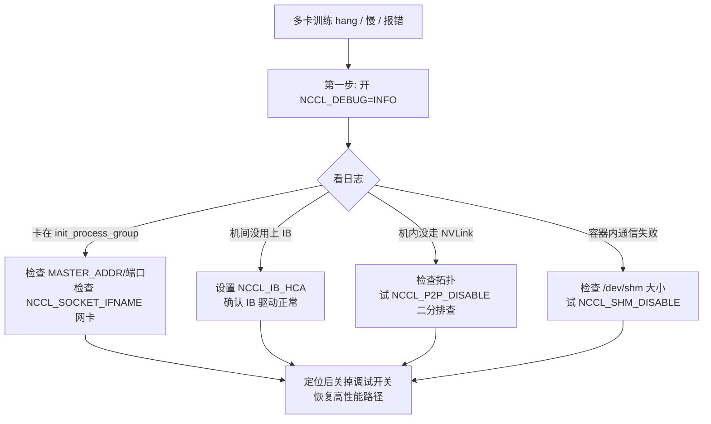
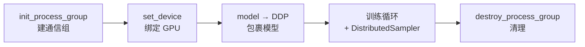

<a id="part3-ch1"></a>

# 第3部分 · 第1章：分布式训练总论

> [总索引](../README.md) ｜ [本部分目录](README.md) ｜ [下一章](ch02-集合通信原语.md)

## 本章目录

- [本章导读](#part3-ch1)
- [1.1 分布式训练总论：显存账本与五大并行策略全景](#part3-ch1-sec1)
- [1.2 环境搭建与分布式启动](#part3-ch1-sec2)

---

## 本章导读

> 发布 2026-04-16 · 标签 "分布式训练", "显存分析", "并行策略", "3D并行", "通信拓扑", "torchrun", "NCCL", "DDP", "rank" · [单篇原文](../articles/part3/第1章-分布式训练总论.md)

### 📖 本章概述

本章是分布式训练模块的总纲，建立三层认知框架：**为什么**需要分布式训练 → 训练到底需要**多少显存** → 有哪些并行策略**怎么分**；随后落到工程地基，讲清多卡如何"组队"、如何用 torchrun 一条命令拉起、如何跑通第一个 DDP 训练脚本。读完本章，既有了后续每一章"在解决什么问题"的坐标系，也具备了亲手跑通多卡训练的能力。

> 本章由两部分构成：前半是认知总论（显存账本 + 并行全景），后半是工程地基（进程模型 + torchrun + NCCL + 最小 DDP 脚本），对应下面两篇正文。

---

### 📑 章节结构

### 第一部分：认知总论（对应正文 1.1）

### 1. 为什么需要分布式训练

- **显存瓶颈**：以 LLaMA 系列为例（7B → 70B → 405B），展示模型规模与显存需求的增长，单卡 80GB 的 H100 在 7B 以上就装不下完整训练状态
- **时间瓶颈**：70B 模型在 1T token 上训练，单卡需要数年；多卡并行可近线性缩短训练时间
- **核心结论**：分布式训练解决"装不下"（显存）和"跑不完"（时间）两个问题

### 2. 训练状态显存分析（本章重点）

- **显存四大组成**：
  - 参数显存（FP16: $2\Psi$ Bytes）
  - 梯度显存（FP16: $2\Psi$ Bytes）
  - 优化器状态显存（Adam: FP32 参数副本 $4\Psi$ + 一阶动量 $4\Psi$ + 二阶动量 $4\Psi$ = $12\Psi$ Bytes）
  - 激活值显存（与 batch size、序列长度、模型宽度相关）
- **手算实例**：7B 模型 BF16 混合精度训练的完整显存账本
  - 静态显存 = $(2 + 2 + 12) \times 7 \times 10^9$ Bytes ≈ 112 GB
  - 激活值显存估算（以 seq_len=2048, batch=1 为例）
- **显存公式总结**：每参数 16-18 Bytes（混合精度 + Adam）+ 激活值

### 3. 并行策略全景

- **数据并行（DP/DDP）**：每卡完整模型，切分数据，AllReduce 同步梯度——解决"跑不完"
- **ZeRO / FSDP**：切分优化器状态/梯度/参数，按需聚合——解决"装不下"
- **张量并行（TP）**：层内矩阵运算切分到多卡——解决"单层太大"
- **流水线并行（PP）**：不同层分配到不同卡——解决"层数太多"
- **序列并行（SP）/ 上下文并行（CP）**：沿序列维度切分——解决"序列太长"

### 4. 并行策略选择原则

- **通信带宽决定作用域**：TP 限制在 NVLink 互联的机内（需高带宽低延迟），PP 可跨机（只传激活值），DP 对带宽要求最低
- **决策树**：单卡装得下 → DDP；单卡装不下 → FSDP/ZeRO；单层装不下 → TP；模型层数太多 → PP；综合使用 → 3D 并行
- **通信拓扑与硬件的映射关系**：NVLink（900 GB/s）vs InfiniBand（400 Gbps）vs 以太网对策略选择的影响

### 第二部分：环境搭建与分布式启动（对应正文 1.2）

### 5. 进程组与核心概念

- 单机单卡 / 单机多卡 / 多机多卡三种规模与带宽分层（NVLink vs InfiniBand）
- 进程模型：为什么是"一卡一进程"（绕开 GIL、独占 CUDA 上下文）
- 核心概念：`rank` / `local_rank` / `world_size`，以及为什么 `set_device` 必须用 `local_rank`
- 进程组 `init_process_group` 与后端选择（nccl / gloo）
- 子通信组 `new_group`：为 3D 并行铺路

### 6. torchrun 启动机制

- 为什么需要专门的启动器；`torch.distributed.launch` → `torchrun` 的演进
- torchrun 注入的环境变量（RANK / LOCAL_RANK / WORLD_SIZE / MASTER_ADDR / MASTER_PORT）
- 单机多卡启动、多机多卡启动与 Rendezvous（c10d 弹性会合）
- torchrun 的弹性与容错能力（详见第 14 章）

### 7. NCCL 环境变量与通信调试

- `NCCL_DEBUG=INFO` 排障第一招
- `NCCL_SOCKET_IFNAME` / `NCCL_IB_HCA` 指定网卡
- `NCCL_P2P_DISABLE` / `NCCL_SHM_DISABLE` 二分排障开关
- `CUDA_VISIBLE_DEVICES` 与设备绑定

### 8. 动手写第一个多卡训练脚本

- 最小 DDP 脚本的五段式骨架：init → set_device → DDP 包裹 → 训练循环（带 Sampler）→ destroy
- 完整可运行模板与逐段拆解
- 仅 rank 0 干活的工程惯例、`DistributedSampler` + `set_epoch`
- 首次跑多卡的常见踩坑

---

### 🎯 本章学习目标

- 能计算任意规模模型（给定参数量）的 BF16 混合精度训练显存需求
- 能画出五大并行策略的"切什么 × 怎么通信"对比表
- 能根据模型规模和集群拓扑选择合适的并行策略组合
- 能准确区分 rank / local_rank / world_size，并写出 torchrun 单机、多机启动命令
- 能独立写出并用 torchrun 跑通一个最小 DDP 训练脚本
- 能说出遇到多卡通信问题的第一个动作（开 `NCCL_DEBUG=INFO`）及常见排查手段

<a id="part3-ch1-sec1"></a>

## 1.1 分布式训练总论：显存账本与五大并行策略全景

> 发布 2026-06-29 · 标签 "分布式训练", "显存分析", "并行策略", "3D并行", "通信拓扑" · [单篇原文](../articles/part3/1.1 分布式训练总论.md)

在一头扎进 DDP、ZeRO、张量并行这些具体技术之前，得先搭好认知地图：单卡到底卡在哪、训练究竟要吃多少显存、有哪些并行策略各自在解决什么。本文用具体数字手算显存账本，再总览五大并行策略与选择原则，让你对后续每一章"在解决什么问题"建立清晰坐标。


### 1. 为什么需要分布式训练：装不下与跑不完

训练神经网络，本质是反复做"前向算 loss → 反向算梯度 → 优化器更新参数"。模型小时一块 GPU 全程装得下也跑得快，根本不需要分布式。但当模型膨胀到几百亿、几千亿参数，单卡会在两个维度同时撞墙。

🔑 **核心概念**：分布式训练要解决的从来不是一个问题，而是两个相互独立的问题——**显存装不下**（空间）和**时间跑不完**（速度）。看懂这两者的区别，是理解所有并行策略的前提。

打个比方：单卡训大模型，就像让一个人用一张小书桌整理一整座图书馆——**桌子太小摊不开**（显存不够），而且**一个人搬一辈子也搬不完**（算力不够）。两个困境解法不同：前者要"拆开放到几张桌子上"，后者要"多叫几个人一起搬"。

#### 1.1 装不下：显存瓶颈

很多人的直觉是"模型多少参数就占多少显存"，这是严重低估。训练时的显存远不止参数本身（下一节细算）。粗略地说，BF16 混合精度 + Adam 下**每个参数约需 16~18 字节静态显存**。用 LLaMA 系列估一下（仅静态显存，暂不含激活值）：

| 📊 模型规模 | 参数量 $\Psi$ | 静态显存 $\approx 16\Psi$ | 单卡能否装下（H100 80GB） |
|------------|--------------|--------------------------|--------------------------|
| LLaMA 7B | $7 \times 10^9$ | $\approx 112$ GB | ❌ 装不下 |
| LLaMA 70B | $70 \times 10^9$ | $\approx 1120$ GB | ❌ 远超 |
| LLaMA 405B | $405 \times 10^9$ | $\approx 6480$ GB | ❌ 需数十卡 |

⚠️ **注意**：连"小号"的 7B 模型，光静态显存就约 112 GB，**已超过单张 H100 的 80 GB**——还没算前向堆积的激活值。这就是第一个动因：**模型规模超过单卡显存容量**。

#### 1.2 跑不完：算力与时间瓶颈

即便显存无限大，单卡还有"算得太慢"这道坎。大模型训练的计算量有个广为引用的经验公式（$C$ 为总浮点运算次数，$\Psi$ 为参数量，$D$ 为训练 token 数）：

$$
C \approx 6 \Psi D
$$

这个 "6" 来自前向约 2 倍、反向约 4 倍参数量的乘加。代入 70B 模型训 1T（$10^{12}$）token：

$$
C \approx 6 \times (70 \times 10^9) \times 10^{12} = 4.2 \times 10^{23} \text{ FLOPs}
$$

单张 H100 的 BF16 算力峰值约 $10^{15}$ FLOP/s，乐观假设 50\% 有效利用率（MFU）：

$$
T = \frac{4.2 \times 10^{23}}{10^{15} \times 0.5} \approx 8.4 \times 10^8 \text{ 秒} \approx 26.6 \text{ 年}
$$

💡 **提示**：单卡训 70B 要二十多年——等训完模型架构都换好几代了。而 $N$ 卡数据并行理论上能把时间压到接近 $1/N$，1024 卡可降到约 9 天量级。这就是第二个动因：**单卡算力不足以在可接受时间内完成训练**。

📌 **关键点**：两个瓶颈解法方向不同——"装不下"靠**切分状态**（把一份东西拆到多卡），"跑不完"靠**复制并行**（多卡各干一摊活）。后续策略也分属这两条线。

### 2. 训练显存账本：手算一遍就懂

这是本章重点。我们把"训练到底吃多少显存"逐项拆开，亲手算一遍 7B 模型的账，以后估算任意规模都心里有数。

训练显存分**静态显存**（与训练步无关、常驻）和**激活值显存**（随 batch / 序列长度变化）两大块。

#### 2.1 静态显存四大组成

以最主流的 **BF16 混合精度 + Adam 优化器** 为例。设参数量为 $\Psi$，逐项分析（单位：Bytes）：

| 组成 | 精度 | 每参数字节 | 说明 |
|------|------|-----------|------|
| 模型参数 | BF16 | $2\Psi$ | 前向/反向用的工作副本 |
| 梯度 | BF16 | $2\Psi$ | 反向产出，与参数同形状 |
| 优化器 - FP32 参数副本 | FP32 | $4\Psi$ | Adam 维护的高精度主权重 |
| 优化器 - 一阶动量 $m$ | FP32 | $4\Psi$ | 梯度的指数滑动平均 |
| 优化器 - 二阶动量 $v$ | FP32 | $4\Psi$ | 梯度平方的指数滑动平均 |

把优化器三项加起来就是 Adam 著名的 $12\Psi$。总静态显存：

$$
M\_{\text{static}} = \underbrace{2\Psi}\_{\text{参数}} + \underbrace{2\Psi}\_{\text{梯度}} + \underbrace{12\Psi}\_{\text{Adam 状态}} = 16\Psi \text{ Bytes}
$$

🔑 **核心概念**：训练显存的"大头"其实是**优化器状态**（$12\Psi$，占了 16 里的 12），而非参数本身。这正是 ZeRO 第一刀就切优化器状态的原因——它是性价比最高的下手处。

⚠️ **注意**：很多资料写"每参数 16~18 字节"，那个 16~20 的浮动来自实现细节差异（比如是否额外保留一份 FP32 梯度、是否用了 FP32 主梯度累加）。本文用最经典的 BF16 混合精度配置，记 $16\Psi$ 即可。

#### 2.2 手算 7B 模型静态显存

代入 $\Psi = 7 \times 10^9$：

$$
M\_{\text{static}} = 16 \times 7 \times 10^9 = 1.12 \times 10^{11} \text{ Bytes} \approx 112 \text{ GB}
$$

逐项看更直观：

- 参数：$2 \times 7\text{B} = 14$ GB
- 梯度：$2 \times 7\text{B} = 14$ GB
- 优化器状态：$12 \times 7\text{B} = 84$ GB
- **合计 ≈ 112 GB**

一张 H100 只有 80 GB——**静态显存就已经装不下了**。

#### 2.3 别忘了激活值

激活值是前向传播中为反向传播保留的中间结果，它**随 batch size $b$ 和序列长度 $s$ 线性/超线性增长**，是长序列、大 batch 训练里真正的"显存刺客"。

对 Transformer，单层激活值的粗略量级正比于 $b \cdot s \cdot h$（$h$ 为隐藏维），全模型再乘层数 $L$。激活值的精确公式涉及注意力中间量、是否开 Activation Checkpointing 等，这里只需建立直觉：

📌 **关键点**：静态显存只取决于参数量，是"固定成本"；激活值取决于 $b$、$s$，是"可调成本"。当你 OOM 时，先想到的应是减小 batch、开梯度累积或 Activation Checkpointing 来压激活值——这些是第8章的主题。

#### 2.4 显存估算速查

| 📊 项目 | 公式（Bytes） | 取决于 |
|---------|--------------|--------|
| 参数 | $2\Psi$ | 参数量 |
| 梯度 | $2\Psi$ | 参数量 |
| Adam 状态 | $12\Psi$ | 参数量 |
| **静态合计** | $\mathbf{16\Psi}$ | 参数量 |
| 激活值 | $\propto b \cdot s \cdot h \cdot L$ | batch / 序列 / 模型宽深 |

记住这张表，给定任意参数量都能 30 秒估出训练显存下限。

### 3. 五大并行策略全景

知道了瓶颈在哪、显存花在哪，接下来总览五种主流并行策略。每种策略的本质都是回答两个问题：**切什么**（决定省不省显存）、**怎么通信**（决定快不快）。



| 策略 | ✂️ 切什么 | 📡 主要通信 | 🎯 解决的问题 |
|------|----------|-----------|--------------|
| 数据并行 DP/DDP | 切数据，模型不切 | 梯度 AllReduce | 跑不完（加速） |
| ZeRO / FSDP | 切优化器/梯度/参数 | ReduceScatter + AllGather | 装不下（省显存） |
| 张量并行 TP | 切单层的矩阵运算 | 层内 AllReduce | 单层太大 |
| 流水线并行 PP | 切网络层（按深度分段） | 段间传激活值（P2P） | 层数太多 |
| 序列并行 SP / 上下文并行 CP | 沿序列维度切 | 序列维 AllGather / All-to-All | 序列太长 |

逐个建立直觉：

- **数据并行（DP/DDP）**：每卡一份完整模型，各算各的数据分片，反向时 AllReduce 同步梯度。它**不省显存**（每卡仍装完整模型），但能近线性加速——主攻"跑不完"。
- **ZeRO / FSDP**：DDP 的"显存优化版"。既然每卡都存了一份完全相同的优化器状态/梯度/参数，那不如分片存储、用时再 AllGather 拼回来——主攻"装不下"。
- **张量并行（TP）**：把一层（如一个大 Linear）的权重矩阵按行/列切到多卡，每卡算一部分再合并。通信频繁且量大，因此**只适合机内 NVLink**——解决"单层太大"。
- **流水线并行（PP）**：把模型按层切成几段，每段放一台/一组机器，激活值像流水线一样在段间传递。通信量小（只传激活值），**可跨机**——解决"层数太多"。
- **序列并行 / 上下文并行（SP/CP）**：沿序列长度维切分，让超长上下文（如 128K）也能放下——解决"序列太长"。

### 4. 并行策略选择原则

有了全景，怎么选？核心只有一句话：**通信带宽决定策略的作用域**。

#### 4.1 带宽决定"谁放机内、谁能跨机"

不同互联的带宽差一个数量级，这直接决定通信密集型策略只能放在哪：

| 互联 | 带宽量级 | 适配策略 |
|------|---------|---------|
| NVLink / NVSwitch（机内） | 数百 GB/s（如 NVLink 900 GB/s） | TP（通信最频繁，必须机内） |
| InfiniBand / RoCE（机间） | 数百 Gbps（如 400 Gbps ≈ 50 GB/s） | PP、DP（通信稀疏，可跨机） |
| 以太网 | 更低 | 仅 DP 这类低频通信勉强可用 |

📌 **关键点**：TP 每一层前向/反向都要 AllReduce，通信极频繁，放到跨机带宽上会被通信拖垮，所以**TP 几乎总是限制在单机 8 卡内**；PP 只在段边界传一次激活值，DP 一步只同步一次梯度，二者都能跨机。这是 3D 并行布局的根本依据。

#### 4.2 一棵实用决策树



✅ **推荐路径**：从最简单的够用方案起步，不够了再加维度——单卡装得下就 DDP；装不下先上 FSDP/ZeRO；还不行再按瓶颈叠 TP/PP/CP；千亿级才需要全套 3D 并行。

❌ **不推荐**：一上来就堆 3D 并行。每多一个并行维度都会显著增加调试复杂度和通信开销，过早优化得不偿失。

### 📝 总结

- 分布式训练解决两个独立问题：显存"装不下"（切分状态）和时间"跑不完"（复制并行）。
- 训练静态显存 $= 16\Psi$ Bytes（参数 $2\Psi$ + 梯度 $2\Psi$ + Adam 状态 $12\Psi$），大头是优化器状态；7B 模型仅静态就约 112 GB，超单张 H100。
- 激活值随 batch / 序列长度增长，是可调成本，OOM 时优先从这里压（减 batch、梯度累积、Activation Checkpointing）。
- 五大策略各有分工：DP/DDP 抢时间，ZeRO/FSDP 省显存，TP 切单层、PP 切层数、SP/CP 切序列。
- 选型核心是"带宽决定作用域"：TP 必须机内 NVLink，PP/DP 可跨机；按"够用就好、不够再加维度"的决策树逐步升级到 3D 并行。

### 🎯 自我检验清单

- 能用一句话说清分布式训练要解决的两个独立问题，并指出各自的解法方向
- 能逐项写出 BF16 + Adam 训练的静态显存组成，并解释为什么是 $16\Psi$
- 能手算给定参数量模型的静态显存，并判断单卡是否装得下
- 能用 $C \approx 6\Psi D$ 估算训练总计算量并推算单卡耗时
- 能画出五大并行策略的"切什么 × 怎么通信 × 解决什么"对比表
- 能解释为什么 TP 必须放机内而 PP/DP 可以跨机
- 能根据模型规模和集群拓扑，用决策树选出合适的并行策略组合

### 📚 参考资料

- [Scaling Laws for Neural Language Models](https://arxiv.org/abs/2001.08361)
- [LLaMA: Open and Efficient Foundation Language Models](https://arxiv.org/abs/2302.13971)
- [ZeRO: Memory Optimizations Toward Training Trillion Parameter Models](https://arxiv.org/abs/1910.02054)
- [Reducing Activation Recomputation in Large Transformer Models](https://arxiv.org/abs/2205.05198)
- [Megatron-LM: Training Multi-Billion Parameter Language Models Using Model Parallelism](https://arxiv.org/abs/1909.08053)

---

<a id="part3-ch1-sec2"></a>

## 1.2 环境搭建与分布式启动

> 发布 2026-06-29 · 标签 "进程组", "rank", "world_size", "torchrun", "NCCL", "DDP", "分布式训练" · [单篇原文](../articles/part3/1.2 环境搭建与分布式启动.md)

上一节从显存账本和并行全景建立了认知地图，这一节落到工程地基：在跑任何并行策略之前，得先搞清楚一件最朴素的事：多张显卡是怎么"组队"的，又怎么用一条命令把一堆进程同时拉起来、让它们知道彼此是谁？本节从进程模型讲起，把 rank / local_rank / world_size 这套贯穿后续每一章的核心概念说透，讲清 torchrun 的启动与会合机制、NCCL 的调试环境变量，最后拼出一个真正能跑的最小 DDP 训练脚本。读完你就能独立跑通第一个多卡训练，并理解后续每一章默认的运行环境。


### 第一部分：进程组与核心概念

### 1. 从单卡到多机：三种规模与硬件拓扑

分布式训练的硬件规模通常分三档，理解它们之间的差异，才知道后续策略为什么要区分"机内"和"机间"。

| 📊 规模 | 典型配置 | 互联方式 | 典型场景 |
|---------|---------|---------|---------|
| 单机单卡 | 1 GPU | — | 调试、小模型原型 |
| 单机多卡 | 8 GPU / 节点 | NVLink / NVSwitch | 中等模型训练、张量并行 |
| 多机多卡 | N 节点 × 8 GPU | InfiniBand / RoCE | 百亿~千亿参数大模型 |

这里最关键的认知是**带宽分层**：同一台机器内的 GPU 通过 NVLink 互联，带宽可达数百 GB/s；而跨机器走 InfiniBand，带宽大约只有机内的几分之一到十分之一。这个差异直接决定了后续"哪些通信密集的策略只能放在机内"。

打个比方：一栋楼里的同事可以随时走过去当面讨论（NVLink，机内），跨城市的团队就只能开视频会议（InfiniBand，机间）——能当面说的事尽量别开远程会，这也是并行策略布局的基本直觉。

### 2. 进程模型：为什么是"一卡一进程"

PyTorch 分布式训练推荐的模型是 **一块 GPU 对应一个独立的操作系统进程**（one process per GPU）。很多初学者会疑惑：为什么不用单进程多线程，让一个进程管理 8 块卡？

原因有两个：

🔑 **核心概念**：一卡一进程的本质是"用进程隔离绕开 Python 的并发限制，并让每块卡独占自己的 CUDA 上下文"。

- **绕开 GIL**：Python 的全局解释器锁（GIL）让同一进程内的多个线程无法真正并行执行 Python 字节码。如果用多线程驱动多卡，调度逻辑会被 GIL 串行化，多卡很难喂饱。多进程则各有各的解释器，互不争锁。
- **独占 CUDA 上下文**：每个进程绑定一块 GPU，拥有自己干净的 CUDA 上下文和显存空间，逻辑清晰、互不干扰，崩溃也只影响单个进程。

📌 **关键点**：早期的 `DataParallel`（单进程多线程多卡）正是栽在 GIL 和主卡负载不均上，所以现代训练全部转向"一卡一进程"的 `DistributedDataParallel`。

### 3. 核心概念：rank / local_rank / world_size

既然是多进程，就需要给每个进程编号，让它们知道"我是谁、总共有几个、我该用哪块卡"。这就是三个最核心的概念。



上图是一个 2 机 × 2 卡（共 4 进程）的例子，对照理解三个概念：

- **`rank`（全局 rank）**：进程在整个训练任务中的全局唯一编号，取值范围 $0 \sim \text{world\_size}-1$。上图中 4 个进程的 rank 依次是 0、1、2、3。常用 `rank == 0` 来指定"主进程"，负责打印日志、保存模型等。
- **`local_rank`（本地 rank）**：进程在**所在节点内部**的编号。它的核心作用是**决定绑定哪块 GPU**——通常直接 `torch.cuda.set_device(local_rank)`。注意上图 Node 1 上的两个进程，全局 rank 是 2、3，但 local_rank 重新从 0 开始数。
- **`world_size`（世界大小）**：参与训练的总进程数，上例为 4。它等于 `节点数 × 每节点进程数`。

💡 **提示**：初学者最容易混淆的就是用 `rank` 去 `set_device`。在多机场景下这会越界出错——`rank=2` 在第二台机器上根本没有"第 2 块卡"。**决定 GPU 绑定的永远是 local_rank，不是 rank**。

它们的换算关系（每节点进程数记为 $G$）：

$$
\text{rank} = \text{node\_rank} \times G + \text{local\_rank}
$$

$$
\text{world\_size} = \text{nnodes} \times G
$$

### 4. 进程组 Process Group

有了编号，进程之间还需要建立一条"约定好的通信通道"，才能互相收发数据。这条通道就叫**进程组（Process Group）**。在做任何分布式通信之前，每个进程都必须先调用 `init_process_group` 加入这个组。

```python
import os
import torch
import torch.distributed as dist

def setup():
    # torchrun 会把这些环境变量注入进来
    rank = int(os.environ["RANK"])
    local_rank = int(os.environ["LOCAL_RANK"])
    world_size = int(os.environ["WORLD_SIZE"])

    # 1) 绑定本进程使用的 GPU（用 local_rank！）
    torch.cuda.set_device(local_rank)

    # 2) 初始化默认进程组，GPU 训练用 nccl 后端
    dist.init_process_group(
        backend="nccl",
        rank=rank,
        world_size=world_size,
    )
    return rank, local_rank, world_size

def cleanup():
    dist.destroy_process_group()
```

这里有两个值得展开的点：

**后端（backend）选择**：`backend` 决定底层用什么通信库，常见两种：

| 🔧 后端 | 适用设备 | 用途 |
|---------|---------|------|
| `nccl` | GPU | GPU 间通信的事实标准，性能最优，训练首选 |
| `gloo` | CPU（也支持 GPU） | CPU 张量通信、不便用 NCCL 的调试场景 |

⚠️ **注意**：GPU 训练几乎总是选 `nccl`。NCCL 针对 NVLink / InfiniBand 做了深度优化，是后续 AllReduce 等集合通信能跑满带宽的关键。

**初始化会"阻塞等待"**：`init_process_group` 是一个同步点——它会**等到所有 world_size 个进程都到达这一行**才返回。如果某个进程没起来（比如某台机器命令没执行），其余进程就会一直卡在这里。这也是最常见的"训练 hang 住"原因之一。

### 5. 子通信组：为 3D 并行铺路

到目前为止我们只有一个"默认进程组"，所有进程都在里面。但真正的大模型训练会同时用多种并行（数据并行 DP + 张量并行 TP + 流水线并行 PP，即 3D 并行），**每种并行需要自己独立的通信域**。

举个 8 卡的例子：假设我们要 张量并行=2、数据并行=4。那么：

- TP 组：每 2 张相邻卡组成一个 TP 组 → `{0,1}`、`{2,3}`、`{4,5}`、`{6,7}`，组内做 AllReduce 合并矩阵切片
- DP 组：跨 TP 组、相同 TP 位置的卡组成 DP 组 → `{0,2,4,6}`、`{1,3,5,7}`，组内做梯度 AllReduce

这些子组通过 `dist.new_group()` 从全局组派生：

```python
# 8 卡，TP=2，DP=4 的子组划分（简化示意）
tp_size, dp_size = 2, 4
rank = dist.get_rank()

# 构造本进程所属的 TP 组
tp_group_ranks = [
    list(range(i, i + tp_size))
    for i in range(0, tp_size * dp_size, tp_size)
]  # [[0,1],[2,3],[4,5],[6,7]]

tp_group = None
for ranks in tp_group_ranks:
    group = dist.new_group(ranks=ranks)  # 所有进程都要执行同样的 new_group 调用
    if rank in ranks:
        tp_group = group  # 只保留自己所在的组句柄

# 之后做 TP 内通信时显式指定 group=tp_group
# dist.all_reduce(tensor, group=tp_group)
```

📌 **关键点**：`new_group` 必须被**所有进程**调用（即使某个进程不属于这个组），否则会死锁。每个进程最终只持有"自己所在那个子组"的句柄，通信时通过 `group=` 参数指定在哪个域里发生。

这套子通信组机制是第 11 章「3D 并行」的基础。现在只需建立直觉：**全局组是大舞台，子组是各个排练厅，不同并行维度在各自的排练厅里互不打扰地通信。**

### 第二部分：torchrun 启动机制

写好了一卡一进程的训练脚本，还差最后一步：怎么用一条命令把这一堆进程同时拉起来，还让它们知道彼此是谁？这一部分讲清 PyTorch 的启动器从 `launch` 到 `torchrun` 的演进、它注入的环境变量，以及单机多卡和多机多卡两种场景下的启动方式与会合（Rendezvous）机制。

### 6. 为什么需要专门的启动器

回想一下：一卡一进程意味着 8 卡训练要起 8 个进程，每个进程都得知道自己的 `rank`、`local_rank`、`world_size`，还要知道去哪里找"主节点"来会合。

如果手动起，你得开 8 个终端，每个都 `RANK=0 ... python train.py`、`RANK=1 ... python train.py`……不仅繁琐，多机时更是噩梦。**启动器（launcher）的作用，就是用一条命令批量拉起这些进程，并自动把每个进程该知道的环境变量塞进去。**

打个比方：启动器就像一个领队，喊一嗓子就能让全队按编号列队集合，而不需要你挨个去通知每个人"你是 3 号，去 B 区报到"。

### 7. 从 torch.distributed.launch 到 torchrun

PyTorch 的启动器经历了一次换代：

| 🔧 启动器 | 状态 | 特点 |
|-----------|------|------|
| `python -m torch.distributed.launch` | ❌ 已废弃 | 老接口，靠 `--local_rank` 命令行参数传递，无弹性能力 |
| `torchrun` | ✅ 当前推荐 | 环境变量注入、内置弹性训练（Elastic）、自动重启、Rendezvous |

⚠️ **注意**：老代码里常见 `parser.add_argument("--local_rank")` 来接收 launch 传入的参数。迁移到 `torchrun` 后，`local_rank` 改为从环境变量 `os.environ["LOCAL_RANK"]` 读取，命令行参数那套要删掉。

`torchrun` 本质上是 `torch.distributed.run` 模块的一个控制台入口，二者等价：

```bash
torchrun --nproc_per_node=8 train.py
# 完全等同于
python -m torch.distributed.run --nproc_per_node=8 train.py
```

### 8. torchrun 注入的环境变量

`torchrun` 拉起每个子进程时，会向它的环境变量里写入一组关键信息。脚本里只需要读取它们，无需自己计算：

| 环境变量 | 含义 | 典型用法 |
|---------|------|---------|
| `RANK` | 全局进程编号 | `dist.init_process_group` 的 rank |
| `LOCAL_RANK` | 节点内进程编号 | `torch.cuda.set_device(local_rank)` |
| `WORLD_SIZE` | 总进程数 | 进程组初始化 |
| `LOCAL_WORLD_SIZE` | 本节点进程数 | 计算本机资源占用 |
| `MASTER_ADDR` | 主节点 IP / 主机名 | 进程会合的"集合点"地址 |
| `MASTER_PORT` | 主节点端口 | 会合用端口（需空闲） |

所以脚本里标准的读取方式就是：

```python
import os

rank = int(os.environ["RANK"])
local_rank = int(os.environ["LOCAL_RANK"])
world_size = int(os.environ["WORLD_SIZE"])
```

💡 **提示**：`MASTER_ADDR` / `MASTER_PORT` 你通常不用在脚本里手动读——`init_process_group(backend="nccl")` 在 `env://` 初始化方式（默认）下会自己从这两个环境变量里读出会合地址。`torchrun` 已经替你设好了。

### 9. 单机多卡启动

单机场景最简单，只需指定本机要起几个进程（一般等于卡数）：

```bash
torchrun --nproc_per_node=8 train.py --epochs 10 --lr 1e-4
```

- `--nproc_per_node=8`：本机起 8 个进程，对应 8 块 GPU
- `train.py` 后面的参数会原样透传给你的脚本

这一条命令背后，`torchrun` 做了：起 8 个 `train.py` 进程 → 给它们分别写入 `RANK=0..7`、`LOCAL_RANK=0..7`、`WORLD_SIZE=8` → 设好 `MASTER_ADDR=127.0.0.1` 和一个空闲 `MASTER_PORT` → 让它们在本机会合。

📌 **关键点**：单机多卡下 `RANK` 和 `LOCAL_RANK` 恰好相等（只有一个节点），所以单机调试时用哪个都"看起来对"。一旦上多机，这个等式就不成立了——这也是为什么前面反复强调 `set_device` 要用 `local_rank`。

### 10. 多机多卡启动与 Rendezvous

多机才是真正考验启动器的地方。核心问题是：分布在不同机器上的进程，如何找到彼此、确认"人齐了"再开始训练？这个"会合"过程就叫 **Rendezvous**。

打个比方：多机会合就像一群人约在火车站碰头——得先约定一个明确的集合点（谁是主节点、在哪个地址端口），所有人到齐后清点人数，确认无误才一起出发。

每台机器都要执行一条 `torchrun` 命令。用 c10d 弹性会合时，各机命令几乎完全相同，由会合过程自动协商各节点编号：

```bash
# 在 Node 0（rdzv 集合点所在机，IP 假设为 192.168.1.1）执行：
torchrun \
    --nnodes=2 \
    --nproc_per_node=8 \
    --rdzv_id=my_job \
    --rdzv_backend=c10d \
    --rdzv_endpoint=192.168.1.1:29400 \
    train.py

# 在 Node 1 执行（命令完全相同）：
torchrun \
    --nnodes=2 \
    --nproc_per_node=8 \
    --rdzv_id=my_job \
    --rdzv_backend=c10d \
    --rdzv_endpoint=192.168.1.1:29400 \
    train.py
```

参数逐个解释：

- `--nnodes=2`：总共 2 个节点。最终 `WORLD_SIZE = nnodes × nproc_per_node = 16`。
- `--rdzv_id=my_job`：本次任务的唯一标识，同一任务的所有节点必须填相同值，用于区分不同训练作业。
- `--rdzv_backend=c10d`：会合后端，`c10d` 是 PyTorch 内置实现，集合点所在节点会起一个 TCP store 供其他节点连接。
- `--rdzv_endpoint=192.168.1.1:29400`：会合点的地址，**所有节点都填同一个地址**。

💡 **提示**：用 c10d 动态 rendezvous 时，节点编号（node rank）由会合过程自动协商分配，因此 **各节点命令完全一致、不需要手动指定** `--node_rank`。`--node_rank` 是早期静态启动（`--master_addr`/`--master_port`）时才需要逐机指定的参数，不要和弹性写法混用。

整个会合流程：



⚠️ **注意**：早期教程常用 `--rdzv_endpoint` 的替代写法 `--master_addr` / `--master_port`（静态 rendezvous）。新代码推荐统一用 `--rdzv_backend=c10d` + `--rdzv_endpoint` 的弹性写法，它额外支持节点动态加入和容错重启。

### 11. torchrun 的弹性与容错能力

`torchrun` 相比老 `launch` 最大的进步，是内置了**弹性训练（Elastic）**能力——这正是大规模训练长时间稳定运行的基础：

- **进程失败自动重启**：某个进程崩了，`torchrun` 可在同一组内重新拉起它（配合 checkpoint 续训）
- **节点弹性伸缩**：通过 `--nnodes=MIN:MAX` 指定节点数范围，允许部分节点中途加入/退出
- **统一的 Rendezvous 协调**：失败后所有存活进程重新会合，重新分配 rank

```bash
# 允许 2 到 4 个节点的弹性训练
torchrun --nnodes=2:4 --nproc_per_node=8 \
    --rdzv_backend=c10d --rdzv_endpoint=192.168.1.1:29400 \
    train.py
```

💡 **提示**：弹性能力的完整故事（如何配合 checkpoint 做断点续训、如何应对大规模训练中频繁的硬件故障）会在第 14 章「训练容错与大规模稳定性」展开。本章只需知道：选 `torchrun` 而非老 launch，弹性是重要理由之一。

### 第三部分：NCCL 环境变量与通信调试

多卡训练跑不起来、卡住、或者慢得离谱，十有八九是通信层出了问题。GPU 间通信背后的主力是 NVIDIA 的 NCCL 库，而排查它的第一手段就是一组环境变量。这一部分整理最常用的 NCCL 环境变量及其用途，帮你把"黑盒卡死"变成"有日志可查"。

### 12. NCCL 是什么，为什么要调它

NCCL（NVIDIA Collective Communications Library，读作 "nickel"）是 NVIDIA 提供的 GPU 集合通信库。前面用 `backend="nccl"` 初始化进程组时，AllReduce、AllGather 这些操作底层全都由它执行。它会自动探测硬件拓扑（NVLink、PCIe、InfiniBand），选择最优的通信算法和路径。

问题在于：NCCL 默认是个"黑盒"。它自动探测、自动选择，平时不输出任何信息。一旦探测出错（比如选了一块没插网线的网卡、走了慢速的 PCIe 而非 NVLink），训练就会**卡死或慢得反常，且没有任何报错**。

这时候，环境变量就是我们打开这个黑盒、看清它行为的唯一窗口。

🔑 **核心概念**：NCCL 的环境变量分两类——**诊断类**（让它把内部决策打印出来）和**干预类**（强制它走某条路径，用于隔离问题）。

### 13. 排查第一招：NCCL_DEBUG

遇到任何多卡通信问题，第一件事永远是打开 NCCL 日志：

```bash
export NCCL_DEBUG=INFO
torchrun --nproc_per_node=8 train.py
```

`NCCL_DEBUG` 有几个等级：

| 等级 | 输出内容 |
|------|---------|
| `WARN` | 仅警告和错误（默认接近此级别） |
| `INFO` | 拓扑探测、选用的算法、网卡、通信通道——排障主力 |
| `TRACE` | 极详细的逐步追踪，问题极难定位时才用 |

设为 `INFO` 后，启动日志里会出现类似这样的关键信息：

```text
NCCL INFO NET/IB : Using [0]mlx5_0:1/IB    # 用了哪块 IB 网卡
NCCL INFO Channel 00 : 0[0] -> 1[1] via NVLink   # 卡间走的是 NVLink
NCCL INFO Ring 00 : 0 1 2 3 4 5 6 7        # Ring 拓扑的连接顺序
```

💡 **提示**：重点看三件事——(1) 机间是否用上了 IB（而不是退化到以太网 socket）；(2) 机内卡间是否走 NVLink（而不是 PCIe）；(3) Ring/Tree 拓扑是否符合预期。这三点决定了通信带宽。

还可以配合 `NCCL_DEBUG_SUBSYS` 缩小日志范围，例如只看网络相关：

```bash
export NCCL_DEBUG=INFO
export NCCL_DEBUG_SUBSYS=NET,GRAPH   # 只看网络与拓扑子系统
```

### 14. 指定网卡与 IB 设备

多机训练里最高频的坑，是机器有多块网卡（管理网卡、存储网卡、计算网卡），NCCL 自动探测时选错了网卡——比如选了一块只有 1Gbps 的管理网卡，导致跨机通信慢到无法接受，或者干脆连不通而 hang 住。

这时需要手动指定：

**指定以太网/socket 网卡**：

```bash
# 只用名为 eth0 的网卡（精确匹配）
export NCCL_SOCKET_IFNAME=eth0

# 也支持前缀匹配多块，或用 ^ 排除
export NCCL_SOCKET_IFNAME=^docker,lo   # 排除 docker 和回环网卡
```

**指定 InfiniBand HCA 设备**：

```bash
# 指定使用的 IB 网卡（HCA）
export NCCL_IB_HCA=mlx5_0,mlx5_1
```

⚠️ **注意**：`NCCL_SOCKET_IFNAME` 用网卡名（如 `eth0`、`bond0`），可以用 `ip addr` 查看本机有哪些。在容器/云环境里网卡名千奇百怪，排除回环 `lo` 和 docker 虚拟网卡是常见做法。指定错网卡会直接导致跨机 hang 在初始化阶段。

### 15. 调试用开关：P2P 与 SHM

下面这两个开关**正常训练时不要开**，它们是用来**隔离问题**的诊断手段——通过强制关闭某条通信路径，看问题是否消失，从而定位故障在哪一层。

**NCCL_P2P_DISABLE**：禁用 GPU 之间的点对点（P2P）直连（如 NVLink、PCIe P2P），强制改用主机（共享）内存做中转缓冲。

```bash
export NCCL_P2P_DISABLE=1
```

如果关掉 P2P 后训练就正常了，说明问题可能出在 NVLink/PCIe 的 P2P 链路或驱动上。

**NCCL_SHM_DISABLE**：禁用通过共享内存（/dev/shm）进行的机内通信，强制走网络。

```bash
export NCCL_SHM_DISABLE=1
```

常用于排查 `/dev/shm` 空间不足导致的问题——容器里 `/dev/shm` 默认往往很小（64MB），多卡通信可能因此失败。

📌 **关键点**：这两个开关的正确用法是"二分法排障"——开启后若问题消失，就锁定了故障层；问题定位后**必须关掉**，因为它们都会显著降低性能（禁用 P2P/SHM = 放弃最快的通信路径）。

| ✅ 用途 | ❌ 误区 |
|---------|---------|
| 临时隔离故障链路 | 当成性能优化常开 |
| 容器环境绕过 /dev/shm 限制（应急） | 忘记关掉，长期跑在慢速路径上 |

### 16. CUDA_VISIBLE_DEVICES 与设备绑定

`CUDA_VISIBLE_DEVICES` 虽不是 NCCL 专属，但它和多卡绑定关系密切，初学者极易踩坑。它控制**当前进程能"看见"哪些 GPU，以及它们被重新编号后的样子**。

关键在于**重映射**：设置后，可见 GPU 会从 0 重新编号。

```bash
# 让进程只能看到物理上的 2、3 号卡
export CUDA_VISIBLE_DEVICES=2,3
```

此时在程序里：

- `torch.cuda.device_count()` 返回 **2**（不是系统总卡数）
- `cuda:0` 实际指向**物理 2 号卡**，`cuda:1` 指向物理 3 号卡

⚠️ **注意**：这就和 `local_rank` 产生了微妙的相互作用。`torchrun` 给每个进程的 `local_rank` 是 0、1、2...，而 `set_device(local_rank)` 设置的是"可见 GPU 中的第几块"。所以：

- 如果**不设** `CUDA_VISIBLE_DEVICES`（推荐），`local_rank` 直接对应物理卡号，最简单清晰。
- 如果设了 `CUDA_VISIBLE_DEVICES=2,3` 又跑 `--nproc_per_node=2`，那么 `local_rank=0` 落到物理 2 号卡、`local_rank=1` 落到物理 3 号卡——这正是"用部分卡训练"的正确做法。

💡 **提示**：常见错误是同时设 `CUDA_VISIBLE_DEVICES` 又在脚本里硬编码 `cuda:2`，导致越界（因为可见范围内根本没有 index=2）。最佳实践是：**要么用 `CUDA_VISIBLE_DEVICES` 框定可见卡 + `set_device(local_rank)`，要么完全交给 torchrun，二者别混着手动指定。**

### 17. 一个排障速查流程

把上面的工具串成一个实战流程：



记住一条主线：**先用 `NCCL_DEBUG=INFO` 看清 NCCL 做了什么决策，再用干预类开关二分隔离，最后定位完务必恢复默认以保证性能。**

### 第四部分：动手写第一个多卡训练脚本

概念讲完了，是时候把进程组、torchrun、NCCL 三件套拼成一个真正能跑的多卡训练脚本。这一部分给出一个最小可运行的 DDP 模板，逐行讲清它的骨架，介绍"仅 rank 0 干活"的工程惯例，并把首次跑多卡最容易撞上的几个坑一次性列清楚。

### 18. 最小 DDP 脚本的五段式骨架

任何一个 DDP 训练脚本，剥掉业务逻辑后都是同一副骨架。记住这个"五段式"，以后看再复杂的训练代码也能一眼找到主干：

📥 **init**（建进程组）→ ⚙️ **set_device**（绑卡）→ 🧩 **DDP 包裹**（包模型）→ 🔁 **训练循环**（带 Sampler）→ 📤 **destroy**（收尾）



每个进程都会完整地把这五步走一遍——这正是"一卡一进程"的体现：8 块卡就是 8 个进程各自跑同一份脚本，差别只在它们读到的 `rank`/`local_rank` 不同。

### 19. 完整可运行模板

下面是一个用合成数据训练的最小完整示例，可直接 `torchrun --nproc_per_node=<卡数> ddp_demo.py` 运行：

```python
# ddp_demo.py
import os
import torch
import torch.nn as nn
import torch.distributed as dist
from torch.nn.parallel import DistributedDataParallel as DDP
from torch.utils.data import DataLoader, TensorDataset
from torch.utils.data.distributed import DistributedSampler


def setup():
    rank = int(os.environ["RANK"])
    local_rank = int(os.environ["LOCAL_RANK"])
    world_size = int(os.environ["WORLD_SIZE"])
    torch.cuda.set_device(local_rank)          # 绑卡：用 local_rank！
    dist.init_process_group(backend="nccl")    # env:// 默认从环境变量读会合信息
    return rank, local_rank, world_size


def cleanup():
    dist.destroy_process_group()


def is_main_process():
    return dist.get_rank() == 0


def main():
    rank, local_rank, world_size = setup()
    device = torch.device(f"cuda:{local_rank}")

    # ---- 构造合成数据集 ----
    x = torch.randn(2048, 128)
    y = torch.randint(0, 10, (2048,))
    dataset = TensorDataset(x, y)
    sampler = DistributedSampler(dataset, num_replicas=world_size, rank=rank, shuffle=True)
    loader = DataLoader(dataset, batch_size=32, sampler=sampler)

    # ---- 模型 → 搬到对应卡 → DDP 包裹 ----
    model = nn.Sequential(nn.Linear(128, 256), nn.ReLU(), nn.Linear(256, 10)).to(device)
    model = DDP(model, device_ids=[local_rank])

    optimizer = torch.optim.AdamW(model.parameters(), lr=1e-3)
    criterion = nn.CrossEntropyLoss()

    # ---- 训练循环 ----
    for epoch in range(5):
        sampler.set_epoch(epoch)               # 关键：每个 epoch 重设种子，保证 shuffle 正确
        model.train()
        for xb, yb in loader:
            xb, yb = xb.to(device), yb.to(device)
            optimizer.zero_grad()
            loss = criterion(model(xb), yb)
            loss.backward()                    # DDP 在此处自动 AllReduce 梯度
            optimizer.step()

        if is_main_process():                  # 仅主进程打印
            print(f"[epoch {epoch}] loss = {loss.item():.4f}")

    # ---- 仅主进程保存模型 ----
    if is_main_process():
        torch.save(model.module.state_dict(), "model.pt")  # 注意 .module

    cleanup()


if __name__ == "__main__":
    main()
```

启动：

```bash
torchrun --nproc_per_node=4 ddp_demo.py
```

### 20. 逐段拆解

**① setup —— 建组 + 绑卡的顺序**

```python
torch.cuda.set_device(local_rank)        # 先绑卡
dist.init_process_group(backend="nccl")  # 后建组
```

⚠️ **注意**：先 `set_device` 再 `init_process_group` 是推荐顺序。NCCL 初始化时会用"当前 GPU"做一些设备相关的设置，如果不先绑卡，多个进程可能都默认落到 0 号卡，引发显存爆掉或通信异常。

**② DDP 包裹**

```python
model = model.to(device)                 # 必须先搬到本进程对应的卡
model = DDP(model, device_ids=[local_rank])
```

`DDP` 包裹做了两件事：初始化时把 rank 0 的模型参数 **broadcast** 给所有进程（保证各卡初始权重一致），并在反向传播时挂上 hook，自动对梯度做 **AllReduce** 同步。所以代码里看不到任何手动通信——`loss.backward()` 背后就藏着梯度同步。

📌 **关键点**：必须先 `.to(device)` 再 `DDP(...)`。在 CPU 上包 DDP 再搬卡会出错。

**③ DistributedSampler —— 让各卡数据不重叠**

DDP 的语义是"每张卡跑不同的数据分片，再同步梯度"。如果所有卡都读同一批数据，那等于白白浪费算力。`DistributedSampler` 负责把数据集按 `rank` 切成互不重叠的 `world_size` 份。

💡 **提示**：用了 `DistributedSampler` 后，`DataLoader` 里就不要再设 `shuffle=True` 了（sampler 已接管打乱），否则会冲突报错。

### 21. 仅 rank 0 干活的工程惯例

既然每个进程跑的是同一份代码，那打印日志、保存 checkpoint、写 TensorBoard 这类操作如果不加判断，就会被执行 `world_size` 次——8 卡训练日志刷 8 遍、8 个进程同时往一个文件写 checkpoint 直接损坏。

惯例是把这些"副作用操作"用 `rank == 0` 守卫起来：

```python
def is_main_process():
    return dist.get_rank() == 0

if is_main_process():
    print(...)                 # 日志只打一份
    torch.save(model.module.state_dict(), path)   # checkpoint 只存一份
    writer.add_scalar(...)     # TensorBoard 只写一份
```

两个细节：

- **保存用 `model.module`**：DDP 把原模型包在 `.module` 属性里。直接存 `model.state_dict()` 会带上 `module.` 前缀，单卡加载时 key 对不上。存 `model.module.state_dict()` 才是干净的原始权重。
- **`set_epoch(epoch)` 不能漏**：`DistributedSampler` 的打乱依赖一个随机种子，默认每个 epoch 种子相同——意味着每轮看到的数据切分完全一样，shuffle 形同虚设。每个 epoch 开头调 `sampler.set_epoch(epoch)`，种子才会随 epoch 变化。这是一个极其高频的隐蔽 bug。

| ✅ 推荐做法 | ❌ 常见错误 |
|-------------|------------|
| `torch.save(model.module.state_dict())` | `torch.save(model.state_dict())`（带 module. 前缀） |
| 每 epoch 调 `sampler.set_epoch(epoch)` | 忘记调，导致每轮数据顺序不变 |
| 日志/保存用 `rank==0` 守卫 | 无守卫，8 卡刷 8 遍、文件写坏 |

### 22. 首次跑多卡的常见踩坑

第一次跑多卡，大概率会撞上下面几个经典问题。提前知道，能省下几个小时的抓狂：

**坑 1：端口被占用 / Address already in use**

```text
RuntimeError: Address already in use
```

上一次训练的进程没退干净，端口还占着。解决：换个 `MASTER_PORT`，或用 `torchrun --rdzv_endpoint=主机:新端口`，或者 `pkill -f train.py` 清掉残留进程。

**坑 2：卡死在 init_process_group（最常见）**

启动后没有任何输出、永久 hang。这几乎都是"会合"出了问题：

- 多机时 `MASTER_ADDR` 配错，或主节点端口被防火墙挡了
- 某个进程/节点根本没起来——`init_process_group` 会一直等到 `world_size` 个进程到齐
- 网卡选错（见第三部分）：`export NCCL_SOCKET_IFNAME` 指定正确网卡

⚠️ **注意**：遇到 hang 的第一反应永远是 `export NCCL_DEBUG=INFO` 重跑，看它卡在哪一步。

**坑 3：所有进程都挤在 0 号卡 / 显存 OOM**

忘了 `torch.cuda.set_device(local_rank)`，或者 `.to(device)` 用了固定的 `cuda:0`。结果 8 个进程的模型和数据全堆到 0 号卡，瞬间爆显存。检查每个 `to(device)` 和 `device_ids` 用的都是 `local_rank`。

**坑 4：各卡 loss 不一致 / 模型不收敛**

通常是数据切分或梯度同步没生效：忘了用 `DistributedSampler`（各卡跑重复数据），或忘了 `set_epoch`，或模型里有未参与 `forward` 的参数导致 DDP 报 "unused parameters" 错误（可设 `find_unused_parameters=True`，但优先排查模型结构）。

**坑 5：NCCL 版本 / 驱动不匹配**

报 `NCCL error` 或 `unhandled cuda error`。多见于环境拼装出错，确认 PyTorch 自带的 NCCL 与 CUDA 驱动兼容，容器内还要检查 `/dev/shm` 是否够大（`--shm-size` 调大）。

### 📝 总结

**进程与概念**

- 分布式训练分单机单卡 / 单机多卡 / 多机多卡三档，机内（NVLink）与机间（InfiniBand）带宽差一个数量级，是策略布局的根本约束。
- PyTorch 采用"一卡一进程"模型，用多进程绕开 GIL、让每块卡独占 CUDA 上下文。
- `rank` 是全局编号，`local_rank` 决定绑定哪块 GPU（多机时千万别用 rank 去 set_device），`world_size` 是总进程数。
- `init_process_group` 建立默认通信组，GPU 训练用 `nccl` 后端；它是同步阻塞点，进程没齐就会 hang。复杂并行通过 `new_group` 派生子通信组，这是 3D 并行的地基。

**启动与调试**

- 启动器用一条命令批量拉起进程并注入环境变量；`torch.distributed.launch` 已废弃，统一改用 `torchrun`。单机多卡只需 `--nproc_per_node`；多机多卡用 c10d 弹性会合，各机命令相同（相同的 `--rdzv_id` 和 `--rdzv_endpoint`），节点编号由 Rendezvous 自动分配。
- NCCL 是 GPU 集合通信的底层库，默认是黑盒。`NCCL_DEBUG=INFO` 是排障第一招；`NCCL_SOCKET_IFNAME` / `NCCL_IB_HCA` 手动指定网卡；`NCCL_P2P_DISABLE` / `NCCL_SHM_DISABLE` 是二分排障开关，用完必须关；`CUDA_VISIBLE_DEVICES` 会重映射 GPU 编号，别和硬编码设备号混用。

**动手实战**

- DDP 脚本的通用骨架是五段式：init → set_device → DDP 包裹 → 训练循环（带 Sampler）→ destroy。
- `set_device(local_rank)` 要在 `init_process_group` 之前；模型要先 `.to(device)` 再 `DDP(...)`；`loss.backward()` 背后由 DDP 自动完成梯度 AllReduce。
- 用 `DistributedSampler` 保证各卡数据不重叠，且**每个 epoch 必须 `set_epoch`**；保存模型用 `model.module.state_dict()`；日志/保存用 `rank==0` 守卫。
- 首次踩坑高发区：端口占用、init hang（先开 `NCCL_DEBUG=INFO`）、进程挤同一张卡、忘 Sampler/set_epoch、NCCL/驱动不匹配。

### 🎯 自我检验清单

- 能说清"一卡一进程"相比单进程多线程的两点优势（GIL、CUDA 上下文）
- 能准确区分 rank、local_rank、world_size，并解释为什么 `set_device` 必须用 local_rank
- 能写出 `rank = node_rank × G + local_rank` 这个换算关系
- 能说出 nccl 与 gloo 后端各自的适用场景，并解释 `init_process_group` 为什么会导致训练 hang 住
- 能描述 8 卡 TP=2/DP=4 场景下子通信组是如何划分的，以及 `new_group` 为什么要所有进程都调用
- 能写出单机 8 卡、2 机 16 卡的 torchrun 启动命令，并说明 c10d 弹性会合下各机命令为何可以相同
- 能解释 Rendezvous（会合）机制解决了什么问题，以及 torchrun 相比废弃 launch 的核心优势
- 能说出遇到多卡通信问题的第一个动作（开 `NCCL_DEBUG=INFO`）以及该看日志里的哪几点
- 能解释 `NCCL_P2P_DISABLE` / `NCCL_SHM_DISABLE` 是诊断工具而非优化项，用完要关
- 能说清 `CUDA_VISIBLE_DEVICES` 如何重映射 GPU 编号，及其与 `local_rank` 的关系
- 能默写出 DDP 脚本的五段式骨架，并独立写出、用 torchrun 跑通一个最小 DDP 训练脚本
- 能解释为什么 `set_device` 要在 `init_process_group` 之前、`.to(device)` 要在 DDP 包裹之前
- 能说清 `DistributedSampler` + `set_epoch` 的作用，以及保存模型为什么要用 `model.module.state_dict()`
- 能列举至少 3 个首次跑多卡的常见坑，并说出对应的排查手段

### 📚 参考资料

- [PyTorch Distributed Overview](https://pytorch.org/tutorials/beginner/dist_overview.html)
- [PyTorch torch.distributed API](https://pytorch.org/docs/stable/distributed.html)
- [Writing Distributed Applications with PyTorch](https://pytorch.org/tutorials/intermediate/dist_tuto.html)
- [torchrun (Elastic Launch) 官方文档](https://pytorch.org/docs/stable/elastic/run.html)
- [Torch Distributed Elastic Quickstart](https://pytorch.org/docs/stable/elastic/quickstart.html)
- [Rendezvous 机制说明](https://pytorch.org/docs/stable/elastic/rendezvous.html)
- [PyTorch DDP 官方教程](https://pytorch.org/tutorials/intermediate/ddp_tutorial.html)
- [DistributedSampler API](https://pytorch.org/docs/stable/data.html#torch.utils.data.distributed.DistributedSampler)
- [DistributedDataParallel API](https://pytorch.org/docs/stable/generated/torch.nn.parallel.DistributedDataParallel.html)
- [NCCL Environment Variables 官方文档](https://docs.nvidia.com/deeplearning/nccl/user-guide/docs/env.html)
- [NCCL Troubleshooting Guide](https://docs.nvidia.com/deeplearning/nccl/user-guide/docs/troubleshooting.html)
- [NVIDIA Collective Communications Library (NCCL)](https://docs.nvidia.com/deeplearning/nccl/user-guide/docs/index.html)
