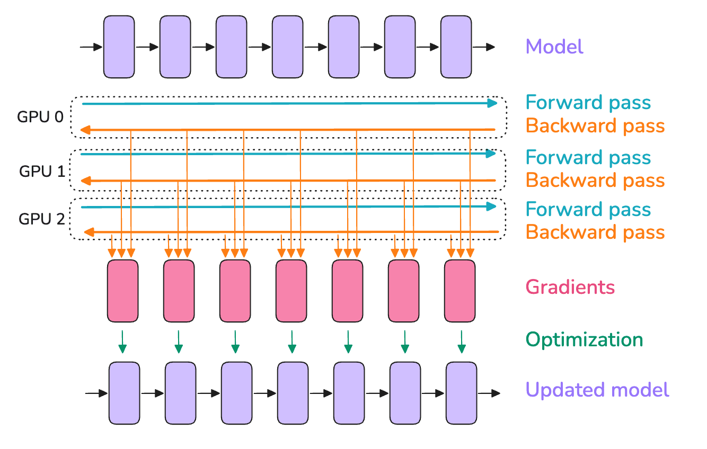
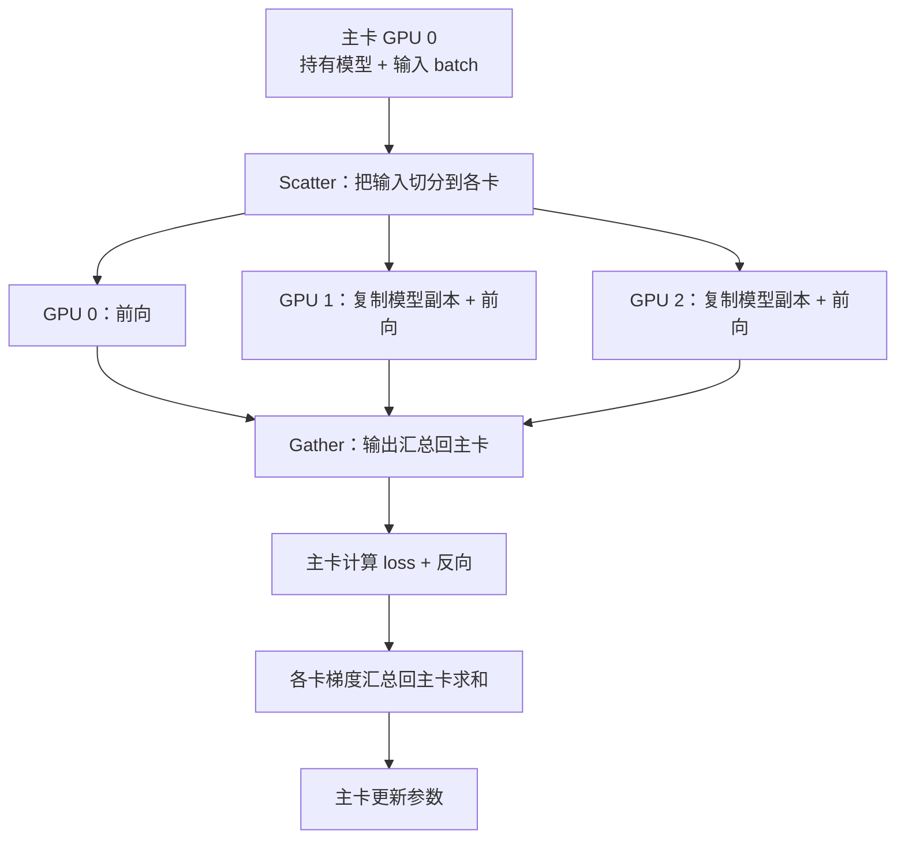
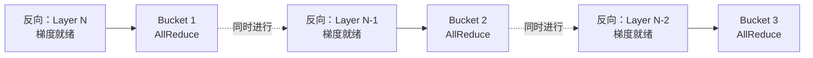
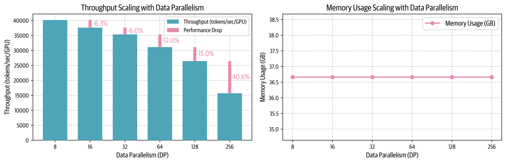
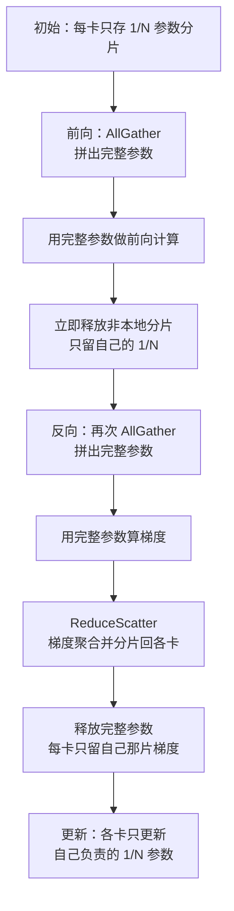
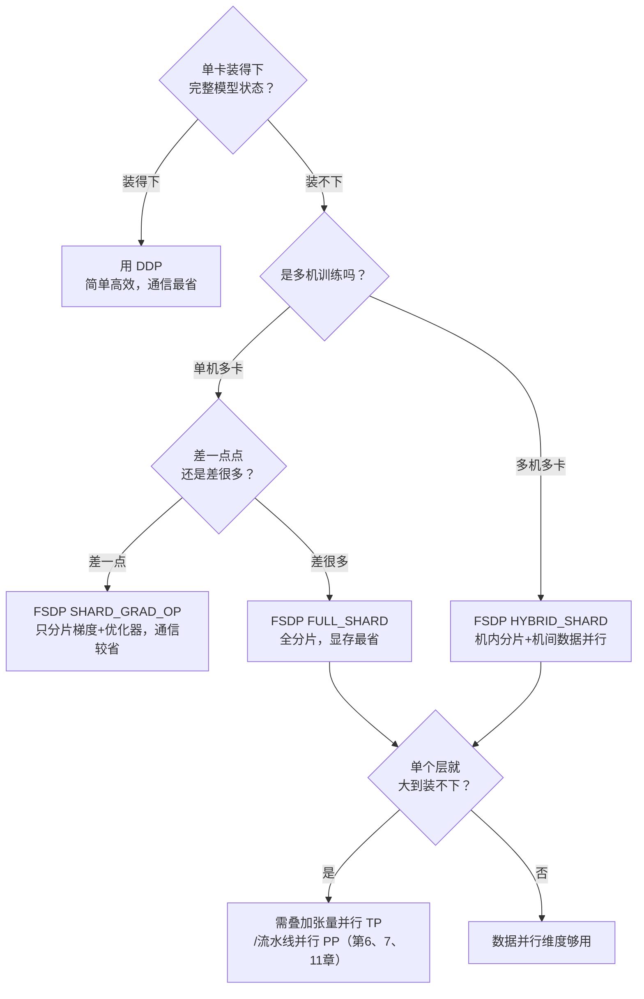

<a id="part3-ch4"></a>

# 第3部分 · 第4章：数据并行(DP、DDP、FSDP)

> 总索引 ｜ [本部分目录](README.md) ｜ [上一章](ch03-优化器.md) ｜ [下一章](ch05-ZeRO系列.md)

## 本章目录

- [本章导读](#part3-ch4)
- [4.1 数据并行详解](#part3-ch4-sec1)
- [4.2 PyTorch 数据并行从原理到实战](#part3-ch4-sec2)

---

## 本章导读

> 发布 2026-04-16 · 标签 "数据并行", "DDP", "FSDP", "AllReduce", "ReduceScatter" · 单篇原文

### 📖 本章概述

数据并行是最基础也最常用的并行策略。本章按"为什么演进"的逻辑线，讲清 DP → DDP → FSDP 三代方案各自解决什么问题、引入什么代价。本章配套两篇正文：

- **4.1《数据并行详解》**：原理篇——数据并行的数学基础、三代演进逻辑、Bucket 机制、Ring AllReduce 通信量推导、显存账本与选型决策。
- **4.2《PyTorch 数据并行从原理到实战》**：实战篇——PyTorch 通信基础、DDP/FSDP 完整可运行代码、torchrun 多机启动与踩坑排查。

建议先读 4.1 建立原理认知，再用 4.2 落到工程实践。

---

### 📑 章节结构

### 1. DataParallel（DP）——单进程多线程

- **工作原理**：单进程持有模型，每次前向时将模型 Scatter 到多卡，输出 Gather 回主卡
- **致命缺陷**：Python GIL 限制、主卡显存/计算负载不均、通信经过 PCIe 而非 NVLink
- **定位**：仅用于快速原型验证，生产环境不使用

### 2. DistributedDataParallel（DDP）——生产标配

- **核心机制**：
  - 每 GPU 一个独立进程，各自持有完整模型副本
  - `init_process_group` 建立通信组
  - `DistributedSampler` 保证各进程数据不重叠
  - 反向传播中通过 AllReduce 同步梯度
- **Bucket 机制与计算通信重叠**：
  - 参数梯度按反向计算顺序分组为 Bucket
  - 每个 Bucket 就绪后立即发起 AllReduce，不等全部反向完成
  - 通信与后续 Bucket 的反向计算重叠（overlap）
- **通信量分析**：每步 AllReduce 通信量 = $2\Psi$（Ring AllReduce 下每卡收发总量）
- **使用要点**：`DistributedSampler` + `set_epoch()`、仅 rank 0 日志/保存、`model.module` 访问原始参数
- **局限**：每卡存完整模型 → 参数 + 梯度 + 优化器状态必须 ≤ 单卡显存

### 3. FullyShardedDataParallel（FSDP）——显存优化的数据并行

- **核心思想**：不让每卡冗余存完整状态，而是分片存储，计算时按需 AllGather 组装
- **工作流程**：
  1. 初始状态：每卡只存 $\frac{1}{N}$ 的参数/梯度/优化器状态
  2. 前向：AllGather 重组完整参数 → 计算 → 释放非本地分片
  3. 反向：AllGather 参数 → 计算梯度 → ReduceScatter 分片梯度 → 释放完整参数
  4. 更新：每卡只更新自己负责的分片
- **分片策略选择**：
  - `FULL_SHARD`（ZeRO-3）：参数+梯度+优化器全部分片，显存最省
  - `SHARD_GRAD_OP`（ZeRO-2）：梯度+优化器分片，参数不分片
  - `HYBRID_SHARD`：机内全分片 + 机间数据并行，多机训练推荐
  - `NO_SHARD`：等价于 DDP，用于调试
- **通信量分析**：每步 = AllGather（前向）+ AllGather + ReduceScatter（反向）= $3\Psi$，比 DDP 多 50%
- **工程配置**：`auto_wrap_policy`（按模块大小或类型自动分片）、`MixedPrecision` 配置、DCP 保存/加载
- **FSDP2 简介**：per-parameter 分片、基于 DTensor、与 TP 更好组合

### 4. DDP vs FSDP 选型指南

- 对比表：显存占用、通信量、代码复杂度、适用规模
- 决策规则：单卡装得下 → DDP（简单高效）；装不下 → FSDP；多机大模型 → FSDP + HYBRID_SHARD

### 5. 动手实验

配套代码与完整实现见 **4.2《PyTorch 数据并行从原理到实战》**：

- 实验 A：将单卡脚本改造为 DDP 版本（30 分钟）
- 实验 B：在 2-4 卡上对比 DDP vs FSDP 的峰值显存与训练吞吐
- 实验 C：测试不同 `sharding_strategy` 对显存和速度的影响

---

### 🎯 本章学习目标

- 能解释 DP → DDP → FSDP 每一步演进解决了什么问题、引入了什么代价
- 能用 PyTorch DDP 将单卡脚本改为多卡训练（含 Sampler、set_epoch、模型保存）
- 能配置 FSDP 的分片策略和自动包装策略
- 能计算 DDP 和 FSDP 每步的通信量并解释差异

<a id="part3-ch4-sec1"></a>

## 4.1 数据并行详解

> 发布 2026-07-02 · 标签 "数据并行", "DDP", "FSDP", "AllReduce", "ReduceScatter" · 单篇原文

数据并行是分布式训练里最先接触、也最常用的一招：让每块 GPU 各算一部分数据，再把结果对齐。听起来简单，但从最早的 `DataParallel` 到今天的 `FSDP`，中间经历了三代演进，每一代都在回答同一个问题——"如何在保证数学等价的前提下，让更多卡、更大的模型跑起来"。本文不讲代码（实战代码见 **4.2**），而是把三代方案的**原理、梯度同步机制、通信量与显存账本**彻底讲透，让你知其然更知其所以然。


### 1. 数据并行要解决什么问题

先厘清一件事：分布式训练里有很多种"并行"，它们解决的痛点并不一样。数据并行专门瞄准的是**训练太慢**——数据量太大，单卡一个 epoch 要跑很久。

打个比方：一个班有 6000 份试卷要批改，一位老师批完要一周。数据并行的做法是找来 6 位老师，每人分 1000 份同时批，一天就能收工。前提是——**每位老师手里都得有一份完整的评分标准**（即完整的模型副本），批完后大家还要**对齐评分尺度**（同步梯度），保证不会出现"张老师给分松、李老师给分紧"的情况。

用技术语言重述这套流程：

1. 每块 GPU 持有一份**完整的模型副本**（参数完全相同）
2. 把一个大 batch 的数据**均匀切分**到各 GPU，每卡只算自己那一份（称为 local batch）
3. 各 GPU **独立**做前向和反向，算出各自的梯度
4. 通过通信把所有卡的梯度**取平均**，让每块卡拿到完全一致的梯度
5. 每块卡用这份一致的梯度更新参数——更新后所有副本依然完全相同



📌 **关键点**：数据并行的核心约束是 **每卡都要装得下完整模型**。它加速了训练，但没有减少单卡的显存负担。这正是后面 FSDP 要突破的地方——当模型大到单卡装不下时，纯数据并行就无能为力了，必须引入参数分片。

💡 **提示**：分布式训练要解决的是两类正交的问题——**跑不完**（时间太长，数据并行的主场）和**装不下**（显存不足，需要 ZeRO/FSDP、张量并行、流水线并行）。本文聚焦数据并行这一维度，以及它如何逐步拥有解决显存问题的能力。

---

### 2. 数据并行的数学基础

数据并行不是"差不多就行"的近似技巧，它在数学上与单卡训练**严格等价**（在同步 SGD 下）。理解这一点，才能明白为什么梯度必须"取平均"而不是"求和"。

考虑一个 batch 的损失，通常定义为样本损失的平均值。设全局 batch 大小为 $B$，损失函数为：

$$
L = \frac{1}{B} \sum_{i=1}^{B} \ell(x_i; \theta)
$$

其中 $\ell(x_i; \theta)$ 是第 $i$ 个样本的损失，$\theta$ 是模型参数。对参数求梯度：

$$
g = \nabla_\theta L = \frac{1}{B} \sum_{i=1}^{B} \nabla_\theta \ell(x_i; \theta)
$$

现在把 $B$ 个样本均匀分给 $N$ 块 GPU，每卡分到 $\frac{B}{N}$ 个样本。第 $k$ 块卡在自己的数据分片上算出的**本地梯度**（注意它内部也做了平均）为：

$$
g_k = \frac{N}{B} \sum_{i \in \mathcal{D}\_k} \nabla_\theta \ell(x_i; \theta)
$$

其中 $\mathcal{D}\_k$ 是第 $k$ 块卡分到的样本集合。把所有卡的本地梯度**取平均**：

$$
\bar{g} = \frac{1}{N} \sum_{k=1}^{N} g_k = \frac{1}{N} \sum_{k=1}^{N} \frac{N}{B} \sum_{i \in \mathcal{D}\_k} \nabla_\theta \ell(x_i; \theta) = \frac{1}{B} \sum_{i=1}^{B} \nabla_\theta \ell(x_i; \theta) = g
$$

🔑 **核心概念**：$N$ 卡数据并行的平均梯度 $\bar{g}$ **精确等于**单卡在全局 batch 上的梯度 $g$。所以数据并行 = 用更多卡分摊计算，但每一步的参数更新与"单卡跑一个 $B$ 大小的 batch"在数学上一模一样。

这个推导带出两个实践结论：

- **为什么梯度要 AllReduce 求平均，而不是求和**：因为每卡的本地损失已经在 local batch 内做过平均（除以 $\frac{B}{N}$），跨卡再对 $N$ 个本地梯度求平均，才能还原出全局 batch 的平均梯度。如果求和，等价于把学习率放大了 $N$ 倍。
- **有效 batch size 变大了**：数据并行的有效 batch size = 单卡 local batch × $N$。这也是为什么扩大卡数时通常要相应调整学习率（详见 4.2 的学习率缩放部分）。

⚠️ **注意**：这个"严格等价"只在同步梯度、且各卡 local batch 大小相同的前提下成立。如果各卡数据条数不均（最后一个 batch 不满）、或用了异步更新，等价性会被打破。

---

### 3. 第一代：DataParallel（DP）

`torch.nn.DataParallel`（简称 DP）是 PyTorch 最早提供的多卡方案。它的最大卖点是"改一行代码就能多卡"——`model = nn.DataParallel(model)`。但它是**单进程多线程**架构，今天已被官方标记为不推荐，理解它主要是为了看清后面 DDP 为什么那样设计。

#### 3.1 DP 的工作流程

DP 用一个进程管理所有 GPU，训练时反复做"分发—收集"：



关键点在于：**每一次迭代**，主卡都要把模型参数复制（replicate）到其他卡，前向的输出又要 Gather 回主卡算 loss，梯度再汇总回主卡更新。主卡既当调度者又当计算者，负担明显更重。

#### 3.2 DP 的三个致命缺陷

| ❌ 缺陷 | 📝 原因 |
|---|---|
| **GIL 限制** | 单进程多线程，Python 全局解释器锁让多线程无法真正并行调度，CPU 侧成为瓶颈 |
| **负载不均** | 主卡额外承担 Scatter/Gather、loss 计算、梯度汇总，显存和算力压力都比其他卡大 |
| **通信低效** | 每步都要重新复制模型；数据走主卡中转，容易挤在 PCIe 上而非高速的 NVLink |

⚠️ **注意**：DP 常见的报错就是"主卡 OOM 而其他卡显存还很空"——因为输出汇总和 loss 计算都堆在主卡。生产环境请直接用 DDP，DP 仅适合单机上快速验证"能不能多卡跑通"。

📌 **关键点**：DP 的病根在于**单进程 + 主卡中心化**。DDP 的所有改进，本质上都是在拆掉这两个前提——改成多进程、去中心化。

---

### 4. 第二代：DistributedDataParallel（DDP）

DDP（DistributedDataParallel）是当前生产环境数据并行的**事实标准**。它的核心变革是：**每块 GPU 一个独立进程**，各进程持有自己的完整模型副本，彼此地位对等——没有"主卡"，梯度同步走**去中心化的 AllReduce**。

#### 4.1 从"中心化"到"去中心化"

对比 DP 就能看出 DDP 好在哪：

| 📊 维度 | DataParallel（DP） | DistributedDataParallel（DDP） |
|---|---|---|
| 进程模型 | 单进程多线程 | 每卡一个进程，无 GIL 争抢 |
| 模型副本 | 每步重新 replicate | 只在初始化时 Broadcast 一次 |
| 梯度同步 | 汇总到主卡求和 | 去中心化 AllReduce，各卡对等 |
| 负载 | 主卡偏重 | 各卡均衡 |
| 通信路径 | 经主卡中转 | 点对点 Ring，充分利用 NVLink |

DDP 的生命周期可以概括为"一次广播，多次同步"：

1. **初始化**：构造 DDP 时，把 rank 0 的参数 **Broadcast** 到所有进程，保证所有副本起点完全一致
2. **前向 + 反向**：每个进程在自己的数据分片上**独立**计算，互不通信
3. **梯度同步**：反向传播过程中，通过 **AllReduce** 把各进程的梯度取平均，同步后各卡梯度一致
4. **参数更新**：各进程用一致的梯度独立更新——因为起点一致、梯度一致，更新后依然一致

🔑 **核心概念**：DDP 全程只在**初始化广播**和**反向的梯度 AllReduce** 两处通信。前向完全无通信，这是它比 DP 高效的根本原因。

#### 4.2 Bucket 机制：让通信藏进计算里

这是 DDP 性能优化的精髓。最朴素的做法是：等整个反向传播算完所有梯度，再统一发起一次 AllReduce。但这样有个大问题——**通信时 GPU 在干等**，算力被浪费。


DDP 的巧思是利用反向传播的特性：反向是**从最后一层往前**逐层算的，靠后的层梯度先就绪。既然如此，为什么要等全部算完？某一层的梯度甚至可以在更靠前的层梯度尚未算完时，就被收集并同步——一旦最后一层反向完成，那部分梯度就能立即 AllReduce，同时反向计算继续向前推进。


于是 DDP 把参数梯度按反向计算顺序打包成若干 **Bucket**（桶，默认约 25 MB 一个）。规则是：

- 某个 Bucket 里的所有梯度都就绪了，**立即**对这个 Bucket 发起 AllReduce
- 与此同时，更靠前的层还在继续算反向


这样通信和计算就**重叠（overlap）** 起来了：



💡 **提示**：Bucket 大小是可调的（`bucket_cap_mb`）。桶太小→通信次数多、每次 AllReduce 的固定开销占比高；桶太大→重叠效果差（要等更久才凑满一桶）。默认值对大多数模型够用，只有在极端网络环境下才需要调。

⚠️ **注意**：如果模型里有参数**没有参与前向计算**（比如条件分支下某些层没被走到），它们的梯度永远不就绪，对应的 Bucket 永远等不满，AllReduce 就会卡住导致死锁。这时需要设置 `find_unused_parameters=True`，让 DDP 主动标记未使用的参数。但这个选项有额外开销，能避免则避免。

计算与通信重叠让 DDP 在中等规模下几乎能线性加速，但这个红利在**超大规模会失效**。随着 GPU 越来越多（数百甚至上千块），协调开销和网络需求显著增长，通信逐渐盖不住计算，每多加一块卡效率反而更低。下面是一组基准测试：超过某个上限后吞吐量开始明显下降，而单卡显存占用保持恒定、不受 DP rank 增加的影响（这也印证了前面那句话——加卡只摊薄计算、不摊薄显存）。



💡 **提示**：在 512+ GPU 规模下，通信还会开始受限于**环延迟（ring latency）**（信号绕 Ring 传播一圈的时间），DP 通信无法再被完全重叠。到了这个点，就该转向其他并行维度（TP/PP/ZeRO）而不是继续堆 DP。

#### 4.3 DDP 的根本局限

DDP 简单、高效、数学严格等价，但它继承了数据并行的天生约束——**每块 GPU 都要装下完整的"参数 + 梯度 + 优化器状态\"**。

对一个 $\Psi$ 参数量的模型，用混合精度 + Adam 训练时，单卡显存里要放（按 ZeRO 论文的经典估算，单位 Byte/参数）：

- FP16 参数：$2\Psi$
- FP16 梯度：$2\Psi$
- FP32 优化器状态（master 权重 + 一阶动量 + 二阶动量）：$12\Psi$

合计约 $16\Psi$。对 7B 模型就是约 112 GB——**单张 80 GB 的 H100 直接装不下**。无论加多少卡，DDP 都救不了这个数字，因为每卡的这份账是完全冗余的。

📌 **关键点**：DDP 增加卡数只能**摊薄计算时间**（更快），不能**摊薄单卡显存**（更省）。要突破单卡显存墙，就要问：这份 $16\Psi$ 的冗余，能不能也切开分给各卡？——这正是 FSDP 的出发点。

---

### 5. AllReduce 通信量的数学推导

很多教程直接抛出"DDP 每步通信量是 $2\Psi$"这个结论，但不解释怎么来的。搞懂这个推导，才能真正理解为什么 Ring AllReduce 是**带宽最优**的，以及后面 FSDP 的 $3\Psi$ 是怎么算出来的。

#### 5.1 AllReduce = ReduceScatter + AllGather

先记住一个关键等式：**一次 AllReduce 在实现上等于一次 ReduceScatter 加一次 AllGather**。

- **ReduceScatter**：把每卡的数据分成 $N$ 块，跨卡对相同位置的块做聚合（求和），最后每卡拿到**一块**已经聚合完成的结果
- **AllGather**：每卡把自己那块结果广播出去，最后所有卡都拿到**完整**的聚合结果

用图书馆盘点打比方：$N$ 个管理员每人手上有全馆图书的一份清点记录。ReduceScatter 阶段，把书架分成 $N$ 区，1 号管理员负责汇总所有人 A 区的数据、2 号汇总 B 区……盘完后每人手里只有自己那一区的最终总数；AllGather 阶段，大家再互相通报自己区的总数，最后每人都拿到全馆的完整总数。

#### 5.2 Ring AllReduce 的通信量

Ring AllReduce 把 $N$ 块卡组成一个环，数据切成 $N$ 份，流水线式地在环上传递。设梯度总大小为 $\Psi$（这里用参数个数近似数据量，实际字节数要再乘以 dtype 大小）。

**ReduceScatter 阶段**：需要 $N-1$ 步，每步每卡向下一个邻居发送 $\frac{\Psi}{N}$ 大小的数据。每卡发送总量：

$$
(N-1) \times \frac{\Psi}{N}
$$

**AllGather 阶段**：同样 $N-1$ 步，每步每卡发送 $\frac{\Psi}{N}$，每卡发送总量同上，也是 $(N-1) \times \frac{\Psi}{N}$。

两阶段相加，每卡**发送**的总数据量为：

$$
2 \times (N-1) \times \frac{\Psi}{N} = 2\Psi \cdot \frac{N-1}{N}
$$

🔑 **核心概念**：当卡数 $N$ 很大时，$\frac{N-1}{N} \to 1$，所以每卡的通信量趋近于 $2\Psi$，且**与卡数 $N$ 无关**。这正是 Ring AllReduce 的精妙之处——加再多卡，单卡的通信负担也不会膨胀。这就是"DDP 每步通信量 $2\Psi$"的出处。

#### 5.3 为什么不用"汇总到一张卡"的朴素做法

假如用 DP 那种中心化方式——所有卡把梯度发给主卡求和，主卡再广播回去——主卡的收发量是 $2(N-1)\Psi$，随 $N$ 线性增长。主卡带宽立刻成为瓶颈。

| 📊 方案 | 单卡通信量 | 是否随 N 膨胀 |
|---|---|---|
| 中心化汇总（DP 式） | 主卡 $2(N-1)\Psi$ | ❌ 主卡线性膨胀，成瓶颈 |
| Ring AllReduce（DDP） | $2\Psi \cdot \frac{N-1}{N} \approx 2\Psi$ | ✅ 恒定，与 N 无关 |

💡 **提示**：这就是集合通信原语的价值所在——不是简单的"发消息"，而是通过精心设计的通信模式，把带宽压力均摊到所有节点。关于 Ring AllReduce、Halving-Doubling 等算法的更细致分析，参见 **第2章：集合通信原语**。

⚠️ **注意**：$2\Psi$ 是**理想 Ring** 下的带宽下界。实际通信量还受拓扑（NVLink vs PCIe vs 跨机 InfiniBand）、消息大小、NCCL 具体算法选择影响。跨机训练时，机间带宽通常远低于机内，往往成为整体瓶颈。

---

### 6. 第三代：FullyShardedDataParallel（FSDP）

回到 DDP 的痛点：每卡冗余存了一份 $16\Psi$ 的完整状态。FSDP（FullyShardedDataParallel）的答案简单而彻底——**别冗余存了，把参数、梯度、优化器状态都切成 $N$ 份，每卡只存 $\frac{1}{N}$，需要用的时候再临时拼出来**。它是 PyTorch 对 DeepSpeed ZeRO 思想的原生实现。

#### 6.1 FSDP 的执行方式

DDP 中每卡始终持有完整的参数、梯度和优化器状态，各卡之间完全冗余。FSDP 将这三类数据按卡数 $N$ 均匀切片，每卡只持久保存属于自己的那 $\frac{1}{N}$。计算某一层时，通过 AllGather 临时收集所有卡的分片、拼成完整参数；计算结束后立即释放其他卡的部分，显存回落到分片大小。梯度在反向传播后通过 ReduceScatter 聚合，每卡只保留本分片对应的梯度；优化器更新同样只在本分片上执行。

用 ZeRO 的语言，冗余可以分三层逐步消除：

| 📊 ZeRO 阶段 | 分片内容 | 每卡显存（$\Psi$ 参数，$N$ 卡） | 对应 FSDP 策略 |
|---|---|---|---|
| **Stage 1** | 优化器状态 | $2\Psi + 2\Psi + \frac{12\Psi}{N}$ | （包含在 `SHARD_GRAD_OP` 内） |
| **Stage 2** | + 梯度 | $2\Psi + \frac{14\Psi}{N}$ | `SHARD_GRAD_OP` |
| **Stage 3** | + 参数 | $\frac{16\Psi}{N}$ | `FULL_SHARD` |

🔑 **核心概念**：Stage 3（FULL_SHARD）把全部 $16\Psi$ 都切开，单卡显存降到 $\frac{16\Psi}{N}$。以 7B 模型、8 卡为例：DDP 每卡约 112 GB（装不下），FSDP FULL_SHARD 每卡约 $\frac{112}{8} = 14$ GB（轻松装下）。这就是 FSDP 能训练"单卡装不下的模型"的原因。

#### 6.2 FSDP 的执行流程：AllGather + ReduceScatter

FSDP 比 DDP 复杂，核心是围绕每个分片单元（FSDP unit，通常是一个 Transformer Block）做"按需组装、用完即弃"。以一个 unit 的前向 + 反向为例：



拆开看两个关键通信：

- **前向的 AllGather**：算某个 unit 前，把散落各卡的参数分片收集起来，临时拼成完整参数。算完立刻扔掉非本地部分。
- **反向的 AllGather + ReduceScatter**：反向要再拼一次完整参数（因为前向后已经释放了）算出完整梯度；然后用 **ReduceScatter**，一步同时完成"梯度聚合"和"分片回各卡"——每卡最终只拿到自己负责那一片的聚合梯度。

📌 **关键点**：注意反向的梯度同步用的是 **ReduceScatter** 而非 DDP 的 AllReduce。因为 FSDP 每卡只需更新自己的分片，所以只需拿到"自己那片"的聚合梯度就够了，不必像 DDP 那样让每卡都拿到完整梯度。这个差异直接决定了两者通信量的不同（下一节推导）。

#### 6.3 FSDP 的四种分片策略

FSDP 用 `sharding_strategy` 控制切到什么程度，是一个"显存 vs 通信"的权衡旋钮：

| 📊 策略 | 分片内容 | 显存节省 | 通信开销 | 适用场景 |
|---|---|---|---|---|
| `FULL_SHARD` | 参数 + 梯度 + 优化器（ZeRO-3） | 最高 | 最高 | 大模型，显存紧张 |
| `SHARD_GRAD_OP` | 梯度 + 优化器状态（ZeRO-2，参数不分片） | 中等 | 中等 | 中等模型，想省通信 |
| `HYBRID_SHARD` | 机内 FULL_SHARD + 机间数据并行 | 高 | 机间较低 | 多机训练首选 |
| `NO_SHARD` | 不分片（等价 DDP） | 无 | 最低 | 调试对照 |

💡 **提示**：`HYBRID_SHARD` 是多机大模型的推荐策略。它的洞察是——机内有高带宽的 NVLink，适合做通信密集的 FULL_SHARD；机间只有较慢的 InfiniBand，就退化成通信量小的数据并行（AllReduce）。相当于把"高频通信"关在机内，"低频通信"才跨机，是显存与通信的最佳折中。

#### 6.4 FSDP2：下一代 API

PyTorch 正在推进新一代 API `fully_shard`（俗称 FSDP2）。与 FSDP1 的"整个模块打包分片"（module-wrapper）不同，FSDP2 采用 **per-parameter 分片**，底层基于 `DTensor`（Distributed Tensor）抽象。它的主要优势：

- 分片粒度到单个参数，更灵活，避免整块打包带来的显存/通信浪费
- 基于 DTensor，与张量并行（TP）、序列并行等**组合**时接口更统一，是搭建 2D/3D 并行的基础
- 更清晰的初始化与 checkpoint 语义

💡 **提示**：截至 PyTorch 2.x，FSDP2 已可用且是官方主推方向，但仍在快速迭代。新项目值得尝试 FSDP2（尤其要和 TP 组合时），追求稳定的存量生产项目 FSDP1 仍是稳妥选择。具体代码见 4.2。

---

### 7. 显存账本：三代方案的定量对比

把显存账彻底算清楚，选型时才有底气。沿用混合精度 + Adam 的经典估算，对 $\Psi$ 参数量的模型，"模型状态"（不含激活值）分为四部分：

$$
\underbrace{2\Psi}\_{\text{FP16 参数}} + \underbrace{2\Psi}\_{\text{FP16 梯度}} + \underbrace{4\Psi}\_{\text{FP32 master 权重}} + \underbrace{4\Psi + 4\Psi}\_{\text{Adam 动量}} = 16\Psi
$$

其中后三项（master 权重 + 一阶动量 + 二阶动量，共 $12\Psi$）合称**优化器状态**。基于这个 $16\Psi$，三代方案的单卡模型状态显存如下（$N$ 为卡数）：

| 📊 方案 | 参数 | 梯度 | 优化器状态 | 单卡合计 | $N=8$ 时（7B 模型） |
|---|---|---|---|---|---|
| **DDP** | $2\Psi$ | $2\Psi$ | $12\Psi$ | $16\Psi$ | ~112 GB |
| **FSDP SHARD_GRAD_OP**（ZeRO-2） | $2\Psi$ | $\frac{2\Psi}{N}$ | $\frac{12\Psi}{N}$ | $2\Psi + \frac{14\Psi}{N}$ | ~26 GB |
| **FSDP FULL_SHARD**（ZeRO-3） | $\frac{2\Psi}{N}$ | $\frac{2\Psi}{N}$ | $\frac{12\Psi}{N}$ | $\frac{16\Psi}{N}$ | ~14 GB |

（7B 即 $\Psi = 7\times10^9$，$16\Psi \approx 112$ GB；$N=8$。）

从这张表能读出几个结论：

- **DDP 的显存与卡数无关**：加卡不减负，$16\Psi$ 恒定。这是它的天花板。
- **优化器状态是最大头**（$12\Psi$，占 75\%）：所以 ZeRO-1/2 只分片优化器状态和梯度就能省掉大半，性价比很高。
- **FULL_SHARD 随卡数线性下降**：卡越多，单卡越省，理论上能训练任意大的模型（只要卡够多）。

⚠️ **注意**：这张表只算了**模型状态**，没算**激活值**（activation）。激活值随 batch size、序列长度、模型深度增长，长序列训练时往往才是显存的大头。FSDP 分片的是模型状态，对激活值无能为力——那需要 Activation Checkpointing、序列并行等手段（见 **第8章、第9章**）。

💡 **提示**：实际选型时，先用这个公式估出模型状态占多少，再留出激活值和碎片的余量（经验上给峰值再乘 1.2~1.5）。如果 DDP 的 $16\Psi$ 加激活值超过单卡容量，就往 FSDP 走；优先试 `SHARD_GRAD_OP`（通信更省），还不够再上 `FULL_SHARD`。

---

### 8. 通信量对比：DDP vs FSDP

省显存不是免费的——FSDP 用**更多通信**换来了**更少显存**。把这笔账算清楚，就明白为什么"单卡装得下时不该硬上 FSDP"。

#### 8.1 DDP：每步 $2\Psi$

前面第 5 节已经推导过：DDP 每步做一次 AllReduce 同步梯度，单卡通信量约 $2\Psi$。这是数据并行通信量的基准线。

#### 8.2 FSDP：每步 $3\Psi$

FSDP 每步的通信拆成三块（回顾 6.2 的流程）：

- **前向 AllGather**：拼出完整参数。AllGather 单卡通信量约 $\Psi$
- **反向 AllGather**：反向前再拼一次参数（前向后已释放）。约 $\Psi$
- **反向 ReduceScatter**：同步并分片梯度。ReduceScatter 单卡通信量约 $\Psi$

合计约 $3\Psi$，比 DDP 的 $2\Psi$ **多出 50\%**。

📌 **关键点**：为什么 AllReduce 是 $2\Psi$，而 AllGather 或 ReduceScatter 各只是 $\Psi$？因为 AllReduce = ReduceScatter + AllGather（第 5.1 节的等式），本身就是两个 $\Psi$ 操作的组合。FSDP 把这两半拆开用，再额外多一次前向 AllGather，所以是 $\Psi + \Psi + \Psi = 3\Psi$。

#### 8.3 汇总对比

| 📊 维度 | DDP | FSDP（FULL_SHARD） |
|---|---|---|
| 核心思路 | 每卡完整模型，梯度 AllReduce | 参数分片，按需 AllGather |
| 每卡通信量/步 | $2\Psi$ | $3\Psi$（多 50\%） |
| 通信时机 | 反向时一次 AllReduce | 每个 unit：前向 AllGather + 反向 AllGather + ReduceScatter |
| 单卡显存 | $16\Psi$ | $\frac{16\Psi}{N}$ |
| 计算通信重叠 | Bucket 机制 | prefetch 预取下一层参数 |

🔑 **核心概念**：DDP 和 FSDP 是一组清晰的**权衡对偶**——DDP 省通信（$2\Psi$）但费显存（$16\Psi$）；FSDP 省显存（$\frac{16\Psi}{N}$）但费通信（$3\Psi$）。没有免费午餐，选哪个取决于你的瓶颈是显存还是通信/吞吐。

⚠️ **注意**：FSDP 多出的通信能否被计算掩盖，很依赖网络带宽和 prefetch 效果。在高带宽机内（NVLink/NVSwitch），$3\Psi$ 的额外通信基本能被重叠掉，吞吐损失不大；但在低带宽的跨机场景，FSDP 的通信可能暴露成为瓶颈——这正是 `HYBRID_SHARD` 存在的意义。

---

### 9. 选型决策指南

把前面的显存账和通信账合起来，就能给出一条清晰的决策路径。核心问题只有一个：**参数 + 梯度 + 优化器状态 + 激活值 单卡装得下吗**



落成一句话的规则：

- ✅ **单卡装得下** → 用 DDP。别为了"显得高级"上 FSDP，白白多付 50\% 通信。
- ✅ **单卡差一点装不下** → 优先 FSDP `SHARD_GRAD_OP`（ZeRO-2），通信比 FULL_SHARD 省。
- ✅ **单卡差很多** → FSDP `FULL_SHARD`（ZeRO-3），显存最省。
- ✅ **多机 + 大模型** → FSDP `HYBRID_SHARD`，避免慢速跨机链路上跑高频通信。
- ✅ **单个层都装不下**（如超大 Embedding 或 FFN） → 数据并行这条维度到头了，要叠加张量并行（TP）、流水线并行（PP），走向 3D 并行（见第 6、7、11 章）。

💡 **提示**：数据并行是并行策略的"第一维度"，也是几乎所有大模型训练的基础层。真正的超大规模训练（千亿参数以上）从来不是单靠数据并行，而是 DP + TP + PP 的组合。但无论组合多复杂，理解本章讲的"梯度同步"和"参数分片"两条主线，都是往上叠加其他并行策略的前提。

---

### 📝 总结

本文沿着"为什么演进"的主线，把数据并行三代方案讲透：

- **数据并行的本质**：用多卡分摊数据、加速训练，数学上与单卡训练严格等价（梯度取平均 = 单卡全局 batch 梯度）。核心约束是每卡都要装下完整模型。
- **DP → DDP**：DP 单进程 + 主卡中心化，受 GIL、负载不均、通信低效三重拖累；DDP 改为每卡一进程、去中心化 AllReduce，并用 **Bucket 机制**把通信藏进反向计算里实现重叠。
- **AllReduce = ReduceScatter + AllGather**：Ring AllReduce 每卡通信量约 $2\Psi$ 且与卡数无关，这是理解 DDP 与 FSDP 通信差异的钥匙。
- **DDP → FSDP**：DDP 每卡冗余存 $16\Psi$ 撞上单卡显存墙；FSDP 借鉴 ZeRO，把参数/梯度/优化器分片存储、按需 AllGather 组装，单卡显存降到 $\frac{16\Psi}{N}$。
- **两笔账**：显存上 DDP 恒定 $16\Psi$、FSDP FULL_SHARD 为 $\frac{16\Psi}{N}$；通信上 DDP 是 $2\Psi$、FSDP 是 $3\Psi$。这是一组"省显存 vs 省通信"的权衡对偶。
- **选型**：单卡装得下用 DDP；装不下按缺口大小选 `SHARD_GRAD_OP` / `FULL_SHARD`；多机用 `HYBRID_SHARD`；单层都装不下则需叠加 TP/PP。

掌握了这些原理，就可以进入 **4.2《PyTorch 数据并行从原理到实战》**，把这套理论落成可运行的 DDP/FSDP 代码、多机启动脚本与踩坑排查。

---

### 🎯 自我检验清单

- 能推导数据并行的平均梯度为什么严格等于单卡全局 batch 梯度，并解释梯度为何要"求平均"而非"求和"
- 能说清 DP 的三个致命缺陷，以及 DDP 分别是如何针对性解决的
- 能解释 DDP 的 Bucket 机制如何实现计算与通信的重叠，以及 `find_unused_parameters` 的作用
- 能写出 AllReduce = ReduceScatter + AllGather 的等价关系，并推导 Ring AllReduce 单卡通信量约 $2\Psi$
- 能说出 ZeRO 三个阶段各分片了什么，分别对应 FSDP 的哪种 `sharding_strategy`
- 能画出 FSDP 一个 unit 前向 + 反向的通信流程（AllGather / ReduceScatter 出现在哪些位置）
- 能解释 FSDP 反向为什么用 ReduceScatter 而不是 AllReduce
- 能算出 DDP 和 FSDP 各分片策略下的单卡显存，并说明优化器状态为何是最大头
- 能解释 FSDP 每步通信量 $3\Psi$ 比 DDP 的 $2\Psi$ 多 50\% 的来源
- 能根据"单卡是否装得下 / 是否多机"给出 DDP、`SHARD_GRAD_OP`、`FULL_SHARD`、`HYBRID_SHARD` 的选型决策

---

### 📚 参考资料

- [PyTorch DistributedDataParallel — API 文档](https://docs.pytorch.org/docs/stable/generated/torch.nn.parallel.DistributedDataParallel.html)
- [PyTorch DDP Design Note（Bucket 与梯度同步机制）](https://docs.pytorch.org/docs/stable/notes/ddp.html)
- [PyTorch FSDP — FullyShardedDataParallel](https://docs.pytorch.org/docs/stable/fsdp.html)
- [Getting Started with Fully Sharded Data Parallel (FSDP2)](https://docs.pytorch.org/tutorials/intermediate/FSDP_tutorial.html)
- [ZeRO: Memory Optimizations Toward Training Trillion Parameter Models](https://arxiv.org/abs/1910.02054)
- [PyTorch FSDP: Experiences on Scaling Fully Sharded Data Parallel](https://arxiv.org/abs/2304.11277)
- [Bringing HPC Techniques to Deep Learning（Ring AllReduce 原理）](https://andrew.gibiansky.com/blog/machine-learning/baidu-allreduce/)
- [NCCL Documentation](https://docs.nvidia.com/deeplearning/nccl/user-guide/docs/)

---

<a id="part3-ch4-sec2"></a>

## 4.2 PyTorch 数据并行从原理到实战

> 发布 2026-04-15 · 标签 "PyTorch", "分布式训练", "DDP", "FSDP", "数据并行" · 单篇原文

数据并行是最基础也最常用的并行策略：每块 GPU 持有一份完整模型副本，各自处理不同的数据分片，再同步梯度。其演进逻辑与显存/通信原理见 **4.1《数据并行详解》**；本文承接原理，聚焦**工程实战**——从 PyTorch 通信基础出发，讲清 DDP、FSDP 的完整可运行代码、多机多卡启动与常见踩坑排查，帮你把数据并行真正落到训练脚本里。


### 1. PyTorch 分布式通信基础

在理解 DDP 和 FSDP 之前，需要先了解它们底层依赖的通信机制。

#### 1.1 核心概念

| 📊 概念 | 含义 | 示例 |
|---|---|---|
| **World Size** | 参与训练的总进程数 | 2 台机器各 4 卡 → world_size = 8 |
| **Rank** | 每个进程的全局唯一编号 | 0, 1, 2, ..., 7 |
| **Local Rank** | 进程在本机内的编号 | 每台机器上 0, 1, 2, 3 |
| **Backend** | 底层通信库 | NCCL（GPU）、Gloo（CPU） |
| **Process Group** | 一组参与通信的进程 | 默认所有进程属于同一组 |

#### 1.2 通信后端选择

PyTorch 支持三种通信后端：

| 📊 后端 | 适用硬件 | 支持操作 | 说明 |
|---|---|---|---|
| **NCCL** | NVIDIA GPU | 几乎所有集合通信 | GPU 训练的首选，性能最优 |
| **Gloo** | CPU / GPU | 大部分集合通信 | 跨平台，CPU 训练首选 |
| **MPI** | CPU / GPU | 取决于 MPI 实现 | 需要单独安装 MPI 库 |

📌 **关键点**：GPU 分布式训练几乎都用 NCCL 后端。NCCL（NVIDIA Collective Communications Library）针对 NVLink、NVSwitch、InfiniBand 等 NVIDIA 互联做了深度优化。

#### 1.3 集合通信原语

分布式训练中的数据同步依赖**集合通信**（Collective Communication）操作。以下是最常用的几种：

| 📊 原语 | 作用 | DDP/FSDP 中的用途 |
|---|---|---|
| **Broadcast** | 一个进程的数据发送给所有进程 | 初始化时同步模型参数 |
| **AllReduce** | 所有进程的数据聚合（如求和），结果发给所有进程 | DDP 梯度同步 |
| **ReduceScatter** | 先 Reduce 再 Scatter——聚合后分片给各进程 | FSDP 梯度同步 |
| **AllGather** | 每个进程的分片收集到所有进程，得到完整数据 | FSDP 前向时重组参数 |
| **Barrier** | 等待所有进程到达同一点再继续 | 同步控制 |

💡 **提示**：理解 AllReduce = ReduceScatter + AllGather 这个等价关系，是理解 DDP 和 FSDP 通信模式差异的关键。

#### 1.4 初始化通信

所有分布式训练的第一步都是初始化进程组：

```python
import torch.distributed as dist

# 方式一：通过环境变量初始化（最常用，配合 torchrun）
dist.init_process_group(backend="nccl")

# 方式二：显式指定参数
dist.init_process_group(
    backend="nccl",
    init_method="tcp://192.168.1.1:29500",
    world_size=8,
    rank=0,
)
```

使用 `torchrun` 启动时，`MASTER_ADDR`、`MASTER_PORT`、`RANK`、`WORLD_SIZE`、`LOCAL_RANK` 等环境变量会被自动设置，因此代码中只需调用 `dist.init_process_group(backend="nccl")` 即可。

---

### 2. DDP：数据并行的标准方案

DDP（DistributedDataParallel）是 PyTorch 中最成熟、使用最广的数据并行方案。

#### 2.1 DDP 的工作原理

DDP 的核心机制可以用三句话概括：

1. **初始化**：将 rank 0 的模型参数 Broadcast 到所有进程，确保起点一致
2. **前向 + 反向**：每个进程在自己的数据分片上独立计算梯度
3. **梯度同步**：反向传播过程中，DDP 通过 **AllReduce** 将所有进程的梯度取平均

⚠️ **注意**：DDP 的梯度同步不是等反向传播完全结束后才开始的。它使用 **Bucket 机制**：将参数梯度按照反向计算顺序分成若干 Bucket，每个 Bucket 的梯度就绪后立即发起 AllReduce，实现**计算与通信重叠**。这是 DDP 性能的关键优化。

#### 2.2 完整的 DDP 训练代码

下面是一个可直接运行的 DDP 训练示例：

```python
import os
import torch
import torch.nn as nn
import torch.distributed as dist
from torch.nn.parallel import DistributedDataParallel as DDP
from torch.utils.data import DataLoader, DistributedSampler
from torchvision import datasets, transforms


def setup():
    """初始化分布式环境"""
    dist.init_process_group(backend="nccl")
    local_rank = int(os.environ["LOCAL_RANK"])
    torch.cuda.set_device(local_rank)
    return local_rank


def cleanup():
    """清理分布式环境"""
    dist.destroy_process_group()


def main():
    local_rank = setup()
    rank = dist.get_rank()
    world_size = dist.get_world_size()

    # 1. 构建模型并包装为 DDP
    model = nn.Sequential(
        nn.Linear(784, 256),
        nn.ReLU(),
        nn.Linear(256, 10),
    ).to(local_rank)
    model = DDP(model, device_ids=[local_rank])

    # 2. 构建数据加载器（必须使用 DistributedSampler）
    transform = transforms.Compose([
        transforms.ToTensor(),
        transforms.Lambda(lambda x: x.view(-1)),
    ])
    dataset = datasets.MNIST("./data", train=True, download=True, transform=transform)
    sampler = DistributedSampler(dataset, num_replicas=world_size, rank=rank, shuffle=True)
    dataloader = DataLoader(dataset, batch_size=64, sampler=sampler, num_workers=2)

    # 3. 优化器和损失函数
    optimizer = torch.optim.Adam(model.parameters(), lr=1e-3)
    criterion = nn.CrossEntropyLoss()

    # 4. 训练循环
    model.train()
    for epoch in range(5):
        sampler.set_epoch(epoch)  # 关键：每个 epoch 设置不同随机种子
        total_loss = 0.0
        for batch_idx, (data, target) in enumerate(dataloader):
            data, target = data.to(local_rank), target.to(local_rank)

            optimizer.zero_grad()
            output = model(data)
            loss = criterion(output, target)
            loss.backward()  # DDP 在这里自动进行 AllReduce
            optimizer.step()

            total_loss += loss.item()

        if rank == 0:
            avg_loss = total_loss / len(dataloader)
            print(f"Epoch {epoch}: avg_loss = {avg_loss:.4f}")

    cleanup()


if __name__ == "__main__":
    main()
```

启动命令：

```bash
# 单机 4 卡
torchrun --nproc_per_node=4 train_ddp.py
```

#### 2.3 DDP 使用要点

使用 DDP 时有几个容易忽视但非常重要的细节：

**1. 必须使用 DistributedSampler**

```python
sampler = DistributedSampler(dataset, num_replicas=world_size, rank=rank, shuffle=True)
dataloader = DataLoader(dataset, batch_size=64, sampler=sampler)
```

如果不使用 `DistributedSampler`，每个进程会读到相同的数据，数据并行就失去了意义。

**2. 每个 epoch 必须调用 `sampler.set_epoch(epoch)`**

```python
for epoch in range(num_epochs):
    sampler.set_epoch(epoch)  # 打乱不同 epoch 的数据分配
    for batch in dataloader:
        ...
```

不调用 `set_epoch` 会导致每个 epoch 各进程的数据分配完全相同。

**3. 只在 rank 0 上做日志和保存**

```python
if dist.get_rank() == 0:
    print(f"Loss: {loss.item()}")
    torch.save(model.module.state_dict(), "checkpoint.pt")  # 注意是 model.module
```

⚠️ **注意**：保存模型时要用 `model.module.state_dict()` 而不是 `model.state_dict()`。DDP 会给参数名加上 `module.` 前缀，直接保存会导致加载时 key 不匹配。

#### 2.4 DDP 的局限

DDP 简单高效，但有一个根本性限制：**每块 GPU 都持有完整的模型副本**。这意味着：

- 模型参数 + 梯度 + 优化器状态必须能装进单卡显存
- 对于 7B 以上的模型，单卡 80 GB 显存往往不够

这就是 FSDP 要解决的问题。

---

### 3. FSDP：参数分片的显存优化方案

FSDP（FullyShardedDataParallel）是 PyTorch 对 DeepSpeed ZeRO 思想的原生实现——核心理念是**不让每块卡都存一份完整的模型，而是把参数、梯度、优化器状态分片存储**。

#### 3.1 从 ZeRO 理解 FSDP

ZeRO（Zero Redundancy Optimizer）的核心洞察是：DDP 中每块 GPU 都冗余存储了完整的优化器状态、梯度和参数，这是巨大的浪费。

ZeRO 分三个阶段逐步消除冗余：

| 📊 阶段 | 分片内容 | 每卡显存（$N$ 卡，$\Psi$ 参数量） | 对应 FSDP |
|---|---|---|---|
| **Stage 1** | 优化器状态 | $4\Psi + \frac{12\Psi}{N}$ | `SHARD_GRAD_OP` 的一部分 |
| **Stage 2** | + 梯度 | $2\Psi + \frac{14\Psi}{N}$ | `SHARD_GRAD_OP` |
| **Stage 3** | + 参数 | $\frac{16\Psi}{N}$ | `FULL_SHARD` |

以 7B 模型、8 卡为例（按 ZeRO 论文的 16 Bytes/参数估算，即 FP16 参数 2B + FP16 梯度 2B + FP32 优化器状态 12B）：
- DDP：每卡 ~112 GB（装不下 80 GB 的 H100）
- FSDP（FULL_SHARD）：每卡 ~$\frac{112}{8}$ = ~14 GB（轻松装下）

#### 3.2 FSDP 的工作流程

FSDP 的执行流程比 DDP 复杂，涉及参数的"按需组装"和"用完即弃"：

1. **初始状态**：每块 GPU 只存储自己负责的参数分片
2. **前向传播**：计算某一层时，通过 **AllGather** 收集所有分片，重组完整参数 → 计算 → 释放非本地分片
3. **反向传播**：同样先 AllGather 重组参数 → 计算梯度 → 通过 **ReduceScatter** 将梯度分片回各 GPU → 释放完整参数
4. **参数更新**：每块 GPU 只更新自己分片对应的参数和优化器状态

📌 **关键点**：FSDP 用**通信换显存**。每层的前向和反向都需要一次 AllGather + 一次 ReduceScatter，通信量比 DDP 更大，但显存占用大幅降低。

#### 3.3 FSDP 分片策略

PyTorch FSDP 提供四种分片策略，灵活度很高：

| 📊 策略 | 行为 | 显存节省 | 通信开销 | 适用场景 |
|---|---|---|---|---|
| `FULL_SHARD` | 参数 + 梯度 + 优化器全部分片 | 最高 | 最高 | 大模型，显存紧张 |
| `SHARD_GRAD_OP` | 梯度 + 优化器分片，参数不分片 | 中等 | 中等 | 中等模型 |
| `HYBRID_SHARD` | 机内全分片，机间数据并行 | 高 | 机间较低 | 多机训练 |
| `NO_SHARD` | 不分片（等价于 DDP） | 无 | 最低 | 调试或小模型 |

💡 **提示**：`HYBRID_SHARD` 是多机训练的推荐策略。它在机内走 FSDP（利用高带宽 NVLink），机间走数据并行（适应较低的 InfiniBand 带宽），是通信效率和显存节省的最佳平衡。

#### 3.4 FSDP 完整训练代码

```python
import os
import functools
import torch
import torch.nn as nn
import torch.distributed as dist
from torch.distributed.fsdp import (
    FullyShardedDataParallel as FSDP,
    MixedPrecision,
    ShardingStrategy,
)
from torch.distributed.fsdp.wrap import size_based_auto_wrap_policy
from torch.utils.data import DataLoader, DistributedSampler
from torchvision import datasets, transforms


def setup():
    dist.init_process_group(backend="nccl")
    local_rank = int(os.environ["LOCAL_RANK"])
    torch.cuda.set_device(local_rank)
    return local_rank


def cleanup():
    dist.destroy_process_group()


class SimpleMLP(nn.Module):
    def __init__(self, input_dim=784, hidden_dim=2048, num_layers=8, output_dim=10):
        super().__init__()
        layers = []
        for i in range(num_layers):
            in_d = input_dim if i == 0 else hidden_dim
            out_d = output_dim if i == num_layers - 1 else hidden_dim
            layers.append(nn.Linear(in_d, out_d))
            if i < num_layers - 1:
                layers.append(nn.ReLU())
        self.net = nn.Sequential(*layers)

    def forward(self, x):
        return self.net(x)


def main():
    local_rank = setup()
    rank = dist.get_rank()
    world_size = dist.get_world_size()

    # 1. 创建模型
    model = SimpleMLP().to(local_rank)

    # 2. 配置混合精度
    bf16_policy = MixedPrecision(
        param_dtype=torch.bfloat16,
        reduce_dtype=torch.bfloat16,
        buffer_dtype=torch.bfloat16,
    )

    # 3. 配置自动包装策略（参数量超过阈值的子模块单独分片）
    wrap_policy = functools.partial(
        size_based_auto_wrap_policy,
        min_num_params=1_000_000,
    )

    # 4. 用 FSDP 包装模型
    model = FSDP(
        model,
        sharding_strategy=ShardingStrategy.FULL_SHARD,
        mixed_precision=bf16_policy,
        auto_wrap_policy=wrap_policy,
        device_id=local_rank,
    )

    # 5. 数据加载
    transform = transforms.Compose([
        transforms.ToTensor(),
        transforms.Lambda(lambda x: x.view(-1)),
    ])
    dataset = datasets.MNIST("./data", train=True, download=(rank == 0), transform=transform)
    dist.barrier()  # 等 rank 0 下载完成
    sampler = DistributedSampler(dataset, num_replicas=world_size, rank=rank, shuffle=True)
    dataloader = DataLoader(dataset, batch_size=64, sampler=sampler, num_workers=2)

    # 6. 优化器
    optimizer = torch.optim.AdamW(model.parameters(), lr=1e-3)
    criterion = nn.CrossEntropyLoss()

    # 7. 训练循环
    model.train()
    for epoch in range(5):
        sampler.set_epoch(epoch)
        total_loss = 0.0
        for data, target in dataloader:
            data, target = data.to(local_rank), target.to(local_rank)

            optimizer.zero_grad()
            output = model(data)
            loss = criterion(output, target)
            loss.backward()
            optimizer.step()

            total_loss += loss.item()

        if rank == 0:
            print(f"Epoch {epoch}: avg_loss = {total_loss / len(dataloader):.4f}")

    cleanup()


if __name__ == "__main__":
    main()
```

#### 3.5 FSDP 模型保存与加载

FSDP 的模型保存比 DDP 复杂，因为参数是分片存储的。推荐使用 PyTorch 的 **Distributed Checkpoint**（DCP），并配合 `torch.distributed.checkpoint.state_dict` 提供的辅助函数来正确获取/写回分片状态：

```python
import torch.distributed.checkpoint as dcp
from torch.distributed.checkpoint.state_dict import (
    get_state_dict,
    set_state_dict,
)

# 保存（所有 rank 参与）：辅助函数会正确抽取 FSDP 分片的 model / optimizer 状态
model_sd, optim_sd = get_state_dict(model, optimizer)
dcp.save(
    {"model": model_sd, "optim": optim_sd},
    checkpoint_id="./checkpoints/epoch_5",
)

# 加载（所有 rank 参与）：先取出当前分片状态占位，load 原地填充，再写回
model_sd, optim_sd = get_state_dict(model, optimizer)
dcp.load(
    {"model": model_sd, "optim": optim_sd},
    checkpoint_id="./checkpoints/epoch_5",
)
set_state_dict(model, optimizer, model_state_dict=model_sd, optim_state_dict=optim_sd)
```

⚠️ **注意**：不要直接用 `torch.save(model.state_dict())` 保存 FSDP 模型。FSDP 的 `state_dict` 行为取决于 `state_dict_type` 配置，直接保存可能只落盘了本地分片。用 DCP + `get_state_dict` / `set_state_dict` 才能正确处理分片的保存与恢复，并支持 **resharding**（保存时 8 卡、恢复时 4 卡也能加载）。

#### 3.6 FSDP2：下一代 API

PyTorch 正在推进新一代的 FSDP API——`torch.distributed.fsdp.fully_shard`（通常称为 FSDP2）。与 FSDP1 的 module-wrapper 方式不同，FSDP2 采用**可组合的 per-parameter 分片**方式：

```python
from torch.distributed.fsdp import fully_shard

# FSDP2 风格：直接对模块调用 fully_shard
for layer in model.layers:
    fully_shard(layer)
fully_shard(model)
```

FSDP2 的优势：
- 更好地与张量并行（TP）等其他并行策略组合
- 基于 DTensor（Distributed Tensor）抽象，API 更统一
- 更灵活的分片粒度控制

💡 **提示**：截至 PyTorch 2.x，FSDP2 已可用但仍在快速迭代中。新项目可以尝试 FSDP2，但生产环境中 FSDP1 仍然是更稳定的选择。

---

### 4. DDP vs FSDP：如何选择

| 📊 对比维度 | DDP | FSDP |
|---|---|---|
| 核心思路 | 每卡完整模型，梯度 AllReduce | 参数分片，按需 AllGather |
| 每卡显存 | 完整参数 + 梯度 + 优化器 | $\frac{1}{N}$ 参数 + 梯度 + 优化器 |
| 通信量（每步） | AllReduce 梯度（$2\Psi$） | AllGather + ReduceScatter（$3\Psi$） |
| 通信模式 | 一次 AllReduce | 每层：AllGather（前向）+ AllGather + ReduceScatter（反向） |
| 适用模型规模 | 单卡能装下的模型 | 单卡装不下的大模型 |
| 代码复杂度 | 低（改动极小） | 中（需要配置分片策略、包装策略） |
| 吞吐量 | 通信少，吞吐高 | 通信多，吞吐略低 |
| 模型保存 | `model.module.state_dict()` | 推荐 DCP |

**选择建议**：

- ✅ 模型参数 + 优化器状态能装进单卡显存 → 用 **DDP**
- ✅ 单卡装不下完整模型 → 用 **FSDP**
- ✅ 多机训练 + 大模型 → 用 **FSDP + HYBRID_SHARD**
- ✅ 超大模型（百亿级以上）→ 考虑 FSDP + TP + PP（需引入 Megatron-LM 或 DeepSpeed）

---

### 5. torchrun 与多机训练实战

#### 5.1 torchrun 简介

`torchrun` 是 PyTorch 推荐的分布式训练启动工具（替代已废弃的 `torch.distributed.launch`）。它的核心能力是：

- **自动设置环境变量**：`RANK`、`WORLD_SIZE`、`LOCAL_RANK`、`MASTER_ADDR`、`MASTER_PORT` 等
- **弹性训练支持**：支持节点动态加入/退出
- **容错机制**：Worker 进程失败时可自动重启

#### 5.2 单机多卡启动

```bash
# 单机 4 卡
torchrun --nproc_per_node=4 train.py --batch_size 64

# 指定 master 端口（避免端口冲突）
torchrun --nproc_per_node=4 --master_port=29501 train.py
```

#### 5.3 多机多卡启动

多机训练需要在每台机器上分别启动 `torchrun`，指定相同的 rendezvous（会合）信息：

```bash
# 机器 0（master 节点）
torchrun \
    --nnodes=2 \
    --nproc_per_node=4 \
    --node_rank=0 \
    --rdzv_backend=c10d \
    --rdzv_endpoint=192.168.1.100:29500 \
    train.py

# 机器 1
torchrun \
    --nnodes=2 \
    --nproc_per_node=4 \
    --node_rank=1 \
    --rdzv_backend=c10d \
    --rdzv_endpoint=192.168.1.100:29500 \
    train.py
```

| 📊 参数 | 含义 |
|---|---|
| `--nnodes` | 总机器数 |
| `--nproc_per_node` | 每台机器的进程数（通常等于 GPU 数） |
| `--node_rank` | 当前机器的编号（从 0 开始） |
| `--rdzv_backend` | 会合后端（`c10d` 无需外部依赖，推荐） |
| `--rdzv_endpoint` | 会合地址（master 节点的 IP:端口） |

#### 5.4 弹性训练

torchrun 支持弹性训练——允许节点数量在指定范围内动态变化：

```bash
# 最少 1 台、最多 4 台机器
torchrun \
    --nnodes=1:4 \
    --nproc_per_node=4 \
    --rdzv_id=my_training_job \
    --rdzv_backend=c10d \
    --rdzv_endpoint=192.168.1.100:29500 \
    train.py
```

⚠️ **注意**：弹性训练要求训练代码能正确处理 checkpoint 的保存和恢复。当节点加入或退出时，torchrun 会重启所有 Worker，训练脚本需要从最近的 checkpoint 恢复状态。

#### 5.5 训练代码中获取分布式信息

使用 torchrun 启动时，训练代码中通过环境变量获取分布式信息：

```python
import os

local_rank = int(os.environ["LOCAL_RANK"])     # 本机内的 GPU 编号
rank = int(os.environ["RANK"])                  # 全局进程编号
world_size = int(os.environ["WORLD_SIZE"])      # 总进程数
local_world_size = int(os.environ["LOCAL_WORLD_SIZE"])  # 本机进程数
```

---

### 6. 分布式训练常见踩坑指南

#### 6.1 死锁（Hang）

分布式训练最常见的问题就是"卡住不动"。常见原因：

| ❌ 问题 | 📝 原因 | ✅ 解决 |
|---|---|---|
| 不同 rank 走了不同的代码分支 | 某个 rank 跳过了 forward/backward | 确保所有 rank 执行相同的计算路径 |
| 只有部分 rank 调用了集合通信 | 比如 `if rank == 0: dist.barrier()` | 集合通信必须所有 rank 共同调用 |
| 数据集大小不一致 | 不同 rank 的数据条数不同，导致有的 rank 先结束 | 使用 `DistributedSampler(drop_last=True)` |
| NCCL 超时 | 网络问题或某个 rank 计算太慢 | 设置 `NCCL_DEBUG=INFO` 排查 |

#### 6.2 常用调试环境变量

```bash
# 开启 NCCL 调试日志
export NCCL_DEBUG=INFO
export NCCL_DEBUG_SUBSYS=ALL

# 增加集合通信超时时间（NCCL 后端默认 10 分钟），在代码中设置：
# dist.init_process_group(..., timeout=datetime.timedelta(seconds=3600))

# 看门狗心跳监控超时：监控线程发现集合通信卡死多久后强制中止进程（PyTorch 2.x）
# 注意它管的是"卡死检测/中止"，不是延长单次通信的超时时间
export TORCH_NCCL_HEARTBEAT_TIMEOUT_SEC=600

# PyTorch 分布式日志
export TORCH_DISTRIBUTED_DEBUG=DETAIL

# 指定可见 GPU（避免 GPU 编号错位）
export CUDA_VISIBLE_DEVICES=0,1,2,3
```

#### 6.3 随机种子一致性

分布式训练中的随机性管理需要特别注意：

```python
import torch
import random
import numpy as np

def set_seed(seed, rank):
    # 模型初始化需要一致的种子（保证 DDP 各 rank 参数一致）
    torch.manual_seed(seed)
    np.random.seed(seed)
    random.seed(seed)

    # 数据增强等需要不同的种子（避免各 rank 数据完全相同）
    torch.manual_seed(seed + rank)
```

📌 **关键点**：DDP 要求所有 rank 的初始参数一致（DDP 构造时会从 rank 0 Broadcast），但数据增强、Dropout 等应该在不同 rank 上有不同的随机行为——否则各 rank 的"数据并行"就失去了多样性。

#### 6.4 学习率缩放

数据并行的有效 batch size = 单卡 batch size × world_size。当 world_size 增大时，通常需要同比放大学习率：

$$
lr_{\text{effective}} = lr_{\text{base}} \times \text{world\_size}
$$

但这个线性缩放在 world_size 很大时可能导致训练不稳定。实践中常配合 **学习率预热**（Warmup）使用：

```python
# 线性预热 + 线性缩放
base_lr = 1e-4
effective_lr = base_lr * world_size
warmup_steps = 1000

for step in range(total_steps):
    if step < warmup_steps:
        lr = effective_lr * (step / warmup_steps)
    else:
        lr = effective_lr  # 或后续加 cosine decay
    for param_group in optimizer.param_groups:
        param_group["lr"] = lr
```

💡 **提示**：线性缩放学习率是经验法则，不是绝对规则。大规模训练中（数百卡以上），可能需要用 $\sqrt{\text{world\_size}}$ 缩放（即 LAMB/LARS 优化器的思路）来保持稳定性。

---

### 📝 总结

本文承接 4.1 的原理，把 PyTorch 数据并行的工程实战讲透：

- **通信基础**：World Size / Rank / Local Rank 等核心概念，NCCL 后端，AllReduce / AllGather / ReduceScatter 等集合通信原语
- **DDP**：最成熟的数据并行方案，适合单卡能装下的模型，附完整可运行代码。核心是 Bucket 化的 AllReduce 梯度同步，配套 `DistributedSampler` + `set_epoch` 与模型保存要点
- **FSDP**：参数分片的显存优化方案，适合单卡装不下的大模型，附完整代码与四种分片策略配置。核心是 AllGather + ReduceScatter 的按需组装，模型保存推荐 DCP
- **torchrun**：推荐的启动工具，支持单机、多机、弹性训练
- **常见问题**：死锁排查、随机种子管理、学习率缩放

掌握这些实战技能后，下一步可以深入学习 3D 并行（TP + PP + DP）、DeepSpeed ZeRO、Megatron-LM 等更高级的分布式训练技术。

---

### 🎯 自我检验清单

- 能解释 DDP 和 FSDP 的核心区别（完整副本 vs 参数分片）
- 能画出 DDP 中 AllReduce 梯度同步的数据流
- 能说出 ZeRO 三个阶段分别分片了什么，对应 FSDP 的哪种策略
- 能用 PyTorch DDP 将一个单卡训练脚本改为多卡训练
- 能正确配置 FSDP 的分片策略、混合精度和自动包装策略
- 能用 torchrun 启动单机多卡和多机多卡训练
- 能解释 DistributedSampler 的作用和 `set_epoch` 的必要性
- 能列举 3 种常见的分布式训练死锁原因和排查方法
- 能计算数据并行下有效 batch size 并正确缩放学习率
- 能用 Distributed Checkpoint（DCP）保存和恢复 FSDP 模型

---

### 📚 参考资料

- [PyTorch Distributed Communication Package — torch.distributed](https://docs.pytorch.org/docs/stable/distributed.html)
- [PyTorch DistributedDataParallel — Getting Started](https://docs.pytorch.org/tutorials/intermediate/ddp_tutorial.html)
- [PyTorch FSDP — FullyShardedDataParallel](https://docs.pytorch.org/docs/stable/fsdp.html)
- [PyTorch torchrun (Elastic Launch)](https://docs.pytorch.org/docs/stable/elastic/run.html)
- [PyTorch Distributed Checkpoint](https://docs.pytorch.org/docs/stable/distributed.checkpoint.html)
- [ZeRO: Memory Optimizations Toward Training Trillion Parameter Models](https://arxiv.org/abs/1910.02054)
- [PyTorch FSDP: Experiences on Scaling Fully Sharded Data Parallel](https://arxiv.org/abs/2304.11277)
- [NCCL Documentation](https://docs.nvidia.com/deeplearning/nccl/user-guide/docs/)
