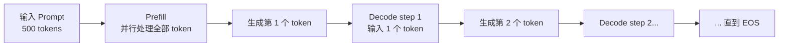
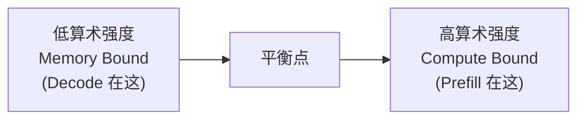
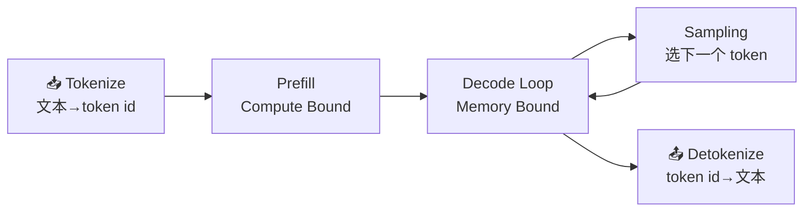
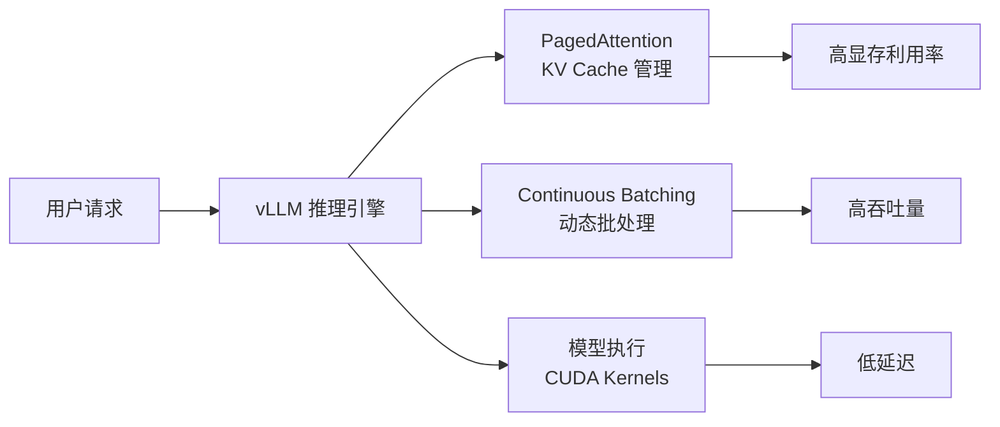

<a id="part4-ch1"></a>

# 第4部分 · 第1章：LLM 推理基础

> 总索引 ｜ [本部分目录](README.md) ｜ [下一章](ch02-推理引擎核心技术.md)

## 本章目录

- [本章导读](#part4-ch1)
- [1.1 LLM 推理基础](#part4-ch1-sec1)
- [1.2 vLLM 快速入门：从安装到部署你的第一个 LLM 推理服务](#part4-ch1-sec2)

---

## 本章导读

> 发布 2026-04-16 · 标签 "LLM推理", "Prefill", "Decode", "KV Cache", "TTFT", "TPOT", "Roofline" · 单篇原文

### 本章简介

推理是大模型从训练走向落地的关键环节。本章建立推理优化的基础概念和分析框架，后续所有优化技术（以 vLLM 为主线）都建立在这套框架之上。

**自回归生成过程**详解 LLM 推理的两阶段：Prefill（一次性处理完整 Prompt，Compute Bound）和 Decode（逐 Token 生成，Memory Bound），以及为什么 Decode 阶段效率远低于 Prefill。

**KV Cache**是推理优化的核心概念：缓存已计算的 Key 和 Value 避免重复计算，包括 KV Cache 的生命周期（分配 → 填充 → 使用 → 释放）、显存计算公式和碎片化问题。

**关键性能指标**覆盖 TTFT（首 Token 延迟）、TPOT/ITL（每 Token 延迟）、Throughput（吞吐量）、P50/P95/P99 尾延迟和 Goodput（满足 SLO 的有效吞吐）。

**瓶颈分析方法**引入算术强度（Arithmetic Intensity）与 Roofline 模型，从第一性原理解释为什么 Decode 阶段是 Memory Bound、打不满 GPU 算力，为后续所有优化技术提供统一的分析视角。

**推理链路拆解**走通 Tokenize → Prefill → Decode Loop → Sampling → Detokenize 的完整流程，分析每个环节的计算特性与潜在瓶颈，并对照 vLLM 的实际执行路径。

### 本章小节

- **1.1 自回归生成过程**：Prefill / Decode 两阶段的计算特性对比
- **1.2 KV Cache 机制**：生命周期、显存计算公式、碎片化问题
- **1.3 关键性能指标**：TTFT、TPOT/ITL、Throughput、尾延迟、Goodput
- **1.4 瓶颈分析方法**：算术强度、Roofline 模型、Memory Bound 本质
- **1.5 推理链路拆解**：从 Tokenize 到 Detokenize 的全流程与瓶颈定位

<a id="part4-ch1-sec1"></a>

## 1.1 LLM 推理基础

> 发布 2026-07-09 · 标签 "LLM推理", "Prefill", "Decode", "KV Cache", "TTFT", "TPOT", "Roofline" · 单篇原文

把一个训练好的大模型"搬上线"提供服务，和把它训练出来，是两件目标完全不同的事。训练追求的是把海量数据喂进去、让 Loss 收敛；而推理追求的是**在延迟和成本的约束下，尽可能快、尽可能多地生成 Token**。这一节不谈任何优化技巧，只做一件事：把 LLM 推理的底层逻辑彻底讲清楚——它分成哪两个阶段、为什么要缓存 KV、显存花在了哪里、用什么指标衡量快慢，以及一个绕不开的灵魂拷问：**为什么砸了几万块钱的 GPU，生成文字时算力却大部分在闲置？**

读完这一节，你就有了一套"坐标系"。后续每一项推理优化技术（PagedAttention、Continuous Batching、量化、投机解码……）本质上都是在这套坐标系里的某个位置动刀，理解了地基，才能看懂它们各自在解决什么问题。


### 1. 自回归生成：Prefill 与 Decode 两阶段

#### 1.1 从"续写"理解自回归

主流的大语言模型（GPT、Llama、Qwen 等）都是 **Decoder-only 的自回归模型**。"自回归"听起来抽象，其实就是**一次只预测下一个词，然后把预测出来的词接到输入末尾，再预测下一个**——像玩接龙一样，把刚说出口的字重新当成线索，猜下一个字。

用一句话概括生成过程：给定已有的 Token 序列 $x_1, x_2, \dots, x_t$，模型输出下一个 Token 的概率分布，采样得到 $x_{t+1}$，再把它拼回去继续。

$$
x_{t+1} \sim P(x \mid x_1, x_2, \dots, x_t)
$$

这个"接龙"会一直进行，直到模型生成了结束符（EOS），或者达到了设定的最大长度。

📌 **关键点**：自回归的本质决定了生成是**串行**的——第 $t+1$ 个 Token 必须等第 $t$ 个 Token 算完才能开始。这个串行依赖，是后面所有延迟问题的总根源。

#### 1.2 两个阶段：Prefill 和 Decode

虽然都是"跑一遍模型"，但推理过程被清晰地切成了两个计算特性截然不同的阶段。

**Prefill（预填充）阶段**：处理你输入的整段 Prompt。假设你输入了 500 个 Token 的问题，模型会把这 500 个 Token **一次性、并行地**送进网络，计算出每一层的中间结果，并生成第一个输出 Token。因为这一步要同时处理成百上千个 Token，矩阵乘法又大又密集，GPU 的算力被喂得很饱。

**Decode（解码）阶段**：从第二个输出 Token 开始，进入逐个生成的循环。每一步**只输入上一步刚生成的那 1 个 Token**，跑一遍完整的网络，吐出下一个 Token。生成 200 个 Token，就要串行地跑 200 次 Decode。

用一个类比：Prefill 像是**读题**——一口气把整道题读完，理解题意；Decode 像是**答题**——一个字一个字往外写，每写一个字都要回顾前面写过的所有内容。读题可以快速扫过，但答题只能一笔一画。



#### 1.3 两阶段的计算特性对比

| 📊 维度 | Prefill 阶段 | Decode 阶段 |
|---|---|---|
| 输入 Token 数 | 整段 Prompt（几十到几千） | 每步仅 1 个 |
| 并行度 | 高，Token 间可并行 | 低，步与步之间串行 |
| 计算瓶颈 | Compute Bound（算力受限） | Memory Bound（访存受限） |
| 决定的指标 | 首 Token 延迟（TTFT） | 每 Token 延迟（TPOT） |
| 执行次数 | 1 次 | 输出长度 - 1 次 |

这张表里最反直觉的一行是**计算瓶颈**：为什么每步只算 1 个 Token 的 Decode，反而是"访存受限"、效率更低？这个问题我们留到第 4 节用 Roofline 模型正面回答，先记住这个结论——它是理解推理优化的分水岭。

---

### 2. KV Cache：用显存换计算

#### 2.1 不缓存会怎样

回到自回归的串行特性。Decode 第 $t$ 步要计算 Attention，需要用当前 Token 的 Query 去和**前面所有 Token 的 Key、Value** 做注意力。问题来了：前面那些 Token 的 Key 和 Value，在上一步不是已经算过了吗？

如果什么都不缓存，每生成一个新 Token，都要把前面所有 Token 重新过一遍网络算出它们的 K、V——生成第 100 个 Token 时要重算 99 个,生成第 200 个时要重算 199 个，计算量随序列长度平方级膨胀。这显然是巨大的浪费。

💡 **提示**：**KV Cache 的核心思想就是——把已经算过的 Key 和 Value 存起来，下一步直接复用，绝不重算。** 这是一个典型的"用空间换时间"：牺牲显存，换掉大量重复计算。

注意一个不对称：Query 不需要缓存，因为每一步只用当前 Token 的 Query；而 Key、Value 是历史累积的、每步都要全量用到，所以缓存的是 K 和 V，这也是"KV Cache"名字的由来。

#### 2.2 KV Cache 的生命周期

一个请求的 KV Cache 会经历四个阶段，理解这个生命周期，才能明白后续 PagedAttention 到底在优化哪一环：

📥 **分配** → ✍️ **填充** → 🔁 **使用** → 🗑️ **释放**

- **分配**：请求进来，推理引擎为它预留一块显存放 KV Cache
- **填充**：Prefill 阶段一次性把整段 Prompt 的 K、V 算出来写进缓存；Decode 每步再追加 1 个 Token 的 K、V
- **使用**：每一步 Decode 都要读取全部历史 KV 来算 Attention
- **释放**：请求生成结束（EOS 或达到长度上限），显存归还

#### 2.3 显存账本：KV Cache 到底占多少

这是必须会手算的一笔账。单个 Token 在 KV Cache 中占用的字节数为：

$$
\text{per\_token\_bytes} = 2 \times L \times H_{kv} \times d_{head} \times \text{bytes}
$$

各项含义：

- $2$：分别存 Key 和 Value 两份
- $L$：Transformer 层数（每一层都有独立的 KV Cache）
- $H_{kv}$：KV 头的数量（注意是 KV 头，不是 Query 头）
- $d_{head}$：每个头的维度
- $\text{bytes}$：数据类型字节数，FP16/BF16 为 2，FP8/INT8 为 1

一个请求的总占用，再乘以序列长度和并发请求数：

$$
\text{total\_bytes} = \text{per\_token\_bytes} \times \text{seq\_len} \times \text{batch\_size}
$$

**举个具体的例子**（以一个 32 层、采用标准多头注意力即 32 个 KV 头、$d_{head}=128$、FP16 的模型为例）：

$$
\text{per\_token\_bytes} = 2 \times 32 \times 32 \times 128 \times 2 = 524288 \text{ bytes} \approx 0.5\ \text{MB}
$$

也就是说，**每生成 1 个 Token，就要多吃约 0.5 MB 显存**。当一个请求的上下文长到 4096 Token 时，光这一个请求的 KV Cache 就要吃掉约 2 GB。如果要同时服务 50 个这样的并发请求，仅 KV Cache 就是 100 GB——单张 80GB 的 GPU 直接爆掉。这就是为什么 KV Cache 的显存管理是推理优化的头号战场。

📌 **关键点**：$H_{kv}$ 在公式里是线性因子，这正是 **GQA（分组查询注意力）/ MQA（多查询注意力）** 能大幅省显存的原因——让多个 Query 头共享一组 KV 头。比如 32 个 Query 头共享 8 个 KV 头（GQA），KV Cache 直接砍到原来的 $1/4$，而模型表达能力几乎不受影响。现代大模型几乎清一色采用 GQA，就是这笔账算出来的。

#### 2.4 碎片化问题

KV Cache 还有一个隐蔽的坑：**你事先不知道一个请求会生成多长**。传统做法是按"最大可能长度"预留一整块连续显存，就像餐厅不管来几个人，都先给你留一张最大的桌子。结果是：请求实际只生成了 100 个 Token，却按 2048 预留，剩下的座位全部空占——这叫**内部碎片**；不同请求预留块之间的空隙又凑不成一整块可用空间——这叫**外部碎片**。

⚠️ **注意**：碎片化会让 KV Cache 的实际显存利用率大打折扣，大量显存被无效预留白白浪费。这正是 vLLM 的 PagedAttention 要解决的核心问题——它把连续大块换成了操作系统式的分页管理（下一章详解）。

---

### 3. 关键性能指标：如何衡量"快"

推理服务的"快"不是一个数字能说清的。用户体验、集群成本、SLA 承诺，分别对应不同的指标。搞混它们，优化就会跑偏。

#### 3.1 延迟类指标：用户等多久

**TTFT（Time To First Token，首 Token 延迟）**：从用户提交请求到收到第一个 Token 的时间。它主要由**排队时间 + Prefill 时间 + 网络延迟**构成，Prompt 越长，Prefill 越久，TTFT 越大。对于聊天、流式输出这类场景，TTFT 直接决定"响应快不快"的第一印象。

**TPOT（Time Per Output Token，每 Token 延迟）**，又称 **ITL（Inter-Token Latency，Token 间延迟）**：生成阶段平均每个输出 Token 花的时间。它决定了文字"往外蹦"的速度——TPOT 是 50ms，用户看到的就是每秒约 20 个字的吐字速度。

💡 **提示**：TPOT 和 ITL 在多数语境下是同义词，都指 Decode 阶段的平均出字间隔。细微差别只在于**计算时是否把首 Token 那一段算进去**——NVIDIA GenAI-Perf 的做法是排除首 Token，即 $\text{ITL} = (\text{e2e\_latency} - \text{TTFT}) / (\text{输出 Token 数} - 1)$。

**端到端延迟（E2E Latency）**：从提交请求到收到完整响应的总时间。它可以拆成：

$$
\text{E2E} = \text{TTFT} + \text{TPOT} \times (\text{输出 Token 数} - 1)
$$

这个公式非常实用——它告诉你：**短输出场景 TTFT 主导，长输出场景 TPOT 主导**。优化时要看清自己的业务落在哪一侧。

**代入两个场景对比**（设 TTFT $=500\ \text{ms}$、TPOT $=40\ \text{ms}$）：

- 短输出（生成 20 Token）：$\text{E2E} = 500 + 40 \times 19 = 1260\ \text{ms}$，其中 TTFT 占约 $40\%$——首字慢用户就先炸了。
- 长输出（生成 800 Token）：$\text{E2E} = 500 + 40 \times 799 \approx 32460\ \text{ms}$，TTFT 只占约 $1.5\%$——这时候优化 TPOT 才是正事。

同一套系统，业务形态不同，优化重心天差地别。这也是为什么"先测清楚自己的输入输出长度分布，再谈优化"是铁律。

#### 3.2 吞吐类指标：机器能扛多少

**Throughput（吞吐量）** 通常有两种口径：

| 📊 指标 | 📝 含义 | 适用视角 |
|---|---|---|
| Token/s（系统） | 全系统每秒生成的总 Token 数 | 衡量集群整体产能与成本 |
| Token/s（单用户） | 单个用户感受到的出字速度 | 约等于 $1 / \text{TPOT}$ |
| RPS（Requests/s） | 每秒成功完成的请求数 | 衡量并发承载能力 |

系统吞吐会随并发上升而增长，直到 GPU 资源饱和后趋于平稳甚至回落。**吞吐和延迟通常是一对矛盾**：把更多请求塞进一个 Batch 能提高系统吞吐，但每个请求的排队和计算时间变长，单用户延迟变差。

#### 3.3 尾延迟与 Goodput：别被平均值骗了

平均延迟是最容易骗人的指标。真实流量下，少数请求可能慢得离谱，而平均值把它们藏了起来。所以生产环境更看**尾延迟**：

- **P50**：中位数，一半请求比它快
- **P95 / P99**：95% / 99% 的请求比它快——这才是用户投诉的来源

📌 **关键点**：**Goodput（有效吞吐）** 是比 Raw QPS 更贴近真实价值的指标。它只统计**满足 SLO（比如 TTFT < 1s 且 TPOT < 50ms）的那部分请求的吞吐**。一个系统 QPS 很高但大部分请求都超时，Goodput 就很低——用户根本用不爽。后面第 7 章的 P/D 解耦、SLO 感知调度，优化目标正是 Goodput。

---

### 4. 瓶颈分析：为什么 Decode 打不满算力

现在回答第 1 节埋下的问题。这是整个推理优化最重要的第一性原理，值得单独一节讲透。

#### 4.1 算术强度：计算与访存的比值

GPU 干活要同时做两件事：从显存（HBM）**搬数据**，和用计算单元**算数据**。谁慢谁就是瓶颈。衡量一个任务"偏计算还是偏访存"，用**算术强度（Arithmetic Intensity）**：

$$
\text{算术强度} = \frac{\text{浮点运算次数 (FLOPs)}}{\text{访存字节数 (Bytes)}}
$$

直白理解：**每从显存搬 1 个字节的数据，能顺带做多少次计算**。这个比值高，说明数据搬来后被充分利用，算力吃得饱；比值低，说明算力在干等数据，大部分时间浪费在搬运上。

#### 4.2 Roofline 模型：一张图看懂瓶颈

Roofline 模型把这件事画成一张图：横轴是算术强度，纵轴是实际能达到的算力。图上有一条"屋顶线"——左半段是被显存带宽压住的斜坡（Memory Bound 区），右半段是被峰值算力压住的水平线（Compute Bound 区）。两段的交点，就是这块 GPU 的"平衡点"算术强度。



一个任务落在斜坡上（算术强度低于平衡点），瓶颈就是显存带宽，无论 GPU 算力多强都用不上；落在水平线上，才是算力受限、真正把 GPU 榨干了。

平衡点怎么算？就是峰值算力除以显存带宽。以 NVIDIA H100 SXM 为例，其 BF16 稠密算力约 $990\ \text{TFLOPS}$（官方标称的 $1979\ \text{TFLOPS}$ 是开启稀疏后的数值，稠密约为一半），HBM3 带宽为 $3.35\ \text{TB/s}$：

$$
\text{平衡点} = \frac{990 \times 10^{12}\ \text{FLOP/s}}{3.35 \times 10^{12}\ \text{Byte/s}} \approx 295\ \text{FLOP/Byte}
$$

也就是说，在 H100 上，一个任务每从显存搬 1 字节数据，得配上约 **295 次浮点运算**，才刚好把算力和带宽同时喂饱。低于这个值就落在斜坡上——这个数字请记住，下一节我们会拿它当标尺。

💡 **提示**：不同 GPU 的平衡点不同，但都在同一量级（几百 FLOP/Byte）。带宽升级往往比算力升级更"值钱"，正是因为绝大多数 Decode 负载都死死卡在斜坡左侧的带宽墙上。

#### 4.3 把 Prefill 和 Decode 放上去

- **Prefill**：一次并行处理成百上千个 Token，权重从显存搬一次（batch 内所有 Token 共享），却要做海量矩阵乘法——算术强度**高**，落在 Compute Bound 区，GPU 算力吃得饱。
- **Decode**：每步只处理 **1 个 Token**，但为了算这 1 个 Token，得把**整个模型的权重**从显存完整搬一遍。搬了几十上百 GB 的权重，只做了一个 Token 的计算——算术强度**极低**，死死落在 Memory Bound 区。

用数字感受一下这个悬殊。Decode 每步的核心是"权重矩阵 × 单 Token 向量"。对一个权重量为 $W$（字节数）的模型，FP16 下每步：搬运约 $W$ 字节权重，对应 $W/2$ 个权重，每个权重参与约一次乘加，即做约 $W/2$ 次乘加（按一次乘加计 2 FLOPs，即约 $2 \times W/2 = W$ FLOP）。于是单请求 Decode 的算术强度约为：

$$
\text{算术强度}_{\text{decode}} \approx \frac{W\ \text{FLOP}}{W\ \text{Byte}} \approx 1\ \text{FLOP/Byte}
$$

对比上一节算出的 H100 平衡点约 $295\ \text{FLOP/Byte}$，单请求 Decode 的算术强度低了整整**两个数量级**——GPU 算力利用率理论上还不到 $1\%$。这就是"Decode 打不满算力"最赤裸的数字证据。而把 $B$ 个请求拼成一个 Batch，权重仍只搬一次却服务 $B$ 个 Token，算术强度直接放大 $B$ 倍，逼近平衡点——这就是 Batching 的威力从何而来。

🔑 **核心概念**：**Decode 慢，不是因为算不过来，而是因为"搬不过来"**。GPU 的计算单元大部分时间在空等权重从显存加载。这就解释了两个关键现象：

1. **为什么 Batch 能大幅提升吞吐却几乎不增加延迟**：把多个请求的 Decode 拼成一个 Batch，权重只搬一次就能服务整个 Batch 的所有 Token，算术强度成倍提升，把闲置的算力利用起来——这正是 Continuous Batching 的理论依据。
2. **为什么量化（尤其是 Weight-only）对 Decode 加速明显**：Decode 瓶颈在搬权重，把权重从 FP16 压到 INT4，要搬的字节数直接减少到 $1/4$，延迟随之大幅下降。

理解了这一点，你就掌握了看穿几乎所有推理优化技术的"透视镜"。

---

### 5. 推理全链路拆解

最后把一个请求从进到出的完整链路走一遍，标出每个环节的计算特性，方便你日后定位瓶颈到底卡在哪。



| 环节 | 做什么 | 计算特性 | 潜在瓶颈 |
|---|---|---|---|
| Tokenize | 把输入文本切成 Token ID 序列 | CPU 任务 | 长文本或高并发时 CPU 成瓶颈 |
| Prefill | 并行处理全部 Prompt Token，产出首 Token 与初始 KV Cache | GPU，Compute Bound | Prompt 很长时拉高 TTFT |
| Decode Loop | 逐 Token 生成，每步读全量 KV、追加新 KV | GPU，Memory Bound | 显存带宽，决定 TPOT |
| Sampling | 从输出分布按 Temperature/Top-p 等采样下一个 Token | GPU，轻量 | 复杂采样或约束解码略增开销 |
| Detokenize | 把 Token ID 拼回可读文本，流式返回 | CPU 任务 | 与主循环争抢 CPU |

💡 **提示**：Tokenize / Detokenize 是 **CPU 任务**，却容易被忽视。当 GPU 优化到位后，CPU 上的这些环节反而可能成为新瓶颈——这正是 vLLM V1 引擎用多进程把它们和 GPU 核心循环重叠起来的原因（第 3 章详解）。

---

### 📝 总结

这一节我们不谈优化技巧，而是把 LLM 推理的地基铺清楚：

- **两阶段**：Prefill 并行读题（Compute Bound，决定 TTFT），Decode 串行答题（Memory Bound，决定 TPOT）。
- **KV Cache**：用显存换计算，避免重算历史 K/V；显存开销 $= 2 \times L \times H_{kv} \times d_{head} \times \text{bytes} \times \text{seq\_len}$，GQA 靠减小 $H_{kv}$ 省显存，碎片化催生了 PagedAttention。
- **性能指标**：TTFT / TPOT 分别刻画首字与出字速度，E2E $=$ TTFT $+$ TPOT $\times$ (输出长度 $-1$)；生产环境看 P95/P99 尾延迟和满足 SLO 的 Goodput。
- **瓶颈本质**：Decode 是 Memory Bound——GPU 在等权重搬运，而非算不过来。这解释了 Batching 提升吞吐、量化加速 Decode 的根本原因。

带着这套坐标系，后面每一章的优化技术都能对号入座：它在攻 TTFT 还是 TPOT？在省显存还是提吞吐？在斜坡上还是水平线上动刀？

### 🎯 自我检验清单

- 能说清 Prefill 和 Decode 两阶段在输入规模、并行度、计算瓶颈上的差异
- 能解释为什么需要 KV Cache，以及为什么只缓存 K、V 而不缓存 Q
- 能手算一个给定配置模型每 Token 的 KV Cache 显存开销
- 能说明 GQA/MQA 为什么能省 KV Cache，以及大致能省多少
- 能准确区分 TTFT、TPOT/ITL、Throughput、尾延迟和 Goodput 的含义与适用场景
- 能用 E2E 延迟公式判断某业务场景是 TTFT 主导还是 TPOT 主导
- 能用算术强度和 Roofline 解释为什么 Decode 是 Memory Bound
- 能从"Decode 卡在搬权重"推导出 Batching 提吞吐、Weight-only 量化加速 Decode 的原因
- 能画出推理全链路并指出每个环节的计算特性与潜在瓶颈

### 📚 参考资料

- [Attention Is All You Need（Transformer 原始论文）](https://arxiv.org/abs/1706.03762)
- [Efficient Memory Management for Large Language Model Serving with PagedAttention（vLLM 论文）](https://arxiv.org/abs/2309.06180)
- [GQA: Training Generalized Multi-Query Transformer Models from Multi-Head Checkpoints](https://arxiv.org/abs/2305.13245)
- [NVIDIA NIM LLM Benchmarking — Metrics](https://docs.nvidia.com/nim/benchmarking/llm/latest/metrics.html)
- [vLLM Documentation](https://docs.vllm.ai/en/latest/)
- [Roofline: An Insightful Visual Performance Model for Multicore Architectures](https://dl.acm.org/doi/10.1145/1498765.1498785)

---

<a id="part4-ch1-sec2"></a>

## 1.2 vLLM 快速入门：从安装到部署你的第一个 LLM 推理服务

> 发布 2026-04-15 · 标签 "vLLM", "LLM推理", "PagedAttention", "模型部署", "推理优化" · 单篇原文

### 1. 什么是 vLLM

当你要把一个大语言模型"搬上线"提供服务时，最头疼的问题是什么？——**显存不够用，吞吐上不去**。传统的推理方式就像一个餐厅里每桌客人都被分配了一间独立包房，不管来了几个人，房间全部占满，后面的客人只能干等。vLLM 的出现就是为了解决这个"包房浪费"问题。

vLLM 是由 UC Berkeley Sky Computing Lab 开发的**高吞吐、低延迟 LLM 推理与服务引擎**。截至 v0.19.0（2026 年 4 月），项目在 GitHub 上已获得超过 76,000 星标，拥有 2,000+ 贡献者，是当前最主流的开源 LLM 推理框架之一。

#### 1.1 vLLM 的核心优势

| 🏷️ 特性 | 📝 说明 |
|---------|---------|
| **PagedAttention** | 借鉴操作系统虚拟内存分页思想管理 KV Cache，显存利用率接近最优 |
| **Continuous Batching** | 动态地将新请求插入正在处理的批次，而非等一批全部完成再开始下一批 |
| **OpenAI 兼容 API** | 直接替换 OpenAI 客户端的 `base_url`，无需修改业务代码 |
| **200+ 模型支持** | 覆盖 Llama、Qwen、Mistral、DeepSeek 等主流架构，含 MoE 和多模态模型 |
| **多硬件支持** | NVIDIA GPU、AMD GPU、Google TPU、Intel Gaudi、CPU 等 |
| **丰富的量化方案** | FP8、INT8、INT4、GPTQ、AWQ、GGUF 等开箱即用 |

#### 1.2 vLLM 在推理生态中的定位



### 2. 核心原理：PagedAttention

在深入使用之前，先理解 vLLM 为什么快——这能帮你在后续调参时做出更好的决策。

#### 2.1 传统 KV Cache 的问题

LLM 推理的 Decode 阶段需要缓存之前所有 token 的 Key 和 Value 向量（即 KV Cache），以避免重复计算。传统做法是为每个请求**预分配一块连续的显存空间**，大小按模型支持的最大序列长度计算。

这就带来了三个问题：

- **内部碎片**：大多数请求用不到最大长度，预留空间大量浪费
- **外部碎片**：请求结束后释放的空间大小不一，难以被新请求复用
- **无法共享**：Beam Search 等场景中，多个候选序列共享前缀部分的 KV Cache，但连续内存布局无法实现共享

💡 **提示**：对于一个 13B 参数的模型，单个请求的 KV Cache 在最大序列长度下可能占用数 GB 显存。如果同时处理几十个请求，显存瓶颈会比模型权重本身更严重。

#### 2.2 PagedAttention 的解决方案

PagedAttention 的核心思想非常直观——把操作系统管理内存的方式搬到 KV Cache 管理上来：

| 🖥️ 操作系统概念 | 🤖 PagedAttention 对应 |
|----------------|----------------------|
| 虚拟内存页（Page） | KV Block（固定大小的 KV Cache 块） |
| 页表（Page Table） | Block Table（逻辑块到物理块的映射） |
| 按需分页 | Token 生成时才分配新的 KV Block |
| 写时复制（Copy-on-Write） | Beam Search 场景共享前缀 KV Block |

具体工作方式：

1. **分块存储**：KV Cache 不再要求连续内存，而是被切分成固定大小的 Block（如 16 个 token 为一个 Block）
2. **按需分配**：每生成一个 token，只在当前 Block 未满时追加，填满后才分配新的 Block
3. **映射表管理**：每个请求维护一个 Block Table，记录自己的逻辑 Block 到物理 Block 的映射关系
4. **内存共享**：多个请求如果有相同的前缀（如 System Prompt），可以共享同一组物理 Block，大幅节省显存

⚠️ **注意**：PagedAttention 的分块存储意味着 KV Cache 在物理上是不连续的，vLLM 需要专门的 CUDA Kernel 来高效地从分散的 Block 中读取数据进行 Attention 计算。

### 3. 安装与环境准备

#### 3.1 系统要求

| 📊 项目 | 📝 要求 |
|---------|---------|
| 操作系统 | Linux（推荐 Ubuntu 20.04+） |
| Python | 3.10 ~ 3.13 |
| CUDA | 12.x（NVIDIA GPU） |
| GPU | Compute Capability 7.0+（Volta 及以上） |

#### 3.2 使用 uv 安装（推荐）

`uv` 是 Rust 编写的高速 Python 包管理器，vLLM 官方推荐使用它来安装，能自动检测 CUDA 版本并选择匹配的 PyTorch：

```bash
# 创建虚拟环境
uv venv --python 3.12 --seed
source .venv/bin/activate

# 安装 vLLM（自动检测 CUDA 版本）
uv pip install vllm --torch-backend=auto
```

`--torch-backend=auto` 会根据系统 CUDA 驱动自动选择合适的 PyTorch 版本。也可以显式指定后端，如 `--torch-backend=cu126`。

#### 3.3 使用 conda + pip 安装

```bash
conda create -n vllm-env python=3.12 -y
conda activate vllm-env
pip install --upgrade uv
uv pip install vllm --torch-backend=auto
```

#### 3.4 AMD ROCm 环境

```bash
uv venv --python 3.12 --seed
source .venv/bin/activate
uv pip install vllm --extra-index-url https://wheels.vllm.ai/rocm/
```

目前 ROCm 支持 Python 3.12、ROCm 7.0，要求 `glibc >= 2.35`。

#### 3.5 验证安装

```bash
python -c "import vllm; print(vllm.__version__)"
```

### 4. 离线批量推理

离线推理适合**不需要实时响应**的场景，如批量文本生成、数据标注、评测跑分等。vLLM 提供 `LLM` 类作为离线推理的主入口。

#### 4.1 基础用法

```python
from vllm import LLM, SamplingParams

# 定义采样参数
sampling_params = SamplingParams(
    temperature=0.8,
    top_p=0.95,
    max_tokens=256,
)

# 加载模型（自动下载 HuggingFace 模型）
llm = LLM(model="Qwen/Qwen2.5-7B-Instruct")

# 批量生成
prompts = [
    "请用一句话解释什么是 Transformer：",
    "Python 和 C++ 的主要区别是什么？",
    "推荐三本深度学习入门书籍：",
]

outputs = llm.generate(prompts, sampling_params)

for output in outputs:
    prompt = output.prompt
    generated = output.outputs[0].text
    print(f"Prompt: {prompt}")
    print(f"Generated: {generated}\n")
```

📌 **关键点**：`LLM` 构造时会一次性将模型加载到 GPU 显存中。默认情况下 vLLM 会使用 90% 的可用 GPU 显存（模型权重 + KV Cache），可通过 `gpu_memory_utilization` 参数调整。

#### 4.2 Chat 模式推理

对于 Instruct/Chat 模型，需要正确应用 Chat Template。vLLM 提供了两种方式：

**方式一：使用 `llm.chat`（推荐）**

```python
from vllm import LLM, SamplingParams

llm = LLM(model="Qwen/Qwen2.5-7B-Instruct")
sampling_params = SamplingParams(temperature=0.7, max_tokens=512)

messages_list = [
    [
        {"role": "system", "content": "你是一个 AI Infra 专家。"},
        {"role": "user", "content": "解释什么是张量并行？"},
    ],
    [
        {"role": "user", "content": "vLLM 和 TensorRT-LLM 有什么区别？"},
    ],
]

outputs = llm.chat(messages_list, sampling_params)

for output in outputs:
    print(output.outputs[0].text)
```

**方式二：手动应用模板**

```python
from transformers import AutoTokenizer
from vllm import LLM, SamplingParams

model_name = "Qwen/Qwen2.5-7B-Instruct"
tokenizer = AutoTokenizer.from_pretrained(model_name)
llm = LLM(model=model_name)

messages_list = [
    [{"role": "user", "content": "什么是 KV Cache？"}],
]

# 手动应用 chat template
texts = tokenizer.apply_chat_template(
    messages_list,
    tokenize=False,
    add_generation_prompt=True,
)

outputs = llm.generate(texts, SamplingParams(temperature=0.7))
```

⚠️ **注意**：`llm.generate` 不会自动应用 Chat Template。如果直接传入裸文本给 Chat 模型，输出质量可能很差甚至乱码。务必使用 `llm.chat` 或手动调用 `apply_chat_template`。

#### 4.3 HuggingFace generation_config 的影响

vLLM 默认会读取模型仓库中的 `generation_config.json`（如果存在），并用其中的参数覆盖 vLLM 的默认值。如果你想使用 vLLM 自身的默认采样配置，需要显式设置：

```python
llm = LLM(model="Qwen/Qwen2.5-7B-Instruct", generation_config="vllm")
```

### 5. 在线服务部署

在线服务是 vLLM 最常用的部署方式——启动一个 HTTP 服务器，暴露 **OpenAI 兼容的 API**，业务端只需修改 `base_url` 即可无缝切换。

#### 5.1 启动服务器

```bash
vllm serve Qwen/Qwen2.5-7B-Instruct
```

默认监听 `http://localhost:8000`，可通过 `--host` 和 `--port` 自定义：

```bash
vllm serve Qwen/Qwen2.5-7B-Instruct \
    --host 0.0.0.0 \
    --port 8080 \
    --tensor-parallel-size 2
```

💡 **提示**：同样可以通过 `--generation-config vllm` 来禁用 HuggingFace 默认的 generation_config。

#### 5.2 Chat Completions API

这是最常用的接口，对标 OpenAI 的 `v1/chat/completions`：

**使用 curl：**

```bash
curl http://localhost:8000/v1/chat/completions \
    -H "Content-Type: application/json" \
    -d '{
        "model": "Qwen/Qwen2.5-7B-Instruct",
        "messages": [
            {"role": "system", "content": "你是一个有帮助的助手。"},
            {"role": "user", "content": "什么是 PagedAttention？"}
        ],
        "temperature": 0.7,
        "max_tokens": 512
    }'
```

**使用 Python openai 客户端：**

```python
from openai import OpenAI

# 只需修改 base_url，其他代码完全不变
client = OpenAI(
    api_key="EMPTY",  # vLLM 默认不需要认证
    base_url="http://localhost:8000/v1",
)

response = client.chat.completions.create(
    model="Qwen/Qwen2.5-7B-Instruct",
    messages=[
        {"role": "system", "content": "你是一个 AI 基础设施专家。"},
        {"role": "user", "content": "解释 Continuous Batching 的工作原理。"},
    ],
    temperature=0.7,
    max_tokens=512,
)

print(response.choices[0].message.content)
```

#### 5.3 Completions API

对标 OpenAI 的 `v1/completions`，适用于文本补全场景：

```python
from openai import OpenAI

client = OpenAI(api_key="EMPTY", base_url="http://localhost:8000/v1")

completion = client.completions.create(
    model="Qwen/Qwen2.5-7B-Instruct",
    prompt="LLM 推理优化的三个核心方向是",
    max_tokens=256,
    temperature=0.8,
)

print(completion.choices[0].text)
```

#### 5.4 API 认证

生产环境中建议开启 API Key 认证：

```bash
vllm serve Qwen/Qwen2.5-7B-Instruct --api-key my-secret-key
```

也可以通过环境变量设置：

```bash
export VLLM_API_KEY=my-secret-key
vllm serve Qwen/Qwen2.5-7B-Instruct
```

客户端调用时传入对应的 `api_key`：

```python
client = OpenAI(api_key="my-secret-key", base_url="http://localhost:8000/v1")
```

#### 5.5 支持的 API 端点

| 📡 端点 | 📝 说明 |
|---------|---------|
| `GET /v1/models` | 列出可用模型 |
| `POST /v1/completions` | 文本补全 |
| `POST /v1/chat/completions` | 对话补全 |
| `GET /health` | 健康检查 |

### 6. 关键参数调优

#### 6.1 采样参数（SamplingParams）

| 📊 参数 | 📝 说明 | 默认值 |
|---------|---------|--------|
| `temperature` | 控制随机性，越高越随机 | 1.0 |
| `top_p` | 核采样，只从累计概率前 p 的 token 中采样 | 1.0 |
| `top_k` | 只从概率最高的 k 个 token 中采样 | -1（不限制） |
| `max_tokens` | 最大生成 token 数 | 16 |
| `repetition_penalty` | 重复惩罚系数，>1 减少重复 | 1.0 |
| `stop` | 遇到指定字符串时停止生成 | None |
| `n` | 为每个 prompt 生成的序列数 | 1 |
| `seed` | 随机种子，设置后可复现结果 | None |

💡 **提示**：对于大多数生产场景，推荐 `temperature=0.7, top_p=0.9` 作为起点。追求确定性输出时设 `temperature=0`。

#### 6.2 引擎关键参数

| ⚙️ 参数 | 📝 说明 | 推荐值 |
|---------|---------|--------|
| `--model` | HuggingFace 模型标识 | - |
| `--tensor-parallel-size` | 张量并行 GPU 数 | 根据模型大小决定 |
| `--gpu-memory-utilization` | GPU 显存使用比例 | 0.9（默认） |
| `--max-model-len` | 模型最大序列长度 | 按需设置 |
| `--dtype` | 模型权重精度 | auto |
| `--quantization` | 量化方式 | None |
| `--max-num-seqs` | 最大并发序列数 | 256 |
| `--enforce-eager` | 禁用 CUDA Graph | 调试时使用 |

#### 6.3 显存估算与 gpu-memory-utilization

vLLM 启动时会按照以下方式分配显存：

```
总 GPU 显存 × gpu_memory_utilization = 模型权重 + KV Cache + 临时缓冲区
```

KV Cache 可用空间 = 总配额 - 模型权重 - 固定开销。KV Cache 越大，能同时处理的请求越多，吞吐就越高。

```bash
# 如果显存紧张，适当降低利用率
vllm serve Qwen/Qwen2.5-7B-Instruct --gpu-memory-utilization 0.85

# 如果需要限制最大序列长度来节省 KV Cache 空间
vllm serve Qwen/Qwen2.5-7B-Instruct --max-model-len 4096
```

⚠️ **注意**：如果模型加载后启动报错 OOM，通常需要降低 `--gpu-memory-utilization` 或 `--max-model-len`，或者增加 `--tensor-parallel-size` 分摊到多卡。

#### 6.4 Attention Backend 选择

vLLM 会自动选择当前平台上性能最优的 Attention 后端，也可以手动指定：

```bash
# 使用 FlashAttention
vllm serve Qwen/Qwen2.5-7B-Instruct --attention-backend FLASH_ATTN

# 使用 FlashInfer
vllm serve Qwen/Qwen2.5-7B-Instruct --attention-backend FLASHINFER
```

| 🖥️ 平台 | 📝 可用后端 |
|---------|------------|
| NVIDIA CUDA | `FLASH_ATTN`、`FLASHINFER` |
| AMD ROCm | `TRITON_ATTN`、`ROCM_ATTN` 等 |

### 7. 多 GPU 推理与张量并行

当单卡显存装不下模型时，需要使用张量并行（Tensor Parallelism）将模型切分到多张 GPU 上。

#### 7.1 基础用法

```bash
# 2 卡张量并行
vllm serve Qwen/Qwen2.5-72B-Instruct --tensor-parallel-size 2

# 4 卡张量并行（适合 70B+ 模型）
vllm serve Qwen/Qwen2.5-72B-Instruct --tensor-parallel-size 4
```

在离线推理中同样支持：

```python
from vllm import LLM, SamplingParams

llm = LLM(
    model="Qwen/Qwen2.5-72B-Instruct",
    tensor_parallel_size=4,
)

outputs = llm.generate(["解释 vLLM 的架构"], SamplingParams(max_tokens=256))
```

#### 7.2 模型大小与 GPU 数量参考

以下是常见模型大小在 FP16 精度下的显存需求估算：

| 🤖 模型规模 | 💾 权重大小 (FP16) | 📝 推荐最小 GPU 配置 |
|------------|-------------------|---------------------|
| 7B | ~14 GB | 1× A100 80G / 1× L40S 48G |
| 13B | ~26 GB | 1× A100 80G |
| 34B | ~68 GB | 1× A100 80G（需降低 max_model_len）或 2× A100 |
| 70B | ~140 GB | 2× A100 80G |
| 405B | ~810 GB | 16× A100 80G 或 8× H100 80G |

💡 **提示**：实际所需显存 = 模型权重 + KV Cache + 运行时开销。使用量化（如 AWQ INT4）可以将权重大小缩减约 4 倍，从而用更少的 GPU 服务更大的模型。

#### 7.3 vLLM 支持的并行方式

vLLM 支持五种并行策略：

- **张量并行（Tensor Parallelism）**：将模型的各层权重矩阵按列/行切分到多张 GPU
- **流水线并行（Pipeline Parallelism）**：将模型的不同层分配到不同 GPU
- **数据并行（Data Parallelism）**：多个副本独立处理不同请求
- **专家并行（Expert Parallelism）**：MoE 模型中将不同专家分配到不同 GPU
- **上下文并行（Context Parallelism）**：将长序列的上下文分散到多张 GPU

对于大部分场景，**张量并行是首选**，配置最简单且效果最好。

### 8. 常见问题与排错

#### 8.1 启动时 OOM

```
torch.cuda.OutOfMemoryError: CUDA out of memory.
```

✅ **解决方案**：

```bash
# 方法一：降低显存利用率
vllm serve model_name --gpu-memory-utilization 0.8

# 方法二：缩短最大序列长度
vllm serve model_name --max-model-len 2048

# 方法三：增加张量并行
vllm serve model_name --tensor-parallel-size 2

# 方法四：使用量化模型
vllm serve model_name --quantization awq
```

#### 8.2 Chat 模型输出乱码

如果使用 `llm.generate` 直接传入文本给 Chat 模型，输出可能不符合预期。

✅ **解决方案**：改用 `llm.chat` 方法或手动调用 `tokenizer.apply_chat_template`，确保输入格式符合模型的 Chat Template。

#### 8.3 ModelScope 下载模型

国内环境下载 HuggingFace 模型较慢，可以切换到 ModelScope：

```bash
export VLLM_USE_MODELSCOPE=True
vllm serve Qwen/Qwen2.5-7B-Instruct
```

#### 8.4 指定信任远程代码

部分模型需要执行自定义代码：

```bash
vllm serve model_name --trust-remote-code
```

### 📝 总结

vLLM 通过 **PagedAttention** 和 **Continuous Batching** 两大核心技术，将 LLM 推理的显存利用率和吞吐量提升到新的水平。本文覆盖了从零开始使用 vLLM 的完整路径：

1. **理解原理**：PagedAttention 将 KV Cache 分块管理，借鉴 OS 虚拟内存分页的思想解决显存碎片问题
2. **离线推理**：通过 `LLM` 类和 `SamplingParams` 快速完成批量文本生成
3. **在线部署**：一行命令启动 OpenAI 兼容 API 服务器，业务端零成本迁移
4. **调优实践**：掌握 `gpu-memory-utilization`、`max-model-len`、`tensor-parallel-size` 等关键参数
5. **多 GPU 扩展**：通过张量并行轻松服务 70B+ 大模型

### 🎯 自我检验清单

- 能解释 PagedAttention 的核心思想及其解决的显存碎片问题
- 能使用 `LLM` 和 `SamplingParams` 完成离线批量推理
- 能正确使用 `llm.chat` 进行 Chat 模式推理，理解 Chat Template 的重要性
- 能用 `vllm serve` 启动 OpenAI 兼容的在线推理服务
- 能使用 Python openai 客户端调用 vLLM 服务
- 能根据模型大小和 GPU 显存选择合适的 `tensor-parallel-size`
- 能通过调整 `gpu-memory-utilization` 和 `max-model-len` 解决 OOM 问题
- 能说出 vLLM 与传统推理方式在显存管理上的核心区别

### 📚 参考资料

- [vLLM 官方文档 - Quickstart](https://docs.vllm.ai/en/stable/getting_started/quickstart.html)
- [vLLM GitHub 仓库](https://github.com/vllm-project/vllm)
- [Efficient Memory Management for Large Language Model Serving with PagedAttention（Kwon et al., 2023）](https://arxiv.org/abs/2309.06180)
- [vLLM 架构概览](https://docs.vllm.ai/en/stable/design/arch_overview.html)
- [vLLM 特性兼容矩阵](https://docs.vllm.ai/en/stable/features/index.html)
