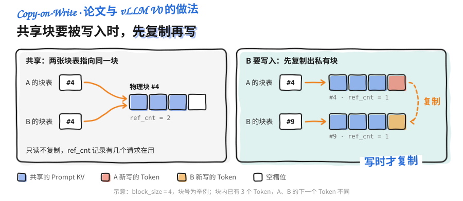
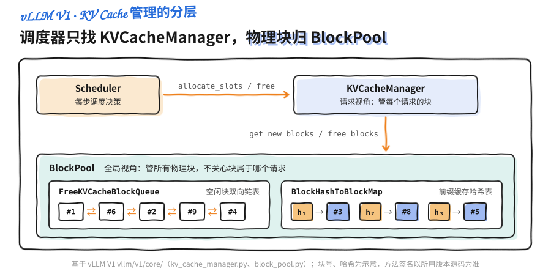
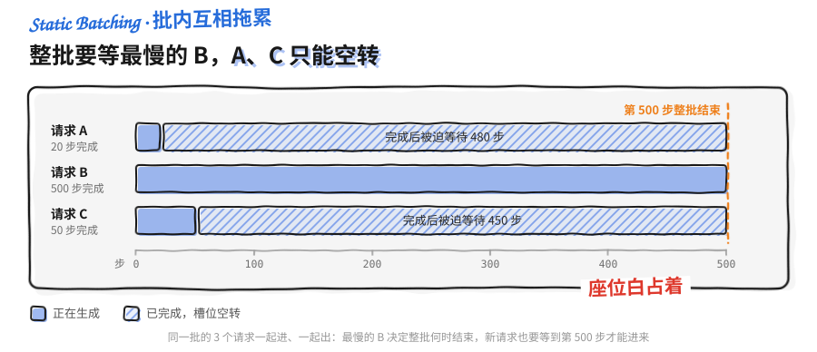
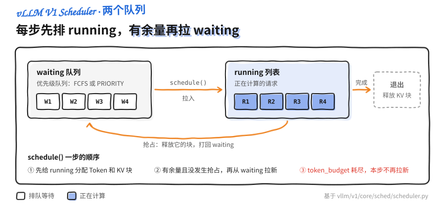
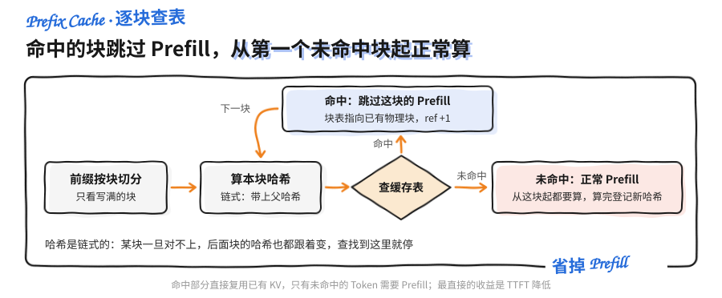
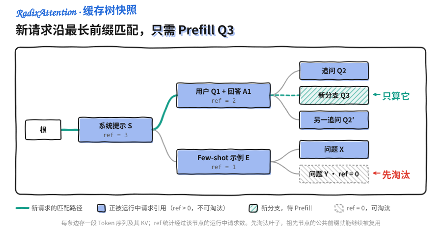
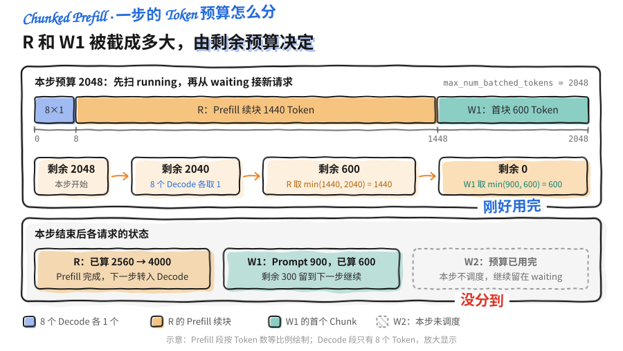

<a id="part4-ch2"></a>

# 第4部分 · 第2章：推理引擎核心技术

> [总索引](../README.md) ｜ [本部分目录](README.md) ｜ [上一章](ch01-LLM推理基础.md) ｜ [下一章](ch03-nano-vllm源码解读.md)

## 本章目录

- [本章导读](#part4-ch2)
- [2.1 PagedAttention：像操作系统管理内存一样管理 KV Cache](#part4-ch2-sec1)
- [2.2 Continuous Batching：让 GPU 不再空等的动态批处理](#part4-ch2-sec2)
- [2.3 Prefix Cache 与 RadixAttention：复用共享前缀的 KV](#part4-ch2-sec3)
- [2.4 Chunked Prefill 与统一 Token Budget 调度](#part4-ch2-sec4)
- [2.5 Attention 后端与图优化：把 Decode 的 CPU 开销榨干](#part4-ch2-sec5)

---

## 本章导读

> 发布 2026-04-16 · 更新 2026-10-29 · 标签 "PagedAttention", "Continuous Batching", "Prefix Cache", "Chunked Prefill", "FlashAttention", "CUDA Graph" · [单篇原文](../articles/part4/第2章-推理引擎核心技术/第2章-推理引擎核心技术.md)

### 📖 本章简介

现代 LLM 推理引擎的高性能来自多项核心技术的协同，本章逐一深入，并对照 vLLM 的具体实现。

**PagedAttention**借鉴操作系统虚拟内存分页的思想，用块表把逻辑块映射到物理块，解决 KV Cache 的内部碎片和外部碎片，大幅提升显存利用率。

**Continuous Batching**解决 Static Batching 中短请求被长请求拖累的问题：调度粒度细化到每个迭代步（Iteration-level Scheduling），请求随到随拼、完成即退，批次里不再有空转的槽位。

**Prefix Cache / RadixAttention**针对大量请求共享相同 System Prompt 的场景：vLLM 的 Prefix Cache 通过链式块哈希复用已有 KV 块，SGLang 的 RadixAttention 基于 Radix Tree 做最长前缀匹配，更擅长树状共享。vLLM V1 把前缀缓存的记账开销压到很低，并默认开启。

**Chunked Prefill 与统一 Token Budget 调度**将长 Prompt 拆成多个 Chunk 分块处理，减少 Prefill 对 Decode 请求的干扰。vLLM V1 更进一步取消 Prefill/Decode 的二分，用统一的 Token 预算调度器同时容纳两类请求。

**Attention 后端与图优化**介绍 vLLM 可插拔的 Attention 后端（FlashAttention 2/3/4、FlashInfer、FlashMLA、Triton）如何支持 Prefill/Decode 混合批次，以及 CUDA Graph 与 torch.compile 如何消除逐 Kernel 启动开销、降低 Decode 阶段的 CPU 瓶颈。

> ⏰ **信息时效**：各技术的原理依据对应论文；vLLM 的参数默认值、调度与 KV Cache 管理的源码走读、CUDA Graph 模式基于 v0.32.0（2026-10-18 发布）。

### 📑 本章小节

- [**2.1 PagedAttention：像操作系统管理内存一样管理 KV Cache**](https://caomaolufei.github.io/AIInfraGuide/inference/模块四-推理优化/第2章-推理引擎核心技术/21-pagedattention/)：连续分配的两种碎片、Block Table 映射、Kernel 寻址、CoW 与 V1 的只读共享、抢占与重计算、`KVCacheManager` 与 `BlockPool` 源码
- [**2.2 Continuous Batching：让 GPU 不再空等的动态批处理**](https://caomaolufei.github.io/AIInfraGuide/inference/模块四-推理优化/第2章-推理引擎核心技术/22-continuous-batching/)：Static Batching 的空转槽位、迭代级调度、与 PagedAttention 的协同、V1 Scheduler 的队列与抢占
- [**2.3 Prefix Cache 与 RadixAttention：复用共享前缀的 KV**](https://caomaolufei.github.io/AIInfraGuide/inference/模块四-推理优化/第2章-推理引擎核心技术/23-prefix-cache-与-radixattention/)：链式块哈希、LRU 与引用计数淘汰、SGLang 的 Radix Tree、vLLM APC 源码
- [**2.4 Chunked Prefill 与统一 Token Budget 调度**](https://caomaolufei.github.io/AIInfraGuide/inference/模块四-推理优化/第2章-推理引擎核心技术/24-chunked-prefill-与统一调度/)：长 Prefill 造成的 TPOT 尖刺、切块、Token 预算装箱、`max_num_batched_tokens` 调优
- [**2.5 Attention 后端与图优化**](https://caomaolufei.github.io/AIInfraGuide/inference/模块四-推理优化/第2章-推理引擎核心技术/25-attention-后端与图优化/)：可插拔后端与默认选择、混合批次、CUDA Graph 与 Padding、Piecewise 与 `FULL_AND_PIECEWISE`、torch.compile 切图

<a id="part4-ch2-sec1"></a>

## 2.1 PagedAttention：像操作系统管理内存一样管理 KV Cache

> 发布 2026-07-11 · 更新 2026-10-29 · 标签 "PagedAttention", "KV Cache", "vLLM", "虚拟内存", "分页" · [单篇原文](../articles/part4/第2章-推理引擎核心技术/2.1-PagedAttention.md)

上一章的 KV Cache 显存账本留下了一个问题：传统的连续显存分配方式，会因为"预留即浪费"产生大量碎片，实际利用率可能只有两三成（vLLM 论文测得，当时的系统里只有 20.4%–38.2% 的 KV Cache 显存真正存放了 Token 状态）。vLLM 用 PagedAttention 解决这个问题，做法是把操作系统管理内存的分页方法搬到 GPU 显存上。这一节讲四件事：它借鉴了什么思想、Block Table 怎么工作、为什么能消灭碎片，以及分页顺带带来的前缀共享能力。

> ⏰ **信息时效**：分页、块表与 CoW 的原理依据 PagedAttention 论文；参数默认值与 V1 源码走读基于 vLLM v0.32.0（2026-10-18 发布）。


### 1. 问题回顾：连续分配的两宗罪

在理解解法之前，先把问题钉死。传统推理框架（PagedAttention 出现之前）给每个请求的 KV Cache 分配的是**一整块连续显存**，而且要按"这个请求可能生成的最大长度"来预留。这带来两宗罪：

- **内部碎片（Internal Fragmentation）**：一个请求最大可能生成 2048 个 Token，就先占好 2048 个 Token 的空间，但它实际可能只生成了 100 个就遇到 EOS 停了。剩下 1948 个 Token 的空间被这个请求"锁着"却没用上，其它请求也进不来。
- **外部碎片（External Fragmentation）**：不同请求预留的大块之间会留下大小不一的空隙，这些零碎空间加起来可能不小，但因为每一块都不够放下一个完整请求，等于全废了。

用一个类比：这就像餐厅给每桌客人都按"最多可能来 10 个人"预留一张十人桌。结果大部分桌子只坐了两三个人，大量座位空着；而新来的一桌 4 人客人，却因为没有一张完整的空桌而只能在门口排队——明明加起来的空座位远够坐下他们。

📌 **关键点**：碎片的根源在于**连续 + 预留**这两个约束叠加。去掉"必须连续"和"必须按最大长度预留"，碎片问题就能解决，PagedAttention 正是从这里入手的。

---

### 2. 核心思想：借鉴操作系统的虚拟内存分页

操作系统几十年前就遇到过一模一样的问题：进程需要连续的内存地址空间，但物理内存被各种进程切得七零八落。操作系统的解法是**虚拟内存分页**——进程看到的是连续的"虚拟地址"，操作系统在背后通过页表（Page Table）把它们映射到任意分散的"物理页"上。进程感觉自己占着一整块连续内存，实际上物理上是东一块西一块拼起来的。

PagedAttention 把这套机制原样搬到了 KV Cache 上：

- 把 KV Cache 切成固定大小的 **KV Block（块）**，每个块存固定数量 Token 的 Key 和 Value（这个数量由 `block_size` 决定，vLLM 中常见取值为 16）。
- 一个请求的 KV Cache 在逻辑上是连续的"逻辑块"序列，物理上却可以散落在显存的任意位置。
- 用一张 **Block Table（块表）** 记录"这个请求的第几个逻辑块，对应物理显存里的哪一个物理块"。

🔑 **核心概念**：**PagedAttention = KV Cache 的虚拟内存分页。** Token 序列被切成块、按需分配、用块表映射，从此显存不再要求连续，也不再需要提前按最大长度预留。

💡 **提示**：vLLM 官方文档特别提醒，这里说的 KV Block 是 vLLM 自己的显存管理单位，和 CUDA 里的 "thread block（线程块）" 完全是两回事，不要混淆。

---

### 3. Block Table：逻辑块到物理块的映射

Block Table 是整个机制的枢纽，下面用一个例子说明它怎么工作。

假设 `block_size = 4`（每块存 4 个 Token 的 KV，真实场景常用 16，这里为了好画取 4）。一个请求 Prefill 了 9 个 Token，那么它需要 $\lceil 9/4 \rceil = 3$ 个逻辑块：

- 逻辑块 0：Token 0~3
- 逻辑块 1：Token 4~7
- 逻辑块 2：Token 8（只用了 1 格，还剩 3 格）

vLLM 从空闲物理块池里分配 3 个物理块给它——注意物理块编号可以完全不连续，比如物理块 `#7`、`#2`、`#5`。Block Table 就长这样：

| 逻辑块 | 物理块 | 状态 |
|---|---|---|
| 0 | #7 | 已满（4/4） |
| 1 | #2 | 已满（4/4） |
| 2 | #5 | 部分填充（1/4） |

下图把这张表放回显存里看：左边是请求眼中连续的 3 个逻辑块，中间是 Block Table，右边是物理块池。红、黄、绿三种实心格分别是逻辑块 0、1、2 已写入的 KV，绿色斜线格是 #5 里已分配但还没写的槽位，紫色、粉色斜线块属于其他请求，白格是空闲块。


进入 Decode 阶段后，每生成一个新 Token 就往当前逻辑块的空位里填。逻辑块 2 还剩 3 格，能再接 3 个 Token；填满后（生成到第 12 个 Token），vLLM 才**按需**再申请一个新物理块挂到逻辑块 3——**用多少申请多少，绝不提前预留**。

Attention 计算时，CUDA Kernel 通过 Block Table 拿到每个逻辑位置对应的 `physical_block_number`（物理块号）和 `physical_block_offset`（块内偏移），就能从分散的物理块里正确读到所有历史 KV。

---

### 4. 分页如何消灭碎片

回到第 1 节的两宗罪，看分页是怎么逐一破解的：

- **消灭内部碎片**：不再按最大长度预留，而是每次只分配一个块，填满了再要下一个。浪费被限制在"最后一个块内没填满的部分"，最多不到一个块（比如 `block_size=16` 时最多浪费 15 个 Token 的空间），相比动辄浪费上千 Token 的旧方式，几乎可以忽略。
- **消灭外部碎片**：所有物理块**大小完全相同**，任何一个空闲块都能被任何请求使用。不存在"空间够但形状不对"的问题，空闲块池里的每一块都是等价、可复用的。

下图用同样 64 个 Token 槽位对比两种分配方式。实心格是已写入的 Token（红、蓝、绿分别对应请求 A、B、C），同色斜线格是预留了却没用上的槽位（内部碎片），灰色虚线格是夹在预留区之间的零散空洞（外部碎片），白格是空闲槽位。左边空闲槽位合计够放新请求 C，却找不到一段足够长的连续空间；右边 C 直接拿走两个不相邻的空闲块。


| 📊 维度 | 传统连续分配 | PagedAttention |
|---|---|---|
| 显存布局 | 每请求一整块连续显存 | 固定大小块，物理上分散 |
| 分配时机 | 提前按最大长度预留 | 按需逐块分配 |
| 内部碎片 | 严重（预留 >> 实际用量） | 极小（< 1 个块） |
| 外部碎片 | 存在（空隙大小不一） | 消除（块大小统一） |
| 显存利用率 | 偏低 | 接近最优 |

📌 **关键点**：显存利用率提高后，**同一张卡能同时塞下更多并发请求**。上一章讲过，Decode 是 Memory Bound，把更多请求拼进一个 Batch 能显著提升系统吞吐，所以 PagedAttention 省下的显存最终变成了吞吐提升。

---

### 5. Kernel 视角：分散的物理块怎么被读出来

前面讲的都是逻辑上的映射。KV 被打散到显存各处以后，Attention Kernel 计算时怎么还能高效地把它们凑齐？这一节看 Kernel 内部的做法。看懂这里才能理解，PagedAttention 不只是显存管理技巧，也是**算子与内存布局的协同设计**。

传统 Attention 假设一个序列的 K、V 在显存里是**连续排列**的，Kernel 直接用一个基地址加偏移就能顺序扫过去。PagedAttention 打破了连续性，于是 Kernel 必须先查块表，把"逻辑位置"翻译成"物理地址"。核心是两个量：

- **`physical_block_number`（物理块号）**：决定去哪一个物理块里取数，乘以块的跨度（block stride）得到块的基址。
- **`physical_block_offset`（块内偏移）**：定位这个 Token 在块内的第几格。

vLLM 官方 Kernel 文档里，Key 指针的地址计算大致是这样一个形式（简化示意，非逐字照搬）：

```cpp
// 根据物理块号 + 头偏移 + 块内偏移，算出这个 token 的 Key 起始地址
const scalar_t* k_ptr = k_cache
                      + physical_block_number * kv_block_stride   // 定位到物理块
                      + kv_head_idx           * kv_head_stride    // 定位到对应 KV 头
                      + physical_block_offset * x;                // 定位块内 token
```

一个 Warp（32 个线程组成的执行单元）在外层循环里逐块推进：每次迭代通过块号跳到下一个物理块，`k_ptr` 随之指向不同块里的 Key。于是**物理上东一块西一块的存储，被 Kernel 当成一段逻辑连续的上下文来访问**。间址查表的代价就在每次迭代的地址重算里，第 10 节"代价与权衡"会讨论这部分开销。

⚠️ **注意**：vLLM 官方这篇 Kernel 走读文档明确标注为"基于原始论文的历史文档，不再反映 vLLM 当前代码"。所以上面的指针公式请当作**理解原理的示意**，而非当前源码。真正想读实现，要去看 V1 引擎的 Attention 后端（第 2.5 节会讲到 FlashAttention/FlashInfer 等后端如何接管这层逻辑）。

---

### 6. 意外之喜：内存共享与 Copy-on-Write

分页还带来一个连续分配做不到的能力：**多个请求共享同一份物理块**。

因为 KV 现在是以块为单位、通过块表间接引用的，多个请求的块表完全可以指向**同一个物理块**。典型场景：

- **跨请求共享前缀**：一批请求用了相同的 System Prompt，它们的前缀 KV 完全相同，就没必要各存一份——让它们的块表都指向同一批物理块即可。这种共享是**只读**的：各请求只读这些前缀块，新生成的内容写在各自的块里。这就是下一节（2.3 Prefix Cache）的物理基础。
- **同一请求内的分叉**：从同一个 Prompt 并行采样多个回答（`n > 1`）或做 Beam Search 时，多个候选序列共享 Prompt 的 KV，但会在某个块**内部**开始分叉——这才是需要下面 CoW 的场景。

那如果共享同一个块的两个序列，后来生成的内容分叉了怎么办？PagedAttention 论文（以及 vLLM V0）的答案是操作系统里另一个经典机制——**写时复制（Copy-on-Write, CoW）**：

- 只读共享时，大家指向同一块，靠**引用计数（ref_cnt）**记录有几个请求在用。
- 当某个请求要往一个被共享的块里写新内容时，先把这个块复制一份成为它的私有块，在副本上写，再更新自己的块表指向副本。其他请求不受影响。

下图左边是只读共享，右边是 B 写入时的 CoW。蓝色是两个请求共享的 Prompt KV，红色和黄色分别是 A、B 各自新写的 Token，白格是空槽位。



💡 **提示**：这套"引用计数 + 写时复制"和 Linux `fork()` 之后父子进程共享内存页的机制如出一辙。理解了操作系统的分页与 CoW，PagedAttention 里几乎没有新东西，这也是它设计优雅的地方。

---

### 7. 抢占与恢复：显存不够时怎么办

分页解决了"怎么高效存"，但还有个现实问题：并发请求太多，物理块池被抽干了，新来的 Decode 步骤申请不到块，怎么办？总不能让请求崩掉。vLLM 的答案是**抢占（Preemption）**：像操作系统调度进程一样，临时"暂停"一部分请求，把资源让给别人，等有空间了再恢复。

触发时机很直接：某一步 Decode 需要为若干请求追加新块，但空闲物理块不够。调度器会挑选部分请求"踢出"，释放它们占用的物理块。被踢出的请求，其已经算好的 KV Cache 有两种处理方式：

| 🔄 恢复方式 | 做法 | ✅ 优点 | ❌ 代价 |
|---|---|---|---|
| **换出（Swapping）** | 把 KV Cache 从 GPU 显存拷贝到 CPU 内存暂存，恢复时再拷回来 | 不用重算，省算力 | 占用 CPU 内存，来回拷贝有 PCIe 传输开销 |
| **重计算（Recomputation）** | 直接丢弃 KV，恢复时把该请求已生成的 Token 当成新 Prompt 重新 Prefill 一遍 | 不占 CPU 内存，实现简单 | 要重跑一次 Prefill，浪费算力 |

用一个类比：换出像是把桌上暂时用不到的资料**收进抽屉**（CPU 内存），要用再拿出来；重计算则是干脆**把草稿扔了**，需要时凭记忆（已生成的 Token）重新推导一遍。哪个划算取决于"抽屉够不够大、传输快不快"和"重推贵不贵"。

💡 **提示**：上表是 PagedAttention 论文和 V0 的两种做法。vLLM V1 的抢占只走重计算：被抢占的请求释放全部块、`num_computed_tokens` 清零后放回等待队列头部，恢复时重新 Prefill。官方调优文档的解释是，V1 架构下重计算的开销更低。开着 Prefix Cache 时，被释放的满块只要还没被淘汰，恢复时还能直接命中，实际要重算的部分会少一些。

📌 **关键点**：抢占是 vLLM 在显存压力下**保证不 OOM、请求不失败**的兜底机制。如果你在日志里频繁看到 preemption 相关的告警，说明并发压得太满——要么调低并发、要么增大 `gpu_memory_utilization` 给 KV Cache 更多空间、要么加卡。它是"系统在硬扛"的信号，不是常态。

---

### 8. 工程实践：PagedAttention 在 vLLM 里怎么调

作为使用者，可以通过下面几个引擎参数影响 PagedAttention 的行为（默认值基于 vLLM v0.32.0，换版本时以 `vllm serve --help` 为准）。

```python
from vllm import LLM

llm = LLM(
    model="meta-llama/Llama-3.1-8B-Instruct",
    # vLLM 实例最多使用总显存的这个比例；扣掉权重和激活峰值后，
    # 剩下的全部划给 KV Cache 块池。v0.32.0 默认 0.92。
    gpu_memory_utilization=0.92,
    # 每个 KV Block 存多少个 token 的 KV。分页的基本粒度。
    block_size=16,
    # 开启前缀缓存，让相同前缀的请求复用物理块（见 2.3 节）。
    enable_prefix_caching=True,
    # 一个 batch 里最多同时处理多少条序列。
    max_num_seqs=256,
)
```

各参数与 PagedAttention 的关系：

- **`gpu_memory_utilization`**：v0.32.0 的默认值是 `0.92`（早期版本为 `0.9`），即 vLLM 实例最多使用 92% 的显存，权重和激活之外的部分拿来做 KV Cache 块池。调高能容纳更多并发、更少触发抢占，但留给激活值和其它开销的余量变小，太激进可能 OOM。
- **`block_size`**：分页粒度，就是前面反复提到的每块 Token 数。文档将其描述为"以 Token 数计的连续缓存块大小"。调它要在"块表长度/管理开销"和"尾块内部碎片"之间权衡。
- **`enable_prefix_caching`**：开启后，共享前缀（如统一 System Prompt）的请求直接复用已缓存的物理块，省掉重复 Prefill。它就是第 6 节内存共享能力的配置开关。
- **`max_num_seqs`**：单次迭代最多处理的序列数，配合下一节的 Continuous Batching 决定并发上限。

💡 **提示**：绝大多数场景下，你**不需要手动改 `block_size`**——默认值已在多数模型上调优过。真正常动的旋钮是 `gpu_memory_utilization`（压榨显存）和 `enable_prefix_caching`（有共享前缀就开）。

---

### 9. 源码走读：vLLM V1 的 KV Cache 管理

这一节看 vLLM 怎么把"块表 + 空闲块池 + 引用计数"写成代码。内容基于 vLLM V1 引擎的 `vllm/v1/core/` 目录（代码持续演进，方法签名以你所用版本源码为准，这里讲的是稳定的设计骨架）。

⚠️ **注意**：前面第 5 节引用的那份 Kernel 文档是 V0 时代的历史文档。V1 引擎对调度与 KV Cache 管理做了整体重写，把管理逻辑集中到了 `KVCacheManager` 和 `BlockPool` 两个核心类。下面讲的是 V1 的实现。

#### 9.1 两个核心类的分工

V1 把职责切得很清楚：



- **`KVCacheManager`**（`kv_cache_manager.py`）：**请求视角**的管理者。调度器每一步都通过它给请求申请、释放块。核心方法和前面讲的概念一一对应：
  - `get_computed_blocks`：前缀缓存查询，返回该请求能命中的、已经算好的块，以及命中了多少 Token。这是第 6 节"共享前缀"的入口。
  - `allocate_slots`：为请求新增的 Token 申请槽位/块，顺带释放不再需要的块，并检查空闲块是否够用；不够就返回 `None`（交给调度器触发抢占）。它对应第 3 节的"按需逐块分配"。
  - `free`：请求结束时**逆序**释放它的块——让尾部的块先被回收，因为头部的块更可能被前缀缓存复用，留得越久越好。
- **`BlockPool`**（`block_pool.py`）：**全局视角**的物理块仓库，不关心哪个请求，只管"哪些块空着、哪些块被缓存着"。

#### 9.2 空闲块为什么用双向链表

一个容易被忽略的设计细节：`BlockPool` 里所有块存在一个普通列表 `self.blocks: list[KVCacheBlock]`（按 block id 索引），但**空闲块**单独用一个 `FreeKVCacheBlockQueue` 管理——它内部是一条**双向链表**，而不是简单的栈或 `deque`。

原因是空闲块要同时支持两种操作：

- **分配时**从头部快速取走 N 个（`popleft_n`）；
- **前缀缓存命中时**，一个原本"空闲但仍缓存着有效内容"的块要被重新激活——需要从链表**中间任意位置**把它摘出来（`remove`）。

普通队列没法 $O(1)$ 地从中间删除，双向链表可以。前缀缓存要求"空闲块也可能携带可复用缓存"，所以 vLLM 选了双向链表。

#### 9.3 引用计数与释放顺序

`ref_cnt`（引用计数）是内存共享的骨架，代码里的行为对应第 6 节讲的"只读共享"部分：

```python
# 伪代码：还原 BlockPool 的关键逻辑（非逐字源码）
def get_new_blocks(self, num_blocks):
    if num_blocks > self.get_num_free_blocks():
        raise ValueError("空闲块不足")          # 触发上层抢占
    blocks = self.free_block_queue.popleft_n(num_blocks)
    for blk in blocks:
        assert blk.ref_cnt == 0                 # 新分配的块必须无人引用
        blk.ref_cnt += 1
    return blocks

def free_blocks(self, ordered_blocks):
    for blk in ordered_blocks:
        blk.ref_cnt -= 1
    to_free = [b for b in ordered_blocks if b.ref_cnt == 0]   # 没人用了才真正回收
    no_hash = [b for b in to_free if b.block_hash is None]
    has_hash = [b for b in to_free if b.block_hash is not None]
    self.free_block_queue.prepend_n(no_hash)    # 没有缓存价值：放链表头，最先被复用
    self.free_block_queue.append_n(has_hash)    # 带哈希：放链表尾，最晚被淘汰

def touch(self, blocks):                        # 前缀缓存命中时调用
    for blk in blocks:
        if blk.ref_cnt == 0:                    # 从空闲链表里"抢救"回来
            self.free_block_queue.remove(blk)
        blk.ref_cnt += 1
```

两个值得记住的设计：

1. **释放不等于清空**：`ref_cnt` 归零的块只是回到空闲链表，**内容还在**。如果后续请求的前缀哈希命中它，`touch()` 直接把它复活复用，这就是 Automatic Prefix Caching 省掉重复 Prefill 的底层机制。
2. **带哈希的块留得更久**：释放时，vLLM 把"没缓存价值的块"放链表头（优先被再分配覆盖，源码注释说这样还能让刚释放的块被立即复用，GPU 局部性更好），"带哈希、有复用潜力的块"放链表尾（晚点才被淘汰）。分配总从链表头取，于是带哈希的块按释放先后被淘汰，效果就是 LRU。

⚠️ **注意：V1 的 BlockPool 里没有 CoW。** 上面三个函数只做 `ref_cnt` 的增减和空闲链表的摘挂，没有任何"复制块"的逻辑。V1 能绕开 CoW，靠的是两点设计：

- **只共享写满的块**：前缀缓存只对已写满的块计算哈希并共享，未写满的尾块不参与共享；新生成的 Token 一律追加到请求自己的新块里。因此跨请求的前缀共享始终是只读的，没有"往共享块里写"的时刻。
- **`n > 1` 拆成独立子请求**：V1 把并行采样拆成 `n` 个 `n = 1` 的子请求（见 `vllm/v1/engine/parallel_sampling.py` 中的 `ParentRequest`），子请求之间通过前缀缓存共享 Prompt 的满块，不再需要块内分叉。

所以第 6 节的 CoW 是 PagedAttention 论文和 V0 中的机制（V0 的 `cow_block_if_not_appendable` 已随 V0 一起移除），理解它有助于把握设计思想，但在 V1 的 KV Cache 路径里找不到对应代码。

📌 **关键点**：读源码时抓住这条主线——**`KVCacheManager` 管请求、`BlockPool` 管物理块、`ref_cnt` 管共享、`FreeKVCacheBlockQueue` 管淘汰**。四者配合起来，就实现了第 3~7 节讲的分页、只读共享和抢占。

---

### 10. 代价与权衡

PagedAttention 也有成本，工程上要清楚它的取舍：

- ✅ **收益**：显存利用率接近最优、支持前缀共享、支持显存不足时通过抢占（论文与 V0 支持换出和重计算，V1 只用重计算）恢复而非直接失败。
- ❌ **代价**：Attention Kernel 要额外做一层块表查找与间址访问（第 5 节的指针重算），实现比连续内存的朴素 Attention 复杂；块表本身也要占一点管理开销。

关于 `block_size` 的权衡：块太小，块表变长、管理开销上升；块太大，又会退化出内部碎片（最后一块浪费变多）。vLLM 选择 16 这类中等值作为常见默认，是在管理开销和碎片之间取平衡。

⚠️ **注意**：本文多处强调的"分页 + 块表 + 引用计数"是 vLLM 稳定不变的**设计地基**（CoW 则只存在于论文和 V0 中，见 9.3 节），但 V1 引擎里的具体数据结构（如 KV Cache Manager 的实现）已经过多轮重写演进。学习时抓住不变的核心思想，具体代码以最新版本为准。

---

### 📝 总结

- PagedAttention 把**操作系统虚拟内存分页**搬到了 KV Cache：切块、按需分配、块表映射。
- **Block Table** 把请求看到的连续逻辑块，映射到物理上分散的物理块，从此显存无需连续、无需按最大长度预留。
- **Kernel 侧**通过 `physical_block_number` + `physical_block_offset` 查表寻址，把分散的物理块当成逻辑连续的上下文来读——这是算子与内存布局的协同设计。
- 它同时消灭了**内部碎片**（不再超额预留）和**外部碎片**（块大小统一），把显存利用率推到接近最优，进而转化为更高的并发与吞吐。
- 分页天然支持**内存共享 + Copy-on-Write**，为前缀复用（Prefix Cache）打下基础。
- 显存被抽干时，靠**抢占**兜底（论文与 V0 可换出到 CPU 或重计算，V1 默认且只用重计算），保证请求不失败而非直接 OOM。
- 工程上常动的旋钮是 `gpu_memory_utilization` 与 `enable_prefix_caching`；`block_size` 需在管理开销与碎片间权衡（vLLM 常用 16）。
- 源码上，V1 引擎由 `KVCacheManager`（管请求）+ `BlockPool`（管物理块）+ `ref_cnt`（管共享）+ `FreeKVCacheBlockQueue`（管淘汰）协作落地。

### 🎯 自我检验清单

- 能说清连续分配下内部碎片和外部碎片各自的成因
- 能用"逻辑块 → 物理块"的映射解释 Block Table 的作用
- 能画出一个请求 Prefill 后的块表，并说明 Decode 时块如何按需增长
- 能解释 Attention Kernel 如何通过物理块号与块内偏移读取分散的 KV
- 能解释 PagedAttention 为什么能同时消除内部和外部碎片
- 能说明只读共享如何支持前缀复用、Copy-on-Write 如何支持并行采样，以及 V1 为什么不再需要 CoW
- 能区分抢占恢复的两种方式（换出 vs 重计算）及各自的代价
- 能说出 `gpu_memory_utilization`、`block_size`、`enable_prefix_caching` 分别影响什么
- 能说清 vLLM V1 中 `KVCacheManager` 与 `BlockPool` 的职责分工
- 能解释空闲块为什么用双向链表而不是普通队列
- 能分析 `block_size` 取值过大或过小分别带来什么问题
- 能把"省显存"和"提吞吐"通过 Memory Bound 的结论串联起来

### 📚 参考资料

- [Efficient Memory Management for Large Language Model Serving with PagedAttention（vLLM 论文）](https://arxiv.org/abs/2309.06180)
- [vLLM 官方博客：Easy, Fast, and Cheap LLM Serving with PagedAttention](https://vllm.ai/blog/2023-06-20-vllm)
- [vLLM Design — PagedAttention Kernel](https://docs.vllm.ai/en/latest/design/paged_attention/)
- [vLLM Design — Automatic Prefix Caching](https://docs.vllm.ai/en/latest/design/prefix_caching/)
- [vLLM — Engine Arguments（引擎参数与默认值）](https://docs.vllm.ai/en/latest/configuration/engine_args/)
- [vLLM — Optimization and Tuning（抢占与 V1 重计算）](https://docs.vllm.ai/en/latest/configuration/optimization/)
- [vLLM V1 源码 — vllm/v1/core（KVCacheManager、BlockPool）](https://github.com/vllm-project/vllm/tree/main/vllm/v1/core)

---

<a id="part4-ch2-sec2"></a>

## 2.2 Continuous Batching：让 GPU 不再空等的动态批处理

> 发布 2026-07-12 · 更新 2026-10-29 · 标签 "Continuous Batching", "Iteration-level Scheduling", "vLLM", "吞吐优化", "调度" · [单篇原文](../articles/part4/第2章-推理引擎核心技术/2.2-Continuous Batching.md)

如果说 PagedAttention 解决的是"显存装得下多少请求"，那 Continuous Batching 解决的就是"装进来的请求能不能把 GPU 喂饱"。这是现代推理引擎吞吐飞跃的另一半功劳。这一节从传统批处理的致命短板讲起，说清批次里的空转槽位从哪来、又怎么被消掉。核心就一句话：**从"按批"调度改成"按迭代步"调度**。

> ⏰ **信息时效**：迭代级调度的思想依据 Orca 论文；Scheduler 的队列、抢占与源码走读基于 vLLM v0.32.0（2026-10-18 发布）。


### 1. 为什么要批处理

先回到上一章的第一性原理：**Decode 阶段是 Memory Bound**，瓶颈在于把整个模型的权重从显存搬到计算单元。这里藏着一个巨大的机会——搬一次权重，本来只服务 1 个请求的 1 个 Token，太亏了；如果能让这一次搬运同时服务多个请求的 Token，算术强度就成倍上升，闲置的算力被利用起来。

这就是**批处理（Batching）**的价值：把多个请求的计算合并成一次大的矩阵运算，摊薄权重搬运的成本。

用类比来说，这就像通勤班车：为一个人发一趟车（搬一次权重只送一个 Token）油钱极不划算；坐满一车人再发（一个 Batch 服务多个请求），每个人分摊的成本骤降。批处理越大，单位 Token 的成本越低、系统吞吐越高。

📌 **关键点**：批处理提升的是**吞吐**，而且几乎不牺牲单请求延迟——因为瓶颈在搬权重，多算几个 Token 的计算量对 Memory Bound 的 Decode 来说近乎"免费"。问题只在于：**怎么组织这个 Batch？**

---

### 2. Static Batching 的致命短板

最朴素的做法叫 **Static Batching（静态批处理）**：攒够一批请求，一起送进模型，等这一批**全部生成完**，再开始下一批。

听起来合理，但它有一个致命短板——**请求的生成长度天差地别**。同一批里，请求 A 可能生成 20 个 Token 就结束了，请求 B 却要生成 500 个。在 Static Batching 下：

- 请求 A 在第 20 步就完事了，但它必须**待在批次里干等**，直到最慢的请求 B 跑完 500 步，整批才释放。
- A 早已完成的那 480 步里，它在 Batch 中占的那个"槽位"纯粹在空转——GPU 在为一个已经没有意义的位置做无用计算。

用类比来说：这就像拼车非要等所有乘客都到达各自终点后才让任何人下车。先到的乘客明明该下车了，却被锁在车上陪着绕路，座位白白占着，后面等车的人还上不来。

下图按 500 步的时间轴画出同一批的三个请求：蓝色是正在生成，蓝色斜线格是请求完成后被迫空转的槽位。



⚠️ **注意**：Static Batching 下，大量算力浪费在给已完成请求的空槽位做无效计算，同时新请求还必须等整批结束才能进来。浪费的比例取决于同批请求的长度差：一批 8 个请求，最长的跑 500 步、其余 7 个平均只跑 50 步，那么 $8 \times 500 = 4000$ 个槽位步里只有 $500 + 7 \times 50 = 850$ 个在干活，约 79% 在空转。请求长度差异越大，浪费越严重。

---

### 3. Continuous Batching：迭代级调度

Continuous Batching（连续批处理，也叫 In-flight Batching）的破局点是把调度的**粒度**从"一整批"细化到"一个迭代步（iteration）"。

🔑 **核心概念**：**Iteration-level Scheduling（迭代级调度）**——不再以"一批请求的完整生命周期"为调度单位，而是**每生成一步（一个 Token）就重新调度一次**。每一步结束后，引擎立刻检查：

- 哪些请求生成了 EOS 或达到长度上限？→ **立即移出批次，释放它的显存**，不必等别人。
- 显存和批次容量是否腾出了空间？→ **立即从等待队列拉新请求进来**，加入下一步计算。

于是批次的构成是**动态流动**的：请求随到随拼、完成即退，GPU 几乎每一步都在满负荷地为"当前真正还在生成"的请求干活，不再有空槽位空转。

下图把两种调度画在同一组 4 个槽位上。蓝色是一起到达的 A–D，黄色是之后陆续到达的 E、F、G，蓝色斜线格是已完成请求留下的空转槽位，白格是空闲槽位。上半部分 Static Batching 要等 B 在第 10 步跑完才放行 E、F、G；下半部分 Continuous Batching 在 A、C、D 退出的同一步就让新请求补位。


回到拼车的类比：现在改成了**招手即停、到站就下**的公交——到站的乘客随时下车，空出的座位马上让站台上等着的人补上，车子始终坐得满满当当往前开。

📌 **关键点**：Continuous Batching 的收益来源有两块：一是**完成的请求立刻退出**，不再空转；二是**新请求立刻补位**，不必等整批结束，排队延迟也大幅下降。最早系统化提出迭代级调度的 Orca 论文报告，在 GPT-3 175B 上、相同延迟下，吞吐比当时的 FasterTransformer 高 36.9 倍（这个倍数还包含 Orca 的其他优化，且依赖负载）。

---

### 4. 一次调度循环里发生了什么

把镜头拉近，看 vLLM 每一个 step 具体做了什么。可以理解为一个不停转的循环：

📥 **收新请求** → 🗂️ **调度** → ⚙️ **前向一步** → 📤 **处理产出** → 🔁 **回到开头**

1. **收新请求**：把新到达的请求放进 Waiting（等待）队列。
2. **调度决策**：调度器决定这一步谁上车。它要同时兼顾两拨请求——正在生成的 Running 队列请求（做 Decode），和等待队列里能塞进来的新请求（做 Prefill）。是否有空间，取决于显存里还有多少空闲 KV Block（这正是 PagedAttention 提供的信息）。
3. **前向计算一步**：对选中的这批请求跑一次模型前向，每个 Decode 请求产出 1 个新 Token，Prefill 请求产出首 Token。
4. **处理产出**：把新 Token 追加到各请求的 KV Cache；检查哪些请求触发了 EOS 或长度上限，将其标记完成、**释放其占用的 KV Block** 归还给空闲池。
5. **循环**：回到第 1 步。

💡 **提示**：当显存不够、Running 队列里请求太多时，调度器还会做**抢占（Preemption）**：暂停部分请求、释放它们的 KV Block，腾出显存保证其他请求推进。vLLM V1 被抢占的请求一律丢弃 KV、恢复时重算，第 6.3 节会看到对应的代码。

---

### 5. 与 PagedAttention 的协同

Continuous Batching 和 PagedAttention 是一对**必须配合才能发挥威力**的搭档，理解这一点很关键：

- Continuous Batching 要做到"请求随退随补"，前提是**能随时、以细粒度分配和回收显存**。如果还是传统的连续大块分配，一个请求退出后留下的空隙未必能恰好塞下新请求，动态补位就无从谈起。
- PagedAttention 的**固定大小块 + 按需分配 + 即时回收**，恰好提供了这种细粒度的显存弹性：请求完成，它的块立刻回到空闲池；新请求进来，从空闲池按需取块。

| 技术 | 解决的问题 | 提供的能力 |
|---|---|---|
| PagedAttention | 显存碎片、利用率低 | 细粒度、可即时回收的显存分配 |
| Continuous Batching | GPU 空转、排队延迟 | 迭代级调度、动态批次构成 |

🔑 **核心概念**：**PagedAttention 管"显存怎么放"，Continuous Batching 管"请求怎么调度"，二者相乘才有 vLLM 的高吞吐。** 单有其一都不够——好比公交系统既要有灵活的座位管理，也要有招手即停的调度策略，缺一不可。

---

### 6. 源码走读：vLLM V1 的 Scheduler

把前面的调度循环落到代码上。vLLM V1 引擎把整个迭代级调度的逻辑集中在 `vllm/v1/core/sched/scheduler.py` 的 `Scheduler` 类里。下面基于 main 分支的设计骨架讲解（代码持续演进，方法签名以你所用版本为准）。

⚠️ **注意**：V1 相比 V0 最大的设计变化是——**调度器眼里不再有"Prefill 阶段"和"Decode 阶段"之分**。源码注释里明确写了 "no 'decoding phase' nor 'prefill phase'"：每个请求只是不停地把 `num_computed_tokens`（已计算 Token 数）推向 `num_tokens_with_spec`（含投机 Token 的总目标数）。这种统一视角，正是 2.4 节 Chunked Prefill 能把 Prefill 和 Decode 混在一步里跑的前提。

#### 6.1 两个队列与一个循环

调度器维护两组核心状态：

下图中白格是 waiting 里排队的请求，蓝格是 running 里正在计算的请求，橙色箭头是请求在两组状态之间的流转。



- **`self.running`**：一个列表，装当前正在计算的请求。
- **`self.waiting`**：一个**优先级队列**，装排队等待的请求。调度策略有两种——`FCFS`（先来先服务）和 `PRIORITY`（按优先级）。v0.32.0 里还有几个辅助队列：`kv_holding_waiting`、`deferred_waiting`，以及每步临时使用的 `step_skipped_waiting` 等，用来暂存本步因依赖未就绪（如异步 KV 传输尚未完成）而不能调度的请求。读主干逻辑时可以先忽略它们。

两个最重要的方法，恰好对应第 4 节讲的"调度 → 前向 → 处理产出"循环：

- **`schedule()`**：一步调度的核心。它给一个 **token 预算（`token_budget`）**，先遍历 `running` 队列给正在生成的请求分配 Token 和 KV 块，预算还有富余、且没发生抢占时，再从 `waiting` 队列拉新请求进来。最后打包成 `SchedulerOutput` 交给模型执行。
- **`update_from_output()`**：拿到模型这一步的输出后，把采样出的 Token 追加回各请求、检查停止条件（EOS/长度上限）、释放已完成请求的资源，并组装成返回给客户端的结果。

#### 6.2 一步调度的决策顺序

`schedule()` 内部的决策顺序很能说明"为什么正在跑的请求优先级高于新请求"：

```python
# 伪代码：还原 V1 Scheduler.schedule() 的主干逻辑（非逐字源码）
def schedule(self):
    token_budget = self.max_num_batched_tokens
    scheduled = []
    preempted = []

    # 第一优先级：喂饱正在运行的请求（Decode 为主）
    req_index = 0
    while req_index < len(self.running) and token_budget > 0:
        req = self.running[req_index]
        num_new = compute_new_tokens(req, token_budget)   # 受预算/max_model_len 限制
        while True:                                       # 申请不到就抢占，再重试
            blocks = self.kv_cache_manager.allocate_slots(req, num_new)
            if blocks is not None:
                break
            victim = self.running.pop()                   # FCFS 踢最后一个（最晚加入的）
            self._preempt_request(victim)                 # 释放块，打回 waiting 队头
            preempted.append(victim)
            if victim is req:                             # 踢到自己，本请求这步不跑了
                break
        if blocks is None:
            break
        scheduled.append(req)
        token_budget -= num_new
        req_index += 1

    # 第二优先级：预算有富余且本步没发生抢占，才拉新请求做 Prefill
    if not preempted and token_budget > 0:
        while self.waiting and token_budget > 0:
            req = self.waiting.pop_front()
            if not self._can_admit(req):                  # 检查 running 上限/LoRA 等
                break
            self.running.append(req)
            scheduled.append(req)

    return SchedulerOutput(scheduled)
```

这段逻辑藏着两个关键设计：

1. **在途请求优先于新请求**：先保证已经在跑的请求继续推进，剩余预算才用于接纳新请求。这避免了"新请求不断插队、老请求迟迟跑不完"的饥饿。
2. **抢占发生在显存耗尽时**：当 `allocate_slots` 返回 `None`（申请不到 KV 块），调度器就挑一个"受害者"抢占，释放它的块后**重试分配**，直到成功或者踢到当前请求自己为止。FCFS 策略下踢掉 `running` 里的最后一个（最晚加入的），PRIORITY 策略下踢 `(priority, arrival_time)` 最大的那个，即优先级最低、同优先级里来得最晚的请求。

#### 6.3 抢占的代码行为

被抢占的请求在 `_preempt_request()` 里经历一套清理：释放它的 KV 块和编码器缓存 → 状态置为 `PREEMPTED` → **`num_computed_tokens` 归零** → 重新塞回 `waiting` 队列的**队头**，等有资源了优先恢复。

📌 **关键点**：注意 `num_computed_tokens` 归零这一步——它意味着 V1 的抢占恢复策略是**重计算（Recompute）**：被抢占的请求下次调度时，从头把 Prompt 和已生成的 Token 重新 Prefill 一遍，而不是从 CPU 换回 KV（这与 2.1 节讲的两种恢复方式呼应）。官方调优文档说明 V1 默认用重计算而非换出，因为在 V1 架构下重计算开销更低；开着 Prefix Cache 时，被释放的满块若还没被淘汰，恢复时可以直接命中。

💡 **提示**：读调度器源码时抓住这条主线——**`waiting`/`running` 两队列 + `token_budget` 预算 + `allocate_slots` 返回值驱动抢占**。第 4 节那个抽象的"调度循环"，落到代码就是这三者的相互作用。更深入的调度细节（Chunked Prefill 如何切分）见 2.4 节；第 3 章会用 nano-vllm 的精简 Scheduler 再走一遍同样的流程。

---

### 7. 调度中的关键权衡

Continuous Batching 虽好，但调度器面对的是一组相互冲突的目标，工程上要清楚这些权衡：

- **吞吐 vs 延迟**：一步里塞进的请求越多，系统吞吐越高，但每步的前向计算耗时也越长，单请求的 TPOT 会略微变差。批次大小需要在两者间取平衡。
- **Prefill vs Decode 的争抢**：新请求的 Prefill 是 Compute Bound 的重活，如果某一步塞进一个超长 Prompt 的 Prefill，会明显拖慢同批 Decode 请求的出字速度（TPOT 抖动）。这个问题正是下一节 **Chunked Prefill** 要解决的——把长 Prefill 切块，避免它一次性霸占整个 step。
- **公平性 vs 效率**：先来的请求是否优先？长请求会不会被短请求反复插队饿死？调度策略需要在整体效率和请求间公平之间做取舍。

⚠️ **注意**：Continuous Batching 让延迟指标变得**对负载敏感**。低负载时批次小、延迟低；高负载时批次变大、排队变长，P95/P99 尾延迟会明显上升。做容量规划时，一定要在**目标并发下**压测延迟，而不是看空载数据。

---

### 📝 总结

- 批处理的本质是**摊薄权重搬运成本**，把 Memory Bound 的 Decode 的算力利用起来，提升吞吐而几乎不增加延迟。
- **Static Batching** 的致命伤是"批内互相拖累"：短请求要陪最长的请求跑完，长度差越大，空转的槽位步越多。
- **Continuous Batching** 把调度粒度细化到**迭代步**（Iteration-level Scheduling）：完成即退、随到随补，空转槽位基本消失。
- 它与 **PagedAttention** 深度协同：后者提供细粒度可回收的显存，前者才能实现动态批次构成。
- 源码上，V1 的 `Scheduler` 用 `waiting`/`running` 两队列 + `token_budget` 预算驱动调度，**在途请求优先、显存耗尽时抢占**，且不再区分 Prefill/Decode 阶段。
- 调度存在**吞吐/延迟、Prefill/Decode 争抢、公平/效率**等权衡，其中 Prefill 干扰 Decode 的问题由 Chunked Prefill 进一步缓解。

### 🎯 自我检验清单

- 能从 Memory Bound 的角度解释批处理为什么能提升吞吐
- 能说清 Static Batching 中短请求被长请求拖累的具体机制
- 能解释 Iteration-level Scheduling 与批级调度的本质区别
- 能描述 vLLM 一次调度 step 中"退出完成请求、补入新请求"的流程
- 能说明为什么 Continuous Batching 必须依赖 PagedAttention 的细粒度显存管理
- 能说清 V1 Scheduler 中 `waiting`/`running` 两队列与 `schedule()` 的决策顺序
- 能解释为什么 V1 调度器"不区分 Prefill/Decode 阶段"，以及默认抢占为何用重计算
- 能分析批次大小对吞吐与 TPOT 的相反影响
- 能解释为什么长 Prompt 的 Prefill 会干扰同批 Decode，并知道该用什么技术缓解

### 📚 参考资料

- [vLLM 官方博客：Easy, Fast, and Cheap LLM Serving with PagedAttention](https://vllm.ai/blog/2023-06-20-vllm)
- [Orca: A Distributed Serving System for Transformer-Based Generative Models（迭代级调度提出者）](https://www.usenix.org/conference/osdi22/presentation/yu)
- [vLLM V1 Alpha Release（统一调度器设计）](https://vllm.ai/blog/2025-01-27-v1-alpha-release)
- [vLLM V1 源码 — vllm/v1/core/sched/scheduler.py（Scheduler 实现）](https://github.com/vllm-project/vllm/blob/main/vllm/v1/core/sched/scheduler.py)
- [vLLM — Optimization and Tuning（抢占与重计算）](https://docs.vllm.ai/en/latest/configuration/optimization/)

---

<a id="part4-ch2-sec3"></a>

## 2.3 Prefix Cache 与 RadixAttention：复用共享前缀的 KV

> 发布 2026-07-13 · 更新 2026-10-29 · 标签 "Prefix Cache", "RadixAttention", "vLLM", "SGLang", "KV Cache" · [单篇原文](../articles/part4/第2章-推理引擎核心技术/2.3-Prefix Cache 与 RadixAttention.md)

真实业务里，海量请求往往共享同一段开头——同一个几百 Token 的 System Prompt、同一份 Few-shot 示例、多轮对话里不断重复的历史。每来一个请求就把这段共享前缀重新 Prefill 一遍，是巨大的浪费。Prefix Cache 就是把这段共享前缀的 KV Cache 缓存下来、后续请求直接复用的技术。这一节讲清 vLLM 基于 Hash 的自动前缀缓存怎么工作，以及 SGLang 的 RadixAttention 在此之上的进阶思路。

> ⏰ **信息时效**：RadixAttention 部分依据 SGLang 论文；vLLM 的哈希算法、默认开关与源码走读基于 v0.32.0（2026-10-18 发布）。


### 1. 重复的前缀有多浪费

先看几个再常见不过的场景：

- **共享 System Prompt**：一个客服机器人，每个请求前面都挂着 800 Token 的角色设定和规则说明，只有用户那句话不同。
- **Few-shot 提示**：分类任务里每个请求都带着相同的 10 个示例，几千 Token 的示例对所有请求都一样。
- **多轮对话**：第 5 轮对话的输入 = 前 4 轮的全部历史 + 新问题，前 4 轮的内容和第 4 轮请求高度重合。

这些场景的共同点是：**大量 Token 在不同请求间完全相同，且位置也相同（都在序列开头）**。而上一章讲过，Prefill 是 Compute Bound 的重活。把同一段 800 Token 的前缀对每个请求都重新 Prefill 一遍，等于反复做同样的昂贵计算。

📌 **关键点**：Attention 的因果性决定了——**一个 Token 的 Key/Value 只取决于它自己和它前面的 Token**。所以两个请求只要**前缀完全一致**，这段前缀每个 Token 算出来的 KV 就一模一样，完全可以只算一次、大家共用。

用类比来说：这就像一份标准合同，前面几页的通用条款对所有客户都一样，没必要给每个客户重新起草——存一份模板，签约时只补上后面的个性化条款即可。

---

### 2. 复用的物理基础：块级 KV 共享

前缀能复用的前提，是显存管理支持"多个请求指向同一份 KV"。这正是上一节 PagedAttention 打下的地基：

- KV Cache 以**固定大小的块**存储，请求通过块表间接引用物理块。
- 只要两个请求的某些前缀块内容相同，就让它们的块表**指向同一个物理块**，配合**引用计数**记录有几个请求在用。
- 新生成的内容写在各请求自己的新块里，共享块只读。vLLM V1 只共享已写满的块，因此跨请求复用不会出现"往共享块里写"的情况，也就不需要 Copy-on-Write。

所以 Prefix Cache 本质上是**把"共享前缀块"这件事从'同时并存的请求之间'扩展到'先后到达的请求之间'**：前一个请求算完的前缀块，先不急着扔，留在缓存里；后来的请求如果前缀匹配，直接复用这些块，跳过对应的 Prefill 计算。

🔑 **核心概念**：**Prefix Cache = 跨请求、跨时间地复用前缀 KV 块。** PagedAttention 的块共享是空间维度（并存请求共享），Prefix Cache 把它延伸到时间维度（先后请求复用）。

---

### 3. vLLM 的 Automatic Prefix Caching

vLLM 的方案叫 **Automatic Prefix Caching（APC，自动前缀缓存）**。"Automatic"是它的一大亮点——**你不需要手动声明哪段是共享前缀，引擎自动检测并复用**。它靠的是对 KV 块做哈希。

#### 3.1 块哈希：如何判断"前缀相同"

关键问题是：怎么快速判断一个新请求的某个前缀块，和缓存里的某个块"内容相同"？vLLM 的做法是给每个**填满的块**算一个哈希值，这个哈希由三部分组成：

- **父块的哈希**（也就是它前面所有前缀块的哈希）
- **本块内 Token 的序列**
- **额外标识**（如 LoRA ID、多模态输入的哈希、cache salt 等）

$$
\text{block\_hash} = \text{Hash}(\text{parent\_hash},\ \text{block\_tokens},\ \text{extra})
$$

把"父块哈希"纳入计算是精髓所在：它保证了**只有从序列开头到当前块的整条前缀都完全一致，哈希才会相同**。这样就精确刻画了"前缀相同"这件事——第 3 个块的哈希相同，意味着前 3 个块的全部 Token 都相同。把块内 Token 也纳入哈希，则是为了降低哈希碰撞的概率。

下图用 `block_size = 4` 演示两个请求的哈希链。蓝色块是 A、B 相同的系统提示，黄色是请求 A 的问题，绿色是请求 B 的问题。A 逐块算出的哈希登记进中间黄底的缓存表；B 下方的蓝字标出命中复用的块，红字标出从第 3 块开始与 A 内容不同、哈希分叉后需要新算的块；斜线格是尾块里还没写的槽位，未写满的尾块不参与哈希。


💡 **提示**：vLLM 自 v0.11 起默认使用 `sha256` 作为哈希算法，也可通过 `--prefix-caching-hash-algo` 切换为 `sha256_cbor`（跨语言可复现）、`xxhash`、`xxhash_cbor` 等。非加密算法（如 xxhash）更快，但碰撞风险略高。

#### 3.2 匹配与复用流程

新请求进来时，vLLM 逐块计算前缀哈希，拿去缓存表（hash → block ID 的映射）里查：

- **命中**：对应的物理块还在缓存里，直接把请求的块表指向它、增加引用计数，**跳过这部分 Prefill**。
- **未命中**：正常 Prefill 计算，算完后把新块的哈希登记进缓存，供后续请求复用。

下图中蓝底卡片是命中分支，红底卡片是未命中分支；命中后回到下一块继续查，第一次未命中后就转入正常 Prefill。



📌 **关键点**：命中前缀缓存能**直接砍掉那部分 Prefill 的计算**，最直接的收益是**大幅降低 TTFT**（首 Token 更快出来），同时省下的算力还能服务更多请求。共享前缀越长、命中率越高，收益越大。

#### 3.3 V1 的"零开销"设计

早期版本（V0）里，前缀缓存因为命中率低时 CPU 记账开销不划算，默认是关闭的。vLLM **V1 引擎**对此做了重写：所有块在初始化时预分配成一个块池，用嵌入块内的双向链表指针做 O(1) 的移动与淘汰，把记账开销压到极低。官方设计文档称前缀缓存"几乎是免费的午餐"（almost a free lunch），V1 发布博客给出的数据是：即使命中率为 0%，吞吐下降也不到 1%。因此 **V1 中前缀缓存默认开启**。

---

### 4. 缓存的淘汰：LRU 与引用计数

缓存空间有限，物理块用完了就得淘汰旧的。vLLM 的策略结合了**引用计数**和 **LRU（最近最少使用）**：

- **正在被使用的块不能淘汰**：引用计数 > 0 的块（还有请求在用）受保护。
- **空闲块按 LRU 淘汰**：请求结束后，它的块引用计数归零、进入空闲队列，但**内容和哈希先保留着**——万一马上有匹配的新请求来，还能命中复用。当显存吃紧需要腾地方时，才真正回收最久没被用到的空闲块。

一个有意思的细节：vLLM 释放块时，是把请求的块**按逆序**放进空闲队列尾部。因为一个请求的**最后一个块**哈希了最多的 Token（前缀最长），最不容易被别的请求命中复用，所以让它**优先被淘汰**；而靠前的块（短前缀，如共享 System Prompt 的开头）更可能被复用，就让它们更晚淘汰。

💡 **提示**：这个"逆序入队"的小设计体现了一个朴素直觉——**越靠近序列开头的前缀，越通用、越值得留**；越靠后的前缀越个性化，留着也难命中。

---

### 5. SGLang 的 RadixAttention

vLLM 的 Hash 方案高效，但它有个隐含限制：**匹配是"块对齐"且"线性前缀"的**——按块边界比对一条从头开始的前缀。而多轮对话、树状采样等场景里，请求的共享关系是**树状**的：一个共同前缀分叉出多个不同的后续。

SGLang 提出的 **RadixAttention** 用一棵 **Radix Tree（基数树/压缩前缀树）** 来管理 KV Cache 的复用：

- 树的每条边代表一段 Token 序列，从根到某节点的路径就是一段前缀，对应缓存的 KV。
- 新请求到来时，沿树做**最长前缀匹配**，匹配到的路径部分直接复用 KV，只对分叉之后的新内容做计算。
- 分叉天然对应"共同前缀 + 不同后续"，非常契合多轮对话（同一段历史派生多轮）和并行采样（同一 Prompt 采样多个回答）。
- 每个节点带一个**引用计数**，记录有几个运行中的请求正在用它；只有引用计数为 0 的节点才可淘汰。淘汰按 LRU 进行，并且**先淘汰叶子**，这样祖先节点上的公共前缀能留得更久。
- 调度时优先处理与缓存共享前缀最长的请求（论文称为 cache-aware scheduling），在同样的缓存容量下提高命中率。

下图是一棵缓存树的快照。蓝色实心节点正被运行中的请求引用（ref > 0），不可淘汰；绿色粗线是新请求沿"系统提示 S → Q1 + A1"匹配到的路径，它只需为绿色斜线的新分支 Q3 做 Prefill；灰色虚线框的叶子 Y 已无人引用（ref = 0），是 LRU 最先淘汰的对象。



| 📊 维度 | vLLM Automatic Prefix Caching | SGLang RadixAttention |
|---|---|---|
| 数据结构 | Hash 表（块哈希 → 块 ID） | Radix Tree（压缩前缀树） |
| 匹配方式 | 块对齐的前缀哈希匹配 | 树上最长前缀匹配（论文实现以单个 Token 为页） |
| 擅长场景 | 通用共享前缀（System Prompt、Few-shot） | 树状共享（多轮对话、树采样） |
| 淘汰策略 | LRU + 引用计数 | LRU + 引用计数，先淘汰叶子 |

🔑 **核心概念**：两者目标一致——**复用共享前缀的 KV、跳过重复 Prefill**；区别在数据结构。Hash 表简单高效、适合线性前缀；Radix Tree 更擅长表达和利用树状的前缀共享关系。

⚠️ **注意**：不要把它们对立起来看。vLLM 的方案在绝大多数场景已经很够用，且随 V1 做到了近乎零开销；RadixAttention 是在**高度树状复用**的负载下（如复杂 Agent、大量并行采样）展现出额外优势。SGLang 论文在这类结构化 LLM 程序负载上报告了最高 6.4 倍的吞吐提升，这个数字来自 RadixAttention 与其他优化的组合。选型时看你的负载形态，而非简单认为"树一定比哈希好"。

---

### 6. 源码走读：vLLM APC 的哈希与匹配

前面讲了原理，这一节钻进 vLLM V1 源码，看自动前缀缓存的哈希链和块复用具体怎么落地。相关逻辑主要在 `vllm/v1/core/kv_cache_utils.py`（哈希）和 `block_pool.py` / `kv_cache_manager.py`（复用与淘汰）。下面基于 main 分支的官方设计文档梳理，代码持续演进，以你所用版本为准。

#### 6.1 块哈希是怎么"链"起来的

第 3.1 节讲的"父块哈希"在源码里是通过**逐块串联**实现的。每个**填满的块**的哈希，由一个元组求哈希得到，元组里包含三样东西：

- **父块的哈希**（前一个块的 `block_hash`，序列第一个块的父哈希是一个常量 `NONE_HASH`）
- **本块的 Token 元组**（降低哈希碰撞概率）
- **额外区分量**（LoRA ID、多模态输入哈希、`cache_salt` 等；其中 `cache_salt` 只加在第一个块上，因为父哈希会把它沿链传给后面所有块）

```python
# 伪代码：还原 vLLM 块哈希的链式计算（非逐字源码）
# 设置了 PYTHONHASHSEED 时由它派生；否则 sha256 系列用固定种子，xxhash 系列用随机种子
NONE_HASH = <进程启动时确定的常量>

def hash_request_tokens(token_ids, block_size, extra):
    block_hashes = []
    parent_hash = NONE_HASH                       # 第一个块没有父块
    for blk_tokens in chunk(token_ids, block_size):
        if len(blk_tokens) < block_size:
            break                                 # 只对"填满的块"算哈希
        # 关键：把父块哈希一起塞进去 → 天然编码了"从头到此的整条前缀"
        curr_hash = hash((parent_hash, tuple(blk_tokens), extra))
        block_hashes.append(curr_hash)
        parent_hash = curr_hash                   # 链式推进
    return block_hashes
```

🔑 **核心概念**：**父块哈希的链式串联，让第 $k$ 个块的哈希唯一编码了"序列前 $k$ 个块的全部 Token"。** 于是"两个请求第 $k$ 块哈希相同" $\Leftrightarrow$ "它们前 $k$ 块的 Token 完全一致"——前缀匹配被压缩成了一次哈希查表，$O(1)$ 判定。

💡 **提示**：只有**填满的块**才被缓存（源码里不满一个 `block_size` 的尾块不参与哈希）。这也解释了为什么前缀命中总是"块对齐"的——不足一块的零头无法复用。

#### 6.2 复用与淘汰的四张表

`BlockPool` 初始化时会预建几套结构协同工作（呼应 2.1 节的源码走读）：

| 📊 结构 | 作用 |
|---|---|
| Block Pool（块列表） | 所有物理块的池子，进程启动时一次性预分配，避免运行时创建 Python 对象的开销 |
| Free Block Queue（空闲双向链表） | 管理空闲块，支持 $O(1)$ 从中间摘除（前缀命中时"抢救"块） |
| Cache（哈希 → 块 ID 映射） | 前缀查表的核心：拿块哈希来查有没有可复用的物理块 |
| Request（请求 → 块 ID 映射） | 记录每个请求当前持有哪些块 |

复用发生在调度器为新请求调用 `get_computed_blocks()` 时：把 Prompt 逐块哈希，去 Cache 表里查命中；命中的块被 `touch()`（引用计数 +1，并从空闲链表摘出以防被淘汰），随后 `allocate_slots()` 只为未命中的部分申请新块。

📌 **关键点**：V1 的块表是**只追加（append-only）**的——同哈希的重复满块可能短暂共存（因为块表不能改写），这些冗余"会在请求释放时被消除"。这是 V1 为了调度简洁性做的一个务实取舍，读源码时看到重复块不必惊讶。

淘汰则是第 4 节讲的 LRU：需要腾地方时，从空闲链表**头部**弹出最久未用的块，把它的哈希从 Cache 表里删掉。而释放请求时块**逆序入队尾**，让哈希了最多 Token 的尾块（最难命中）优先被淘汰。

---

### 7. 适用场景与注意事项

✅ **前缀缓存收益大的场景**：

- 长 System Prompt / 长 Few-shot 且被大量请求共享
- 多轮对话（历史不断累积复用）
- 同一 Prompt 并行采样多个输出（`n > 1`）
- RAG 中固定的指令模板 + 变化的检索内容（固定部分放前面才能命中）

❌ **收益有限甚至无收益的场景**：

- 每个请求前缀都不同（如无模板的自由问答）
- 共享部分放在了 Prompt**中间或末尾**——前缀缓存只能复用**从头开始连续相同**的部分，共享内容一旦不在开头就无法命中

📌 **关键点**：想吃到前缀缓存的红利，**Prompt 工程上要有意识地"把公共内容前置"**——固定不变的指令、示例、上下文放最前面，变化的用户输入放最后。这是一条几乎零成本却常被忽视的优化。

⚠️ **注意**：前缀缓存**不改变模型输出**（复用的是数学上完全等价的 KV），可以放心开启。但要留意多租户环境下的隔离——vLLM 提供 `cache_salt` 等机制，避免不同租户/权限的请求意外命中彼此的缓存造成信息泄露。

---

### 📝 总结

- Prefix Cache 复用**共享前缀的 KV**，跳过重复 Prefill，核心收益是**降低 TTFT + 提升吞吐**。
- 它的物理基础是 PagedAttention 的**块级只读共享 + 引用计数**，把块共享从"并存请求"延伸到"先后请求"。
- vLLM 的 **Automatic Prefix Caching** 用**含父块哈希的块哈希**自动检测相同前缀；V1 做到近乎零开销、默认开启；用 **LRU + 引用计数**淘汰，并按逆序入队优先淘汰个性化的尾块。
- SGLang 的 **RadixAttention** 用 **Radix Tree** 做最长前缀匹配，配合引用计数和"先淘汰叶子"的 LRU，更擅长多轮对话、树状采样等树状复用场景。
- 源码上，vLLM 用 `NONE_HASH` 起始的**链式块哈希**把前缀匹配压成 $O(1)$ 查表，配合"块池 + 空闲链表 + 哈希表 + 请求表"四结构完成复用与 LRU 淘汰。
- 实践中要**把公共内容前置**才能命中，并注意多租户下的缓存隔离。

### 🎯 自我检验清单

- 能解释为什么"前缀相同"的请求可以复用同一份 KV（Attention 因果性）
- 能说清 Prefix Cache 与 PagedAttention 块共享在时间维度上的联系
- 能描述 vLLM 块哈希为什么要包含"父块哈希"，以及它如何刻画"前缀相同"
- 能说清链式块哈希如何把前缀匹配变成 $O(1)$ 查表，以及为何只缓存填满的块
- 能说明前缀缓存命中主要优化的是哪个指标（TTFT）及原因
- 能解释 vLLM 释放块时"逆序入队"背后的直觉
- 能对比 Hash 方案与 RadixAttention 的数据结构与擅长场景
- 能指出哪些 Prompt 组织方式能/不能命中前缀缓存

### 📚 参考资料

- [vLLM Design — Automatic Prefix Caching](https://docs.vllm.ai/en/latest/design/prefix_caching/)
- [vLLM V1 Alpha Release（零开销前缀缓存）](https://vllm.ai/blog/2025-01-27-v1-alpha-release)
- [vLLM V1 源码 — kv_cache_utils.py（块哈希实现）](https://github.com/vllm-project/vllm/blob/main/vllm/v1/core/kv_cache_utils.py)
- [vLLM V1 源码 — block_pool.py（空闲队列与 LRU 淘汰）](https://github.com/vllm-project/vllm/blob/main/vllm/v1/core/block_pool.py)
- [SGLang: Efficient Execution of Structured Language Model Programs（RadixAttention）](https://arxiv.org/abs/2312.07104)
- [vLLM — Engine Arguments（--prefix-caching-hash-algo）](https://docs.vllm.ai/en/latest/configuration/engine_args/)

---

<a id="part4-ch2-sec4"></a>

## 2.4 Chunked Prefill 与统一 Token Budget 调度

> 发布 2026-07-14 · 更新 2026-10-29 · 标签 "Chunked Prefill", "Token Budget", "vLLM", "调度", "TPOT" · [单篇原文](../articles/part4/第2章-推理引擎核心技术/2.4-Chunked Prefill 与统一调度.md)

Continuous Batching 那一节留了个尾巴：当一个超长 Prompt 的 Prefill 挤进某一步计算时，会把同批正在生成的 Decode 请求全部拖慢，用户能明显感到"卡了一下"。Chunked Prefill 就是来收拾这个尾巴的——把长 Prefill 切成小块，掺进 Decode 的间隙里做，谁也不耽误谁。而 vLLM V1 更进一步，用一个统一的 Token 预算调度器，把 Prefill 和 Decode 的界限彻底抹平。这一节讲透这两件事。

> ⏰ **信息时效**：切块思想依据 SARATHI 论文；vLLM 的调度逻辑、参数与调优建议基于 v0.32.0（2026-10-18 发布）。


### 1. Prefill 是怎么拖慢 Decode 的

先把干扰的机制讲清楚。回顾上一章的两条结论：

- **Prefill 是 Compute Bound**：一次要并行处理整段 Prompt 的所有 Token，Prompt 越长，这一步的矩阵运算量越大、耗时越久。
- **Decode 是 Memory Bound**：每步只处理 1 个 Token，本身很快，用户感受到的出字速度（TPOT）就靠它一步一步稳定推进。

问题出在：Continuous Batching 是**每一步重新组批**的。如果某一步里，调度器把一个 4000 Token 的长 Prompt 的 Prefill 和一批 Decode 请求塞进了同一个 step，那么这一步的耗时会被那个庞大的 Prefill 计算**整体拉长**——同批所有 Decode 请求的这个 Token 都得等 Prefill 算完才能一起出来。

用类比来说：Decode 请求像流水线上匀速前进的小件包裹，本来每几秒过一个；突然来了一个巨大的集装箱（长 Prefill）也要挤上同一条流水线过检，整条线被它堵住，后面的小包裹全部被迫等待。用户端的表现就是：**出字很流畅，然后突然卡顿一下，再恢复流畅**——TPOT 出现尖刺（P99 抖动）。

📌 **关键点**：这不是"要不要批处理"的问题，而是"**一步里塞了太多 Compute Bound 的活**"。既然长 Prefill 是罪魁，那把它拆小、分几步做，不就不会一次性堵死流水线了吗？

---

### 2. Chunked Prefill：把长 Prefill 切块

**Chunked Prefill（分块预填充）** 的思路非常直接：**不要求一个长 Prompt 在一步里 Prefill 完，而是把它切成若干个 Chunk（块），分散到多个 step 里逐块处理。** SARATHI 论文按等长切块；vLLM 不预设块长，每块多大由当步剩余的 Token 预算决定（见第 5 节）。

比如一个 4000 Token 的 Prompt，按每块 512 Token 切，就是 7 个满块加 1 个 416 Token 的尾块，共 8 个 Chunk。每一步只处理其中一块，剩下的算力**留给同批的 Decode 请求正常出字**。这样：

- 每一步的计算量被控制在一个可预期的范围内，不会被超长 Prefill 突然撑爆。
- Decode 请求得以在长 Prefill 进行的同时**持续、平稳地推进**，TPOT 尖刺被抹平。

下图把第 1 节的场景和切块后的场景画在同一条时间轴上。每个格子是一步：蓝色是 8 个 Decode 请求各出 1 个 Token 的部分，黄色是长 Prompt 的 Prefill 部分，黑框标出含 Prefill 的步，橙色虚线是长 Prompt 出首 Token 的时刻。步的宽度按"固定开销 + 与 Prefill Token 数成正比"的简化模型估算，只用来示意相对长短。


用回流水线的类比：现在把那个大集装箱**拆成一箱箱标准货物**，每次过检只放一箱进流水线，中间穿插着让小包裹继续通过。集装箱是慢慢过完了，但整条线始终匀速运转，没有谁被彻底堵死。

🔑 **核心概念**：**Chunked Prefill 用"把大块 Prefill 摊到多步"换来"Decode 的平稳"**，本质是把一次性的计算尖峰削平成多个可控的小峰，从而稳住 TPOT 尾延迟。

⚠️ **注意**：切块会让这个长 Prompt 的 **TTFT 略微变大**（它要跨多步才 Prefill 完，首 Token 出得稍晚）。这是一个刻意的权衡——**牺牲少量单请求 TTFT，换取整批 Decode 的 TPOT 稳定**。在追求平稳出字体验的服务里，这笔交易通常很划算。

---

### 3. Token Budget：调度的统一货币

Chunked Prefill 要落地，调度器需要一个统一的"度量衡"来决定每一步塞多少活。这个度量衡就是 **Token Budget（Token 预算）**。

核心洞察是：**无论 Prefill 还是 Decode，对 GPU 来说本质都是"处理若干个 Token 的前向计算"**。

- 一个做 Decode 的请求，这一步贡献 **1 个 Token**（生成下一个）。
- 一个做 Prefill 的请求（或它的一个 Chunk），这一步贡献 **N 个 Token**（这一块的长度）。

于是调度器给每一步设定一个总的 Token 预算上限（比如"这一步最多处理 2048 个 Token"），然后往里面装请求：先保证正在生成的 Decode 请求（每个占 1 个 Token 额度），剩下的预算再分给 Prefill 的 Chunk。预算用完，这一步就发车。

$$
\underbrace{\sum \text{Decode 请求}}_{\text{每个 1 token}} + \underbrace{\sum \text{Prefill Chunk}}_{\text{每个 chunk\_size token}} \leq \text{token\_budget}
$$

💡 **提示**：用 Token 预算这把统一的尺子，"Chunk 该切多大""一步能塞几个 Decode""长 Prefill 和 Decode 怎么共处一步"这些问题就都归结成了同一个装箱问题——**在预算内尽量把 GPU 装满，同时优先保证 Decode 不断流**。

---

### 4. vLLM V1 的统一调度器

早期的 vLLM（V0）调度器里，Prefill 和 Decode 是**两类被区别对待**的阶段，调度逻辑要分别处理，代码复杂且容易在两者切换时产生空隙。

vLLM **V1 引擎**做了一个漂亮的简化：**彻底取消 Prefill 和 Decode 的二分**。在 V1 的调度器眼里，没有"Prefill 请求"和"Decode 请求"之分，只有"这一步每个请求要处理多少个 Token"。调度决策被表达成一个简洁的字典：

```python
# V1 调度器每一步的决策，本质是这样一个映射
{
    "req_A": 1,      # 正在 Decode，处理 1 个新 token
    "req_B": 1,      # 正在 Decode，处理 1 个新 token
    "req_C": 512,    # 长 Prompt 的一个 Prefill chunk
    "req_D": 128,    # 短 Prompt，一步就能 Prefill 完
}
# 约束：所有 value 之和 ≤ token_budget
```

🔑 **核心概念**：**V1 用 `{request_id: num_tokens}` 这一个统一表示，同时涵盖了 Chunked Prefill、Prefix Cache 和 Speculative Decoding。** 因为它们本质都是"某个请求这一步要处理多少 Token"的不同取值——Prefill chunk 是一个较大的值，Decode 是 1，投机解码验证是若干个候选 Token。一套调度框架，优雅地统一了所有情况。

这也是为什么 V1 能把 Chunked Prefill 做成**默认行为**：既然调度天然以 Token 为单位、不区分阶段，长 Prompt 自然就被预算约束切成了 Chunk，无需额外的特殊逻辑。

---

### 5. 源码走读：Token Budget 如何切出 Chunk

把上面的思想落到 vLLM V1 源码。调度逻辑在 `vllm/v1/core/sched/scheduler.py` 的 `Scheduler.schedule()`。这里不重复 2.2 节讲过的两队列结构，只聚焦"Token 预算怎么把长 Prefill 自然切成 Chunk"这一点（代码持续演进，以你所用版本为准）。

关键在于：调度器给每个请求计算"这一步处理多少 Token"时，会用**剩余预算**去截断。长 Prompt 一步吃不完，就只吃预算允许的那一截——**切块不是一个独立的"切块函数"，而是预算截断的自然结果**。

```python
# 伪代码：还原 schedule() 里"预算截断即切块"的逻辑（非逐字源码）
def schedule(self):
    token_budget = self.max_num_batched_tokens
    scheduled = {}

    # 正在运行的请求：Decode 每个只要 1 个 token，也可能是上一步没填完的 prefill 续块
    for req in self.running:
        if token_budget == 0:
            break
        # 这个请求还差多少 token 才算完（prefill 未完成部分 或 decode 的 1 个）
        need = req.num_tokens_with_spec - req.num_computed_tokens
        # 关键：被剩余预算截断 → 长 prefill 在这里被"切"出一个 chunk
        num_tokens = min(need, token_budget)
        blocks = self.kv_cache_manager.allocate_slots(req, num_tokens)
        if blocks is None:
            ...                                  # 显存不足：抢占并重试，细节见 2.2 节 6.2
            continue
        scheduled[req.id] = num_tokens          # {request_id: num_tokens}
        token_budget -= num_tokens

    # 预算有剩，再从 waiting 拉新请求（同样会被预算截断成首个 chunk）
    # 源码里本步若发生过抢占，就跳过这一段，不接新请求
    while self.waiting and token_budget > 0 and self._can_admit():
        req = self.waiting.peek_front()
        # 先查前缀缓存：命中的 token 不用再算（见 2.3 节）
        _, num_cached = self.kv_cache_manager.get_computed_blocks(req)
        need = req.num_tokens - num_cached
        num_tokens = min(need, token_budget)     # 长 prompt 首个 chunk 也在此截断
        if self.kv_cache_manager.allocate_slots(req, num_tokens) is None:
            break                                # 显存不够就不再接新请求
        self.waiting.pop_front()
        self.running.append(req)
        scheduled[req.id] = num_tokens
        token_budget -= num_tokens

    return SchedulerOutput(scheduled)
```

下图用一组具体数字走一遍上面的循环。预算 2048：8 个 Decode 请求各取 1 个（蓝色）；running 里的长请求 R 还差 1440 个 Token 没 Prefill，一次拿完（黄色）；剩下的 600 分给 waiting 里 900 Token 的新请求 W1，它被截成首个 Chunk（绿色）；W2 没分到预算，留在队列里（灰色虚线）。



两个值得记住的点：

1. **`min(need, token_budget)` 就是切块的本质**：一个 4000 Token 的 Prompt，若这一步只剩 512 预算，就只 Prefill 512，剩下 3488 留到后续步——它自动成了一个 Chunk，没有任何专门的"分块器"。
2. **续块靠 `num_computed_tokens` 记账**：请求的"已计算到第几个 Token"被持久记录，下一步从断点继续，直到 `num_computed_tokens` 追上 `num_prompt_tokens`（Prefill 完成）后自然转入每步 +1 的 Decode。这正是 2.2 节"不分 Prefill/Decode 阶段"在数据上的体现。

📌 **关键点**：理解 V1 调度的精髓就一句话——**`num_computed_tokens` 一路推向 `num_tokens_with_spec`，每步推进多少由 `min(剩余需求, 剩余预算)` 决定**。Chunked Prefill、Decode、投机解码验证，都只是这个式子在不同请求上取了不同的值。

---

### 6. 关键参数与调优

在 vLLM 中，与本节相关的核心参数主要是三个。V1 在条件允许时默认开启 Chunked Prefill，并且组批时优先安排 Decode 请求，一般不需要手动打开：

| ⚙️ 参数 | 含义 | 调优方向 |
|---|---|---|
| `max_num_batched_tokens` | 一步能处理的最大 Token 数（即 Token Budget） | 调大 → 吞吐↑、单步耗时↑（TPOT 可能↑）；调小 → TPOT 更稳、吞吐可能↓ |
| `max_num_seqs` | 一步最多容纳的请求数（批次上限） | 受显存/KV Block 约束，与上者共同决定实际批大小 |
| `long_prefill_token_threshold` | 超过这个长度的 Prompt 被视为"长 Prefill"，单步处理的 Token 数被限制在该值以内 | 默认 0（不限制）；混跑大量长 Prompt 时设一个值，防止单个长请求吃掉整步预算。批里只有它一个请求时不生效 |

调优的核心是围绕 `max_num_batched_tokens` 做取舍：

- **偏吞吐**：把预算调大，一步塞更多 Token，GPU 装得更满，系统吞吐更高，但长 Prefill 占的比重上升，Decode 的 TPOT 稳定性会下降。
- **偏延迟稳定**：把预算调小，每步计算量更可控，Decode 出字更平稳、TPOT 尾延迟更低，但单步能干的活变少，峰值吞吐可能受限。

vLLM 官方调优文档给出了一个参考刻度：较小的值（如 2048）能得到更好的 ITL（Inter-Token Latency，相邻两个输出 Token 的间隔，与 TPOT 基本同义），因为拖慢 Decode 的 Prefill 更少；较大的值能缩短 TTFT，因为一步能 Prefill 更多 Token；追求吞吐时建议设到 8192 以上，小模型跑在大显存 GPU 上时尤其如此。

💡 **提示**：没有放之四海皆准的最优值。正确做法是**在你的目标负载（真实的 Prompt 长度分布、并发量）下压测**，观察 TTFT、TPOT P95/P99 和吞吐三条曲线，找到满足 SLO 的最大吞吐点。具体调参会在第 3 章"vLLM 关键配置调优"里结合实例展开。

---

### 7. 权衡与适用场景

✅ **Chunked Prefill 收益明显的场景**：

- Prompt 长度差异大、且有超长 Prompt 混入（长文档问答、长上下文 RAG）
- 对出字流畅度敏感、要压 TPOT 尾延迟的在线服务（如实时对话）
- Prefill 和 Decode 请求混合的高并发在线负载

❌ **收益有限的场景**：

- 纯离线批量推理、只追求总吞吐而不在乎单请求延迟抖动——此时切块带来的调度开销未必划算
- Prompt 都很短、本来就不会有长 Prefill 独占一步的情况

📌 **关键点**：Chunked Prefill 优化的是 **Prefill 与 Decode 混跑时的相互干扰**，它是"平稳性"优化而非"峰值吞吐"优化。判断要不要用、怎么调，关键看你的服务**是否在乎 TPOT 的稳定性**，以及负载里**有没有长 Prompt**。

⚠️ **注意**：Chunked Prefill 与 Prefix Cache 是天然搭档——前缀命中先砍掉一部分 Prefill 计算，剩下未命中的部分再切块掺入 Decode。二者叠加，长 Prompt 场景下的 TTFT 和 TPOT 能同时得到照顾。

---

### 📝 总结

- 长 Prompt 的 Prefill 挤进一步会**整体拉长该步耗时**，导致同批 Decode 请求 TPOT 出现尖刺。
- **Chunked Prefill** 把长 Prefill 切成多个 Chunk 分散到多步（vLLM 中块长由剩余预算决定），用少量 TTFT 增加换来 Decode 的**平稳出字**。
- **Token Budget** 是统一的调度货币：Decode 每请求占 1 个 Token 额度，Prefill Chunk 占 chunk 长度，一步在预算内装箱。
- vLLM **V1 统一调度器**用 `{request_id: num_tokens}` 抹平 Prefill/Decode 边界，一套框架涵盖 Chunked Prefill、Prefix Cache、投机解码。
- 源码上，切块是 `min(剩余需求, 剩余预算)` 的自然结果，靠 `num_computed_tokens` 记账续块，无需独立的分块器。
- 核心调参是 `max_num_batched_tokens`（吞吐↔TPOT 稳定性的权衡）：官方建议 2048 左右偏 ITL、8192 以上偏吞吐，最终需在目标负载下压测确定；长 Prompt 多时可用 `long_prefill_token_threshold` 限制单个请求每步的 Prefill 量。

### 🎯 自我检验清单

- 能解释长 Prefill 为什么会拖慢同批 Decode 请求的 TPOT
- 能描述 Chunked Prefill 如何把计算尖峰削平成多个小峰
- 能说清 Chunked Prefill 用什么代价（TTFT）换来什么收益（TPOT 稳定）
- 能解释 Token Budget 为什么能统一度量 Prefill 和 Decode
- 能说明 vLLM V1 用 `{request_id: num_tokens}` 统一表示带来的好处
- 能从源码角度说清"预算截断即切块"以及 `num_computed_tokens` 如何续块
- 能描述 `max_num_batched_tokens` 调大/调小分别如何影响吞吐与 TPOT
- 能判断自己的负载是否适合开启 Chunked Prefill

### 📚 参考资料

- [SARATHI: Efficient LLM Inference by Piggybacking Decodes with Chunked Prefills](https://arxiv.org/abs/2308.16369)
- [vLLM V1 Alpha Release（统一 Token 预算调度器）](https://vllm.ai/blog/2025-01-27-v1-alpha-release)
- [vLLM V1 源码 — vllm/v1/core/sched/scheduler.py（统一调度实现）](https://github.com/vllm-project/vllm/blob/main/vllm/v1/core/sched/scheduler.py)
- [vLLM — Optimization and Tuning（Chunked Prefill 与 max_num_batched_tokens 调优）](https://docs.vllm.ai/en/latest/configuration/optimization/)
- [vLLM — Engine Arguments（long_prefill_token_threshold 等调度参数）](https://docs.vllm.ai/en/latest/configuration/engine_args/)

---

<a id="part4-ch2-sec5"></a>

## 2.5 Attention 后端与图优化：把 Decode 的 CPU 开销榨干

> 发布 2026-07-15 · 更新 2026-10-29 · 标签 "FlashAttention", "CUDA Graph", "torch.compile", "vLLM", "Attention后端" · [单篇原文](../articles/part4/第2章-推理引擎核心技术/2.5-Attention 后端与图优化.md)

前四节讲的都是"宏观"的技术——怎么管显存、怎么组批、怎么复用前缀、怎么切块。这一节把镜头拉到"微观"：**同样一批请求的一次前向计算，怎么让它跑得更快？** 答案落在两件事上：一是选对高效的 **Attention 后端 Kernel**，二是用 **CUDA Graph + torch.compile** 消除 Decode 阶段那些看不见却致命的 CPU 开销。这也是 vLLM V1 相比 V0 提速的重要来源之一。

> ⏰ **信息时效**：后端默认选择、CUDA Graph 模式与捕获尺寸、torch.compile 行为均基于 vLLM v0.32.0（2026-10-18 发布）及对应版本的官方设计文档。


### 1. 一个反直觉的瓶颈：CPU 拖了 GPU 的后腿

先抛一个反直觉的现象。上一章我们论证了 Decode 是 Memory Bound——瓶颈在从显存搬权重。但当模型不大、Batch 也不大时，还有一个更隐蔽的瓶颈会冒出来：**CPU 发射 Kernel 的开销**。

GPU 自己不会主动干活，它每做一个操作（一次矩阵乘、一次 LayerNorm、一次激活……），都要由 CPU 通过一次"启动（launch）"命令告诉它。跑一遍 Transformer，有成百上千个这样的小操作，就对应成百上千次 CPU→GPU 的启动调用。每次启动本身有固定的 CPU 开销（构造参数、驱动调度、提交队列），量级在微秒级。

平时这点开销不算什么——因为 Prefill 一步要处理成千 Token，每个 GPU Kernel 一跑就是几百微秒甚至毫秒，CPU 那点启动开销被淹没了。但 **Decode 每步只处理 1 个（或很少几个）Token**，每个 Kernel 的实际计算可能就几微秒，结果**CPU 发射这个 Kernel 的时间比 GPU 执行它的时间还长**。于是 GPU 干几微秒就停下来，眼巴巴等 CPU 发下一条命令——算力再次闲置，只不过这次不是等数据，是**等指令**。

下图上半部分就是这种情形：黄色是 CPU 逐条发射 Kernel，蓝色是 GPU 真正在算，灰色虚线斜线格是 GPU 空等下一条指令的时间。下半部分是第 4 节要讲的 CUDA Graph，CPU 只提交一次（绿色），8 个 Kernel 在 GPU 上首尾相接，橙色虚线标出两种方式各自完成这一步的时刻。


📌 **关键点**：Decode 阶段有两重"等待"——**等数据**（Memory Bound，靠 Batching/量化缓解）和**等指令**（CPU launch 开销，靠本节的图优化缓解）。小模型、小 Batch 时，后者尤其突出。这就是为什么图优化对 Decode 加速格外有效。

---

### 2. 可插拔的 Attention 后端

Attention 是 Transformer 里最重、最讲究的算子，它的 Kernel 实现直接决定推理速度。vLLM 的设计哲学是**不绑死一种实现，而是提供可插拔的 Attention 后端**，根据硬件、模型结构和场景自动或手动选择最优的那一个。

常见的后端包括：

| 🏷️ 后端 | 特点 | 典型适用 |
|---|---|---|
| **FlashAttention** | IO 感知的经典高性能实现，vLLM 按架构选用 FA2（Ampere）、FA3（Hopper）或 FA4（Blackwell） | Ampere、Hopper 上的默认后端 |
| **FlashInfer** | 面向推理优化，KV Cache 处理灵活，支持多种数据类型 | Blackwell 上的默认后端；高吞吐服务、需要灵活 KV 布局 |
| **FlashMLA** 等 MLA 后端 | 针对 MLA（Multi-head Latent Attention）优化 | DeepSeek 等采用 MLA 结构的模型 |
| **Triton** | 用 Triton 语言实现，可移植性好 | 非 NVIDIA 硬件或需自定义时的兜底 |

🔑 **核心概念**：Attention 后端是**同一个数学操作的不同工程实现**。它们算出的结果在数学上等价，区别在于**访存模式、并行策略、对特定硬件指令和模型结构的适配程度**。选对后端，同样的卡能跑出明显不同的吞吐。

💡 **提示**：多数情况下不用手动指定，vLLM 会根据 GPU 架构、模型类型和数据精度**自动挑选**合适的后端。v0.32.0 在 Ampere 和 Hopper 上默认选 `FLASH_ATTN`，在 Blackwell 上默认选 `FLASHINFER`；MLA 模型会走专门的 MLA 后端。需要显式干预时，用 `--attention-backend` 指定后端，用 `--attention-config.flash_attn_version` 指定 FlashAttention 版本（2、3 或 4）。后端支持矩阵随版本演进较快，具体某张卡、某个模型用哪个后端，以你所用版本的官方文档为准。

---

### 3. 后端如何处理 Prefill/Decode 混合批次

这里有个上一节埋下的关键联系。vLLM V1 的统一调度器会把 **Prefill 的 Chunk 和 Decode 请求塞进同一步**——那么这一步的 Attention 该怎么算？毕竟 Prefill 部分要算"一整段新 Token 之间 + 对历史的注意力"，Decode 部分只算"1 个新 Token 对全部历史的注意力"，两者的计算形态不一样。

这就要求 Attention 后端**原生支持混合批次（mixed prefill/decode batch）**：在一次 Kernel 调用里，同时正确处理批中既有 Prefill 又有 Decode 的请求。FlashAttention 等现代后端提供的变长（varlen）接口正是为此设计的——它把批里所有请求的 Query 首尾拼成一个变长序列，配合每个请求的起止偏移，在一次 Kernel 调用里算完，不需要把 Prefill 和 Decode 拆成两次调用。

📌 **关键点**：**"统一调度器"（软件层抹平 Prefill/Decode）和"支持混合批次的 Attention 后端"（Kernel 层抹平 Prefill/Decode）是配套的。** 没有后者，V1 那套优雅的 Token 预算调度就落不了地。这也是为什么 V1 对 Attention 后端的能力有要求，早期不是所有后端都能支持。

---

### 4. CUDA Graph：把一串 Kernel 启动打包成一次

回到第 1 节的 CPU launch 开销。**CUDA Graph** 是 NVIDIA 提供的解药：把一连串固定的 GPU 操作**录制（capture）**成一张"图"，之后只需一条命令**重放（replay）**整张图，GPU 就会依次执行录好的所有 Kernel——**成百上千次 CPU 启动被压缩成一次**。

用类比来说：没有 CUDA Graph，就像老师每讲一句话都要等秘书传一次话（每个 Kernel 都要 CPU 单独发射）；有了 CUDA Graph，相当于老师提前把整段讲稿录好，上课时按一下播放键，一气呵成放完，中间不用秘书再一句句传。第 1 节那张时间线的下半部分就是重放时的样子：CPU 提交一次后就空出来，可以去准备下一步的调度。

但 CUDA Graph 有个硬性前提：**录制的操作序列和张量形状必须固定**。这对 Decode 是天作之合——每步都是"处理固定 Batch 个 Token"，形状稳定，可以针对不同的 Batch Size 分别录制好图，运行时按当前 Batch Size 选对应的图重放。

⚠️ **注意**：正因为要求形状固定，vLLM 只为**一组预设的 Batch Size** 捕获 CUDA Graph。v0.32.0 的默认捕获尺寸是 `[1, 2, 4]`，加上 8 到 248 之间每隔 8 取一个，再加上 256 到 `max_cudagraph_capture_size` 之间每隔 16 取一个；`max_cudagraph_capture_size` 默认 512（数据中心级 Blackwell GPU 上为 1024），两者都可以通过 `compilation_config` 调整。运行时实际 Batch 会被**向上 Padding 到最近的已捕获尺寸**再重放，比如 13 个 Token 的批次按 16 的图跑，多出的 3 个位置是空算；只有超过最大捕获尺寸的批次才回退到逐 Kernel 启动。这也意味着 CUDA Graph 的收益主要体现在 Decode 这类小而规整的批次，大块的 Prefill 较难直接套用。

---

### 5. torch.compile 与 Piecewise CUDA Graph

CUDA Graph 解决了"启动开销"，但还有一层优化空间：**能不能把很多小 Kernel 本身合并成更少、更大的 Kernel？** 这就是 `torch.compile` 干的事——它把模型的前向计算**编译**成优化后的图，通过算子融合（fusion）等手段减少 Kernel 数量。在 vLLM V1 中，`torch.compile` 默认开启，且**所有编译在开始服务前完成**，避免请求过程中触发编译导致延迟尖刺。

但这里有个矛盾：CUDA Graph 要求整段操作形状固定，而 **Attention 恰恰是最难被 CUDA Graph 兼容的部分**——它涉及变长的 KV、复杂的 Mask，形状不那么规整。如果因为 Attention 不好处理就放弃整张图的 CUDA Graph，就太可惜了。

vLLM V1 的巧解是 **Piecewise CUDA Graph（分段 CUDA Graph）**：

- 把整个前向图**在 Attention 算子处切开**（Attention 被包装成一个"不透明"的自定义算子，编译器不去动它）。
- **Attention 之外的部分**（LayerNorm、各种 GEMM、激活、残差……这些都是规整的 token-wise 操作）用 CUDA Graph 捕获、重放。
- **Attention 本身保持 eager（即时）执行**，保留它处理变长 KV 的灵活性。

🔑 **核心概念**：**Piecewise CUDA Graph = 对规整的部分用图优化榨干 CPU 开销，对灵活的 Attention 网开一面保留 eager。** 二者各取所长：CPU launch 开销大头（那成百上千个小算子）被 CUDA Graph 消灭，而 Attention 的灵活性（支持混合批次、变长 KV）不受损。这正是 V1 相比 V0 在 Decode 上提速的关键工程之一。

vLLM 还支持 **Full CUDA Graph**，把 Attention 也录进图里，前提是后端在这类批次上支持图捕获。v0.32.0 的 V1 默认模式是两者结合的 `FULL_AND_PIECEWISE`：纯 Decode 批次形状最规整，用一张 FULL 图整步重放；含 Prefill 的混合批次退回 PIECEWISE，Attention 在图外执行。早期版本的默认是 PIECEWISE，Pooling 类模型现在仍默认 PIECEWISE。完整的模式还有 `NONE`、`PIECEWISE`、`FULL`、`FULL_DECODE_ONLY`，可通过 `compilation_config` 的 `cudagraph_mode` 设置。

下图上半部分是切图后的前向：蓝色是 torch.compile 编译出的子图，黄色是留在图外的 Attention，中间各层共用同一种子图。下半部分是 `FULL_AND_PIECEWISE` 在运行时的选择：绿框表示整步一张 FULL 图，黑框表示每段子图各是一张 CUDA Graph。


💡 **提示**：FULL 图能不能用，取决于 Attention 后端对 CUDA Graph 的支持程度。官方文档把它分成几档：FA3 和 Triton 在任意批次上都支持（`ALWAYS`）；FA2 和 FlashMLA 只支持形状统一的批次（`UNIFORM_BATCH`）；FlashInfer 只支持每个请求 1 个 Token 的纯 Decode 批次（`UNIFORM_SINGLE_TOKEN_DECODE`）。不满足条件的批次会自动退回 PIECEWISE。文档也指出，FULL 图对小模型和 MoE 模型的 Decode 提速最明显。

---

### 6. 源码走读：vLLM 怎么切图与捕获

前面讲了 Piecewise CUDA Graph 的思路，这一节看 vLLM V1 在代码层面怎么把它做出来。核心机制在 `torch.compile` 集成里（官方设计文档 `design/torch_compile`）。代码持续演进，以下描述基于 main 分支文档，具体 API 以你所用版本为准。

#### 6.1 Attention 被包成"不透明算子"

切图的第一步，是让编译器"看不进" Attention。vLLM 把 Attention 注册成一个自定义算子 `torch.ops.vllm.unified_attention_with_output`。这样 PyTorch 的图追踪器（Dynamo）遇到它时，会把它当成一个**黑盒**——不去追踪其内部、也不试图优化它，但仍能围绕它捕获出一张完整的计算图。

🔑 **核心概念**：**把 Attention 包成不透明算子，是"切图"能成立的前提。** 编译器不碰 Attention 的变长逻辑，只优化它前后那些形状规整的层——这就是第 5 节"在 Attention 处切开"在代码上的实现方式。

#### 6.2 一张图被切成三种子图

Dynamo 追踪模型的 `forward` 后，按 `splitting_ops`（通常就是 Attention）把图切开。由于 Transformer 是同构层的堆叠，切完只会得到**三种不同的子图**，对应第 5 节图中的子图 ①②③：

- **首层**：进入第一个 Attention 之前的部分。
- **中间重复层**：夹在相邻两个 Attention 之间的部分——这一种子图被所有中间层**复用**，只需编译一次。
- **末层**：最后一个 Attention 之后到输出的部分。

📌 **关键点**：正因为中间层同构、子图可复用，编译成本被摊得很低——几十层的模型也只编译三种子图。这是 Transformer 结构规整性带给工程实现的红利。

#### 6.3 按 Batch Size 捕获与重放

编译产出的规整子图，再用 CUDA Graph 捕获。因为 CUDA Graph 要求形状固定，vLLM 只为一组预设 Batch Size 捕获，运行时把批次 Padding 到最近的捕获尺寸再重放：

```python
from vllm import LLM
from vllm.config import CompilationConfig

llm = LLM(
    model="meta-llama/Llama-3.1-8B-Instruct",
    compilation_config=CompilationConfig(
        # 只为这些 batch size 捕获 CUDA Graph；批次向上 Padding 到最近的尺寸重放，
        # 超过最大值（这里是 32）的批次不走 CUDA Graph
        cudagraph_capture_sizes=[1, 2, 4, 8, 16, 32],
        # 可选：为特定静态形状做 Inductor 自动调优（首次较慢，默认关闭）
        compile_sizes=[1, 2, 4, 8],
    ),
)
```

- `cudagraph_capture_sizes`：控制为哪些 Batch Size 捕获图。不设时用第 4 节讲的默认列表；列表越长，覆盖越细、Padding 浪费越少，但捕获耗时和显存占用越多。
- `compile_sizes`：让 Inductor 为指定静态形状做自动调优，找更快的 Triton 配置——收益是运行更快，代价是首次编译更慢，所以默认关闭。

💡 **提示**：编译产物会写入**编译缓存**，默认位于 `~/.cache/vllm/torch_compile_cache`（缓存键包含所有相关配置与被追踪的源文件）。缓存目录可在部署间**直接拷贝**以省掉重复编译时间；调试时若想强制重编，可用 `VLLM_DISABLE_COMPILE_CACHE=1` 关闭缓存。

---

### 7. 实践中的开关与权衡

对使用者来说，这些优化大多是**默认开启、自动生效**的，日常无需操心。但了解它们的权衡有助于排查问题和调优：

- ✅ **收益**：Decode 阶段 CPU 开销大幅下降，小模型/小 Batch 下的吞吐和延迟明显改善；`torch.compile` 的算子融合进一步减少 Kernel 数量。
- ❌ **代价**：
  - **启动变慢**：服务启动时要做编译和 CUDA Graph 捕获，首次拉起耗时增加（vLLM 用编译缓存缓解，缓存目录可复制以加速后续启动）。
  - **显存占用**：捕获多个 Batch Size 的 CUDA Graph 需要额外显存。
  - **调试复杂度**：编译后的图不如 eager 模式好调试，排查数值问题时可能需要临时关掉。

⚠️ **注意**：遇到疑难的数值异常或想确认某个 Kernel 行为时，可以临时加 `--enforce-eager` 启动，它会同时关闭 `torch.compile` 和 CUDA Graph，用纯 eager 模式对比。定位完再去掉——生产环境务必保持开启，否则会白白损失 Decode 性能。更细的开关（如只关 CUDA Graph 可设 `cudagraph_mode` 为 `NONE`）以对应 vLLM 版本的官方文档为准。

---

### 📝 总结

- Decode 阶段除了"等数据"（Memory Bound），还有"等指令"——**CPU 逐 Kernel 启动的开销**，小模型/小 Batch 下尤为突出。
- vLLM 提供**可插拔 Attention 后端**（FlashAttention/FlashInfer/FlashMLA/Triton），数学等价而工程各异，通常按 GPU 架构自动选择（v0.32.0 在 Ampere/Hopper 默认 FlashAttention，Blackwell 默认 FlashInfer）。
- 现代后端需**原生支持 Prefill/Decode 混合批次**，与 V1 的统一调度器配套。
- **CUDA Graph** 把成百上千次 Kernel 启动压成一次重放，消除 CPU 开销，但要求形状固定：批次被 Padding 到最近的捕获尺寸，超过最大捕获尺寸的批次不走图。
- **Piecewise CUDA Graph** 在 Attention 处切图：规整部分走 CUDA Graph，Attention 保持 eager，兼得性能与灵活性。V1 默认的 `FULL_AND_PIECEWISE` 再进一步，纯 Decode 批次整步用一张 FULL 图。
- 源码上，Attention 被包成不透明算子 `unified_attention_with_output`，图按 `splitting_ops` 切成三种可复用子图，再按 `cudagraph_capture_sizes` 分尺寸捕获、编译产物写入可拷贝的缓存。
- 这些优化默认开启，代价是启动变慢、额外显存和调试复杂度；排障时可用 `--enforce-eager` 临时关闭，生产环境应保持开启。

### 🎯 自我检验清单

- 能解释为什么 Decode 阶段 CPU 的 Kernel 启动开销会成为瓶颈
- 能说出至少三种 vLLM Attention 后端及各自的适用场景
- 能解释"数学等价、工程不同"的 Attention 后端意味着什么
- 能说明为什么统一调度器需要后端支持 Prefill/Decode 混合批次
- 能描述 CUDA Graph 通过"录制—重放"消除 CPU 开销的原理及其形状固定的前提
- 能解释 Piecewise CUDA Graph 为什么在 Attention 处切图，以及 `FULL_AND_PIECEWISE` 如何按批次类型选图
- 能说清为什么切图后只产生三种子图，以及 `cudagraph_capture_sizes` 与 Padding 的关系
- 能说清这些图优化的代价（启动、显存、调试）与生产环境的取舍

### 📚 参考资料

- [FlashAttention: Fast and Memory-Efficient Exact Attention with IO-Awareness](https://arxiv.org/abs/2205.14135)
- [vLLM Design — torch.compile Integration](https://docs.vllm.ai/en/latest/design/torch_compile/)
- [vLLM Design — CUDA Graphs（cudagraph_mode 与后端支持级别）](https://docs.vllm.ai/en/latest/design/cuda_graphs/)
- [vLLM Design — Attention Backends（默认后端选择）](https://docs.vllm.ai/en/latest/design/attention_backends/)
- [vLLM V1 Alpha Release（Piecewise CUDA Graph、FlashAttention 3）](https://vllm.ai/blog/2025-01-27-v1-alpha-release)
- [NVIDIA Developer Blog — Getting Started with CUDA Graphs](https://developer.nvidia.com/blog/cuda-graphs/)
- [vLLM — Engine Arguments（--attention-backend、--enforce-eager）](https://docs.vllm.ai/en/latest/configuration/engine_args/)
