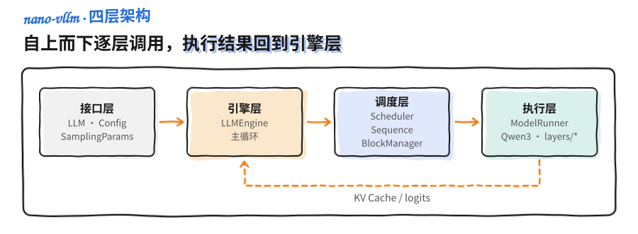
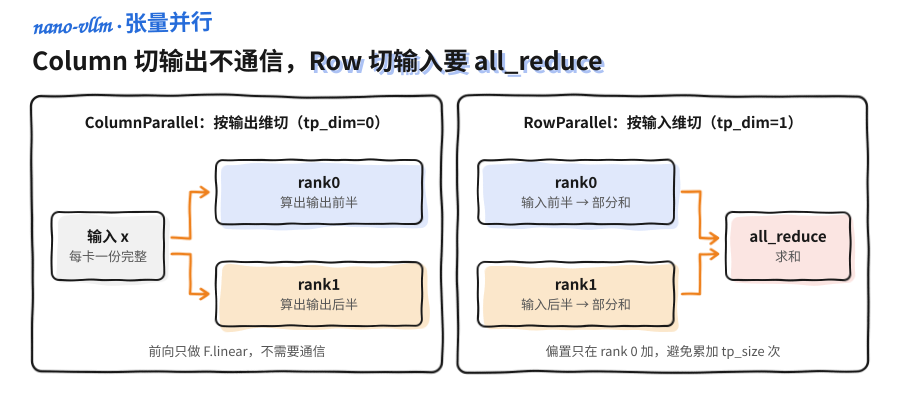
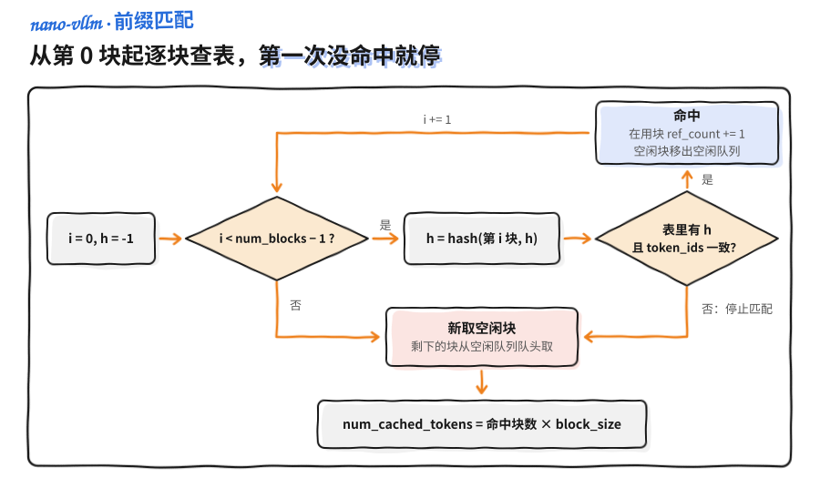
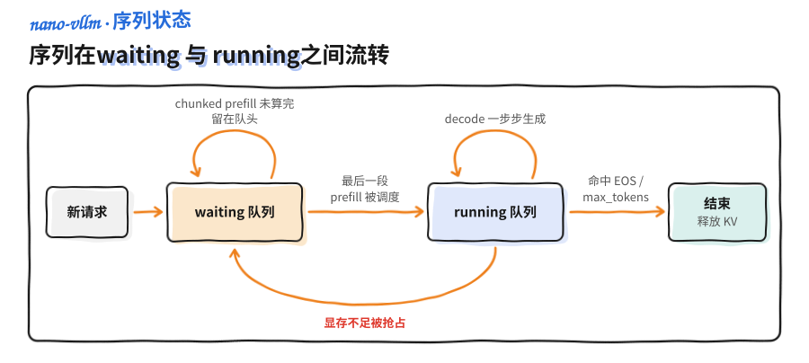
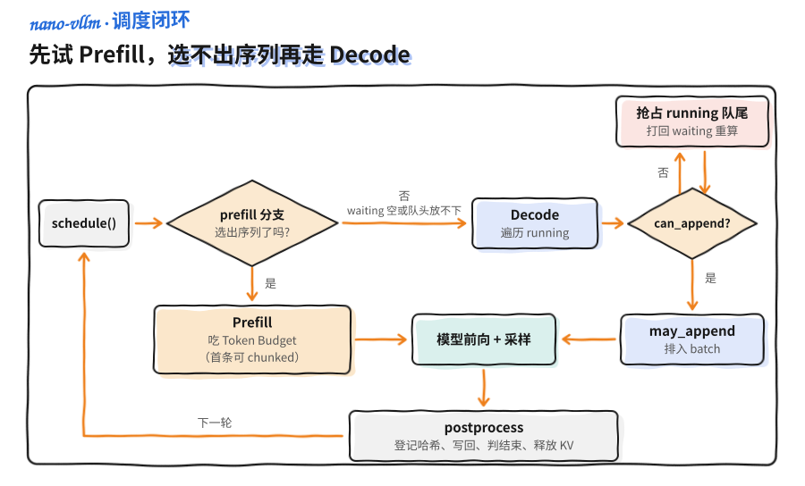
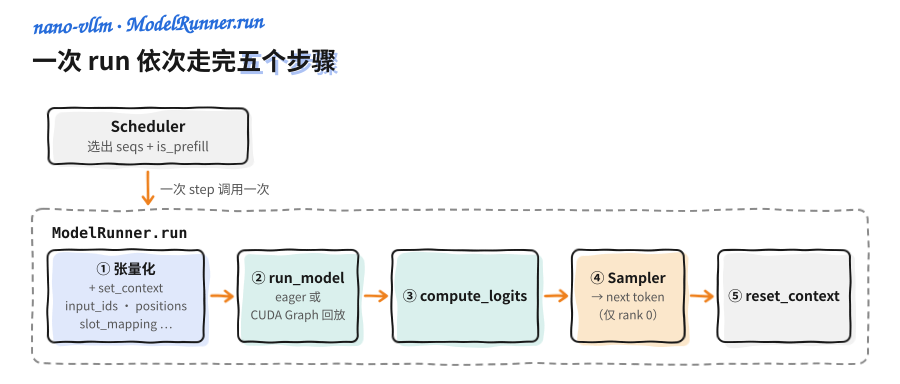
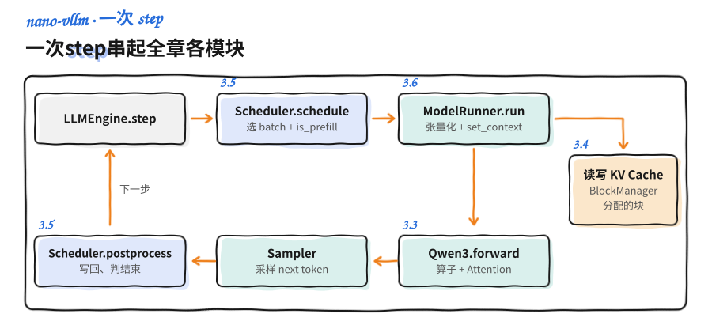

<a id="part4-ch3"></a>

# 第4部分 · 第3章：nano-vllm 源码解读

> [总索引](../README.md) ｜ [本部分目录](README.md) ｜ [上一章](ch02-推理引擎核心技术.md) ｜ [下一章](ch04-量化.md)

## 本章目录

- [本章导读](#part4-ch3)
- [3.1 项目全景与四层架构](#part4-ch3-sec1)
- [3.2 配置、入口与一次 generate 的全流程](#part4-ch3-sec2)
- [3.3 模型骨架与核心算子](#part4-ch3-sec3)
- [3.4 KV Cache 与 BlockManager](#part4-ch3-sec4)
- [3.5 Scheduler 与连续批处理](#part4-ch3-sec5)
- [3.6 ModelRunner、CUDA Graph 与性能基准](#part4-ch3-sec6)

---

## 本章导读

> 发布 2026-10-12 · 标签 "nano-vllm", "源码解读", "推理引擎", "PagedAttention", "连续批处理", "CUDA Graph" · [单篇原文](../articles/part4/第3章-nano-vllm源码解读/第3章-nano-vllm源码解读.md)

### 📖 本章简介

第 2 章把推理引擎的核心技术逐个拆开讲了：PagedAttention 怎么管显存、Continuous Batching 怎么填满 GPU、Prefix Cache 怎么复用前缀、Chunked Prefill 怎么统一调度。这些技术点在一个真实引擎里如何拼成一条流水线，是本章要回答的问题。

本章的方法是读代码。样本是 [nano-vllm](https://github.com/GeeeekExplorer/nano-vllm)，由 Xingkai Yu（GitHub ID `GeeeekExplorer`，主页标注 DeepSeek、南京大学）开源的极简 LLM 推理引擎。项目约 1200 行 Python，覆盖了配置、调度、KV 管理、模型前向和采样的完整链路，并实现了前缀缓存、张量并行、`torch.compile` 和 CUDA Graph。它和 vLLM 的关系，类似 nanoGPT 和大规模训练框架的关系：代码量小到能一次读完，同时保留了工业系统的主干。

读完本章，你应该能对着源码目录说清楚一个请求从字符串进来、到第一个 token 输出、再到整段生成结束，中间每一层代码做了什么，并能把这些实现与 vLLM 的设计对应起来。

> ⏰ **信息时效**：本章代码分析基于 nano-vllm `main` 分支 2026-04-26 的提交（`pyproject.toml` 版本 0.2.0；截至 2026-11-01 仓库约 16.2k stars，MIT 协议），示例模型为 `Qwen/Qwen3-0.6B`。源码仍在演进，关键标识符若有出入请以仓库最新版本为准。

### 📑 本章小节

- **3.1 项目全景与四层架构**：项目定位、目录结构，以及「接口层 → 引擎层 → 调度层 → 执行层」的分层设计与端到端数据流
- **3.2 配置、入口与一次 generate 的全流程**：`Config` / `SamplingParams`、`LLM` 与 `LLMEngine` 的关系、README 示例用法，以及 `generate → add_request → step → postprocess` 主循环
- **3.3 模型骨架与核心算子**：词表并行 Embedding/LMHead、RMSNorm、RoPE、SwiGLU、并行 Linear 族与张量并行权重切分、Attention 的 KV 写入与 FlashAttention 两条路径、Sampler 温度采样、Qwen3 的组装
- **3.4 KV Cache 与 BlockManager**：`Block` 结构、PagedAttention 的分块思想、基于哈希的前缀缓存、块的分配与回收，以及 `Sequence` 的生命周期
- **3.5 Scheduler 与连续批处理**：Waiting/Running 队列、Prefill/Decode 的调度决策、Token Budget、抢占与重计算
- **3.6 ModelRunner、CUDA Graph 与性能基准**：输入张量准备、全局 Context 注入、KV Cache 显存分配、CUDA Graph 的捕获与回放，以及官方性能基准与 vLLM 对比

<a id="part4-ch3-sec1"></a>

## 3.1 项目全景与四层架构

> 发布 2026-10-12 · 标签 "nano-vllm", "推理引擎", "架构设计", "源码解读" · [单篇原文](../articles/part4/第3章-nano-vllm源码解读/3.1-项目全景与四层架构.md)

### 1. 为什么值得读 nano-vllm

vLLM、SGLang 这类生产框架的代码量在十万行以上，读的时候很难指着某一行说「批处理就是在这里拼起来的」。[nano-vllm](https://github.com/GeeeekExplorer/nano-vllm) 用约 1200 行 Python 把一个推理引擎的主干实现了一遍，适合拿来对照源码学习。

打个比方，vLLM 像一座有地下管网、消防系统、电梯调度的摩天大楼，nano-vllm 则是一栋结构裸露的样板房：墙体、承重柱、水电走线都露在外面，一眼能看出房子是怎么立起来的。它不做生产环境需要的那些外围功能（大量模型适配、各种量化方案、集群编排），只保留**算法与工程主干**。

| 📊 维度 | 📝 说明 |
|---------|---------|
| 作者 | Xingkai Yu（GitHub `GeeeekExplorer`，主页标注 DeepSeek、南京大学） |
| 代码量 | README 称约 1200 行；`nanovllm/` 包实际 1385 行（含空行，按 2026-04-26 的提交统计） |
| 协议 / 热度 | MIT；截至 2026-11-01 约 16.2k stars、2.8k forks |
| 版本 | `pyproject.toml` 标注 0.2.0，依赖 `torch>=2.4`、`triton>=3.0`、`transformers>=4.51`、`flash-attn`、`xxhash` |
| 示例模型 | `Qwen/Qwen3-0.6B`，目前 `models/` 下只有 Qwen3 一个实现 |
| 优化套件 | 前缀缓存、张量并行、`torch.compile`、CUDA Graph |

它特别适合两类人：第一次系统学习推理 / Serving 的开发者，以及准备大模型推理岗、需要「能讲到源码级细节」的面试者。熟悉 nanoGPT 的读者可以这样类比：

| 🔎 项目 | 对应「完整版」 | 教学侧重点 |
|------|----------------|------------|
| nanoGPT | 大规模语言模型训练 | 训练循环、Transformer Block |
| **nano-vllm** | **vLLM 等推理引擎** | **批处理、KV 管理、调度、低延迟执行** |

会写模型的 `forward` 之后，推理引擎要解决的是另外几件事：**batch 如何动态组装、KV 如何分块存放、何时该 prefill 何时该 decode**。nano-vllm 的代码就围绕这几件事展开。

💡 **提示**：读源码前建议先过一遍第 2 章。本章不再重复 PagedAttention、Continuous Batching 这些概念本身，而是看它们在代码里怎么实现。

### 2. 目录结构速览

把仓库 clone 下来，核心代码都在 `nanovllm/` 包里，根目录另有 `example.py`（最简用法）和 `bench.py`（吞吐基准）。先建立「文件名 → 职责」的映射：

```text
nanovllm/
├── __init__.py          # 对外导出 LLM, SamplingParams
├── config.py            # Config 全局配置（dataclass）
├── llm.py               # LLM：直接继承 LLMEngine，类体只有 pass
├── sampling_params.py   # SamplingParams 采样超参
├── engine/
│   ├── llm_engine.py    # 引擎主循环：调度 → 前向 → 采样 → 更新
│   ├── scheduler.py     # Prefill/Decode 调度与抢占
│   ├── sequence.py      # 单条请求的状态机
│   ├── block_manager.py # KV Cache 的分块分配与回收
│   └── model_runner.py  # GPU 侧执行：张量准备、Context、CUDA Graph
├── layers/
│   ├── attention.py     # Triton 写 KV + FlashAttention 前向
│   ├── linear.py        # 列/行/QKV/合并 并行 Linear
│   ├── embed_head.py    # 词表并行 Embedding 与 LMHead
│   ├── layernorm.py     # RMSNorm
│   ├── activation.py    # SiluAndMul（SwiGLU）
│   ├── rotary_embedding.py  # RoPE 旋转位置编码
│   └── sampler.py       # 温度采样（指数噪声 + argmax）
├── models/
│   └── qwen3.py         # Qwen3 模型实现
└── utils/
    ├── context.py       # 全局推理上下文（is_prefill、cu_seqlens 等）
    └── loader.py        # safetensors 权重加载
```

按目录看分工：`engine/` 决定这一步算谁、怎么调度；`layers/` 和 `models/` 做矩阵运算；`utils/` 负责跨模块传递上下文和加载权重。最外层的 `__init__.py` 只导出 `LLM` 和 `SamplingParams` 两个名字，用户只需要接触这两个入口。

文件体量也能说明重点在哪里。最大的四个文件是 `model_runner.py`（257 行）、`qwen3.py`（216 行）、`linear.py`（156 行）和 `block_manager.py`（120 行），分别对应执行、模型、张量并行和 KV 管理；`llm.py` 只有 5 行。

### 3. 四层架构

把这些文件按「谁调用谁」归类，可以得到下面的四层结构。橙色实线箭头是逐层调用，虚线是执行层把 KV Cache 和 logits 交回引擎层：



**🔌 第一层：接口层（`llm.py` + `sampling_params.py` + `config.py`）**

用户只接触 `LLM`（提供 `generate`）和 `SamplingParams`（温度、最大生成长度等）。`Config` 在引擎初始化时把显存比例、最大批大小、张量并行度、KV 块大小等全局约束固定下来。这一层的对外 API 很小，不懂调度也能跑通推理。

**🧠 第二层：引擎层（`engine/llm_engine.py`）**

`LLMEngine` 持有调度器、模型执行器和分词器，跑一个循环：**从调度器拿一批序列 → 交给执行器做一次前向并采样出下一个 token → 把结果写回序列状态**，直到所有请求结束。

**🗂️ 第三层：调度层（`scheduler.py` + `sequence.py` + `block_manager.py`）**

这一层决定「这一步跑谁、它们的 KV 放哪儿」。`Scheduler` 决定本轮是 prefill 还是 decode、把哪些序列拼成一个 batch；`Sequence` 跟踪每条请求的 token、已缓存长度和状态；`BlockManager` 按 PagedAttention 的思路给 KV 分配物理块。这一层**只管资源分配与生命周期，不碰矩阵乘法**，所以 `BlockManager` 放在 `engine/` 而不是 `layers/`。

**⚙️ 第四层：执行层（`model_runner.py` + `models/qwen3.py` + `layers/*`）**

`ModelRunner` 把调度器选出的序列转成张量：构造 `input_ids`、`positions`、`slot_mapping`、`block_tables` 等，设置全局 `Context`，然后调用 `Qwen3` 前向。`layers/` 是算子级实现，其中 `attention.py` 有两项任务：把新的 K/V 写进 Cache，以及调用 FlashAttention 计算注意力。

| 模块 | 一句话职责 |
|------|------------|
| `config.py` | 全局超参，与 HuggingFace 配置对齐 |
| `llm.py` | 对外 `generate`，内部转交 `LLMEngine` |
| `llm_engine.py` | 推理主循环：调度 → 前向 → 采样 → 更新 |
| `scheduler.py` | 选序列、组 batch、Prefill/Decode 策略、抢占 |
| `sequence.py` | 单请求状态机 |
| `block_manager.py` | KV 块分配、回收与前缀缓存 |
| `model_runner.py` | GPU 侧执行、Context 注入、CUDA Graph |
| `attention.py` | Triton 写 KV + FlashAttention 两条路径 |
| `sampler.py` | 按温度从 logits 采样下一个 token |
| `qwen3.py` | Transformer 层堆叠与权重映射 |

### 4. 一个请求的生命周期

分层说的是静态结构，下面这张图说的是数据流：一个字符串从进入引擎到输出完整文本经过的路径。后面 3.2～3.6 各节分别展开这条链路上的一段。

图中菱形是主循环 `step()`，蓝色框属于调度器，绿色框在 GPU 上执行，下方六个框组成每一轮的循环体：


按步骤复述一遍（面试里常问「请求进来之后走哪条代码路径」）：

1. 📥 用户调用 `llm.generate(prompts, sampling_params)`。prompt 可以是字符串，也可以是已经编码好的 token id 列表；字符串由 `add_request` 内部的 HuggingFace 分词器编码。
2. `add_request` 为每条 prompt 创建一个 `Sequence`，放进 `Scheduler` 的 `waiting` 队列。
3. ⚙️ 主循环每执行一次 `step()`：`Scheduler` 根据 Token Budget 和 KV 余量选出本轮要跑的序列，并标记这是一次 **prefill**（处理 prompt）还是 **decode**（逐 token 生成）。
4. `ModelRunner` 把这批序列转成 GPU 张量，写好全局 `Context`，跑一遍 `Qwen3`。前向过程中 `Attention` 把新算出的 K/V 存进 KV Cache，再用 FlashAttention 算注意力。
5. 模型输出的 hidden state 过 `ParallelLMHead` 得到 logits，`Sampler` 按温度采样出下一个 token。
6. `Scheduler.postprocess` 把新 token 写回对应 `Sequence`，判断是否命中 EOS 或达到 `max_tokens`。结束的序列释放 KV 块，未结束的留到下一轮 decode。
7. 📤 所有序列结束后，`generate` 按 `seq_id` 排序还原请求顺序，解码成字符串返回。

📌 **关键点**：**Prefill 和 Decode 不混在同一个 batch 里**，这一点与 vLLM V0 的默认调度一致。prefill 一次处理整段 prompt，属于算力密集型；decode 每条序列每步只算一个 token，属于访存密集型。调度器每一轮要么全做 prefill、要么全做 decode，3.5 会展开这个策略。

### 5. 与 vLLM 的关系

面试里常被问「nano-vllm 和 vLLM 什么关系」，可以概括为**思想同源，工程裁剪**。

| 维度 | nano-vllm | vLLM |
|------|-----------|------|
| 代码量 | 约 1200 行，单仓库可通读 | 十万行量级、多模块 |
| 核心思想 | 分块 KV、连续批处理、FlashAttention、张量并行 | 同类思想 + 更完整的生产特性 |
| 功能覆盖 | Qwen3 路径 + 教学向最小闭环 | 多模型生态、量化、API Server、分布式 |
| 定位 | 学习、面试、二次实验 | 生产 Serving |

✅ **推荐表述**：nano-vllm 把 vLLM 的主干算法与工程路径压缩到「可读范围」，目的不是替代 vLLM 上生产。它继承了 PagedAttention、Continuous Batching、FlashAttention、TP 等核心机制，省略的是量化、海量模型适配、集群编排这些工程细节。

❌ **不要这样说**：「nano-vllm 比 vLLM 落后 / 简陋」。这种说法混淆了教学项目与生产系统的定位。

### 📝 总结

- nano-vllm 用约 1200 行 Python 实现了一个推理引擎的主干，适合作为读 vLLM 类系统之前的样本。
- 代码按**接口层 → 引擎层 → 调度层 → 执行层**四层组织，调用方向自上而下，KV Cache 与 logits 自下而上回流。
- 一个请求的生命周期是一条流水线：分词 → 入队 → 调度 → 张量化 → 前向（写 KV + 注意力）→ 采样 → 写回 → 解码。
- Prefill 与 Decode 分批调度，是后续理解调度器的关键前提。

### 🎯 自我检验清单

- 能说出 nano-vllm 的作者、代码量级与定位，并用一句话讲清它与 vLLM 的关系
- 能默写 `nanovllm/` 的目录结构，并说明 `engine/`、`layers/`、`utils/` 各自的职责
- 能画出接口层 / 引擎层 / 调度层 / 执行层的四层调用关系
- 能用一段话复述一个请求从字符串到输出文本的完整数据流
- 能解释为什么 `BlockManager` 属于调度层而不是 `layers/`
- 能说明 Prefill 与 Decode 为什么分开调度，以及它们各自的资源瓶颈

### 📚 参考资料

- [nano-vllm GitHub 仓库](https://github.com/GeeeekExplorer/nano-vllm)
- [nanoGPT GitHub 仓库](https://github.com/karpathy/nanoGPT)
- [Efficient Memory Management for Large Language Model Serving with PagedAttention（Kwon et al., 2023）](https://arxiv.org/abs/2309.06180)
- [vLLM 官方文档 - 架构概览](https://docs.vllm.ai/en/stable/design/arch_overview.html)

---

<a id="part4-ch3-sec2"></a>

## 3.2 配置、入口与一次 generate 的全流程

> 发布 2026-10-12 · 标签 "nano-vllm", "LLMEngine", "推理循环", "源码解读" · [单篇原文](../articles/part4/第3章-nano-vllm源码解读/3.2-配置入口与推理主循环.md)

### 1. 从一段示例代码进入

读引擎先看它怎么被调用。README 的 Quick Start 和根目录的 `example.py` 用到的对外 API 只有三样：`LLM`、`SamplingParams` 和 `generate`。下面按 `example.py` 的写法整理了一段最简用法：

```python
import os
from transformers import AutoTokenizer
from nanovllm import LLM, SamplingParams

path = os.path.expanduser("~/huggingface/Qwen3-0.6B/")   # 本地模型目录

# 1) 构造引擎：本地路径 + 全局开关
llm = LLM(path, enforce_eager=True, tensor_parallel_size=1)

# 2) 定义采样策略
sampling_params = SamplingParams(temperature=0.6, max_tokens=256)

# 3) Chat 模型先套对话模板，再交给引擎
tokenizer = AutoTokenizer.from_pretrained(path)
questions = ["用一句话介绍 PagedAttention", "100 以内有哪些质数"]
prompts = [
    tokenizer.apply_chat_template([{"role": "user", "content": q}],
                                  tokenize=False, add_generation_prompt=True)
    for q in questions
]

# 4) 批量生成：每个元素是 {"text": ..., "token_ids": ...}
outputs = llm.generate(prompts, sampling_params)
print(outputs[0]["text"])
```

这段代码里有三个细节：

- 构造 `LLM` 时第一个参数是**本地目录路径**，不是 HuggingFace 仓库名。`Config` 会断言 `os.path.isdir(model)`，权重由 `safetensors` 从本地加载，nano-vllm 不负责下载。
- `generate` 返回 **dict 列表**（含 `"text"` 和 `"token_ids"`），vLLM 返回的是 `RequestOutput` 对象。README 把这称为与 vLLM 接口的「minor differences」。
- 对话模板由调用方处理。`example.py` 用 `apply_chat_template(..., tokenize=False, add_generation_prompt=True)` 先把问题包成对话格式的字符串；引擎内部只做 `encode`，不会自动套模板。

⚠️ **注意**：README 的 Quick Start 直接把 `"Hello, Nano-vLLM."` 这样的裸文本传给 `generate`，用来演示 API 可以，但 Qwen3 是对话模型，不套模板时输出质量会明显变差。实际使用按 `example.py` 的写法。

下面按这四步依次看 `Config` 和 `SamplingParams` 的字段、`LLM` 构造时做的事，以及 `generate` 内部的循环。

### 2. Config：全局配置

`config.py` 里的 `Config` 是一个 `@dataclass(slots=True)`，把引擎运行需要的全局约束集中在一处。字段与默认值如下：

```python
@dataclass(slots=True)
class Config:
    model: str                              # 本地模型目录（必填）
    max_num_batched_tokens: int = 16384     # 单步最多处理的 token 总数（Token Budget）
    max_num_seqs: int = 512                 # 单步最多并发的序列数
    max_model_len: int = 4096               # 支持的最大上下文长度
    gpu_memory_utilization: float = 0.9     # 允许占用的显存比例
    tensor_parallel_size: int = 1           # 张量并行 GPU 数
    enforce_eager: bool = False             # True 则禁用 CUDA Graph
    hf_config: AutoConfig | None = None     # 在 __post_init__ 里加载的 HF 配置
    eos: int = -1                           # EOS token id（初始化后由 tokenizer 填入）
    kvcache_block_size: int = 256           # 每个 KV 块容纳的 token 数
    num_kvcache_blocks: int = -1            # KV 块总数（运行时按显存推算）
```

构造后 `__post_init__` 做三条断言，加载 HF 配置，并把上下文长度截到模型支持的上限：

```python
def __post_init__(self):
    assert os.path.isdir(self.model)                 # 必须是存在的本地目录
    assert self.kvcache_block_size % 256 == 0        # 块大小需 256 的整数倍
    assert 1 <= self.tensor_parallel_size <= 8       # TP 度在 1~8 之间
    self.hf_config = AutoConfig.from_pretrained(self.model)
    self.max_model_len = min(self.max_model_len,
                             self.hf_config.max_position_embeddings)
```

几个值得注意的字段：

- 🔑 **`kvcache_block_size = 256`**：每个 KV 块装多少个 token。块越大，块表（Block Table）越短、管理开销越小，但最后一块没填满造成的内部碎片也越大。`% 256 == 0` 这条断言来自底层算子的要求：flash-attn 的 `flash_attn_with_kvcache` 文档写明，传入 `block_table`（分页 KV）时 `page_block_size` 必须是 256 的倍数。nano-vllm 的 decode 路径和前缀命中的 prefill 路径都通过 `block_table` 读分页 KV，所以块大小只能取 256、512 这类值，256 是允许的最小值，不是在碎片和开销之间挑出来的折中。

> ⏰ **信息时效**：`256` 是 nano-vllm 当前默认值。vLLM 使用自己的 PagedAttention 内核，常见默认 `block_size=16`，两者的默认值不要混为一谈。

- 🔑 **`max_num_batched_tokens` 与 `max_num_seqs`**：前者限制一步最多算多少 token（主要约束 prefill），后者限制一步最多有多少条序列（主要约束 decode）。两者共同构成调度器的 **Token Budget**，3.5 会详细讲。
- 🔑 **`gpu_memory_utilization = 0.9`**：引擎不按最大长度给每条请求预留 KV，而是先加载权重、用一次最大规模的 prefill 测出激活峰值，再把剩余配额全部切成 KV 块。`num_kvcache_blocks` 因此初始为 `-1`，运行时才算出来，公式见 3.6。
- **`tensor_parallel_size ≤ 8`**：这是单机 8 卡的上限。实际可用的 TP 度还受模型约束，Qwen3 的实现要求注意力头数和 KV 头数都能被 TP 度整除，见 3.3。

### 3. SamplingParams：采样超参

相比 vLLM 几十个采样参数，nano-vllm 的 `SamplingParams` 只有三个字段：

```python
@dataclass(slots=True)
class SamplingParams:
    temperature: float = 1.0
    max_tokens: int = 64
    ignore_eos: bool = False

    def __post_init__(self):
        assert self.temperature > 1e-10, "greedy sampling is not permitted"
```

- **`temperature`**：温度，控制采样随机性。
- **`max_tokens`**：最多生成多少个 token，默认 `64`（示例里显式设成了 `256`）。它既是停止条件，也用于 benchmark 时固定生成量。
- **`ignore_eos`**：是否忽略 EOS 继续生成。`bench.py` 把它设为 `True`，保证每条序列都生成满 `max_tokens`，吞吐数据才可比。

📌 **关键点**：`__post_init__` 断言温度必须大于 `1e-10`，也就是说 **nano-vllm 不支持贪心采样**（temperature=0）。它的 `Sampler` 只有一条随机采样路径：logits 除以温度后做 softmax，再用指数噪声取 argmax（见 3.3）。温度为 0 时除法会出错，作者没有为这种情况单独写 argmax 分支，而是在入口处挡掉。想要接近确定性的输出，可以把温度设成一个很小的正数。

### 4. LLM 与 LLMEngine：构造时做了什么

`llm.py` 只有 5 行，`LLM` 直接继承 `LLMEngine`，类体是 `pass`，`generate` 等方法全部来自父类。所有初始化工作都在 `LLMEngine.__init__` 里，分四步：

```python
class LLMEngine:
    def __init__(self, model, **kwargs):
        # 1) 从 kwargs 里挑出 Config 认识的字段，构造全局配置
        config_fields = {f.name for f in fields(Config)}
        config = Config(model, **{k: v for k, v in kwargs.items()
                                   if k in config_fields})
        # 把块大小同步给 Sequence（它用类变量记 block_size）
        Sequence.block_size = config.kvcache_block_size

        # 2) 张量并行：用 spawn 启动 rank>0 的 worker 子进程
        ctx = mp.get_context("spawn")
        self.ps, self.events = [], []
        for rank in range(1, config.tensor_parallel_size):
            event = ctx.Event()
            p = ctx.Process(target=ModelRunner, args=(config, rank, event))
            p.start()
            self.ps.append(p); self.events.append(event)
        # rank 0 的 ModelRunner 跑在主进程
        self.model_runner = ModelRunner(config, 0, self.events)

        # 3) 分词器只在主进程持有，并把 EOS 回填到 config
        self.tokenizer = AutoTokenizer.from_pretrained(config.model, use_fast=True)
        config.eos = self.tokenizer.eos_token_id

        # 4) 调度器 + 退出清理
        self.scheduler = Scheduler(config)
        atexit.register(self.exit)
```

这里有几处工程细节：

- 🔑 **为什么用 `spawn` 而不是 Linux 默认的 `fork`**：CUDA 运行时不支持在 `fork` 出的子进程里重新初始化。父进程一旦初始化过 CUDA，`fork` 出的子进程再用 GPU 就会报错。`spawn` 启动的是全新的解释器进程，每个 rank 各自初始化自己的 GPU。
- 🔑 **主从进程靠共享内存 + `Event` 通信**：`rank>0` 的 `ModelRunner` 在子进程的 `__init__` 末尾进入循环，等待任务。主进程把方法名和参数 pickle 后写进共享内存，再 `set` 每个 worker 的 `Event` 通知它读取。细节见 3.6。
- **分词器只在主进程**：编码和解码都是 CPU 任务，TP worker 只需要 token id，不需要各自加载一份分词器。
- **`atexit` 清理**：退出时通过同一套 RPC 给子进程发 `"exit"`，再 `join` 回收，避免残留进程。

💡 **提示**：`Sequence.block_size = config.kvcache_block_size` 这一行容易被忽略。`Sequence` 用**类变量**记录块大小，所有序列共享同一个值，`num_blocks`、`last_block_num_tokens` 等属性都靠它计算。

### 5. 主循环：add_request → step → postprocess

`generate` 的骨架如下（去掉了 tqdm 进度条与吞吐统计）：

```python
def generate(self, prompts, sampling_params, use_tqdm=True):
    # 单个 SamplingParams 复制给每条 prompt；也可以传一个等长列表
    if not isinstance(sampling_params, list):
        sampling_params = [sampling_params] * len(prompts)
    for prompt, sp in zip(prompts, sampling_params):
        self.add_request(prompt, sp)

    outputs = {}
    while not self.is_finished():
        finished, num_tokens = self.step()   # 跑一步，拿回本步完成的序列
        for seq_id, token_ids in finished:
            outputs[seq_id] = token_ids

    # 序列完成的先后顺序和提交顺序不同，按 seq_id 排序还原
    outputs = [outputs[i] for i in sorted(outputs)]
    return [{"text": self.tokenizer.decode(ids), "token_ids": ids}
            for ids in outputs]
```

`seq_id` 由 `Sequence` 的类级计数器递增分配，所以按 `seq_id` 排序就等于按提交顺序排序。短 prompt 往往先结束，没有这一步排序，返回顺序会和输入对不上。

两个关键方法：

**`add_request`**：把一条 prompt 变成一个 `Sequence` 放进调度器。prompt 可以是字符串（内部先 `encode`）也可以是现成的 token id 列表：

```python
def add_request(self, prompt, sampling_params):
    if isinstance(prompt, str):
        prompt = self.tokenizer.encode(prompt)
    self.scheduler.add(Sequence(prompt, sampling_params))
```

**`step`**：一次完整的「调度 → 前向 → 写回」：

```python
def step(self):
    seqs, is_prefill = self.scheduler.schedule()                  # 选 batch
    # 必须在 postprocess 之前统计：postprocess 会把 num_scheduled_tokens 清零
    num_tokens = sum(seq.num_scheduled_tokens for seq in seqs) if is_prefill else -len(seqs)
    token_ids = self.model_runner.call("run", seqs, is_prefill)  # 跑模型 + 采样
    self.scheduler.postprocess(seqs, token_ids, is_prefill)      # 写回、判断结束
    outputs = [(seq.seq_id, seq.completion_token_ids)
               for seq in seqs if seq.is_finished]
    return outputs, num_tokens
```

📌 **关键点**：`num_tokens` 用**正负号**区分阶段。prefill 时返回正数，即这一步实际计算的 token 总量（开启 chunked prefill 后可能只是 prompt 的一部分）；decode 时返回负的 batch 大小 `-len(seqs)`。`generate` 根据符号分别计算 Prefill 和 Decode 吞吐（tok/s）显示在进度条上。这一行的位置不能挪到 `postprocess` 之后，否则 `num_scheduled_tokens` 已经被清零，prefill 吞吐会一直显示为 0。

循环里的分工是：**`model_runner.call("run", ...)` 负责怎么算，`scheduler` 负责算谁、算完怎么办**。`call` 在 TP=1 时就是普通的方法调用，TP>1 时还会把同一个调用广播给其他 rank。后面三节分别展开执行层（3.3）、KV 管理（3.4）和调度层（3.5），3.6 再回到 `ModelRunner` 把它们串起来。

### 📝 总结

- README 和 `example.py` 用到的对外 API 只有 `LLM`、`SamplingParams`、`generate`，返回含 `"text"` 和 `"token_ids"` 的 dict 列表；对话模板由调用方自己套。
- `Config` 是 `@dataclass(slots=True)`，集中管理显存比例、Token Budget、TP 度、KV 块大小。`kvcache_block_size % 256 == 0` 来自 flash-attn 分页 KV 的要求。
- `SamplingParams` 只有三个字段，且断言温度 > `1e-10`，不支持贪心采样。
- `LLM` 是 `LLMEngine` 的空子类。`LLMEngine.__init__` 用 `spawn` 启动 TP worker、只在主进程持有分词器、注册 `atexit` 清理。
- 主循环是 `generate → add_request → step → postprocess`。`step` 在 `postprocess` 之前统计 `num_tokens`，用正负号区分 prefill 和 decode；`generate` 最后按 `seq_id` 还原提交顺序。

### 🎯 自我检验清单

- 能用 `LLM` 和 `SamplingParams` 写出一段带对话模板的最简推理代码，并取出 `outputs[0]["text"]`
- 能说出 `Config` 的 `max_num_batched_tokens`、`max_num_seqs`、`gpu_memory_utilization`、`kvcache_block_size` 各自约束什么
- 能解释 `kvcache_block_size` 为什么必须是 256 的倍数
- 能解释 nano-vllm 为什么不支持贪心采样
- 能说清 `LLMEngine` 为什么用 `spawn` 而非 `fork` 启动张量并行进程
- 能复述 `step()` 的执行顺序，并解释 `num_tokens` 为什么必须在 `postprocess` 之前计算
- 能说明 `generate` 为什么要按 `seq_id` 排序后再返回

### 📚 参考资料

- [nano-vllm GitHub 仓库](https://github.com/GeeeekExplorer/nano-vllm)
- [FlashAttention 接口文档（flash_attn_interface.py）](https://github.com/Dao-AILab/flash-attention/blob/main/flash_attn/flash_attn_interface.py)
- [Python multiprocessing — Contexts and start methods](https://docs.python.org/3/library/multiprocessing.html#contexts-and-start-methods)
- [PyTorch - Multiprocessing best practices（CUDA in multiprocessing）](https://pytorch.org/docs/stable/notes/multiprocessing.html)
- [HuggingFace Transformers - Chat templates](https://huggingface.co/docs/transformers/main/en/chat_templating)

---

<a id="part4-ch3-sec3"></a>

## 3.3 模型骨架与核心算子

> 发布 2026-10-12 · 标签 "nano-vllm", "Qwen3", "张量并行", "FlashAttention", "RoPE", "源码解读" · [单篇原文](../articles/part4/第3章-nano-vllm源码解读/3.3-模型与核心算子.md)

### 1. 从 Qwen3 的一层说起

执行层最终要跑的是 `models/qwen3.py` 里的 Transformer。先看一个 `Qwen3DecoderLayer` 的结构，它决定了各个算子的调用顺序。

Qwen3 用的是 **Pre-Norm + 残差**结构：归一化放在子层之前，残差直接跨过子层。nano-vllm 把残差相加放进了 norm 内部：

```python
class Qwen3DecoderLayer(nn.Module):
    def forward(self, positions, hidden_states, residual):
        if residual is None:                       # 第一层：残差从输入初始化
            hidden_states, residual = self.input_layernorm(hidden_states), hidden_states
        else:                                       # 后续层：norm 同时吐出新残差
            hidden_states, residual = self.input_layernorm(hidden_states, residual)
        hidden_states = self.self_attn(positions, hidden_states)
        hidden_states, residual = self.post_attention_layernorm(hidden_states, residual)
        hidden_states = self.mlp(hidden_states)
        return hidden_states, residual
```

每一层做两件事：**先归一化 + 注意力，再归一化 + MLP**。残差 `residual` 从第一层一路传到最后一层。`RMSNorm` 可以接收上一层的残差，先把它加进来再归一化，同时返回相加后的新残差，所以 `DecoderLayer` 里不用反复写 `x = x + sublayer(norm(x))`。下面把这一层用到的算子逐个展开。

### 2. RMSNorm：更省的归一化

LLM 普遍用 RMSNorm 替代 LayerNorm。它去掉了减均值和偏置，只按均方根缩放，计算更少，效果相当：

$$
\text{RMSNorm}(x) = \frac{x}{\sqrt{\frac{1}{d}\sum_{i=1}^{d} x_i^2 + \epsilon}} \cdot \gamma
$$

nano-vllm 的 `RMSNorm` 有两个入口，都带 `@torch.compile`。普通归一化：

```python
@torch.compile
def rms_forward(self, x):
    orig_dtype = x.dtype
    x = x.float()                                  # 升到 fp32 求方差
    var = x.pow(2).mean(dim=-1, keepdim=True)
    x.mul_(torch.rsqrt(var + self.eps))
    return x.to(orig_dtype).mul_(self.weight)      # 先转回原精度，再乘 γ
```

带残差相加的版本，先在 fp32 里把残差加进来，相加结果转回原精度作为**新残差**，再对和做归一化：

```python
@torch.compile
def add_rms_forward(self, x, residual):
    orig_dtype = x.dtype
    x = x.float().add_(residual.float())           # 残差相加
    residual = x.to(orig_dtype)                    # 新残差 = 相加后的值
    var = x.pow(2).mean(dim=-1, keepdim=True)
    x.mul_(torch.rsqrt(var + self.eps))
    return x.to(orig_dtype).mul_(self.weight), residual
```

💡 **提示**：上一节 `hidden_states, residual = self.input_layernorm(hidden_states, residual)` 调用的就是这个版本。残差相加和归一化写在同一个 `torch.compile` 函数里，编译器可以把它们融合成更少的 kernel。求方差在 fp32 里做，是为了避免 bf16 下平方求和损失精度。

### 3. RoPE：旋转位置编码

RoPE（Rotary Position Embedding）不往输入里加位置向量，而是**按位置把 Q、K 的每一对维度旋转一个角度**，这样 Q 和 K 的点积只和两者的相对位置有关。频率表在初始化时预计算，cos 和 sin 拼成一个 buffer：

```python
inv_freq = 1.0 / (base ** (torch.arange(0, rotary_dim, 2).float() / rotary_dim))
t = torch.arange(max_position_embeddings).float()
freqs = torch.einsum("i,j->ij", t, inv_freq)            # [位置, rotary_dim/2]
cache = torch.cat((freqs.cos(), freqs.sin()), dim=-1)   # [位置, rotary_dim]
self.register_buffer("cos_sin_cache", cache.unsqueeze_(1), persistent=False)  # 中间补一维对齐头维
```

前向时把最后一维**按前后两半**拆成 $(x_1, x_2)$，第 $i$ 维和第 $i + d/2$ 维组成一对，做二维旋转：

$$
\begin{aligned}
y_1 &= x_1 \cos\theta - x_2 \sin\theta \\
y_2 &= x_2 \cos\theta + x_1 \sin\theta
\end{aligned}
$$

```python
@torch.compile
def forward(self, positions, query, key):
    cos, sin = self.cos_sin_cache[positions].chunk(2, dim=-1)  # 按位置查表
    query = apply_rotary_emb(query, cos, sin)    # 内部 chunk 成两半、按上式旋转
    key = apply_rotary_emb(key, cos, sin)
    return query, key
```

需要注意的几点：

- 🔑 RoPE 只作用于 **Q 和 K**，不碰 V。位置信息只需要体现在注意力分数上，V 是被加权求和的内容。
- 🔑 `forward` 带了 `@torch.compile`。RoPE 是逐元素的小算子，编译后可以融合成少量 kernel，减少显存读写。nano-vllm 在 RMSNorm、RoPE、SiluAndMul 和 Sampler 这几个逐元素算子上都用了 `torch.compile`。
- `get_rope` 带 `@lru_cache(1)`，参数相同时返回同一个对象，所以 28 层共享一份 `cos_sin_cache`，不会每层各存一张表。
- 即使配置里有 `rope_scaling`，代码也只从中读取 `rope_theta`，没有实现 NTK / YaRN 等长度外推逻辑。

### 4. SwiGLU：SiluAndMul

Qwen3 的 FFN 用的是 SwiGLU 激活。它把输入投影成两份：一份当「门控」过 SiLU，一份当「数据」，两份再逐元素相乘：

$$
\text{SwiGLU}(x) = \text{SiLU}(x W_{\text{gate}}) \odot (x W_{\text{up}})
$$

nano-vllm 把它拆成两部分：投影由一个 `MergedColumnParallelLinear` 一次算出 `gate` 和 `up` 两段（输出维是中间维的 2 倍），激活是一个很短的 `SiluAndMul`：

```python
class SiluAndMul(nn.Module):
    @torch.compile
    def forward(self, x):
        gate, up = x.chunk(2, dim=-1)      # 前一半是 gate，后一半是 up
        return F.silu(gate) * up
```

💡 **提示**：gate 和 up 合并成一个 Linear 再切，是因为一次大矩阵乘比两次小矩阵乘更能用满 GPU：输入 `x` 只读一次，kernel 启动次数也减半。QKV 合并成 `qkv_proj` 是同样的考虑。

### 5. 并行 Linear 族与张量并行

张量并行（Tensor Parallelism, TP）把一个大矩阵乘切到多张卡上并行算。nano-vllm 的 `linear.py` 把这套机制封装成一组 Linear 子类，模型代码选对类型就具备 TP 能力。关键是分清**沿哪个维度切**。下图以 TP=2 为例，蓝色和黄色分别是 rank0 和 rank1 负责的分片，红色是唯一需要通信的 all_reduce：



- **`ColumnParallelLinear`（`tp_dim=0`）**：按**输出维**切分，每张卡算出一部分输出列。权重加载时用 `narrow` 沿 dim 0 取本 rank 的分片；前向是普通 `F.linear`，**不需要通信**。
- **`RowParallelLinear`（`tp_dim=1`）**：按**输入维**切分，每张卡拿输入的一部分、算出部分和。所以 TP>1 时前向末尾要 `dist.all_reduce(y)` 把各卡结果加起来；偏置只在 rank 0 加，避免被累加 tp_size 次。
- **`QKVParallelLinear`（ColumnParallel 的子类）**：把 Q、K、V 三个投影合并成一个大矩阵，输出维是 `(num_heads + 2 * num_kv_heads) * head_dim`。它的权重加载按**字符串** `shard_id`（`"q"`/`"k"`/`"v"`）定位各段的偏移。
- **`MergedColumnParallelLinear`（ColumnParallel 的子类）**：把 gate、up 合并（上一节的 SwiGLU 用它），权重加载按**整数** `shard_id`（0=gate、1=up）索引 `output_sizes`。

把它们按 Transformer 的数据流排开，Column 和 Row 正好成对出现：

| 位置 | 用什么 | 为什么 |
|------|--------|--------|
| QKV 投影 | `QKVParallelLinear`（Column） | 按头切分，每卡算自己负责的那些注意力头 |
| Attention 输出投影 `o_proj` | `RowParallelLinear` | 把各卡的头拼回来，需要 all_reduce |
| FFN 第一层 `gate_up` | `MergedColumnParallelLinear`（Column） | 按中间维切 |
| FFN 第二层 `down` | `RowParallelLinear` | 收回中间维，需要 all_reduce |

📌 **关键点**：**Column 切输出、Row 收输入**，一前一后配对，中间的激活在卡内保持切分状态、不必通信，只在每个子层的末尾做一次 all_reduce。所以每个 Transformer 层恰好有 **2 次 all_reduce**（Attention 的 `o_proj` 一次、FFN 的 `down_proj` 一次）。这是 Megatron-LM 提出的 TP 切分方式，nano-vllm 的 `linear.py` 用 156 行实现了它。

⚠️ **注意**：QKV 按头切分，所以 `Qwen3Attention` 断言注意力头数和 KV 头数都能被 tp_size 整除。Qwen3-0.6B 有 16 个 Q 头、8 个 KV 头，TP 度只能取 1、2、4、8。在 nano-vllm 里，KV 头数就是 GQA 模型 TP 度的上限（vLLM 会在 TP 度超过 KV 头数时复制 KV 头，nano-vllm 没有实现）。

### 6. 词表并行 Embedding 与 LMHead

Qwen3 的词表约 15 万行，Embedding 和 LMHead 的权重都很大，也要切。nano-vllm 把它们做成**词表并行**：每张卡只持有词表的一段。

`VocabParallelEmbedding` 的 forward 要处理「某个 token 不属于本卡」的情况：

```python
def forward(self, x):
    if self.tp_size > 1:
        mask = (x >= self.vocab_start_idx) & (x < self.vocab_end_idx)  # 本卡负责的 token
        x = mask * (x - self.vocab_start_idx)   # 平移到本地下标，越界的先置 0
    y = F.embedding(x, self.weight)
    if self.tp_size > 1:
        y = mask.unsqueeze(1) * y               # 不属于本卡的行清零
        dist.all_reduce(y)                      # 求和：每个 token 的向量只有一卡非零
    return y
```

每张卡都查一次表，但只有负责该 token 的卡查出非零向量，其余卡输出 0，`all_reduce` 求和后就是完整结果。TP=1 时两段 `if` 都跳过，退化成普通的 `F.embedding`。

`ParallelLMHead` 是它的子类，负责把 hidden state 投影成词表 logits。两个细节：

```python
def forward(self, x):
    context = get_context()
    if context.is_prefill:
        last_indices = context.cu_seqlens_q[1:] - 1   # 每条序列最后一个位置
        x = x[last_indices].contiguous()               # 只取最后一个 token
    logits = F.linear(x, self.weight)
    if self.tp_size > 1:
        # 各卡算出词表的一段，gather 到 rank0 再拼接成完整 logits
        all_logits = [...] if self.tp_rank == 0 else None
        dist.gather(logits, all_logits, 0)
        logits = torch.cat(all_logits, -1) if self.tp_rank == 0 else None
    return logits
```

- 🔑 **prefill 只取最后一个 token**：生成下一个 token 只需要序列最后一个位置的 logits。`cu_seqlens_q[1:] - 1` 定位每条序列在拼接张量里的末位，避免把整段 prompt 都投影到词表维度。一条 1000 token 的 prompt，LMHead 只需投影 1 行，而不是 1000 行。
- 🔑 **LMHead 用 `gather` 而非 `all_reduce`**：词表按**输出维**切（每卡算不同的 logits 列），要的是拼接而不是求和，所以用 `dist.gather` 收到 rank 0 再 `cat`，其他 rank 返回 `None`。Embedding 查表等价于 one-hot 向量乘权重矩阵，词表是这次乘法的输入维，所以用 `all_reduce`。**切输入维就 reduce，切输出维就 gather**，和第 5 节的 Column/Row 规律一致。

### 7. Attention：写 KV 与两条路径

`attention.py` 做两件事：**先把新算出的 K/V 写进 KV Cache，再做注意力计算**。注意力计算在 prefill 和 decode 两个阶段调用的是**不同的 FlashAttention 接口**。

#### 7.1 用 Triton 把 K/V 写进 Cache

每个 token 的 K/V 要存到 KV Cache 里对应的槽位（slot）。slot 编号由上层算好的 `slot_mapping` 给出（见 3.6），这里只按编号写入。nano-vllm 用一个很短的 Triton kernel 完成：

```python
@triton.jit
def store_kvcache_kernel(key_ptr, key_stride, value_ptr, value_stride,
                         k_cache_ptr, v_cache_ptr, slot_mapping_ptr, D: tl.constexpr):
    idx = tl.program_id(0)                 # 每个 program 处理一个 token
    slot = tl.load(slot_mapping_ptr + idx)
    if slot == -1:                         # -1 表示这个 token 不需要写（padding）
        return
    # 用传入的 stride 定位第 idx 个 token 的 D 个元素，写到 cache 的 slot 行
    key = tl.load(key_ptr + idx * key_stride + tl.arange(0, D))
    value = tl.load(value_ptr + idx * value_stride + tl.arange(0, D))
    cache_offsets = slot * D + tl.arange(0, D)
    tl.store(k_cache_ptr + cache_offsets, key)
    tl.store(v_cache_ptr + cache_offsets, value)
```

包装函数 `store_kvcache` 从 `key.shape` 取出 `(N, num_heads, head_dim)`，令 `D = num_heads * head_dim`。传进来的 `key` 是 KV 头的张量，所以这里的 `num_heads` 实际是本 rank 的 KV 头数，`D` 就是一个 token 在一层里的 K（或 V）向量长度。`key_stride`/`value_stride` 由外层用 `key.stride(0)` 传入；包装函数还断言 `key.stride(-1) == 1`、`key.stride(1) == head_dim`、`k_cache.stride(1) == D`，确保每个 token 的 D 个元素在内存里连续，kernel 才能一次读写一整段。

💡 **提示**：用 PyTorch 写同样的逻辑，大致是 `k_cache.view(-1, D)[slot_mapping] = key.view(N, D)`。问题出在 `slot == -1` 的位置：CUDA Graph 回放时 decode batch 会补齐到固定大小，补出来的 token 的 slot 是 -1（3.6 会讲），这些位置不能写。PyTorch 里要先用掩码筛掉它们，筛选结果的长度随数据变化，不适合放进 CUDA Graph。Triton kernel 每个 program 处理一个 token，遇到 -1 直接返回，张量形状始终固定，可以被 Graph 捕获。

#### 7.2 两条路径：prefill 用 varlen，decode 用 with_kvcache

`Attention.forward` 先调用 `store_kvcache` 写缓存，然后按 `context.is_prefill` 分流：

```python
def forward(self, q, k, v):
    context = get_context()
    k_cache, v_cache = self.k_cache, self.v_cache
    if k_cache.numel() and v_cache.numel():    # cache 已分配才写
        store_kvcache(k, v, k_cache, v_cache, context.slot_mapping)
    if context.is_prefill:
        if context.block_tables is not None:   # 有历史 KV：改从整块 cache 读
            k, v = k_cache, v_cache
        o = flash_attn_varlen_func(
            q, k, v,
            cu_seqlens_q=context.cu_seqlens_q, cu_seqlens_k=context.cu_seqlens_k,
            max_seqlen_q=context.max_seqlen_q, max_seqlen_k=context.max_seqlen_k,
            softmax_scale=self.scale, causal=True,
            block_table=context.block_tables)
    else:                                       # decode
        o = flash_attn_with_kvcache(
            q.unsqueeze(1), k_cache, v_cache,
            cache_seqlens=context.context_lens, block_table=context.block_tables,
            softmax_scale=self.scale, causal=True)
    return o
```

两条路径分别对应两个阶段的特点：

- 🔑 **prefill 用 `flash_attn_varlen_func`**：一次要算整段 prompt 的注意力，多条序列**变长**地拼在一起，靠 `cu_seqlens_q`/`cu_seqlens_k` 两组累积长度切分；`causal=True` 保证每个位置只看前文。如果本步的部分 K/V 已经在 Cache 里，`ModelRunner` 会传入 `block_tables`，这时 `k, v` 换成整块 `k_cache`/`v_cache`，kernel 按 `block_table` 去物理块里读完整的历史 K/V。有两种情况会触发：命中了前缀缓存，或者 chunked prefill 的后续块（前面的块上一步已经写进 Cache）。两种情况下 Q 都比 K 短，判断条件统一是 `cu_seqlens_k[-1] > cu_seqlens_q[-1]`。
- 🔑 **decode 用 `flash_attn_with_kvcache`**：每条序列只新增一个 token（`q.unsqueeze(1)` 补出长度维 1），K/V 全部来自 Cache，`cache_seqlens` 告诉 kernel 每条序列当前多长，`block_table` 告诉它去哪些物理块里读。
- 缩放因子 `scale = head_dim ** -0.5`，即标准的 $1/\sqrt{d_k}$。

📌 **关键点**：「Prefill 算力密集、Decode 访存密集」在代码里体现为两个阶段调用不同的 FlashAttention 接口。KV Cache 的物理块怎么分、slot 怎么算留到 3.4 和 3.6，这里只需记住 Attention 既负责写 Cache，也负责读 Cache。

### 8. Qwen3 的组装

有了上面这些算子，`models/qwen3.py` 按 Qwen3 的结构把它们拼起来。和 LLaMA 式实现相比，有两处不同。

**① QKV 投影后对 Q、K 做 per-head RMSNorm**。Qwen3 在每个注意力头的 Q、K 上各加了一个 RMSNorm（即 QK-Norm），用来稳定训练：

```python
def forward(self, positions, hidden_states):
    qkv = self.qkv_proj(hidden_states)
    q, k, v = qkv.split([self.q_size, self.kv_size, self.kv_size], dim=-1)
    q = q.view(-1, self.num_heads, self.head_dim)     # reshape 成 [token, 头, head_dim]
    k = k.view(-1, self.num_kv_heads, self.head_dim)
    v = v.view(-1, self.num_kv_heads, self.head_dim)
    if not self.qkv_bias:                             # Qwen3 走这条分支
        q = self.q_norm(q)                            # 在 head_dim 维上逐头归一化
        k = self.k_norm(k)
    q, k = self.rotary_emb(positions, q, k)           # 再加旋转位置
    o = self.attn(q, k, v)
    return self.o_proj(o.flatten(1, -1))              # 把头维摊平后投影回 hidden
```

🔑 **核心概念**：`RMSNorm` 作用在最后一维 `head_dim` 上，所以把张量 reshape 成 `[token, 头, head_dim]` 后直接送进去，就是逐头归一化。QK-Norm 只在 `not self.qkv_bias` 时启用。`qkv_bias` 取自 HF 配置的 `attention_bias`（缺省按 `True` 处理），Qwen3 的配置里它是 `false`，所以走 QK-Norm 分支；带 QKV bias 的 Qwen2 式结构则不做 QK-Norm。

**② 权重映射 `packed_modules_mapping`**。nano-vllm 把 q/k/v 合并成了 `qkv_proj`、gate/up 合并成了 `gate_up_proj`，而 HuggingFace 的 checkpoint 里它们是分开的五个权重。加载时 `loader.py` 遍历 safetensors 里的权重名，按子串匹配这张映射表，把原始名字翻译成合并后的参数名和 shard_id：

```python
packed_modules_mapping = {
    "q_proj":    ("qkv_proj", "q"),      # 字符串 shard_id
    "k_proj":    ("qkv_proj", "k"),
    "v_proj":    ("qkv_proj", "v"),
    "gate_proj": ("gate_up_proj", 0),    # 整数 shard_id
    "up_proj":   ("gate_up_proj", 1),
}
```

第 5 节「QKV 用字符串 shard_id、Merged 用整数 shard_id」就来自这张表：两个类的 `weight_loader` 分别处理表里的两种值类型。

此外还有两个工程细节：

- **`tie_word_embeddings`**：Qwen3-0.6B 这类小模型的 Embedding 和 LMHead 共用同一张权重表。`Qwen3ForCausalLM.__init__` 里执行 `self.lm_head.weight.data = self.model.embed_tokens.weight.data`，让两个参数指向同一块存储；之后加载 embed 权重，lm_head 自然也有了，只占一份显存。
- **`compute_logits` 单独调用 LMHead**：`forward` 只算到 hidden state，logits 由 `compute_logits` 单独计算。这样 CUDA Graph 只需要捕获到 hidden state 为止，LMHead 的「prefill 只取最后 token」逻辑和后面的采样都放在 Graph 之外。

### 9. Sampler：从 logits 到 token

rank 0 拿到 logits 后，`Sampler` 按每条序列自己的温度采样出下一个 token。整个类只有一个带 `@torch.compile` 的 `forward`：

```python
class Sampler(nn.Module):
    @torch.compile
    def forward(self, logits, temperatures):
        logits = logits.float().div_(temperatures.unsqueeze(dim=1))  # 每行除以各自的温度
        probs = torch.softmax(logits, dim=-1)
        noise = torch.empty_like(probs).exponential_(1).clamp_min_(1e-10)  # E ~ Exp(1)
        return probs.div_(noise).argmax(dim=-1)                       # argmax(p / E)
```

最后一行没有调用 `torch.multinomial`，而是给每个概率除以一个独立的指数分布随机数，再取最大值。这是 Gumbel-max 技巧的等价写法，结论是：

$$
\arg\max_i \frac{p_i}{E_i} \sim \text{Categorical}(p), \quad E_i \overset{\text{iid}}{\sim} \text{Exp}(1)
$$

简单的推导：$p_i / E_i$ 的最大值对应 $E_i / p_i$ 的最小值，而 $E_i / p_i$ 服从参数为 $p_i$ 的指数分布。一组独立指数随机变量里，第 $i$ 个最先「到达」的概率是 $p_i / \sum_j p_j = p_i$，正好是按概率 $p$ 抽样。

- 🔑 **效果和 `multinomial` 一样，但都是逐元素运算加一次 argmax**：除法、指数随机数、argmax 都能被 `torch.compile` 融合，不需要 `multinomial` 那样先做前缀和再二分查找。
- 🔑 **温度只缩放 logits**：温度越高，softmax 越平，随机性越大。温度为 0 时第一行就会除以 0，这就是 `SamplingParams` 在入口处断言 `temperature > 1e-10` 的原因（见 3.2）。
- 采样只在 rank 0 执行。`ModelRunner.run` 里只有 rank 0 调用 `prepare_sample` 和 `sampler`，其他 rank 的 `compute_logits` 返回 `None`，`run` 也返回 `None`。
- nano-vllm 没有实现 top-k、top-p、重复惩罚等策略，`SamplingParams` 也只有三个字段。

### 📝 总结

- `Qwen3DecoderLayer` 是 Pre-Norm + 残差结构，nano-vllm 把残差相加放进 `RMSNorm`，主干代码只传一个 `residual`。
- RMSNorm 去掉减均值、只按均方根缩放，方差在 fp32 里算；RoPE 按前后两半配对旋转 Q/K，不碰 V，28 层共享一份 `cos_sin_cache`；SwiGLU 由 `MergedColumnParallelLinear` + `SiluAndMul` 实现。这些逐元素算子都用 `@torch.compile` 融合。
- 并行 Linear 族遵循「**Column 切输出、Row 收输入**」，每个 Transformer 层恰好 2 次 `all_reduce`（`o_proj` 与 `down_proj`）；TP 度必须能整除 Q 头数和 KV 头数。
- 词表并行里，Embedding 用 `all_reduce`、LMHead 用 `gather`；LMHead 在 prefill 阶段只对每条序列最后一个 token 投影。
- Attention 先用 Triton kernel 把 K/V 写进 Cache（跳过 slot = -1 的 padding），再按阶段分流：prefill 走 `flash_attn_varlen_func`，Cache 里已有历史 KV 时带上 `block_table`；decode 走 `flash_attn_with_kvcache`。
- Qwen3 的特点是 per-head QK-Norm 与 `packed_modules_mapping` 权重合并映射；`tie_word_embeddings` 让 LMHead 与 Embedding 共享存储。
- `Sampler` 用 `argmax(p / E)`、`E ~ Exp(1)` 实现按温度采样，等价于从 `softmax(logits / T)` 中抽样，只在 rank 0 执行。

### 🎯 自我检验清单

- 能画出 `Qwen3DecoderLayer` 的数据流，并解释残差为什么能放进 RMSNorm
- 能说清 RMSNorm 相比 LayerNorm 省了什么，以及 RoPE 为什么只作用于 Q/K
- 能解释 SwiGLU 为什么把 gate、up 合并成一个 Linear 再切
- 能区分 ColumnParallelLinear 与 RowParallelLinear 的切分维度与通信方式，并说出每层为何恰好 2 次 all_reduce
- 能说出 Qwen3-0.6B 在 nano-vllm 里可用的 TP 度，并解释限制来自哪里
- 能解释词表并行里 Embedding 用 `all_reduce`、LMHead 用 `gather` 的原因
- 能说出 Attention 在 prefill 与 decode 分别调用哪个 FlashAttention 函数，以及 prefill 什么时候会带上 `block_table`
- 能解释 `store_kvcache` 为什么用 Triton 写，而不用 PyTorch 索引赋值
- 能证明 `argmax(p / E)`（`E ~ Exp(1)`）等价于按概率 `p` 抽样

### 📚 参考资料

- [nano-vllm GitHub 仓库](https://github.com/GeeeekExplorer/nano-vllm)
- [Qwen3 Technical Report（Qwen Team, 2025）](https://arxiv.org/abs/2505.09388)
- [Qwen3-0.6B 模型卡](https://huggingface.co/Qwen/Qwen3-0.6B)
- [RoFormer: Enhanced Transformer with Rotary Position Embedding（Su et al., 2021）](https://arxiv.org/abs/2104.09864)
- [Root Mean Square Layer Normalization（Zhang & Sennrich, 2019）](https://arxiv.org/abs/1910.07467)
- [GLU Variants Improve Transformer（Shazeer, 2020）](https://arxiv.org/abs/2002.05202)
- [Megatron-LM: Training Multi-Billion Parameter Language Models Using Model Parallelism（Shoeybi et al., 2019）](https://arxiv.org/abs/1909.08053)
- [FlashAttention: Fast and Memory-Efficient Exact Attention with IO-Awareness（Dao et al., 2022）](https://arxiv.org/abs/2205.14135)
- [FlashAttention 接口文档（flash_attn_interface.py）](https://github.com/Dao-AILab/flash-attention/blob/main/flash_attn/flash_attn_interface.py)
- [Triton 官方文档](https://triton-lang.org/)

---

<a id="part4-ch3-sec4"></a>

## 3.4 KV Cache 与 BlockManager

> 发布 2026-10-12 · 标签 "nano-vllm", "PagedAttention", "KV Cache", "前缀缓存", "源码解读" · [单篇原文](../articles/part4/第3章-nano-vllm源码解读/3.4-KVCache与BlockManager.md)

### 1. 为什么 KV 要分块

Decode 阶段每生成一个 token，都要用到前面所有 token 的 K/V。如果给每条序列预留「最大长度」那么大的一块连续显存，大多数请求用不满，预留出来的部分就浪费了，这就是第 2 章讲过的**内部碎片**问题。

PagedAttention 的解法借鉴了操作系统的分页：把 KV Cache 切成固定大小的**块（Block）**，序列需要多少就分多少块，块与块在物理上不必相邻。nano-vllm 的 `block_manager.py` 是这套机制的最小实现，共 120 行。它只管块的账本，不碰任何矩阵运算，所以归在调度层而不是 `layers/`。

💡 **提示**：nano-vllm 的块大小默认 `kvcache_block_size = 256`（每块装 256 个 token），比 vLLM 常见的 16 大得多。这个值不是随意选的：flash-attn 读分页 KV 时要求块大小是 256 的倍数（见 3.2），256 已经是能取的最小值。代价是最后一块没填满时浪费更多，前缀缓存的匹配粒度也更粗（见第 5 节）。

### 2. Block：最小管理单元

每个 `Block` 对应 KV Cache 里一段物理显存，但 `Block` 对象本身只是一条**元数据**，记录这块被几条序列引用、装了哪些 token：

```python
class Block:
    def __init__(self, block_id):
        self.block_id = block_id       # 物理块编号
        self.ref_count = 0             # 引用计数：几条序列在共享这块
        self.hash = -1                 # 块内容的哈希（-1 表示还没填满、没登记）
        self.token_ids = []            # 块内 token（用于校验前缀是否真的相同）

    def update(self, hash, token_ids): # 块被填满、算好哈希时登记
        self.hash = hash
        self.token_ids = token_ids

    def reset(self):                   # 从空闲队列取出、分配给新序列时
        self.ref_count = 1
        self.hash = -1
        self.token_ids = []
```

三个字段的用途：

- 🔑 **`ref_count`（引用计数）**：多条序列共享同一个前缀块时，这块的 `ref_count` 大于 1，减到 0 才能回收。被共享的块都是已经填满的块，内容不会再变，所以 nano-vllm 不需要写时复制（copy-on-write）：每条序列新生成的 token 总是写进自己独占的最后一块。
- 🔑 **`hash`**：块内容的指纹。只有**被填满的块**才算哈希并参与前缀缓存；没填满的块 `hash = -1`，不能被别的序列复用，因为它还会继续追加 token。
- **`token_ids`**：存一份块内 token，哈希命中后再逐个比对，防止哈希碰撞导致复用错块。

### 3. Sequence：一条请求的状态机

`sequence.py` 里的 `Sequence` 跟踪单条请求从进来到结束的全部状态。它用一个枚举表示生命周期：

```python
class SequenceStatus(Enum):
    WAITING = auto()     # 在等待队列里，还没开始算
    RUNNING = auto()     # 正在被调度执行
    FINISHED = auto()    # 已结束（命中 EOS 或达到 max_tokens）
```

`Sequence` 的构造函数如下：

```python
class Sequence:
    block_size = 256                 # 类变量：所有序列共享同一块大小
    counter = count()                # 类变量：自增 ID 生成器

    def __init__(self, token_ids, sampling_params=SamplingParams()):
        self.seq_id = next(Sequence.counter)
        self.status = SequenceStatus.WAITING
        self.token_ids = copy(token_ids)   # prompt + 已生成的 token（拷贝一份，不改调用方的列表）
        self.last_token = token_ids[-1]    # 最后一个 token，decode 时作为模型输入
        self.num_tokens = len(self.token_ids)
        self.num_prompt_tokens = len(token_ids)
        self.num_cached_tokens = 0         # 已经算完、KV 写进 Cache 的 token 数
        self.num_scheduled_tokens = 0      # 本轮被调度计算的 token 数
        self.is_prefill = True             # 实例属性：是否还在 prefill 阶段
        self.block_table = []              # 逻辑块 → 物理 block_id 的映射
        # 采样超参直接摊平成实例属性（不另存 sampling_params 对象）
        self.temperature = sampling_params.temperature
        self.max_tokens = sampling_params.max_tokens
        self.ignore_eos = sampling_params.ignore_eos
```

几个关键设计：

- 🔑 **`block_table` 相当于页表**：一个 Python list，第 `i` 个元素是本序列第 `i` 个逻辑块对应的物理块号。有了它，分散在显存各处的物理块就能还原成一条逻辑上连续的序列。
- 🔑 **`is_prefill` 是实例属性而非 property**：调度器在第一次把它排进 decode batch 时置为 `False`（见 3.5 的 decode 分支）；被抢占时重置为 `True`，下次重新 prefill。
- **`num_scheduled_tokens` 与 `num_cached_tokens`**：支持 chunked prefill，一条长 prompt 可能分几步才算完。`num_scheduled_tokens` 记本轮算几个，`num_cached_tokens` 记累计已写进 Cache 几个；两者之和等于 `num_tokens` 时 prefill 才算做完。命中前缀缓存时，`allocate` 会直接把 `num_cached_tokens` 设成命中块数 × 256。
- **`append_token`** 把新 token 追加到 `token_ids`，同时更新 `last_token` 和 `num_tokens`。

常用的派生属性都做成了 property，比如：

```python
@property
def num_blocks(self):                        # 需要几个块（向上取整）
    return (len(self) + self.block_size - 1) // self.block_size

@property
def last_block_num_tokens(self):             # 最后一块装了几个 token
    return len(self) - (self.num_blocks - 1) * self.block_size
```

📌 **关键点**：`num_blocks` 和 `last_block_num_tokens` 是 BlockManager 判断要不要开新块的依据。序列长度刚好跨过块边界时，就需要再分配一个物理块。

#### 3.1 跨进程时只传必要字段

TP>1 时，主进程每一步都要把这批 `Sequence` pickle 后通过共享内存发给其他 rank（见 3.6）。一条序列的 `token_ids` 可能有几千个元素，每步全量发送很浪费。`Sequence` 自定义了 `__getstate__`，只打包 worker 需要的字段：

```python
def __getstate__(self):
    # prefill 需要整段 token；decode 只需要最后一个 token
    last_state = self.last_token if not self.is_prefill else self.token_ids
    return (self.num_tokens, self.num_prompt_tokens, self.num_cached_tokens,
            self.num_scheduled_tokens, self.block_table, last_state)
```

`__setstate__` 按 `last_state` 的类型恢复：是 list 就还原 `token_ids`，否则 `token_ids` 置空、只保留 `last_token`。decode 阶段 worker 收到的每条序列只有几个整数和一个 `block_table`，这也是 `prepare_decode` 读 `seq.last_token` 而不读 `seq.token_ids[-1]` 的原因。采样参数没有被打包，因为采样只在 rank 0 做。

### 4. BlockManager：分配、追加与回收

`BlockManager` 持有全部物理块、一个空闲队列和一张哈希表，对外提供分配、追加、回收三组操作。初始化：

```python
class BlockManager:
    def __init__(self, num_blocks, block_size):
        self.block_size = block_size
        self.blocks = [Block(i) for i in range(num_blocks)]
        self.hash_to_block_id = {}                        # 前缀缓存：哈希 → 块号
        self.free_block_ids = deque(range(num_blocks))   # 空闲块队列（先进先出）
        self.used_block_ids = set()
```

**① 分配（prefill 前一次性分够块）**

调度器先调 `can_allocate(seq)`：它沿哈希链逐块查前缀缓存，统计命中了几块，再判断空闲块够不够装下剩下的部分。放不下返回 `-1`，否则返回命中块数。确认放得下之后，调度器再调 `allocate(seq, num_cached_blocks)` 把物理块挂到 `seq.block_table` 上。两个函数的匹配细节放在第 5 节。

新块由 `_allocate_block` 从空闲队列**队头**取出：

```python
def _allocate_block(self):
    block_id = self.free_block_ids.popleft()
    block = self.blocks[block_id]
    assert block.ref_count == 0
    # 这块以前登记过哈希，且表里还指向它：要被覆盖了，先把登记删掉
    if block.hash != -1 and self.hash_to_block_id.get(block.hash) == block_id:
        del self.hash_to_block_id[block.hash]
    block.reset()                  # ref_count = 1，清空 hash 和 token_ids
    self.used_block_ids.add(block_id)
    return block_id
```

**② 追加（decode 时每步可能新增一块）**

```python
def can_append(self, seq):
    # 只有「最后一个 token 正好落在新块的第一格」时才需要一个空闲块
    return len(self.free_block_ids) >= (len(seq) % self.block_size == 1)

def may_append(self, seq):
    if len(seq) % self.block_size == 1:
        seq.block_table.append(self._allocate_block())
```

decode 调度时，上一步采样出的 token 已经追加进序列，这一步要计算它的 K/V。`len(seq) % block_size == 1` 为真，说明这个 token 是新块的第一个 token，需要一个空闲块（布尔值 `True` 参与比较时等于 `1`）；否则当前块还有空位，`0` 个空闲块就够。`may_append` 在真正跨块时从空闲队列取块追加到 `block_table`。

**③ 回收（序列结束或被抢占）**

```python
def deallocate(self, seq):
    for block_id in reversed(seq.block_table):   # 从最后一块往前放
        block = self.blocks[block_id]
        block.ref_count -= 1
        if block.ref_count == 0:                 # 没人用了才放回空闲队列队尾
            self._deallocate_block(block_id)
    seq.num_cached_tokens = 0
    seq.block_table.clear()
```

⚠️ **注意**：回收时**先减引用计数、减到 0 才放回空闲队列**，被多条序列共享的前缀块不会因为其中一条结束就被回收。另外 `_deallocate_block` 只把块号移回空闲队列，**不清空块的 `hash` 和 `token_ids`**，哈希表里的登记也还在。这块真正被 `_allocate_block` 取走覆盖之前，后来的请求仍然可以命中它。

两个顺序上的细节让缓存保留得更久：

- 空闲队列先进先出，`_allocate_block` 从队头取、回收放到队尾，所以最近释放的块最晚被覆盖。
- `deallocate` 倒序释放，同一条序列的后段块先进队列、先被覆盖，开头的块排在后面。开头的块最可能是多个请求共享的前缀，这样它们留得最久。

### 5. 前缀缓存：用哈希复用历史

多条请求常有相同前缀（同一段 System Prompt、同一组 few-shot 例子）。让它们共享这段前缀的 KV，就能省掉重复的 prefill 计算。nano-vllm 用**块级哈希**实现：给每个填满的块算一个指纹，新请求按指纹去找已经算好的块。

#### 5.1 哈希链

每个块的哈希都**把前一块的哈希拌进来**，形成一条哈希链：

```python
@classmethod
def compute_hash(cls, token_ids, prefix=-1):
    # 把「前缀哈希 + 本块 token」一起喂给 xxhash
    h = xxhash.xxh64()
    if prefix != -1:
        h.update(prefix.to_bytes(8, "little"))
    h.update(np.array(token_ids).tobytes())
    return h.intdigest()
```

🔑 **为什么要把前缀哈希拌进来**：两个块即使内容相同，只要它们前面的历史不同，就不是同一段上下文，不能复用。把前缀哈希链进来，等于让每个块的哈希代表「从序列开头到这块为止的完整前缀」。这和 Merkle 链的思想一致。

#### 5.2 登记：块填满后调用 hash_blocks

块要等填满才算哈希。登记发生在调度器的 `postprocess` 里（见 3.5）：每步模型跑完，在更新 `num_cached_tokens` 之前，对这条序列调用一次 `hash_blocks`：

```python
def hash_blocks(self, seq):
    start = seq.num_cached_tokens // self.block_size                               # 本轮之前已填满的块数
    end = (seq.num_cached_tokens + seq.num_scheduled_tokens) // self.block_size    # 本轮之后已填满的块数
    if start == end: return                                                        # 本轮没有新填满的块
    h = self.blocks[seq.block_table[start - 1]].hash if start > 0 else -1          # 接上链的前一环
    for i in range(start, end):
        block = self.blocks[seq.block_table[i]]
        token_ids = seq.block(i)
        h = self.compute_hash(token_ids, h)
        block.update(h, token_ids)
        self.hash_to_block_id[h] = block.block_id                                  # 直接覆盖旧登记
```

`[start, end)` 就是本轮新填满的块。prefill 一步可能填满好几块；decode 每步只算 1 个 token，只有恰好写满一块的那一步才登记 1 块。chunked prefill 的一段停在块中间时，那块不算哈希，等下一段把它填满再登记。链的前一环直接读 `block_table[start - 1]` 上存好的哈希，不用从头重算。

`hash_to_block_id[h]` 是直接覆盖的。两块内容相同时（比如两条相同前缀的请求同时 prefill，都没命中），表里只记最后登记的那块。这就是 `_allocate_block` 删除登记前要先确认 `hash_to_block_id.get(block.hash) == block_id` 的原因：表里指向的可能已经是别的块了。

#### 5.3 匹配：can_allocate 与 allocate

新请求进来时，调度器先调 `can_allocate` 沿哈希链逐块查表：

```python
def can_allocate(self, seq):
    h = -1
    num_cached_blocks = 0
    num_new_blocks = seq.num_blocks              # 最坏情况：每块都要占一个空闲块
    for i in range(seq.num_blocks - 1):          # 注意：最后一块不查
        token_ids = seq.block(i)
        h = self.compute_hash(token_ids, h)
        block_id = self.hash_to_block_id.get(h, -1)
        if block_id == -1 or self.blocks[block_id].token_ids != token_ids:
            break                                # 第一次没命中就停
        num_cached_blocks += 1
        if block_id in self.used_block_ids:      # 命中在用的块：不占空闲块
            num_new_blocks -= 1
    if len(self.free_block_ids) < num_new_blocks:
        return -1
    return num_cached_blocks
```

确认放得下后，`allocate` 按同样的哈希链把命中的块挂上去，剩下的块从空闲队列新取：

```python
def allocate(self, seq, num_cached_blocks):
    h = -1
    for i in range(num_cached_blocks):
        h = self.compute_hash(seq.block(i), h)
        block_id = self.hash_to_block_id[h]
        block = self.blocks[block_id]
        if block_id in self.used_block_ids:      # 别的序列正在用：共享
            block.ref_count += 1
        else:                                    # 已释放但还没被覆盖：从空闲队列里摘回来
            block.ref_count = 1
            self.free_block_ids.remove(block_id)
            self.used_block_ids.add(block_id)
        seq.block_table.append(block_id)
    for i in range(num_cached_blocks, seq.num_blocks):
        seq.block_table.append(self._allocate_block())
    seq.num_cached_tokens = num_cached_blocks * self.block_size
```

整个匹配流程如下，菱形是两处判断，蓝色框是命中后的处理，红色框是从空闲队列新取块：



这段代码有几处细节：

- 🔑 **最后一块永远不查**：循环只到 `num_blocks - 1`。即使整条 prompt 都在缓存里，最后一块也要重新算。prefill 需要最后一个 token 的 logits 来采样下一个 token，如果所有 token 都命中，这一轮就没有 token 进模型，也就拿不到 logits。
- **前缀必须连续命中**：第一次未命中就 `break`。中间断了一块，后面的块即使还在表里也用不上，因为它们依赖的前文 KV 已经不在缓存里了。
- **命中块分两种**：在用的块直接 `ref_count += 1`，不消耗空闲块；已释放、还没被覆盖的块要从空闲队列里摘出来重新启用，仍然占一个空闲名额。所以 `can_allocate` 只在命中在用块时才把 `num_new_blocks` 减 1。被抢占的序列重新 prefill 时，也可能这样命中自己刚释放的旧块。
- **`token_ids` 二次校验**：哈希相等后再逐个比对 token，防止 xxhash 碰撞导致复用错块。

下图用 block_size = 4 演示一条 12 token 的请求：L0 命中另一条请求正在用的 #1，L1 命中空闲队列里的 #3，最后一块不查表，直接从空闲队列队头取 #6（暖色是本请求的块，斜线是其他请求占用的块）：


📌 **关键点**：前缀缓存的粒度是一整块，加上最后一块不查的规则，block_size = 256 时复用量会被截断。两条请求的公共前缀有 600 个 token，只能复用前 512 个（2 块），其余 88 个要重算；如果一条 512 token 的 prompt 和缓存完全相同，也只能复用第 1 块，第 2 块要重算。块越小，匹配越细，但块表更长、哈希次数更多。

### 📝 总结

- nano-vllm 把 KV Cache 切成固定大小的物理块（默认 256 token/块，flash-attn 分页 KV 允许的最小值），用 `BlockManager` 管理块的账本，不碰矩阵运算。
- `Block` 的 `ref_count`/`hash`/`token_ids` 分别支撑共享回收、前缀缓存与碰撞校验。被共享的块都已填满、不再改动，所以不需要写时复制。
- `Sequence` 是请求状态机：`block_table` 充当页表，`is_prefill` 在首次进入 decode 时置 `False`、被抢占时重置；`__getstate__` 在 decode 阶段只给 worker 发 `last_token`。
- `can_append` 用 `len(seq) % block_size == 1` 判断是否跨块；`deallocate` 先减引用计数、减到 0 才放回空闲队列队尾，且保留哈希，块被覆盖前仍可命中。
- 前缀缓存靠拌入前缀的块级 xxhash 形成哈希链：`hash_blocks` 在 `postprocess` 里登记本轮填满的块，`can_allocate` 连续匹配、遇到未命中即停，最后一块永远重算。

### 🎯 自我检验清单

- 能解释 KV 分块相比「预留最大长度连续显存」解决了什么碎片问题
- 能说出 `Block` 的 `ref_count`、`hash`、`token_ids` 各自的作用，以及 nano-vllm 为什么不需要写时复制
- 能解释 `Sequence.block_table` 为什么相当于操作系统的页表，以及 `__getstate__` 在 decode 阶段省掉了什么
- 能看懂 `can_append` 里 `len(seq) % block_size == 1` 为什么能判断「是否需要新块」
- 能说清 `deallocate` 为什么要先减引用计数再回收，以及释放后的块为什么还能被命中
- 能解释前缀缓存为什么要把前缀哈希链入当前块，以及 `hash_blocks` 在什么时候登记哪些块
- 能说明 `can_allocate` 为什么不查最后一块，以及命中在用块和命中空闲块对空闲块需求的影响有何不同
- 能算出 block_size = 256 时，一段 600 token 的公共前缀实际能复用多少 token

### 📚 参考资料

- [nano-vllm GitHub 仓库](https://github.com/GeeeekExplorer/nano-vllm)
- [Efficient Memory Management for Large Language Model Serving with PagedAttention（Kwon et al., 2023）](https://arxiv.org/abs/2309.06180)
- [vLLM 官方文档 - Automatic Prefix Caching](https://docs.vllm.ai/en/stable/features/automatic_prefix_caching.html)
- [xxHash 官方仓库](https://github.com/Cyan4973/xxHash)

---

<a id="part4-ch3-sec5"></a>

## 3.5 Scheduler 与连续批处理

> 发布 2026-10-12 · 标签 "nano-vllm", "Scheduler", "连续批处理", "调度", "抢占", "源码解读" · [单篇原文](../articles/part4/第3章-nano-vllm源码解读/3.5-Scheduler与连续批处理.md)

### 1. 调度器要回答的三个问题

引擎每跑一步（`step`），都要先问调度器：**这一轮算谁？是 prefill 还是 decode？它们的 KV 放得下吗？** `scheduler.py` 只有 90 多行，职责就是回答这三个问题。它不碰矩阵乘法，只做资源分配和批次组装的决策。

调度器可以类比成餐厅领位员：门口排队的客人是 `waiting`，已经落座点菜的是 `running`。领位员每轮先看门口还能不能再安排一桌，安排不了才去照顾已经落座的客人；桌子不够时，就请最后落座的那桌先起身，回门口重新排队。

nano-vllm 采用和 vLLM V0 默认调度相同的做法：**一轮要么全是 prefill，要么全是 decode，不混批**。两个阶段的输入形状不同：prefill 是多条变长的整段 prompt，走 `flash_attn_varlen_func`；decode 是每条序列 1 个 token，走 `flash_attn_with_kvcache`，还能用 CUDA Graph 回放（见 3.3、3.6）。分开调度后，每一步只需要准备一种输入、走一条执行路径。

### 2. 两个队列与一次 schedule

调度器维护两个双端队列（`deque`）和若干预算约束：

```python
class Scheduler:
    def __init__(self, config):
        self.max_num_seqs = config.max_num_seqs                   # 一轮最多几条序列
        self.max_num_batched_tokens = config.max_num_batched_tokens  # 一轮最多几个 token
        self.eos = config.eos
        self.block_size = config.kvcache_block_size
        self.block_manager = BlockManager(config.num_kvcache_blocks,
                                          config.kvcache_block_size)
        self.waiting = deque()    # 还没 prefill 完的序列（新请求、chunked 未算完、被抢占的）
        self.running = deque()    # prefill 已完成、正在逐 token decode 的序列
```

一条序列的流动路径如下，黄色是 waiting 队列，蓝色是 running 队列，下方的弧线是抢占：



`schedule()` 返回 `(seqs, is_prefill)`，即选中的这批序列，以及这一轮是 prefill 还是 decode。它的逻辑是 **prefill 优先**：只要 prefill 分支选出了至少一条序列，本轮就做 prefill；一条都选不出来（`waiting` 为空，或队头序列的块不够），才去 `running` 做 decode。

### 3. Prefill 调度：吃 Token Budget

Prefill 分支从 `waiting` 队头依次取序列，往一个 batch 里塞，直到撞上任一预算上限：

```python
def schedule(self):
    scheduled_seqs = []
    num_batched_tokens = 0
    while self.waiting and len(scheduled_seqs) < self.max_num_seqs:
        seq = self.waiting[0]
        remaining = self.max_num_batched_tokens - num_batched_tokens  # 剩余 token 预算
        if remaining == 0:
            break
        if not seq.block_table:                     # 首次调度：查前缀缓存，确认块够用
            num_cached_blocks = self.block_manager.can_allocate(seq)
            if num_cached_blocks == -1:             # 块不够，放不下
                break
            num_tokens = seq.num_tokens - num_cached_blocks * self.block_size
        else:                                        # chunked prefill 续算：块已分配
            num_tokens = seq.num_tokens - seq.num_cached_tokens
        if remaining < num_tokens and scheduled_seqs:
            break                                   # 预算不够、且已有序列：收手
        if not seq.block_table:
            self.block_manager.allocate(seq, num_cached_blocks)
        # 允许对「本轮第一条」做 chunked prefill：只算预算内的部分
        seq.num_scheduled_tokens = min(num_tokens, remaining)
        num_batched_tokens += seq.num_scheduled_tokens
        if seq.num_cached_tokens + seq.num_scheduled_tokens == seq.num_tokens:
            seq.status = SequenceStatus.RUNNING     # 整段 prompt 算完才转 running
            self.waiting.popleft(); self.running.append(seq)
        scheduled_seqs.append(seq)
    if scheduled_seqs:
        return scheduled_seqs, True                 # is_prefill = True
    # ...否则进入 decode 分支（见第 4 节）
```

两个预算共同构成 **Token Budget**：

- 🔑 **`max_num_batched_tokens`**：一轮最多处理多少 token，主要约束 prefill（prompt 可能很长）。超了就停止往 batch 里加。
- 🔑 **`max_num_seqs`**：一轮最多多少条序列，主要约束 decode（每条只算一个 token，但条数不能无限多）。

循环里有三个出口，含义各不相同：

- **`can_allocate` 返回 `-1` 就 `break`**：队头序列的块不够时，后面即使有更短、放得下的请求也不会被调度。这是严格的先来先服务，代价是队头阻塞。
- **`remaining < num_tokens and scheduled_seqs` 就 `break`**：只有 batch 里已经有序列时，预算不够才收手。如果队头是一条超长 prompt，batch 还空着，调度器就用 `min(num_tokens, remaining)` 只排预算内的一段，这就是 chunked prefill。源码注释写的是 "only allow chunked prefill for the first seq"。
- **`remaining == 0` 就 `break`**：第一条序列被截断后预算正好用完，下一轮循环直接退出，所以被截断的序列总是本轮唯一的一条。

被截断的序列不会离开 `waiting`：它仍在队头，`block_table` 在第一次调度时已经整段分配好，状态还是 `WAITING`，`is_prefill` 还是 `True`。下一轮它走 `else` 分支，`num_tokens` 按 `num_tokens - num_cached_tokens` 算出剩余部分继续 prefill，直到最后一段被调度时才移进 `running`。

💡 **提示**：prefill 优先意味着只要 `waiting` 队头能排上，`running` 里的序列这一轮就不 decode。一条很长的 prompt 分成多段 chunked prefill 时，已经在生成的请求会停顿好几步，出词间隔随之变长。vLLM V1 的调度器去掉了 prefill/decode 的阶段区分，每步按固定的 token 预算给每个请求分配要算的 token 数（调度结果就是 `{request_id: num_tokens}`），prefill 片段和 decode token 可以在同一个 batch 里。

### 4. Decode 调度：抢占来腾地方

当 prefill 分支一条都没选出来，`schedule()` 转去给 `running` 里的序列做 decode。decode 每条序列每步只 +1 个 token，风险在于**这个 token 正好要开新块，而空闲块已经用完**。nano-vllm 的处理方式是**抢占（preemption）**：

```python
    # decode 分支
    while self.running and len(scheduled_seqs) < self.max_num_seqs:
        seq = self.running.popleft()
        while not self.block_manager.can_append(seq):
            if self.running:
                self.preempt(self.running.pop())   # 牺牲 running 队尾的序列
            else:
                self.preempt(seq); break           # 没有别人可牺牲，牺牲自己
        else:
            seq.num_scheduled_tokens = 1
            seq.is_prefill = False                 # 第一次进 decode batch 时在这里置 False
            self.block_manager.may_append(seq)     # 真的跨块就取新块
            scheduled_seqs.append(seq)
    assert scheduled_seqs
    self.running.extendleft(reversed(scheduled_seqs))  # 选中的序列按原顺序放回队头
    return scheduled_seqs, False                       # is_prefill = False
```

内层 `while` 可能连续抢占好几条，直到当前序列能追加为止。循环结束后，`extendleft(reversed(...))` 把本轮选中的序列按原来的先后放回 `running` 队头；因为 `max_num_seqs` 没轮到的序列一直留在队里，排在它们后面。

抢占做的事：

```python
def preempt(self, seq):
    seq.status = SequenceStatus.WAITING   # 打回等待队列
    seq.is_prefill = True                 # 下次要重新 prefill
    self.block_manager.deallocate(seq)    # 释放它占的所有 KV 块，num_cached_tokens 清零
    self.waiting.appendleft(seq)          # 插回队头，下一轮优先重新调度
```

📌 **关键点**：nano-vllm 的抢占策略是**重计算（recomputation）而非换出（swap）**。被抢占的序列直接释放 KV、打回 `waiting`，下次把 prompt 和已生成的 token 当成一整段重新 prefill。这比把 KV 搬到 CPU 内存再搬回来简单得多，代价是重算。重算的量通常比整段小：`deallocate` 只把块放回空闲队列、不清哈希（见 3.4），只要这些块还没被别的请求覆盖，重新 prefill 时就能命中前缀缓存。

被牺牲的是 `running` 队尾，也就是最近才完成 prefill 的序列。先来的请求因此能继续推进，整体接近先来先服务。它已生成的 token 通常也最少，但占用的 KV 还取决于 prompt 长度，不一定是最小的。

⚠️ **注意**：`while ... else` 的 `else` 只在循环条件变为假（`can_append` 成功）时执行，被 `break` 跳出则不执行。牺牲自己的分支以 `break` 结束，所以这条序列不会进入本轮 batch，它已经在 `preempt` 里被插回了 `waiting` 队头。

### 5. postprocess：写回与结束判定

模型算完、采样出 token 后，引擎调用 `scheduler.postprocess` 把结果写回序列并判断是否结束：

```python
def postprocess(self, seqs, token_ids, is_prefill):
    for seq, token_id in zip(seqs, token_ids):
        self.block_manager.hash_blocks(seq)   # 本轮新填满的块登记哈希（见 3.4）
        seq.num_cached_tokens += seq.num_scheduled_tokens   # 本轮算过的 token 记为已缓存
        seq.num_scheduled_tokens = 0
        if is_prefill and seq.num_cached_tokens < seq.num_tokens:
            continue                          # chunked prefill 还没算完：丢弃本轮采样结果
        seq.append_token(token_id)            # 追加采样出的新 token
        if (not seq.ignore_eos and token_id == self.eos) \
           or seq.num_completion_tokens == seq.max_tokens:
            seq.status = SequenceStatus.FINISHED
            self.block_manager.deallocate(seq)   # 结束就释放 KV
            self.running.remove(seq)
```

几个要点：

- **chunked prefill 的中间段也会采样**：模型照常对这一段的最后一个位置算 logits、采样出一个 token，但那个位置不是 prompt 的末尾，结果没有意义，`continue` 直接丢掉。只有最后一段算完，采样出的才是真正的第一个生成 token。
- **结束条件**：命中 EOS（且没设 `ignore_eos`），或生成数达到 `max_tokens`。满足任一就标记 `FINISHED`、释放 KV 块、从 `running` 移除；未结束的序列留在 `running` 里等下一轮 decode。`max_tokens = 1` 的请求在 prefill 这一步就会结束，这时它已经在 `schedule` 里被移进 `running`，`remove` 不会出错。
- `ignore_eos`/`max_tokens` 是 `Sequence` 的实例属性（构造时从 `SamplingParams` 摊平而来，见 3.4）。

把这一节串起来，每一步的调度闭环如下图。左边是 prefill 路径（黄色），右边是 decode 路径（蓝色），红色框是 decode 时 KV 不够触发的抢占：



### 📝 总结

- 调度器只做决策、不算矩阵：维护 `waiting`/`running` 两个 deque，`schedule()` 返回 `(seqs, is_prefill)`。
- **Prefill 优先、不混批**：prefill 分支选出序列就做 prefill，否则才 decode。`waiting` 队头放不下时直接停，严格先来先服务。
- **Token Budget** = `max_num_batched_tokens`（约束 prefill）+ `max_num_seqs`（约束 decode）。只有本轮第一条序列可以被 chunked prefill 截断，截断后它留在 `waiting` 队头续算，中间段的采样结果被丢弃。
- Decode 遇到空闲块不足时**抢占 `running` 队尾**，采用**重计算而非换出**：打回 `waiting` 队头、重置 `is_prefill=True`、释放 KV。释放的块保留哈希，重新 prefill 时可能命中前缀缓存。
- `postprocess` 先登记新填满块的哈希、更新 `num_cached_tokens`，再追加 token；命中 EOS 或达到 `max_tokens` 则 `FINISHED` 并释放 KV。

### 🎯 自我检验清单

- 能说清 nano-vllm 为什么把 Prefill 和 Decode 分开调度，以及 prefill 优先会让正在 decode 的请求付出什么代价
- 能解释 `max_num_batched_tokens` 与 `max_num_seqs` 分别主要约束哪个阶段
- 能说明 chunked prefill 只对本轮第一条序列生效的原因，以及被截断的序列下一轮如何续算
- 能解释 `can_allocate` 返回 `-1` 时为什么直接 `break`，以及这带来的队头阻塞
- 能复述 decode 阶段空闲块不足时的抢占流程，包括「牺牲自己」时 `while ... else` 的走向
- 能解释 nano-vllm 为什么选「重计算」而非「换出」，以及前缀缓存如何减少重算量
- 能说出 `postprocess` 里 `continue` 丢弃的是哪一步的采样结果，以及判定序列结束的两个条件
- 能对比 nano-vllm 与 vLLM V1 调度器在 prefill/decode 混批上的差异

### 📚 参考资料

- [nano-vllm GitHub 仓库](https://github.com/GeeeekExplorer/nano-vllm)
- [Efficient Memory Management for Large Language Model Serving with PagedAttention（Kwon et al., 2023）](https://arxiv.org/abs/2309.06180)
- [Orca: A Distributed Serving System for Transformer-Based Generative Models（Yu et al., 2022）](https://www.usenix.org/conference/osdi22/presentation/yu)
- [vLLM 官方文档 - 架构概览](https://docs.vllm.ai/en/stable/design/arch_overview.html)
- [vLLM V1: A Major Upgrade to vLLM's Core Architecture（vLLM 官方博客，2025-01-27）](https://vllm.ai/blog/2025-01-27-v1-alpha-release)

---

<a id="part4-ch3-sec6"></a>

## 3.6 ModelRunner、CUDA Graph 与性能基准

> 发布 2026-10-12 · 标签 "nano-vllm", "ModelRunner", "CUDA Graph", "性能基准", "张量并行", "源码解读" · [单篇原文](../articles/part4/第3章-nano-vllm源码解读/3.6-ModelRunner引擎循环与性能.md)

### 1. ModelRunner 的位置

前面几节分别讲了算什么算子（3.3）、KV 放哪（3.4）、算谁（3.5）。`ModelRunner`（`engine/model_runner.py`，257 行）把它们接成一次真实的 GPU 执行：接过调度器选好的序列，构造模型 `forward` 需要的张量，设置全局上下文，调用 `Qwen3`，再把 logits 交给采样器。

虚线框是一次 `ModelRunner.run`，框内五步从左到右依次执行，绿色两步调用模型本身：



`run` 本身只有几行：

```python
def run(self, seqs, is_prefill):
    input_ids, positions = self.prepare_prefill(seqs) if is_prefill else self.prepare_decode(seqs)
    temperatures = self.prepare_sample(seqs) if self.rank == 0 else None
    logits = self.run_model(input_ids, positions, is_prefill)   # eager 或 CUDA Graph 回放
    token_ids = self.sampler(logits, temperatures).tolist() if self.rank == 0 else None
    reset_context()
    return token_ids
```

`ModelRunner.__init__` 在引擎启动时按固定顺序做完准备工作，后面几节逐个展开：

1. 用 NCCL 初始化进程组，绑定本 rank 的 GPU，把默认 dtype 设成模型的 dtype（Qwen3-0.6B 是 bf16）。
2. 构造 `Qwen3ForCausalLM` 并从 safetensors 加载权重。
3. `warmup_model`：跑一次最大规模的 prefill，测出激活显存的峰值（第 4 节）。
4. `allocate_kv_cache`：把剩余显存切成 KV 块（第 4 节）。
5. `enforce_eager=False` 时 `capture_cudagraph`，预先捕获 decode 的 CUDA Graph（第 5 节）。
6. TP>1 时建立共享内存，rank>0 进入 `loop` 等待指令（第 6 节）。

### 2. 把序列张量化：prepare_prefill / prepare_decode

模型 `forward` 吃的是张量，调度器给的是一批 `Sequence` 对象。`ModelRunner` 按阶段用两个准备函数做转换，两个阶段需要的张量形态不同。

**Prefill：变长序列拼在一起**

```python
def prepare_prefill(self, seqs):
    input_ids, positions, slot_mapping = [], [], []
    cu_seqlens_q, cu_seqlens_k = [0], [0]
    max_seqlen_q = max_seqlen_k = 0
    block_tables = None
    for seq in seqs:
        start = seq.num_cached_tokens               # 已经在 Cache 里的 token 数
        end = start + seq.num_scheduled_tokens      # 本轮算到哪里
        input_ids.extend(seq[start:end])            # Q 只包含本轮要算的 token
        positions.extend(range(start, end))         # 位置接着 start 往后排
        cu_seqlens_q.append(cu_seqlens_q[-1] + end - start)
        cu_seqlens_k.append(cu_seqlens_k[-1] + end) # K 覆盖从开头到 end 的全部 token
        max_seqlen_q = max(max_seqlen_q, end - start)
        max_seqlen_k = max(max_seqlen_k, end)
        if not seq.block_table:                     # warmup 的假序列没有块，不写 Cache
            continue
        # 把 [start, end) 映射成物理 slot（源码按块成段 extend，这里逐 token 展开）
        for i in range(start, end):
            block_id = seq.block_table[i // self.block_size]
            slot_mapping.append(block_id * self.block_size + i % self.block_size)
    if cu_seqlens_k[-1] > cu_seqlens_q[-1]:         # 有历史 KV：前缀命中或 chunked 续算
        block_tables = self.prepare_block_tables(seqs)
    # ...转成 pin_memory 张量，non_blocking 拷到 GPU，再 set_context(True, ...)
```

- 🔑 **`cu_seqlens`（cumulative sequence lengths）**：多条变长序列首尾相接后，用一串累积长度标出每条的边界，这是 `flash_attn_varlen_func` 要求的格式（见 3.3）。Q 侧只有本轮要算的 token，K 侧从序列开头算起。
- 🔑 **何时带 `block_tables`**：没有历史时，Q 和 K 一样长，kernel 直接用本轮新算出的 k/v。只要有一条序列的 K 比 Q 长，说明它的前半段 KV 已经在 Cache 里，这时才准备 `block_tables`，Attention 改从 Cache 读完整的 K/V（3.3 第 7.2 节）。
- **`slot_mapping`**：每个 token 在 KV Cache 里的物理位置，等于 `物理块号 × block_size + 块内偏移`。3.3 的 Triton `store_kvcache` 按它把 K/V 写进 Cache。

下图用 block_size = 4 演示一条命中 1 块前缀缓存的 10 token 序列（灰色是已在 Cache 里的 token，橙色是本轮要算的 token）：


**Decode：每条序列只有一个 token**

```python
def prepare_decode(self, seqs):
    input_ids, positions, slot_mapping, context_lens = [], [], [], []
    for seq in seqs:
        input_ids.append(seq.last_token)          # 只喂上一步采样出的 token
        positions.append(len(seq) - 1)
        context_lens.append(len(seq))             # 包含这个新 token 在内的总长度
        # 新 token 是最后一块里的第 last_block_num_tokens 个
        slot_mapping.append(seq.block_table[-1] * self.block_size + seq.last_block_num_tokens - 1)
    block_tables = self.prepare_block_tables(seqs)  # 各序列 block_table 右侧补 -1，对齐成矩阵
    # ...转成 GPU 张量，set_context(False, slot_mapping=..., context_lens=..., block_tables=...)
```

- **读 `last_token` 而不是 `token_ids[-1]`**：TP>1 时 worker 收到的 decode 序列只有 `last_token`，没有 `token_ids`（3.4 第 3.1 节）。
- **slot 的位置**：调度器在 `may_append` 里已经为跨块的 token 分好了新块，所以新 token 一定落在 `block_table[-1]` 里。
- 🔑 **`context_lens`**：告诉 `flash_attn_with_kvcache` 每条序列要读多少个历史 K/V。它把新 token 也算进去，因为 Attention 先执行 `store_kvcache` 把新 token 的 K/V 写进 Cache，再做注意力计算。

⚠️ **注意**：`block_tables` 右侧补的 -1 只用于对齐矩阵，kernel 只按 `context_lens` 读前面有效的块，不会访问补位。它和 `store_kvcache` 跳过的 `slot == -1` 不是一回事，后者来自 CUDA Graph 回放时补齐的 batch（第 5 节）。

### 3. 全局 Context：算子的"隐式参数"

`cu_seqlens`、`slot_mapping`、`block_tables`、`is_prefill` 这些张量，Attention、LMHead 等算子都要用。如果当函数参数一层层传下去，`Qwen3ForCausalLM`、每个 `DecoderLayer`、每个 `Attention` 的 `forward` 都要多出七八个参数。nano-vllm 把它们放进一个**全局 Context**（`utils/context.py`），算子内部用 `get_context()` 现取：

```python
@dataclass(slots=True)
class Context:
    is_prefill: bool = False
    cu_seqlens_q: torch.Tensor | None = None
    cu_seqlens_k: torch.Tensor | None = None
    max_seqlen_q: int = 0
    max_seqlen_k: int = 0
    slot_mapping: torch.Tensor | None = None
    context_lens: torch.Tensor | None = None
    block_tables: torch.Tensor | None = None

_CONTEXT = Context()

def set_context(is_prefill, cu_seqlens_q=None, ...):   # prepare_* 末尾调用
    global _CONTEXT
    _CONTEXT = Context(is_prefill, cu_seqlens_q, ...)

def reset_context():                                     # run 末尾调用
    global _CONTEXT
    _CONTEXT = Context()
```

其中 `max_seqlen_q`/`max_seqlen_k` 是 `flash_attn_varlen_func` 需要的本批最长序列长度，与 `cu_seqlens` 配套使用；decode 只设置 `slot_mapping`、`context_lens`、`block_tables` 三项。

💡 **提示**：这是用全局变量换代码整洁的做法。`Qwen3.forward` 的签名只有 `input_ids` 和 `positions`，代价是算子隐式依赖全局状态，每次 `forward` 前必须先 `set_context`。nano-vllm 的推理循环是单线程串行执行的，每个 rank 一个进程，这个前提成立。`run` 结束时 `reset_context` 清掉引用，避免本步的张量被下一步误用。

### 4. KV Cache 显存怎么切出来

第 2 节 `slot_mapping` 指向的物理显存，是引擎启动时一次性分配好的。`ModelRunner` 不按最大长度给每条请求预留，而是**先加载权重、用 warmup 测出激活峰值，再把剩下的显存全切成 KV 块**。这就是 3.2 里 `num_kvcache_blocks` 初始为 `-1`、运行时才算出来的原因。

warmup 用一批假序列跑一次最大规模的 prefill：

```python
def warmup_model(self):
    torch.cuda.empty_cache()
    torch.cuda.reset_peak_memory_stats()              # 峰值统计从这里重新开始
    seq_len = min(max_num_batched_tokens, max_model_len)
    num_seqs = min(max_num_batched_tokens // seq_len, max_num_seqs)
    seqs = [Sequence([0] * seq_len) for _ in range(num_seqs)]   # 没有 block_table 的假序列
    for seq in seqs:
        seq.num_scheduled_tokens = seq_len
    self.run(seqs, True)
    torch.cuda.empty_cache()
```

默认配置下是 `16384 // 4096 = 4` 条 4096 token 的序列，正好用满一步的 token 预算。这时 KV Cache 还没分配，`k_cache.numel()` 为 0，3.3 里 Attention 的写 Cache 分支被跳过，测出的峰值只包含权重和激活。随后 `allocate_kv_cache` 按余量切块：

```python
def allocate_kv_cache(self):
    free, total = torch.cuda.mem_get_info()
    used = total - free                                                # 整张卡已占用的显存
    peak = torch.cuda.memory_stats()["allocated_bytes.all.peak"]      # warmup 期间的分配峰值
    current = torch.cuda.memory_stats()["allocated_bytes.all.current"]
    num_kv_heads = hf_config.num_key_value_heads // self.world_size    # 本 rank 负责的 KV 头
    block_bytes = 2 * num_layers * block_size * num_kv_heads * head_dim * dtype.itemsize
    config.num_kvcache_blocks = int(total * gpu_memory_utilization - used - peak + current) // block_bytes
    assert config.num_kvcache_blocks > 0
    # 一个 6 维大张量装下所有层、所有块的 K 和 V
    self.kv_cache = torch.empty(2, num_layers, num_kvcache_blocks, block_size, num_kv_heads, head_dim)
    layer_id = 0
    for module in self.model.modules():                # 按顺序绑定到每层 Attention
        if hasattr(module, "k_cache") and hasattr(module, "v_cache"):
            module.k_cache = self.kv_cache[0, layer_id]
            module.v_cache = self.kv_cache[1, layer_id]
            layer_id += 1
```

块数公式写成：

$$
\text{num\_blocks} = \left\lfloor \frac{\text{total} \times \text{util} - \text{used} - (\text{peak} - \text{current})}{\text{block\_bytes}} \right\rfloor
$$

`used` 是驱动看到的整卡占用，包括权重、CUDA 上下文、PyTorch 缓存池，也包括同一张卡上其他进程的占用。`peak - current` 是 warmup 时激活比当前多占的部分，正式运行时还会再出现，要提前留出来。每块的字节数是：

$$
\text{block\_bytes} = 2 \times L \times \text{block\_size} \times \frac{H_{kv}}{\text{tp}} \times d_{\text{head}} \times \text{itemsize}
$$

以 Qwen3-0.6B 为例（28 层、8 个 KV 头、`head_dim = 128`、bf16，TP=1）：$2 \times 28 \times 256 \times 8 \times 128 \times 2 = 29{,}360{,}128$ 字节，即每块 28 MiB，每个 token 112 KiB。每 1 GiB 显存大约能放 36 块，约 9200 个 token。

📌 **关键点**：KV Cache 是一个 **6 维张量** `(2, 层数, 块数, 块大小, KV 头数, head_dim)`，第 0 维区分 K 和 V。分配后把每层的切片绑定到对应 Attention 模块的 `k_cache`/`v_cache` 属性上，3.3 里的 `store_kvcache` 和 `flash_attn_with_kvcache` 直接用 `self.k_cache` 读写。显存余量按块全部切给 KV，不按请求预留，能同时容纳的序列数由实际长度决定。

⚠️ **注意**：KV Cache 的 dtype 跟模型的默认 dtype 一致（`__init__` 里设成了 `hf_config.dtype`），nano-vllm 没有实现 KV Cache 量化。

### 5. CUDA Graph：只为 decode 加速

Decode 阶段每步每条序列只算一个 token，单个 kernel 的计算量很小，**CPU 逐个发射 kernel 的开销（launch overhead）占比变大**：GPU 算完一个小 kernel，要等 CPU 把下一个发过来。CUDA Graph 把一串 kernel 的发射录制成一张图，之后一次 `replay()` 就重放整串，省掉逐个发射的 CPU 开销。

CUDA Graph 录下的是 kernel 和它们读写的**固定显存地址**，回放时只能换数据、不能换地址和形状。所以 nano-vllm 先按最大 batch 分配一组静态缓冲区，让 Context 指向这些缓冲区的切片，再为每个 batch 档位捕获一张图：

```python
@torch.inference_mode()
def capture_cudagraph(self):
    max_bs = min(self.config.max_num_seqs, 512)
    max_num_blocks = (config.max_model_len + self.block_size - 1) // self.block_size
    input_ids = torch.zeros(max_bs, dtype=torch.int64)       # 静态缓冲区，所有图共用
    positions = torch.zeros(max_bs, dtype=torch.int64)
    slot_mapping = torch.zeros(max_bs, dtype=torch.int32)
    context_lens = torch.zeros(max_bs, dtype=torch.int32)
    block_tables = torch.zeros(max_bs, max_num_blocks, dtype=torch.int32)
    outputs = torch.zeros(max_bs, hf_config.hidden_size)
    self.graph_bs = [1, 2, 4, 8] + list(range(16, max_bs + 1, 16))
    self.graphs, self.graph_pool = {}, None
    for bs in reversed(self.graph_bs):                       # 从大到小捕获
        graph = torch.cuda.CUDAGraph()
        set_context(False, slot_mapping=slot_mapping[:bs], context_lens=context_lens[:bs],
                    block_tables=block_tables[:bs])
        outputs[:bs] = self.model(input_ids[:bs], positions[:bs])    # 先正常跑一遍
        with torch.cuda.graph(graph, self.graph_pool):
            outputs[:bs] = self.model(input_ids[:bs], positions[:bs])    # 再捕获
        if self.graph_pool is None:
            self.graph_pool = graph.pool()                   # 最大那张图的内存池给后面的图共用
        self.graphs[bs] = graph
        torch.cuda.synchronize()
        reset_context()
    self.graph_vars = dict(input_ids=input_ids, positions=positions, slot_mapping=slot_mapping,
                           context_lens=context_lens, block_tables=block_tables, outputs=outputs)
```

- 🔑 **档位**：默认 `max_num_seqs = 512` 时，档位是 1、2、4、8 和 16 到 512 之间每隔 16 一档，共 36 张图。
- **从大到小捕获**：第一张（最大的）图分配的内存池通过 `graph.pool()` 传给后面的小图复用，36 张图不会各占一份中间激活。
- **捕获前先跑一遍**：被 `@torch.compile` 修饰的算子遇到新的输入形状时可能重新编译，Triton kernel 也在首次调用时 JIT，这些都不能发生在捕获过程中。
- 图里只到 hidden state 为止，`compute_logits` 和采样在图外执行（3.3 第 8 节）。

运行时按实际 batch 大小挑一张不小于它的图，把数据拷进静态缓冲区再回放：

```python
@torch.inference_mode()
def run_model(self, input_ids, positions, is_prefill):
    if is_prefill or self.enforce_eager or input_ids.size(0) > 512:
        return self.model.compute_logits(self.model(input_ids, positions))  # eager
    bs = input_ids.size(0)
    context = get_context()
    graph = self.graphs[next(x for x in self.graph_bs if x >= bs)]   # 向上取档
    graph_vars = self.graph_vars
    graph_vars["input_ids"][:bs] = input_ids
    graph_vars["positions"][:bs] = positions
    graph_vars["slot_mapping"].fill_(-1)                  # 补齐的位置 slot = -1：不写 Cache
    graph_vars["slot_mapping"][:bs] = context.slot_mapping
    graph_vars["context_lens"].zero_()                    # 补齐的位置长度为 0：不读 Cache
    graph_vars["context_lens"][:bs] = context.context_lens
    graph_vars["block_tables"][:bs, :context.block_tables.size(1)] = context.block_tables
    graph.replay()
    return self.model.compute_logits(graph_vars["outputs"][:bs])
```

下图以 37 条序列为例：没有 37 这一档，选 48 号图回放，多出的 11 个位置是补齐位（绿色是真实序列，灰色是补齐位）：


- 🔑 **只捕获 decode**：prefill 每步的 token 总数都在变，没法用固定形状的图；decode 每条序列恒为 1 个 token，只有 batch 大小在变，预捕获几十档就能覆盖。
- 🔑 **补齐位怎么处理**：`slot_mapping` 填 -1，3.3 的 `store_kvcache` 遇到 -1 直接返回，不写 Cache；`context_lens` 填 0，注意力不读任何历史。`input_ids`、`positions` 的补齐位保留上一次的旧值，算出来的结果在 `outputs[:bs]` 切片时被丢掉。`block_tables` 只覆盖前 `bs` 行、前若干列，残留的旧块号同样因为 `context_lens` 的限制不会被读到。
- **`enforce_eager=True`**：`run_model` 永远走 eager 分支，启动时也不捕获图。调试时打开，每个 kernel 真实发射，方便定位问题；跑吞吐时关掉。
- **batch 超过 512 时退回 eager**：档位最多到 512，`max_num_seqs` 设得更大时，超出部分直接普通执行。

⚠️ **注意**：`max_num_seqs` 小于 512 且不是 16 的倍数（大于 8）时，最大档位小于 `max_num_seqs`。比如设成 100，档位最大是 96，batch 为 97 到 100 时 `next(...)` 找不到档位，会抛出 `StopIteration`。使用默认值 512 不会遇到这个问题。

### 6. 张量并行的进程协同

3.2 提过，`LLMEngine` 用 `spawn` 为 `rank>0` 启动了 worker 子进程，子进程里跑的也是 `ModelRunner`。张量的汇合走 NCCL（`init_process_group("nccl", "tcp://localhost:2333", ...)`），「这一步该做什么」则由 rank 0 通过一块共享内存下发，构成一套很小的 RPC：

```python
def write_shm(self, method_name, *args):        # rank 0
    data = pickle.dumps([method_name, *args])
    n = len(data)
    self.shm.buf[0:4] = n.to_bytes(4, "little") # 前 4 字节写长度
    self.shm.buf[4:n+4] = data
    for event in self.event:                    # rank 0 持有所有 worker 的 Event
        event.set()

def read_shm(self):                             # rank > 0
    self.event.wait()
    n = int.from_bytes(self.shm.buf[0:4], "little")
    method_name, *args = pickle.loads(self.shm.buf[4:n+4])
    self.event.clear()
    return method_name, args

def call(self, method_name, *args):
    if self.world_size > 1 and self.rank == 0:
        self.write_shm(method_name, *args)      # 先广播给 worker
    return getattr(self, method_name)(*args)    # 再自己执行

def loop(self):                                 # rank > 0 在 __init__ 末尾进入，不再返回
    while True:
        method_name, args = self.read_shm()
        self.call(method_name, *args)
        if method_name == "exit":
            break
```

- 共享内存名为 `"nanovllm"`、大小 `2**20` 字节（1 MiB），由 rank 0 创建，`dist.barrier()` 之后 worker 再按名字打开。
- 每步写进去的是 pickle 后的方法名和 `Sequence` 列表。`Sequence.__getstate__` 在 decode 阶段只打包几个整数、`block_table` 和 `last_token`（3.4 第 3.1 节），每步的消息很小。
- NCCL 的初始化地址和共享内存名都是写死的。TP=1 时也会在 2333 端口初始化进程组，所以同一台机器上同时起两个 nano-vllm 实例会端口冲突；TP>1 时共享内存名也会冲突。

📌 **关键点**：rank 0 负责调度、采样，持有分词器；rank 1 到 N-1 只负责自己那份权重的前向，通过 3.3 讲的 `all_reduce`/`gather` 和 rank 0 汇合结果。3.2 里 `step` 调用的 `call("run", seqs, is_prefill)` 这一个入口，就让所有 rank 跑同一步。

### 7. 性能基准与 vLLM 对比

nano-vllm 的 README 给出了一组和 vLLM 的吞吐对比（数据取自 2026-04-26 提交的 README）：

| 📊 项目 | 配置 |
|---------|------|
| 硬件 | RTX 4070 Laptop（8GB 显存） |
| 模型 | `Qwen3-0.6B` |
| 请求数 | 256 条序列 |
| 输入/输出长度 | 各在 100–1024 token 之间随机 |

| 引擎 | 输出总 token | 耗时 | 吞吐 |
|------|-------------|------|------|
| vLLM | 133,966 | 98.37 s | 1361.84 tok/s |
| **nano-vllm** | 133,966 | **93.41 s** | **1434.13 tok/s** |

看这组数之前，先看 `bench.py` 是怎么测的：

- `seed(0)` 固定随机数；prompt 是 `randint(0, 10000)` 生成的随机 token id，长度 `randint(100, 1024)`；每条的 `max_tokens` 取 `randint(100, 1024)`。
- `ignore_eos=True`、`temperature=0.6`，保证每条序列都生成满 `max_tokens`，两个引擎的输出总量一致。
- `LLM(path, enforce_eager=False, max_model_len=4096)`，开启 CUDA Graph；正式计时前先用一条短请求预热。
- 吞吐 = `sum(max_tokens) / 总耗时`。分子只算输出 token，分母却包含了所有 prefill 的时间，这是端到端的输出吞吐，不是 decode 吞吐。
- README 没有写对比用的 vLLM 版本。

💡 **提示**：这组结果说明，在单卡、0.6B 小模型、离线批量生成的场景下，nano-vllm 的吞吐和 vLLM 处在同一水平，高出约 5%。它不说明 nano-vllm 在大模型、长上下文、在线服务或多卡场景下也更快，这些场景下 vLLM 的混合批处理、更多 Attention 后端和量化支持都会起作用，而这个基准没有覆盖。更准确的说法是：nano-vllm 用约 1200 行代码实现了 PagedAttention、前缀缓存、连续批处理、CUDA Graph 这些主干机制，在这个测试里达到了和 vLLM 相当的吞吐。

把全章的六节连起来，一次 `step` 的完整调用链如下，每个框左上角的蓝字是讲解它的小节：



### 📝 总结

- `ModelRunner.run` 的流程是：张量化序列并 `set_context` → `run_model`（eager 或 CUDA Graph 回放）→ `compute_logits` → rank 0 采样 → `reset_context`。
- Prefill 把变长序列首尾相接，Q 侧只放本轮要算的 token，用 `cu_seqlens_q`/`cu_seqlens_k` 标边界；K 比 Q 长（前缀命中或 chunked 续算）时才带 `block_tables`。Decode 每条只喂 `last_token`，用 `context_lens` 和 `block_tables` 从 Cache 读历史。`slot_mapping` 在两个阶段都负责把新 K/V 写到 `物理块号 × block_size + 块内偏移`。
- 全局 `Context` 让算子通过 `get_context()` 拿到这些张量，`forward` 签名只剩 `input_ids` 和 `positions`，代价是每步必须先 `set_context`。
- 启动时先用一次最大规模的 prefill（默认 4 × 4096 token）测出激活峰值，再按 `total × util − used − (peak − current)` 把剩余显存切成 KV 块。KV Cache 是一个 6 维张量 `(2, 层, 块, 块大小, KV头, head_dim)`，按层切片绑定到每个 Attention。Qwen3-0.6B 每块 28 MiB、每 token 112 KiB。
- CUDA Graph 只捕获 decode：默认 36 个 batch 档位从大到小捕获、共用一个内存池；运行时向上取档，补齐位的 `slot_mapping` 填 -1、`context_lens` 填 0。`max_num_seqs` 不是 16 的倍数时，最大档位以上的 batch 会触发 `StopIteration`。
- 张量并行下，rank 0 把 pickle 后的方法名和 `Sequence` 写进 1 MiB 共享内存，用 Event 通知 worker 执行同一个方法；张量的汇合走 NCCL。端口 2333 和共享内存名都是写死的。
- README 的基准（RTX 4070 Laptop、Qwen3-0.6B、256 条随机请求）里 nano-vllm 端到端输出吞吐比 vLLM 高约 5%。这只说明在单卡小模型离线批量生成的场景下两者相当。

### 🎯 自我检验清单

- 能说出 `ModelRunner.run` 的五个步骤，以及哪几步只在 rank 0 执行
- 能给定 `block_table`、`num_cached_tokens` 和本轮 token 数，手算 prefill 的 `slot_mapping`、`cu_seqlens_q`、`cu_seqlens_k`，并判断要不要带 `block_tables`
- 能解释 decode 的 `context_lens` 为什么包含新 token，以及 `block_tables` 补的 -1 和 `slot_mapping` 的 -1 有什么不同
- 能说明全局 `Context` 的设计权衡（签名整洁 vs 隐式依赖），以及它成立的前提
- 能说清 warmup 为什么要在分配 KV Cache 之前跑，并用公式算出 Qwen3-0.6B 每块 KV 的字节数
- 能解释 CUDA Graph 为什么只捕获 decode、为什么从大到小捕获、补齐位为什么不会写坏 Cache
- 能举例说明 `max_num_seqs` 取什么值时 `run_model` 会抛出 `StopIteration`
- 能描述张量并行里 rank 0 怎样通过共享内存和 Event 让 worker 跑同一步
- 能指出 README 基准的测法（吞吐分母含 prefill、vLLM 版本未注明）以及它能和不能说明的结论

### 📚 参考资料

- [nano-vllm GitHub 仓库](https://github.com/GeeeekExplorer/nano-vllm)
- [nano-vllm bench.py](https://github.com/GeeeekExplorer/nano-vllm/blob/main/bench.py)
- [PyTorch 官方博客 - Accelerating PyTorch with CUDA Graphs](https://pytorch.org/blog/accelerating-pytorch-with-cuda-graphs/)
- [PyTorch 文档 - CUDA Graphs](https://pytorch.org/docs/stable/notes/cuda.html#cuda-graphs)
- [CUDA C++ Programming Guide - CUDA Graphs](https://docs.nvidia.com/cuda/cuda-c-programming-guide/index.html#cuda-graphs)
- [Python 文档 - multiprocessing.shared_memory](https://docs.python.org/3/library/multiprocessing.shared_memory.html)
- [Qwen3-0.6B 模型卡](https://huggingface.co/Qwen/Qwen3-0.6B)
- [FlashAttention: Fast and Memory-Efficient Exact Attention with IO-Awareness（Dao et al., 2022）](https://arxiv.org/abs/2205.14135)
- [Efficient Memory Management for Large Language Model Serving with PagedAttention（Kwon et al., 2023）](https://arxiv.org/abs/2309.06180)
