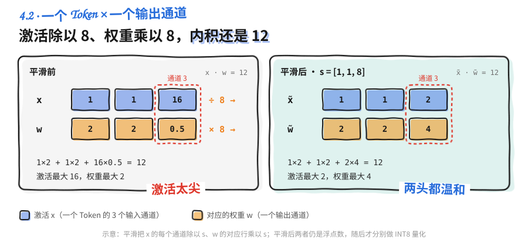
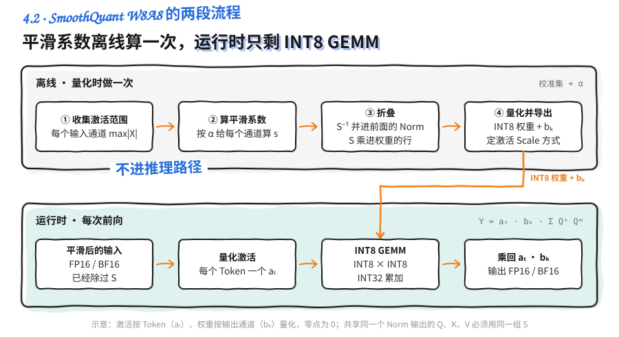
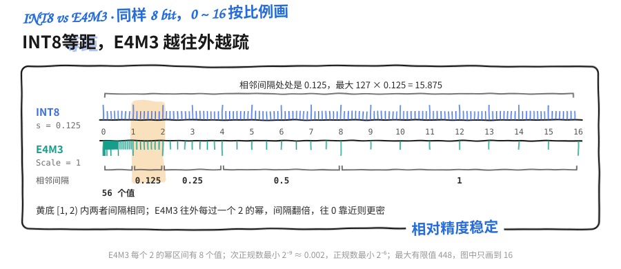
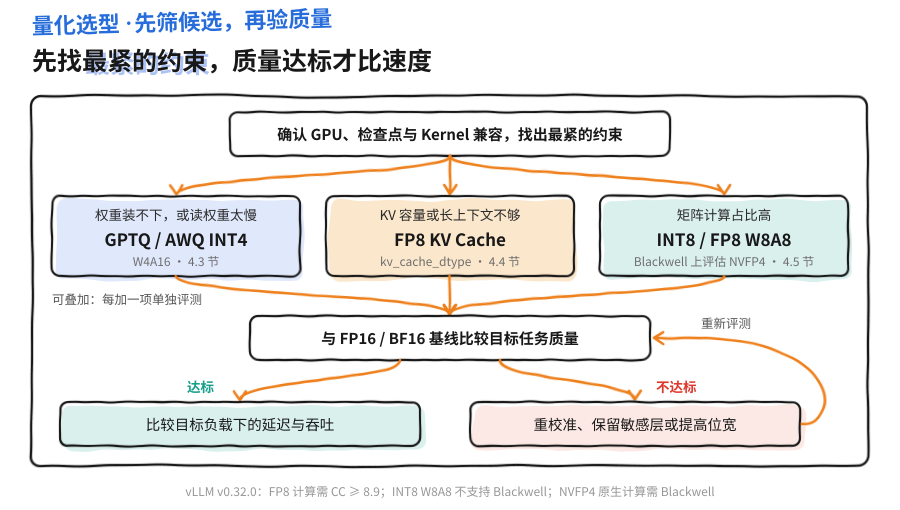

<a id="part4-ch4"></a>

# 第4部分 · 第4章：量化

> 总索引 ｜ [本部分目录](README.md) ｜ [上一章](ch03-nano-vllm源码解读.md) ｜ [下一章](ch05-Speculative-Decoding.md)

## 本章目录

- [本章导读](#part4-ch4)
- [4.1 量化基础：Scale、粒度与 PTQ/QAT](#part4-ch4-sec1)
- [4.2 W8A8 量化：SmoothQuant 如何处理激活离群值](#part4-ch4-sec2)
- [4.3 Weight-only INT4：GPTQ、AWQ 与 Marlin](#part4-ch4-sec3)
- [4.4 KV Cache 量化：KIVI 与 FP8 缓存](#part4-ch4-sec4)
- [4.5 FP8 与 NVFP4/MXFP4：低比特浮点怎样工作](#part4-ch4-sec5)
- [4.6 量化选型与 vLLM 实战](#part4-ch4-sec6)

---

## 本章导读

> 发布 2026-04-16 · 更新 2026-11-01 · 标签 "量化", "SmoothQuant", "GPTQ", "AWQ", "FP8", "NVFP4", "KV Cache量化" · 单篇原文

### 📖 本章简介

量化就是换一把刻度更少的尺子来记数：每个数占的空间变小，读写更快，代价是读数变粗。难点不在"压到几 bit"，而在怎样让粗下来的读数尽量少伤模型输出，以及怎样让硬件真的从低比特里拿到收益。

本章按"概念、方法、格式、落地"四步展开：

- **基础概念**：Scale 与零点、对称与非对称、位宽与格距、Per-tensor/Per-channel/Per-group/Per-token 粒度、校准，以及 PTQ 与 QAT。
- **三类量化对象**：W8A8 用 SmoothQuant 把激活的离群值迁移给权重；W4A16 用 GPTQ 的误差补偿或 AWQ 的激活感知缩放压缩权重，再由 Marlin 等 Kernel 高效执行；KV Cache 用 KIVI 的分组策略或 FP8 缓存减少每个历史 Token 的占用。
- **低比特浮点**：E4M3/E5M2 怎样分配范围与精度，FP4 为什么离不开微块缩放，NVFP4 与 MXFP4 的 Scale 设计差在哪里。
- **选型与实战**：从瓶颈和硬件条件筛选候选，理解 vLLM 怎样识别检查点和选择 Kernel，并对比 FP16 与 AWQ INT4 的吞吐和生成质量。

> ⏰ **信息时效**：原理部分与框架无关；vLLM 相关的参数、方案名、硬件支持与 Kernel 选择基于 v0.32.0（2026-10-18 发布）。量化支持矩阵变化较快，换版本时请对照官方文档和启动日志核对。

### 📑 本章小节

- [**4.1 量化基础：Scale、粒度与 PTQ/QAT**](https://caomaolufei.github.io/AIInfraGuide/inference/模块四-推理优化/第4章-量化/41-量化基础/)：仿射量化与反量化、对称与非对称、位宽与格距、量化粒度、校准、PTQ 与 QAT
- [**4.2 W8A8 量化：SmoothQuant 如何处理激活离群值**](https://caomaolufei.github.io/AIInfraGuide/inference/模块四-推理优化/第4章-量化/42-w8a8与smoothquant/)：通道离群值、等价缩放、迁移强度 α、INT8 GEMM 与 LLM Compressor 配方
- [**4.3 Weight-only INT4：GPTQ、AWQ 与 Marlin**](https://caomaolufei.github.io/AIInfraGuide/inference/模块四-推理优化/第4章-量化/43-weight-only-int4/)：W4A16 存储、GPTQ 二阶补偿、AWQ 激活感知缩放、Marlin 融合 Kernel 与 vLLM 的 Kernel 选择
- [**4.4 KV Cache 量化：KIVI 与 FP8 缓存**](https://caomaolufei.github.io/AIInfraGuide/inference/模块四-推理优化/第4章-量化/44-kv-cache量化/)：KV 占用估算、KIVI 的 Key/Value 分组与残留缓存、FP8 KV 的 Scale 校准、跳层与长上下文验证
- [**4.5 FP8 与 NVFP4/MXFP4：低比特浮点怎样工作**](https://caomaolufei.github.io/AIInfraGuide/inference/模块四-推理优化/第4章-量化/45-fp8与nvfp4-mxfp4/)：E4M3/E5M2、FP8 的 Scale、E2M1 与微块缩放、NVFP4 与 MXFP4 对比及硬件执行条件
- [**4.6 量化选型与 vLLM 实战**](https://caomaolufei.github.io/AIInfraGuide/inference/模块四-推理优化/第4章-量化/46-量化选型与vllm实战/)：按瓶颈选候选、方法/格式/Kernel 分层、在线量化入口、FP16 与 AWQ INT4 对照实验

<a id="part4-ch4-sec1"></a>

## 4.1 量化基础：Scale、粒度与 PTQ/QAT

> 发布 2026-10-06 · 更新 2026-11-01 · 标签 "量化", "INT8", "INT4", "Scale", "PTQ", "QAT" · 单篇原文

量化像是换一把刻度更少的尺子：原来能读到毫米，现在只能读到厘米。数据量小了，读数也粗了。**量化要回答的就是三件事：刻度怎么定（Scale 与零点），多少数据共用一把尺子（粒度），以及怎样让模型少受读数误差的影响（校准与 PTQ/QAT）。**

本节只讲与框架无关的基础概念，后面几节的 SmoothQuant、GPTQ/AWQ、KV Cache 量化和低比特浮点都建立在这些概念上。

> ⏰ **信息时效**：本节为通用原理，不依赖具体框架版本；舍入规则以 ONNX QuantizeLinear 算子定义为例。


### 1. 先分清量化的对象

推理时显存里主要有三类数据，它们都可以量化，但性质不同：

| 📊 对象 | 数据的特点 | 量化后的主要收益 |
|---|---|---|
| **权重（Weight）** | 训练完就固定，可以离线慢慢处理 | 模型变小，每步读的权重变少 |
| **激活（Activation）** | 随每次输入变化，只能在线处理 | 让矩阵乘法走低精度 Kernel |
| **KV Cache** | 随请求和上下文不断增长 | 每个历史 Token 占的缓存变少 |

常见记号 **W4A16** 表示权重 4-bit、激活 16-bit；**W8A8** 表示两者都是 8-bit。这个记号只描述线性层的两个输入，KV Cache 的精度要另外说明。

先算一笔粗账：7B 个参数全用 16-bit，纯数据约 14 GB；全用 4-bit 约 3.5 GB（十进制 GB，未计量化参数）。数据量降到四分之一，速度能快多少则取决于第 1 章讲的瓶颈在哪里。

---

### 2. 数值映射、Scale 与 Zero-point

#### 2.1 量化与反量化

FP16 本身也只能表示有限个数，量化是把它们再映射到更少的编码上。对均匀整数编码，常用的仿射量化写作：

$$
q=\operatorname{clip}\left(\operatorname{round}(x/s)+z,\ q_{\min},q_{\max}\right),
\qquad \hat{x}=s(q-z)
$$

- $s>0$ 是 **Scale**，即尺子上相邻两格代表的数值间隔；
- $z$ 是 **Zero-point**，即实数 0 落在哪个整数格上；
- **量化**得到编码 $q$，**反量化**用 $s$、$z$ 把编码还原成近似值 $\hat x$。

`round` 的规则由实现决定，例如 ONNX 的整数 QuantizeLinear 采用"四舍六入五成双"（Round Half to Even）。

取 $s=0.1,z=0$：$x=0.26$ 记为 $q=3$，读回来是 $\hat x=0.3$，舍掉的 0.04 再也找不回来。换成 $s=1/16$，同一个 0.26 记为 4，读回 0.25。可见"保留一位小数"只是 $s=0.1$ 的巧合，**真正决定能表示哪些值的是位宽和 Scale**。一段区间内的数都会落到同一个格子上，比如 $s=0.1$ 时 0.251、0.26、0.349 都映射为 3。

下图把两种 4-bit 量程画在同一根实数轴上（对称取 $s=0.25$，非对称沿用 2.3 节的 $[-1,3]$），蓝色底是量程覆盖的范围：绿色点被拉到最近的刻度，产生**舍入误差**；红色点超出量程被压到端点，产生**截断误差**。量化误差基本就是这两类。


#### 2.2 对称量化

正负比较均衡的数据可以令 $z=0$。常见的 INT8 约定只用 $[-127,127]$：

$$
s=\frac{\max |x|}{127},\qquad q=\operatorname{clip}(\operatorname{round}(x/s),-127,127)
$$

INT8 类型本身能表示到 $-128$，这里主动放弃它，换来正负两端对称。4-bit 同理只用 $[-7,7]$，上图的对称数轴就是这样取的。好处是反量化只需乘一个 Scale，矩阵乘法里也不用做零点修正。

#### 2.3 非对称量化

如果数据都在 $[0,6]$，对称量化会把一半编码浪费在用不到的负数上。非对称量化让量程贴着数据走：先取一个包含 0 的区间 $[a,b]$，再计算

$$
s=\frac{b-a}{q_{\max}-q_{\min}},\qquad
z=\operatorname{clip}\left(\operatorname{round}\left(q_{\min}-\frac{a}{s}\right),q_{\min},q_{\max}\right)
$$

例如 $[a,b]=[-1,3]$、编码范围 $[0,15]$，得到 $s=4/15,z=4$。$x=1$ 时 $q=\operatorname{round}(3.75)+4=8$，反量化为 $4\times4/15\approx1.067$。零点要取整，所以实际量程两端会略有偏移。

非对称量化更贴合偏移的分布，代价是要多存一个零点，计算时多一步修正。全零张量要单独处理，避免算出 $s=0$。

#### 2.4 位宽决定刻度有多密

量程固定时，位宽每少 1 bit，格子数减半，格距翻倍。把 $[0,1]$ 均匀量化：

| 📊 位宽 | 编码数 | 相邻刻度间隔 | 最大舍入误差 |
|---|---:|---:|---:|
| 8-bit | 256 | $1/255\approx0.00392$ | $\approx0.00196$ |
| 4-bit | 16 | $1/15\approx0.06667$ | $\approx0.03333$ |
| 2-bit | 4 | $1/3\approx0.33333$ | $\approx0.16667$ |

从 8-bit 到 4-bit，格距变成约 17 倍。所以低比特方案几乎都要配合更细的粒度或更聪明的误差补偿，后面的 GPTQ、AWQ、KIVI 都在解决这件事。

---

### 3. 张量维度与量化粒度

#### 3.1 先看清矩阵的轴

本章统一用数学写法 $Y=XW$：

$$
X\in\mathbb R^{T\times C_{\text{in}}},\qquad
W\in\mathbb R^{C_{\text{in}}\times C_{\text{out}}},\qquad
Y_{tk}=\sum_j X_{tj}W_{jk}
$$

$X$ 的行是 Token，列是输入通道。PyTorch 的 `nn.Linear.weight` 形状是 $C_{\text{out}}\times C_{\text{in}}$，正好是这里 $W$ 的转置，读代码时别把"行"和"列"弄反。

看一个小激活矩阵（3 个 Token、4 个通道）：

$$
X=\begin{bmatrix}
0.2&0.5&8.0&-0.1\\
0.3&0.4&9.0&-0.2\\
0.1&0.6&7.0&-0.1
\end{bmatrix}
$$

第 3 列在每个 Token 上都很大。这种"某几个通道持续偏大"的现象在 LLM 激活里很常见，是 4.2 节 SmoothQuant 的出发点。

#### 3.2 多少数据共用一把尺子

粒度就是"一组共享 Scale 的数据有多大"。组越小，尺子越贴合局部数据，但要存、要读的 Scale 也越多：

| 📊 粒度 | 共享范围 | 典型用途 | 代价 |
|---|---|---|---|
| Per-tensor | 整个张量一个 Scale | 静态激活、FP8 权重 | 一个离群值拖累全体 |
| Per-channel | 每个输出通道一个 | INT8 权重 | Scale 数量等于输出通道数 |
| Per-group | 每 $g$ 个连续元素一个（如 128） | INT4 权重 | Scale 更多，Kernel 要分组反量化 |
| Per-token | 每个 Token 一个 | 动态激活 | 运行时要先求每行最大值 |

下图在 $Y=XW$ 的布局上画出四种粒度，同色同标号的格子共用一个 Scale；右下角的 $X$ 取自上面的矩阵，红色虚线框是持续偏大的第 3 个输入通道：


对上面的 $X$，Per-token 给每一行单独定量程，但同一行里 8.0 和 0.2 还是共用一把尺子，小值照样被挤得很粗。**粒度只能沿某个轴切分，切的方向和离群值所在的方向不一致时，再细也帮不上忙。** 激活的离群值沿通道分布，而矩阵乘法要求激活的 Scale 能从求和里提出来（只能按 Token 分），这就是 W8A8 难做的根源。

---

### 4. 校准：给尺子选量程

#### 4.1 量程大了糊，小了断

Scale 由量程决定。量程取到最大值，离群值放得下，但大部分数据挤在少数几个格子里，舍入误差大；量程收窄，大部分数据读得更细，超出部分却被截断。**校准就是在舍入误差和截断误差之间找平衡。** 常见做法有直接取最大值、取百分位数，或者以 MSE、输出误差为目标搜索截断点。

权重是固定的，可以直接从权重本身统计。激活要喂真实样本才能看到分布，这批样本叫**校准集**。它应覆盖线上真实的语言、Chat Template 和输入长度，并且与评测集分开，否则评测分数会偏乐观。

#### 4.2 静态与动态

- **静态量化**：用校准集离线算好 Scale，推理时直接用，开销最小，但输入分布变了就可能不准。
- **动态量化**：推理时按当前数据实时求 Scale，更贴合输入，代价是每次都要先求一遍最大值。

"动态"本身不说明粒度。看到一个方案自称动态量化时，要再确认三件事：Scale 在什么时候算、沿哪个轴算、作用在哪些算子上。

---

### 5. PTQ 与 QAT

**PTQ（Post-Training Quantization）** 在训练完成后直接量化，最多再用少量校准数据调整 Scale 或权重。**QAT（Quantization-Aware Training）** 则在训练或微调时就让模型"戴着量化误差"前向计算，让参数自己去适应。

QAT 的前向用 **Fake Quant**：先量化、再立刻反量化，数据仍是浮点，但已带上了舍入误差。`round` 的导数几乎处处为 0，反向传播时用 **STE（Straight-Through Estimator）** 近似：在量程内把梯度原样传过去，量程外的通常置 0。

| 📊 维度 | PTQ | QAT |
|---|---|---|
| 需要什么 | 训练好的模型，加少量校准数据 | 训练流程、数据与算力 |
| 怎样控制误差 | 选 Scale、截断点，或做逐层补偿（GPTQ/AWQ） | 让参数在训练中适应量化 |
| 适合何时 | 8-bit、4-bit 权重等误差可控的场景 | 更低比特，或 PTQ 精度不达标时 |
| 仍需验证 | 目标任务上的精度 | 目标任务上的精度，以及推理 Kernel 是否支持该格式 |

LLM 推理部署以 PTQ 为主，本章后面的方法基本都属于 PTQ。

💡 **提示**：PTQ 不等于不需要数据，大多数方法仍要校准集；QAT 也不是在整数上训练，主体计算仍是浮点，量化误差靠 Fake Quant 模拟。

---

### 6. 动手观察离群值的影响

下面用纯 Python 对 4 个数做对称 INT8 量化，比较"量程覆盖全部"和"截断到 1"两种选择：

```python
def quantize(values, amax):
    scale = amax / 127 if amax > 0 else 1.0
    codes = [max(-127, min(127, round(x / scale))) for x in values]
    return codes, scale


def dequantize(codes, scale):
    return [q * scale for q in codes]


x = [0.2, 0.5, 0.8, 20.0]
for label, bound in [("覆盖全部", 20.0), ("截断到 1", 1.0)]:
    codes, scale = quantize(x, bound)
    restored = dequantize(codes, scale)
    errors = [abs(a - b) for a, b in zip(x, restored)]
    print(label, "scale =", round(scale, 6))
    print("编码:", codes)
    print("还原:", [round(v, 6) for v in restored])
    print("绝对误差:", [round(v, 6) for v in errors])
```

量程覆盖 20 时，Scale 约 0.15748，三个小值只能还原成约 0.157、0.472、0.787，前两个的相对误差都在 5% 以上。截断到 1 后，小值几乎没有误差，20 却被压成 1，误差高达 19。

两种选择都不好：**一个离群值就能让整组数据进退两难。** 只靠调量程解决不了，要么把离群值转移走（4.2 节 SmoothQuant），要么缩小共享 Scale 的组、补偿误差（4.3 节 GPTQ/AWQ）。

---

### 📝 总结

- 量化是把数值映射到更少的编码上，误差来自舍入和截断两类。
- Scale 是格距，Zero-point 是 0 所在的格子；对称量化省掉零点修正，非对称量化更贴合偏移分布。
- 位宽每少 1 bit 格距翻倍，4-bit 的格距约是 8-bit 的 17 倍。
- 粒度决定多少数据共用一个 Scale，切分方向要和离群值的方向一致才有效。
- 校准在舍入与截断之间选量程；"动态"要说清时机、轴和作用的算子。
- PTQ 是 LLM 推理的主流，QAT 用 Fake Quant 和 STE 让参数适应量化误差。

### 🎯 自我检验清单

- 能写出仿射量化与反量化公式，并解释 Scale 和 Zero-point 的含义
- 能手算对称与非对称量化的 Scale、零点和某个值的还原结果
- 能估算一个模型在 16-bit 和 4-bit 下的权重存储量
- 能说明 Per-tensor、Per-channel、Per-group、Per-token 各自沿哪个轴共享 Scale
- 能解释为什么激活的通道离群值不能简单地靠 Per-token 量化解决
- 能区分静态与动态量化，并说出判断一个"动态"方案时要确认的三件事
- 能说明 PTQ 与 QAT 的差别，以及 Fake Quant 和 STE 的作用

### 📚 参考资料

- [ONNX — QuantizeLinear 算子定义](https://onnx.ai/onnx/operators/onnx__QuantizeLinear.html)
- [Quantization and Training of Neural Networks for Efficient Integer-Arithmetic-Only Inference（Jacob et al., 2017）](https://arxiv.org/abs/1712.05877)
- [PyTorch torchao 文档（PyTorch 的量化与 QAT 开发已统一迁到 torchao）](https://docs.pytorch.org/ao/stable/index.html)

---

<a id="part4-ch4-sec2"></a>

## 4.2 W8A8 量化：SmoothQuant 如何处理激活离群值

> 发布 2026-10-06 · 更新 2026-11-01 · 标签 "SmoothQuant", "W8A8", "INT8", "Activation Outlier" · 单篇原文

上一节的实验里，一个 20 就让 0.2、0.5 这些小值几乎读不清。LLM 的激活正有这种麻烦：少数通道的数值比其他通道大几十倍，INT8 的 255 个格子不够分。**SmoothQuant 的办法像挑担子：激活这头太重，就把一部分重量挪到权重那头，两头都不太重，再分别量化。** 挪动用的是数学上严格等价的缩放，线性层的输出不变。

> ⏰ **信息时效**：算法部分依据 SmoothQuant 论文；vLLM 与 LLM Compressor 的支持情况基于 vLLM v0.32.0（2026-10-18 发布）文档。


### 1. W8A8 难在哪里

这里的 W8A8 特指 **INT8 权重 × INT8 激活**，线性层可以直接走 INT8 矩阵乘法。只压权重的方案（4.3 节）不碰激活，W8A8 则要在线处理每次都不一样的输入。

假设一个 Token 的隐藏向量里，大部分元素在 $[-1,1]$，某个通道却达到 80。按整行的最大绝对值求 Scale，$s=80/127\approx0.63$，$[-1,1]$ 里的数只能落到 $-2$ 到 $2$ 这几个编码上。Per-token 量化隔开了 Token 之间的差异，却管不了同一个 Token 内的通道差异。

[SmoothQuant 论文](https://arxiv.org/abs/2211.10438)观察到，这些大值集中在少数固定通道上，并在不同 Token 间反复出现；权重的分布则平坦得多，相对容易量化。所以可以把激活的量化难度分一部分给权重。

---

### 2. 等价缩放：一边除，一边乘

#### 2.1 公式

沿用 4.1 节的矩阵方向：

$$
Y=XW,\qquad X\in\mathbb{R}^{T\times C_{\text{in}}},\quad
W\in\mathbb{R}^{C_{\text{in}}\times C_{\text{out}}}
$$

取对角矩阵 $S=\operatorname{diag}(s_1,\ldots,s_{C_{\text{in}}})$，所有 $s_j>0$：

$$
Y=(XS^{-1})(SW)=\widetilde X\widetilde W
$$

对第 $j$ 个输入通道，$X$ 的第 $j$ 列除以 $s_j$，$W$ 的第 $j$ 行乘以 $s_j$。精确算术下一除一乘正好抵消，输出不变。

缩放作用在**同一个通道的所有 Token 上**，所以 $S$ 只有 $C_{\text{in}}$ 个系数，和 Token 数无关，可以离线算好。换成 PyTorch 的转置权重布局，乘的就是权重的列。

#### 2.2 一个点积看懂

下图只展开一个 Token 和一个输出通道，蓝色格是激活，黄色格是对应的权重，红色虚线框标出被缩放的第 3 个通道：



平滑前，$[1,1,16]$ 与 $[2,2,0.5]$ 的内积是 12。第三个激活除以 8、对应权重乘以 8，变成 $[1,1,2]$ 与 $[2,2,4]$，内积还是 12。激活的最大值从 16 降到 2，权重的最大值从 2 升到 4，**两个输入的量程都变得温和了**。

📌 **关键点**：平滑之后 $\widetilde X$、$\widetilde W$ 仍是浮点数，还没有任何 INT8 编码。平滑本身不引入误差，它的作用是让下一步量化的误差变小。SmoothQuant W8A8 = 平滑 + 量化，两步不能混为一谈。

---

### 3. 迁移强度 α 怎么选

挪得太少，激活的尖峰还在；挪得太多，权重又出现新的尖峰。SmoothQuant 用**迁移强度** $\alpha$ 控制挪多少：

$$
s_j=\frac{\left(\max_t|X_{tj}|\right)^\alpha}
{\left(\max_k|W_{jk}|\right)^{1-\alpha}},\qquad 0\leq\alpha\leq1
$$

激活的最大值用校准样本统计，权重的最大值直接从参数算。实现上还要防止分母接近 0。

- $\alpha$ 越大，激活被压得越平，更多难度转给权重；$\alpha$ 越小则相反。
- 论文把 $\alpha=0.5$ 称为 OPT、BLOOM 系列的通用"甜点"；激活更难量化的 GLM-130B 用了 0.75。
- 论文的消融显示，$\alpha$ 小于约 0.4 时激活难量化，大于约 0.6 时权重难量化（针对其实验模型）；后续版本中 LLaMA 系列用到 0.8 甚至更高。
- 合适的值要按模型在一小批校准数据上搜索，论文的做法是在 Pile 的子集上做网格搜索。

vLLM 文档给出的 LLM Compressor INT8 W8A8 示例用的是 `SmoothQuantModifier(smoothing_strength=0.8)`，这里的 `smoothing_strength` 就对应 $\alpha$。

⚠️ **注意**：这里有两种"Scale"。$s_j$ 是**平滑系数**，只做等价变换；INT8 的**量化 Scale** 在平滑之后按新的量程计算，负责映射到整数。

---

### 4. 从变换到 INT8 GEMM

#### 4.1 离线流程

下图上半是离线做一次的四步，下半是每次前向的运行时路径，橙色折线表示导出的 INT8 权重和权重 Scale $b_k$ 交给运行时的 GEMM：



1. **收集激活范围**：用有代表性的校准文本跑前向，记录每个待量化线性层的输入通道最大值。
2. **计算并折叠平滑系数**：$S^{-1}$ 不必单独成为一个算子，可以并进前面的 LayerNorm/RMSNorm 的缩放参数里，$S$ 则直接乘进权重。
3. **量化**：选权重和激活的粒度，确定激活用静态校准还是动态计算 Scale，再验证逐层误差和整模型质量。
4. **导出**：保存真实的 INT8 权重和量化配置，交给支持该格式的推理 Kernel。

折叠有条件。一个 Norm 的输出若同时送给 Q、K、V 三个投影，三者必须用同一组 $S$，否则无法共用一次 $S^{-1}$。残差、非线性算子处也不能随意移动缩放，以工具支持的变换位置为准。

在 vLLM v0.32.0 文档的 LLM Compressor 示例中，INT8 W8A8 的配方是先平滑、再用 GPTQ 量化：

```python
from llmcompressor.modifiers.quantization import GPTQModifier
from llmcompressor.modifiers.smoothquant import SmoothQuantModifier

recipe = [
    SmoothQuantModifier(smoothing_strength=0.8),
    GPTQModifier(targets="Linear", scheme="W8A8", ignore=["lm_head"]),
]
```

`lm_head` 保持原精度，是这类配方的常见做法。导出后的检查点可以直接被 vLLM 加载，具体命令见 4.6 节。

#### 4.2 运行时怎样算

为看清数据流，设平滑后的激活按 Token 量化、权重按输出通道量化，零点都为 0：

$$
\widehat X_{tj}=a_t Q^X_{tj},\qquad
\widehat W_{jk}=b_k Q^W_{jk}
$$

两个 Scale 都能从求和号里提出来：

$$
\widehat Y_{tk}=a_t b_k\sum_jQ^X_{tj}Q^W_{jk}
$$

求和部分是 INT8 乘、INT32 累加，最后乘回 $a_tb_k$ 转成 FP16/BF16。可见 **W8A8 只描述矩阵乘法的两个输入，累加和输出仍保留更高精度**。这也解释了 4.1 节的结论：激活 Scale 若按通道 $j$ 设，就提不出求和号，所以只能靠平滑把通道差异提前消掉。

#### 4.3 收益与适用条件

论文报告，SmoothQuant 在其测试的模型上最高可提速 1.56 倍、显存减半，精度损失可以忽略。整模型能否提速，取决于 INT8 GEMM 省下的时间能否覆盖在线量化激活、处理 Scale 和类型转换的开销；矩阵很小、算子没融合，或大部分时间耗在 Attention 与调度上时，收益有限。

硬件也有边界。vLLM v0.32.0 文档注明，INT8 W8A8 计算支持 Turing 到 Hopper 的 NVIDIA GPU，**不支持计算能力 10.0 及以上的 Blackwell**，这类卡应改用 FP8（4.5 节）。

质量上，要重点看校准集没覆盖到的输入：长文本、代码、特殊符号和小语种。必要时让敏感层保留高精度。

---

### 5. 动手验证一个点积

把 2.2 节的例子接上对称 INT8 量化。`qdq` 表示 Quantize-Dequantize：算出整数编码后立刻转回浮点，用来模拟量化误差，并不执行真正的 INT8 GEMM。

```python
def qdq(values):
    amax = max(map(abs, values))
    scale = amax / 127 if amax else 1.0
    return [max(-127, min(127, round(v / scale))) * scale for v in values]


def dot(a, b):
    return sum(x * y for x, y in zip(a, b))


x, w = [1.0, 1.0, 16.0], [2.0, 2.0, 0.5]
s = [1.0, 1.0, 8.0]  # 手工选取便于观察，真实模型由校准统计和 α 算出
x_s = [v / k for v, k in zip(x, s)]
w_s = [v * k for v, k in zip(w, s)]

print("原始输出:", dot(x, w))
print("平滑后输出:", dot(x_s, w_s))
print("直接量化:", round(dot(qdq(x), qdq(w)), 6))
print("平滑后量化:", round(dot(qdq(x_s), qdq(w_s)), 6))
```

前两行都是 12.0，说明平滑是等价变换。直接量化得到约 12.094488，平滑后再量化约 12.063240，误差从 0.094 降到 0.063。这只是一个输出通道上的机制演示，真实模型的效果要靠整模型评测确认。

---

### 📝 总结

- INT8 W8A8 同时量化权重和激活，难点在于激活中集中在少数通道的离群值。
- SmoothQuant 利用 $XW=(XS^{-1})(SW)$ 把激活的量化难度迁移一部分给权重，再分别量化。
- 迁移强度 $\alpha$ 平衡两边的难度，论文中 0.5 是常见起点，不同模型需要搜索。
- 平滑系数 $S$ 可离线折叠进前一个算子；共享输入的多个投影必须用同一组系数。
- 激活 Scale 只能按 Token 设，才能从求和中提出，这是需要先平滑的根本原因。
- vLLM v0.32.0 中 INT8 W8A8 不支持 Blackwell，这类卡应选 FP8。

### 🎯 自我检验清单

- 能解释 Per-token 量化为什么挡不住通道离群值
- 能指出平滑变换分别改了 $X$ 和 $W$ 的哪个轴，以及 $S$ 有多少个系数
- 能写出 $\alpha$ 的平滑公式，说明增大 $\alpha$ 的效果
- 能区分平滑系数和量化 Scale
- 能说明为什么 Q、K、V 共享一个 Norm 输出时必须一起处理
- 能写出 W8A8 运行时的反量化公式，并说明累加用什么精度
- 能用 LLM Compressor 的配方描述一次 SmoothQuant + GPTQ 的 W8A8 量化

### 📚 参考资料

- [SmoothQuant: Accurate and Efficient Post-Training Quantization for Large Language Models（Xiao et al., 2022）](https://arxiv.org/abs/2211.10438)
- [SmoothQuant 官方代码](https://github.com/mit-han-lab/smoothquant)
- [vLLM v0.32.0 — INT8 W8A8（LLM Compressor）](https://docs.vllm.ai/en/v0.32.0/features/quantization/llm_compressor/int8_w8a8/)
- [LLM Compressor](https://github.com/vllm-project/llm-compressor)

---

<a id="part4-ch4-sec3"></a>

## 4.3 Weight-only INT4：GPTQ、AWQ 与 Marlin

> 发布 2026-10-06 · 更新 2026-11-01 · 标签 "GPTQ", "AWQ", "INT4", "Weight-only", "Marlin" · 单篇原文

4.2 节的 W8A8 要同时对付权重和激活。这一节换个思路：**激活保留 FP16/BF16，只把权重压到 4-bit，即 W4A16。** Decode 阶段每步都要把整份权重从显存读一遍，权重变成四分之一，读的时间也跟着少。难点在于 4-bit 只有 16 个编码，格距是 8-bit 的约 17 倍（4.1 节），必须想办法让误差少伤输出。

GPTQ 和 AWQ 是两种主流的解法：前者像拼图时边放边调整剩下的块，后者先找出最要紧的几块重点保护。Marlin 则负责让 GPU 高效地读和算这些 4-bit 权重。

> ⏰ **信息时效**：算法部分依据各自论文；vLLM 的 Kernel 选择与工具链建议基于 vLLM v0.32.0（2026-10-18 发布）。


### 1. W4A16 的存储和计算

INT4 权重在显存里是**打包**存放的：一个 32-bit 字装 8 个 4-bit 编码，另外存每组的 Scale，非对称方案还有零点。推理时，Kernel 读出编码，在片上反量化成 FP16/BF16，再和 16-bit 激活做矩阵乘法。

所以看到"INT4 模型"，要分清两件事：**权重的存储类型**是 INT4，**乘法指令的输入类型**仍是 16-bit。这条路径省的是读权重的带宽，不是乘法的算力。

下图左边是显存里的一组权重（蓝色为 INT4 编码，黄色为 FP16 Scale，白格为非对称方案才有的零点），右边是 Kernel 在片上把编码还原成 FP16 权重（绿色）后，再和 16-bit 激活（红色）相乘：


分组参数也占空间。每 128 个 INT4 权重共用一个 FP16 Scale 时，平均每个权重占：

$$
\frac{4}{8}+\frac{2}{128}=0.515625\ \text{byte}
$$

再加零点和对齐还会略多。能省多少时间，要看解包与反量化是否和矩阵乘法融合在同一个 Kernel 里，以及 KV 读取、Attention 等其他部分还占多大比例。

---

### 2. GPTQ：边量化边补偿

#### 2.1 目标要带上输入

如果只最小化 $\|W-\widehat W\|_F^2$，每个权重的误差都按同样的分量计分。可经过线性层后，有的误差被输入放大，有的则互相抵消。[GPTQ](https://arxiv.org/abs/2210.17323) 用校准输入，把目标换成层输出的重建误差：

$$
\min_{\widehat W}\ \|XW-X\widehat W\|_F^2
$$

取一个输出通道的权重列 $w$，记 $\delta=w-\widehat w$：

$$
E=\|X\delta\|_2^2=\delta^\mathsf TX^\mathsf TX\delta,
\qquad H=2X^\mathsf TX
$$

$H$ 刻画了在真实输入下，每个方向上的误差要付多大代价，以及输入通道之间的相关性。它只来自单个线性层的重建目标，不需要整个语言模型损失的 Hessian。

#### 2.2 补偿的直觉

拼图时一块放歪了，可以挪一挪旁边还没固定的块来弥补。GPTQ 也是这样：**每固定一个权重，就把它的误差分摊给还没量化的权重。**

看两维的例子。若校准输入的两列几乎相同，输出主要取决于 $w_1+w_2$。$w_1=0.26$ 量化成 0.30，多了 0.04；趁 $w_2$ 还没量化，让它减 0.04，输出就基本不变。两列不完全相同时，补多少由 $H$ 决定，不是简单的一加一减。

设 $F$ 是尚未固定的权重下标集合，$H_F$ 是对应的子矩阵。把 $w_i$ 固定为量化值 $\widehat w_i$ 后，最优补偿是：

$$
\Delta w_F=-\frac{w_i-\widehat w_i}{[H_F^{-1}]_{ii}}[H_F^{-1}]_{:,i}
$$

第 $i$ 项正好把 $w_i$ 变成 $\widehat w_i$，其余项给出剩余权重的调整量。$\widehat w_i$ 是反量化后的值，和原权重同一尺度，不是整数编码。官方实现还加了阻尼项保证数值稳定，并用 Cholesky 分解和分块更新降低成本。

两个"128"别搞混：**更新块大小**决定一次处理多少列、多久批量传播一次误差；**Group Size** 决定多少权重共享一个 Scale。

#### 2.3 代价与效果

论文报告，GPTQ 量化 175B 参数的 GPT 模型约需 4 个 GPU 小时，降到 3–4 bit 时精度损失可忽略，第一次让 175B 模型能在单张 GPU 上运行。量化是离线一次性的成本，推理时不再需要 $H$。

---

### 3. AWQ：按激活找出要保护的通道

#### 3.1 权重大，不一定最要紧

对 $y=\sum_jx_jw_j$，权重误差 $\Delta w_j$ 对输出的影响是 $x_j\Delta w_j$。**一个权重要不要紧，取决于和它相乘的激活有多大**，而不是它自己有多大。

[AWQ](https://arxiv.org/abs/2306.00978) 的论文指出两点：只保护 1% 的显著权重就能大幅减小量化误差；而找显著通道应该看激活分布，不是看权重。

#### 3.2 用缩放代替混合精度

最直接的保护是让这 1% 保持 FP16，但混合精度的存储布局对 Kernel 很不友好。AWQ 改用缩放：量化前把显著通道的权重放大 $s_j$ 倍，输入相应除以 $s_j$。沿用 4.2 节的符号：

$$
Y=(XS^{-1})(SW),\qquad
\widehat Y=(XS^{-1})\,D(Q(SW))
$$

$Q$ 生成低比特编码，$D$ 用 Scale 和零点反量化。放大后，只要这个通道所在组的量化格距没有同比例变大，除回 $s_j$ 后它的有效误差就变小了。但放得太大会撑宽整组量程，误伤同组其他权重，所以 AWQ 要在校准数据上搜索缩放因子，再配合截断控制总误差。

部署出来的仍是规则的 INT4 布局，没有单独存成 FP16 的权重，所以高效 Kernel 容易支持它。论文配套的 TinyChat 在桌面和移动 GPU 上比 Hugging Face FP16 实现快 3 倍以上。

#### 3.3 与 SmoothQuant 对照

两者都用配对缩放，但目的不同：

| 📊 方法 | 处理什么 | 缩放的方向 | 典型配置 |
|---|---|---|---|
| SmoothQuant | 激活离群值让 INT8 激活难量化 | 压平激活，难度转给权重 | INT8 W8A8 |
| AWQ | 显著通道的权重误差被大激活放大 | 放大显著权重，降低其相对误差 | INT4 W4A16 |

只做 AWQ 的缩放搜索，得到的还是浮点权重，后面仍要量化和打包。比较方法时要分清三种中间产物：缩放后的浮点权重、模拟量化（QDQ）后的浮点权重、真正编码打包的部署权重。

---

### 4. Marlin：让解包不拖慢计算

编码好了，还有一道工程题。最笨的做法是先把整层 INT4 展开成 FP16 写回显存，再调用普通 GEMM，结果多了一次大规模读写，省下的带宽全吐了回去。

[Marlin](https://arxiv.org/abs/2408.11743) 把读权重、解包、反量化和矩阵乘法放进同一个 Kernel 的流水线里。下图左边是朴素做法，展开后的 FP16 权重（绿色）要写回显存再读一遍；右边是 Marlin，蓝色的搬运和黄色的片上计算错开一个 Tile 同时进行：


权重事先重排成适合运行时读取的布局，再用模块二讲过的 Tiling 与多级缓冲，把数据搬运和计算重叠起来。论文报告，Batch 在 16–32 以内时能接近 4 倍的理论加速上限，到 64–128 时加速逐渐减小但仍然明显；接入 vLLM 后端到端最高约 2.8 倍。

Batch 一大，计算重新成为瓶颈，少读权重的优势就被摊薄，这和第 1 章的 Roofline 分析一致。

#### 4.1 vLLM 中的 Kernel 选择

在 vLLM v0.32.0 中，量化方法名和 Kernel 已经解耦：

- `--quantization` 写 `awq`、`awq_marlin` 或 `auto_awq`，都解析为同一个 `auto_awq` 配置；GPTQ 的 `gptq`、`gptq_marlin`、`auto_gptq` 同理。不写时按检查点里的 `quant_method` 自动识别。
- 具体用哪个 Kernel，由 vLLM 按优先级逐个检查能否实现当前层。CUDA 上 INT4 W4A16 权重的主要候选依次是 Machete（仅 Hopper，计算能力 9.0）、Marlin（Turing 及以上）、Conch、Exllama、Triton 等，第一个通过检查的胜出。
- 启动日志会打印 `Using MarlinLinearKernel for AutoAWQMarlinLinearMethod` 这类信息；AWQ 层不满足条件时则会提示 "Falling back to unoptimized AWQ kernels"。
- 想排除某个 Kernel 做对比，可以用环境变量 `VLLM_DISABLED_KERNELS`。

**GPTQ/AWQ 决定编码的误差，Kernel 决定编码跑得多快。** 判断实际走了哪条路径，看启动日志，不要只凭模型名字。

---

### 5. 怎样比较 GPTQ 与 AWQ

#### 5.1 先拆开四个维度

"GPTQ、INT4 W4A16、Group Size 128、Marlin"这一串描述，分别回答了四个不同的问题：

| 📊 维度 | 例子 | 回答什么 |
|---|---|---|
| 量化算法 | GPTQ 或 AWQ | 怎样控制量化误差 |
| 格式与位宽 | INT4 W4A16 | 权重怎么编码，激活保留什么精度 |
| 量化粒度 | Group Size 128 | 多少权重共享一组 Scale |
| 执行实现 | Marlin、Machete | 编码怎样被读取和计算 |

W4A16 不限定算法，同一种算法也可以配不同的分组和 Kernel。

下图把两种算法放在一起：左边 GPTQ 逐列量化（蓝色已量化、蓝色斜线为当前列），把误差补偿给右侧尚未量化的浮点权重（绿色）；右边 AWQ 先按激活幅值找出显著通道（红色实心），放大对应权重后再整组量化。两条路最后都导出同样规整的 INT4 检查点：


四项都固定了，再比较算法本身：

| 📊 维度 | GPTQ | AWQ |
|---|---|---|
| 校准数据用来做什么 | 构造 $H$，衡量层输出误差 | 统计激活，搜索通道缩放 |
| 主要手段 | 逐列量化，补偿剩余权重 | 放大显著通道，降低其相对误差 |
| 离线计算 | 逐层求解重建问题，更新每个权重 | 搜索每通道的缩放因子，不逐个改写权重 |
| 推理速度 | 取决于导出布局与 Kernel | 同样取决于导出布局与 Kernel |

"AWQ 一定更快""GPTQ 一定更准"都缺少前提。公平对比至少要固定基础模型、位宽、Group Size、校准集、输入长度和负载，并记录实际加载的 Kernel。

#### 5.2 用什么工具量化

- **LLM Compressor**：vLLM 项目维护，支持 GPTQ、AWQ 和 SmoothQuant，导出的 `compressed-tensors` 格式可直接被 vLLM 加载。vLLM 文档的 INT4 W4A16 示例用 `GPTQModifier(scheme="W4A16")`。
- **GPTQModel**：专注 GPTQ 系列，文档注明兼容的模型可以用 vLLM 的 Marlin 和 Machete Kernel。
- **AutoAWQ**：已停止维护，vLLM 文档建议改用 LLM Compressor 中的 AWQ。已有的 AutoAWQ 检查点仍能正常加载。

#### 5.3 排查顺序

1. **确认检查点**：量化配置是否完整，基础模型和版本是否一致。
2. **看加载日志**：最终用了哪个 Kernel，有没有回退。
3. **先验质量**：用独立的任务集评测，别只挑几条好看的输出。
4. **再测性能**：分别看小 Batch Decode、大 Batch 和长 Prompt；量化省出的显存也可能被用来扩大并发。

---

### 📝 总结

- W4A16 只压缩权重，存储是 INT4，乘法输入仍是 16-bit，省的是读权重的带宽。
- GPTQ 用校准输入衡量层输出误差，借助 $H=2X^\mathsf TX$ 把每个权重的误差补偿给尚未量化的权重。
- AWQ 按激活大小找显著通道，用缩放代替混合精度来保护它们，部署布局仍然规整。
- Marlin 把解包、反量化和矩阵乘法融合进一条流水线，小 Batch 下接近 4 倍理论加速，Batch 变大后收益递减。
- vLLM v0.32.0 中 AWQ/GPTQ 的方法别名已统一，Kernel 按优先级自动选择，以启动日志为准。
- 比较 GPTQ 与 AWQ 前，先固定格式、粒度和 Kernel。

### 🎯 自我检验清单

- 能算出 Group Size 128、FP16 Scale 下每个 INT4 权重的平均存储量
- 能解释为什么 $\|XW-X\widehat W\|$ 比单看权重误差更贴近层输出
- 能用两个高度相关的输入通道说明 GPTQ 的补偿思路
- 能区分 GPTQ 的更新块大小和量化 Group Size
- 能说明 AWQ 为什么看激活而不是权重来找显著通道，以及它为何用缩放代替混合精度
- 能对比 AWQ 与 SmoothQuant 中配对缩放的方向和目的
- 能解释 Marlin 的加速为什么会随 Batch 变大而减小
- 能从 vLLM 启动日志判断 INT4 模型实际使用的 Kernel

### 📚 参考资料

- [GPTQ: Accurate Post-Training Quantization for Generative Pre-trained Transformers（Frantar et al., 2022）](https://arxiv.org/abs/2210.17323)
- [GPTQ 官方代码](https://github.com/IST-DASLab/gptq)
- [AWQ: Activation-aware Weight Quantization for LLM Compression and Acceleration（Lin et al., 2023）](https://arxiv.org/abs/2306.00978)
- [AWQ 官方代码](https://github.com/mit-han-lab/llm-awq)
- [MARLIN: Mixed-Precision Auto-Regressive Parallel Inference on Large Language Models（Frantar et al., 2024）](https://arxiv.org/abs/2408.11743)
- [Marlin 官方代码](https://github.com/IST-DASLab/marlin)
- [vLLM v0.32.0 — INT4 W4A16（LLM Compressor）](https://docs.vllm.ai/en/v0.32.0/features/quantization/llm_compressor/int4/)
- [vLLM v0.32.0 — AutoAWQ](https://docs.vllm.ai/en/v0.32.0/features/quantization/auto_awq/)
- [vLLM v0.32.0 — GPTQModel](https://docs.vllm.ai/en/v0.32.0/features/quantization/gptqmodel/)
- [vLLM v0.32.0 — 线性层 Kernel 选择源码](https://github.com/vllm-project/vllm/blob/v0.32.0/vllm/model_executor/kernels/linear/__init__.py)

---

<a id="part4-ch4-sec4"></a>

## 4.4 KV Cache 量化：KIVI 与 FP8 缓存

> 发布 2026-10-06 · 更新 2026-11-01 · 标签 "KV Cache", "KIVI", "FP8", "长上下文", "vLLM" · 单篇原文

权重压到 INT4，模型终于装进了显存；可上下文一拉长、并发一上来，显存又不够了。第 1 章的账本解释过原因：**权重是一次性的固定开销，KV Cache 却随每个请求的历史 Token 不断增长。** 这一节看怎样让每个历史 Token 占得更少。

KV Cache 像一本边写边记的会议纪要：权重量化是在会前把参考资料印成小字版，可以慢慢排版；纪要却只能现场速记，记下一句就要马上能被查阅。所以 KV 量化方法必须便宜、能流式追加。

> ⏰ **信息时效**：KIVI 部分依据论文；vLLM 的参数、Scale 方案与校准路径基于 v0.32.0（2026-10-18 发布）。旧版本中的 `calculate_kv_scales` 参数在 v0.32.0 中已不存在。


### 1. 先估算能省下多少缓存

对常规 MHA/GQA，设层数 $L$、请求数 $B$、每请求缓存长度 $T$、KV Head 数 $H_{\text{KV}}$、Head 维度 $d$、每个元素 $b$ 字节：

$$
M_{\text{KV}}=2LBTH_{\text{KV}}db
$$

开头的 2 对应 K 和 V。取 $L=32,H_{\text{KV}}=8,d=128$，单请求缓存 32768 个 Token，16-bit 下：

$$
2\times32\times32768\times8\times128\times2\ \text{B}=4\ \text{GiB}
$$

8-bit 约 2 GiB，2-bit 约 0.5 GiB。2-bit 的数字只是编码本身的下限，还没算分组的 Scale/零点、高精度残留区、对齐与分页开销。MLA、滑动窗口和混合架构的缓存结构不同，要按实际结构另算。

两件事可以叠加：PagedAttention 让已有空间少浪费，量化让每个元素变小。权重量化不会自动改变这里的 $b$，KV 精度要单独配置。

---

### 2. KV 为什么不能照搬权重量化

**时间约束不同。** 权重可以离线花几小时跑 GPTQ，处理一次反复使用。KV 则在请求执行中不断产生，每生成一个 Token 就要写入一份。量化必须足够便宜，否则省下的显存要拿延迟来换。

**误差进入的位置不同。** 记 $P=\operatorname{softmax}(QK^\mathsf T/\sqrt d)$：

- **Key 的误差**先改变 $QK^\mathsf T$，再经过 Softmax，可能让模型关注错位置。
- **Value 的误差**进入 $PV$，按注意力权重加权后影响输出。

所以 KV 量化的效果要放回长上下文任务里验证。几条短对话正常，说明不了长文档检索、跨段推理和长输出也正常。

---

### 3. KIVI：Key 按通道，Value 按 Token

#### 3.1 两个张量，两种分组

[KIVI](https://arxiv.org/abs/2402.02750) 是一种免调参的 2-bit KV Cache 量化算法。它的出发点是一个观察：在其研究的模型中，**Key 有明显的通道离群值，Value 没有**。因此论文主张 Key 按通道量化、Value 按 Token 量化。

固定一层、一个请求和一个 KV Head，把 K、V 都看成 $T\times d$ 矩阵，沿用 4.1 节"行 = Token，列 = 通道"的约定：

- **Key Per-channel**：固定一个通道，沿连续的若干 Token 分组求量化参数（竖着切）。
- **Value Per-token**：固定一个 Token，沿通道分组求量化参数（横着切）。

下图用组大小 G = 4、残留长度 R = 4 示意两种分组：蓝色是已量化的 2-bit 数据，红色列是 Key 的离群通道，黄色是虚线框里的全精度残留区，每个黑框内共享一组量化参数：


Key 竖着切，大幅值通道就被单独隔开，不再拖累其他通道；Value 横着切，每个 Token 用自己的范围。图中的黑框是共享量化参数的组，和 PagedAttention 的物理 KV Block 不是一回事。

这在 2-bit 下格外关键：每组只有 4 个编码，大小悬殊的数挤在一组，小值几乎都会落到同一个编码上（4.1 节）。

论文标题里的 **Asymmetric** 指 K 和 V 用不同的策略；组内则是基于最小值、最大值的非对称映射。"怎么分组"和"组内怎么编码"是两个问题。

#### 3.2 新 Token 凑不满一组怎么办

Key 的组跨越多个 Token，刚生成的几个 Token 还凑不满一组。KIVI 为此保留一段高精度的 **Residual Cache（残留缓存）**，和已量化的历史一起参与 Attention；新 Token 积累够了，再成批量化移入历史区。Value 按 Token 量化，不用凑组。它的残留区只保留最近的若干个 Token，每进来一个新 Token，就把最老的一个量化后移出，像一个滑动窗口。

残留区让流式写入可行，也让最近的 Token 保持高精度，但它占额外空间。上下文越短，残留区和元数据的占比越高，实际压缩比离"16-bit 到 2-bit 的 8 倍"就越远。

论文在 Llama、Falcon 和 Mistral 上测试，报告峰值显存（含模型权重）降低 2.6 倍，Batch 可放大到 4 倍，实际推理负载下吞吐提升 2.35–3.47 倍。

📌 **关键点**：KIVI 是论文方法，有自己的实现，不等于 vLLM 默认的 KV 路径。2-bit 是论文在其模型和任务上验证的配置，换模型要重新评测。

---

### 4. vLLM 的 FP8 KV Cache

工程上更常用的路线是把 KV 存成 FP8：数据量减半，精度压力比 2-bit 小得多，也不需要 KIVI 那样的特殊缓存结构。FP8 的数值格式在 4.5 节展开，这里只看使用环节。

#### 4.1 选格式

`kv_cache_dtype` 的常用取值：

| 📊 取值 | 含义 | 支持说明（v0.32.0 文档） |
|---|---|---|
| `auto` | 与模型数据类型一致 | 默认值 |
| `fp8` / `fp8_e4m3` | E4M3，精度更高 | CUDA 11.8+ 与 ROCm |
| `fp8_e5m2` | E5M2，范围更大、精度更低 | CUDA 11.8+ |

源码里的 `CacheDType` 还列出了 `int8_per_token_head`、`fp8_per_token_head`、`nvfp4` 等更多选项，它们依赖特定的 Attention 后端，使用前要查对应后端的支持情况。另外，DeepSeek-V3.2 等少数模型默认就用 FP8 KV。

#### 4.2 FP8 也要 Scale

FP8 的指数范围有限，实际值仍要乘一个 Scale 放进合适的区间。v0.32.0 支持两种 Scale 粒度：

- **Per-tensor**：Q、K、V 各一个 Scale。
- **Per-attention-head**：每个 Head 一个，`q_scale` 有 `num_heads` 个，`k/v_scale` 有 `num_kv_heads` 个。目前只有 Flash Attention 后端支持，且必须用 LLM Compressor 校准。

Scale 的来源有两条路径：

1. **不校准**：只设 `kv_cache_dtype="fp8"`，所有 Scale 取 1.0。检查点里没有 Scale 时，启动日志会警告 "Using KV cache scaling factor 1.0 for fp8_e4m3"。
2. **用数据集校准（文档推荐）**：用 LLM Compressor 的 `QuantizationModifier` 配 `kv_cache_scheme`，在校准集上做一次 `oneshot`，把 Scale 写进检查点。文档示例用 512 条样本、最大长度 2048，`strategy` 可选 `"tensor"` 或 `"attn_head"`。

⚠️ **注意**：旧版本中用随机 Token 估计 Scale 的 `calculate_kv_scales` 参数，在 v0.32.0 中已经不存在。只剩"Scale 取 1.0"和"读取检查点里的校准 Scale"两种情况，**能跑通不等于已经校准**。

#### 4.3 先跑通，再校准

下面的离线示例只验证 FP8 KV 路径能否加载和生成：

```python
from vllm import LLM, SamplingParams

llm = LLM(
    model="Qwen/Qwen2.5-7B-Instruct",
    dtype="bfloat16",  # 检查点的发布精度
    max_model_len=4096,
    kv_cache_dtype="fp8",  # 未校准：Scale 全部为 1.0
)
outputs = llm.chat(
    [[{"role": "user", "content": "用两句话说明 KV Cache 量化节省了什么。"}]],
    SamplingParams(temperature=0, max_tokens=128),
)
print(outputs[0].outputs[0].text)
```

正式对比应使用带校准 Scale 的检查点，并在日志里确认没有出现 Scale 为 1.0 的警告。

#### 4.4 跳过敏感层

有些层对 KV 量化更敏感，例如滑动窗口 Attention 层。`--kv-cache-dtype-skip-layers` 可以让指定的层保持原精度，其余层照常量化：

```bash
vllm serve <model> \
  --kv-cache-dtype fp8 \
  --kv-cache-dtype-skip-layers sliding_window  # 也可以写层号，如 0 1 23
```

Python 接口对应参数 `kv_cache_dtype_skip_layers=["sliding_window"]`。

#### 4.5 存储精度不等于计算精度

FP8 KV 首先减少的是存储；读出来以后，后端可能转回高精度再算，也可能直接在 FP8 域做 Attention。vLLM 文档注明，**Flash Attention 3 后端配合 FP8 KV 时，Attention 在 FP8 域计算，Query 也会被量化成 FP8**。所以只看 `kv_cache_dtype` 不能断定整段 Attention 的精度，要结合 GPU、后端和启动日志一起判断（第 2 章讲过后端选择）。

---

### 5. 怎样验证长上下文收益

先固定权重格式，只改 KV 配置，才看得出变化来自哪里：

| 📊 要验证的收益 | 对比条件 | 观察什么 |
|---|---|---|
| 缓存容量 | 相同的 KV 显存预算 | 可缓存的 Token 数、能承载的上下文和并发 |
| 单请求延迟 | 相同的输入/输出长度和并发 | TTFT、TPOT，量化与转换有无额外开销 |
| 服务吞吐 | 相同的质量要求与延迟目标 | 多出的容量能否变成更多有效并发 |
| 长上下文质量 | 独立的长文本任务集 | 检索正确率、引用位置、跨段推理和长输出 |

vLLM 会把剩余显存都分给 KV 池，所以两次运行在 `nvidia-smi` 里看起来占用差不多。真正变化的是**同样的预算能放下多少 KV Token**，这个数字在启动日志里，比截一张总显存图更能说明问题。

权重量化和 KV 量化组合时，先分别验证，再测组合。两种误差会在同一个网络里叠加，各自通过评测不代表组合后也没问题。

---

### 📝 总结

- KV 量化减少每个历史 Token 的存储，收益随上下文长度和并发增大。
- KV 在线产生，量化方法必须便宜、支持流式追加；K 的误差影响注意力分布，V 的误差影响加权输出。
- KIVI 对 Key 按通道、Value 按 Token 分组，用高精度残留缓存处理凑不满一组的新 Token。
- vLLM v0.32.0 的 FP8 KV 支持 Per-tensor 与 Per-attention-head 两种 Scale，Scale 要么取 1.0，要么来自 LLM Compressor 校准的检查点。
- 敏感层可以用 `--kv-cache-dtype-skip-layers` 保留原精度；FA3 后端下 Attention 本身也会在 FP8 域计算。
- 判断收益要看日志中的 KV Token 容量，并单独做长上下文质量评测。

### 🎯 自我检验清单

- 能用 $M_{\text{KV}}=2LBTH_{\text{KV}}db$ 估算一个模型在给定上下文下的 KV 占用
- 能说明 KV 量化与权重量化在时间约束和误差传播上的区别
- 能画出 KIVI 中 Key、Value 的分组方向，并解释为什么这样分
- 能解释 Residual Cache 为什么会拉低实际压缩比
- 能说出 vLLM v0.32.0 中 FP8 KV Scale 的两种粒度和两种来源
- 能从启动日志判断 FP8 KV 是否真的用上了校准 Scale
- 能说明显存占用看起来相同时，怎样判断 KV 量化是否增加了容量

### 📚 参考资料

- [KIVI: A Tuning-Free Asymmetric 2bit Quantization for KV Cache（Liu et al., 2024）](https://arxiv.org/abs/2402.02750)
- [KIVI 官方实现](https://github.com/jy-yuan/KIVI)
- [vLLM v0.32.0 — Quantized KV Cache](https://docs.vllm.ai/en/v0.32.0/features/quantization/quantized_kvcache/)
- [vLLM v0.32.0 — CacheConfig 源码](https://github.com/vllm-project/vllm/blob/v0.32.0/vllm/config/cache.py)
- [LLM Compressor — KV Cache 量化示例](https://github.com/vllm-project/llm-compressor/tree/main/examples/quantization_kv_cache)

---

<a id="part4-ch4-sec5"></a>

## 4.5 FP8 与 NVFP4/MXFP4：低比特浮点怎样工作

> 发布 2026-10-06 · 更新 2026-11-01 · 标签 "FP8", "E4M3", "E5M2", "NVFP4", "MXFP4", "Hopper", "Blackwell" · 单篇原文

前几节用的都是整数编码，上一节又出现了 FP8 KV Cache。INT8 和 FP8 都是 8 个 bit，区别在于怎么解读：**整数格式像一把等距刻度的直尺，浮点格式更像对数刻度的计算尺，靠近 0 刻得密，越往外越疏。** 这一节先讲从 INT 换成 FP 改变了什么，再看 Hopper 起普及的 FP8，以及 Blackwell 上的 NVFP4、MXFP4。

> ⏰ **信息时效**：格式定义依据 OCP MX 规范、FP8 Formats 论文与 NVIDIA 官方说明；vLLM 的硬件支持与在线量化方案基于 v0.32.0（2026-10-18 发布）文档。


### 1. FP8：范围和精度怎样分配

#### 1.1 同一串 bit，两种含义

均匀 INT8 量化里，整数 $q$ 按 $s(q-z)$ 解读，Scale 固定后相邻重建值等距。FP8 则把 8 个 bit 分成符号、指数、尾数三段。例如 `00111000`：

- 按有符号 INT8 读，是 56；
- 按 E4M3 读，符号 0、指数 `0111`、尾数 `000`，是 1.0。

所以把一份 INT8 编码的类型标签改成 FP8，数值就全变了。格式之间转换，必须从原值重新编码，并重新计算 Scale。E4M3 的完整编码和特殊值见 [ONNX 的 FP8 说明](https://onnx.ai/onnx/technical/float8.html)。

| 📊 比较项 | 均匀整数量化 | 低比特浮点量化 |
|---|---|---|
| 编码的含义 | 整数，配 Scale 和零点 | 符号、指数、尾数，配外部 Scale |
| 固定 Scale 后的间距 | 处处相等 | 随指数区间变化 |
| 误差特点 | 绝对误差上界统一 | 正规数范围内相对误差大致统一 |
| 计算 | 需要整数输入的 Kernel | 需要对应浮点格式的 Kernel |

**位宽没变，变的是可表示值怎样分布、范围多大、走哪条计算路径。** 哪种误差更小，要结合数据分布、Scale 和粒度来判断。

#### 1.2 E4M3 与 E5M2

8 个 bit 怎么分给指数和尾数，就是范围与精度的取舍。[FP8 Formats 论文](https://arxiv.org/abs/2209.05433)提出了两种编码，后来被 NVIDIA 等硬件广泛采用：

| 📊 格式 | 符号 / 指数 / 尾数 | 最大有限值 | 特殊值 | 取舍 |
|---|---|---|---|---|
| E4M3 | 1 / 4 / 3 | ±448 | 只有 NaN，无 Inf | 精度更高，范围较小 |
| E5M2 | 1 / 5 / 2 | ±57344 | ±Inf 与 NaN | 范围更大，精度更低 |

E5M2 遵循 IEEE 754 的特殊值约定；E4M3 不表示无穷大、只留一个尾数模式给 NaN，从而把范围扩展到 448。推理中的权重和激活一般用 E4M3，vLLM 的 FP8 W8A8 也以 E4M3 为主；论文建议的分工是 E4M3 用于权重和激活，E5M2 用于训练时的梯度。

以 E4M3 的正规数为例：在 $[1,2)$ 内相邻值间隔是 $1/8=0.125$，到 $[8,16)$ 内变成 1。**它保住的是相对精度**，和 INT8 的固定步长不同。接近 0 时另有次正规数的表示规则。

下图把 0 到 16 按比例画出两种格式的可表示值：蓝色刻度是 $s=0.125$ 的 INT8，绿色刻度是 Scale 为 1 的 E4M3，黄底标出两者间隔相同的 $[1,2)$：



比较格式时要交代 Scale。外部 Scale 为 1 时，E4M3 能精确表示 1.375，INT8 只能就近取 1；但给 INT8 选 $s=0.125$，它同样能精确表示 1.375，代价是最大值降到 $127\times0.125=15.875$。只拿一个数的误差，推不出哪种格式整体更好。

📌 **关键点**：把数除以 Scale 后 `round()`，得到的是整数网格；即使再裁到 $[-448,448]$，也不是 E4M3。模拟 FP8 误差要用真实的类型转换（如 PyTorch 的 `torch.float8_e4m3fn`）。

---

### 2. 为什么 FP8 仍然需要 Scale

FP8 的指数范围依然有限。合适的外部 Scale 能减少数值掉进次正规区、下溢成 0 或溢出最大值。在正规数范围内，只改变 2 的幂次的 Scale 基本不提高相对精度，**Scale 的作用主要是让分布落进可表示的范围**。

常见写法：

$$
q=\operatorname{cast}_{\text{FP8}}(x/s),\qquad \hat{x}=s q
$$

按最大值缩放时取 $s=\max|x|/F_{\max}$，E4M3 的 $F_{\max}=448$，全零张量单独处理。这里 $s$ 是反量化时相乘的 Scale，有些库存的是倒数，读代码时要确认方向。

和整数一样，FP8 的 Scale 也可以按张量、通道、Token 或 Block 设置。vLLM v0.32.0 的在线 FP8 量化按粒度分成几种方案（`fp8_per_channel` 在源码的 `--quantization` 方案名里，文档的方案表没有列出）：

| 📊 方案 | 权重 | 激活 |
|---|---|---|
| `fp8_per_tensor` | E4M3，每个张量一个 FP32 Scale | 每个张量一个 Scale；Ada、Hopper 上线性层激活改用 Per-token |
| `fp8_per_channel` | E4M3，每个输出通道一个 Scale | 动态 Per-token |
| `fp8_per_block` | E4M3，每个 128×128 块一个 Scale | 每个 1×128 块一个 Scale |

硬件方面，vLLM v0.32.0 文档注明：FP8 **计算**需要计算能力 8.9 及以上（Ada、Hopper、Blackwell）；Turing、Ampere 上 FP8 模型也能运行，但走的是 FP8 Marlin 的 W8A16 路径，即只有权重是 FP8，乘法仍用 16-bit。文档称 FP8 可让模型显存减半、吞吐最高提升 1.6 倍。

---

### 3. FP4 与微块缩放

#### 3.1 E2M1 只有 8 个幅值

缩到 4-bit，E2M1 只剩 1 个符号位、2 个指数位、1 个尾数位，非负幅值只有：

$$
0,\ 0.5,\ 1,\ 1.5,\ 2,\ 3,\ 4,\ 6
$$

0.5 是次正规数；最大值是 6 而不是 8，因为只有 1 位尾数，最大正规数是 $2^2\times1.5$。完整编码见 [ONNX 的 FP4 说明](https://onnx.ai/onnx/technical/float4.html)。

只有 8 个幅值，如果整层几百万个数共用一个 Scale，局部差异几乎全丢。于是有了 **Micro-block Scaling（微块缩放）**：每一小组元素共享一个 Scale，各自适配自己的范围。好比一张大合影只能统一曝光，拆成多张小照片就能每张单独调亮度。

#### 3.2 粒度要写清楚形状

微块缩放和 4.1 节的 Per-group 是同一种思想，但 **Per-group 和 Block-wise 的叫法并不统一**：Block 可能是一维的，也可能是二维的。以 PyTorch 布局 $W_{\text{torch}}\in\mathbb{R}^{256\times512}$（每行一个输出通道）为例：

| 📊 配置 | 共用 Scale 的元素 | Scale 数量 |
|---|---|---|
| Per-group，$G=128$ | 同一行内连续 128 个 | $256\times(512/128)=1024$ |
| 二维 Block，$128\times128$ | 128 行 × 128 列的区域 | $(256/128)\times(512/128)=8$ |

一维 $1\times128$ 的 Block 和上面的 Per-group 是同一种分组；二维 $128\times128$ 则跨输出通道共享 Scale，上一节的 `fp8_per_block` 权重就是这种。**比较粒度时要写出张量布局、分组轴和组形状。** GPTQ 的更新块、GEMM 的计算 Tile 属于执行过程，不决定 Scale 的共享范围。

#### 3.3 Scale 本身也有格式

FP4 的微块由格式规范直接规定块大小和 Scale 类型。下图对同样 32 个元素画出两种格式：蓝格是 4-bit 的 E2M1 元素，黄格是 8-bit 的块 Scale，绿格是 NVFP4 额外的 FP32 张量级 Scale：


两种格式的数据元素都是 E2M1，区别在于每块多少个元素、Scale 用什么格式存。

看一个例子：两组数据 $[0.5,1,2,6]$ 和 $[5,10,20,60]$，分别用 Scale 1 和 10，就都能用同一组 E2M1 值精确表示。可 Scale 本身也要编码：MXFP4 的 E8M0 只能存 2 的幂，存不了 10；NVFP4 的 E4M3 可以，$10=1.25\times2^3$。

NVIDIA 的 NVFP4 说明给了一个示例：同一组数据的 Scale 编码误差（MSE），E8M0 是 0.72，E4M3 只有 0.08。Scale 越贴近真实范围，块内的 E2M1 刻度就用得越充分。

---

### 4. NVFP4 与 MXFP4 的区别

#### 4.1 两层 Scale 与一层 Scale

| 📊 比较项 | MXFP4 | NVFP4 |
|---|---|---|
| 来源 | OCP MX 规范（多家厂商共同制定） | NVIDIA，随 Blackwell 推出 |
| 数据元素 | E2M1 | E2M1 |
| 块大小 | 32 个元素 | 16 个元素 |
| 块 Scale | E8M0，只能是 2 的幂 | E4M3，带 3 位尾数 |
| 张量级 Scale | 无 | 额外一个 FP32 Scale |
| 平均位宽（不含张量级 Scale） | $4+8/32=4.25$ bit | $4+8/16=4.5$ bit |

NVFP4 的反量化是两级相乘：

$$
\hat{x}=s_{\text{tensor}}\cdot s_{\text{block}}\cdot q
$$

E4M3 的块 Scale 最大只有 448，覆盖不了整个张量的动态范围，所以先用 FP32 的张量级 Scale 把整体拉到合适区间，再由块 Scale 做局部微调。MXFP4 的 E8M0 有 8 位指数，范围足够大，不需要第二层；代价是 Scale 只能取 2 的幂，块内最大值往往用不满 E2M1 的刻度。

**NVFP4 用更小的块、更精细的 Scale 换精度，多付 0.25 bit/元素的元数据。** NVIDIA 的说明报告，DeepSeek-R1-0528 从 FP8 转到 NVFP4 后，关键评测的精度下降在 1% 以内；模型显存约为 FP16 的 1/3.5、FP8 的 1/1.8。这些是厂商在特定模型上的结果，换模型仍要自己评测。

#### 4.2 在 vLLM v0.32.0 中怎样使用

| 📊 入口 | 格式 | 说明 |
|---|---|---|
| `--quantization mxfp4`（在线） | 权重 E2M1 + 每 1×32 一个 E8M0 Scale | 线性层激活精度取决于后端，有的后端仍用 BF16 |
| `--quantization mxfp8`（在线） | 权重 FP8 + 每 1×32 一个 E8M0 Scale | W8A8 需要 SM100 及以上，其他 GPU 回退为 W8A16 |
| ModelOpt 检查点（`modelopt_fp4`） | NVFP4，或 W4A16 的 NVFP4 权重 | 没有原生 FP4 的 GPU 上回退到 Marlin W4A16 |

在线量化在加载时从 BF16/FP16 检查点直接转换，不需要校准数据，适合快速试用；NVFP4 通常先用 NVIDIA Model Optimizer 离线量化导出，再交给 vLLM 加载。线性层 Kernel 可以用 `--linear-backend` 固定，取值包括 `cutlass`、`flashinfer_cutlass`、`flashinfer_trtllm`、`marlin` 等，它取代了旧的 `VLLM_NVFP4_GEMM_BACKEND` 环境变量。

⚠️ **注意**：在线 FP8 的方案名是 `fp8_per_tensor`、`fp8_per_channel` 或 `fp8_per_block`。对未量化的检查点写 `--quantization fp8` 会直接报错，这和旧版本的行为不同。

---

### 5. 硬件支持怎样变成模型收益

"这张卡支持 FP4" 和 "这个模型用 FP4 跑得更快" 之间隔着好几步。要拿到计算上的收益，至少要同时满足三个条件：

1. **Tensor Core 有对应的指令**：在 NVIDIA GPU 上，FP8 从 Ada、Hopper 开始；NVFP4、MXFP4 的原生矩阵乘法要 Blackwell 的第五代 Tensor Core。
2. **框架选中了对应的 Kernel**：vLLM 按平台自动挑选，没有原生 Kernel 时会回退到 Marlin 这类 Weight-only 路径，日志里有警告。
3. **激活也被量化**：只有权重是低比特时（W4A16、W8A16），乘法仍在 16-bit 上做，省的是带宽而不是算力。

三条都满足，也只是线性层变快。长上下文下 Attention 和 KV 读取可能占大头，这部分要靠 4.4 节的 KV 量化和第 2 章的 Attention 后端解决。

| 📊 部署情况 | 实际执行 | 主要收益 |
|---|---|---|
| FP8 模型，Ada / Hopper / Blackwell | FP8 W8A8 GEMM | 显存减半，计算吞吐提升 |
| FP8 模型，Ampere | FP8 Marlin，W8A16 | 显存减半，Decode 读权重更快 |
| NVFP4 模型，Blackwell 原生 Kernel | FP4 GEMM | 显存最小，计算吞吐提升 |
| NVFP4 模型，无原生 FP4 的 GPU | Marlin W4A16 | 只剩显存和带宽收益 |

💡 **提示**：确认实际路径，看启动日志里 `Selected <kernel> for <module>` 或回退警告这类信息，比看模型名字可靠。

---

### 📝 总结

- INT 与 FP 用同样的位宽，区别在可表示值的分布：整数等距，浮点在正规数范围内保持相对精度。
- E4M3 最大 ±448、精度更高，用于推理的权重和激活；E5M2 最大 ±57344、范围更大，论文建议用于梯度。
- FP8 仍需要外部 Scale，作用是让数据落进可表示范围；vLLM v0.32.0 的在线 FP8 方案有 `fp8_per_tensor`、`fp8_per_channel` 和 `fp8_per_block`。
- E2M1 只有 8 个幅值，必须配合微块缩放；比较粒度要写清布局、分组轴和组形状。
- MXFP4 是 32 元素 + E8M0 Scale，NVFP4 是 16 元素 + E4M3 Scale + FP32 张量 Scale，后者 Scale 更精细。
- 硬件收益要同时满足指令支持、Kernel 选中、激活也量化三个条件，否则会回退到 Weight-only 路径。

### 🎯 自我检验清单

- 能解释同一串 8 bit 按 INT8 和 E4M3 读为什么得到不同的数
- 能写出 E4M3、E5M2 的位分配、最大值和特殊值差异
- 能说明 FP8 为什么仍需要 Scale，并按最大值缩放算出 $s$
- 能列出 E2M1 的 8 个非负幅值，解释最大值为什么是 6
- 能算出给定张量在 Per-group 与二维 Block 粒度下的 Scale 数量
- 能对比 MXFP4 与 NVFP4 的块大小、Scale 格式和平均位宽
- 能说出 vLLM v0.32.0 中 FP8 计算的硬件门槛，以及 Ampere 上走的是什么路径
- 能判断一个 NVFP4 模型在某张 GPU 上是否真的用上了 FP4 计算

### 📚 参考资料

- [FP8 Formats for Deep Learning（Micikevicius et al., 2022）](https://arxiv.org/abs/2209.05433)
- [OCP Microscaling Formats (MX) Specification v1.0](https://www.opencompute.org/documents/ocp-microscaling-formats-mx-v1-0-spec-final-pdf)
- [NVIDIA — Introducing NVFP4 for Efficient and Accurate Low-Precision Inference](https://developer.nvidia.com/blog/introducing-nvfp4-for-efficient-and-accurate-low-precision-inference/)
- [ONNX — Float stored in 8 bits](https://onnx.ai/onnx/technical/float8.html)
- [ONNX — Float stored in 4 bits](https://onnx.ai/onnx/technical/float4.html)
- [vLLM v0.32.0 — FP8 W8A8](https://docs.vllm.ai/en/v0.32.0/features/quantization/llm_compressor/fp8/)
- [vLLM v0.32.0 — Online Quantization](https://docs.vllm.ai/en/v0.32.0/features/quantization/online/)
- [vLLM v0.32.0 — NVIDIA Model Optimizer](https://docs.vllm.ai/en/v0.32.0/features/quantization/modelopt/)

---

<a id="part4-ch4-sec6"></a>

## 4.6 量化选型与 vLLM 实战

> 发布 2026-10-06 · 更新 2026-11-01 · 标签 "量化选型", "vLLM", "AWQ", "compressed-tensors", "Benchmark" · 单篇原文

方法讲完了，回到一个具体的部署问题：手里有一个模型、一张 GPU，先试哪种量化？这有点像看病，**先找出最难受的症状（最紧的约束），再排除身体条件不允许的疗法（硬件和后端不支持的路径），最后用检查结果（质量与性能评测）确认疗效。** 这一节先建立候选顺序，再在 vLLM 上对比 FP16 与 AWQ INT4。

> ⏰ **信息时效**：vLLM 的量化入口、方案名与 Kernel 选择基于 v0.32.0（2026-10-18 发布）。量化支持矩阵变化较快，换版本后请重新核对文档和启动日志。


### 1. 从瓶颈出发选候选

下图是选型的流程：先按最紧的约束进入蓝、黄、绿三条候选分支之一，再统一和 16-bit 基线比质量；绿底框表示达标后比较性能，红底框表示不达标时的调整，调整后回到质量评测：



几条分支可以组合。权重装不下、长上下文缓存也不够时，先验证 INT4 权重，再叠加 FP8 KV Cache，每加一项都单独评测一次。

| 📊 首要约束 | 优先候选 | 下一步确认什么 |
|---|---|---|
| 精度退化容忍度低 | 以 FP16/BF16 为基线，先试 8-bit（FP8 或 INT8 W8A8） | 目标任务质量；8-bit 也可能不达标 |
| 权重装不下、小 Batch 读权重慢 | GPTQ/AWQ INT4（W4A16） | Group Size、实际 Kernel、敏感层 |
| 长上下文或并发被 KV 限制 | FP8 KV Cache | Scale 是否校准、Attention 后端、长文本质量 |
| GEMM 计算占比高 | 硬件支持的 W8A8；Blackwell 上评估 NVFP4 | 实际算子路径和端到端收益 |

硬件会先筛掉一部分候选。按 vLLM v0.32.0 文档：FP8 计算需要计算能力 8.9 及以上，Ampere 上只能走 W8A16；INT8 W8A8 支持 Turing 到 Hopper，**不支持 Blackwell**；NVFP4 的原生计算要 Blackwell，其他 GPU 回退到 Marlin W4A16。

还没有量化检查点时，要先离线生成：

- **LLM Compressor**：vLLM 项目维护，覆盖 GPTQ、AWQ、SmoothQuant、FP8 和 KV Cache Scale 校准，导出 `compressed-tensors` 格式。
- **GPTQModel**：专注 GPTQ 系列。
- **NVIDIA Model Optimizer**：导出 FP8、NVFP4、MXFP8 等 ModelOpt 格式。

校准与导出是独立的一段流程，本节主实验直接用已发布的检查点，集中验证部署效果。

---

### 2. vLLM 怎样识别量化模型

#### 2.1 方法、格式与 Kernel 分开看

| 📊 名称 | 属于哪一层 | 加载时看什么 |
|---|---|---|
| GPTQ、AWQ | 量化算法及其常见检查点格式 | 位宽、Group Size、零点、权重排列 |
| `compressed-tensors` | 可承载多种方案的格式与配置体系 | 实际可能是 INT8、INT4、FP8 等 |
| FP8、NVFP4、MXFP4 | 数值格式及对应的缩放方案 | 检查点配置、硬件、后端 |
| Marlin、Machete、CUTLASS 等 | 执行 Kernel | 是否匹配权重布局和设备 |

vLLM 从检查点配置里的 `quant_method` 识别方案，一般不需要写 `--quantization`。v0.32.0 中方法名和 Kernel 已经解耦：`awq`、`awq_marlin`、`auto_awq` 都解析为同一个 `auto_awq` 配置，GPTQ 同理；具体 Kernel 由 vLLM 按优先级自动挑选（4.3 节）。所以**写不写 `--quantization`，都要看启动日志确认实际 Kernel**，例如 `Using MarlinLinearKernel for AutoAWQMarlinLinearMethod`，或 FP8 层的 `Selected <kernel> for <module>`。

#### 2.2 不同入口的含义

下面几条命令是不同配置的入口，一次只启动一个，本地路径换成已导出的检查点：

```bash
# 已有 AWQ 检查点：由配置识别位宽，自动选择 Kernel
vllm serve Qwen/Qwen2.5-7B-Instruct-AWQ --dtype half

# 已有 compressed-tensors 检查点（LLM Compressor 导出）：由配置识别具体方案
vllm serve /path/to/compressed-tensors-model

# 已有 ModelOpt NVFP4 检查点
vllm serve /path/to/nvfp4-model --quantization modelopt_fp4

# 在线 FP8：加载时把 BF16/FP16 权重转成 FP8，不需要校准数据
vllm serve Qwen/Qwen2.5-7B-Instruct --quantization fp8_per_tensor
```

在线量化目前提供 `fp8_per_tensor`、`fp8_per_channel`、`fp8_per_block`、`mxfp8`、`mxfp4` 等方案（格式细节见 4.5 节），激活在每次前向时动态求 Scale。文档提示 `fp8_per_tensor` 的延迟收益有限，它更适合快速试用；追求性能和质量时，用离线校准的检查点。

⚠️ **注意**：旧版本里的 `--quantization fp8` 在线量化写法在 v0.32.0 中已不再支持，对未量化检查点使用会报错并提示改用 `fp8_per_tensor`。`fp8` 仍可用于加载本身就是 FP8 的检查点。

在线转换发生在加载阶段。v0.32.0 的在线 FP8 先把原精度权重建在 meta 设备上（只有形状，不占显存），每个线性层的权重载入后立即转成 FP8，不会把整份 16-bit 权重同时放进显存。不过它读取的仍是原精度检查点，也拿不到离线校准的好处，正式部署时优先准备离线量化的检查点。

#### 2.3 先保存实验环境

沿用第 3 章的 Linux/CUDA 环境，不再重复安装。实验前至少记录：

```bash
python -c "import vllm, torch; print('vLLM:', vllm.__version__); print('PyTorch:', torch.__version__); print('CUDA:', torch.version.cuda)"
nvidia-smi
```

模型仓库的 revision 也要记下，最好先下载固定快照，再把后面的模型参数换成本地路径。GPU 型号、驱动、vLLM 版本、检查点配置和实际 Kernel 都是结果的一部分。下文不预填吞吐数字，请在自己的设备上测。

---

### 3. 启动 FP16 与 AWQ 服务

先用原始模型跑 FP16 基线：

```bash
vllm serve Qwen/Qwen2.5-7B-Instruct \
    --served-model-name quant-demo \
    --dtype half \
    --max-model-len 4096 \
    --max-num-seqs 32 \
    --gpu-memory-utilization 0.9 \
    --generation-config vllm \
    --no-enable-prefix-caching
```

发几条请求、保存日志后停止进程，确认显存已释放，再启动 AWQ：

```bash
vllm serve Qwen/Qwen2.5-7B-Instruct-AWQ \
    --served-model-name quant-demo \
    --dtype half \
    --max-model-len 4096 \
    --max-num-seqs 32 \
    --gpu-memory-utilization 0.9 \
    --generation-config vllm \
    --no-enable-prefix-caching
```

两边保持相同的激活类型、上下文上限、并发上限和缓存精度，都不传 `--quantization`，由检查点配置决定。原始 Qwen 检查点以 BF16 发布，这里统一用 FP16，是为了和 AWQ 的 FP16 激活路径对齐（见 [AWQ 模型卡](https://huggingface.co/Qwen/Qwen2.5-7B-Instruct-AWQ)）。

每次启动都记下三样东西：模型权重占用、可用的 KV Token 容量、实际的量化 Kernel。AWQ 省下的权重空间会被 vLLM 分给 KV Cache，所以 `nvidia-smi` 里的总占用不会缩到四分之一，变的是 KV 容量。

---

### 4. 控制变量测离线吞吐

#### 4.1 先回答一个有限的问题

下面的实验只回答：**相同的输入 Token、固定的输出长度、相同的引擎配置下，一批请求完成得多快？** 它不给在线的 TTFT/TPOT 尾延迟，也不代表真实到达率下的服务表现，在线压测留给"性能分析与 Benchmark"一章。

关掉前面的在线服务，把下面的代码存为 `compare_quant.py`。脚本每次只加载一个模型，预热后测三轮，保存输出 Token/s、总 Token/s 和生成样例。两种模型用同一个 Tokenizer 构造输入，吞吐阶段关闭 Prefix Cache，并忽略 EOS 以固定输出量。

```python
import argparse
import json
import statistics
import time
from pathlib import Path

from transformers import AutoTokenizer
from vllm import LLM, SamplingParams


def main():
    parser = argparse.ArgumentParser()
    parser.add_argument("--model", required=True)
    parser.add_argument("--tokenizer", default="Qwen/Qwen2.5-7B-Instruct")
    parser.add_argument("--quantization", default=None)
    parser.add_argument("--num-prompts", type=int, default=64)
    parser.add_argument("--input-len", type=int, default=512)
    parser.add_argument("--output-len", type=int, default=256)
    parser.add_argument("--save", required=True)
    args = parser.parse_args()
    if min(args.num_prompts, args.input_len, args.output_len) <= 0:
        parser.error("请求数和 Token 长度必须为正")
    if args.input_len + args.output_len > 4096:
        parser.error("输入与输出之和不能超过本实验的 4096 Token 上限")

    tokenizer = AutoTokenizer.from_pretrained(args.tokenizer)
    # 构造可重复的等长输入。这里只测速度，不用这批重复文本评质量。
    prompts = []
    for i in range(args.num_prompts):
        unit = tokenizer.encode(
            f"请求编号 {i}。请解释量化对推理显存和计算的影响。",
            add_special_tokens=False,
        )
        ids = (unit * (args.input_len // len(unit) + 1))[:args.input_len]
        prompts.append({"prompt_token_ids": ids})

    llm = LLM(
        model=args.model,
        tokenizer=args.tokenizer,
        quantization=args.quantization,
        dtype="half",
        max_model_len=4096,
        max_num_seqs=32,
        max_num_batched_tokens=2048,
        gpu_memory_utilization=0.9,
        kv_cache_dtype="auto",
        enable_prefix_caching=False,
        generation_config="vllm",
        seed=0,
    )
    params = SamplingParams(
        temperature=0, max_tokens=args.output_len, ignore_eos=True, seed=0
    )
    llm.generate(prompts, params, use_tqdm=False)  # 完整负载预热，不计时
    measurements = []
    for _ in range(3):
        start = time.perf_counter()
        outputs = llm.generate(prompts, params, use_tqdm=False)
        elapsed = time.perf_counter() - start
        output_tokens = sum(len(o.outputs[0].token_ids) for o in outputs)
        expected = args.num_prompts * args.output_len
        if output_tokens != expected:
            raise RuntimeError(f"实际输出 {output_tokens}，预期 {expected}")
        input_tokens = sum(len(o.prompt_token_ids) for o in outputs)
        measurements.append({
            "seconds": elapsed,
            "output_tokens_per_second": output_tokens / elapsed,
            "total_tokens_per_second": (input_tokens + output_tokens) / elapsed,
        })

    # 质量样例恢复正常 EOS，并使用一致的 Chat Template；不纳入吞吐计时。
    questions = [
        "只返回 JSON：name 为 Alice，count 为整数 3，不要 Markdown 围栏。",
        "有 17 箱货物，每箱 24 件，发出 89 件后还剩多少件？给出计算。",
        "写一个 Python 函数，判断字符串是否为回文，忽略大小写和非字母数字字符。",
    ]
    chats = [[{"role": "user", "content": q}] for q in questions]
    texts = [tokenizer.apply_chat_template(
        chat, tokenize=False, add_generation_prompt=True
    ) for chat in chats]
    examples = llm.generate(
        texts, SamplingParams(temperature=0, max_tokens=512, seed=0),
        use_tqdm=False,
    )
    result = {
        "config": vars(args),
        "runs": measurements,
        "median_output_tokens_per_second": statistics.median(
            r["output_tokens_per_second"] for r in measurements
        ),
        "examples": [
            {"question": q, "answer": o.outputs[0].text}
            for q, o in zip(questions, examples)
        ],
    }
    Path(args.save).write_text(
        json.dumps(result, ensure_ascii=False, indent=2), encoding="utf-8"
    )
    print(json.dumps(result, ensure_ascii=False, indent=2))


if __name__ == "__main__":
    main()
```

#### 4.2 分别运行两个进程

```bash
python compare_quant.py \
    --model Qwen/Qwen2.5-7B-Instruct \
    --save fp16.json

python compare_quant.py \
    --model Qwen/Qwen2.5-7B-Instruct-AWQ \
    --save awq-int4.json
```

第一条结束后再跑第二条，避免两个引擎抢显存。每边提交 64 个请求，每个输入 512、输出 256 Token，引擎同时处理的序列上限是 32。想看小 Batch 场景，可以给两条命令都加上 `--num-prompts 1 --input-len 64`，结果另存。

计时包住整个阻塞式的 `generate()` 调用，含本地调度和输出整理；模型下载、加载和首次预热不计入。严肃对比时，保持 GPU 空闲状态一致，交替运行两种配置并观察波动；要分析算子耗时，再用 Profiling 工具。

---

### 5. 生成质量怎样比较

脚本里的三条问题只是冒烟检查，用来发现明显的格式、算术和代码能力退化：

| 📊 样例 | 检查方法 |
|---|---|
| JSON 输出 | 能解析为对象，字段和值正确，`count` 是整数 |
| 算术 | 应得到 $17\times24-89=319$，过程与答案一致 |
| 回文函数 | 用空串、`A man, a plan, a canal: Panama`、`ab` 等输入测试 |

两份输出逐字不同不等于质量退化。即使温度为 0，不同的数值路径也不保证输出完全一样，应按任务要求打分，统计通过率的变化。

正式评测要独立于校准集，并覆盖实际业务：中文指令、代码、数学、结构化输出、长文档问答等。固定 Prompt、Chat Template、最大生成长度和评分规则后，再比较基线和量化模型。PPL 可以作为补充，但代替不了代码正确率或检索准确率。

某类任务明显退化时，先排查模板、截断和量化配置；确认评测本身一致后，再考虑更细的粒度、让敏感层保留高精度、提高位宽或重新校准。PTQ 仍达不到要求、又具备训练条件时，才考虑 QAT。

---

### 6. 读懂结果与常见问题

把两份 JSON 和启动日志整理成下表。没跑的项留空，不要拿论文或别的设备的数字来填：

| 📊 指标 | FP16 基线 | AWQ INT4 |
|---|---|---|
| 模型 revision / vLLM / GPU | 待记录 | 待记录 |
| 实际量化 Kernel | 不适用 | 待记录 |
| 模型权重占用 / KV Token 容量 | 待记录 | 待记录 |
| 输出 Token/s 中位数（3 轮） | 待测 | 待测 |
| 总 Token/s 与输入输出长度 | 待测 | 待测 |
| 任务通过率 / 失败样例 | 待评测 | 待评测 |

输出 Token/s 之比可以作为这组固定负载下的加速比。计入输入 Token 的总吞吐要另列，两种口径不能混着比。

| 📊 现象 | 优先检查 |
|---|---|
| AWQ 检查点无法加载 | 是否是真正的 AWQ 检查点，配置与工具版本是否匹配 |
| INT4 装得下却比 FP16 慢 | 日志里实际选中的 Kernel、有无 "Falling back to unoptimized AWQ kernels" 回退、矩阵形状和当前瓶颈 |
| 总显存几乎没降 | KV 池是否吃掉了省下的权重空间，看 KV Token 容量 |
| 小 Batch 快，大 Batch 改善不大 | GEMM 是否已转向计算受限（4.3 节） |
| 长文本质量下降 | KV 精度、Scale 是否校准、截断长度、长文本评测覆盖 |
| NVFP4 模型没有变快 | GPU 是否有原生 FP4 Kernel，日志是否提示回退到 Marlin W4A16 |

💡 **提示**：想排除某个 Kernel 做对照，可以用环境变量 `VLLM_DISABLED_KERNELS`；NVFP4 等格式的线性层后端可以用 `--linear-backend` 固定。

FP16 基线在当前设备上跑不起来时，如实记录容量限制。可以减小共同负载，或换一台显存足够的设备重做对照。只跑出量化模型能证明部署可行，但得不出相对 FP16 快了多少。

---

### 📝 总结

- 先从权重、KV 或计算瓶颈选候选，再按硬件筛掉不支持的路径：FP8 计算要 CC 8.9+，INT8 W8A8 不支持 Blackwell，NVFP4 原生计算要 Blackwell。
- 量化算法、检查点格式、数值格式和执行 Kernel 是四件事；vLLM v0.32.0 从检查点自动识别方案并按优先级选 Kernel，以启动日志为准。
- 在线量化用 `fp8_per_tensor`、`fp8_per_block`、`mxfp8`、`mxfp4` 等方案名，旧的 `--quantization fp8` 在线写法已不再支持。
- 对照实验要固定模型来源、输入输出长度、引擎配置和测量口径，一次只改一个变量。
- 量化的价值是在质量和延迟达标的前提下，换来的显存或吞吐收益。

### 🎯 自我检验清单

- 能根据当前瓶颈说明先试哪种量化，并说出理由
- 能说出 FP8、INT8 W8A8、NVFP4 在 vLLM v0.32.0 中各自的硬件门槛
- 能解释 `compressed-tensors` 为什么没有唯一的位宽
- 能从启动日志判断量化模型实际使用的 Kernel，以及是否发生了回退
- 能写出 v0.32.0 中在线 FP8 量化的正确参数
- 能区分压缩比、离线吞吐加速比与在线延迟指标
- 能指出本节实验控制了哪些变量，还缺哪些质量评测

### 📚 参考资料

- [vLLM v0.32.0 — Quantization 支持概览](https://docs.vllm.ai/en/v0.32.0/features/quantization/)
- [vLLM v0.32.0 — Online Quantization](https://docs.vllm.ai/en/v0.32.0/features/quantization/online/)
- [vLLM v0.32.0 — AutoAWQ](https://docs.vllm.ai/en/v0.32.0/features/quantization/auto_awq/)
- [vLLM v0.32.0 — INT4 W4A16（LLM Compressor）](https://docs.vllm.ai/en/v0.32.0/features/quantization/llm_compressor/int4/)
- [vLLM v0.32.0 — INT8 W8A8（LLM Compressor）](https://docs.vllm.ai/en/v0.32.0/features/quantization/llm_compressor/int8_w8a8/)
- [vLLM v0.32.0 — FP8 W8A8](https://docs.vllm.ai/en/v0.32.0/features/quantization/llm_compressor/fp8/)
- [vLLM v0.32.0 — NVIDIA Model Optimizer](https://docs.vllm.ai/en/v0.32.0/features/quantization/modelopt/)
- [Qwen2.5-7B-Instruct-AWQ 模型卡](https://huggingface.co/Qwen/Qwen2.5-7B-Instruct-AWQ)
- [LLM Compressor](https://github.com/vllm-project/llm-compressor)
