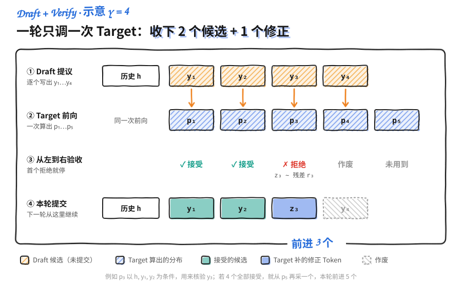
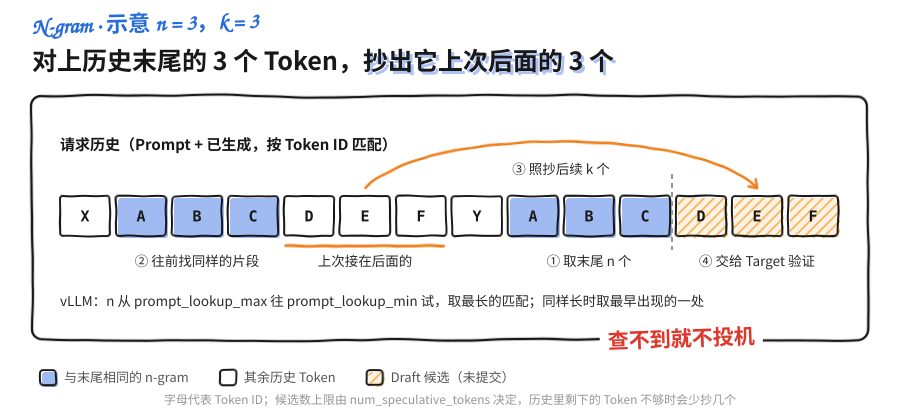

<a id="part4-ch5"></a>

# 第4部分 · 第5章：Speculative Decoding

> 总索引 ｜ [本部分目录](README.md) ｜ [上一章](ch04-量化.md) ｜ [下一章](ch06-分布式推理.md)

## 本章目录

- [本章导读](#part4-ch5)
- [5.1 投机解码核心原理：先猜一段，再让大模型验收](#part4-ch5-sec1)
- [5.2 Draft 模型与无模型方案：怎样便宜地猜得更准](#part4-ch5-sec2)
- [5.3 Medusa、EAGLE 与 MTP：复用大模型信息生成更好的草稿](#part4-ch5-sec3)
- [5.4 投机解码的收益边界：接受率高，为什么仍可能变慢](#part4-ch5-sec4)
- [5.5 vLLM 投机解码实战：配置、接受率与性能一起测](#part4-ch5-sec5)

---

## 本章导读

> 发布 2026-04-16 · 更新 2026-11-01 · 标签 "Speculative Decoding", "投机解码", "Medusa", "EAGLE", "MTP", "N-gram" · 单篇原文

### 📖 本章简介

Decode 慢，是因为大模型每读一遍权重只写出一个 Token。投机解码换了一种分工：让便宜的 Draft 先写一段草稿，再让 Target 一次前向批量验收，猜对的直接收下，猜错的由 Target 改写。只要验收与修正的规则做对，最终输出和 Target 自己逐个生成的分布完全一样。

本章按"为什么对、怎么猜、什么时候值、怎么测"四步展开：

- **原理**：一轮 Draft + Verify 的流程、接受概率与残差分布、无损证明，以及 KV Cache 怎样回退被拒的草稿。
- **草稿来源**：独立小模型、并行 Draft、N-gram 与 Suffix Decoding；Medusa、EAGLE 系列等复用 Target 特征的方案；以及模型自带的 MTP 模块。
- **收益边界**：用"每轮提交多少 Token / 每轮花多久"建立性能账本，分析投机长度、并发、长上下文、量化和流式输出的影响。
- **实战**：在 vLLM 上用同一个 Target 依次对比普通 Decode、N-gram、独立 Draft 与 EAGLE-3，同时采集接受指标、输出内容和延迟吞吐。

> ⏰ **信息时效**：原理部分与框架无关；vLLM 相关的参数、方法名与指标基于 v0.32.0（2026-10-18 发布）。投机解码的配置项在近几个版本中变动频繁，换版本时请对照官方文档核对。

### 📑 本章小节

- [**5.1 投机解码核心原理：先猜一段，再让大模型验收**](https://caomaolufei.github.io/AIInfraGuide/inference/模块四-推理优化/第5章-speculative-decoding/51-投机解码核心原理/)：Draft + Verify 流程、保分布证明、one-hot Draft、首个拒绝与 KV 回退
- [**5.2 Draft 模型与无模型方案：怎样便宜地猜得更准**](https://caomaolufei.github.io/AIInfraGuide/inference/模块四-推理优化/第5章-speculative-decoding/52-draft模型与无模型方案/)：独立小模型与 PARD、Tokenizer 兼容、N-gram/Suffix，以及接受率、平均接受长度与候选覆盖的统一口径
- [**5.3 Medusa、EAGLE 与 MTP：复用大模型信息生成更好的草稿**](https://caomaolufei.github.io/AIInfraGuide/inference/模块四-推理优化/第5章-speculative-decoding/53-medusa与eagle/)：Medusa 多头、Tree Attention、EAGLE-1/2/3、DeepSeek-V3 MTP、DFlash 与 Block Verification
- [**5.4 投机解码的收益边界：接受率高，为什么仍可能变慢**](https://caomaolufei.github.io/AIInfraGuide/inference/模块四-推理优化/第5章-speculative-decoding/54-收益边界与限制/)：提交长度与轮耗时、投机长度的收益递减、Dynamic SD、并发、量化与流式延迟
- [**5.5 vLLM 投机解码实战：配置、接受率与性能一起测**](https://caomaolufei.github.io/AIInfraGuide/inference/模块四-推理优化/第5章-speculative-decoding/55-vllm投机解码实战/)：基线、N-gram、Draft、EAGLE-3 对照，逐请求接受指标与 Benchmark

<a id="part4-ch5-sec1"></a>

## 5.1 投机解码核心原理：先猜一段，再让大模型验收

> 发布 2026-10-07 · 更新 2026-11-01 · 标签 "Speculative Decoding", "Draft", "Verify", "Rejection Sampling", "KV Cache" · 单篇原文

第 1 章把 Decode 比作接龙：大模型写完一个 Token，才知道下一个该接什么。第 2 章用批处理让一次权重搬运服务更多请求，第 4 章用低比特让每次搬得更少。这一章换个思路：**同一个请求，能不能一次大模型前向就确认好几个 Token？**

Speculative Decoding（投机解码）的答案是"先猜后验"：让便宜的 Draft 先写一段草稿，再让昂贵的 Target 一次性批改。猜对的部分直接收下，猜错的地方由 Target 改写。难点在于"改写"要怎么做，才能让最终输出和 Target 自己一个个写出来的**分布完全一样**。本节先讲清一轮的流程，再给出证明，最后落到 KV Cache 的工程细节。

> ⏰ **信息时效**：原理部分与框架版本无关；涉及 vLLM 实现的描述基于 v0.32.0（2026-10-18 发布）。


### 1. 串行瓶颈：每搬一次权重只写一个 Token

自回归生成每一步都依赖前面已经确定的 Token：

$$
x_{t+1}\sim p(\cdot\mid x_{\le t})
$$

$x_{t+1}$ 没定下来，$x_{t+2}$ 的条件分布就无从谈起。所以 Target 不能凭空"同时预测后面十个位置"，那样会丢掉后一个 Token 对前一个 Token 的依赖。

问题在于硬件利用率。小 Batch 的 Decode 基本是访存受限：GPU 把几十 GB 权重从显存读一遍，只为算一个位置，计算单元大部分时间在等数据。如果这一遍读取能顺便算好几个位置，单位 Token 的成本就降下来了。

投机解码正是利用这份空闲：先由别人提供几个**候选 Token**，Target 把它们当作已知输入，一次前向同时算出每个位置的条件分布，再逐个判断收不收。

用一个类比：主编逐字写稿太慢，于是请助手先写一段，主编一口气审完。最终内容仍由主编拍板，只是把"自己逐字起草"换成了"批量审阅草稿"。

📌 **关键点**：投机解码减少的是 **Target 的串行调用轮数**，自回归依赖本身并没有消失，独立 Draft 自己通常也还要逐 Token 生成。

---

### 2. Draft + Verify：一轮里发生了什么

#### 2.1 两个模型，两套条件分布

设已提交的历史为 $h$，本轮草稿长度为 $\gamma$：

- **Draft** 按 $q_i(\cdot)=q(\cdot\mid h,y_{<i})$ 依次提议 $y_1,\ldots,y_\gamma$。
- **Target** 在同样的历史上算出 $p_i(\cdot)=p(\cdot\mid h,y_{<i})$，用来核验第 $i$ 个候选。

这里的 $p$、$q$ 都是**实际用于采样的分布**，已经包含温度、Top-k/Top-p 等处理。后面的证明对任意一对归一化分布都成立，但前提是验收时用的就是采样时的那一对。

#### 2.2 为什么 Target 能一次验完

候选串一旦写好，对 Target 来说就是一段已知输入。它用 Causal Attention 同时算出所有位置的隐藏状态，第 $i$ 个位置只看得到 $h,y_{<i}$，不会偷看后面的候选。

这和训练时的 Teacher Forcing 是一回事：**输入已知，多个条件预测可以并行算；至于采不采用，稍后再决定。** 一轮实际会算出 $p_1,\ldots,p_{\gamma+1}$ 共 $\gamma+1$ 个分布，最后一个留给"全部接受"时再多生成一个 Token。

举个例子：Draft 猜了 4 个 Token，前 2 个通过、第 3 个被拒。那么本轮提交前 2 个，再在第 3 个位置补一个按规则重新采样的 Token，第 4 个候选直接作废。如果 4 个全部通过，就从 $p_5$ 再采一个，这一轮一共前进 5 个 Token。

下图按这个例子画出一轮的四步（斜纹黄格是还没提交的候选，绿格是接受的候选，蓝格是 Target 补的修正 Token，灰色虚线格作废）：



---

### 3. 接受规则：贪心与随机采样要分开

#### 3.1 贪心：和 Target 的 argmax 比

Target 用贪心解码时，规则很直接：第 $i$ 个候选等于 Target 在该位置的 `argmax` 就接受，否则换成 Target 的 `argmax` 并结束本轮。

这样得到的序列与 Target 自己贪心解码完全一致（前提是数值计算一致、并列最大值的处理一致）。但它只适用于温度为 0 的情况。

#### 3.2 随机采样：按概率比接受

温度大于 0 时，对从 $q_i$ 抽出的候选 $y_i$，标准 Speculative Sampling 的接受概率是：

$$
a_i(y_i)=\min\left(1,\frac{p_i(y_i)}{q_i(y_i)}\right)
$$

直观地说：Target 比 Draft 更看好这个 Token（$p\ge q$），就一定收下；Target 没那么看好，就按 $p/q$ 的比例打折收下。实现上抽一个 $u\sim U(0,1)$，$u<a_i$ 时接受。

被拒绝后，**不能简单地从 $p_i$ 重新抽一次**，而要从残差分布采样：

$$
r_i(x)=\frac{[p_i(x)-q_i(x)]_+}{\sum_z[p_i(z)-q_i(z)]_+},\qquad [v]_+=\max(v,0)
$$

残差只保留 Target 比 Draft "更想要"的那部分概率。必须这样做的原因见第 4 节的证明，第 7 节用代码演示错误做法的后果。

#### 3.3 Draft 只给 Token、不给概率时

N-gram 这类方法只产出 Token，没有概率；vLLM 对模型类 Draft 的默认设置 `draft_sample_method="greedy"` 也只取 Draft 的 argmax，不保存整份 Draft 概率。此时可以把 $q$ 看成落在候选上的 one-hot 分布：$q(y)=1$，其他位置为 0。

代入上面的公式，接受概率变成 $p(y)$；拒绝后的残差就是"把 $y$ 去掉、其余按 $p$ 重新归一化"。两条路径合起来依然恰好是 $p$，所以这仍是无损的。代价是 Draft 的概率信息没被利用，接受率取决于 Target 对 Draft 首选 Token 给出多大的概率。若改用 `"probabilistic"`，vLLM 会保存 Draft 的完整概率参与验收，代价是更多的显存占用。

🔑 **核心概念**：**残差分布是对接受路径"多给或少给"的概率质量做补偿。** 接受规则和修正采样必须成对使用，只改其中一个都会改变最终分布。

---

### 4. 正确性证明：两条路径合起来才是 Target

固定一个位置和它的历史，省略下标。推导思路与 [Leviathan 等人](https://arxiv.org/abs/2211.17192)、[Chen 等人](https://arxiv.org/abs/2302.01318)的论文一致。某个 Token $x$ 最终被输出，只有两条路：被 Draft 抽中并接受，或者在拒绝后从残差里抽中。

#### 4.1 接受路径贡献多少

先被抽中、再被接受的联合概率是：

$$
q(x)a(x)=q(x)\min\left(1,\frac{p(x)}{q(x)}\right)=\min(p(x),q(x))
$$

记总接受概率 $A=\sum_x\min(p(x),q(x))$，拒绝概率 $\beta=1-A$。由于 $p$、$q$ 都归一化，$\sum_x p(x)=\sum_x\min(p,q)+\sum_x[p-q]_+$，于是：

$$
\beta=\sum_x[p(x)-q(x)]_+
$$

这正是残差分布的分母。

#### 4.2 拒绝路径补上缺口

拒绝后按 $r$ 采样，输出 $x$ 的联合概率是：

$$
\beta\,r(x)=[p(x)-q(x)]_+
$$

两条路径相加：

$$
\Pr(\text{输出}=x)=\min(p(x),q(x))+[p(x)-q(x)]_+=p(x)
$$

证毕。$p=q$ 时 $\beta=0$，永远不会走到拒绝路径，残差分母为零的情况也就不会出现。

下图用第 7 节实验里的同一组数字验证这个等式（左侧蓝柱为 $p$、黄柱为 $q$；右侧绿色是接受路径 $\min(p,q)$，红色是拒绝路径补上的 $[p-q]_+$，两段叠起来正好等于 $p$）：

![p = [0.6, 0.3, 0.1]、q = [0.2, 0.5, 0.3] 时，接受路径给出 0.2、0.3、0.1，拒绝路径把 0.4 全部补给 Token A，相加后等于 p](../../../../public/images/speculative-decoding/residual-sampling-proof.svg)

⚠️ **注意**：只看"被接受的 Token"，它们服从的是 $\min(p,q)/A$，一般不等于 $p$。严格服从 Target 的，是接受与修正**合在一起**的最终输出。

#### 4.3 接受率反映两个分布有多接近

用全变差距离 $\operatorname{TV}(p,q)=\frac12\sum_x|p(x)-q(x)|$ 可以写出：

$$
A=1-\operatorname{TV}(p,q)
$$

Draft 和 Target 的分布重合得越多，需要修正的次数越少。不过这只是某个历史下单个位置的接受概率，离"整个请求快多少"还隔着成本账，第 5.4 节专门算这笔账。

---

### 5. 从一个位置推广到整段序列

每个被保留的 Token 都是在**真实已提交的前缀**上按上述规则产生的，所以可以逐位置归纳，得到整段序列的分布与 Target 一致：

$$
\Pr(x_{1:n}\mid h)=\prod_{i=1}^{n}p(x_i\mid h,x_{<i})
$$

#### 5.1 为什么首个拒绝后必须停

假设 $y_3$ 被拒、换成了 $z_3$。已经算好的 $p_4$ 是以 $h,y_1,y_2,y_3$ 为条件的，而真实历史已经变成 $h,y_1,y_2,z_3$。$y_4$ 的验收依据随之失效，哪怕它看起来"也挺合理"。

所以每轮只能提交**连续接受的前缀**，不能跳过错误位置去拼后面的候选。第 5.3 节的 Draft Tree 只保留一条合法路径，依据的也是这一点。

#### 5.2 为什么可以多出一个 Token

全部 $\gamma$ 个候选都通过时，$p_{\gamma+1}$ 已经在正确的历史上算好了，直接从中采样即可；中途被拒时则补一个修正 Token。两种情况都保证每轮至少前进 1 个、至多 $\gamma+1$ 个 Token。

遇到 EOS、Stop String、输出长度上限或上下文上限时，实际提交会更短。引擎会在停止条件处截断，不会为了凑满一轮而越过它。

---

### 6. KV Cache：草稿不是已经提交的历史

候选进入 Target 前向时，会先占用 KV 槽位。但在验收结果出来之前，这些 KV 只是"试算"：被拒的部分必须作废，否则下一轮就会读到一段从未真正发生的历史。

| 📦 状态 | 应该怎么处理 | 常见错误 |
|---|---|---|
| 已提交历史 | 保留对应 KV | 回退时误删了 Prompt 的 KV |
| 连续接受的候选 | 直接复用验证时算出的 KV | 再跑一遍前向，白白浪费收益 |
| 被拒位置及其后缀 | 标记失效，回退缓存指针 | 下一轮还读到错误候选的 KV |
| 修正 / 额外 Token | 提交，但 KV 留到下一轮作为输入时再算 | 把"已采样"误当成"已有 KV" |

最后一行是最容易出 off-by-one 的地方：修正 Token 已经对外输出，但它自己的 KV 要等它作为下一次前向的输入时才会生成。所以引擎内部要分别记录**已提交 Token 数**和**已计算 KV 的 Token 数**。

Draft 如果有自己的 KV Cache，也要跟着回退到最终提交的历史上。Target 否决了 $y_3$，Draft 下一轮就必须从 $z_3$ 接着猜，而不是沿着自己原来的 $y_3$ 往下走。

📌 **关键点**：概率证明管"每个 Token 怎么采"，缓存与调度管"下一轮看到的历史对不对"。两者任何一处错位，理论上的无损都落不了地。

---

### 7. 动手实验：错误的重采样怎样改变分布

下面只用 Python 标准库，模拟**固定历史下的一个位置**，不加载模型，也不涉及 GPU 性能。代码对比三种做法：标准规则、拒绝后直接从 $p$ 重抽的错误规则，以及第 3.3 节的 one-hot Draft。

```python
import random
from collections import Counter

p = [0.6, 0.3, 0.1]  # Target
q = [0.2, 0.5, 0.3]  # Draft


def final_dist(p, q, resample):
    """接受路径 min(p, q) + 拒绝概率 × 拒绝后采样分布。"""
    overlap = [min(a, b) for a, b in zip(p, q)]
    beta = 1 - sum(overlap)
    return [o + beta * r for o, r in zip(overlap, resample)]


beta = sum(max(a - b, 0) for a, b in zip(p, q))
residual = [max(a - b, 0) / beta for a, b in zip(p, q)]
print("标准规则:", final_dist(p, q, residual))
print("错误规则（拒绝后直接抽 p）:", final_dist(p, q, p))

# one-hot Draft：总是提议 q 的 argmax（索引 1，即第二个 Token），q 退化为 [0, 1, 0]
q_onehot = [0.0, 1.0, 0.0]
beta1 = sum(max(a - b, 0) for a, b in zip(p, q_onehot))
residual1 = [max(a - b, 0) / beta1 for a, b in zip(p, q_onehot)]
exact = final_dist(p, q_onehot, residual1)
assert all(abs(a - b) < 1e-12 for a, b in zip(exact, p))
print("one-hot Draft:", exact, "接受率:", 1 - beta1)

# 蒙特卡洛验证标准规则
rng = random.Random(42)
counts, accepted, trials = Counter(), 0, 100_000
for _ in range(trials):
    y = rng.choices(range(3), weights=q)[0]
    if rng.random() < min(1, p[y] / q[y]):
        token, accepted = y, accepted + 1
    else:
        token = rng.choices(range(3), weights=residual)[0]
    counts[token] += 1
print("经验分布:", [counts[i] / trials for i in range(3)], "接受率:", accepted / trials)
```

标准规则下，接受路径贡献 $[0.2,0.3,0.1]$，拒绝概率 0.4 全部补给第一个 Token，最终恢复 $[0.6,0.3,0.1]$。错误规则得到 $[0.44,0.42,0.14]$：第二、第三个 Token 都被高估了 40%，第一个被低估了约 27%。one-hot Draft 的接受率只有 0.3，但最终分布同样是 $p$，说明无损和接受率高低是两回事。

蒙特卡洛结果会有几个千分点的波动，它用来帮助理解证明，正确性仍以精确计算为准。

---

### 8. 工程边界：无损到底保证什么

"无损"是一个精确的数学承诺，覆盖范围也要说准：

- **保证分布一致**：正确实现的投机采样，输出分布等于**被验证的那个 Target** 的分布。
- **不保证逐字相同**：随机采样时，两条执行路径消耗随机数的方式不同，同一个 Seed 也可能得到不同文本。
- **不修复 Target 本身**：Target 若已量化，保证针对的是量化后的模型，不会自动恢复成原始 BF16 模型。
- **只覆盖标准规则**：阈值放行、Typical Acceptance、vLLM 用于压测的 `synthetic` 模式等都不在此列，需要单独评估质量。

重复惩罚、结构化输出这类依赖历史的 Logits Processor，在验证时也要按每个候选前缀分别更新状态。框架是否支持某种组合，以所用版本的文档和测试为准。

[vLLM 文档](https://docs.vllm.ai/en/stable/features/speculative_decoding/#lossless-guarantees-of-speculative-decoding)把无损拆成三层：理论上无损（受限于硬件数值精度）、算法层面由 Rejection Sampler 的收敛测试与贪心一致性测试保证，以及不承诺 logprobs 完全稳定。Batch 形状和 Kernel 不同，可能让两个几乎并列的 Logits 交换大小，所以上线前仍需要做端到端的输出比对。

---

### 📝 总结

- 投机解码让便宜的 Draft 先写候选，再用一次 Target 前向批量验证，减少的是 Target 的串行轮数。
- 并行计算的是**已知候选**的条件分布，自回归依赖仍然存在。
- 贪心时比较 argmax；随机采样时按 $\min(1,p/q)$ 接受，拒绝后从残差 $[p-q]_+$ 归一化采样。
- 接受路径贡献 $\min(p,q)$，拒绝路径补上 $[p-q]_+$，两者相加恰好是 $p$。
- 只给 Token 的 Draft 可视为 one-hot 的 $q$，同样无损，只是接受率取决于 $p(y)$。
- 每轮只提交连续接受前缀加 1 个新 Token，首个拒绝后的候选全部作废。
- KV 回退、Draft 状态同步和 Logits Processor 状态，是无损能否落地的工程部分。
- 无损以实际 Target 为基准，不等于文本逐字一致，也不等于一定提速。

### 🎯 自我检验清单

- 能解释为什么候选已知时可以并行验证，而未知的未来不能直接并行生成
- 能标出 $p_i$ 和 $q_i$ 分别以哪一段历史为条件
- 能写出贪心与随机采样两种接受规则
- 能从接受、拒绝两条路径推导出最终分布等于 $p$
- 能用数值例子说明拒绝后直接从 $p$ 重抽为什么有偏
- 能解释 one-hot Draft 为什么仍然无损
- 能说明首个拒绝后必须丢弃后缀的原因，以及额外 Token 从哪里来
- 能区分已提交 Token、已计算 KV 和临时候选三种状态
- 能说清"无损"在量化 Target、相同 Seed 和近似验收下的边界

### 📚 参考资料

- [Fast Inference from Transformers via Speculative Decoding（Leviathan et al., 2023）](https://arxiv.org/abs/2211.17192)
- [Accelerating Large Language Model Decoding with Speculative Sampling（Chen et al., 2023）](https://arxiv.org/abs/2302.01318)
- [vLLM — Speculative Decoding 与无损保证](https://docs.vllm.ai/en/stable/features/speculative_decoding/)
- [vLLM v0.32.0 — Rejection Sampler 实现](https://github.com/vllm-project/vllm/blob/v0.32.0/vllm/v1/sample/rejection_sampler.py)
- [vLLM v0.32.0 — SpeculativeConfig（draft_sample_method 等字段）](https://github.com/vllm-project/vllm/blob/v0.32.0/vllm/config/speculative.py)

---

<a id="part4-ch5-sec2"></a>

## 5.2 Draft 模型与无模型方案：怎样便宜地猜得更准

> 发布 2026-10-07 · 更新 2026-11-01 · 标签 "Draft Model", "N-gram", "Prompt Lookup", "Suffix Decoding", "Acceptance Rate" · 单篇原文

上一节证明了：只要验收与修正做对，Draft 猜得再差也不会把输出带偏。但从性能上看，草稿写得慢、又总被否决，投机就成了白忙一场。所以本节的问题是：**怎样让"猜一段"的成本，低于"少调几次大模型"省下来的时间？**

答案不一定是再加载一个神经网络。模型输出经常复制 Prompt，代码反复出现同样的标识符，Agent 一遍遍走相似的步骤，这些历史本身就是现成的草稿来源。本节把独立小模型、N-gram 和 Suffix Decoding 放到同一张表上比较，并在最后统一接受率的统计口径，后续 5.4、5.5 都沿用这里的定义。

> ⏰ **信息时效**：框架行为与参数默认值基于 vLLM v0.32.0（2026-10-18 发布）源码与文档。


### 1. 好 Draft 的标准：快、准、能接上

负责提议候选的组件叫 Proposer。一个好用的 Proposer 要同时满足三点：

1. **便宜**：生成候选的耗时、显存和通信开销小。
2. **准**：在真实业务上，候选经常与 Target 的选择一致。
3. **接得上**：Token ID、上下文、缓存与采样规则能和推理引擎对接。

就像招助手：工资低只是一方面，还要看他写的稿子主编改起来费不费劲，以及他交的文件能不能在主编的软件里打开。

| 📊 路线 | 候选从哪来 | 额外权重 | 擅长的场景 |
|---|---|---|---|
| 独立 Draft 模型 | 小模型的条件预测 | 有 | 能提议历史中没出现过的新内容 |
| N-gram / Prompt Lookup | 历史中相同的 Token 片段 | 无 | 复制、抽取、改写 |
| Suffix Decoding | 后缀树匹配 + 续写频次 | 无 | 重复轨迹、代码编辑、相似请求 |

📌 **关键点**："无模型"只是说没有额外的神经网络权重。查找、索引维护、CPU 与 GPU 之间的数据传递以及 Target 验证，都有各自的成本。

---

### 2. 独立小模型：不是越小越好

#### 2.1 小模型为什么够用

一段文本里，并不是每个位置都同样难。标点、常见连接词、语法结构、上文出现过的变量名，小模型也能猜得八九不离十。把这些"容易的位置"交给小模型，Target 只需要验收。

参数量只是一个粗略的成本指标。Draft 的实际延迟还取决于层数、Attention 结构、KV 长度、Kernel 实现和 Batch 大小。一个层数很深的 0.5B 模型，逐 Token 生成时未必比层数浅的 1B 模型快。

#### 2.2 与 Target 对得上，比自身分数高更重要

挑 Draft 时要看的是**它在目标业务上与 Target 有多一致**：

- Target 擅长代码，而 Draft 没怎么见过代码，语法部分能猜中，算法选择就会频繁被拒。
- 训练数据、对齐方式或语言分布不同，常用的续写习惯也会错开。同一家族、同一批数据训练的小模型通常是首选，vLLM 文档的示例就是 `Qwen/Qwen3-8B` 搭配 `Qwen/Qwen3-0.6B`。
- Draft 更大往往接受得更多，但多出来的 Draft 时间可能把收益吃掉。

所以选型的依据是实测的"（Draft 耗时 + 验证耗时）/ 已提交 Token 数"，排行榜分数只能当参考。

#### 2.3 并行 Draft：一次前向出多个候选

传统 Draft 要逐 Token 跑 $\gamma$ 次前向，草稿越长越慢。[PARD](https://arxiv.org/abs/2504.18583)（Parallel Draft Model）换了一种训练方式，让 Draft 一次前向就预测出多个位置，Draft 的耗时基本不再随 $\gamma$ 线性增长。vLLM v0.32.0 通过 `"parallel_drafting": true` 启用，官方示例给 `amd/PARD-Qwen3-0.6B` 配了 12 个候选。这类方法需要专门训练的 Draft 权重，普通小模型打开这个开关并不会变成并行 Draft。

#### 2.4 额外模型会挤占服务容量

独立 Draft 除了权重，还有自己的 KV Cache、激活和工作空间。显存总量不变，留给 Target KV 的空间就会变少，能同时服务的请求也随之减少。

单请求变快、最大并发变小，这两件事可以同时发生。5.5 节的实战会把低并发延迟和服务容量分开测。

---

### 3. Tokenizer 与上下文：两个模型要说同一种语言

#### 3.1 文本相同，Token ID 未必相同

第 5.1 节的 $p(x)$、$q(x)$ 默认定义在同一个 Token 空间上。两个 Tokenizer 都能编码"hello"，不代表它们切分方式一样，更不代表每个整数编号含义一样。

需要核对的是词表的 Token → ID 映射、特殊 Token（BOS/EOS/Chat 模板标记），以及 Target 实际使用的 Chat Template。`vocab_size` 相同只说明数量一样。

下面的检查需要 `transformers`，只下载两个模型的 Tokenizer 文件，不下载权重、不运行推理（首次运行要联网）：

```python
from transformers import AutoTokenizer

target = AutoTokenizer.from_pretrained("Qwen/Qwen3-8B")
draft = AutoTokenizer.from_pretrained("Qwen/Qwen3-0.6B")

t_vocab, d_vocab = target.get_vocab(), draft.get_vocab()
diff = {tok for tok in t_vocab.keys() | d_vocab.keys()
        if t_vocab.get(tok) != d_vocab.get(tok)}
print("映射不一致的 Token 数:", len(diff))
print("EOS:", target.eos_token_id, draft.eos_token_id)

messages = [{"role": "user", "content": "你好"}]
same_template = target.apply_chat_template(messages, tokenize=True) == \
    draft.apply_chat_template(messages, tokenize=True)
print("同一段对话的模板编码是否一致:", same_template)
```

推理时 Draft 读的是 Target 那一份已编码的历史，不会自己再套一遍模板。所以模板差异影响的是 Draft 有没有"见过"这种格式，进而影响接受率。

#### 3.2 词表不同：单独的工程路线

vLLM 默认要求两边共享词表。v0.32.0 提供了 `use_heterogeneous_vocab: true`，用 Token-Level Intersection（TLI）算法支持不同家族、不同 Tokenizer 的 Draft，但目前只能用于 `draft_model` 方法，并且只支持默认的 `draft_sample_method="greedy"`。

#### 3.3 Draft 的上下文不能悄悄变短

Draft 要能处理"实际历史 + 候选"的总长度。最大上下文、RoPE 配置和长文能力不一致时，长请求可能直接失败，或者接受率在长文本上明显下滑。部署前应把 Draft 的 `max_model_len` 与 Target 对齐，或者明确记录 Draft 只看部分历史这一设计。

---

### 4. N-gram：在历史里找已经写过的下一段

#### 4.1 先对上尾巴，再抄后面

假设当前历史末尾是 `[A, B, C]`，而更早的位置出现过 `[A, B, C, D, E, F]`。查找器发现尾巴对得上，就把后面的 `[D, E, F]` 当作候选交给 Target。

下图按 $n=3$、$k=3$ 走一遍查找过程（蓝格是与末尾相同的 3-gram，斜纹黄格是抄出来的候选）：



匹配发生在 **Token ID 序列**上，与中文分词或字符数无关。这里有两个独立的参数：

- **查找窗口** $n$：vLLM 中是 `prompt_lookup_min` 和 `prompt_lookup_max`。两者都不设时默认为 5；只设一个时，另一个取同样的值。
- **提议长度**：`num_speculative_tokens`，最多抄出多少个后续 Token。

vLLM v0.32.0 的 CPU 实现会在**整个请求历史**（Prompt 加已生成内容）中查找，优先取 $[\text{min},\text{max}]$ 范围内**最长**的匹配，同样长度时取**最早出现**的位置。另有 `ngram_gpu` 方法把查找放到 GPU 上，V1 和 V2 Model Runner 都能用；V2 Model Runner 中 `ngram` 也会走 GPU 实现，v0.32.0 还让它支持变长草稿。

#### 4.2 窗口长短的权衡

- 窗口长：约束强，候选更可能相关，但命中更少。
- 窗口短：容易命中，却可能只是对上了一个逗号加"的"，后面的续写分歧很大。
- 提议长：一次抄得多，可能省下更多 Target 调用，也可能前几个就被拒，后面全白算。

Prompt Lookup 最适合"输出大量复用输入"的任务：摘要引用原文、代码只改几行、按模板抽取字段。

#### 4.3 没有概率，怎么验证

N-gram 给出的是确定的 Token。按第 5.1 节 3.3 的分析，可以把它看成 one-hot 的 $q$，验收规则退化为"以 $p(y)$ 的概率接受"，残差就是去掉 $y$ 后按 $p$ 重新归一化。结论不变：输出分布仍是 Target 的。

---

### 5. Suffix Decoding：从一次匹配到历史统计

N-gram 的思路是"以前写过同样的尾巴，后面大概还能照抄"，每次只看一处匹配。[SuffixDecoding](https://arxiv.org/abs/2411.04975) 更进一步：用后缀树把历史组织起来，记录每种续写出现过多少次，再挑最有把握的路线。

#### 5.1 频次当作便宜的置信度

假设某个后缀之后，`return` 出现过 20 次、`raise` 出现过 2 次，那么先提议 `return` 显然更划算。续写越分散，就越不值得往深处猜。vLLM 用 `suffix_decoding_min_token_prob`（默认 0.1）过滤掉估计概率太低的 Token。

这些频次只是 Proposer 内部的排序依据，不是 Target 的条件概率，最终收不收仍由 Target 验证决定。

#### 5.2 历史范围与动态长度

Suffix Decoding 维护两类后缀树：

- **Prompt 树**：针对当前请求的 Prompt 和已生成内容。
- **全局树**：跨请求缓存历史输出，由 `suffix_decoding_max_cached_requests`（默认 10000）控制规模，设为 0 即关闭。

每一步提议多少个 Token 是动态决定的：匹配越长、越有把握，就猜得越多。因此 `num_speculative_tokens` 在这里是**上限**，文档建议设到 16 或 32；v0.32.0 中不设时，代码取 `suffix_decoding_max_tree_depth` 的值（默认 24）。它在代码编辑、Agent 自我反思循环、RL Rollout 这类高重复任务上效果明显；生成全新内容时，历史再多也帮不上忙。

#### 5.3 接入成本

| 🔍 成本项 | 要核对什么 |
|---|---|
| 搜索与更新 | 建树、更新频次是否拖慢每一步 |
| 历史存储 | 全局树缓存多少请求、占多少内存 |
| 统计作用域 | 跨请求共享历史是否符合业务的数据隔离要求 |
| 依赖 | 需要 `pip install arctic-inference`，记录版本 |

💡 **提示**：全局树会让一个用户的输出影响另一个用户请求的候选。候选仍要经过 Target 验证，输出分布不受影响；但在多租户场景，是否允许这种共享，应由业务的隔离要求决定。

📌 **关键点**：Prefix Cache 复用的是**已经算过的 KV**，减少重复 Prefill；N-gram/Suffix 提议的是**可能要生成的 Token**，仍需验证。两者都叫"复用历史"，但统计指标不能混在一起。

---

### 6. 动手实验：匹配窗口与候选覆盖

下面用整数代替 Token ID，按 vLLM 的规则实现一个简化查找器：从长窗口往短窗口找，同长度取最早出现的位置。它只演示规则，vLLM 实际用的是一次扫描完成的 KMP 变体。

```python
def propose(history, min_n=2, max_n=4, k=3):
    """返回 (命中窗口长度, 候选)；未命中返回 (None, [])。"""
    for n in range(min(max_n, len(history) - 1), min_n - 1, -1):
        tail = history[-n:]
        # 起点 < len - n，排除尾巴自身；从前往后扫，取最早的匹配
        for start in range(len(history) - n):
            if history[start:start + n] == tail:
                return n, history[start + n:start + n + k]
    return None, []


h1 = [10, 11, 12, 20, 21, 99, 10, 11, 12]
print("h1:", propose(h1))                      # (3, [20, 21, 99])
print("h1 只允许 4-gram:", propose(h1, min_n=4))  # (None, [])

h2 = [7, 8, 1, 7, 8, 2, 7, 8]                  # 尾巴 [7, 8] 出现过两次
print("h2:", propose(h2))                      # 取最早一处：(2, [1, 7, 8])
print("没有重复:", propose([1, 2, 3, 4, 5]))
```

`h1` 命中 3-gram，限制成 4-gram 就没有候选。`h2` 里尾巴 `[7, 8]` 后面跟过 1 也跟过 2，规则选最早的一处，提议 1；如果 Target 这次想写 2，候选就会第一位被拒。

可以给 `h2` 再加几次 `7, 8, 2`，想想 Suffix Decoding 按频次会提议什么，对比"取某一处匹配"和"按历史频次挑续写"的差别。

---

### 7. 接受率：先把分母说清楚

#### 7.1 三个相关但不同的量

本章后面都用这一组定义。设观测区间内一共提出 $D$ 个候选 Token、接受了其中 $C$ 个，共进行了 $R$ 轮验收：

$$
\text{Draft Acceptance Rate}=\frac{C}{D}
$$

$$
\text{Mean Acceptance Length}=1+\frac{C}{R}
$$

平均接受长度里的"加一"，是每轮都会提交的那个修正或额外 Token。vLLM 的逐请求指标和 Prometheus 指标都采用这两个口径。

第三个量是**候选覆盖**：有多少步真正提出了候选。N-gram 查不到时这一步就不投机，若只统计有候选的轮次，90% 的接受率背后可能只有 10% 的步骤在投机。

#### 7.2 固定长度与动态长度不能互相换算

只有每轮都提出相同的 $\gamma$ 个候选时，才有 $D=\gamma R$，此时平均接受长度可写成 $1+\gamma\cdot C/D$。Suffix、动态 SD 这类每轮长度不同的方案，必须直接用实际的 $D$ 和 $R$ 计算。

另一个常见混淆是位置上的接受率："第 $i$ 位在前面都通过时被接受的概率"和"从第 1 位一路通过到第 $i$ 位的概率"是两回事，后者随 $i$ 增大衰减得快得多。vLLM 的 `vllm:spec_decode_num_accepted_tokens_per_pos_total`（按 `position` 标签区分位置）统计的是后者对应的计数。

⚠️ **注意**：接受率 90% 不等于提速 90%。Draft 生成、验证长度、显存容量和调度负载都会进入耗时的分母，第 5.4 节专门推导这笔账。

---

### 8. 工程选型：按业务和资源挑候选

| 🎯 业务特征 | 先试哪种 | 重点观察 |
|---|---|---|
| 输出大量复用 Prompt | N-gram | 候选覆盖、查找窗口、接受前缀长度 |
| 重复编辑、相似轨迹多 | Suffix | 全局树作用域、动态长度、建树开销 |
| 新内容多、复制少 | 独立 Draft / PARD | 与 Target 的一致性、Draft 耗时、额外显存 |
| 模型自带或有适配的辅助模块 | MTP / EAGLE（见 5.3） | 产物与 Target 版本是否匹配 |

先拿真实的 Prompt 和采样配置，测出候选覆盖、平均接受长度和端到端延迟，再决定要不要上更复杂的方案。"代码""对话"只是任务标签，真正决定效果的是重复程度、分布匹配与系统成本。

✅ **收益机会**：便宜又容易命中的候选，可以减少 Target 的调用次数。

❌ **代价**：独立模型要占显存；无模型方案依赖可复用的历史；两者都要额外维护缓存与验证流程。

---

### 📝 总结

- 好 Draft 要同时做到便宜、准、接得上，参数少只是其中一项。
- 独立小模型能猜新内容，但要算上权重、KV 和能力匹配；PARD 用并行 Draft 降低草稿延迟。
- `vocab_size` 相同不等于 Token ID 一致，特殊 Token、模板和上下文长度都要核对；异构词表需要 TLI。
- N-gram 用历史尾部匹配后续，查找窗口和提议长度是两个参数；vLLM 取最长、最早的匹配。
- Suffix 用后缀树和频次动态决定提议长度，成本在建树、缓存和依赖上。
- 确定性候选等价于 one-hot 的 $q$，配合标准验收依然无损。
- 接受率 $C/D$、平均接受长度 $1+C/R$ 和候选覆盖要分开报告。

### 🎯 自我检验清单

- 能说明为什么更大的 Draft 可能更准却更慢
- 能列出独立 Draft 额外占用的显存项
- 能写一段脚本检查两个 Tokenizer 的 Token → ID 映射是否一致
- 能区分 N-gram 的查找窗口与提议长度，并说出 vLLM 的默认值
- 能描述 vLLM N-gram 在多处匹配时选哪一处
- 能说明 Suffix 的频次为什么仍需 Target 验证，以及全局树的隔离风险
- 能区分 Prefix Cache 与历史 Token 提议
- 能用 $C$、$D$、$R$ 计算接受率与平均接受长度，并指出动态长度下的换算陷阱

### 📚 参考资料

- [Fast Inference from Transformers via Speculative Decoding（Leviathan et al., 2023）](https://arxiv.org/abs/2211.17192)
- [Transformers — Assisted Decoding 与 Prompt Lookup](https://huggingface.co/docs/transformers/assisted_decoding)
- [SuffixDecoding: Extreme Speculative Decoding for Emerging AI Applications（Oliaro et al.）](https://arxiv.org/abs/2411.04975)
- [Snowflake — Arctic Inference 官方实现](https://github.com/snowflakedb/ArcticInference)
- [PARD: Accelerating LLM Inference with Low-Cost PARallel Draft Model Adaptation（An et al.）](https://arxiv.org/abs/2504.18583)
- [vLLM — Draft Models](https://docs.vllm.ai/en/stable/features/speculative_decoding/draft_model/)
- [vLLM — Parallel Draft Models](https://docs.vllm.ai/en/stable/features/speculative_decoding/parallel_draft_model/)
- [vLLM — N-Gram Speculation](https://docs.vllm.ai/en/stable/features/speculative_decoding/n_gram/)
- [vLLM — Suffix Decoding](https://docs.vllm.ai/en/stable/features/speculative_decoding/suffix/)
- [vLLM v0.32.0 — N-gram Proposer 实现](https://github.com/vllm-project/vllm/blob/v0.32.0/vllm/v1/spec_decode/ngram_proposer.py)

---

<a id="part4-ch5-sec3"></a>

## 5.3 Medusa、EAGLE 与 MTP：复用大模型信息生成更好的草稿

> 发布 2026-10-07 · 更新 2026-11-01 · 标签 "Medusa", "EAGLE", "EAGLE-3", "MTP", "Draft Tree", "Tree Attention" · 单篇原文

独立 Draft 像另请了一位助手：工资低，但他得自己把全文再读一遍、另记一份笔记才能动笔。另一种思路是让助手直接用上主编已经形成的理解：Target 的隐藏状态里装着它对上文的理解，**在这些表示上接几个小头或一个轻量网络，往往比从 Token 开始再跑一个完整模型更划算。**

这一类方法统称 Self-Draft，本节按出现顺序介绍：Medusa 在 Target 上挂多个预测头，EAGLE 系列训练一个读取 Target 特征的小网络，MTP 则是模型预训练时就自带的多 Token 预测模块。它们都需要专门训练的权重，而且这些权重和 Target 的具体版本绑定。

> ⏰ **信息时效**：论文结论以各自 arXiv 版本为准；vLLM 支持情况基于 v0.32.0（2026-10-18 发布），SGLang 参数以其官方文档为准。


### 1. Self-Draft：复用什么，增加什么

| 📊 路线 | 复用 Target 的什么 | 新增部分 | 怎么得到 |
|---|---|---|---|
| 独立 Draft | 只共享 Token 历史 | 一个完整的小模型 | 选同家族的兼容模型 |
| Medusa | 最后一层隐藏状态 | 多个预测头 | 在 Target 上训练这些头 |
| EAGLE / EAGLE-2 | 高层特征 + Token | 一层左右的草稿网络 | 针对 Target 训练 |
| EAGLE-3 | 低、中、高多层特征 + Token | 草稿网络 | 改进的训练流程 |
| MTP | 共享 Embedding 与输出头 | 预训练时一起训练的 MTP 模块 | 随模型权重一起发布 |

这些方法改进的都是"出草稿"这一步，Target 仍要验证。辅助模块的权重、激活和缓存同样要计入显存预算。

🔑 **核心概念**：**复用 Target 的表示，省掉重复理解；保留 Target 的验收，最终输出仍由它决定。** 是否严格保分布，取决于用的是哪种接受规则（见第 9 节）。

---

### 2. Medusa：一次隐藏状态，多个未来预测头

#### 2.1 多个头一起猜

普通 LM Head 把当前隐藏状态 $h_t$ 映射成下一个 Token 的分布。[Medusa](https://arxiv.org/abs/2401.10774) 在同一个 $h_t$ 上再挂 $K$ 个小头，第 $k$ 个头直接预测更远的第 $t+k+1$ 个位置：

$$
q^{(k)}=\operatorname{softmax}\big(g_k(h_t)\big),\qquad k=1,\ldots,K
$$

每个 $g_k$ 是一个带残差连接的单层前馈网络。所有头读的是同一个 $h_t$，可以一次算完，不必像独立 Draft 那样串行跑好几步。

代价也很明显：第 3 个头预测时，并不知道第 1、2 个位置最后选了什么。越远的头越像"闭着眼猜"，准确率衰减得越快。

#### 2.2 多个候选组成一棵树

每个头只取 Top-1，前面错一个整条链就废了。Medusa 让每个头保留几个候选，把可能的组合组织成一棵树，让 Target 一次验完多条分支。

但不能把每个头 Top-k 的所有组合都展开：每层 $b$ 个分支、深 $d$ 层，节点数是 $b^d$ 量级。Medusa 的做法是在校准集上统计各条路径的命中情况，只保留最有希望的那些节点，构成一棵稀疏树。

#### 2.3 Medusa-1 与 Medusa-2

论文给出了两种训练方式：

- **Medusa-1**：冻结 Target 骨干，只训练预测头。Target 没变，配合精确验收可以做到无损。
- **Medusa-2**：骨干和预测头一起训练，让表示更适合预测远处的 Token。

Medusa-2 实际上已经得到了一个新的 Target。即使验收是精确的，它保证的也是对新模型的分布一致，评测时要拿训练前的原模型做质量对照。就像只给主编配助手，和连主编的写作习惯一起重新训练，是两种程度的改动。

---

### 3. Draft Tree 与 Tree Attention

#### 3.1 树上每条路径是一段不同的历史

同一个前缀后面可能接 `return`，也可能接 `raise`，它们的后续分别属于两段互斥的历史。Tree Attention 规定：每个节点只能看到共同前缀和**自己的祖先**。

把树节点展平成一个数组送进 Attention 时，不能用普通的下三角 Mask，否则排在后面的 B 分支会看到 A 分支，等于把两种互斥的续写当成了连续文本。

下图用第 8 节实验里的同一棵树（`parents = [-1, 0, 0, 1, 2]`）画出树形 Mask。黄色是 `return` 分支，蓝色是 `raise` 分支；矩阵中实心蓝格表示可见，红色斜纹是下三角 Mask 会误看到的位置，最右一列是按深度编号的 Position ID：


#### 3.2 Position ID 按深度编号

同一层的兄弟节点处在序列的同一个位置，Position ID 应该按树深度设，而不是按展平后的数组下标递增。Mask 决定"能看到谁"，Position ID 决定"自己在第几个位置"，两者都要对。

所有节点共享前缀的 KV；验证结束后只提交一条通过验收的路径，其他分支的临时 KV 全部作废。

📌 **关键点**：Tree Attention 是一次算多条候选历史的批处理技巧。它保证每条路径的计算各自正确，选哪条路径则由验收规则决定。

---

### 4. EAGLE：从特征出发的轻量草稿

#### 4.1 为什么在特征上做草稿

独立小模型要从 Token 开始重新跑一遍网络，相当于把 Target 已经做过的理解再做一次。[EAGLE](https://arxiv.org/abs/2401.15077) 的观察是：Target 进入 LM Head 之前的顶层特征（论文称 second-to-top-layer feature）比 Token 更有规律，用"一个全连接层 + 一层 Decoder"的小网络，就能根据当前特征自回归地预测下一个特征，再通过 Target 的 LM Head 转成 Token 候选。

#### 4.2 只看特征不够，还要看 Token

特征序列并不完全决定未来。采样时 Target 选了 `return` 还是 `raise`，下一步的特征会走向完全不同的方向。所以 EAGLE 的草稿网络同时输入两样东西：当前特征，以及**已经采样出的下一个 Token**（提前一步的 Token 序列）。Token 信息消除了"走哪条分支"的不确定性。

草稿网络的输出照样交给 Target 验证。由于它读的是 Target 的特征，结构、隐藏维度、特征层位置和训练所用的 Target 都必须对得上。

⚠️ **注意**：EAGLE 权重和具体的 Target 版本绑定。参数规模相同、名字相近的两个 8B 模型，不能共用同一份 EAGLE 权重。

---

### 5. EAGLE-2：把树预算花在更有把握的路径上

#### 5.1 固定树的浪费

EAGLE 和 Medusa 都用静态树：每一轮的深度和分支数固定不变。可实际上，有的上下文后续几乎是确定的，适合往深处猜；有的一开始就有好几种写法，适合铺宽。

[EAGLE-2](https://arxiv.org/abs/2406.16858) 发现草稿模型的置信度与实际接受率高度相关，于是用置信度在每一轮动态地扩展和剪枝候选树，让有限的节点预算落在最可能被接受的地方。

#### 5.2 看整条路径，而不只看当前节点

一个节点自己的置信度是 0.95，但它的父节点只有 0.1 的机会被接受，那它最终被提交的机会也很小。树上的路径必须从根一路连续通过，所以 EAGLE-2 用路径上置信度的乘积来估计节点价值：

$$
v(u)\approx\prod_{j\in\operatorname{path}(u)}c_j
$$

其中 $c_j$ 是草稿模型对路径上第 $j$ 个节点的置信度。扩展阶段选 $v$ 最高的若干节点继续往下长；重排阶段再从所有节点里挑 $v$ 最高的一批送去验证。

#### 5.3 置信度只用来分配预算

"置信度与接受率相关"是在论文的模型和任务上测出来的经验关系，换模型、换温度、换任务都应重新确认。另外，$v(u)$ 只决定把哪些节点送去验证，验证本身仍是第 5.1 节（投机解码核心原理）的标准规则，置信度并不参与接受与否的判定。

---

### 6. EAGLE-3：改变训练目标与输入信息

[EAGLE-3](https://arxiv.org/abs/2503.01840) 的作者发现，EAGLE 增加训练数据后提升很有限，原因在于"必须预测出 Target 的下一个特征"这个约束限制了草稿网络。EAGLE-3 做了三处改动：

1. **去掉特征预测损失**，只用 Token 预测作为训练目标，让草稿网络自由学习对预测有用的表示。
2. **融合多层特征**：把 Target 低、中、高三层的特征拼接后输入，不再只依赖最后一层。
3. **Training-time Test（TTT）**：推理时，草稿网络从第二步起读的是自己上一步的输出，而不是 Target 的真实特征。训练时就模拟这个过程，让网络习惯在自己的中间结果上继续预测。

这里的 "Test" 指训练中模拟推理阶段的多步草稿，与评测集、部署时再训练都没有关系。

打个比方：EAGLE 要求助手先临摹主编脑中的草图再写字，EAGLE-3 只要求他写出主编会写的字，同时在训练时就练习"接着自己写的往下写"。

---

### 7. MTP：预训练时就带上的草稿模块

#### 7.1 从训练目标变成推理加速

前面几种方法都是"模型训完以后，再为它配一个草稿模块"。Multi-Token Prediction（MTP）把顺序倒了过来：预训练时就让模型多预测几个未来 Token，这个辅助目标能让模型学到更好的表示；推理时，训练好的 MTP 模块正好可以拿来当草稿。

[DeepSeek-V3](https://arxiv.org/abs/2412.19437) 是代表。它的 MTP 模块与 Medusa 的"并列小头"有一处关键区别：**按顺序预测，保留因果链。** 第 $k$ 个模块读取上一深度的表示 $h^{k-1}$ 和第 $i+k$ 个 Token 的 Embedding，各自做 RMSNorm 后拼接、经投影矩阵 $M_k$ 压回原维度，再过一个 Transformer Block，最后用**与主模型共享**的输出头预测第 $i+k+1$ 个 Token：

$$
h'^{k}_i=M_k\big[\operatorname{RMSNorm}(h^{k-1}_i);\ \operatorname{RMSNorm}(\operatorname{Emb}(t_{i+k}))\big]
$$

Embedding 和输出头都与主模型共享，所以 MTP 模块相对主模型很轻。这个结构和 EAGLE"特征 + Token"的思路几乎一致，区别在于它和主模型一起预训练，而不是事后单独训练。

#### 7.2 实际效果

DeepSeek-V3 训练时只预测一个额外 Token（深度 $D=1$）。论文报告，推理时用 MTP 模块做投机，第二个 Token 的接受率在 85%–90% 之间，解码速度（TPS）达到原来的 1.8 倍。这是该模型、该部署条件下的数字，换模型或负载需要重测。

📌 **关键点**：MTP 的优势是**不用另训草稿**。权重随模型一起训练和发布，直接使用官方权重时不用担心版本错配；若自行微调或量化了主模型，MTP 模块不会自动跟着适配，接受率需要重测。前提是模型本身带有 MTP 模块，没有就用不上。

#### 7.3 在 vLLM 中的形态

vLLM v0.32.0 统一用 `"method": "mtp"` 启用这类能力，早期的 `deepseek_mtp`、`qwen3_5_mtp` 等模型专用名称已被废弃并自动改写为 `mtp`。文档给出的示例包括 `XiaomiMiMo/MiMo-7B-Base`，以及 Gemma 4 搭配官方 assistant 检查点（assistant 层与 Target 共享 KV Cache）。官方建议从 `num_speculative_tokens: 1` 开始调。

#### 7.4 更远的探索：一次前向出一整块草稿

EAGLE 和 MTP 生成草稿仍是逐 Token 的，草稿越长越慢。[DFlash](https://arxiv.org/abs/2602.06036) 把草稿模型换成一个以 Target 特征为条件的小型块扩散（Block Diffusion）模型，一次前向生成一整块候选。作者报告在多个模型与任务上达到 6 倍以上的无损加速，最高比 EAGLE-3 再快 2.5 倍。vLLM v0.32.0 已提供 `"method": "dflash"`，但这是 2026 年的新工作，结论还需要更多独立复现。

---

### 8. 动手实验：兄弟节点为什么不能互相看见

下面只构造树形 Mask 和 Position ID，不做 Attention 计算。节点 0 是根，1 和 2 是兄弟，3 挂在 1 下，4 挂在 2 下；共同前缀不在这个小矩阵里。

```python
parents = [-1, 0, 0, 1, 2]
n = len(parents)
mask = [[0] * n for _ in range(n)]
depth = [0] * n

for node, parent in enumerate(parents):
    assert parent < node, "要求父节点排在子节点之前"
    depth[node] = 0 if parent == -1 else depth[parent] + 1
    cursor = node
    while cursor != -1:          # 沿祖先链往上，逐个标记可见
        mask[node][cursor] = 1
        cursor = parents[cursor]

causal = [[1 if j <= i else 0 for j in range(n)] for i in range(n)]
print("相对 Position ID:", depth)
for i, (tree_row, causal_row) in enumerate(zip(mask, causal)):
    leaked = [j for j in range(n) if causal_row[j] and not tree_row[j]]
    print(f"节点 {i}: 树形 Mask {tree_row}  下三角会多看到 {leaked}")

assert mask[4] == [1, 0, 1, 0, 1]
assert depth[1] == depth[2] == 1
```

节点 4 在数组里排在最后，用下三角 Mask 会看到节点 1 和 3，而它们属于另一条分支。打印结果把每个节点"多看到的节点"列了出来。

真实实现还要处理共同前缀、分页 KV 的块表、Batch 内不同请求的树边界，并让 Attention Kernel 支持这种稀疏 Mask。这个例子只说明数据流上的约束。

---

### 9. 验收与部署：树形计算不自动保证无损

#### 9.1 Medusa 的 Typical Acceptance

Medusa 除了精确的拒绝采样，还提出了 Typical Acceptance：只要候选在 Target 分布下的概率超过一个与熵相关的阈值，就认为它"足够合理"并接受。这样能接受得更长，在论文的评测中生成质量也基本保持；但它不满足第 5.1 节的保分布证明，属于近似方案。

评测报告里应当把这些情况分开写清楚：冻结骨干还是联合训练，贪心匹配、精确随机采样还是 Typical Acceptance。光写"用了 Medusa"，回答不了输出质量有什么保证。

#### 9.2 三件容易混在一起的事

- **并行前向**：一次 Target 调用计算多个位置或多个树节点，是计算层面的优化。
- **Token 级验收**：候选从左到右逐个按规则核验，遇到首个拒绝就停，即第 5.1 节（投机解码核心原理）的标准规则。
- **Block Verification**：把整块候选放在一起决定接受多少、如何修正，是另一种采样算法。

[Block Verification](https://arxiv.org/abs/2403.10444) 证明了在保分布的前提下，联合验收的预期提交长度不低于逐 Token 验收。它需要配套的概率规则，与"把几个 Token 放进同一个 Tensor"不是一回事。vLLM v0.32.0 通过 `"rejection_sample_method": "block"` 提供了这一算法，目前只在 V2 Model Runner 的采样器中实现。

#### 9.3 论文结构与框架实现要分开核对

框架里的 `method` 名称是一套加载与执行约定，未必复现论文里的全部结构。以树为例：

- **vLLM v0.32.0**：`eagle`、`eagle3`、`mtp` 都按**线性链**出草稿，没有树形验证。
- **SGLang**：EAGLE 系列在 `--speculative-eagle-topk` 大于 1 时构建草稿树，配合 `--speculative-num-steps`（草稿步数）和 `--speculative-num-draft-tokens`（最终送去验证的节点数）控制预算。它默认开启的 V2 Overlap Scheduler 只支持 `topk=1`，要用树需显式调整。

部署时逐项核对：Target 的 revision、辅助权重的来源、特征层约定、词表、dtype、量化方式以及实际运行的后端。树节点越多，验证计算和临时 KV 越多，节点预算应按实测的性能曲线来定。

---

### 📝 总结

- Self-Draft 复用 Target 的表示来便宜地出草稿，但辅助模块都需要专门训练，并与 Target 版本绑定。
- Medusa 用多个并列头一次预测多个未来位置，越远越不准；Medusa-2 联合训练后，对照基准要换成原模型。
- Tree Attention 只让节点看到共同前缀与祖先，Position ID 按深度编号，最终只提交一条路径。
- EAGLE 用"特征 + 提前一步的 Token"做草稿；EAGLE-2 用路径置信度乘积动态分配树预算。
- EAGLE-3 去掉特征损失、融合多层特征，并用 Training-time Test 让训练贴近多步推理。
- MTP 在预训练时就带上顺序预测模块，推理时直接充当草稿，DeepSeek-V3 报告第二 Token 接受率 85%–90%。
- Typical Acceptance 是近似方案；Block Verification 保分布，预期接受长度不低于逐 Token 验收；vLLM 与 SGLang 对树的支持不同。

### 🎯 自我检验清单

- 能说明复用 Target 表示与使用独立小模型的区别和代价
- 能解释 Medusa 多头为什么能并行，又为什么越远越不准
- 能区分 Medusa-1 与 Medusa-2 的训练方式和质量对照基准
- 能为一棵小树写出正确的 Tree Attention Mask 与 Position ID
- 能解释 EAGLE 为什么需要 Token 信息，以及 EAGLE 权重为什么不能跨 Target 复用
- 能说明 EAGLE-2 为什么用路径置信度乘积而不是节点自身置信度
- 能列出 EAGLE-3 相对 EAGLE 的三处主要改动
- 能对比 DeepSeek-V3 的 MTP 模块与 Medusa 预测头的结构差异
- 能区分并行前向、Token 级验收与 Block Verification，并指出 Typical Acceptance 不保分布

### 📚 参考资料

- [Medusa: Simple LLM Inference Acceleration Framework with Multiple Decoding Heads（Cai et al., 2024）](https://arxiv.org/abs/2401.10774)
- [FasterDecoding — Medusa 官方实现](https://github.com/FasterDecoding/Medusa)
- [EAGLE: Speculative Sampling Requires Rethinking Feature Uncertainty（Li et al., 2024）](https://arxiv.org/abs/2401.15077)
- [EAGLE-2: Faster Inference of Language Models with Dynamic Draft Trees（Li et al., 2024）](https://arxiv.org/abs/2406.16858)
- [EAGLE-3: Scaling up Inference Acceleration of Large Language Models via Training-Time Test（Li et al., 2025）](https://arxiv.org/abs/2503.01840)
- [SafeAILab — EAGLE 官方实现](https://github.com/SafeAILab/EAGLE)
- [DeepSeek-V3 Technical Report（DeepSeek-AI, 2024）](https://arxiv.org/abs/2412.19437)
- [DFlash: Block Diffusion for Flash Speculative Decoding（Chen et al., 2026）](https://arxiv.org/abs/2602.06036)
- [Block Verification Accelerates Speculative Decoding（Sun et al., 2024）](https://arxiv.org/abs/2403.10444)
- [vLLM — EAGLE Draft Models](https://docs.vllm.ai/en/stable/features/speculative_decoding/eagle/)
- [vLLM — Multi-Token Prediction (MTP)](https://docs.vllm.ai/en/stable/features/speculative_decoding/mtp/)
- [SGLang — Speculative Decoding](https://docs.sglang.io/advanced_features/speculative_decoding.html)

---

<a id="part4-ch5-sec4"></a>

## 5.4 投机解码的收益边界：接受率高，为什么仍可能变慢

> 发布 2026-10-07 · 更新 2026-11-01 · 标签 "Acceptance Rate", "TPOT", "Continuous Batching", "Dynamic Speculative Decoding", "量化", "性能分析" · 单篇原文

"草稿接受率 80%，是不是一定变快？"这是投机解码最常见的误判。接受率只说明猜得准不准，没说明猜一次花多久、验证一段草稿要多少算力、多出来的缓存挤掉了多少请求。**每轮提交的 Token 多了，每轮的耗时也长了，两者相除才是真正的收益。**

本节先用一个简化账本推导加速条件，再把真实服务中的并发、长上下文、量化、调度和流式输出逐个加进来。目标不是给出一个通用的"最佳投机长度"，而是让你能解释：为什么这组条件下变快了，换一组条件却不值得。

> ⏰ **信息时效**：公式推导与框架无关；vLLM 相关的建议、参数与限制基于 v0.32.0（2026-10-18 发布）文档。接受率、平均接受长度的定义见第 5.2 节第 7 小节。


### 1. 先定义收益：一轮提交多少 Token

一轮提出 $\gamma$ 个候选，记 $K\in\{0,\ldots,\gamma\}$ 为连续被接受的前缀长度。没有被 EOS 或长度上限截断时，这一轮提交的 Token 数是：

$$
L=K+1
$$

多出来的 1 是首个拒绝位置的修正 Token，或全部接受后的额外 Token。所以哪怕一个候选都没通过，这一轮也能前进一步。

📌 **关键点**："至少前进一个 Token"是进度保证，不是性能保证。全军覆没的一轮，花费的是 Draft 加验证的时间，却只换来普通 Decode 一步的产出。

---

### 2. 性能账本：从接受前缀推导加速条件

#### 2.1 预期提交长度

对取非负整数的 $K$，有尾概率恒等式：

$$
\mathbb E[L]=1+\sum_{i=1}^{\gamma}\Pr(K\ge i)
$$

记 $a_i$ 为"前 $i-1$ 个都已接受时，第 $i$ 个也被接受"的条件概率。由链式法则：

$$
\Pr(K\ge i)=\prod_{j=1}^{i}a_j
$$

这一步不需要假设各位置相互独立。如果再简化成所有 $a_i$ 都等于同一个 $a$：

$$
\mathbb E[L]=1+a+a^2+\cdots+a^\gamma=\frac{1-a^{\gamma+1}}{1-a}\quad(a\ne1)
$$

$a=1$ 时取极限 $\gamma+1$。动态长度和树形方案每轮候选数不同，应直接用实测的平均接受长度 $1+C/R$。

#### 2.2 分母是完整的一轮

记普通 Decode 每个 Token 的平均耗时为 $T_0$，投机一轮的平均耗时为：

$$
T_{\text{round}}=T_{\text{draft}}+T_{\text{verify}}+T_{\text{other}}
$$

$T_{\text{other}}$ 包括采样、缓存维护、CPU/GPU 同步和调度。在单请求、稳定 Decode、忽略首尾边界轮的简化条件下，加速比为：

$$
S\approx\frac{T_0\cdot\mathbb E[L]}{\mathbb E[T_{\text{round}}]}
$$

要变快，必须满足 $\mathbb E[T_{\text{round}}]<T_0\cdot\mathbb E[L]$：一轮的耗时要少于普通 Decode 生成同样多 Token 的时间。实测时用"总提交 Token 数 / 总耗时"计算，不要对每轮的速度比取算术平均。

#### 2.3 验证不是免费的

一次验证 $\gamma+1$ 个位置能复用同一次权重读取，提高算术强度。但计算量、Attention、候选 KV 写入和 Logits 处理都随位置数增长。小 Batch 时 $T_{\text{verify}}$ 接近 $T_0$；候选长、Batch 大或上下文长时，它会明显超过 $T_0$。

还是主编的比喻：审一段稿比自己写快，但审十页不可能和审一句话一样快，助手写稿的时间也得算进去。

---

### 3. 投机长度：多猜几个何时变成浪费

在固定 $a$ 的简化模型里，把候选从 $\gamma$ 个加到 $\gamma+1$ 个，预期提交长度只增加：

$$
\Delta\mathbb E[L]=a^{\gamma+1}
$$

越往后，前面全部通过的机会越小。$a=0.8$ 时，第 1 个候选能带来 0.8 个预期 Token，第 8 个只能带来约 0.168 个。可 Draft 和验证每多一个位置的成本并不会跟着下降，到某个长度之后，多猜就成了净亏损。

#### 3.1 深度与宽度是两种预算

链式投机只调深度；树形方案（第 5.3 节）还要调每层的分支数。树越宽，找到可接受路径的机会越大，但没被选中的节点也全要计算。所以只报告"投机深度 4"不够，还要报告每轮实际验证了多少个节点。

#### 3.2 动态长度：随负载调整

最优长度会随负载变化。vLLM 的 Dynamic Speculative Decoding 用 `num_speculative_tokens_per_batch_size` 按并发分段设置长度，例如 `[[1, 64, 3], [65, 128, 1], [129, 512, 0]]` 表示并发 1–64 时猜 3 个、65–128 时猜 1 个、129 以上不投机。文档给出的理由是：Batch 为 $B$、每个请求猜 $\gamma$ 个候选时，验证的有效 Batch 约为 $B\times\gamma$，超过某个临界值后反而拖慢 TPOT。

v0.32.0 中该功能在 EAGLE、EAGLE-3 和 DFlash 上测过，开启 Data Parallel 时会自动退回固定长度。另有 Adaptive Verification 为每个请求决定验证长度，支持 EAGLE、MTP、DFlash、DSpark 和独立 Draft 这类基于模型的草稿方法：DSpark 用自带的置信度头，其余方法用在线估计的接受概率。它要求完整 CUDA Graph，不支持 LoRA 和 Pipeline Parallel。

好的策略优化的是"单位时间推进多少合格输出"，而不是单独把接受率推到最高。

---

### 4. 代码与对话：任务标签不是性能结论

"代码接受率高、开放对话收益有限"是常见的经验，但真正起作用的是**历史重复程度和分布匹配**：

| 📊 场景 | 可能有利的原因 | 仍会失败的情况 |
|---|---|---|
| 代码编辑 | 大段原文保留，标识符反复出现 | 改动集中，续写方向变化大 |
| 结构化抽取 | 输出复制输入，格式固定 | Prompt 里没有答案，或格式约束与候选冲突 |
| Agent 轨迹 | 重复步骤、相似续写多 | 工具返回结果改变了后续走向 |
| 开放对话 | 强 Draft 仍可能与 Target 合拍 | 表达多样，便宜的草稿频繁被否 |

温度、Top-p、模型的对齐方式和 Prompt 分布都会影响接受情况。一个"原样复制代码"的题目代表不了所有代码任务，一个高温创作题也代表不了所有对话。

⚠️ **注意**：随机 Token 的 Benchmark 适合控制性能变量，但它没有真实业务的重复结构。要评估 N-gram/Suffix 的实际收益，必须用真实 Prompt。

---

### 5. 高并发与长上下文：空余算力会变化

#### 5.1 Continuous Batching 已经吃掉了一部分空闲

低并发时，每步只处理少数请求，Target 的计算单元大量空闲，投机正好利用这部分算力。并发上来后，Continuous Batching 让一次权重读取服务更多请求，普通 Decode 自己就把算力用起来了。

这时再加候选，就从"用空闲算力"变成了"和其他请求抢算力"。vLLM 文档也把投机解码定位为降低**中低 QPS、访存受限**场景下的 Token 间延迟。它的方法选择表给出的定性判断是：EAGLE、MTP 在低 QPS 下收益高、高 QPS 下中到高；N-gram 和 Suffix 在低 QPS 下收益低到中、高 QPS 下中等。文档开头还提到，这类简单方法加速有限，但不会在流量高峰时增加负载。

高并发也不一定无效：更准的 Draft、并行草稿和合适的 Kernel 都可能保住收益。应该按负载画曲线，不要凭一条经验全盘否定。

#### 5.2 长上下文增加读写与临时状态

上下文越长，每个验证位置的 Attention 越贵，候选也要占额外的 KV；独立 Draft 自己的缓存同样随上下文增长。设 Batch 中有 $B$ 个请求、每个预留约 $\gamma$ 个候选位置，Target 额外 KV 的粗略量级是：

$$
M_{\text{candidate}}\approx B\cdot\gamma\cdot m_{\text{KV/token}}
$$

这个估算忽略了分页取整、lookahead 槽位、共享前缀和树布局，只用来说明多出了哪一项，实际容量以引擎日志为准。

#### 5.3 抢占会吃掉纸面收益

Draft 权重和临时缓存减少了可用 KV 空间，可能触发更多抢占和重算，或者让引擎接纳更少的请求。单轮验证更快、整个请求完成得反而更慢，这两件事并不矛盾。

因此记录接受长度时，要同时记录 KV 容量、抢占次数、成功请求数和实际吞吐。

---

### 6. 与量化叠加：先明确正确性基准

#### 6.1 量化 Draft 与量化 Target 是两回事

- **只量化 Draft**：改变的是提议分布 $q$。按第 5.1 节的证明，最终输出仍是未量化 Target 的 $p$，变化的只是速度和接受率。
- **量化 Target**：验证基准变成了 $p_{\text{quant}}$。投机解码保证与量化后的模型一致，不会把它恢复成原始精度。
- **近似验收 + 量化**：两种变化叠加，需要分别评估质量。

EAGLE、MTP 这类读取 Target 特征的模块，训练时见的是原精度特征。Target 换了量化方案，特征分布随之变化，接受率可能下降，需要重新测量。v0.32.0 的发布说明里有一项修复，针对的是 DeepSeek-V4 系列 NVFP4 检查点上 Draft 接受率为 0% 的问题。这类组合值得单独验证。

#### 6.2 加速比不能直接相乘

量化和投机缓解的都是 Decode 的访存瓶颈。量化减少了 Target 的权重读取量，本来被访存掩盖的验证计算可能变得更显眼；同时它也释放了显存，为更多候选和请求腾出空间。

所以"量化快 1.5 倍、投机快 2 倍"推不出组合快 3 倍。应分别测原始基线、仅量化、仅投机和组合方案，并写明各自的质量基准。

📌 **关键点**：第 4 章的精度账本和第 5 章的采样保证，要在同一个 Target 上对齐，才谈得上组合收益。

---

### 7. 调度与流式输出：一次推进变长以后

#### 7.1 调度器要管的不止一个新位置

开启投机后，引擎每步要为候选预留位置、分配 Token 预算，再根据接受结果更新每个请求的真实进度。同一个 Batch 里，不同请求的候选数、接受长度和剩余输出额度都可能不同。

下图上半部分是调度器的一轮，下半部分是同一 Batch 里三个请求在这一轮结束时的状态（绿格是接受的候选，蓝格是 Target 补的 Token，灰色虚线格是回退的 KV 槽位）：


这条链路会和 Continuous Batching、Chunked Prefill、CUDA Graph 的固定形状以及异步调度相互影响。例如 Dynamic SD 在 v0.32.0 中只有 V2 Model Runner 支持完整 CUDA Graph。哪些组合可用，以所用版本的文档和启动日志为准。

#### 7.2 TPOT 变小，出字不一定更均匀

投机解码一次验证可能返回好几个 Token，下一轮又要等一阵，用户看到的流式输出更像"一段一段地冒出来"。

- **TPOT**：首 Token 之后，平均每个 Token 的时间。
- **ITL / 流式间隔**：相邻两次返回之间的停顿。一个 chunk 里可能有多个 Token，不能直接等同于单 Token 耗时。
- **TTFT**：包含排队和 Prefill，减少 Decode 轮数对它帮助不大。

评估时要把 TTFT、TPOT、流式停顿和端到端时间放在一起看。实时交互场景还要看 P95/P99，以及业务能接受的最长停顿。

#### 7.3 停止条件与结构化输出要及时生效

接受的前缀里如果出现 EOS、Stop String 或达到输出上限，只提交结束之前的部分。结构化输出、Tool Calling 这类带状态的约束也要随每个候选前缀更新；vLLM 逐请求指标里的 `num_draft_tokens`，已经扣除了被结构化输出约束提前作废的候选。

遇到问题时，先让普通生成和最简单的投机配置跑通，再逐个加功能，方便定位是哪一步改变了正确性或性能。

---

### 8. 动手算账与部署门槛

#### 8.1 接受情况相同，分母可以完全不同

下面是纯标准库的**假设成本模型**，时间常数只为演示，不对应任何 GPU 或真实模型。

```python
def expected_length(conditional_acceptance):
    """E[L] = 1 + Σ Pr(K >= i)，输入为各位置的条件接受概率 a_i。"""
    survival, total = 1.0, 1.0
    for a in conditional_acceptance:
        assert 0 <= a <= 1
        survival *= a
        total += survival
    return total


base_ms = 10.0  # 假设普通 Decode 每 Token 10 ms
print(f"{'γ':>2} {'E[L]':>6} {'便宜草稿':>8} {'昂贵草稿':>8}")
for gamma in [1, 2, 4, 8]:
    length = expected_length([0.8] * gamma)
    cheap_round = 10 + 0.7 * gamma + 0.1 * gamma ** 2  # 草稿快、验证增长慢
    costly_round = 10 + 5.0 * gamma + 0.8 * gamma ** 2  # 草稿慢、验证增长快
    print(f"{gamma:>2} {length:>6.3f} "
          f"{base_ms * length / cheap_round:>8.3f} "
          f"{base_ms * length / costly_round:>8.3f}")

assert expected_length([0.0] * 4) == 1
assert expected_length([1.0] * 4) == 5
```

两组方案的条件接受概率完全相同：便宜的那组在 $\gamma=4$ 时达到约 2.3 倍，到 $\gamma=8$ 反而回落；昂贵的那组只在 $\gamma\le2$ 时略快，$\gamma=4$ 起就比普通 Decode 还慢。实际实验时，把两个假设的成本函数换成实测的轮耗时和提交统计即可。

#### 8.2 上线前的四道门槛

| 🎯 门槛 | 要求 | 不通过时 |
|---|---|---|
| 正确性 | Target、采样参数与缓存历史对齐 | 排查实现与配置 |
| 质量 | 业务指标达到既定基准 | 拆开量化、训练、近似验收各自的影响 |
| 延迟 | 目标负载下 TTFT/TPOT 与流式停顿达标 | 调候选长度，或换一种方法 |
| 容量与成本 | 吞吐、KV 容量与资源成本合理 | 比较更小的 Draft、无模型方案，或关闭投机 |

平均接受长度变大、轮耗时也变长、TPOT 却没改善时，沿 Draft、验证、采样和缓存维护逐项定位。若只有空载时效果好，就在目标负载下重测，再决定是否按场景启用，或交给 Dynamic SD 自动降级。

---

### 📝 总结

- 每轮提交长度是连续接受前缀加 1，边界轮会被停止条件截断。
- $\mathbb E[L]=1+\sum_i\Pr(K\ge i)$ 不要求位置独立；固定条件接受概率 $a$ 只是简化模型。
- 加速的条件是完整一轮的耗时低于普通 Decode 生成同样多 Token 的时间。
- 第 $\gamma+1$ 个候选只多带来 $a^{\gamma+1}$ 个预期 Token，收益递减；树的宽度同样有成本。
- Dynamic SD 按并发分段调整投机长度，高并发时可以自动减少甚至关闭投机。
- 代码和对话只是实验分组，真正解释差异的是重复结构和分布匹配。
- 高并发、长上下文和抢占会改变空闲算力与显存预算，vLLM 把投机定位在中低 QPS 场景。
- 量化 Draft 不改变输出基准，量化 Target 会；两种加速比不能直接相乘。
- TPOT、流式停顿、容量与业务质量共同决定是否部署。

### 🎯 自我检验清单

- 能从连续接受前缀推导出预期提交长度
- 能说明条件接受概率链式相乘为什么不需要独立假设
- 能写出包含 Draft、验证与其他开销的加速条件
- 能用 $a^{\gamma+1}$ 解释投机长度的收益递减
- 能为 vLLM 写出一份按并发分段的 `num_speculative_tokens_per_batch_size` 配置，并解释它的依据
- 能说明随机 Prompt 为什么不足以评估 N-gram/Suffix
- 能分析高并发、长上下文与抢占如何吃掉投机收益
- 能区分量化 Draft 与量化 Target 对输出基准的影响
- 能解释 TPOT 改善为什么不保证流式停顿改善
- 能按正确性、质量、延迟与容量四道门槛做部署决策

### 📚 参考资料

- [Fast Inference from Transformers via Speculative Decoding（Leviathan et al., 2023）](https://arxiv.org/abs/2211.17192)
- [Accelerating Large Language Model Decoding with Speculative Sampling（Chen et al., 2023）](https://arxiv.org/abs/2302.01318)
- [vLLM — Speculative Decoding（方法选择表）](https://docs.vllm.ai/en/stable/features/speculative_decoding/)
- [vLLM — Dynamic Speculative Decoding](https://docs.vllm.ai/en/stable/features/speculative_decoding/dynamic_speculative_decoding/)
- [vLLM — Adaptive Verification](https://docs.vllm.ai/en/stable/features/speculative_decoding/adaptive_verification/)
- [vLLM — Per-Request Acceptance Metrics](https://docs.vllm.ai/en/stable/features/speculative_decoding/acceptance_metrics/)
- [vLLM v0.32.0 Release Notes](https://github.com/vllm-project/vllm/releases/tag/v0.32.0)
- [vLLM v0.32.0 — V1 Scheduler](https://github.com/vllm-project/vllm/blob/v0.32.0/vllm/v1/core/sched/scheduler.py)

---

<a id="part4-ch5-sec5"></a>

## 5.5 vLLM 投机解码实战：配置、接受率与性能一起测

> 发布 2026-10-07 · 更新 2026-11-01 · 标签 "vLLM", "Speculative Decoding", "N-gram", "EAGLE-3", "Benchmark", "Acceptance Rate" · 单篇原文

前四节把"先猜后验"拆成了采样规则、候选来源、辅助网络和性能账本。现在把它们接回推理服务：**同一个 Target、同一张卡、同一批请求，打开投机之后到底变了什么？** 只有接受率没有普通 Decode 的基线，或者只有 Token/s 不看输出内容，都回答不了这个问题。

本节给出一套可复测的流程：先跑基线，再依次跑 N-gram、独立 Draft 和 EAGLE-3；代码编辑和开放对话分开统计，同时记录接受情况、输出内容和性能。命令按 vLLM v0.32.0 的文档与源码编写，GPU 实验需要你在自己的环境中执行，文中不填写未经实测的成绩。

> ⏰ **信息时效**：基于 vLLM v0.32.0（2026-10-18 发布）。逐请求接受指标是实验性接口，字段可能随版本变化，务必固定版本。


### 1. 固定环境与对照变量

#### 1.1 安装并记录版本

使用 vLLM 支持的 Linux GPU 环境，先按 [GPU 安装文档](https://docs.vllm.ai/en/stable/getting_started/installation/gpu/)确认驱动、CUDA 与 Wheel 的兼容性。显存要装得下 Target 权重、KV Cache、工作空间和 CUDA Graph；Draft 组还需要额外空间。

在隔离环境中安装，并把版本信息存档：

```bash
python -m venv .venv
source .venv/bin/activate
python -m pip install 'vllm[bench]==0.32.0'  # bench 子命令需要额外依赖
python -c "import torch, vllm; print('torch', torch.__version__, 'cuda', torch.version.cuda, 'vllm', vllm.__version__)"
nvidia-smi
mkdir -p results
python -m pip freeze > results/environment.txt
vllm serve --help > results/serve-help.txt
vllm bench serve --help > results/bench-help.txt
```

换用其他版本时，先对照该版本的文档核对方法名和字段。投机解码的配置项在近几个版本中变动频繁，例如模型专用的 MTP 方法名已统一为 `mtp`，旧的 `--speculative-model` 参数也已废弃，命令行改用 `--speculative-config`（简写 `-sc`）。

#### 1.2 只改变提议方法

Target 统一用 `Qwen/Qwen3-8B`。这样选是因为它有三类现成的搭档：同家族的 `Qwen/Qwen3-0.6B` 可作独立 Draft（vLLM 文档的官方示例），`RedHatAI/Qwen3-8B-speculator.eagle3` 是为它训练的 EAGLE-3 权重，N-gram 则不需要额外权重。四组实验共用同一个基线。

| 📊 固定项 | 本例设置 | 原因 |
|---|---|---|
| Target / dtype | Qwen3-8B，BF16（检查点原始精度） | 不混入量化变量 |
| GPU / TP | 同一张卡，TP=1 | 不把卡数变化算成投机收益 |
| KV dtype | `auto` | 不叠加 FP8 KV |
| 上下文与调度 | 相同的长度上限与 Token 预算 | 服务条件可比 |
| Prefix Cache | 关闭 | 避免重复请求命中 KV，干扰对照 |
| 采样与模板 | 显式指定，各组一致 | 避免默认值悄悄改变工作量 |

Qwen3 默认会进入 Thinking 模式，本例统一用 `enable_thinking=False`。这是为了控制变量，也和该 EAGLE-3 权重的训练条件一致（模型卡注明训练时关闭了 Thinking）。若业务要开 Thinking，输出长度和接受情况都会变，需要重新测。

正式实验应记录每个模型的 revision，最好下载到本地固定快照，方便复测。

---

### 2. 准备代码与对话两组输入

#### 2.1 生成可检查的 JSONL

把下面的代码保存为 `prepare_workloads.py`，运行后得到两组各 64 条输入。代码组让模型只改一个函数、原样保留其余部分；对话组要求解释不同主题，几乎没有可复制的原文。

```python
import json
from pathlib import Path

Path("data").mkdir(exist_ok=True)
source = "\n\n".join(
    f"def scale_{i}(value):\n    return value * {i + 1}" for i in range(12)
)
topics = [
    "解释推理服务为什么要同时关注吞吐与延迟",
    "说明缓存命中率很高、用户却仍在等待的可能原因",
    "讨论团队怎样选择一个便于维护的部署方案",
    "解释为什么平均指标会掩盖少量严重的失败",
]

for task in ["code", "chat"]:
    rows = []
    for i in range(64):
        if task == "code":
            prompt = (
                f"只把 scale_{i % 12} 的乘数改成 {100 + i}，其余函数保持不变。"
                "输出完整的 Python 文件，不要解释，也不要代码围栏。\n" + source
            )
        else:
            prompt = f"案例 {i}：请用两段完整的文字{topics[i % len(topics)]}。"
        rows.append({"prompt": prompt, "output_tokens": 128})
    with open(f"data/{task}.jsonl", "w", encoding="utf-8") as f:
        f.writelines(json.dumps(r, ensure_ascii=False) + "\n" for r in rows)

print("已生成 data/code.jsonl 与 data/chat.jsonl，各 64 条（流程演示用）")
```

```bash
python prepare_workloads.py
sha256sum data/*.jsonl > results/input-sha256.txt
```

#### 2.2 这两组数据能说明什么

这是机制演示。代码组刻意放大了可复制的文本，不能代表所有代码生成；对话组也不能代表所有语言、领域和温度。正式评测应换成规模足够的真实业务样本，并保证所有服务版本读的是同一份文件。

两组输入长度不同，所以比较一律在**同一个 task 内**进行：code 的投机结果对比 code 的基线，chat 对比 chat。

---

### 3. 依次启动基线、N-gram 与 Draft 服务

#### 3.1 在终端 A 定义公共参数

下面是 Bash 示例。公共参数放进一个数组，后面每组只追加投机配置：

```bash
TARGET_MODEL=Qwen/Qwen3-8B
COMMON=(
  --served-model-name spec-demo
  --host 127.0.0.1
  --port 8000
  --dtype bfloat16
  --tensor-parallel-size 1
  --kv-cache-dtype auto
  --max-model-len 4096
  --max-num-seqs 16
  --max-num-batched-tokens 4096
  --gpu-memory-utilization 0.85
  --no-enable-prefix-caching
  --generation-config vllm
  --seed 42
  --per-request-spec-decode-metrics summary
)

# 第一组：普通 Decode，不传 --speculative-config
vllm serve "$TARGET_MODEL" "${COMMON[@]}"
```

几个参数的作用：`--generation-config vllm` 让服务忽略模型仓库自带的默认采样参数，所有采样设置都由客户端显式给出；`--per-request-spec-decode-metrics summary` 让每个响应带上本请求的接受统计（第 5 节）。

等模型加载、编译和 CUDA Graph 捕获完成后，在终端 B 检查：

```bash
curl http://127.0.0.1:8000/health
curl http://127.0.0.1:8000/v1/models
```

完成第 5、6 节的基线采集后，在终端 A 按 `Ctrl+C` 停止服务，用 `nvidia-smi` 确认显存已释放。各组**顺序运行**，不要让多个服务同时抢同一张 GPU。

#### 3.2 第二组：N-gram

```bash
vllm serve "$TARGET_MODEL" "${COMMON[@]}" \
  --speculative-config '{"method":"ngram","num_speculative_tokens":4,"prompt_lookup_min":2,"prompt_lookup_max":4}'
```

查找窗口 2–4 个 Token，每轮最多提议 4 个。不显式设置窗口时，vLLM 默认两端都是 5。查不到匹配的步骤不投机，所以要关注候选覆盖（第 5.2 节第 7 小节）。

#### 3.3 第三组：独立 Draft

停掉上一个服务、确认显存释放后启动：

```bash
vllm serve "$TARGET_MODEL" "${COMMON[@]}" \
  --speculative-config '{"method":"draft_model","model":"Qwen/Qwen3-0.6B","num_speculative_tokens":4}'
```

官方示例用的是 5 个候选，这里取 4 是为了和 N-gram 组对齐。启动日志里会打印 Draft 的配置与 KV Cache 容量，把它和基线组的容量一起记下来，就能看到 Draft 挤占了多少空间。

`--speculative-config` 只负责投机本身的配置。`temperature`、`top_p` 等采样参数属于客户端请求，不要放进这个 JSON。

📌 **关键点**：各组都用同一个服务名 `spec-demo`，客户端脚本不用改。服务能启动只说明配置通过了检查，输出和性能仍要逐项验证。

---

### 4. EAGLE-3、Suffix 与 MTP：核对产物再配置

#### 4.1 第四组：EAGLE-3

EAGLE-3 权重必须和 Target 配套。`RedHatAI/Qwen3-8B-speculator.eagle3` 的模型卡注明其 verifier 是 `Qwen/Qwen3-8B`，因此可以直接接在本例的 Target 上：

```bash
vllm serve "$TARGET_MODEL" "${COMMON[@]}" \
  --speculative-config '{"method":"eagle3","model":"RedHatAI/Qwen3-8B-speculator.eagle3","num_speculative_tokens":3}'
```

候选数 3 取自模型卡的 vLLM 示例，卡中的接受长度表也显示超过 3–4 个后增益明显变小。模型卡还说明该权重训练时关闭了 Thinking，应通过 `/v1/chat/completions` 使用，第 5 节的采集脚本正好满足这两点。

换成其他 Target 时，要换成对应的 EAGLE-3 权重，并为新 Target 重新跑一遍普通 Decode 基线。`method="eagle"` 对应的是第一代 EAGLE 权重，两代产物不能通过改方法名互换。

#### 4.2 Suffix Decoding

Suffix 依赖 Arctic Inference。安装时仍约束 vLLM 版本，避免依赖解析悄悄换掉对照环境：

```bash
python -m pip install 'vllm==0.32.0' arctic-inference
python -m pip check
python -m pip freeze > results/environment-suffix.txt

vllm serve "$TARGET_MODEL" "${COMMON[@]}" \
  --speculative-config '{"method":"suffix","num_speculative_tokens":16,"suffix_decoding_max_cached_requests":0}'
```

`suffix_decoding_max_cached_requests: 0` 关闭跨请求的全局树，只保留当前请求的历史，演示时更容易解释结果。16 是每轮候选数的上限，实际长度动态变化。如果依赖版本冲突，按 Arctic Inference 的说明选择兼容组合，并重新跑基线。

#### 4.3 MTP：只适用于自带 MTP 的模型

Qwen3-8B 没有 MTP 模块，所以 MTP 不在本例的对照组里。对于自带 MTP 的模型，配置最简单：

```bash
vllm serve XiaomiMiMo/MiMo-7B-Base \
  --speculative-config '{"method":"mtp","num_speculative_tokens":1}'
```

官方建议从 1 个候选开始调。这类实验要以该模型自己的普通 Decode 作为基线。

⚠️ **注意**：`rejection_sample_method: "synthetic"` 会按预设的接受率放行候选，用来在没有好 Draft 时压测系统上限。它**不保分布**，只能用于性能测试，不能出现在线上配置里。

---

### 5. 接受率采集：逐请求看见真实分母

#### 5.1 响应里的接受统计

开启 `--per-request-spec-decode-metrics summary` 后，`n=1` 的请求会在响应的 `metrics.speculative_decoding` 中带上本请求的统计。主要字段：

| 📊 字段 | 含义 |
|---|---|
| `num_spec_steps` | 验收轮数，即第 5.2 节的 $R$ |
| `num_draft_tokens` | 提出的候选总数 $D$，已扣除被结构化输出约束作废的候选 |
| `num_accepted_draft_tokens` | 接受的候选总数 $C$，不含额外 Token |
| `acceptance_histogram` | 长度为 `num_speculative_tokens` + 1，第 $j$ 项是恰好接受 $j$ 个候选的轮数 |
| `mean_acceptance_length` | $1+C/R$ |

设成 `detailed` 还会附上每轮的 `per_step_accepted` 和 `per_step_drafted`，适合观察 Suffix 这类动态长度方法。投机开启但请求一个候选都没提出时，字段照样存在，直方图全为 0；基线服务没有投机，这个字段为 `null`。

#### 5.2 采集脚本

把下面的代码保存为 `collect_acceptance.py`。它用非流式 Chat API 跑四道题，保存每题的输出和统计，再按 task 汇总：

```python
import argparse
import json
import time
from pathlib import Path
from urllib.request import Request, urlopen

parser = argparse.ArgumentParser()
parser.add_argument("label", help="如 baseline / ngram / draft / eagle3 / suffix")
args = parser.parse_args()

code = "def add(a, b):\n    return a + b\n\ndef multiply(a, b):\n    return a * b\n"
cases = [
    {"id": "edit", "task": "code",
     "prompt": "把 add 改名为 subtract 并改成减法，multiply 保持不变。只输出完整代码，不要围栏。\n" + code},
    {"id": "copy", "task": "code", "prompt": "原样输出以下代码，不要解释或围栏：\n" + code},
    {"id": "explain", "task": "chat", "prompt": "用两段话解释推理服务中吞吐与单请求延迟的区别。"},
    {"id": "tradeoff", "task": "chat", "prompt": "团队要在低成本和稳定延迟之间做取舍，请给出一套有理有据的讨论方法。"},
]

rows = []
for case in cases:
    payload = {
        "model": "spec-demo",
        "messages": [{"role": "user", "content": case["prompt"]}],
        "temperature": 0, "top_p": 1, "seed": 42, "n": 1,
        "max_tokens": 256, "stream": False,
        "chat_template_kwargs": {"enable_thinking": False},
    }
    req = Request("http://127.0.0.1:8000/v1/chat/completions",
                  data=json.dumps(payload).encode(),
                  headers={"Content-Type": "application/json"})
    start = time.perf_counter()
    with urlopen(req, timeout=180) as resp:
        result = json.load(resp)
    choice = result["choices"][0]
    spec = (result.get("metrics") or {}).get("speculative_decoding")
    if args.label != "baseline" and spec is None:
        raise RuntimeError("缺少接受指标：检查版本、启动参数与 n=1")
    rows.append({**case, "output": choice["message"]["content"],
                 "finish_reason": choice["finish_reason"], "usage": result.get("usage"),
                 "request_seconds": time.perf_counter() - start, "speculative": spec})

Path("results").mkdir(exist_ok=True)
Path(f"results/{args.label}-acceptance.json").write_text(
    json.dumps(rows, ensure_ascii=False, indent=2), encoding="utf-8")

for task in ["code", "chat"]:
    stats = [r["speculative"] for r in rows if r["task"] == task and r["speculative"]]
    C = sum(s["num_accepted_draft_tokens"] for s in stats)
    D = sum(s["num_draft_tokens"] for s in stats)
    R = sum(s["num_spec_steps"] for s in stats)
    hist = [sum(col) for col in zip(*(s["acceptance_histogram"] for s in stats))]
    print(task, {"C": C, "D": D, "R": R,
                 "acceptance_rate": C / D if D else None,
                 "mean_acceptance_length": 1 + C / R if R else None,
                 "histogram": hist})
```

#### 5.3 每组服务各跑一次

```bash
# 在对应服务运行期间执行
python collect_acceptance.py baseline
python collect_acceptance.py ngram
python collect_acceptance.py draft
python collect_acceptance.py eagle3
```

四道题只用来验证采集流程。正式比较要换成规模更大、长度可比的样本，并先做预热。脚本记录的非流式总耗时包含 Prefill 和排队，不能当作 TTFT 或 TPOT。

汇总时**先把 $C$、$D$、$R$ 分别加总，再算比值**，不要对每个请求的百分比取平均。$D=0$ 时输出 `None`，表示没有分母，和"接受率 0%"是两回事。直方图的第 0 项（一个都没接受的轮数）往往最能说明 chat 组为什么收益有限。

#### 5.4 与服务端汇总指标交叉核对

`/metrics` 中的 `vllm:spec_decode_num_drafts_total`、`vllm:spec_decode_num_draft_tokens_total`、`vllm:spec_decode_num_accepted_tokens_total` 分别对应逐请求字段 $R$、$D$、$C$ 的累加。`vllm:spec_decode_num_accepted_tokens_per_pos_total` 带 `position` 标签，第 $i$ 位的计数是"至少接受了 $i+1$ 个候选"的轮数，除以 `num_drafts_total` 就是逐位置的累计接受率，可以直接看出它随位置衰减的速度。

这些是进程启动以来的累计计数，使用时取实验前后两次快照的**差值**。服务端汇总不区分 code/chat，预热请求和 `n>1` 的请求也会计入。流式请求的逐请求指标在最后一个 usage chunk 里，需要设置 `stream_options.include_usage: true` 或用 `--enable-force-include-usage` 启动服务。

---

### 6. 性能对比：相同工作量与并发

#### 6.1 在终端 B 运行 Benchmark

当前服务是哪一组，就把 `LABEL` 设成对应的名字，再运行下面的循环，为每个"任务 × 并发"组合保存结果：

```bash
LABEL=baseline  # 切换服务后改为 ngram / draft / eagle3
for TASK in code chat; do
  for CONCURRENCY in 1 8; do
    vllm bench serve \
      --backend openai \
      --base-url http://127.0.0.1:8000 \
      --endpoint /v1/completions \
      --model spec-demo \
      --tokenizer Qwen/Qwen3-8B \
      --dataset-name custom \
      --dataset-path "data/${TASK}.jsonl" \
      --chat-template-kwargs '{"enable_thinking":false}' \
      --custom-output-len 128 \
      --num-prompts 64 \
      --num-warmups 4 \
      --max-concurrency "$CONCURRENCY" \
      --request-rate inf \
      --temperature 0 \
      --top-p 1 \
      --ignore-eos \
      --seed 42 \
      --percentile-metrics ttft,tpot,itl \
      --metric-percentiles 50,95,99 \
      --save-result \
      --result-dir results \
      --result-filename "${LABEL}-${TASK}-c${CONCURRENCY}.json"
  done
done
```

`custom` 数据集会在客户端用 Target 的 Tokenizer 套上 Chat Template（这里显式关闭 Thinking），再把格式化好的文本发给 Completions API。第 5 节的采集脚本则走 Chat API，由服务端套模板。两条路径用途不同，但模板设置必须一致。

#### 6.2 固定长度只用于性能

`--ignore-eos` 让每个请求都生成满 128 个 Token，避免各组因为自然结束长度不同而工作量不同。代价是输出可能超出正常答案的范围，所以这批文本不能拿来评价质量。

64 个请求是能跑通的起点，P95/P99 在这么小的样本上并不稳定。正式实验要增加样本和重复次数，保留原始 JSON，并补测有限到达速率（`--request-rate` 设为具体数值）下的表现。

#### 6.3 按任务、并发与基线配对记录

| 📊 记录项 | baseline | 各投机组 |
|---|---|---|
| GPU、模型 revision、软件版本与采样参数 | 固定 | 相同，另记投机配置 |
| 实际输入/输出 Token 数、成功请求数 | Benchmark JSON | Benchmark JSON |
| Output Throughput、P95 TTFT/TPOT/ITL | 实测 | 实测 |
| KV Cache 容量、额外权重、抢占次数 | 启动与运行日志 | 启动与运行日志 |
| $C/D$、$1+C/R$、接受直方图 | 不适用 | 分 task 统计 |
| 正常生成的输出与结束原因 | 逐题保存 | 逐题保存 |

投机主要改善 TPOT 和输出吞吐；TTFT 主要取决于排队和 Prefill。一个流式 chunk 可能包含多个 Token，ITL 的分布会和基线组形状不同，第 5.4 节第 7 小节解释了原因。

---

### 7. 质量与结果解释

#### 7.1 先排除明显的配置错误

对比各组的 `*-acceptance.json`：代码题是否保留了未修改的函数、修改是否正确，对话题是否正常结束。`finish_reason` 为 `"length"` 时，先检查输出预算是否不够，再考虑其他原因。

本例用的是贪心解码，各组输出理应一致。出现差异就要排查：先查模板和采样参数是否一致，再考虑 Batch 形状、Kernel 带来的数值差异（第 5.1 节第 8 小节）。随机采样时，相同 Seed 也不保证逐字相同，应比较任务指标的分布。

#### 7.2 再做独立的任务评测

正式的质量评测要与 Draft 或 EAGLE 权重的训练数据分开，覆盖代码执行正确性、数学、结构化输出、长文本、多轮对话等场景，并恢复正常的 EOS 和 Stop 行为。报告里写明验收方式（标准规则还是其他），以及 Target 是否量化。

只量化 Draft 时，可以沿用原 Target 的基线；量化 Target 或换用其他 Target 后，要重新建立基线，避免把几种变化混在一起。

#### 7.3 四种常见结果怎么读

- **code 组接受率高，加速却不明显**：看验证长度、Draft 耗时，以及基线本身是否已经很快。
- **N-gram 接受率高，但很多步没候选**：看直方图和 $D/R$，把候选覆盖一起报告。
- **并发 1 变快，并发 8 吞吐下降**：高负载下投机在和其他请求抢算力，或者 KV 容量变小，可以考虑 Dynamic SD（第 5.4 节第 3 小节）。
- **平均 TPOT 更好，流式停顿更长**：检查 ITL 的 P95/P99，交互体验不只由平均 Token/s 决定。

先定好要比较的配置和样本，再看结果。无收益和失败的配置也要保留，它们标出了方案的适用边界。

---

### 8. 排错与下一轮调优

#### 8.1 常见现象与排查顺序

| 🔍 现象 | 先查什么 | 再查什么 |
|---|---|---|
| 服务启动失败 | `--help` 存档里是否有该参数，方法名是否写对 | 辅助权重与 Target 是否配套、显存是否够 |
| 响应里没有 `speculative_decoding` | 是否带了 `--per-request-spec-decode-metrics`，请求是否 `n=1` | 流式请求是否打开 `include_usage` |
| 接受率接近 0 | 词表、Chat Template、Thinking 开关是否与权重训练条件一致 | Target 是否量化；量化后接受率骤降时先确认版本，v0.32.0 就修复过 DeepSeek-V4 系列 NVFP4 检查点接受率为 0 的问题 |
| 接受率很高却没提速 | Draft 耗时、验证长度、基线 TPOT | 是否误用了 `synthetic` 等压测模式 |
| 并发上去后吞吐下降 | KV 容量、抢占次数 | 候选数是否过大，考虑按并发分段 |
| 各组贪心输出不一致 | 模板、采样参数、`--generation-config` | Batch 形状与 Kernel 的数值差异 |

一次只改一个变量。如果同时换了候选数、模型和并发，结果变好变坏都说不清原因。

#### 8.2 下一轮调什么

- **候选数**：在固定并发下扫 1、2、3、4…，画出 TPOT 和平均接受长度的曲线，找到收益开始回落的位置（第 5.4 节第 3 小节）。
- **按并发分段**：如果低并发和高并发的最优长度不同，用 `num_speculative_tokens_per_batch_size` 分段设置，高负载段可以设为 0。
- **N-gram 窗口**：同时看接受率和候选覆盖，窗口放宽后覆盖上升、接受率下降是正常的，要看两者共同作用下的 TPOT。
- **换方法**：复制多的业务先比较 N-gram 与 Suffix；新内容多的业务比较独立 Draft 与 EAGLE-3；模型自带 MTP 时优先试 MTP。

✅ **可以上线的信号**：目标负载下 TPOT 与吞吐都优于基线，质量评测通过，容量损失可以接受。

❌ **应该放弃的信号**：只在远低于目标负载的并发下有收益，或者接受率高但端到端时间没有改善。

---

### 📝 总结

- 所有投机组共用一个普通 Decode 基线，只改变 `--speculative-config`，各服务顺序运行。
- 代码与对话分组统计，比较只在同一个 task 内进行。
- N-gram 和 Suffix 不需要额外权重；独立 Draft 要同家族、同词表；EAGLE-3 权重必须与 Target 配套；MTP 只适用于自带模块的模型。
- `--per-request-spec-decode-metrics` 让每个响应带上 $C$、$D$、$R$ 和接受直方图；汇总时先加总再算比值。
- 性能测试用 `--ignore-eos` 固定工作量，质量判断则用正常结束的输出，两批数据分开。
- 结果要和 KV 容量、抢占、P95/P99 一起解读，无收益的配置也要记录。

### 🎯 自我检验清单

- 能列出对照实验中必须固定的变量，并说明各自的理由
- 能写出 N-gram、独立 Draft、EAGLE-3、Suffix 和 MTP 的 `--speculative-config`
- 能说明为什么 EAGLE-3 权重不能换一个 Target 直接用
- 能开启逐请求接受指标，并从响应中读出 $C$、$D$、$R$ 和直方图
- 能按 task 汇总接受率与平均接受长度，并区分 $D=0$ 和接受率 0%
- 能用 `/metrics` 的前后快照差值交叉核对逐请求统计
- 能用 `vllm bench serve` 在相同工作量和并发下对比基线与投机组
- 能解释 `--ignore-eos` 为什么只适合性能测试
- 能根据"接受率高却不提速""高并发吞吐下降"等现象定位原因

### 📚 参考资料

- [vLLM v0.32.0 Release Notes](https://github.com/vllm-project/vllm/releases/tag/v0.32.0)
- [vLLM — GPU 安装](https://docs.vllm.ai/en/stable/getting_started/installation/gpu/)
- [vLLM — Speculative Decoding](https://docs.vllm.ai/en/stable/features/speculative_decoding/)
- [vLLM — N-Gram Speculation](https://docs.vllm.ai/en/stable/features/speculative_decoding/n_gram/)
- [vLLM — Draft Models](https://docs.vllm.ai/en/stable/features/speculative_decoding/draft_model/)
- [vLLM — EAGLE Draft Models](https://docs.vllm.ai/en/stable/features/speculative_decoding/eagle/)
- [vLLM — Suffix Decoding](https://docs.vllm.ai/en/stable/features/speculative_decoding/suffix/)
- [vLLM — Multi-Token Prediction (MTP)](https://docs.vllm.ai/en/stable/features/speculative_decoding/mtp/)
- [vLLM — Per-Request Acceptance Metrics](https://docs.vllm.ai/en/stable/features/speculative_decoding/acceptance_metrics/)
- [vLLM — Dynamic Speculative Decoding](https://docs.vllm.ai/en/stable/features/speculative_decoding/dynamic_speculative_decoding/)
- [vLLM — `vllm bench serve` CLI](https://docs.vllm.ai/en/stable/cli/bench/serve/)
- [vLLM v0.32.0 — Benchmark 数据集实现（CustomDataset）](https://github.com/vllm-project/vllm/blob/v0.32.0/vllm/benchmarks/datasets/datasets.py)
- [Hugging Face — RedHatAI/Qwen3-8B-speculator.eagle3](https://huggingface.co/RedHatAI/Qwen3-8B-speculator.eagle3)
- [Hugging Face — Qwen/Qwen3-8B](https://huggingface.co/Qwen/Qwen3-8B)
- [Hugging Face — Qwen/Qwen3-0.6B](https://huggingface.co/Qwen/Qwen3-0.6B)
- [Snowflake — Arctic Inference](https://github.com/snowflakedb/ArcticInference)
