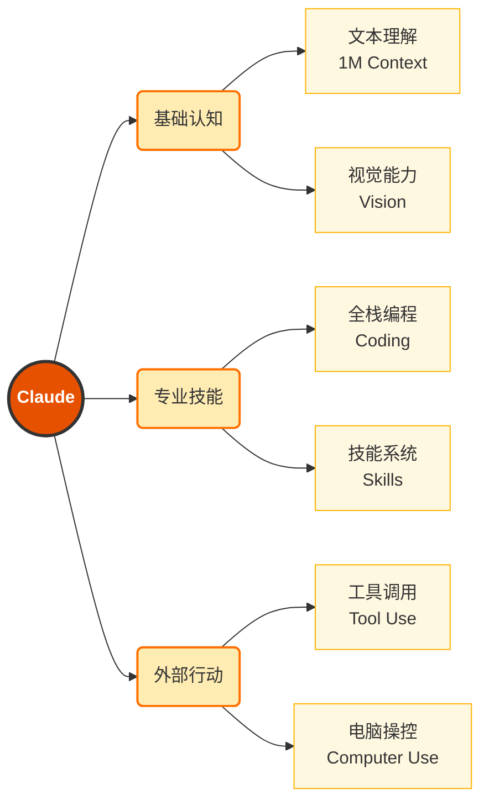
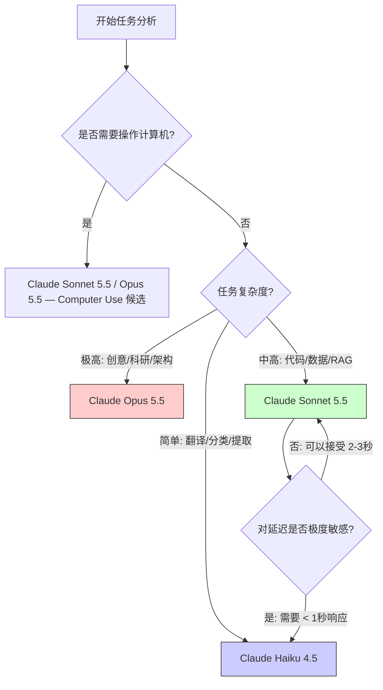
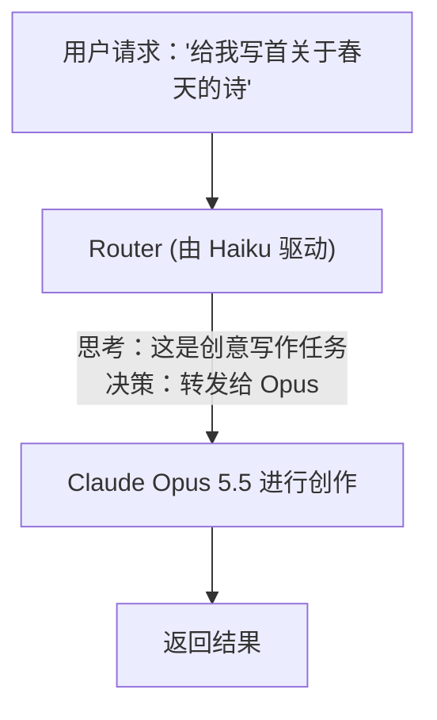

# 第一章 认识 Claude

在深入学习 Claude 的各项技能之前，首先需要建立对其整体认知。本章将带你了解：

- Anthropic 公司的创立背景与使命
- Claude 模型家族的演进历程
- Claude 具备哪些核心能力
- 如何根据场景选择合适的模型

---

## 本章概览

Claude 不是一个单一的模型，而是一个 **模型家族**。从 2023 年首次发布到 2026 年，Claude 已经经历了多次重大迭代，能力边界不断扩展。

理解 Claude 的能力边界，是高效使用它的前提。很多用户抱怨 Claude “不够聪明”或“无法完成任务”，往往是因为：

1. **选错了模型**：用快速模型处理复杂推理任务
2. **忽略了能力**：不知道 Claude 可以调用工具、操作计算机
3. **提示不当**：没有给 Claude 足够的上下文和指导

本章的目标，是帮你建立一张完整的 Claude 能力地图。

---

## 1. Anthropic 与 Claude 的诞生

### 1.1 硅谷的“异类”：Anthropic 的起源

故事始于 2021 年。那一年，人工智能领域正处于爆发的前夜，一场关于 AI 未来发展方向的变革正在旧金山酝酿。

#### 从 OpenAI 到 Anthropic

Anthropic 的创始人是 **Dario Amodei**（前 OpenAI 研究副总裁，GPT-2 和 GPT-3 核心研发负责人）和他的妹妹 **Daniela Amodei**（前 OpenAI 安全与政策副总裁）。然而，随着 AI 模型能力的指数级增长，他们对 AI 安全性的担忧也日益加深。

在 OpenAI 内部，关于“商业化速度”与“安全研究”的优先级之争逐渐显现。Amodei 兄妹坚信，如果不从根本上解决 AI 的可控性（Steerability）和可解释性（Interpretability），盲目追求更强的算力和更大的参数规模可能会给人类带来不可预知的风险。

于是，带着“构建可靠、可解释和可操纵的 AI 系统”的愿景，他们带领一群志同道合的核心研究员（包括 GPT-3 的首席作者 Tom Brown 等人）离开了 OpenAI，创立了 **Anthropic**。

#### “公益”性质的企业架构

Anthropic 并非一家传统的初创公司。它注册为 **Public Benefit Corporation (PBC)**，即“公益公司”。这意味着在法律层面，公司的董事会有义务平衡股东利益与公共利益。这种架构确保了即使在巨大的商业诱惑面前，Anthropic 仍能坚守“AI 安全第一”的底线。

### 1.2 核心理念：宪法式 AI

如果说 ChatGPT 的核心技术是 RLHF（人类反馈强化学习），那么 Claude 的核心差异化技术就是 **Constitutional AI (CAI)**。

#### RLHF 的局限性

传统的 RLHF 依赖大量人类标注员来给 AI 的回复打分，存在难以扩展和价值观黑盒等问题。

#### 用 AI 来监督 AI

Constitutional AI 提出了一种革命性的方法：Anthropic 制定了一套明确的原则（即“宪法”），涵盖联合国人权宣言、隐私规范、Sparrow 原则以及非西方视角的多元文化价值观。模型根据这套“宪法”进行 **自我批评** 和 **自我修正**，再通过 RLAIF（AI 反馈强化学习）进行优化。这种方法使 Claude 的行为更加稳定、透明且符合预期。

> 关于 Constitutional AI 的详细训练流程和技术原理，请参见 [第十一章：宪法式 AI](../11_safety/11.1_cai.md)。

### 1.3 为什么叫“Claude”？

这个名字是对信息论之父 **Claude Shannon（克劳德·香农）** 的致敬。

香农在 1948 年发表的《通信的数学理论》奠定了现代数字世界的基石。他提出的“比特（Bit）”概念，得以量化信息。Anthropic 选择这个名字，寓意着希望这款 AI 能像香农的理论一样，成为人类与信息交互的 **基础性工具**——精确、高效且充满智慧。

这也解释了为什么 Claude 在处理长文本、逻辑推理和代码任务时表现出一种冷静、客观（甚至略显严谨）的“工程师气质”。

### 1.4 为什么选择 Claude？

在 2026 年的 AI 战场上，Claude 凭借独特的优势占据了半壁江山。

#### 技术层面的护城河

*   **超长上下文 (Context Window)**：Claude 是最早突破 100K 和 200K Token 窗口的模型。这使得它能够一次性读完整本技术书籍、分析庞大的代码库或处理复杂的法律合同。这不仅仅是“记忆力”好，更是“全局理解力”的质变。
*   **Artifacts（工件）**：2024 年推出的 Artifacts 改变了人机交互的形态。代码、SVG 图表、React 组件不再是单纯的文本流，而是变成了可独立预览、编辑的“实体”。这让 Claude 从“对话者”变成了“协作者”。
*   **无与伦比的代码能力**：在 SWE-bench 等权威基准测试中，Claude 持续霸榜。其生成的代码逻辑严密，且更擅长遵循复杂的工程规范。

#### 企业级安全

得益于 Constitutional AI，Claude 对于企业客户来说是 **最安全** 的选择。它极少出现“越狱”行为，不会随意泄露敏感信息，这让金融、医疗和法律等高合规要求的行业对其青睐有加。

#### 生态系统

随着 Model Context Protocol (MCP) 的推出，Claude 正在成为连接万物的枢纽。它不再局限于浏览器，而是能通过 MCP 深入到文件系统、数据库和 Slack 工作区中。

### 1.5 里程碑时刻

*   **2021**: Anthropic 成立。
*   **2022.12.15**: Anthropic 公开发布 Constitutional AI 研究文章《Constitutional AI: Harmlessness from AI Feedback》，系统阐述用一套原则和 AI 反馈训练更无害模型的方法。
*   **2023.03**: Claude 1 发布，初露锋芒。
*   **2023.05**: Claude 上下文窗口从 9K 扩展到 **100K**（业内率先公开提供）。
*   **2023.07**: Claude 2 发布，延续 100K 上下文并提升综合能力。
*   **2024.03**: Claude 3 (Opus/Sonnet/Haiku) 发布，全面超越 GPT-4。
*   **2024.06**: Claude 3.5 Sonnet 发布，重新定义了“模型智商”与“速度”的平衡。
*   **2024.10**: Computer Use（计算机操控）公测，AI 开始拥有“手”和“眼”。
*   **2024.11**: MCP（模型上下文协议）正式发布，成为连接 AI 与外部世界的标准。
*   **2025.02.24**: Claude 3.7 Sonnet 发布，首次引入 Extended Thinking 混合推理模式；Claude Code CLI 发布 (Preview)，开发者首次获得 Agentic 编程终端工具。
*   **2025.05**: Claude Opus 4 与 Sonnet 4 发布；Claude Code 正式 GA。Opus 4 作为预防性措施在 ASL-3 防护标准下部署（官方明确并未认定其跨过 ASL-3 能力阈值）。
*   **2025.08**: Claude Opus 4.1 增量升级，SWE-bench Verified 从 72.5% 提至 74.5%（+2 个百分点）。
*   **2025.09**: Claude Sonnet 4.5 发布，匹配 Opus 4.1 能力，价格更低。
*   **2025.10**: Claude Haiku 4.5 发布，达到 Sonnet 4.5 约 90% 的编码能力，速度快 4-5 倍。
*   **2025.11**: Claude Opus 4.5 发布；长对话能力仍应按官方上下文窗口、提示缓存、压缩和记忆文档分别核对，不应把“长对话管理”当作独立官方产品名。
*   **2026.02**: Claude Opus 4.6 与 Sonnet 4.6 发布，均支持 1M Token 上下文窗口。
*   **2026.04**: 同月密集发布：① Claude Opus 4.7（SWE-bench Verified 87.6%，视觉分辨率与复杂多步任务一致性显著提升）；② Claude Mythos Preview（研究预览）并启动 Project Glasswing 防御性安全计划；③ 2026-04-08 **Claude Managed Agents 公开测试**；2026-04-09 **Claude Cowork 转为 GA**，同时推出企业级权限/连接器控制；④ 2026-04-14 Routines（研究预览）发布。
*   **2026.05**: Claude Managed Agents 持续迭代（2026-05-06 outcomes 与 multiagent orchestration 转入公测、dreaming 进入研究预览，2026-05-19 推出自托管沙盒与 MCP tunnels）；**2026-05-28 Claude Opus 4.8 发布**，成为彼时最强的通用可用模型（沿用 4.7 的 $5/$25 定价、1M 上下文、128K 输出），并为 Claude Code 带来 Dynamic Workflows（研究预览）。
*   **2026.06–07**: **2026-06-09 Claude Fable 5 正式 GA**（$10/$50、1M 上下文、128K 输出、Adaptive Thinking 常开），Claude Mythos 5 同日面向 Project Glasswing 受邀客户开放；两者于 6 月 12 日暂停访问后，Fable 5 于 7 月 1 日恢复全球访问。2026-07-01 公告称 Mythos 5 当时恢复给一组美国机构；当前可用性应以模型目录的 Project Glasswing 获批客户邀请制口径为准。Claude Sonnet 5 同期发布，带来新的 tokenizer、默认 Adaptive Thinking 和迁移约束。**2026-07-24 Claude Opus 5 发布**（`claude-opus-5`，$5/$25、1M 上下文、128K 输出），成为官方模型页推荐的默认起点，Opus 4.8/4.7/4.6 同时转入 Legacy models 分组。

---

了解了 Claude 的身世，自然会好奇：Anthropic 究竟发布了哪些模型？Opus、Sonnet 和 Haiku 到底有何区别？

➡️ [Claude 模型家族全景](1.2_model_family.md)

## 2. Claude 模型家族全景

### 2.1 三种尺寸，一种智慧

Anthropic 没有采取“一个模型通吃”的策略，而是推出了三个不同定位的模型系列。这种分层策略深受用户欢迎，因为它允许开发者在 **智能水平 (Intelligence)**、**响应速度 (Speed)** 和 **使用成本 (Cost)** 之间找到最佳平衡点。

这三个系列分别是：**Opus（史诗/巨作）**、**Sonnet（十四行诗）** 和 **Haiku（俳句）**。

#### Claude Opus：史诗

*   **定位**：旗舰级，最强智能。
*   **特点**：拥有近乎人类专家的推理能力。它擅长处理高度复杂的任务，如创意写作、战略分析、复杂数学证明和大型系统架构设计。
*   **适用场景**：当需要“最好的结果”且不在乎多等几秒钟或多付一点钱时。
    *   科研论文润色
    *   法律合同审查
    *   复杂算法编写
*   **形象比喻**：一位学识渊博的大学教授。

#### Claude Sonnet：十四行诗

*   **定位**：平衡级，企业首选。
*   **特点**：这是 Claude 家族的 **中流砥柱**。它在大多数任务上的表现与 Opus 差距极小（甚至在编程任务上经常超越老版本的 Opus），但速度更快，成本显著低于 Opus。
*   **适用场景**：绝大多数日常任务的最佳默认选择。
    *   代码生成与调试（VS Code 插件默认首选）
    *   RAG（检索增强生成）
    *   数据提取与清洗
    *   构建 Agent 工作流
*   **形象比喻**：一位经验丰富的高级工程师。

#### Claude Haiku：俳句

*   **定位**：轻量级，极致速度。
*   **特点**：虽然体积小，但绝不“傻”。Claude Haiku 4.5 以 Sonnet 约 90% 的编码能力和 4-5 倍的速度，专为高并发、低延迟场景设计。
*   **适用场景**：
    *   即时聊天机器人 (Chatbots)
    *   内容审核 (Content Moderation)
    *   海量文档的快速摘要
    *   作为复杂 Agent 系统中的“路由器”或“分类器”
*   **形象比喻**：一位动作敏捷的实习生助理。

### 2.2 模型演进史

Claude 的迭代速度令人惊叹。每一次大版本更新都标志着 AI 能力的阶跃。

#### 早期探索：Claude 1 与 2

*   **Claude 1 (2023.03)**: Anthropic 的首次亮相。相比当时的 GPT-3.5，它更“守规矩”，更不容易被套话。
*   **Claude 2 (2023.07)**: 一个极其重要的里程碑。Anthropic 已于 2023 年 5 月率先把上下文窗口从 9K 扩展到 **100K Token（约 7.5 万单词）**（Claude 1.3 代即可用），Claude 2 将这一能力带给更广泛的公众，直接引爆了 PDF 阅读和长文档分析的市场需求。

#### 家族化时代

2024 年 3 月，Anthropic 发布了 Claude 3 系列，正式确立了 Opus/Sonnet/Haiku 的产品矩阵。
*   **Claude 3 Opus**: 在当时一举超越 GPT-4，成为新的 SOTA (State of the Art) 模型。
*   **多模态能力**: 全系支持视觉输入（Vision），能看懂图表和照片。

#### 速度与智能的统一：Claude 3.5

*   **Claude 3.5 Sonnet (2024.06)**: 这一版本被誉为“神作”。它以中等模型的成本和速度，实现了超越上一代旗舰 (Opus) 的智能。它引入了 **Artifacts**，改变了编程和 UI 设计的交互方式。
*   **Claude 3.5 Sonnet (New) (2024.10)**: 进一步增强了代码能力，并首次引入 **Computer Use（计算机操控）**。

#### 混合推理时代：Claude 3.7

*   **Claude 3.7 Sonnet (2025.02.24)**: 一个划时代的版本。它是 Anthropic 首个支持 **Extended Thinking（扩展思考）** 的模型，开创了混合推理模式——模型可以在输出答案前进行深度的内部推理与自我校验。这一能力使 Claude 在复杂数学、逻辑推理和代码分析任务上的表现显著提升，也为后续 Claude 4 系列的推理架构奠定了基础。

#### 第四代飞跃

*   **Claude Opus 4 / Sonnet 4 (2025.05)**: Claude 4 代标志着推理能力的重大跃迁。鉴于 Opus 4 强大的自主行动能力，Anthropic 作为预防性措施在 ASL-3 防护标准下部署它（官方明确并未认定其跨过 ASL-3 能力阈值）。
*   **Claude Opus 4.1 (2025.08)**: 专注于 Agentic 任务和编程能力的增量升级，SWE-bench Verified 从 72.5% 提至 74.5%（+2 个百分点）。（注：Claude Opus 4 已于 2026-04-14 在 API 中 deprecated，并于 2026-06-15 retired；Claude Opus 4.1 已于 2026-06-05 deprecated，并于 2026-08-05 retired，官方推荐的替代型号是 Opus 4.8，新项目建议直接用 Opus 5。）
*   **Claude Sonnet 4.5 (2025.09)**: 平衡之王。在能力上匹配 Opus 4.1，但以更低的价格提供服务，迅速成为最广泛部署的模型。
*   **Claude Haiku 4.5 (2025.10)**: 以 Sonnet 4.5 约 90% 的编码能力、4-5 倍的速度，为中小企业提供了极致性价比的选择。（注：Claude 3 Haiku 已于 2026-02-19 deprecated，并于 2026-04-20 retired；新项目应直接使用 Haiku 4.5。）
*   **Claude Opus 4.5 (2025.11)**: 被称为“世界上最好的编码、Agent 和 Computer Use 模型”。长对话能力应按上下文窗口、提示缓存、压缩和记忆等官方能力分别核对；不要把“长对话管理”当作独立官方产品名。同时 Opus 系列价格大幅下调。

#### 百万上下文时代：Claude 4.6

*   **Claude Opus 4.6 / Sonnet 4.6 (2026.02)**: 均支持 **1M Token 上下文窗口**。Opus 4.6 在 Agentic 编码和复杂多学科推理中刷新 SOTA。Sonnet 4.6 在保持 $3/$15 定价的同时实现全面升级。

#### 工程能力再突破：Claude Opus 4.7

*   **Claude Opus 4.7 (2026.04)**: 在高难度软件工程、视觉分辨率和复杂多步任务一致性上相比 4.6 有显著提升（以下指标取自 Anthropic Opus 4.7 发布说明与 pricing 页，核验记录见附录 G）。SWE-bench Verified 达 87.6%（4.6 为 80.8%），Terminal-Bench 2.0 达 69.4%（4.6 为 65.4%），GPQA Diamond 达 94.2%（4.6 为 91.3%），Finance Agent 达 64.4%（4.6 为 60.7%）。定价与长上下文条款应以 Anthropic pricing page 为准；4.7 使用新 tokenizer，同一文本可能消耗 1.00–1.35 倍 token，迁移时建议监控实际成本。

#### Opus 4 系列收官：Claude Opus 4.8

*   **Claude Opus 4.8 (2026.05)**: 2026-05-28 发布，发布时为 Anthropic 最强的通用可用（GA）模型（2026-06-09 起该头衔由新一代 Claude Fable 5 接任，2026-09-01 起再由 Claude Fable 5.1 接任，Opus 4.8 转为 Opus 档旗舰；2026-07-24 Claude Opus 5 发布后，4.8 与 4.7、4.6 一同被官方模型页归入 Legacy models，仍可调用但不再是推荐起点）。它在 4.7 基础上进一步改进长跨度 Agentic 编码（更少压缩、更好的压缩恢复）、推理 effort 校准与工具触发，并显著降低代码缺陷遗漏率。沿用 4.7 的 $5/$25 定价、1M 上下文与 128K 最大输出，仅支持 Adaptive Thinking（不支持 Extended Thinking），`effort` 在所有界面默认 `high`；新增研究预览的 Fast mode（`speed: "fast"`，约 2.5× 输出速度，$10/$50）与更低的 1,024 token 缓存下限。模型 ID 为 `claude-opus-4-8`。

#### 研究预览：Claude Mythos Preview

*   **Claude Mythos Preview (2026.04)**: 一款面向防御性网络安全的前沿研究预览模型，在软件漏洞发现能力上接近甚至超越顶尖人类安全研究员。它在所有主流操作系统和浏览器中发现了数千个零日漏洞，包括 OpenBSD 中一个存在 27 年的漏洞。Anthropic 以此为基础启动了 Project Glasswing 防御性安全计划，联合 AWS、Apple、Google、Microsoft、NVIDIA 等 12 家首批合作伙伴。Mythos Preview 仅通过邀请制提供（定价 $25/$125 per M tokens），不对外公开发售。

#### 新一代命名体系：Claude Fable 5 / Mythos 5

*   **Claude Fable 5 (2026.06)**: 模型 ID 为 `claude-fable-5`，定价 $10/$50，1M 上下文、128K 最大输出。6 月 12 日暂停后，Fable 5 已于 2026-07-01 恢复全球访问；**Claude Mythos 5**（`claude-mythos-5`）非普遍可用，仅向 Project Glasswing 获批客户有限开放，采用邀请制且无自助注册。生产路由还需显式处理分类器返回的 `stop_reason: "refusal"`。

#### Sonnet 新一代：Claude Sonnet 5

*   **Claude Sonnet 5 (2026.06)**: API ID 为 `claude-sonnet-5`，1M 上下文、128K 最大输出。Adaptive Thinking 默认开启；标准价 $2/$10——发布时公布的介绍价已转为标准价，官方已取消原定 2026-09-01 上调至 $3/$15 的计划。它是 Sonnet 4.6 的迁移目标，但新 tokenizer、thinking 默认值和 sampling 参数限制都必须重新回归测试。2026-09-28 起由 Sonnet 5.5 接替，Sonnet 5 进入 Legacy models，仍可调用。

#### Opus 新一代：Claude Opus 5

*   **Claude Opus 5 (2026.07)**: 2026-07-24 发布，API ID 为 `claude-opus-5`。发布时官方把它定位为“不确定选哪个时的起点”（2026-09-22 起这一定位由 Opus 5.5 接任，Opus 5 随之进入 Legacy models），主打复杂 Agentic 编码与企业级工作；发布同时 Opus 4.8 / 4.7 / 4.6 一并进入模型页的 Legacy models 分组。沿用 $5/$25 定价、1M 上下文（既是默认也是上限）与 128K 最大输出，可靠知识截止为 2026 年 5 月。相比 4.8 有两处**破坏性变更**，迁移时必须逐个调用点审计：
    *   **Thinking 默认开启**。4.8 是不写 `thinking` 字段就不思考，Opus 5 则默认按 adaptive 思考。由于 `max_tokens` 同时约束思考与正文，原本“不思考”的负载可能被截断，必须重估该值。
    *   **关闭 thinking 受 effort 限制**。`thinking: {type: "disabled"}` 仍可用，但只在 `effort` 为 `high` 及以下时接受；与 `xhigh` / `max` 同时使用返回 400，且按请求逐次校验（同一会话中后续请求调高 effort 也会被拒）。

    其余变化多为增量：`effort` 全档位 `low`–`max` 可用（默认 `high`），最小可缓存前缀从 1,024 降到 512 token，新增 beta 的会话中途增删工具（`mid-conversation-tool-changes-2026-07-01`，可保住 prompt 缓存）与 `fallbacks: "default"` 回退模式。需要注意的行为差异是：Opus 5 会**自行验证自己的工作**，因此从旧模型沿用下来的“最后加一步验证”类提示词反而会造成过度验证，应当删除。

#### 5.x 迭代：Claude Fable 5.1、Opus 5.5 与 Sonnet 5.5

*   **Claude Fable 5.1 (2026.09)**: 2026-09-01 发布，API ID 为 `claude-fable-5-1`，接替 Fable 5（后者进入 Legacy models）。定价仍为 $10/$50，缓存命中价降到基础输入的 2.5%；1M 上下文、128K 最大输出，Adaptive Thinking 常开。`tool_choice` 的 `any` 与 `tool` 两种强制工具调用返回 400，需要保证工具参数符合 schema 时改用 strict tool use。同日发布的 **Claude Mythos 5.1** 仍只面向 Project Glasswing 参与者。
*   **Claude Opus 5.5 (2026.09)**: 2026-09-22 发布，API ID 为 `claude-opus-5-5`，接替 Opus 5 成为官方“不确定选哪个时的起点”。单价 $4/$20，低于 Opus 5 的 $5/$25，缓存命中价为基础输入的 5%；1M 上下文、128K 最大输出。相比 Opus 5 的破坏性变更：**thinking 常开、不可关闭**，`thinking: {type: "disabled"}` 与手动 `type: "enabled"` 都返回 400；**默认 `effort` 从 `high` 降为 `medium`**；强制工具调用返回 400；在 Claude API 与 Google Cloud 上，computer use 只接受 `computer_toolset_20260801`。
*   **Claude Sonnet 5.5 (2026.09)**: 2026-09-28 发布，API ID 为 `claude-sonnet-5-5`，价格与 Sonnet 5 相同（$2/$10），tokenizer 也相同，同一文本的 token 数不变。Adaptive Thinking 默认开启；`thinking: {type: "disabled"}` 返回 400，要关掉动手前的思考改用 `thinking: {type: "between_tools"}`（只在 `effort` 为 `high` 及以下时接受）；强制工具调用同样返回 400。

#### Claude Sonnet 4.5 vs Claude Sonnet 4.6 历史对比

**Claude Sonnet 4.6 相比 4.5 的关键升级**

| 维度 | Sonnet 4.5 | Sonnet 4.6 | 提升 |
|------|-----------|----------|-----|
| **编码与智能体能力** | 强 | 更强 | 官方口径见发布说明（SWE-bench Verified、OSWorld、Terminal-Bench 2.0 等） |
| **长上下文理解** | 200K tokens | 1M tokens | 5 倍提升 |
| **Computer Use** | ✓ 支持 | ✓ 增强 | 更精准的交互 |
| **Agent 规划** | ✓ 支持 | ✓ 改进 | 更好的多步推理 |
| **价格** | $3/$15 | $3/$15 | 无变化 |

*   **编码提升**: 在算法题、系统设计、代码重构上表现更稳定（具体基准分以 Sonnet 4.6 官方发布说明为准）
*   **长上下文推理**: 能更好地利用 1M token 窗口处理整个代码库
*   **Computer Use 增强**: 对屏幕上的 UI 元素识别更准确，操作更精细
*   **Agent 决策改进**: 在复杂多步骤任务中的自纠正能力更强

**何时升级到 4.6**

> 本小节回顾 4.6 发布时从 4.5 迁移的历史决策；当前新项目应评测 Sonnet 5.5，不应把下列历史建议当成新默认值。

- 当时的 Sonnet 4.5 用户无需立即升级
- 当时的新项目或长上下文应用会优先评测 4.6
- 企业应用可逐步从 4.5 迁移到 4.6，并验证两个版本的 API 兼容性

### 2.3 性能与成本对比图解

为了更直观地理解三者的区别，可以通过能力对比表来分析。

#### 模型能力倾向对比

| 能力维度 | Opus | Sonnet | Haiku |
|---------|------|--------|-------|
| 逻辑推理 | ⭐⭐⭐⭐⭐ | ⭐⭐⭐⭐ | ⭐⭐⭐ |
| 代码能力 | ⭐⭐⭐⭐⭐ | ⭐⭐⭐⭐⭐ | ⭐⭐⭐ |
| 响应速度 | ⭐⭐ | ⭐⭐⭐⭐ | ⭐⭐⭐⭐⭐ |
| 视觉理解 | ⭐⭐⭐⭐⭐ | ⭐⭐⭐⭐ | ⭐⭐⭐ |
| 成本经济性 | ⭐ | ⭐⭐⭐ | ⭐⭐⭐⭐⭐ |

（注：⭐越多代表该维度表现越优）

#### 具体的 Token 成本

具体定价细节请参考 **[附录 E：Claude 定价与成本参考](../12_appendix/12.5_pricing.md)** 以及 [官方定价页面](https://claude.com/pricing)。

以当前家族为例，Opus 5.5、Sonnet 5.5、Haiku 4.5 的价格与适用边界不同；Sonnet 5.5 的单价还低于 Sonnet 4.6，Opus 5.5 的单价也低于 Opus 5，不能把某一代的档位倍率写成长期规则。具体价格以附录 E 和官方定价页为准。

### 2.4 新兴能力维度：Extended Thinking 与 Adaptive Thinking

除了传统的“智能-速度-成本”三角，Claude 正在引入新的维度：**思考时间 (Thinking Budget)**。
即允许模型在输出结果前，进行一段“静默思考”或“草稿纸推演”。这在处理需要深度逻辑（如复杂数学题、代码重构方案权衡）时，能显著提升准确率，但会消耗更多的推理时间与 Token。

**Extended Thinking 与 Adaptive Thinking 的区分**：
- **Claude Fable 5.1 / Fable 5**: **Adaptive Thinking** 常开，模型始终自动决定思考深度，无需也不支持手动配置 Extended Thinking。
- **Claude Opus 5.5**: **Adaptive Thinking 常开、不可关闭**，`thinking={type: "disabled"}` 与手动 `type: "enabled"` 都返回 400；思考深度只能用 `effort` 调，默认 `medium`。
- **Claude Sonnet 5.5**: **Adaptive Thinking 默认开启**；`thinking={type: "disabled"}` 返回 400，要关掉动手前的思考改用 `thinking={type: "between_tools"}`（仅限 `effort` 为 `high` 及以下）；手动 Extended Thinking 返回 400。
- **Claude Opus 5（Legacy）**: **Adaptive Thinking 默认开启**，不写 `thinking` 字段即按 adaptive 思考；可用 `thinking={type: "disabled"}` 关闭，但仅在 `effort` 为 `high` 及以下时接受。不支持 Extended Thinking。
- **Claude Sonnet 5（Legacy）**: **Adaptive Thinking 默认开启**，可显式关闭；手动 Extended Thinking 会返回 400。
- **Claude Opus 4.8 / 4.7**: 仅支持 **Adaptive Thinking**（`thinking={type: "adaptive"}`），模型根据任务复杂度自动决定思考深度；与 Opus 5 不同，**不写 `thinking` 字段就不思考**。不支持 Extended Thinking。
- **Claude Sonnet 4.6（迁移兼容性参考）**: 支持 **Adaptive Thinking**（推荐）和 **Extended Thinking**；手动 `budget_tokens` 路径已弃用但仍可用。
- **Claude Opus 4.6**: 支持 **Adaptive Thinking**（推荐）和 **Extended Thinking**（`thinking={type: "enabled"}`，已弃用但仍可用）。
- **Claude Haiku 4.5**: 支持 Extended Thinking（`thinking={type: "enabled"}`），但不支持 Adaptive Thinking。

详见 [8.4 扩展思考](../08_agent/8.4_extended_thinking.md)。

### 2.5 如何选择？

在接下来的“模型选择”章节我们会详细讨论，但这里有一个简单的法则：

> **“Default to Sonnet, optimize with Haiku, escalate to Opus.”**
> **“默认用 Sonnet，用 Haiku 优化成本，遇难事找 Opus。”**

1.  **开发阶段**：直接使用 **Sonnet**。它的反馈够快，智能足够高，能让开发者专注于业务逻辑而非 Prompt 调优。
2.  **上线前优化**：
    *   检查 Prompt 历史。如果发现大量任务只是简单的“提取 JSON”或“分类”，尝试切换到 **Haiku** 并微调 Prompt。节省幅度取决于输入/输出比例和缓存命中率，不能把“90%”当作通用承诺。
    *   如果发现某些复杂的长逻辑链推理（Chain of Thought）经常出错，将该特定步骤的模型切换为 **Opus**。
3.  **混合编排**：成熟的 Agent 系统往往是混合使用的。例如，用 Haiku 快速判断用户意图，然后根据意图分发给 Sonnet 或 Opus 处理。

### 2.6 展望未来

从 Claude 3 到 4.8，可以观察到三个明显的趋势：
1. **模型能力差距缩小**：Haiku 4.5 已经接近旧版旗舰水平，Sonnet 4.6 在多项指标上匹配 Opus。
2. **价格持续下降**：Opus 从 3 代的 $15/$75 降至 4.7 的 $5/$25，降幅超过 66%。
3. **上下文窗口急剧扩大**：从 200K 跃升至 1M Token，催生了全新的长文档分析和代码库级别的应用场景。

未来，或许不再需要痛苦地在成本和智能之间做取舍，AI 将像电力一样，既廉价又强大。

---

了解了模型家族，接下来深入挖掘 Claude 到底具体能干什么？它的六大核心能力是如何重新定义“生产力”的？

➡️ [Claude 能做什么](1.3_capabilities.md)

## 3. Claude 能做什么：六大核心能力

很多人初次接触 AI 时，往往只把它们当作聊天机器人。这就像是买了一台超级计算机却只用它来玩扫雷。Claude 不仅仅是一个会说话的程序，它是一个 **多模态的智能代理系统 (Multimodal Intelligent Agent)**。

在 2026 年的视角下，Claude 的能力版图可以概括为六大核心支柱。

### 3.1 文本理解与生成

这是 Claude 的基本功，但它不仅限于“写文章”。

*   **长文档分析 (Long-context Understanding)**：
    Claude Opus 5.5、Sonnet 5.5、Fable 5.1、Opus 5、Sonnet 5、Fable 5 和 Opus 4.8/4.7/4.6 支持 1M Token 上下文窗口；Sonnet 4.6 保留为迁移期兼容性基线。Fable 5 已于 2026-07-01 恢复全球访问。Haiku 4.5 通常为 200K。实际可用窗口还可能受平台限制；即使使用长上下文模型，处理大代码库、数百份财报、法律文书或技术白皮书时仍需要配套检索、分块和摘要策略。
    > *示例*：上传 10 份竞品的年报，让 Claude 生成一份横向对比的财务分析表格。
*   **细微语境捕捉 (Nuance)**：
    Claude 以“文笔细腻”著称。它能精准捕捉文字背后的情感色彩、讽刺意味或文化隐喻。这使得它在文学创作、公关稿撰写和情感陪伴场景下表现优异。
*   **多语言翻译**：
    它不是简单的词对词翻译，而是基于语义的“本地化”。它能处理日语的敬语、中文的成语以及编程领域的专业术语。

### 3.2 代码生成与工程

对于开发者来说，Claude 已经是公认的 **最强编程模型** 阵营——口碑自 4.5/4.6 系列奠定，经 Opus 4.7/4.8 延续，如今由 Opus 5.5 延续；Fable 5 的发布规格更高，但生产可用性需按官方模型页重新核验。

*   **全栈开发**：从 React 前端组件到 Python 后端 API，再到 Dockerfile 和 Kubernetes 配置，Claude 能编写可运行的完整代码片段。
*   **遗留代码重构**：扔给它一段没有注释、变量名混乱的 10 年前的 Java 代码，它可以分析逻辑、添加注释，并将其重构为现代的 Kotlin 语法。
*   **Artifacts 实时预览**：
    这是 Claude 最具杀伤力的特性。当要求“写一个贪吃蛇游戏”或“画一个销售漏斗图”时，它生成的 HTML/JS 代码会直接在侧边栏渲染成可交互的应用。无需复制粘贴代码到本地运行，所见即所得。
*   **Claude Design（2026-04-17，研究预览）**：
    Anthropic Labs 推出的视觉设计协作工具，基于 Opus 4.7 驱动。用户通过自然语言描述需求，Claude 即可生成海报、原型图、幻灯片等视觉设计稿，并支持对话式迭代修改。成品可导出为 PDF、PPTX、HTML 或分享给团队。

### 3.3 视觉与多模态

Claude 拥有极强的“眼睛”。

*   **图表转数据**：上传一张复杂的柱状图或销售仪表盘截图，Claude 可以直接将其转化为 JSON 数据或 Markdown 表格。
*   **UI/UX 设计辅助**：给它看一张手绘的网页草图，它可以直接生成对应的 HTML/Tailwind CSS 代码。
*   **视觉问答**：拍一张冰箱里食材的照片，问它“今晚能做什么菜？”，或者拍一张报错的电脑屏幕，问它“这是什么错误？”。

### 3.4 工具使用

这是 Claude 走出“聊天框”，连接现实世界的桥梁。
这一点在[第三章](../03_tools/README.md)有详细讲解，这里简要概述：

通过 Tool Use，Claude 可以：
*   **实时联网**：调用 Web Search / Web Fetch 或自定义搜索工具获取当前网页信息。
*   **操作业务系统**：连接 CRM 查询客户资料，连接 Jira 创建工单。
*   **精准计算**：遇到复杂数学题，自动调用 Python 代码进行计算，而不是瞎猜。

### 3.5 计算机操控

这被认为是 **Agentic AI（代理式 AI）** 的终极形态之一。

在 2024 年底，Anthropic 赋予了 Claude 直接控制鼠标和键盘的能力。
*   **工作原理**：Claude 像人类一样“看”屏幕截图，计算出“应该点击坐标 (x, y)”，并发送指令给虚拟桌面。
*   **应用场景**：
    *   **在旧软件上工作**：很多企业内部系统没有 API，只有古老的 Windows 界面。Claude 可以像人一样点击菜单、输入数据、导出报表。
    *   **跨应用工作流**：从 Excel 复制数据 -> 打开浏览器 -> 登录后台 -> 填表提交。这种跨越多个 GUI 软件的流程，以前很难自动化，现在 Claude 可以轻松搞定。

### 3.6 技能系统

Skills 是 Claude 生态的最新拼图。它解决的是“复用性”问题。

如果你教会了 Claude “如何撰写符合公司规范的周报”，由于 Context 会重置，下次还得重教一遍。
**Skills** 允许你将这套指令（Prompt + 相关资料 + 示例）打包成一个“技能包”。
*   当在 Claude.ai 或企业版中使用时，系统会根据请求自动挂载相关的 Skill。
*   这相当于给 Claude 安装了“插件”，让它瞬间变成“资深法务”、“专业会计”或“Python 专家”。

---

### 3.7 能力分布雷达图

为了更直观地展示这六大能力如何构成完整的智能系统，请看 Claude 的能力图谱：



### 3.8 边界：Claude 做不到什么？

诚实是 Claude 的核心价值观之一。了解它的局限同样重要：
*   **它没有长期记忆**：除非使用专门的 Memory 功能或外挂数据库，否则它记不住历史对话内容。
*   **它不会主动行动**：Claude 本质上是被动的。若不发消息，它永远不会主动发送早安（除非写了一个定时脚本去触发它）。
*   **它是概率模型**：在极少数情况下，它仍可能产生幻觉（Hallucination）——输出看似流畅但事实内容错误。幻觉往往出现在模型“不熟悉”的领域（训练数据稀疏的方向）。对于医疗、法律建议，务必进行人工核实。关于幻觉产生的底层机制（信号空间 vs 零空间），参见姊妹篇《大模型原理与架构》14.9.4 节。

---

了解了 Claude 的强大能力，可能会产生“选择困难症”：这么多模型，该用哪一个？Opus 虽好，但会不会太贵？

➡️ [如何选择合适的模型](1.4_model_selection.md)

## 4. 如何选择合适的模型：决策框架

在实际的工程落地中，**“用哪个模型”** 往往是开发者面临的第一个难题。
选大了，钱包受不了；选小了，用户体验受不了。

本章将提供一套系统的决策框架，帮助在 **智能 (Intelligence)**、**延迟 (Latency)** 和 **成本 (Cost)** 这个“不可能三角”中找到最优解。

### 4.1 核心决策树

在做决定之前，请先回答以下三个问题：
1.  **任务有多难？**（需要复杂推理吗？）
2.  **用户能等多久？**（是实时对话还是后台批处理？）
3.  **预算有多少？**（是一次性的 demo 还是百万级日活的产品？）

基于这三个维度，可以画出一棵决策树：



### 4.2 详细选型指南

#### 新项目首评：Claude Sonnet 5.5

新项目应先在自己的业务评测集上测试 **Claude Sonnet 5.5**；既有 Sonnet 4.6 或 Sonnet 5 系统则保留稳定基线，完成灰度评测后再迁移，并保留回退路径。
*   **理由**：Sonnet 5.5（2026-09-28 发布）是 Sonnet 档当前型号，价格与 Sonnet 5 相同，$2/$10 反而低于 Sonnet 4.6 的 $3/$15（Sonnet 5 发布时的介绍价已转为标准价，官方已取消原定 2026-09-01 上调至 $3/$15 的计划）。从 Sonnet 4.6 迁移要注意新 tokenizer：同一文本约增加 30% token，因此上线前必须重跑 token 计数、成本、延迟和截断回归。从 Sonnet 5 迁移时 tokenizer 不变，但 `thinking: {type: "disabled"}` 与强制工具调用（`tool_choice` 为 `any` 或 `tool`）都会返回 400。
*   **最佳场景**：
    *   **代码助手**：IDE 插件、代码补全、重构。
    *   **复杂的 RAG 系统**：阅读这一大段检索到的文档并回答问题。
    *   **多步 Agent**：规划任务、调用工具。
    *   **数据分析**：处理 Excel 表格、分析图表。

#### 成本杀手：Claude Haiku 4.5

不可小觑。Haiku 是目前市场上性价比最高的模型之一。
*   **理由**：它极其便宜，且速度极快。它的智能程度完全足以应付 80% 的“脏活累活”。
*   **最佳场景**：
    *   **内容审核**：判断用户输入是否违规。
    *   **意图识别 (Router)**：作为网关，判断用户是想“查天气”还是“写诗”，然后分发给不同的模型。
    *   **海量文档处理**：比如你要从 10 万份 PDF 中提取“发票金额”，用 Opus 可能会破产，用 Haiku 则毫无压力。
    *   **实时翻译**：即时通讯软件中的即时翻译。

#### 艺术与深思：Claude Opus 5.5

Opus 5.5（2026-09-22 发布）是当前 Opus 档型号，也是官方模型页给出的默认起点；需要更高能力上限时再评估 Fable 5.1（`claude-fable-5-1`，2026-09-01 起接替 Fable 5，后者已进入 Legacy）。极复杂任务应通过自己的评测在两者间路由，并显式处理 Fable 的分类器拒绝。
*   **理由**：Opus 5.5 适合最困难的 Agentic 编码、复杂数学推导和逻辑推理，单价 $4/$20 低于 Opus 5 的 $5/$25。其输出往往详尽且富有洞察力；迁移或上线时仍应以官方模型页的价格、上下文窗口和可用区为准，并注意它的 thinking 常开且不可关闭、默认 `effort` 降为 `medium`，原有的 effort 设置要重新评测（见 [1.2 模型家族](1.2_model_family.md)）。
*   **最佳场景**：
    *   **创意写作**：小说、剧本、营销软文。
    *   **极度复杂的逻辑**：如果 Sonnet 在某个数学证明或逻辑推理上反复出错，请尝试 Opus。
    *   **可以慢慢等的任务**：不需要实时反馈的离线报告生成。

### 4.3 成本经济学

以下算一笔账。假设应用每天有 100 个用户，每个用户进行 10 轮对话，每轮消耗 1,000 Tokens（输入+输出）。
日总量 = 100 万 (1M) Tokens。
下面先按 **80% 输入 / 20% 输出** 估算，便于做粗略预算。

*   **极高复杂度的推理/长文写作**：选择 **Claude Opus 5.5**。
*   **Computer Use（屏幕观察与 GUI 操作）**：新项目评测 **Claude Sonnet 5.5** 或 **Claude Opus 5.5**，并为外部副作用动作设置人工确认；既有 Sonnet 4.6 链路在灰度迁移期间可保留为回退。
*   **企业级 Agent 路由分发中心**：选择 **Claude Haiku 4.5**。

| 模型 | 日成本估算 (USD) | 性能评价 |
| :--- | :--- | :--- |
| **Claude Haiku 4.5** | ~$1.8 | 极快，性价比高 |
| **Claude Sonnet 5.5** | ~$3.6 | 通用候选，单价与 Sonnet 5 相同、低于 Sonnet 4.6 |
| **Claude Opus 5.5** | ~$7.2 | 极度聪明，工程能力最强；单价低于 Opus 5 |

*注：Sonnet 5.5 行按 $2/$10、Opus 5.5 行按 $4/$20 计算。表中 1M token 必须是各模型重新计数后的真实用量；Sonnet 5.5 使用的新 tokenizer 对同一文本约增加 30% token，不能直接复用 Sonnet 4.6 的 token 数。输出占比更高时，成本还会继续上升。*

**结论**：在上述假设下，Sonnet 5.5 比 Haiku 每日多约 $1.8。是否值得应由业务评测中的质量、延迟和单位成功任务成本决定，不能用未经验证的留存率假设替代。

### 4.4 高级架构：混合路由

成熟的 AI 应用不会只吊死在一棵树上。最佳实践是构建一个 **Model Router**。

#### 架构图



#### 路由策略示例

1.  **难度分级**：如果 Prompt 包含关键词 “复杂”、“架构”、“分析”，路由到 Sonnet/Opus；如果包含 “总结”、“提取”、“分类”，路由到 Haiku。
2.  **降级策略 (Fallback)**：优先尝试 Sonnet，如果 API 超时或报错，自动降级到 Haiku 以保证服务可用性。
3.  **VIP 策略**：免费用户使用 Haiku，付费会员使用 Sonnet/Opus。

### 4.5 迁移指南

随着 Anthropic 快速迭代，每隔几个月就会有新模型（如 3.5, 4.0）。
*   **不要硬编码模型名称**：
```python
# 推荐实践：提取常量
MODEL_CHEAP = "claude-haiku-4-5-20251001" # 便宜型号用于大批量简单任务
MODEL_BALANCED = "claude-sonnet-5-5"  # 新项目先评测的通用型号
MODEL_BALANCED_LEGACY = "claude-sonnet-4-6"  # 仅供既有系统灰度迁移与回退
MODEL_SOTA = "claude-opus-5-5"  # 当前 Opus 档型号（2026-09-22 发布，$4/$20）
MODEL_FABLE = "claude-fable-5-1"  # 当前 Fable 档型号（2026-09-01 发布，$10/$50）

# 调用演示
response = client.messages.create(
    model=MODEL_BALANCED,
    max_tokens=1024,
    messages=[
        {"role": "user", "content": "你好，请介绍一下你自己。"}
    ]
)
```

*   **建立评估集 (Evals)**：新项目先评测 Sonnet 5.5；既有 Sonnet 4.6 或 Sonnet 5 系统按迁移清单灰度升级，并保留回退。切换前必须重跑核心业务测试、token 计数、成本和截断用例；同时移除手动 Extended Thinking 配置与非默认 sampling 参数，避免 Sonnet 5.5 返回 400。

---

恭喜！已完成了第一章的学习，对 Claude 的身世、能力和选型有了全方位的认知。
现在，进入实战的核心——如何跟这位高智商的 AI 说话？

➡️ [第二章：提示工程核心技术](../02_prompt/README.md)
