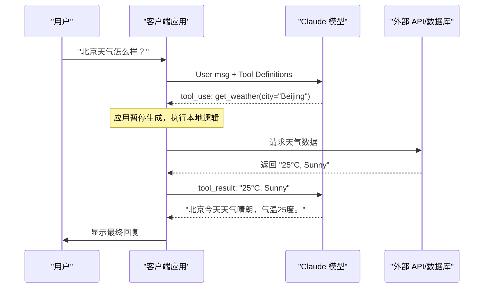
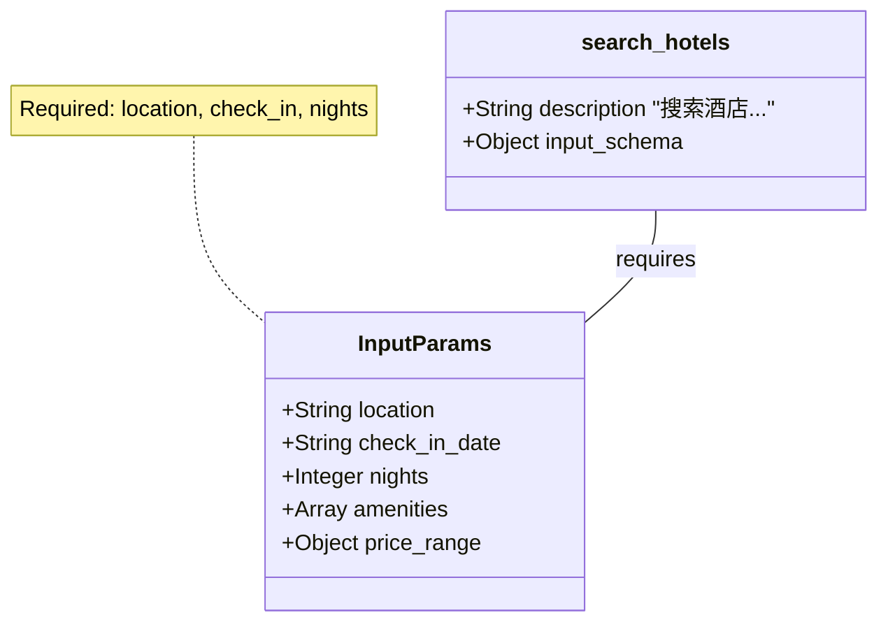
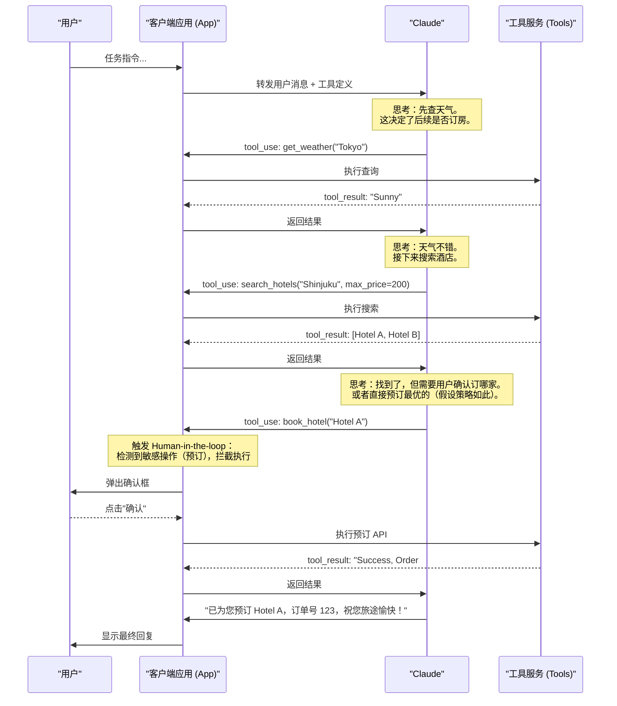

# 第三章 工具

Tool（工具）是 Claude 最重要的扩展能力之一。通过工具调用，Claude 可以突破语言模型的固有限制，与外部世界交互。

---

## 为什么需要工具？

Claude 本身有以下局限：

| 局限      | 解决方案        |
| ------- | ----------- |
| 无法联网    | 调用搜索 API    |
| 数学不精确   | 调用计算器工具     |
| 无法访问数据库 | 调用数据库查询工具   |
| 不知道当前时间 | 调用时间 API    |
| 无法发送消息  | 调用邮件/消息 API |

---

## 本章学习目标

- [ ] 理解工具的工作原理
- [ ] 定义工具的 Schema
- [ ] 处理工具调用和返回结果
- [ ] 编排多工具协作
- [ ] 了解高级特性

---

## 1. 工具概述与工作原理

### 1.1 什么是工具使用？

在大型语言模型（LLM）的发展历程中，“工具使用”（Tool Use，又称 Function Calling）是一个里程碑式的飞跃。它标志着 AI 模型从单纯的“文本生成器”进化为能够与其环境交互的“智能代理”（Agent）。

简单来说，**工具使用** 是指 Claude 等模型能够理解开发者定义的外部函数或 API，并在对话过程中根据用户的需求，自主判断、决策并生成调用这些工具所需的参数（通常是 JSON 格式）。

**核心概念**：
*   **并非模型直接执行**：重要的是要理解，Claude 本身并不直接运行代码或访问互联网（除非使用特定的服务端工具）。当你定义一个工具（例如 `get_weather`）时，Claude 只是输出了“我想要调用 `get_weather`，参数是 `city='Beijing'`”这样的指令。
*   **执行在客户端**：实际的 API 调用、数据库查询或代码执行，是由应用程序（客户端）在接收到 Claude 的指令后完成的。
*   **闭环交互**：应用程序执行完工具后，将结果（例如“北京气温 25 度”）再次发送给 Claude，Claude 结合这个结果生成最终回复。

这种能力让 Claude 拥有了“双手”和“眼睛”，可以连接每一个 API，从简单的计算器到复杂的企业级 ERP 系统。

### 1.2 为什么需要工具？

虽然 Claude 拥有海量的训练数据和强大的逻辑推理能力，但作为预训练模型，它存在几个天然的局限性，而工具正是为了解决这些问题而生：

#### 突破知识截止日期

模型的知识受限于其训练数据的截止时间。它无法通过自身知道“此时此刻”的股价、天气或最新的体育比分。通过连接 **搜索工具** 或 **实时数据 API**，Claude 可以获取最新的动态信息。

#### 访问私有数据

Claude 无法访问个人文件、公司数据库或 CRM 系统。通过定义 **数据检索工具**，可以安全地赋予 Claude 访问特定私有数据的权限，使其成为专属的业务助手。

#### 执行实际操作

仅靠生成文本无法改变现实世界。Claude 不能直接发送邮件、购买商品或重启服务器。通过 **API 集成工具**，Claude 可以代表用户执行确切的操作，实现真正的自动化。

#### 增强计算与逻辑准确性

虽然 LLM 擅长逻辑推理，但在复杂的数学计算或精确的字符串处理上可能会出错。通过调用 **Python 解释器** 或 **计算器工具**，可以将这些精确任务外包给程序代码，确保准确率。

### 1.3 工具分类详解

根据工具的定义位置、执行载体及隐私边界，Claude 的工具体系主要分为两大类：

#### 客户端工具

这是最常见、最灵活的工具类型，运行在开发者本地，也是大多数开发者主要使用的模式。

*   **定义者**：开发者。
*   **执行者**：开发者的应用程序代码。
*   **数据流**：数据在服务器和 Claude API 之间流转。
*   **特点**：
    *   **高度定制**：可以将任何 Python、Node.js 函数或 REST API 封装为工具。
    *   **隐私安全**：具体的业务逻辑和数据库连接完全运行在受控环境中，Claude 此时仅充当自然语言到 API 参数的转换器。
    *   **示例**：`query_database`（查询内部 SQL）、`send_slack_message`（发送消息）、`control_smart_light`（控制智能家居）。

#### Anthropic 托管工具

与客户端工具不同，这类工具的实际**执行**发生在 Anthropic 的云端环境中，开发者无需编写任何执行逻辑，只需在 API 请求中声明启用即可。之所以称为“托管工具”而非简单的“服务端工具”，是为了避免与开发者自己部署在服务器上的客户端工具产生概念混淆——**客户端工具同样可以运行在服务端**，区别在于谁定义和执行这个工具。

*   **定义者**：Anthropic。
*   **执行者**：Anthropic 的服务器（开发者不可见也无需维护）。
*   **特点**：
    *   **零代码集成**：只需在 API 请求中声明启用，无需编写执行逻辑。
    *   **特定场景优化**：针对通用高频需求（如 Web Search、代码执行）进行了深度优化。
*   **注意**：Anthropic 正在逐步推出更多托管工具，但在构建自定义 Agent 时，客户端工具依然是核心，因为它们提供了对业务逻辑和数据的完全控制。

> 此外，还有一类特殊的 **“Anthropic 定义的客户端工具”**（如 Computer Use（计算机操控）和 Text Editor）。这类工具的 Schema（输入输出格式）由 Anthropic 统一标准，以便模型经过专门训练能更好地使用它们，但其具体的执行环境（如虚拟机、浏览器）仍然由开发者在客户端提供。

### 1.4 核心工作流程

理解“请求-决策-执行-反馈”的循环是掌握 Agent 开发的关键。这是一个典型的 **ReAct** (Reasoning + Acting) 模式。

#### 交互步骤

1.  **定义与声明 (Define)**
    开发者在 API 请求的 `tools` 参数中提供可用的工具列表（包含名称、描述、参数 Schema）。
2.  **用户提问 (Prompt)**
    用户发送消息，例如“帮我查一下查理公司的销售额”。
3.  **模型决策 (Reasoning)**
    Claude 分析用户意图，结合工具定义，判断是否需要使用工具。如果需要，它会生成一个 `tool_use` 内容块（包含工具名和参数，如 `{"company": "Charlie"}`）。
    *此时模型会暂停生成，等待外部输入。*
4.  **客户端执行 (Execution)**
    代码捕获到 `stop_reason="tool_use"`，解析模型返回的 JSON 参数，并在本地执行对应的 SQL 查询函数。
5.  **结果回传 (Feedback)**
    代码将查询结果（如“$50,000”）封装在一个 `tool_result` 消息块中，发送回 Claude。
6.  **最终生成 (Response)**
    Claude 接收到工具结果，将其融入上下文中，生成最终给用户的自然语言回复：“查理公司的销售额为 50,000 美元。”

#### 示例流程图



### 1.5 典型应用场景

工具使用将 Claude 的应用范围从“咨询对话”扩展到了“业务自动化”。

| 场景类别 | 具体示例 | 描述 |
| :--- | :--- | :--- |
| **外部信息获取** | 天气、股票、汇率查询 | 连接实时数据源，打破训练数据限制。 |
| **办公自动化** | 日历管理、邮件发送 | “帮我约明天下午 3 点和张总的会议”，自动检查冲突并发送邀请。 |
| **数据分析助手** | SQL 生成与查询 | 自然语言转 SQL，执行查询并解释数据报表。 |
| **客户服务 Agent** | 订单查询、退款处理 | 根据订单号查询物流状态，并根据政策自动发起退款流程。 |
| **代码与工程** | 代码解释器、Git 操作 | 自动编写代码、运行测试、提交代码库。 |
| **多模态操作** | 计算机操控 (Computer Use) | 像人一样操控鼠标键盘，操作无法通过 API 访问的旧版 GUI 软件。 |

### 1.6 计费与 Token 消耗

在设计 Agent 时，必须考虑 Token 成本，因为工具定义和交互会显著增加 Context 长度。

#### 成本构成

1.  **工具定义 (Definition Overhead)**：
    所有的工具描述（Name, Description, Input Schema）都会作为 System Prompt 的一部分发送给模型。拥有几十个复杂工具的定义可能会占用数千 Token。
    *优化建议：仅发送当前场景必要的工具，或使用动态检索机制加载工具子集。*

2.  **思维链与决策 (Chain of Thought)**：
    为了准确使用工具，Claude 通常会进行内部推理（CoT），这增加了输出 Token 的数量。

3.  **多轮交互 (Multi-turn Overhead)**：
    工具使用涉及“请求-执行-结果”的往返。每一轮对话历史（包括工具调用的具体的 JSON 参数和返回的详细结果）都需要保留在上下文中，随对话深度增加，Token 消耗呈线性甚至更高增长。

#### 延迟考量

除了 Token 成本，工具使用引入了 **网络往返 (Network Round-trips)**。一次简单的问答可能变成三次网络请求（LLM 决策 -> 工具执行 -> LLM 总结）。开发者需要优化本地工具的执行速度，并考虑流式输出（Streaming）来提升用户感知的响应速度。

### 1.7 安全与最佳实践

赋予 AI 执行操作的能力伴随着风险。

*   **人机回环 (Human-in-the-loop)**：对于高风险操作（如删除文件、转账、发送批量邮件），务必在 Tool 执行前加入人工确认步骤。
*   **最小权限原则 (Least Privilege)**：工具只能访问其任务必需的数据。不要把 `rm -rf /` 封装成工具。
*   **清晰的描述**：Claude 依靠工具的 `description` 字段来理解何时以及如何使用工具。编写详尽、无歧义的文档字符串（Docstrings）是提高成功率的各种最佳实践之首。

### 1.8 流式输出：Streaming

在构建实时性要求高的 Agent 时，**流式输出 (Streaming)** 是必不可少的。用户不愿意盯着一个白屏等待 10 秒钟的模型推理。

*   **Server-Sent Events (SSE)**：Claude 的 API 支持流式返回，前端可以在接收到第一个 Token 时就开始逐字渲染。
*   **工具调用的流式交互**：
    *   当模型决定调用工具时，API 会流式返回一个包含工具名和增量 JSON 参数块（`input_json_delta`）的事件。
    *   客户端可以在后台静默收集这些参数，等到参数完整后直接触发本地工具执行。
    *   待工具结果返回给模型后，模型生成的最终回答也会再次以流式的形式展现给用户。
*   **用户体验**：即使在复杂的 ReAct 循环中，前端也应该通过加载动画（如“正在查询数据库...”）或流式展示思考过程，来降低用户的焦虑感。

---

我们将从定义工具的基础结构开始，深入学习如何构建强大的 Agent。

➡️ [工具定义详解](3.2_schema.md)

## 2. 定义工具 Schema

### 2.1 什么是工具 Schema？

在与 Claude 进行工具集成时，并非直接上传代码函数，而是提供一份 **Schema**（结构定义）。这份 Schema 就像是一份“说明书”，告诉 Claude：这里有一个工具，它的名字叫什么，用来做什么，以及使用时需要按照什么样的格式提供参数。

Claude 工具定义使用 **JSON Schema** 风格的结构来描述参数，但生产系统应按 Anthropic Structured Outputs / Strict Tool Use 文档核验当前支持的子集、复杂度限制和无效输出处理路径。换句话说，Schema 是强约束工具，不是“任意 JSON Schema 都完整执行”的保证。

### 2.2 工具定义的三大支柱

一个标准的工具定义（Tool Definition）由三个核心字段（名称、描述和参数结构）构成。每一个字段都直接影响模型的判断准确性和 Token 消耗。

#### Name：名称

工具的唯一标识符。
*   **格式限制**：必须匹配正则 `^[a-zA-Z0-9_-]{1,64}$`。通常推荐使用 `snake_case`（蛇形命名法），如 `get_stock_price`。
*   **最佳实践**：名称本身应具有语义。Claude 会关注工具名称。例如 `search_database` 比 `tool_a` 更能引导模型正确使用。

#### Description：描述 —— 提示工程的战场

这是工具定义中最重要的部分。许多开发者低估了 `description` 的作用。实际上，这里的文本会作为系统提示词 (System Prompt) 的一部分输入给模型。

**编写高质量描述的技巧**：
*   **明确“何时”使用**：不要只写“获取天气”，而要写“当用户询问实时天气情况或气温时，使用此工具”。
*   **提供相关上下文**：如果工具返回的数据有特定格式（如 CSV 或 JSON），可以在描述中提及，以便 Claude 做好解析准备。
*   **示例增强**（Few-shot）：对于复杂工具，可以在描述中简要包含一个参数示例。

#### Input Schema：参数结构

定义了工具接受的参数格式。这是一个标准的 JSON Schema 对象。
*   **`type`**: 通常为 `object`。
*   **`properties`**: 定义各个参数字段。
*   **`required`**: 一个数组，列出必须提供的字段名。Claude 会努力确保生成的 JSON 包含这些字段。

### 2.3 完整示例解析

下面的示例展示了一个用于“查询酒店”的工具定义，包含了多种参数类型。

```json
{
  "name": "search_hotels",
  "description": "根据目的地、日期和价格范围搜索酒店。当用户计划旅行或寻找住宿时使用。",
  "input_schema": {
    "type": "object",
    "properties": {
      "location": {
        "type": "string",
        "description": "目的地城市或地标，如 'Paris' 或 'Eiffel Tower'"
      },
      "check_in_date": {
        "type": "string",
        "format": "date",
        "description": "入住日期，格式 YYYY-MM-DD"
      },
      "nights": {
        "type": "integer",
        "minimum": 1,
        "maximum": 30,
        "description": "入住晚数"
      },
      "amenities": {
        "type": "array",
        "items": {
          "type": "string",
          "enum": ["wifi", "pool", "gym", "breakfast"]
        },
        "description": "所需的设施列表"
      },
      "price_range": {
        "type": "object",
        "properties": {
          "min": {"type": "number"},
          "max": {"type": "number"}
        },
        "description": "价格区间（每晚）"
      }
    },
    "required": ["location", "check_in_date", "nights"]
  }
}
```

#### 结构可视化

将上述 Schema 结构化为一个类图，有助于理解 Claude 是如何看待这个工具的。



**图 3-1：工具定义类图**
这个类图直观地展示了 `search_hotels` 工具的数据结构。Claude 将其视为一个主对象（Function），它依赖于一个参数对象（InputParams）。其中 `InputParams` 包含了所有必要的字段及其类型约束。这种可视化的理解有助于开发者在设计复杂参数时保持逻辑清晰。

### 2.4 高级参数技巧

让 Claude 更稳定地工作的关键，在于通过 Schema **限制生成空间**。

#### 枚举 —— 抗幻觉神器

如果一个字段只有固定的几个有效值（如状态、类型、模式），**务必使用 `enum`**。
*   **Bad**: `"type": "string", "description": "排序方式"`（模型可能生成 'desc', 'descending', 'down' 等）
*   **Good**: `"type": "string", "enum": ["asc", "desc"]`

#### 验证信息：Format 与 Descriptions

虽然 JSON Schema 支持 `format: email` 或 `pattern`（正则），但 LLM 并不总是完美遵循这些隐式约束。
**建议**：将格式要求显式写在 `description` 中。
*   `"description": "用户邮箱，必须是有效的 email 格式"`
*   `"description": "日期，严格遵循 YYYY-MM-DD 格式"`

### 2.5 开发实战：使用 Pydantic 生成 Schema

在 Python 开发中，手动编写冗长的 JSON 往往容易出错。推荐使用 `Pydantic` 库来定义数据模型，并自动生成 Schema。

```python
from pydantic import BaseModel, Field
from typing import List, Optional

class HotelSearch(BaseModel):
    location: str = Field(..., description="目的地城市")
    nights: int = Field(1, ge=1, le=30, description="入住晚数")
    amenities: List[str] = Field(default_factory=list, description="设施列表")

#自动生成 Claude 兼容的 Schema
schema = HotelSearch.model_json_schema()

# 注意：生成的 schema 可能包含 'title' 等额外字段，Claude API 通常会忽略，但最好清理一下。
```

### 2.6 实战洞察：工具结构化频谱

工具设计不仅是写 JSON Schema，更是一门在“结构化”与“灵活性”之间寻找平衡的艺术。Claude Code 团队在实践中总结出一个核心概念——**工具结构化频谱**：

*   **无结构（过于松散）**：让模型自由输出 Markdown 或自然语言，灵活但难以程序化解析，输出格式不稳定。
*   **甜蜜点（恰到好处）**：设计专用工具，结构化输出参数，模型既能正确调用，程序也能可靠解析。
*   **过度刚性（过于死板）**：在不相关的工具中硬塞额外参数，虽然结构化了，但混淆了模型的语义理解。

以下是 Claude Code 团队在设计“引导用户澄清”功能时的三次迭代——这个案例完美诠释了频谱上不同位置的效果差异：

#### 尝试一：扩展现有工具参数（过度刚性）

团队最初在用于生成计划的 `ExitPlanTool` 中新增了一个 `questions` 参数，想让模型在输出计划的同时提出澄清问题。结果是**失败的**——模型在“给出计划”和“提问”两个矛盾状态之间左右为难，输出质量严重下降。

**教训**：不要让一个工具承担两种语义冲突的职责。

#### 尝试二：自定义输出格式（无结构）

团队转而用提示词指示模型以特定的 Markdown 格式输出问题。结果**不稳定**——模型经常在问题后面追加多余文本，或者干脆忽略格式要求，导致程序解析困难。

**教训**：纯文本格式缺乏强制约束力，模型的遵从率不可靠。

#### 尝试三：专用工具（甜蜜点）

最终，团队设计了一个独立的 `AskUserQuestion` 工具，模型可以在任何时候调用它来向用户提问。工具的 Schema 包含结构化的问题文本和可选的选项列表。结果是**成功的**——模型能准确调用，输出结构化且一致，程序端可以直接渲染为交互式 UI 组件。

**核心原则**：

*   **一个工具只做一件事**。与其往现有工具里塞参数，不如新建一个语义清晰的专用工具。
*   **独立工具优于参数扩展**。模型对“调用哪个工具”的判断，往往比“在一个工具里填哪些可选参数”更准确。

### 2.7 常见陷阱与调试

在定义工具时，开发者常犯以下错误：

1.  **参数过多且非必填**：如果一个工具包含 20 个参数且大部分是可选的，Claude 往往会感到困惑，不知道该填哪些。**策略**：拆分为多个专注的小工具，或者将可选参数合并为一个 `options` 对象。
2.  **不仅是 JSON 类型**：不要把所有东西都定义为 `string`。如果你需要数字，就用 `integer` 或 `number`；如果需要布尔开关，就用 `boolean`。这能减少后续代码转换的工作量。
3.  **忽略错误处理**：即使定义了 Schema，未启用 strict 模式时 Claude 仍极小概率会生成不符合 Schema 的 JSON（尽管当前模型在这方面已非常强，且可用 `strict: true` 从 API 层面保证参数严格符合 Schema，见 3.7 节）。代码必须具备 `try-catch` 机制，在 JSON 解析失败时给 Claude 返回明确的错误信息（Tool Result），让它可以纠正并重试。

### 2.8 工具设计哲学：为 Agent 而非为用户设计

在讨论 Token 成本之前，必须理解一个根本性的转变：**当我们为 Agent 设计工具时，原则与为传统软件设计 API 完全不同**。

**关键认知：工具是人与非人之间的契约**

传统 API 设计面向程序员——我们知道开发者会仔细阅读文档，理解边界情况，并相应地构建代码。

但 Agent（LLM）面对大量工具时的能力与限制完全不同：
- Agent 的“上下文”有限——过多工具会导致混淆
- Agent 没有逻辑编程的严格性——它会根据模糊的启发式做出决策
- Agent 的决策基于概率，而非确定性规则

**三个工具设计原则**

1. **优先完整性而非最小化**

许多开发者觉得工具应该像 REST API 一样最小化，但对 Agent 来说，**一个工具应该完成一个完整的业务流程**，而非暴露各个原始操作。

示例对比：
- ❌ **过度细粒度（不适合 Agent）**：
  - `list_users()`
  - `list_events()`
  - `create_event()`

- ✅ **适合 Agent 的完整工具**：
  - `schedule_event(user_name, description, availability)`：内部找到用户、检查可用性、创建事件，一次完成

2. **让工具处理“多步”任务**

Agent 调用工具时，工具可以（也应该）在幕后执行多个步骤。这样做有两个好处：
- 减少 Agent 的工具调用次数，降低 Token 消耗
- 减少 Agent 的认知负担——它不需要记得前一个调用的结果，传入下一个调用

示例：
- 不要让 Agent 先调用 `search_logs(id)`，再调用 `analyze_logs(log_data)`
- 而是让 Agent 调用一次 `investigate_customer_issue(customer_id)`，工具内部处理搜索和分析

3. **工具应该是“人类做什么，工具就做什么”**

最好的工具设计思路是问自己：**如果一个人类专家接收同样的要求，会怎么做？** 然后让工具镜像这个人类工作流。

例如：
- 人类处理“客户取消请求”时：会找到用户、查看订购历史、发送保留优惠
- 所以工具也应该叫 `handle_cancellation_request(customer_id)` 而非 `cancel_subscription()` + `send_offer()` 两个分开的工具

**根据任务特征选择工具还是参数**

一个常见的设计问题：什么时候应该添加一个新工具，什么时候应该添加一个参数？

| 情景 | 选择 | 原因 |
|------|------|------|
| 两个操作代表完全不同的意图 | 新工具 | Agent 在“调用哪个工具”上的准确度高于“填哪个参数” |
| 一个参数会使工具的名义目标模糊 | 新工具 | 语义清晰的工具名比复杂的参数组合更能引导 Agent |
| 两个操作很少一起使用 | 新工具 | 减少不必要的参数加载到上下文 |
| 两个操作是同一任务的前后步骤 | 同一工具的多个参数 | 合并能减少 Agent 的协调开销 |

---

*融入自 Anthropic 的《Writing effective tools for agents — with agents》中关于工具设计哲学的最佳实践*

### 2.9 Token 消耗警示

需注意，**整个 Schema 定义都会被计入 Input Tokens**。
如果定义了 50 个工具，每个都有详细的描述和复杂的参数，这可能消耗数千 Token，不仅增加成本，还可能挤占模型对用户问题的注意力（Attention）。

*   **动态工具加载**：如果在某些对话分支中只需要特定工具，可以动态修改 API 请求中的 `tools` 列表，只发送当下相关的工具。

---

完成工具定义后，接下来将探讨 Claude 在调用工具后，该如何处理返回的结果。

➡️ [处理工具调用结果](3.3_results.md)

---

> **🔥 踩坑实录**
>
> 团队在定义自定义工具时，参数类型中使用了 `"type": "integer"` 而非 `"type": "number"`。本来问题不大，但在某些场景下，Claude 的数值推理会生成浮点数（比如计算平均值），这些浮点数值会被 JSON Schema 校验拒绝。表面现象是“工具调用随机失败，有时成功有时不成功”，非常难以定位。最后发现根本原因是参数类型约束不够宽松。改为 `"type": "number"` 后，问题彻底消失。教训：理解 `integer` 和 `number` 的区别很关键——整数更严格，浮点数更宽容。如果业务允许，优先选择 `number`。

## 3. 处理工具调用与结果反馈

### 3.1 识别工具调用请求

当 Claude 决定使用工具时，它的响应行为与普通对话有所不同。应用程序的核心逻辑需要能够准确识别这种状态切换。

#### 停止原因

最直接的判断依据是 API 响应中的 `stop_reason` 字段：
*   **`tool_use`**: 表示模型生成了一个或多个确定的工具调用意图，并暂停了生成，等待外部输入。
*   **`end_turn`**: 表示模型完成了回答，没有通过工具进行后续操作。
*   **`max_tokens`**: 警告！表示被长度截断。如果截断发生在 JSON 生成中间，需要特殊处理。
*   **`stop_sequence`**: 命中自定义停止序列，应按业务协议判断是否完整。
*   **`pause_turn`**: 服务端工具或长流程需要继续轮询；应把本次 Assistant 响应保留进历史，再继续调用 Messages API。
*   **`refusal`**: 模型以 HTTP 200 返回安全拒答，不应按普通最终答案盲取 `response.content[0].text`；开启 thinking 的模型（含 Sonnet 5.5、Opus 5.5）回复里第一个块常是 thinking 块，读正文一律按 `type == "text"` 过滤。
*   **`model_context_window_exceeded`**: 生成触达上下文窗口边界，应触发压缩、截断或降级策略。

#### 内容块结构

在 `stop_reason="tool_use"` 时，`content` 列表通常包含两种类型的块：
1.  **Text Block（说明性文本）**: `{"type": "text", "text": "..."}`。这是模型在调用工具前的说明性文本（朴素的思维链），解释它为什么要调用工具——注意它与 Extended/Adaptive Thinking 产生的专用 `thinking` 块是两种不同的块类型。
2.  **Tool Use Block**: 核心指令。

```jsonc
{
  "stop_reason": "tool_use",
  "content": [
    {
      "type": "text",
      "text": "好的，我来查询北京和上海的天气。"
    },
    {
      "type": "tool_use",
      "id": "toolu_01...",
      "name": "get_weather",
      "input": {"city": "Beijing"}
    },
    {
      "type": "tool_use",
      "id": "toolu_02...",
      "name": "get_weather",
      "input": {"city": "Shanghai"}
    }
  ]
}
```

### 3.2 并行工具执行

如上例所示，Claude Sonnet 5.5 等先进模型具有强大的 **并行调用能力**。它可以在一次回复中请求执行多个动作。

**关键规则**：如果模型一次性发出了 3 个 tool_use 请求，必须在下一次交互中，一次性返回这 3 个请求对应的 `tool_result`。如果遗漏任何一个，会引发 API 错误。

#### 执行策略

对于并行请求，推荐使用异步编程（如 Python 的 `asyncio`）并发执行，以减少总等待时间。

### 3.3 构造工具结果

执行完工具逻辑后，需要构造一个特定格式的 `tool_result` 消息块。

#### 基础文本结果

大多数工具返回 JSON 字符串或纯文本。

```jsonc
{
  "role": "user",
  "content": [
    {
      "type": "tool_result",
      "tool_use_id": "toolu_01...",  // 必须与请求中的 ID 完全匹配
      "content": "25°C, Sunny"
    }
  ]
}
```

#### 错误处理：`is_error`

如果工具执行失败（例如数据库连接超时、API 报错），**不要抛出异常中断程序**。相反，应该捕获异常并告诉 Claude 发生了错误。

```json
{
  "type": "tool_result",
  "tool_use_id": "toolu_01...",
  "content": "Error: Connection timed out after 5000ms",
  "is_error": true
}
```
当 Claude 收到 `is_error: true` 时，它会分析错误原因，并尝试自我修正（例如修改参数并重试）。

#### 多模态结果：返回图片或文档

工具不仅能返回文字，还能返回图片或文档块。这对于截图工具、绘图工具和文档检索工具至关重要。

```json
{
  "type": "tool_result",
  "tool_use_id": "toolu_01...",
  "content": [
    {"type": "text", "text": "这是当前的屏幕截图："},
    {
      "type": "image",
      "source": {
        "type": "base64",
        "media_type": "image/png",
        "data": "iVBORw0KGgoAAAANSUhEUg..."
      }
    }
  ]
}
```

### 3.4 多轮对话的历史维护

这是开发者最容易出错的地方。
为了让 Claude 理解上下文，必须维护完整的对话历史链条。

**正确的历史堆栈顺序**：
1.  **User**: “查询北京天气”
2.  **Assistant**:（包含 `tool_use` 请求的完整响应）
3.  **User**:（包含 `tool_result` 的结果响应）
4.  **Assistant**:（Claude 根据结果生成的最终回复）

**错误示范**：
如果在第 3 步发送结果时，忘记在 `messages` 列表中包含第 2 步 Assistant 的原始请求消息，API 会报错，因为它找不到 `tool_use_id` 的来源。

### 3.5 完整代码范例

下面是一个健壮的处理循环，涵盖了并行执行和历史维护：

```python
import anthropic

client = anthropic.Anthropic()
messages = []

def process_query(user_input):
    messages.append({"role": "user", "content": user_input})

    while True:
        # 发送请求给 Claude
        response = client.messages.create(
            model="claude-sonnet-5-5",
            max_tokens=1024,
            tools=tools, # 假设 tools 已定义
            messages=messages
        )

        # 将 Claude 的回复加入历史
        messages.append({"role": "assistant", "content": response.content})

        # 检查是否停止原因为 tool_use
        if response.stop_reason == "tool_use":
            tool_results = []

            # 遍历所有工具调用请求
            for block in response.content:
                if block.type == "tool_use":
                    # 执行具体逻辑 (此处简化为通过名称分发)
                    result_content = execute_function(block.name, block.input)

                    tool_results.append({
                        "type": "tool_result",
                        "tool_use_id": block.id,
                        "content": str(result_content)
                    })

            # 将所有结果作为一条 User 消息发回
            messages.append({
                "role": "user",
                "content": tool_results
            })
            # 循环继续，Claude 将看到结果并决定是继续调用工具还是给出最终回复

        elif response.stop_reason == "pause_turn":
            # 服务端工具或长任务要求继续，同一历史直接重试
            continue
        elif response.stop_reason == "end_turn":
            # 任务完成，只拼接文本块，避免假设 content[0] 一定是 text
            final_response = "".join(
                block.text for block in response.content
                if getattr(block, "type", None) == "text"
            )
            print(f"Claude: {final_response}")
            break
        elif response.stop_reason in {"max_tokens", "model_context_window_exceeded"}:
            raise RuntimeError("Claude response was truncated; compact context or raise max_tokens")
        elif response.stop_reason == "refusal":
            raise RuntimeError("Claude refused the request; return a controlled fallback")
        else:
            # stop_sequence 或未来新增 stop_reason：交给业务层显式处理
            final_response = "".join(b.text for b in response.content if b.type == "text")
            print(f"Claude: {final_response}")
            break

def execute_function(name, args):
    # 模拟工具执行
    if name == "get_weather":
        return f"Weather in {args.get('city')} is Sunny."
    return "Unknown tool"
```

---

掌握了请求与反馈的机制后，下面看看如何将多个工具组合起来，实现复杂的任务编排。

> 可运行参考：[`examples/tool_use_loop.py`](../examples/tool_use_loop.py) 完整回放 assistant 的 `tool_use` 块，并用同一个调用 ID 生成 user `tool_result`；其 fake transport 测试无需 API key 或网络。

➡️ [Agent 编排模式](3.4_orchestration.md)

## 4. Agent 编排模式与复杂流程

### 4.1 为什么需要编排？

单个工具调用只是原子操作。真实世界的业务场景往往是错综复杂的。
当用户说“帮我策划一次去日本的旅行，并预订性价比最高的酒店”时，这不仅是一个简单的查询，而是一个需要拆解、规划、执行和验证的 **工作流**。

**编排** 是指协调模型与多个工具之间交互的逻辑，确保任务能够按照正确的依赖关系和逻辑顺序高效完成。Claude 强大的推理能力使其天然适合作为这种编排的“大脑”。

### 4.2 核心编排模式

#### 顺序链

这是最常见的模式，后续步骤依赖于前一步骤的输出。

*   **场景**：用户想查询某位员工的最近订单。
*   **逻辑**：
    1.  `get_employee_id(name='Alice')` -> 返回 “ID_999”
    2.  `get_orders(employee_id='ID_999')` -> 返回订单列表
*   **实现**：Claude 会自动识别这种依赖。它会先调用第一个工具，等待结果返回后，再利用结果中的 ID 发起第二次调用。无需硬编码这种顺序，只需提供这两个工具，Claude 的逻辑推理会自动完成“填空”。

#### 并行执行：Parallel Execution / Fan-out

当多个子任务之间没有依赖关系时，并行执行可以极大降低延迟。

*   **场景**：用户问“比较一下 iPhone 17 和 Pixel 10 的价格”。
*   **逻辑**：Claude 会在一次响应中同时发出两个 `tool_use` 请求：
    1.  `search_product("iPhone 17")`
    2.  `search_product("Pixel 10")`
*   **优势**：利用 `asyncio` 等异步机制，应用程序可以同时发起网络请求，总耗时取决于最慢的那个请求，而不是两者之和。

#### 路由与分发

对于拥有成百上千个工具的巨型系统，直接把所有工具塞给模型是不现实的。

*   **分类器模式**：
    1.  **第一步**：使用一个轻量级 Prompt（或微调模型）判断用户意图类别（如“售后”、“销售”、“技术支持”）。
    2.  **第二步**：根据类别加载对应的 10 个工具，而非全部 100 个。
    3.  **第三步**：让主力模型（如 Claude Sonnet 5.5）进行具体的工具调用。

#### 规划—执行

对于需要长视距推理的复杂任务，简单的 ReAct 循环可能会陷入局部最优或死循环。这种模式要求 Model 先生成完整的计划，再逐一执行。

*   **场景**：写一个贪吃蛇游戏。
*   **逻辑**：
    1.  **Plan**: Claude 先列出步骤：1.设计游戏循环 2.处理用户输入 3.绘制图形 4.整合测试。
    2.  **Execute**: 按照列表顺序，一次只专注执行一个子任务。
    3.  **Replanning**: 如果执行中发现计划不可行（如库版本冲突），则更新剩余的计划。
*   **优势**：通过“三思而后行”，减少了盲目试错的 Token 消耗，提高了复杂任务的成功率。

### 4.3 复杂工作流：深入 ReAct 循环

Claude 处理复杂任务的核心机制是 **ReAct (Reasoning + Acting)** 循环。

1.  **Thought（思考）**：模型分析当前状态，制定下一步计划。
    *   *Claude: “用户想订酒店，但我还不知道他的预算，我需要先问用户。或者如果用户已提供预算，我应该调用搜索工具。”*
2.  **Action（行动）**：生成工具调用指令。
3.  **Observation（观察）**：获取工具执行结果。
4.  **Repeat（循环）**：基于新获得的信息（观察），重新思考，直到任务完成。

**自我修正**：如果工具报错（例如“无此相关记录”），Claude 会根据错误信息调整搜索关键词并重试。这种“韧性”是 Agent 区别于传统脚本的关键。

### 4.4 人机协作模式

在涉及资金、隐私或产生副作用的操作中，**完全自动化是危险的**。需要在编排中插入“人工确认”环节。

#### 交互流程设计：

1.  **User**: “给张总转账 1000 元。”
2.  **Claude**: 调用 `propose_transfer(amount=1000, recipient="Zhang")`。
3.  **App**: 拦截此工具调用。**不直接执行转账逻辑**。
4.  **App**: 向用户展示 UI 弹窗：“Claude 想要发起一笔转账，是否批准？”
5.  **User**: 点击“批准”。
6.  **App**: 这里才真正执行转账 API，并将结果 `{"status": "success"}` 作为 `tool_result` 返回给 Claude。
7.  **Claude**: “转账已成功。”

这种模式既利用了 AI 的意图理解，又保留了人类的最终决定权。

### 4.5 案例分析：全自动旅行策划师

以下通过一个 Mermaid 时序图，展示一个整合了顺序、并行和人机协作的完整案例。

任务：**“查一下东京明天的天气，如果没有雨，就帮我订一家靠近新宿站的酒店，预算 200 刀以内。”**



### 4.6 状态管理与上下文清洗

在多轮编排中，Context Window（上下文窗口）很容易被填满。

*   **滑动窗口**：仅保留最近的 N 轮对话。但要注意不要切断正在进行的 `tool_use` -> `tool_result` 配对。
*   **状态外置**：不要让 Claude 记所有东西。
    *   *Bad*: 让 Claude 记住用户的购物车清单。
    *   *Good*: 购物车数据存数据库，Claude 只通过 `get_cart()` 查看，通过 `add_to_cart()` 修改。

---

对于更复杂的自动化需求，甚至可以让 Claude 自己写代码来解决问题。

➡️ [程序化执行与代码解释器](3.5_programmatic.md)

## 5. 高级特性：程序化工具调用与代码执行

### 5.1 什么是程序化工具调用？

在标准的工具使用模式中，Claude 扮演的是一个“调度员”：它输出指令，代码执行指令。虽然这种模式简单清晰，但在面对复杂任务时，它通过 HTTP 请求往返的“乒乓”效应会导致显著的延迟。

2025 年，Anthropic 引入了 **程序化工具调用**。这是一种范式转变：Claude 不再仅仅输出单一的 JSON 指令，而是能够编写并在安全的沙箱容器中执行 **Python 代码脚本**。这使得 Claude 能够通过代码逻辑（循环、判断、变量传递）一次性编排多个工具调用，甚至直接在沙箱中处理数据。

#### 支持的模型

程序化工具调用支持以下模型（需要 `code_execution_20260120` 或更新的代码执行工具版本，如 `code_execution_20260521`；该特性现已 GA，无需额外 beta 头）：

| 模型 | 说明 |
| :--- | :--- |
| `claude-fable-5-1` | 当前 Fable 档型号（2026-09-01 发布），Adaptive Thinking 常开 |
| `claude-mythos-5-1` / `claude-mythos-5` | 非普遍可用；仅向 Project Glasswing 获批客户有限开放，采用邀请制且无自助注册 |
| `claude-opus-5-5` | 当前 Opus 档型号（2026-09-22 发布）；thinking 常开、不可关闭，1M 上下文 |
| `claude-sonnet-5-5` | 当前 Sonnet 档型号（2026-09-28 发布）；Adaptive Thinking 默认开启 |
| `claude-fable-5` | Fable 前版本（Legacy）；2026-07-01 已恢复全球访问 |
| `claude-sonnet-5` | Sonnet 前版本（Legacy）；Adaptive Thinking 默认开启 |
| `claude-opus-5` | Opus 前版本（Legacy，2026-07-24 发布）；thinking 默认开启，1M 上下文 |
| `claude-opus-4-8` | Opus 前版本（Legacy），支持 Adaptive Thinking 与 1M 上下文 |
| `claude-opus-4-7` | Opus 前版本（2026-04-16 发布） |
| `claude-opus-4-6` | Opus 前版本 |
| `claude-sonnet-4-6` | Sonnet 前代模型；仅用于既有系统的迁移、兼容性验证或回退 |
| `claude-opus-4-5-20251101` | Opus 4.5（dated ID） |
| `claude-sonnet-4-5-20250929` | Sonnet 4.5（dated ID） |

该功能通过 Claude API、Claude Platform on AWS 和 Microsoft Foundry 提供；目前在 Amazon Bedrock 与 Google Cloud Agent Platform 上不可用。

### 5.2 架构对比：打破“乒乓”效应

以下通过一个场景来对比两种模式：**“获取系统中所有活跃用户的名单，并为每个人生成一份月度报表。”**

#### 传统模式

1.  **Claude**: `get_active_users()`
2.  **App**: 返回 100 个用户的 JSON List（消耗大量 Token）。
3.  **Claude**: `generate_report(user_id=1)`
4.  **App**: 返回结果。
5.  **Claude**: `generate_report(user_id=2)`
6.  ...（重复 100 次）

**由于上下文窗口 (Context Window) 限制和网络延迟，这种任务在传统模式下几乎不可行。**

#### 程序化模式

1.  **Claude**: 生成并执行如下 Python 代码：
    ```python
    # 工具是异步函数：参数是一个 dict，返回值是字符串（即你回传的 tool_result 文本）
    users = json.loads(await get_active_users({}))
    results = []

    # 在容器内进行逻辑处理，无需回传给 LLM 上下文
    for user in users:
        if user['status'] == 'active':
            rep = await generate_report({"user_id": user['id']})
            results.append(rep)

    print(f"Generated {len(results)} reports.")
    ```
2.  **Container**: 运行这段代码。每调用一次工具，代码就暂停，API 把这次调用作为 `tool_use` 交给 App。
3.  **App**: 执行工具并回传 `tool_result`，代码继续运行；其间不再重新采样模型。
4.  **Claude**: 代码运行结束后，只收到最终输出（这里是一句话）。

**优势总结**：
*   **更低延迟**：把约 100 轮模型采样压缩为一次代码执行。App 仍要逐次（或按并行批次）回传工具结果，但这些往返之间不再重新采样模型。
*   **节省 Token**：中间数据（如那 100 个用户的详细信息）在代码空间中流转，无需进入 LLM 的上下文窗口。程序化调用的工具结果 **不计入** 输入/输出 Token——只有最终代码执行结果和 Claude 的回复才计费。
*   **逻辑完备**：支持 `if-else`、`for` 循环和异常处理。

> [!TIP]
> **Token 效率**：官方基准给出了量级——在 BrowseComp、DeepSearchQA 等智能体搜索基准上，于基础搜索工具之上启用程序化调用平均提升 11% 准确率、减少 24% 输入 token；在一个 75 工具的项目管理基准中，计费输入 token 减少约 38%。注意：顺序单调用型工作流（每轮只调一两个工具）无收益，成本反而略增约 8%。

### 5.3 配置与启用

要启用此功能，需要告知 Claude 哪些工具允许被代码调用。

#### `allowed_callers` 字段

在定义工具 Schema 时，新增 `allowed_callers` 属性：

```python
tools = [
    {
        "type": "code_execution_20260120",  # 代码执行工具
        "name": "code_execution"
    },
    {
        "name": "query_database",
        "description": "执行 SQL 查询",
        "input_schema": { ... },
        # 关键配置
        "allowed_callers": [
            "code_execution_20260120"  # 允许被代码容器调用
        ]
    }
]
```

`allowed_callers` 的可选值：

| 值 | 含义 |
| :--- | :--- |
| `["direct"]` | 引导 Claude 直接调用（标准模式，省略时的默认值） |
| `["code_execution_20260120"]` | 引导 Claude 仅从代码执行环境中调用 |
| `["direct", "code_execution_20260120"]` | 两种模式均可 |

> [!TIP]
> 建议为每个工具只选择 `['direct']` 或 `['code_execution_20260120']` 其中之一，这样能给 Claude 提供更明确的使用指引。

> [!IMPORTANT]
> `allowed_callers` 决定的是工具如何呈现给 Claude，并会与 `tool_choice` 做校验，但它**不是 API 层面的硬性拦截**：Claude 会被强烈引导遵守该约定，客户端仍应准备好处理任何已定义工具的直接 `tool_use` 调用。不要把 `allowed_callers` 当作安全边界。

#### `caller` 响应字段

每个 `tool_use` 响应块都包含一个 `caller` 字段，标识该工具是如何被调用的：

```jsonc
// 传统直接调用
{
  "type": "tool_use",
  "id": "toolu_abc123",
  "name": "query_database",
  "input": { "sql": "<sql>" },
  "caller": { "type": "direct" }
}

// 程序化调用（从代码执行环境发起）
{
  "type": "tool_use",
  "id": "toolu_xyz789",
  "name": "query_database",
  "input": { "sql": "<sql>" },
  "caller": {
    "type": "code_execution_20260120",
    "tool_id": "srvtoolu_abc123"  // 引用发起调用的代码执行工具
  }
}
```

这在续传协议里是必需的：程序化调用要在同一条消息里回传全部待处理结果，且结果只能是文本。`caller` 也可用于审计和统计，但不能据此放宽检查。代码每调用一次工具，执行就会暂停，由 API 把这次调用作为 `tool_use` 交回你的客户端执行；这正是做权限和参数校验的位置，对两种来源应一视同仁。

#### 容器环境

当 Claude 决定使用程序化工具时，它不仅会生成 `tool_use`，还会请求一个 `code_execution` 环境。
*   **生命周期**：默认每个**请求**创建一个新容器（除非显式复用已有容器 ID），闲置约 5 分钟后被回收，且容器创建满 30 天后不可再复用；另外，代码中挂起的程序化工具调用约 4 分钟后会超时。
*   **状态保持**：读取响应里的 `container.id`，并在后续请求中通过 `container` 传入该 ID，可以让 Claude 访问之前定义的变量（如 `pd.DataFrame`）。
*   **超时监控**：当容器等待工具结果时，必须在容器过期前响应。可通过 `expires_at` 字段监控剩余时间。如果容器过期，Claude 可能会将该工具调用视为超时并重试。

### 5.4 高级模式

程序化调用支持多种强大的代码模式，以下是典型场景。

下面片段是 Claude 在代码执行容器里写的代码：容器支持顶层 `await`，工具只以异步函数的形式存在于容器中，参数是一个 dict，返回字符串，需要结构化数据时用 `json.loads` 解析。

#### 批量处理

```python
regions = ["West", "East", "Central", "North", "South"]
results = {}
for region in regions:
    rows = json.loads(await query_database({"sql": f"<sql for {region}>"}))
    results[region] = sum(row["revenue"] for row in rows)

top_region = max(results.items(), key=lambda x: x[1])
print(f"Top region: {top_region[0]} with ${top_region[1]:,} in revenue")
```

此模式将 N 次模型往返减少为 1 次，且大量中间数据无需进入上下文窗口。

#### 提前终止

```python
endpoints = ["us-east", "eu-west", "apac"]
for endpoint in endpoints:
    status = await check_health({"endpoint": endpoint})
    if status == "healthy":
        print(f"Found healthy endpoint: {endpoint}")
        break  # 提前结束，不检查剩余节点
```

#### 条件选择工具

```python
path = "/tmp/example.txt"
file_info = json.loads(await get_file_info({"path": path}))
if file_info["size"] < 10000:
    content = await read_full_file({"path": path})
else:
    content = await read_file_summary({"path": path})
print(content)
```

#### 数据过滤

```python
server_id = "srv-01"
log_text = await fetch_logs({"server_id": server_id})
errors = [line for line in log_text.splitlines() if "ERROR" in line]
print(f"Found {len(errors)} errors")
for error in errors[-10:]:  # 仅返回最近 10 条错误
    print(error)
```

### 5.5 设计适合程序化调用的工具

程序化调用的工具设计理念与传统模式有所不同。

*   **返回结构化数据**：工具最好返回 JSON 对象、列表或 Pandas DataFrame 兼容的数据，方便代码处理。避免返回“自然语言描述”。
    *   *Bad*: “张三的年龄是 30 岁。”
    *   *Good*: `{"name": "Zhang San", "age": 30}`
*   **提供详细的输出描述**：由于 Claude 会在代码中反序列化工具结果，请清楚记录返回格式（JSON 结构、字段类型等）。
*   **原子化 (Atomic)**：工具功能应尽量单一。组合逻辑交给 Claude 写代码去完成。
*   **批量接口**：虽然循环调用很快，但提供 `batch_get_users([ids])` 这样的批量接口依然是性能优化的首选。
*   **保持响应简洁**：仅返回必要数据，减少处理开销。

### 5.6 工具学习：Tool Learning / Few-Shot

对于极其复杂或非直观的工具，仅靠 `description` 可能不够。可以通过 **Few-Shot Examples（少样本示例）** 来“教会” Claude 如何编写正确的调用代码。

Anthropic 推荐使用 XML 格式提供示例：

```xml
<tool_examples>
    <example tool="data_visualizer">
        <task>为上季度的销售额绘制柱状图</task>
        <thinking>
            我需要先获取数据，然后使用 visualize 工具。注意数据格式必须是 List[Dict]。
        </thinking>
        <correct_usage>
            sales_data = json.loads(await get_sales({"quarter": "Q3"}))
            # 数据预处理
            chart_data = [{"x": item["month"], "y": item["amount"]} for item in sales_data]
            await visualize({
                "type": "bar",
                "data": chart_data,
                "title": "Q3 Sales"
            })
        </correct_usage>
    </example>
</tool_examples>
```

将这部分内容包含在 `system prompt` 中，能显著提高一次成功率。

### 5.7 限制与注意事项

尽管功能强大，但目前仍存在边界：

#### 功能不兼容项

| 限制 | 说明 |
| :--- | :--- |
| **结构化输出** | 设置了 `strict: true` 的工具不支持程序化调用 |
| **工具选择** | 无法通过 `tool_choice` 强制触发程序化调用 |
| **并行工具** | `disable_parallel_tool_use: true` 与程序化调用不兼容 |
| **MCP 工具** | 通过 MCP Connector 接入的工具**不能**被程序化调用（官方文档明确将其列入排除项） |

#### 响应格式限制

当回复程序化工具调用时，响应消息 **必须仅包含 `tool_result` 块**，不能夹带任何文本内容。这是一个严格的格式要求——如果包含了额外文本，会导致解析错误。

```jsonc
// ❌ 错误 - 不能在回复程序化调用时包含文本
{
  "role": "user",
  "content": [
    { "type": "tool_result", "tool_use_id": "toolu_01", "content": "[...]" },
    { "type": "text", "text": "What should I do next?" }
  ]
}

// ✅ 正确 - 仅包含 tool_result
{
  "role": "user",
  "content": [
    { "type": "tool_result", "tool_use_id": "toolu_01", "content": "[...]" }
  ]
}
```

> [!IMPORTANT]
> 此限制仅适用于程序化（代码执行）工具调用的回复。对于常规的客户端工具调用，仍然可以在 `tool_result` 之后包含文本内容。

#### 安全注意事项

*   虽然运行在沙箱中，但让 AI 写代码并执行总是伴随风险。建议对代码容器进行网络隔离，仅允许其访问白名单内的 API。
*   工具结果以字符串形式返回，可能包含代码片段或可执行命令。如果工具返回来自外部来源的数据，需注意代码注入风险。
*   中间结果不进入 Claude 的上下文，少了一条把注入内容送进模型的通道；但它们会被运行中的代码直接处理，对来自外部来源的结果，校验要放在你的工具实现里完成。

### 5.8 何时使用程序化调用

| 适合场景 | 不太适合场景 |
| :--- | :--- |
| 处理大数据集，仅需聚合/摘要 | 单次工具调用且返回简单 |
| 涉及 3 个以上相互依赖的工具调用 | 需要即时用户反馈的工具 |
| 需要对工具结果进行过滤、排序或转换 | 极快操作（代码执行开销大于收益） |
| 中间数据不应影响 Claude 推理的场景 | - |
| 跨多项目并行操作（如检查 50 个端点） | - |

### 5.9 最佳实践清单

| 维度 | 建议 |
| :--- | :--- |
| **工具粒度** | 保持工具简单、原子化。避免“万能工具”。 |
| **数据格式** | 始终针对“机器读取”而非“人类阅读”优化工具返回值。 |
| **输出描述** | 详细记录工具返回的 JSON 结构和字段类型。 |
| **错误处理** | 在工具内部捕获异常并返回清晰的错误 JSON，让 Claude 的代码能 `try-catch`。 |
| **容器复用** | 发起多个相关请求时复用容器以保持状态。 |
| **监控** | 记录 Claude 生成的所有代码，这对于调试和安全审计至关重要。 |

---

当工具数量增长到数百个时，如何让 Claude 找到正确的工具？需要“工具搜索”。

➡️ [工具搜索与大规模管理](3.6_tool_search.md)

## 6. 工具搜索：大规模工具库的管理之道

### 6.1 大规模工具库的挑战：上下文污染与 Token 黑洞

随着 Agent 能力的增长，很快会面临一个棘手的问题：**工具数量爆炸**。
一个成熟的企业级助手可能集成了 Jira、GitHub、Salesforce、AWS 和内部数据库，可用工具轻易超过 100 个。

如果尝试将这 100 个工具的完整定义（名称+描述+参数 Schema）全部塞进 API 请求：
1.  **Token 成本激增**：每次对话的 Overhead 可能高达几万 Token。
2.  **注意力分散**：过多的选项会“稀释”模型的注意力，导致它混淆相似的工具（如 `delete_user` 和 `remove_member`）。
3.  **延迟增加**：庞大的 Prompt 处理速度变慢。

**工具搜索 (Tool Search)** 正是为了解决这一问题而生。它引入了类似“图书馆索引”的机制，通过 **按需加载 (Deferred Loading)**，让 Claude 有能力在数千个工具中精准找到所需的那一个，而无需预先加载所有细节。

### 6.2 核心机制：按需加载

工具搜索的工作流程打破了传统的“一次性全部提供”模式：

1.  **定义**：在 `tools` 列表中，可以提供数千个工具，但将绝大多数标记为 `defer_loading: true`。
2.  **隐藏**：对于这些延迟加载的工具，Claude **初始时看不到它们的完整定义**。它只知道“这里有很多关于数据库和代码的工具”。
3.  **索书号**：不仅如此，为了帮助 Claude 找到它们，会提供一个特殊的 **工具搜索工具**。
4.  **发现**：当用户问“重启数据库”时，Claude 意识到自己当前手中的工具不够用，于是调用“搜索工具”。
5.  **加载**：搜索工具返回了最相关的 3 个工具（如 `restart_db_service`）。此时，这 3 个工具的完整定义才真正进入上下文窗口。

这是一个典型的 **Retrieve-Read** 模式在工具使用上的应用。

### 6.3 内置搜索变体

Anthropic API 提供了原生的搜索能力，这意味着不需要自己写向量数据库来实现工具检索（虽然完全可以这么做）。

#### 内容搜索

这是最通用的搜索模式，基于关键词匹配。

*   **Type ID**: `tool_search_tool_bm25_20251119`
*   **原理**：经典的 BM25 算法。它根据工具的 `name` 和 `description` 计算相关性。
*   **适用场景**：你的工具描述写得非常自然语言化，或者用户提问比较模糊。
    *   *User*: “服务器卡死了”
    *   *Search*: "server performance lag"
    *   *Match*: `check_cpu_usage`, `restart_nginx`

#### 正则搜索

基于 Python 风格的正则表达式进行精确匹配。

*   **Type ID**: `tool_search_tool_regex_20251119`
*   **适用场景**：拥有严格命名规范的工具库。
    *   *Pattern*: `aws_ec2_.*`（查找所有 EC2 相关工具）
    *   *Pattern*: `(?i)user`（查找所有包含 user 的工具，忽略大小写）

### 6.4 API 定义示例

下面是如何在一个请求中混合使用“立即加载”工具和“搜索”工具的示例：

```jsonc
{
  "tools": [
    // 1. 立即加载的核心工具 (Eager)
    {
      "name": "help",
      "description": "获取系统帮助",
      "input_schema": { ... }
    },

    // 2. 引入搜索能力 (Search Tool)
    {
      "type": "tool_search_tool_bm25_20251119",
      "name": "tool_search_tool_bm25" // 固定名称，必须与 type 变体对应
    },

    // 3. 延迟加载的海量工具 (Deferred)
    {
      "name": "get_customer_data",
      "description": "查询 CRM 中的客户详情",
      "input_schema": { ... },
      "defer_loading": true // <--- 关键标记
    },
    {
      "name": "update_inventory",
      "description": "更新库存",
      "input_schema": { ... },
      "defer_loading": true
    }
    // ... 更多 500 个工具
  ]
}
```

### 6.5 工具的选择与命名空间化原则

在大规模工具生态中，简单地增加工具数量往往会导致反效果。本小节总结 Anthropic 实战中发现的工具设计关键原则。

**原则一：选择正确的工具而非所有工具**

许多团队的误区是“如果某个系统有 API，我们就为它创建工具”。但**更多工具≠更好的 Agent**。

关键问题是：**让 Agent 选择大量工具会分散它的注意力，导致它混淆相似的工具或做出次优选择。**

建议：
- 从少而精的工具开始（10-15 个核心工具）
- 通过评估识别哪些工具被频繁使用、哪些被忽视
- 只增加经过验证确实能改善性能的工具
- 对于重复功能的工具，优先保留最清晰、最常用的那个

**原则二：工具命名空间化与前缀设计**

当工具库扩展到数十个乃至数百个时，命名空间变得关键。

命名空间的目的有两个：
1. **帮助 Agent 理解工具分类**：通过前缀，Agent 能推断出哪些工具属于同一类
2. **减少工具搜索空间**：好的前缀能帮助工具搜索算法更精准地定位

命名模式对比：

| 模式 | 示例 | 优点 | 缺点 |
|------|------|------|------|
| **无前缀** | `create_user`, `update_config` | 简洁 | 难以分类，大规模下容易混淆 |
| **前缀命名（推荐）** | `user_create`, `user_update`, `config_update` | 清晰的分类，BM25 搜索更高效 | 名字略长 |
| **嵌套命名** | `github.repo.create`, `github.issue.list` | 最清晰的层级 | 可能与某些 API 限制冲突 |

**实践建议**：
- 使用 `service_resource_action` 或 `service_action` 模式
- 相似功能的工具应使用相同前缀：`slack_send_message`, `slack_list_channels`, `slack_delete_channel`
- 避免通用词：“list” 比 “get_all” 更清晰，“create” 比 “new” 更标准

**原则三：精确化工具选择而非参数扩张**

一个常见的设计陷阱是在一个工具上不断添加参数，试图覆盖所有用例。但结果往往是：

- Agent 面对大量可选参数感到困惑
- 工具的语义变得模糊（“这个工具到底是用来做什么的？”）
- Token 消耗增加（每个请求都要传入完整的参数定义）

更好的做法：
- 创建多个专注的工具而不是一个包罗万象的工具
- 每个工具应该有清晰、单一的职责
- 可选参数应该少于 3 个；如果超过，考虑拆分工具

示例：
- ❌ `send_message(channel, text, emoji_reaction, thread_id, scheduled_time, format, encrypt)`
- ✅ `send_message(channel, text)`, `add_reaction(message_id, emoji)`, `schedule_message(channel, text, time)`

---

*融入自 Anthropic 的《Writing effective tools for agents》中关于工具选择与命名空间化的最佳实践*

### 6.6 评估驱动的工具改进流程

理想的工具设计不是一次性完成的，而是通过评估、测试和迭代逐步优化的过程。Anthropic 在内部大规模应用了这个流程，并取得了显著成果。

**三步循环：评估 → 分析 → 改进**

1. **第一步：建立评估框架**

在改进工具之前，需要有量化的衡量标准：
- 定义代表性的任务集（来自实际使用场景）
- 对于每个任务，明确验证标准（什么样的结果算成功）
- 评估标准可以是精确匹配、AI 评判或人工评审

示例：
```python
evaluation_tasks = [
    {
        "query": "Schedule a meeting with Jane next week to discuss our latest Acme Corp project.",
        "expected_tools": ["schedule_event", "find_availability"],
        "success_criteria": "Event created with correct date, attendee, and context"
    },
    {
        "query": "Customer ID 9182 was charged three times. Find all related logs.",
        "expected_tools": ["search_logs", "filter_by_customer"],
        "success_criteria": "Identified all three duplicate charges and their timestamps"
    }
]
```

2. **第二步：运行评估并分析结果**

执行 Agent 在所有任务上的表现，收集详细的执行日志：
- Agent 调用了哪些工具
- 每个工具调用的参数是什么
- 返回结果是否有用
- Agent 最终是否正确完成了任务

关键：
- 记录可审计轨迹：输入、输出、工具名、参数 schema/hash、工具结果摘要、错误、token、耗时和 grader 结果
- 捕捉 Agent 遇到的困惑或重试，但不要依赖或长期保存隐藏推理、extended thinking 原文或包含敏感信息的完整工具参数
- 量化效率指标：总 Token 数、API 调用次数、完成时间

3. **第三步：与 Agent 合作迭代改进**

这是最关键的一步——使用 Agent 本身来分析和改进工具。

做法：
- 将评估日志导入 Claude Code 或您的编程环境
- 要求 Agent 分析：哪些工具描述导致了混淆？哪些工具参数不清晰？
- Agent 会建议改进方案（优化描述、拆分工具、重命名等）
- 实施改进，重新运行评估，验证是否有改善

**实战案例数据（示意重构）**

Anthropic 在《Writing effective tools for agents》中介绍了用 Claude 自动优化其内部 Slack MCP 服务器工具、以评估驱动迭代的做法（原文以图表呈现提升幅度，并未给出具体百分数）。下面用一组示意数字还原这类迭代的典型轨迹：
- 初始版本（人工编写）：准确率 62%
- 第一轮迭代（Agent 优化描述）：准确率 71%
- 第二轮迭代（Agent 优化参数设计）：准确率 78%
- 第三轮迭代（Agent 建议拆分工具）：准确率 85%

典型的改进方向（示意）：
- 明确“何时”调用工具：从 “发送消息” 改为 “发送文本消息到特定频道（而不是创建频道）”
- 优化参数：合并了 5 个“可选”参数，只保留了 2 个关键参数
- 拆分工具：将“message_search”拆分为“search_by_text”和“search_by_author”

**最佳实践建议**

1. 从小规模评估开始（10-20 个任务）
2. 重点关注“失败案例”的根本原因
3. 优先改进高频工具（被调用次数多但成功率低的）
4. 定期运行全量评估以检测回归
5. 建立基准测试集，确保改进不会伤害已有的功能

---

*融入自 Anthropic 的《Writing effective tools for agents》中关于评估驱动迭代的最佳实践*

### 6.7 最佳实践：构建可搜索的工具库

为了让搜索更高效，开发者需要像 SEO 专家一样优化工具定义。

#### 命名规范化

使用具有层级结构的命名，便于正则搜索和人类理解。
*   `category_action_object`
*   ✅ `github_issue_create`, `github_issue_close`
*   ❌ `new_task`, `close_it`

#### 关键词填充

在描述中显式加入同义词或标签。
*   `description`: "Updates user permissions. Keywords: admin, auth, rbac, grant, revoke."
*   这样即使用户说“修改权限”或“授权”，都能被 BM25 命中。

#### 引导地图 System Prompt

虽然 Claude 看不到具体的工具细节，但需要在 System Prompt 中给它一张“地图”。
*   *Prompt*: “你拥有以下类别的工具库：数据库管理、CRM 操作、AWS 运维。如果遇到相关问题，请使用 `tool_search_tool_bm25` 查找具体命令。”

### 6.8 与 MCP 的天作之合

工具搜索是 **[MCP (Model Context Protocol)](../04_mcp/README.md)** 生态的关键粘合剂。

想象连接了 5 个 MCP 服务器：
1.  **Filesystem Server**: 20 个文件操作工具
2.  **Postgres Server**: 50 个数据库操作工具
3.  **Slack Server**: 15 个通讯工具
4.  **GitHub Server**: 30 个代码管理工具

总计 100+ 工具。如果没有工具搜索，每次对话的上下文 (Context) 都会爆满。有了工具搜索，可以轻松挂载所有这些服务器，让 Claude 成为真正的全能 Agent，而只在真正需要“读文件”时才加载文件系统的工具定义。

### 6.9 案例推演：企业级运维助手

**User**: “生产数据库好像有死锁，帮忙看看。”

1.  **Claude 思考**: 用户提到了数据库死锁。我当前没有直接的工具。系统提示说我有数据库工具。
2.  **Claude 行动**: `tool_search_tool_bm25(query="database deadlock lock kill")`
3.  **API 返回**: 用于延迟加载的工具定义：
    *   `pg_stat_activity`: 查看当前查询
    *   `pg_cancel_backend`: 尝试取消正在运行的查询
    *   `pg_terminate_backend`: 终止后端连接（破坏性操作）
    *   `pg_locks`: 查看锁信息
4.  **Claude 思考**: 我需要先看锁。
5.  **Claude 行动**: `pg_locks()`
6.  **API 返回**: “Table users is locked by PID 1024.”
7.  **Claude 行动**: 先读取 `pg_stat_activity(pid=1024)`，确认 SQL、事务年龄、用户、业务影响和是否可重试。
8.  **Claude 行动**: 如需干预，先请求值班人员确认并优先 `pg_cancel_backend(pid=1024)`；只有取消失败且影响明确时，才升级到 `pg_terminate_backend(pid=1024)`。

整个过程流畅自然，且只消耗了必要的 Token。

---

掌握了工具的动态发现，还需要保证模型的输出严格符合预期格式——下一节介绍结构化输出。

➡️ [3.7 结构化输出](3.7_structured_outputs.md)

## 7. 结构化输出：保证响应格式的可靠性

在生产环境中，一次格式错误就可能引发级联故障——JSON 解析失败、工具调用参数不匹配、多 Agent 通信中断。Claude 的结构化输出分为两条官方路径：用 `output_config.format` 控制最终 JSON 响应，用 `strict: true` 控制工具调用参数；不要把其他厂商的 `response_format` 参数照搬到 Anthropic Messages API。

> 💡 纯 JSON 抽取、分类和报告优先使用 `output_config.format`；只有需要函数/工具调用语义时，才把结构定义为 client tool 的 `input_schema`，并配合 `strict: true`。Sonnet 5.5、Opus 5.5 与 Fable 5.1 不支持强制工具调用（`tool_choice` 为 `any` 或 `tool` 返回 400），要在提示词里说明何时调用工具。

### 7.1 为什么需要结构化输出

传统方式下，开发者通过提示词要求 Claude “以 JSON 格式返回”，但模型可能返回多余的 Markdown 包装、遗漏必填字段、或数据类型不匹配。生产系统应使用原生结构化输出：纯响应格式走 `output_config.format`，工具参数走 strict tool use。

### 7.2 使用方式

#### JSON Outputs

纯数据抽取或结构化报告时，直接要求响应匹配 JSON Schema：

```python
import json

response = client.messages.create(
    model="claude-opus-4-8",
    max_tokens=1024,
    messages=[{"role": "user", "content": "提取以下邮件的姓名、邮箱和需求..."}],
    output_config={
        "format": {
            "type": "json_schema",
            "schema": {
                "type": "object",
                "properties": {
                    "name": {"type": "string"},
                    "email": {"type": "string"},
                    "request": {"type": "string"},
                },
                "required": ["name", "email", "request"],
                "additionalProperties": False,
            },
        }
    },
)

data = json.loads("".join(b.text for b in response.content if b.type == "text"))
```

#### Strict Tool Use

把数据提取任务建模成一个无副作用的 client tool。Sonnet 5.5 不接受强制工具调用，官方迁移指南的做法是保留默认的 `tool_choice: auto`，把工具标为 `strict: true`，并在提示词里说明要调用它；因为模型仍可能不调用工具直接作答，代码要检查有没有拿到 `tool_use` 块：

```python
response = client.messages.create(
    model="claude-sonnet-5-5",
    max_tokens=1024,
    tools=[
        {
            "name": "record_extraction",
            "description": "Extract the title, date, and named entities from the provided text. Return only fields supported by the schema.",
            "input_schema": {
                "type": "object",
                "properties": {
                    "title": {"type": "string"},
                    "date": {"type": "string", "description": "ISO 8601 date if present"},
                    "entities": {"type": "array", "items": {"type": "string"}},
                },
                "required": ["title", "entities"],
                # strict 模式下 object 必须显式关闭额外字段，否则返回 400
                "additionalProperties": False,
            },
            "strict": True,
        }
    ],
    messages=[{"role": "user", "content": "调用 record_extraction 工具，提取以下文本的关键信息：..."}],
)

tool_call = next((block for block in response.content if block.type == "tool_use"), None)
if tool_call is None:
    raise RuntimeError("模型没有调用 record_extraction，按业务需要重试或改用 output_config.format")
data = tool_call.input
```

#### Tool Mode

对会产生外部副作用的业务动作，也可以在工具定义中使用 `strict: true`，保证工具调用参数严格匹配 Schema：

```python
tools = [{
    "name": "create_ticket",
    "description": "创建工单",
    "input_schema": {
        "type": "object",
        "properties": {
            "title": {"type": "string"},
            "priority": {"type": "string", "enum": ["P0", "P1", "P2", "P3"]},
            "assignee": {"type": "string"}
        },
        "required": ["title", "priority"]
    },
    "strict": True
}]
```

### 7.3 支持的 Schema 特性

结构化输出支持丰富的 JSON Schema 子集，包括基础类型（string、number、integer、boolean、null）、复合类型（嵌套 object、array）、枚举约束（`enum`）、联合类型（`anyOf`）和必填字段（`required`）。

### 7.4 关键应用场景

**数据提取**：从非结构化文本（合同、发票、简历）中提取结构化数据，下游系统可以显著减少格式容错，但仍要处理拒答、截断、空值和业务校验失败。

**多 Agent 通信**：Agent 之间通过结构化消息通信时，格式保证可以降低序列化/反序列化失败的风险，显著提升系统稳定性。

**复杂搜索工具**：搜索 Agent 返回的结果严格符合预定义结构，前端仍需保留安全渲染、长度限制和空结果处理。

### 7.5 注意事项

- 纯 JSON 输出优先使用 `output_config.format`，再按 `type == "text"` 取出文本块解析（开启 thinking 时第一个块可能是 thinking 块，不要直接读 `response.content[0].text`）
- 工具调用场景使用 `strict: true`，再从 `tool_use.input` 读取结构化参数
- `tool_choice={"type": "any"}` 或指定工具可保证返回工具调用，但只适用于 Opus 5、Sonnet 5 及更早的型号；Sonnet 5.5、Opus 5.5 与 Fable 5.1 会返回 400，只能用 `auto` 加提示词，再检查是否真的拿到了 `tool_use` 块
- 对于特别复杂的 Schema（深层嵌套超过 5 层），建议拆分为多次调用

---

随着工具的增多，不仅面临管理的挑战，还面临连接的挑战。如何标准化地连接本地文件、远程服务和各类数据库？

➡️ [第四章：MCP 模型上下文协议](../04_mcp/README.md)
