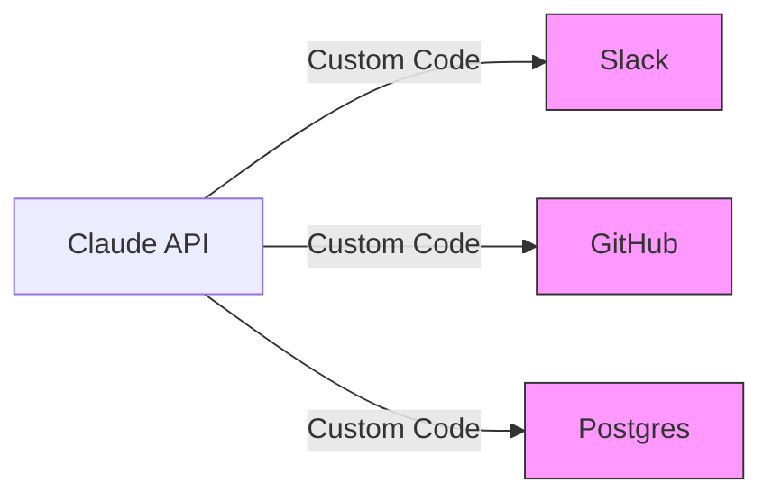
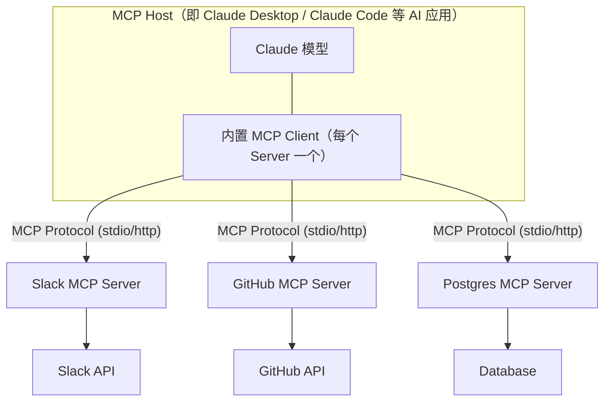
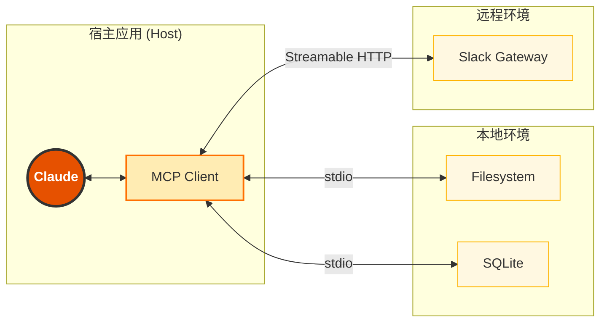

# 第四章 MCP 模型上下文协议

MCP（Model Context Protocol）是 Anthropic 推出的开放标准，让 Claude 能够安全地连接各种外部数据源和服务。

---

## 什么是 MCP？

MCP 是大模型对其他资源或工具的统一访问接口标准，就像 AI 世界的 **USB-C**，让 Claude 能够：

- 访问本地文件系统
- 连接数据库
- 集成第三方服务（GitHub、Slack、Google Drive 等）
- 使用自定义工具

---

## 本章学习目标

- [ ] 理解 MCP 的架构和核心概念
- [ ] 配置和使用 MCP 服务器
- [ ] 掌握常用 MCP 服务器
- [ ] 开发自定义 MCP 服务器

---

## 1. MCP 是什么：AI 世界的 USB-C

在 2024 年之前，如果想让 Claude 读取电脑上的文件，或者查询公司的数据库，需要编写大量的“胶水代码”。这就像是在不同品牌的手机充电器之间寻找转接头——繁琐、混乱且互不兼容。对于这样的问题，再加一层是计算机领域屡试不爽的办法。

**Model Context Protocol (MCP)** 的出现，彻底改变了这一切。Anthropic 将其发布为一种开放标准，并在开发者社区引发了轰动。

### 1.1 痛点：集成的“巴别塔”

在 MCP 诞生之前，将 LLM 连接到数据源面临着巨大的碎片化问题：

*   **重复造轮子**：每个开发者如果要连接 Google Drive，都得自己写一套 OAuth 认证、API 封装和数据清洗逻辑。
*   **维护噩梦**：一旦 Slack 更新了 API，所有连接 Slack 的 Agent 都得重写代码。
*   **上下文孤岛**：IDE 里的 AI 助手读不到浏览器里的内容，因为它们运行在不同的沙箱里。

这就像早期的计算机外设接口——鼠标用 PS/2，打印机用并口，显示器用 VGA。如果想换个设备，可能连接口都插不上。

### 1.2 解决方案：标准化的通用协议

MCP 的核心理念非常简单：**让 AI 连接数据就像插 USB 设备一样简单。**

它定义了一套通用的协议，规定了 AI 模型（Client）和数据源（Server）之间该如何“握手”和“对话”。

#### 这里的“USB-C”意味着什么？

1.  **标准化 (Standardized)**：无论你是连接本地文件系统、PostgreSQL 数据库还是 Notion 笔记，对于 Claude 来说，它们看起来都 **一模一样**。Claude 只需要学会说“MCP 语言”。
2.  **即插即用 (Plug-and-Play)**：一旦安装或连接了一个 MCP Server（比如 GitHub 官方 `github-mcp-server` 或托管远程端点），任何支持 MCP 的客户端（如 Claude Desktop App、Claude Code、Cursor、Zed）都能获得读取 GitHub 的能力，无需为每个宿主重新写一套集成。
3.  **双向流通 (Bi-directional)**：不仅 Claude 可以读取数据（Resources/资源）、执行操作（Tools/工具），Server 还能反过来请求宿主调用模型生成内容（Sampling/采样），实现真正的双向交互。

### 1.3 架构对比

#### 传统模式


每个连接都需要独特的维护。

#### MCP 模式


Host 就是 AI 应用本身（如 Claude Desktop、Claude Code），它内部为每个 Server 创建一个 MCP Client；具体的业务逻辑被封装在各个 Server 中。

### 1.4 为什么这对开发者很重要？

*   **对于工具开发者**：只需要写一次 `mcp-server`，工具就能被所有 AI 客户端（Claude, Cursor, VS Code...）直接使用。
*   **对于 AI 应用开发者**：可以专注于构建 Agent 的逻辑，而不用担心底层如何解析 PDF 或如何连接 MySQL。只需配置好现成的 MCP Server 即可。

### 1.5 MCP 的诞生

MCP 由 Anthropic 工程师 **David Soria Parra** 和 **Justin Spahr-Summers** 创建。创意源于 David 在使用 Claude Desktop 时的一个痛点：需要不断在 Claude 和 IDE 之间复制粘贴代码。

这是一个典型的 **M×N 问题**：M 个 AI 应用需要连接 N 个外部服务，传统方式需要 M×N 个独立集成。MCP 的设计灵感来自 **Language Server Protocol (LSP)**—一个标准化的协议只需要 M+N 个实现即可完成全部连接。

2024 年 11 月，Anthropic 将 MCP 开源，使整个 AI 生态系统都能受益。2025 年 12 月，MCP 正式加入 **Agentic AI Foundation (AAIF)**——一个由 Linux Foundation 托管、Anthropic / Block / OpenAI 联合发起的开源基金会，确保协议的供应商中立与社区治理。

### 1.6 生态系统概览

MCP 生态正在快速扩张：

#### 客户端

实现了 MCP Client 的应用可以连接任何 MCP Server：
- Claude Desktop App
- Claude Code
- Zed Editor
- Cursor
- VS Code 扩展

#### 服务端

| 类别 | 示例 |
| :--- | :--- |
| 本地资源 | Filesystem, SQLite, Git |
| 云服务 | AWS, Google Drive, Azure |
| SaaS | Slack, Linear, Notion, Sentry |
| 浏览器 | Puppeteer（网页自动化）|

### 1.7 Connectors：零配置的 MCP 体验

对于非技术用户，Anthropic 提供了 **Connectors**——可直接启用的预置集成能力：

- **无需配置**：按产品入口启用即可使用
- **官方合作**：由 Anthropic 与合作伙伴共同维护
- **权限管理**：细粒度的访问控制

#### 热门 Connectors

| Connector | 功能 |
| :--- | :--- |
| **Notion** | 读写 Notion 页面和数据库 |
| **Figma** | 访问设计稿，生成前端代码 |
| **Canva** | 在画布中生成设计 |
| **Linear** | 创建和更新工单 |
| **Stripe** | 查询支付数据 |
| **Hubspot** | 自动化 CRM 任务 |
| **Sentry** | 分析错误日志 |

启用方式：在 Anthropic 提供的相关目录或产品入口中浏览可用 Connectors，点击添加即可。

### 1.8 MCP 在代理经济中的战略地位

MCP 的意义远不止于技术便利。在代理经济（Agentic Economy）中，API 和 MCP 正在取代图形界面成为新的“用户界面”——智能体通过 MCP 发现和调用服务，就像人类通过浏览器访问网站一样自然。

这意味着：如果一个 SaaS 产品缺乏可读的底层数据表示、不支持脚本调用或采用封闭格式，它将无法被智能体有效操纵，在市场竞争中处于劣势。构建健壮、文档完善且具有高度表达能力的 MCP 服务器，使 AI 能够成为人类用户的无缝副驾驶，正在从“锦上添花”变为软件企业的生存前提。

未来还将出现去中心化的“智能体发现网络”——智能体以机器可读格式发布自身能力，其他智能体可以动态发现和调用，类似于互联网的 DNS 系统。MCP 作为工具连接协议，与 A2A 等智能体互操作协议一起，构成了这个新网络的协议基础（更多关于代理经济的讨论，参见姊妹篇《智能体 AI 权威指南》第六章和第十一章）。

---

现在理解了 MCP 作为“连接一切”的通用标准。接下来深入探讨其内部架构—Client 和 Server 之间到底发送了什么消息？

➡️ [深入 MCP 架构原理](4.2_architecture.md)

## 2. MCP 架构与核心概念

MCP 并不仅仅是一个简单的 API 定义，它是一套面向工具、资源与提示模板的应用层协议。要熟练使用 MCP，需要理解其架构组件、能力边界与通信机制。

### 2.1 系统架构图谱

MCP 采用经典的 **Client-Server (C/S)** 架构，但在 AI 场景里，角色定义略有特殊。



#### MCP Host 与 MCP Client

**Host 是宿主应用**，即 Claude Desktop、IDE、终端代理等 AI 应用本身；它为每个 Server 实例化一个 **MCP Client**。Client 是协议层的发起方，与 Server 保持一对一连接。
*   **职责**：Host 协调多个 Client、把用户意图转成 MCP 请求、并将 Server 的结果呈现给用户或喂给模型；每个 Client 负责管理与对应 Server 的连接。
*   *注意：LLM 本身既不是 Host 也不是 Client；包裹 LLM 的宿主应用是 Host，Client 是 Host 内部与 Server 通信的组件。*

#### MCP Server

**Server 是能力提供方**。它通常是一个独立进程或独立服务。
*   **职责**：暴露资源（数据）、工具（功能）和提示词（模板）。
*   **特性**：一般专注于单一领域，如 Git、PostgreSQL、文件系统或企业内部系统。

### 2.2 三大核心原语

MCP 协议定义了三种主要能力。

#### 资源 —— “读取 Context”

资源是被动的数据源，模型通过 `read` 操作获取其内容。
*   **类比**：`GET` 请求或文件读取。
*   **URI 寻址**：每个资源都有唯一 URI，例如 `file:///home/user/notes.txt` 或 `postgres://db/users/schema`。
*   **用途**：让 Claude 读取大文件、数据库 schema 或运行日志，而不必把全部内容塞进 prompt。
*   **注意**：资源内容获取后直接进入上下文窗口，应注意资源大小的管理以避免 Token 溢出。

#### 工具 —— “执行 Action”

工具是可执行的函数。
*   **类比**：`POST` 请求或函数调用。
*   **结构**：通常包含 `name`、`description`、`inputSchema` 等元数据。
*   **用途**：创建文件、执行查询、发送消息、触发工作流。
*   **流程**：Client 发起 `tools/call`，Server 执行逻辑并返回结果内容。

#### 提示词 —— “预设模板”

这是 MCP 相对有特色的一类能力，允许 Server 暴露可复用的提示模板。
*   **类比**：Slash Command（斜杠命令）或参数化 Prompt 模板。
*   **用途**：把某个领域里的标准分析过程沉淀为可复用入口。
*   **例子**：Git Server 可以提供一个 “分析当前 diff” 的提示模板，宿主应用把上下文采集和模板拼装标准化后，再交给模型执行。

#### 大规模工具库的按需加载

面对大规模工具库时，要区分 **MCP 协议标准能力** 和 **宿主/编排层优化**。MCP 标准层定义的是 `tools/list`、`tools/call` 和 `Tool[]` 等基本交互；部分宿主或 agent harness 可能会在其上增加工具搜索、延迟加载或压缩提示的机制。

一种常见优化是：

1. 先让模型看到精简的工具索引或工具分类。
2. 当任务需要某类工具时，再加载完整 schema、描述和使用示例。
3. 通过宿主提供的 Tool Search、RAG 或工具目录服务找到候选工具。

这种设计可以减少初始 prompt 的 token 占用。如果一个 MCP Server 暴露了 50 个工具，但当前任务只需要其中 2 个，预加载全部 Schema 会浪费大量上下文空间。写 MCP 文档或实现时，应把这类优化描述为宿主层能力，不要把 `deferred_tools_delta`、`ToolSearch` 等特定实现名写成 MCP 核心协议的一部分。Anthropic API 层面的工具搜索与按需加载实现，详见 [3.6 工具搜索](../03_tools/3.6_tool_search.md)。

### 2.3 通信与传输层

MCP 在消息层统一使用 **JSON-RPC 2.0**（规范强制要求，所有 Client-Server 消息都必须遵循该格式）。在传输层，MCP 规范定义了 `stdio` 和 `Streamable HTTP` 两种标准传输方式，同时不同的客户端实现可能支持额外的传输选项。

#### `stdio`：本地进程通信

*   **最常用**：Client 作为父进程启动 Server 子进程。
*   **通信**：通过 `stdin` / `stdout` 交换 JSON-RPC 消息。
*   **优点**：部署简单、不暴露网络端口、适合本地工具。
*   **场景**：文件系统、本地数据库、本机开发工具。

#### `Streamable HTTP`：远程服务主流方案

*   **当前远程连接的推荐方案**。
*   **通信**：基于 HTTP 传输 JSON-RPC 消息，支持流式返回、会话恢复 token 和重试逻辑。
*   **优点**：适合容器部署、内网服务、云端网关，支持断线重连。
*   **场景**：团队共享服务、企业内部系统、需要远程认证的工具网关。

#### `SSE`：历史双向实现

*   **早期远程方案**：下行使用 Server-Sent Events，上行使用独立的 HTTP POST。
*   **定位**：在当前生态中属于历史兼容实现，新项目应优先使用 Streamable HTTP。
*   **仍可用**：部分已有 Server 仍采用此方案，Client 通常向后兼容。

#### `WebSocket`：低延迟选项

*   **注意**：Claude Code 可以通过 `.mcp.json` / `claude mcp add-json` 配置 WebSocket MCP Server；但普通请求/响应和需要 OAuth 的远程工具应优先使用 Streamable HTTP。
*   **直连模式**：直接 JSON 消息传递，延迟最低。
*   **场景**：实时协作、需要双向高频通信的工具。
*   **兼容性**：使用前需确认 Server 端是否支持此协议。

> **提示**：选择传输方式时，优先使用 MCP 标准定义的 `stdio`（本地）或 `Streamable HTTP`（远程），以确保最大兼容性。需要兼容旧远程 Server 时可保留 SSE；WebSocket 只能作为双方显式支持的自定义传输处理。

下面是 Claude Code / Claude Desktop 风格的宿主配置示例；不同宿主的字段名可能不同。

```json
{
  "mcpServers": {
    "company-tools": {
      "type": "streamable-http",
      "url": "https://mcp-server.company.com/mcp"
    }
  }
}
```

### 2.4 MCP 认证与交互

随着 MCP 被用于企业系统和远程服务，认证与用户确认变得至关重要。

#### OAuth 2.1

对于远程 MCP Server，常见做法是由宿主应用或网关接入 **OAuth 2.1** 流程。

**工程上要把握两个原则：**

*   认证配置的具体字段由所用宿主、SDK 或 Server 实现决定，并不意味着 MCP 核心协议强制规定了某一套环境变量名。
*   写文档时应重点解释“为什么需要 OAuth、典型会话长什么样”，避免把某个私有实现的配置项写成协议标准。

#### Elicitation / 用户确认

在需要额外输入或确认的场景中，远程端与宿主端可能发生交互式确认，例如：

*   请求额外权限；
*   询问是否继续敏感操作；
*   补充缺失参数。

这类能力说明 MCP 并不总是单向“调用工具 -> 返回结果”，而是可以承载更复杂的人机协作流程。

### 2.5 初始化握手

> **版本说明**：本节描述的是握手式修订版（MCP `2025-11-25` 及更早）的流程，也是当前多数客户端与 Server 实际运行的方式。官方 `2026-07-28` 修订版移除了 `initialize` / `notifications/initialized` 握手与协议级会话，改为每个请求在 `_meta` 中携带协议版本与客户端能力，并新增 `server/discover` 供客户端一次性获取版本与能力。实现方通常会同时支持多个修订版，接入前请按目标 Server 支持的版本核对。

当支持 MCP 的宿主应用启动并连接某个 Server 时，通常会发生以下过程：

1.  **启动或连接**：启动本地 `mcp-server` 进程，或连接远程服务。
2.  **Initialize**：Client 发送 `initialize` 请求，声明自己的协议版本与能力。
3.  **Negotiate**：Server 返回自身信息和支持的能力。
4.  **Initialized**：Client 发送 `notifications/initialized`，表示初始化阶段完成。
5.  **List**：Client 视需要请求 `tools/list`、`resources/list`、`prompts/list` 构建能力目录。
6.  **Auth / Consent**：若远程服务需要认证或用户确认，会在此阶段或首次调用时完成。

这一过程对用户通常是透明的。用户看到的只是 Claude “学会”了访问数据库、文件系统或企业服务。

### 2.6 配置层级与企业管控

> **来源说明**：本节的作用域优先级与企业管控行为以 [官方 MCP 文档](https://code.claude.com/docs/en/mcp#scope-hierarchy-and-precedence) 和 [官方 Managed MCP 文档](https://code.claude.com/docs/en/managed-mcp) 为准；个别官方未载的实现细节（如每轮重新获取 MCP 指令、Resource 内容直接进入上下文）仍来自社区逆向分析（HitCC 项目）。其他 MCP 客户端的配置机制可能不同。

MCP 在 Claude Code 中的配置解析遵循官方文档定义的作用域优先级——同名 Server 取最高优先级来源，从高到低依次为：

| 优先级 | 配置来源 | 说明 |
| :--- | :--- | :--- |
| 1 | 本地作用域（local） | 当前用户在当前项目内私有的配置（含 `claude mcp add` 默认写入） |
| 2 | 项目作用域 `.mcp.json` | 随仓库共享的项目配置 |
| 3 | 用户作用域 | `~/.claude/` 下跨项目的个人配置 |

上述合并**按名称**匹配重复项；按**端点**（URL 或启动命令）匹配的去重只适用于插件与连接器——当插件/连接器指向的 URL 或命令与上层某个 Server 相同时，会被视为重复。

企业 `managed-mcp.json` 不参与上述合并——它具有**排他控制权**：一旦部署，Claude Code 只加载该文件定义的 Server，用户无法添加、修改或使用任何其他 MCP Server。

#### 企业管控约束

在企业环境中，MCP 配置不是简单的合并——**企业级配置会施加策略约束**：

*   企业 `managed-mcp.json` 存在时，仅其定义的 Server 可用（排他）
*   用户**无法**通过命令行动态添加新的 MCP Server
*   企业管理员可以锁定允许使用的 Server 列表

这意味着 MCP 在企业部署中是一个**策略管控系统**，而非简单的配置文件合并。管理员可以确保所有用户只连接到经过审批的工具服务。

#### MCP 指令的动态性

MCP Server 可能在运行中动态更新其工具、资源或提示列表。客户端可根据 `list_changed` 通知或重连刷新能力目录；是否每轮对话都刷新取决于宿主实现，不是 MCP 核心协议的硬性要求。

#### Resource 的使用方式

MCP Resource 的内容在被获取后，会直接出现在对话上下文中（而非保持为引用）。这意味着大型资源会直接占用上下文窗口空间，使用时需要注意资源大小的管理。

---

理论知识已经具备，现在动手实战。我们将配置 Claude Desktop 来连接一个本地的 SQLite 数据库。

➡️ [配置与实战指南](4.3_config.md)

## 3. 配置与实战指南

下面动手实践，在 Claude Desktop App 中通过 MCP 挂载几个强大的工具。

### 3.1 配置文件解析

Claude Desktop 通过一个 JSON 配置文件来管理所有的 MCP 连接。

#### 配置文件位置

不同操作系统的路径如下：

*   **macOS**: `~/Library/Application Support/Claude/claude_desktop_config.json`
*   **Windows**: `%APPDATA%\Claude\claude_desktop_config.json`

可以通过 VS Code 或任何文本编辑器打开它。如果文件不存在，请手动创建一个。

#### 配置格式

文件的核心结构是一个名为 `mcpServers` 的对象。

```jsonc
{
  "mcpServers": {
    "server-name-1": {
      "command": "executable-command",
      "args": ["arg1", "arg2"],
      "env": {
        "KEY": "VALUE"
      }
    },
    "server-name-2": { ... }
  }
}
```
*   **Key (`server-name-1`)**: 自定义名称，方便识别。
*   **command**: 启动 Server 的可执行程序（通常是 `npx`, `uvx`, `docker` 或 python 脚本路径）。
*   **args**: 传递给命令的参数列表。
*   **env**:（可选）传递给 Server 进程的环境变量（常用于传递 API Key）。

### 3.2 实战案例：打造全能工作台

下面将配置三个极其常用的 MCP Server：文件系统、SQLite 数据库和 Git。以下 JSON 都是 `mcpServers` 对象内部的条目片段；复制到完整配置文件时，需要放在 `{ "mcpServers": { ... } }` 里面。

#### 挂载文件系统

让 Claude 能够读写指定的本地目录。

```jsonc
"filesystem": {
  "command": "npx",
  "args": [
    "-y",
    "@modelcontextprotocol/server-filesystem",
    "/Users/username/Desktop",
    "/Users/username/Projects"
  ]
}
```
*注意：上例允许访问桌面和项目目录。将 `/Users/username` 替换为真实路径；出于安全考虑，请只挂载必要的目录，不要挂载根目录。*

#### 连接 SQLite 数据库

让 Claude 甚至可以直接查询本地的 `.db` 文件进行数据分析。

```jsonc
"sqlite": {
  "command": "uvx",
  "args": [
    "mcp-server-sqlite",
    "--db-path",
    "/Users/username/data/chinook.db"
  ]
}
```
*注意：`uvx` 用于运行 Python 包；最后一个参数是你的 SQLite 数据库文件路径。*

#### 集成 Git

让 Claude 可以查看提交记录、Diff，甚至帮忙创建 Commit。

```jsonc
"git": {
  "command": "python3",
  "args": [
    "-m",
    "mcp_server_git",
    "--repository",
    "/Users/username/Projects/my-app"
  ]
}
```
*注意：最后一个参数是 Git 仓库路径。*

### 3.3 环境变量与安全

很多 Server（如 GitHub, Slack, Postgres）需要认证。**不要把密码写在 `args` 里，也不要把真实 token 提交到 MCP 配置文件**。优先用操作系统密钥链、CI secret、企业 secret manager 或只保存在本机且已加入 `.gitignore` 的环境文件，在启动 MCP server 时注入最小权限凭据。

```jsonc
"github": {
  "command": "docker",
  "args": [
    "run", "-i", "--rm",
    "-e", "GITHUB_PERSONAL_ACCESS_TOKEN",
    "ghcr.io/github/github-mcp-server"
  ],
  "env": {
    "GITHUB_PERSONAL_ACCESS_TOKEN": "<set by your secret manager at process launch>"
  }
}
```

*注意：早期教程常用的 `@modelcontextprotocol/server-github`（`npx` 方式）已于 2025 年随官方参考实现仓库归档、npm 包停止维护，上例改用 GitHub 官方的 [github-mcp-server](https://github.com/github/github-mcp-server)（Docker 本地运行）。GitHub 还提供托管远程端点 `https://api.githubcopilot.com/mcp/`（OAuth 认证），支持远程 MCP 的客户端可直接连接。*

示例中的占位符不是 token 格式，不能替换为真实密钥后提交。GitHub PAT 应限制到当前 server 实际需要的仓库和 scopes，并定期轮换。

### 3.4 调试与故障排除

配置完成后，**必须重启 Claude Desktop** 才能生效。

#### 怎么知道连接成功了？

启动 Claude 后，点击输入框右下角的 MCP 服务器指示图标（官方文档描述为“滑块”状图标；具体样式随版本可能微调）。
*   点击图标可以看到已加载的 Server 与工具列表（如 `read_file`, `query_table` 等）；列表中出现即表示连接正常。

#### 常见错误排查

1.  **“Connection failed”**: 检查 `command` 是否存在。例如 `npx` 需要安装 Node.js，`uvx` 需要安装 uv。
    *   *Tip*: 在终端里手动运行由 `command` + `args` 组成的命令，看是否有报错。
2.  **“ENOENT” / “File not found”**: 检查 `args` 里的绝对路径是否正确。不要使用 `~` 符号，尽量使用完整路径 `/Users/...`。
3.  **“Permission denied”**: 某些目录需要特殊权限。

### 3.5 使用 MCP Inspector

如果正在开发自己的 Server，或者仅仅想看看 Server 到底发了什么数据，可以使用官方的调试工具 **MCP Inspector**。

```bash
npx @modelcontextprotocol/inspector python weather_server.py
```
它会启动一个网页界面，可以像使用 Postman 一样手动发送 MCP 请求并查看响应，而无需打开 Claude。把示例中的 `python weather_server.py` 替换成你自己的 server 启动命令。

---

配置好了，怎么用呢？其实对于用户来说，只要像往常一样说话就行。但如何将多个 MCP Server 组合起来发挥最大威力？

➡️ [场景化实战：MCP 的组合拳](4.4_practice.md)

---

> **🔥 踩坑实录**
>
> 某团队配置了一个 MCP 服务器用于数据库查询，在 Claude Desktop 中测试一切正常，能顺利执行数据库查询工具。但当把配置部署到无头服务器环境（Headless Server）后，MCP 连接始终失败。排查发现：Claude Desktop 会自动管理 MCP 服务器进程的生命周期（启动、保活），但在无头服务器环境中没有 Desktop App，MCP 进程需要手动启动并维持运行。最终通过 systemd 服务单元来管理 MCP 进程，并配置健康检查和自动重启，问题才解决。教训：MCP Server 的运维方式随场景而异，开发测试可依赖 Desktop，但生产部署必须考虑自动化生命周期管理。

## 4. 场景化实战：MCP 的组合拳

单纯地连接一个 Server 只是第一步。MCP 的真正威力在于 **组合**。当 Claude 同时连接了“眼睛”（搜索）、“记忆”（数据库）和“双手”（GitHub）时，它就不再是一个聊天机器人，而是一个全栈工程师。

本节将通过三个典型场景，展示如何组合多个 MCP Server 来完成复杂任务。

### 4.1 场景一：全自动代码审查员

**目标**：自动拉取最新的 Pull Request，分析代码变动，并生成一份审查报告保存到本地。

#### 所需组件

*   GitHub MCP Server：读取 PR 内容（包名和配置以官方 registry / 文档为准）。
*   Filesystem MCP Server：保存 Markdown 报告（只授权目标目录）。

#### 交互流程

**User**: “请帮我审查 `anthropic/sdk` 仓库的 #123 号 PR，并将报告保存到桌面的 `reviews` 文件夹。”

**Claude 的后台操作 (Thinking)**:
1.  调用 `github.get_pull_request(owner="anthropic", repo="sdk", number=123)` 获取 PR 描述。
2.  调用 `github.get_issue_comments` 查看已有讨论。
3.  调用 `github.get_pull_request_files` 获取变更文件列表。
4.  逐个分析代码逻辑...（Claude 内部推理）。
5.  生成一份 Markdown 内容。
6.  调用 `filesystem.write_file(path="/Users/me/Desktop/reviews/pr_123.md", content=...)`。

**Result（结果）**: 桌面上多了一份文件，无需离开对话框。

### 4.2 场景二：智能数据分析师

**目标**：无需写 SQL，直接用自然语言查询数据库，结合互联网信息生成商业分析图表。

#### 所需组件

*   Postgres MCP Server：连接业务数据库（如销售数据）。
*   Search MCP Server：搜索外部竞品信息。

#### 交互流程

**User**: “分析一下上个季度我们在'无线耳机'品类的销售情况，并与苹果 AirPods 的近期市场表现做对比。”

**Claude 的后台操作**:
1.  **内部数据**: 调用 `postgres.query("SELECT sum(amount) FROM sales WHERE category='earphones' AND date > ...")`。
    *   *Result*: “销售额 500 万，环比增长 10%。”
2.  **外部数据**: 调用 `brave.search("Apple AirPods market share Q3 2025")`。
    *   *Result*: “AirPods 市场份额下滑 2%...”
3.  **综合分析**: 结合内外部数据，生成洞察。
    *   “虽然竞品下滑，但我司逆势增长，建议加大营销投入...”

### 4.3 场景三：自动化运维

**目标**：当系统报警时，自动查看日志并尝试修复。

#### 所需组件

*   Sentry MCP Server：获取错误堆栈。
*   SSH / Shell MCP Server（如组织批准）：连接服务器查看日志。
*   Slack MCP Server：通知运维团队。

#### 交互流程

**User**: “Sentry 上刚报了一个 Critical Error，看看是咋回事。”

**Claude 的后台操作**:
1.  调用 `sentry.get_latest_issue()`。
    *   *Error*: "Connection refused on port 6379 (Redis)".
2.  **推理**: “这是 Redis 挂了。”
3.  调用 `ssh.execute("systemctl status redis")`。
    *   *Output*: "Active: failed".
4.  调用 `slack.send_message(channel="#devops", text="检测到 Redis 服务宕机，建议重启。")`。

### 4.4 最佳实践：如何向 Claude 提问

当挂载了多个工具时，Prompt 的质量决定了调用的准确度。

#### 明确数据源

*   *Bad*: “查一下那个数据。”
*   *Good*: “请去 **Postgres 数据库** 查一下...” 或 “请用已配置的 **Web Search / 搜索工具** 查一下...”

#### 赋予权限

如果在构建自己的 Agent 应用：
```xml
<system_prompt>
你是一个拥有只读 Postgres 和只读 GitHub 访问权限的助手。
在回答问题前，优先使用已授权工具获取真实数据；任何写入、删除、发布或通知动作都必须先请求人工确认。
</system_prompt>
```

#### 组合使用

不要一次只发一个指令。尝试让 Claude 规划任务：
“请先列出数据库里的表结构，然后帮我写一个查询...”
Claude 会先调用 `list_tables`，看到结果后，再在同一个回复中生成 SQL 查询。

> **MCP 生态扩展（2026-04）**：Anthropic 联合 Adobe、Blender、Autodesk Fusion、Ableton、Splice 等厂商发布了首批面向创意工作的官方连接器，把上述“组合调用”模式延伸到 3D 建模、音频制作与视觉设计场景——其中 Ableton 连接器以官方产品文档作为答复 grounding，是“文档 RAG over MCP”的代表范式。

---

现在已经体验了使用现成的 Server，但在企业中，往往需要通过 MCP 暴露 **内部的私有 API**。这就需要自己动手编写 MCP Server 了。

➡️ [从零开发 MCP Server](4.5_custom.md)

## 5. 从零开发自定义 MCP Server

虽然社区提供了很多现成的 Server，但在企业应用中，往往需要让 Claude 连接 **内部 API**、**私有数据库** 或者 **自研系统**。

本节将介绍如何用 Python 和 TypeScript 两种语言，快速开发一个自定义的 MCP Server。

### 5.1 极速入门：FastMCP

如果是 Python 开发者，Anthropic 官方提供了一个名为 `fastmcp`（包含在 `mcp` 库中）的高级封装，它可以像写 FastAPI 一样简单地写 MCP Server。

#### 环境准备

```bash
# 安装 mcp 库
pip install mcp
```

#### 编写代码：`weather_server.py`

下面做一个简单的“虚拟天气服务”。

```python
from mcp.server.fastmcp import FastMCP

# 1. 创建 Server 实例
mcp = FastMCP("My Weather Server")

# 2. 定义工具 (使用装饰器)
# docstring 会自动变成工具的 description
# 类型注解会自动变成 input_schema
@mcp.tool()
def get_weather(city: str) -> str:
    """获取指定城市的当前天气情况。"""
    # 这里可以填写真实的 API 调用逻辑
    # 例如: requests.get(f"https://api.weather.com/{city}")
    return f"{city} 今天晴朗，气温 25度。"

# 3. 定义资源
# 让 Claude 可以直接读取这种格式的数据: weather://beijing
@mcp.resource("weather://{city}")
def get_weather_resource(city: str) -> str:
    """以资源形式获取天气数据"""
    return f"Latest weather report for {city}: Sunny, 25C, Humidity 40%."

if __name__ == "__main__":
    # 启动 Server
    mcp.run()
```

#### 本地测试

可以使用 MCP Inspector 直接运行它：
```bash
npx @modelcontextprotocol/inspector python weather_server.py
```
这会弹出一个网页，可以在上面看到 `get_weather` 工具，点击运行，还能看到 JSON 交互日志。

### 5.2 企业级开发：TypeScript SDK

如果是 Node.js 开发者，可以使用官方的 TypeScript SDK。这通常用于构建生产环境级别、基于 Docker 的 Server。

#### 初始化项目

```bash
mkdir my-mcp-server
cd my-mcp-server
npm init -y
npm pkg set type=module   # 必须：示例使用顶层 await，CommonJS 下 tsx 会直接报错
npm install @modelcontextprotocol/sdk zod
npm install -D typescript tsx @types/node
```

#### 编写代码：`index.ts`

```typescript
import { Server } from "@modelcontextprotocol/sdk/server/index.js";
import { StdioServerTransport } from "@modelcontextprotocol/sdk/server/stdio.js";
import { CallToolRequestSchema, ListToolsRequestSchema } from "@modelcontextprotocol/sdk/types.js";

// 1. 初始化 Server
const server = new Server(
  {
    name: "my-ts-server",
    version: "1.0.0",
  },
  {
    capabilities: {
      tools: {}, // 声明支持 Tools 能力
    },
  }
);

// 2. 实现 Tools 列表
server.setRequestHandler(ListToolsRequestSchema, async () => {
  return {
    tools: [
      {
        name: "calculate_sum",
        description: "计算两个数字的和",
        inputSchema: {
          type: "object",
          properties: {
            a: { type: "number" },
            b: { type: "number" },
          },
          required: ["a", "b"],
        },
      },
    ],
  };
});

// 3. 实现工具调用逻辑
server.setRequestHandler(CallToolRequestSchema, async (request) => {
  if (request.params.name === "calculate_sum") {
    const args = request.params.arguments as { a: number; b: number };
    const sum = args.a + args.b;

    return {
      content: [
        {
          type: "text",
          text: `Result is ${sum}`,
        },
      ],
    };
  }
  throw new Error("Tool not found");
});

// 4. 连接 Transport
const transport = new StdioServerTransport();
await server.connect(transport);
```

开发时可直接运行：

```bash
npx tsx index.ts
```

### 5.3 设计原则与最佳实践

开发 MCP Server 时，请遵循以下原则：

#### 保持原子性

不要做一个名为 `do_everything` 的工具。
*   *Bad*: `manage_user(action="create", ...)`
*   *Good*: `create_user(...)`, `delete_user(...)`, `update_user(...)`
工具越小，模型越容易组合使用。

#### 丰富的描述

`docstring` 或 `description` 字段非常重要。
告诉 Claude：
*   这个工具是干嘛的？
*   参数的单位是什么？（秒？毫秒？）
*   返回值的格式是什么？

#### 错误处理

如果 API 调用失败，**不要抛出异常让进程崩溃**。
应该捕获异常，并返回一个包含错误信息的文本结果，或者使用 `isError: true` 标志（如果 SDK 支持）。这样 Claude 可以读取错误信息，并尝试自我修正（比如换个参数重试）。

### 5.4 部署与分发

当写好 Server 后，如何分享给团队？

*   **NPM 发布**: 将 TypeScript Server 发布为 npm 包。
    *   配置 command: `npx -y my-mcp-server`
*   **Docker 部署**: 封装为 Docker 镜像，通过 Streamable HTTP 暴露远程 MCP 端点。
    *   适用于云端部署，供远程 Client 连接；如果必须兼容旧客户端，可同时保留旧 HTTP+SSE 传输。
*   **Git 仓库**: 直接分享源码。
    *   配置 command: `python /path/to/repo/main.py`

---

Claude 现在已经连接上了数据。接下来，将介绍更强大的功能——让 Claude 自己看屏幕，像人一样操作电脑。

➡️ [第五章：Computer Use 计算机操控](../05_computer_use/README.md)
