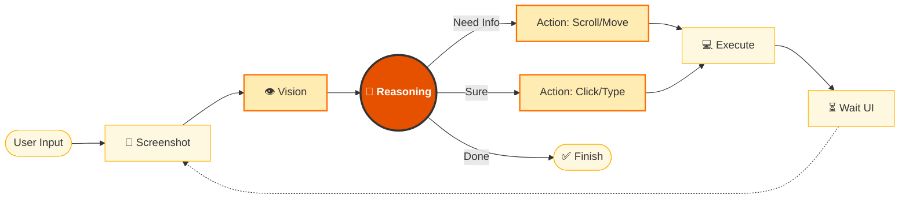

# 第五章：Computer Use 计算机操控

Computer Use 是 Claude 最具突破性的能力，让 AI 能够像人类一样操作计算机界面。

---

## 革命性意义

传统 AI 只能处理文本和数据。Computer Use 让 Claude 能够：

- 直接操作桌面应用程序
- 填写表单、点击按钮
- 在没有 API 的系统中工作
- 执行端到端的自动化任务

---

## 本章学习目标

- [ ] 理解 Computer Use 的工作原理
- [ ] 搭建安全的运行环境
- [ ] 构建桌面自动化 Agent
- [ ] 了解局限性和最佳实践

---

## 1. Computer Use 能力概述：AI 的“阿凡达”时刻

2024 年 10 月 22 日，Anthropic 发布了一项震撼业界的功能：**Computer Use（计算机操控）**，首先在公测阶段推出。
如果说 LLM 之前的能力是“大脑”（思考）和“嘴巴”（说话），那么 Computer Use 就赋予了它“眼睛”和“双手”。

Claude 现在可以像人类一样，看着屏幕，移动鼠标，点击按钮，敲击键盘。这标志着 AI 从“辅助生成内容”迈向了“自主执行任务”的新纪元。

### 1.1 什么是 Computer Use？

简单来说，Computer Use 是一种允许 AI 模型通过视觉反馈回路与计算机图形界面 (GUI) 进行交互的技术。

Claude 收到的不再仅仅是文本 Prompt，而是 **当前屏幕的截图**。它输出的不再仅仅是建议，而是具体的 **操作指令**（如 `click(x=500, y=200)` 或 `type("Hello World")`）。

#### 核心能力矩阵

| 能力 | 描述 | 技术原理 |
| :--- | :--- | :--- |
| **视觉感知 (See)** | 识别图标、菜单、按钮、文本框，即便它们没有可访问性标签。 | Vision-Language Model 像素级分析 |
| **精准操控 (Act)** | 移动光标、点击、双击、拖拽、滚动、键盘输入组合键。 | 映射到操作系统的底层 HID 事件 |
| **状态反馈 (Loop)** | 每次操作后，再次查看屏幕以确认结果（如“页面是否加载完成？”）。 | ReAct 循环 (Observation -> Action) |
| **跨应用协作 (Cross-App)** | 从 Excel 复制数据，粘贴到 CRM 网页，再打开 Slack 发通知。 | 操作系统级任务切换 |

### 1.2 为什么它很重要？

在 Computer Use 出现之前，自动化主要依赖 API 或 RPA (Robotic Process Automation)。但它们都有致命弱点：

*   **API 的局限**：世界上 99% 的软件（尤其是企业内部遗留系统、桌面软件）没有 API，或者 API 极其难用。
*   **传统 RPA 的脆弱**：传统的按键精灵依赖固定的坐标或 DOM 选择器。一旦软件界面更新（比如按钮位置移了 5 像素），脚本就会崩溃。

**Computer Use 是“反脆弱”的。**
因为它像人一样是通过“看”来操作的。即使按钮从左边移到了右边，Claude 也能认出那是“登录”按钮并去点击它，而不需要重写代码。

### 1.3 适用场景

Computer Use 不是为了取代 API，而是为了填补 API 无法覆盖的 **最后一公里**。

#### 遗留系统操作

很多银行、医院、制造业使用的软件是 20 年前开发的，没有任何接口。Claude 可以直接操作这些“古董”软件进行数据录入。

#### 复杂的 GUI 工作流

比如“打开 Photoshop，把这张图根据内容裁剪一下，然后导出为 WebP”。这种涉及视觉判断和复杂软件操作的任务，以前是自动化的禁区。

#### 软件测试

让 Claude 扮演测试员：“打开我们的新网站，尝试注册一个账号，如果遇到报错就截图发给我。”它可以像真实用户一样进行端到端测试。

### 1.4 安全模型与风险

赋予 AI 控制电脑的权限是极度危险的。Anthropic 在设计之初就确立了严格的安全边界。

#### 风险点

*   **Prompt Injection**: 如果 Claude 访问了一个恶意网页，网页上的隐藏文字可能会诱导它删除本地文件。
*   **误操作**: AI 可能会点错按钮，比如误点了“发送给全员”而不是“保存草稿”。

#### 防御机制

*   **受信任沙箱隔离**：官方参考实现建议运行在受信任的隔离环境中，Docker 容器是常见的参考实现之一，虚拟机等其他沙箱方案也可以满足隔离要求。
*   **人机回环 (HITL)**：对于敏感操作，建议设置拦截机制，需人工批准才能执行。
*   **截图隐私**：开发者应确保截图不包含敏感的 PII（个人身份信息），或者接受 Claude 会看到这些信息的风险。

---

了解 Computer Use 可以在屏幕上“指点江山”后，其大脑内部究竟是如何运转的？本节将拆解其神奇的“截图-思考-行动”循环。

➡️ 工作原理：ReAct 循环详解

## 2. 工作原理：截图、识别、行动

Computer Use 的核心不是魔法，而是一个高速运转的 **Agentic Loop（代理循环）**。
理解这个循环，对于调试 Agent 的行为和优化性能至关重要。

### 2.1 核心循环图解

这是一个典型的 **OODA 循环** (Observe-Orient-Decide-Act)。

**图 5-1：Computer Use OODA 循环**

Claude 与计算机交互的高层逻辑是一个持续的闭环：左侧是“大脑”（Claude 模型），右侧是“环境”（计算机界面）。两者通过“截图”（Vision）和“行动”（Action）连接。模型不断观察屏幕状态，形成认知，做出决策，然后施加影响，形成闭环。



上方流程图（图 5-1）详细拆解了每一步的技术实现：
1.  **输入**：始于用户的自然语言指令。
2.  **感知**：获取屏幕截图，这是 AI 的“眼睛”。
3.  **决策**：Claude 分析图像内容（如识别按钮位置），结合任务目标，决定下一步行动。
4.  **执行**：如果需要更多信息（如找不到目标），可能会执行滚动操作；如果确定目标，则执行点击或输入。
5.  **反馈**：执行后系统会等待 UI 响应（如页面跳转），然后再次截图，开始下一轮循环。

每一轮循环，Claude 都必须重新评估整个局势。

### 2.2 三大核心工具

在 Computer Use 模式下，Claude 通过版本化工具定义操作桌面环境。当前的正式形态是**客户端工具集（client toolset）**：在 `tools` 里放一条 `{"type": "computer_toolset_20260801"}`，就会得到 `screenshot`、`left_click`、`type`、`zoom` 等 17 个成员工具，请求**不需要 `anthropic-beta` 头**。更早的两个版本化工具仍以 beta 形式保留给存量集成与尚未支持工具集的模型、平台。新项目应直接复制当前官方 quickstart 中的 `computer_*`、`text_editor_*`、`bash_*` 版本字符串。

`computer_toolset_20260801` 支持 Claude Fable 5.1 / 5、Mythos 5.1 / 5、Opus 5.5 / 5、Sonnet 5.5 / 5 与 Opus 4.8（其中 Opus 5.5 与 Sonnet 5.5 在 Claude API 和 Google Cloud 上只接受这个工具集，旧的 `computer_20251124` 会返回 400），在 Claude API 和 Google Cloud 上为稳定版本（其余平台目前只提供更早的 beta 工具版本），并配合 `text_editor_20250728` 与 `bash_20250124`。Claude Opus 4.7/4.6、Sonnet 4.6 和 Opus 4.5 只能走更早的 `computer-use-2025-11-24` / `computer_20251124`（需 beta 头；上面几个新模型也继续接受它，因此存量集成不必改代码）；Claude Sonnet 4.5 / Haiku 4.5（以及已在 Claude API 退役、仅合作方云仍可用的 Opus 4.1、Sonnet 4、Opus 4）目前仍需使用 `computer-use-2025-01-24` / `computer_20250124`，并非过时组合（更早的 Claude 3.7 文档亦用此组合）。版本会随模型更新，不能写死成永久规则。

#### `computer`

这是最核心的工具，用于执行键鼠操作。
*   **输入参数**:
    *   `action`: 动作类型。基础动作包括 `screenshot`, `left_click`, `type`, `key`, `mouse_move`；较新工具还支持 `scroll`, `left_click_drag`, `right_click`, `middle_click`, `double_click`, `triple_click`, `left_mouse_down`, `left_mouse_up`, `hold_key`, `wait`，`computer_20251124` 可通过 `enable_zoom` 启用 `zoom`。改用 `computer_toolset_20260801` 后，这些动作变成独立的成员工具：输入里不再有 `action` 字段，代码要按 `tool_use` 块的 `name`（配合 `toolset_name`）分发，`zoom` 默认开启，`display_width_px` 等参数则不再接受。
    *   `coordinate`: `[x, y]` 坐标（可选）。
    *   `text`: 要输入的文本（可选）。
*   **特性**: Claude 经过特殊训练，能够理解屏幕截图和坐标，但坐标语义取决于模型与工具版本。Opus 4.8 / 4.7 的较新 Computer Use 工具支持更高分辨率与 1:1 坐标；较旧工具仍可能要求缩放到官方限制范围内，生产实现应按当前 quickstart 设置分辨率和坐标转换。

#### `str_replace_based_edit_tool`

虽然 Claude 可以通过 GUI 打开记事本打字，但这很慢且容易出错。
这个工具允许 Claude 直接以编程方式读写文件。这对于编写代码、修改配置文件非常高效。
*   **功能**: view（查看）, create（创建）, str_replace（替换）, insert（插入）。（`undo_edit` 命令自 `text_editor_20250429` 起已移除）

#### `bash`

对于安装软件、运行脚本、Git 操作，GUI 往往不如 CLI 高效。
Claude 可以在终端中执行命令，并获取 stdout/stderr。

### 2.3 详细交互流程示例

以下通过一个任务来透视这个过程：**“去 Google Images 搜索‘可爱猫咪’并保存第一张图。”**

#### Turn 1: 观察与规划

*   **State**: 屏幕显示空白桌面。
*   **User**: “去 Google Images...”
*   **Claude Thinking**: “我需要先打开浏览器。”
*   **Claude Action**: `computer(action="left_click", coordinate=[50, 800])`（假设这是 Chrome 图标位置）

#### Turn 2: 等待与输入

*   **State**: Chrome 窗口正在打开，可能还在加载。
*   **Claude Thinking**: “浏览器打开了，我需要点击地址栏。”
*   **Claude Action**: `computer(action="type", text="images.google.com")` + `computer(action="key", text="Return")`

#### Turn 3: 视觉搜索

*   **State**: Google 图片首页已加载。
*   **Claude Thinking**: “看到了搜索框。我需要输入关键词。”
*   **Claude Action**: `computer(action="left_click", coordinate=[...])` + `computer(action="type", text="cute cats")` + `key("Return")`

#### Turn 4: 精准定位

*   **State**: 满屏猫咪图。
*   **Claude Thinking**: “我要保存第一张。我需要右键点击它。”
*   **Claude Action**: `computer(action="right_click", coordinate=[200, 300])`

#### Turn 5: 菜单导航

*   **State**: 右键菜单弹出。
*   **Claude Thinking**: “看到了 'Save Image As...' 选项 text。我需要点击它。”
*   **Claude Action**: `computer(action="left_click", coordinate=[220, 350])`

...（后续步骤：输入文件名，点击保存按钮）

### 2.4 视觉提示工程

在 Computer Use 中，Context 不仅是文本，更是 **像素**。
截图的质量直接影响 Claude 的智商。

#### 分辨率权衡

*   **高分辨率**: 细节清晰，但 Token 消耗巨大，且增加延迟。
*   **低分辨率**: 速度快，但小字看不清，容易误点。
*   **推荐**: 1024x768 或 1280x800 是目前的最佳平衡点。Anthropic 模型在训练时对这些标准分辨率有优化。

#### 像素坐标系

Claude 在输出坐标时，是基于它看到的图片分辨率。如果截图经过了缩放（Scaling），必须在执行点击前，将 Claude 返回的坐标 **映射** 回真实的屏幕坐标。

### 2.5 Token 消耗警示

Computer Use 是 Token 吞噬兽。
*   **一张截图**：约需 1,000 - 1,800 Tokens（官方现行口径，取决于分辨率与压缩）。
*   **单次任务**：简单的“订机票”流程可能包含 50 个步骤，消耗 100k+ Tokens。
*   **成本控制**：
    *   不要每一步都截图。如果确定连续操作（如输入文字后按回车），可以在一次 API 调用中返回多个 actions，减少截图次数。
    *   开启 Prompt Caching（已正式发布，支持 5 分钟和 1 小时两种缓存时长）。官方建议：一个 `cache_control` 断点放在系统提示与工具定义之后，最多三个放在最近的 `tool_result` 块上并逐轮前移。
    *   按**批**修剪截图历史而非逐轮删除——每轮删一张会让前缀每轮变化、反复打破缓存；合理默认是保留最近 3 张、每 25 轮修剪一次。

---

理解原理后，接下来需要搭建一个安全的环境。毕竟，避免误操作导致数据丢失至关重要。

➡️ 环境配置：Docker 安全沙箱

## 3. 环境配置与安全沙箱

Computer Use 是一把双刃剑。它能帮你工作，也能（理论上）帮你删除所有文件。
因此，**严禁在宿主机（Host Machine）上直接运行 Computer Use**。

官方建议使用最小权限的专用虚拟机或容器进行隔离。官方参考实现（quickstart）基于 **Docker**，本章也以 Docker 为例。

### 3.1 为什么选 Docker？

1.  **文件隔离**：在不挂载宿主目录、凭据目录或浏览器 profile 的前提下，容器有独立的文件系统，Claude 只能看到容器内的 `/`。
2.  **环境一致性**：官方参考实现使用 Linux 桌面环境（通常是 X11/Xvfb）和 Docker；其他平台也可以实现自有 harness，但要处理 Retina/DPI/坐标缩放。
3.  **状态重置**：`docker restart` 只会重启同一个容器，不会清空可写层。要回到初始状态，应删除并重建容器、使用 `--rm` 临时容器，或恢复 VM/container 快照。

### 3.2 官方参考实现

Anthropic 开源了一个参考实现，集成了所有必要的组件：一个微型的 Linux (Ubuntu) 桌面、VNC 服务器、noVNC 网页客户端以及 Python 控制代码。

#### 快速启动

```bash
# 1. 准备临时 API Key（只放在当前 shell 环境中，不写入镜像或仓库）
export ANTHROPIC_API_KEY="<ANTHROPIC_API_KEY>"

# 2. 拉取并运行镜像。不要挂载 $HOME/.anthropic 等宿主机凭据目录。
docker run \
    -e ANTHROPIC_API_KEY="${ANTHROPIC_API_KEY:?}" \
    -p 127.0.0.1:5900:5900 \
    -p 127.0.0.1:8501:8501 \
    -p 127.0.0.1:6080:6080 \
    -p 127.0.0.1:8080:8080 \
    -it ghcr.io/anthropics/anthropic-quickstarts:computer-use-demo-latest
```

不要把宿主机的 Claude 配置目录、浏览器资料目录、SSH key、云厂商凭据或长期 token 挂进 Computer Use 容器。上面的端口绑定到 `127.0.0.1`，避免把 VNC/noVNC/Streamlit 暴露到局域网或公网；远程主机还要配合防火墙和隧道。Computer Use 会操作 GUI 和浏览器，仍需人工监督；涉及敏感账号、生产数据或不可逆操作时，应使用单独测试账号、临时凭据和白名单网络。

API 调用要使用与当前模型匹配的版本化工具名。当前工具集形态不需要 beta 头，只有回退到更早的版本化工具时才要带上对应的 `anthropic-beta`。示例值（以官方文档为准）：

```text
# 当前形态：Fable 5.1 / Opus 5.5 / Sonnet 5.5 等 5.x 型号与 Opus 4.8，无需 beta 头
computer toolset: computer_toolset_20260801

# 更早形态：Opus 4.7 / 4.6、Sonnet 4.6、Opus 4.5 只能用它；Fable 5.1 / 5、Opus 5、Sonnet 5、Opus 4.8 也接受；Opus 5.5 / Sonnet 5.5 在 Claude API 与 Google Cloud 上不再接受
anthropic-beta: computer-use-2025-11-24
computer tool: computer_20251124

# 两种形态共用
text editor tool: text_editor_20250728
bash tool: bash_20250124
```

### 端口解析

*   **8080**: 组合界面（聊天 + 桌面画面合一），官方推荐的访问入口。
*   **8501**: Streamlit 界面。用户与 Claude 交互的聊天窗口。
*   **6080**: noVNC 界面。可以在浏览器里看到 Claude 正在操作的“虚拟机桌面”。
*   **5900**: 原始 VNC 端口。可以用系统的 VNC 客户端连接。

### 3.3 自定义镜像构建

官方镜像基于 Ubuntu 22.04。如果任务需要特殊的软件（比如 Chrome 浏览器、LibreOffice），需要构建自己的 Dockerfile。

```dockerfile
# 基础镜像
FROM ghcr.io/anthropics/anthropic-quickstarts:computer-use-demo-latest

# 安装额外软件
RUN sudo apt-get update && \
    sudo apt-get install -y \
    libreoffice \
    vlc \
    git

# 安装 Python 库
RUN pip install pandas matplotlib
```

构建并运行：
```bash
docker build -t my-computer-use .
docker run ... my-computer-use
```

### 3.4 生产环境安全配置

如果你要在公司内部部署 Computer Use Server，默认配置是不够安全的。

#### 限制网络出站

Claude 可能会通过浏览器访问恶意网站。
**策略**：使用 Docker Network 规则或防火墙，只允许访问白名单域名（如 `github.com`, `googleapis.com`, 公司内网 API）。

#### 最小权限用户

默认容器可能使用 root 运行部分服务。建议创建一个低权限用户 `computeruse`，并只给予其操作 GUI 和 home 目录的权限。

#### 敏感信息屏蔽

如果屏幕上可能出现 2FA 验证码或密码，需要实现一个中间件，在把截图发给 Claude 之前，对特定区域（比如密码框位置）进行 **遮罩处理 (Masking)**。

### 3.5 常见问题排查

#### 屏幕全黑？

检查 Xvfb 是否启动。Computer Use 依赖虚拟帧缓冲（X Virtual Framebuffer）。
进入容器检查：
```bash
ps aux | grep Xvfb
```

#### 点击位置不准？

这通常是坐标缩放没做对。注意当前的 `computer_toolset_20260801` **不再接受
`display_width_px` / `display_height_px` / `display_number`**——请求里带上它们会直接返回
`invalid_request_error`；坐标一律以你回传的截图像素空间为准。因此：

1.  Docker 容器设置的分辨率（如 `WIDTH=1024 HEIGHT=768`）。
2.  你实际回传给模型的**截图尺寸**。
3.  若截图相对屏幕做过缩放，必须在应用侧把 Claude 返回的坐标按同一比例还原后再点击；
    macOS Retina 屏还要额外考虑 2x 设备像素比。
4.  分辨率过低同样会拉低精度，官方建议以 1280x720 作为基线。

（仅当仍在用更早的 `computer_20251124` / `computer_20250124` beta 工具时，才需要让
`display_*` 参数与容器分辨率保持一致。）

#### 中文乱码？

官方镜像默认只有英文字体。
解决方法：在 Dockerfile 中安装中文字体：
```dockerfile
RUN apt-get install -y fonts-noto-cjk
```

---

环境搭建好了，是时候让它干点正事了。我们将通过几个实战案例，看看它到底能做什么。

➡️ 实战：桌面自动化案例

## 4. 实战：桌面自动化案例

本节将把 Computer Use 投入到真实的（模拟）工作中。
下面通过三个不同难度的案例，展示从简单的网页任务到复杂的跨应用工作流。

所有示例默认在隔离容器、测试账号、非生产数据和可回滚环境中运行。涉及提交、上传、发送、购买、接受条款或影响真实用户的动作时，必须先生成草稿或预览，并由人类确认后再执行。

### 4.1 案例一：智能填表员

**场景**：有一份从 Excel 导出的测试客户表（customers.csv），里面有 10 个虚构客户的姓名和地址。需要把它们一个个复制粘贴到一个老旧的 CRM 测试环境网页表单里，并在人工确认后点击“提交”。

**难点**：CRM 系统没有 API，且 input 框的 `id` 是随机生成的，无法用传统爬虫。

#### Agent 代码逻辑

```python
task = """
1. 打开桌面的 'customers.csv' 文件。
2. 打开 Firefox 浏览器，访问 'http://internal-crm.local'。
3. 对于 CSV 中的每一行：
    a. 此刻在 CRM 页面上找到 'Name' 框，输入姓名。
    b. 找到 'Address' 框，输入地址。
    c. 点击 'Submit' 按钮。
    d. 等待 'Success' 弹窗出现，点击 'OK'。
"""
run_agent(task)
```

#### Claude 的执行流

1.  **Read**: 调用 `str_replace_based_edit_tool` 读取 CSV 内容。
2.  **Open**: 点击 Firefox 图标，输入 URL。
3.  **Loop**:
    *   Claude 会看着屏幕：“如果你能看到 'Name' 旁边那个白框，那就是输入框。”
    *   它不需要知道 DOM 结构，它像人一样认出了输入框。
    *   它输入数据，点击提交。
    *   它会等待屏幕变化（Visual Feedback 视觉反馈），确认弹窗出现后再进行下一条。

### 4.2 案例二：视觉自动化测试

**场景**：作为前端开发人员，想测试在不同分辨率下，网站的导航栏是否会重叠错位。

**难点**：传统的单元测试测不出来 CSS 的视觉 Bug。

#### Agent 代码逻辑

```python
task = """
1. 打开我们的测试网站 staging.example.com。
2. 将浏览器窗口大小调整为 1920x1080。
    - 检查截图：导航栏的 'Login' 按钮是否被遮挡？
3. 将窗口调整为 375x812 (手机模式)。
    - 检查截图：汉堡菜单是否出现？
    - 点击汉堡菜单，确认侧边栏能否滑出。
4. 如果任何一步看起来不对劲，请把错误描述写在 'report.md' 里。
"""
```

#### Claude 的执行流

这里 Claude 扮演了 QA 的角色。它不仅仅是在操作，更是在 **判断**。
*   “Wait, at 375px width, the logo implies overlapping with the menu icon.” -> 记录 Bug。
*   这就是 Computer Use 的核心优势：**Semantic Understanding of UI（UI 的语义理解）**。

### 4.3 案例三：跨应用综合任务

**场景**：每日早报生成。需要从网上搜集今天的科技新闻，整理成摘要，配上一张图，然后发到 Slack 群里。

**涉及应用**：Chrome（搜索）, VS Code（写摘要）, Files（存图片）, Slack（发送）。

#### 任务描述

```text
Task: Prepare the Daily Tech Briefing.
1. Search Google for 'top AI news today'.
2. Open 3 interesting articles in new tabs.
3. Summarize them into a markdown file 'briefing.md' on Desktop.
4. Find a relevant image from Google Images, save as 'cover.jpg'.
5. Open Slack, find a private test channel.
6. Upload 'cover.jpg' and paste the content of 'briefing.md' as a draft.
7. Ask for human approval before sending.
```

#### 关键挑战与解决

*   **上下文切换 (Context Switching)**: Claude 需要在浏览器和编辑器之间来回切换 (`Alt+Tab`)。它需要记住“我刚才在浏览器里看到了什么”，然后去编辑器里写下来。
*   **文件路径**: 在上传图片时，Slack 的文件选择器是系统的原生窗口。Claude 需要能操作 Linux 的文件选择对话框（“Click User -> Desktop -> cover.jpg”）。这对传统自动化脚本来说是噩梦，但对 Claude 来说只是又一个 UI 界面而已。

### 4.4 提升成功率的技巧

在实战中，会发现 Claude 经常犯傻。比如盯着加载中的页面发呆，或者点不中那个微小的关闭按钮。

#### 显式等待

告诉 Agent：“点击后，请等待页面完全加载，直到你看到某某标志出现，再进行下一步。”

#### 键盘优于鼠标

*   **Mouse**: `move(500, 300)` -> `click()`。容易受分辨率影响，容易点偏。
*   **Keyboard**: `key('Super_L')` （打开开始菜单） -> `type('Chrome')` -> `key('Return')`。
*   **Rule（原则）**: 能用快捷键（`Ctrl+C`, `Ctrl+V`, `Ctrl+T`）解决的，绝对不要用鼠标点。

#### 错误恢复

让 Agent 具备韧性。
“由于网络波动，如果你点击提交后 10 秒没反应，先检查当前记录状态、页面提示和幂等键；只有确认未提交且获得人工许可后，才允许重新提交。”

---

Computer Use 虽好，但并非万能。它在延迟、视觉定位精度和工具选择可靠性上都有明显的局限性。我们需要了解这些边界，才能避坑。

➡️ 最佳实践与局限性

## 5. 局限性与最佳实践

Computer Use 是一项前沿技术，它既令人兴奋，也充满了初期的粗糙感。
作为开发者，需要清醒地认识到其能力边界，并采用最佳实践来规避风险。

### 5.1 当前的局限性

即使在今天，Computer Use 也绝非完美。

#### 高延迟

由于涉及到大量的图像上传和处理，每一步操作的延迟通常在 **数秒** 级别。
*   人类：点击 -> (0.1s) -> 看到结果。
*   Claude：截图 -> 上传(2s) -> 推理(2s) -> 下发指令(1s) -> 执行。
*   **结论**：不适合玩游戏、实时抢票等对低延迟要求极高的任务。

#### 视觉盲区

*   **低对比度**：灰底上的浅灰字，Claude 可能看不清。
*   **动态内容**：Claude 看到的是静态截图。它不知道那个加载圈是在转动还是卡住了。它也不知道鼠标悬停 (Hover) 才会显示的菜单在哪里，除非明确告诉它“把鼠标移到这里试试”。
*   **分辨率限制**：如果屏幕是 4K，传输给 Claude 的图片可能会被压缩，导致小文字模糊不可读。

#### 幻觉操作

Claude 偶尔会“以为”自己点击了，但其实没点中。或者它以为页面加载完了，其实还在白屏。这种“过度自信”会导致任务链断裂。

### 5.2 提示工程最佳实践

针对 Computer Use 的 Prompt 写法与普通对话完全不同。

#### 坐标系校准

在 System Prompt 中明确说明：
> “当前屏幕分辨率为 1024x768。所有坐标必须在此范围内。请尽量点击按钮的中心位置。”

#### 视觉引导

如果这是特定软件，通过 Few-Shot 告诉它按钮长什么样。
> “在这个软件中，'保存'通常是一个蓝色的软盘图标，位于右上角。请优先寻找蓝色图标。”

#### 状态检查

强制 Claude 在行动前确认状态。
> **Bad**: “点击搜索框然后输入 'Python'。”
> **Good**: “点击搜索框。**在输入之前，请截图确认光标是否要在搜索框内闪烁**。确认无误后，再输入 'Python'。”

### 5.3 架构设计最佳实践

#### 人机回环

对于关键操作（转账、删除资源、发送邮件），设计一个“确认断点”。
当 Claude 决定点击“发送”时，Agent 暂停，发消息给用户：“我准备发送这封邮件，内容如下... 批准吗？”

#### 混合模式

不要执着于全视觉操作。**API 和 Computer Use 结合才是最佳方案。**
*   **场景**: 在 CRM 里查找客户并打电话。
*   **流程**:
    1.  用 **SQL Tool** 查客户 ID（API, 快且准）。
    2.  用 **Computer Use** 打开拨号软件，输入刚才查到的 ID（GUI, 解决无 API 问题）。
    这种组合既利用了 API 的准确性，又利用了 Computer Use 的兼容性。

#### 容错重试

UI 交互充满了不确定性（弹窗广告、网络延迟）。
编写一个健壮的 Loop：
```python
retries = 3
while retries > 0:
    try:
        agent.step()
        break
    except ToolError:
        agent.observe("Action failed, retrying...")
        retries -= 1
```

### 5.4 隐私与数据安全

#### 截图脱敏

在将截图发送给 Claude API 之前，可以在本地运行一个轻量级 OCR 模型（如 Tesseract 或 PaddleOCR）。
如果检测到敏感关键词（“Password”, “Credit Card”），用黑色矩形遮盖该区域。

#### 最小化窗口

只给 Claude 看它需要看的窗口。不要截全屏。
如果是 Web 任务，可以使用浏览器插件只截取 Viewport，而不是整个操作系统桌面。

### 5.5 什么时候该用，什么时候不该用？

| 场景 | 推荐指数 | 理由 |
| :--- | :--- | :--- |
| **遗留 ERP 系统录入** | ⭐⭐⭐⭐⭐ | 没有 API，人工操作枯燥，由于界面固定，成功率高。 |
| **跨应用数据搬运** | ⭐⭐⭐⭐ | 连接 Slack 和 Notion 等 SaaS，作为 Glue Code（胶水代码）。 |
| **软件功能测试** | ⭐⭐⭐⭐ | 模拟小白用户，发现 UI 逻辑漏洞。 |
| **高频交易/抢票** | ⭐ | 延迟太高，必败无疑。 |
| **平面设计/视频剪辑** | ⭐⭐ | 对鼠标精度要求过高，且难以判断动态效果。 |

---

Computer Use 只是 Claude 众多能力中的一种。为了让 Claude 真正胜任特定的工作岗位，需要给它装备更专业的知识体系——这就是 **Skills（技能）**。

➡️ 第六章：Skills 技能系统
