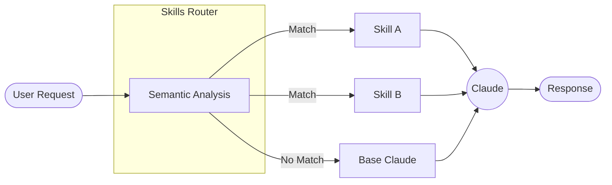
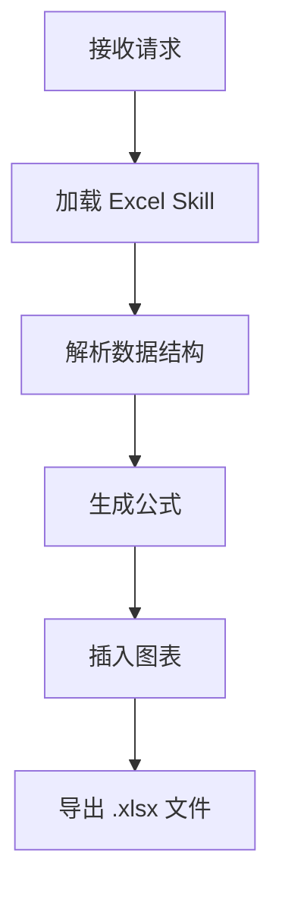
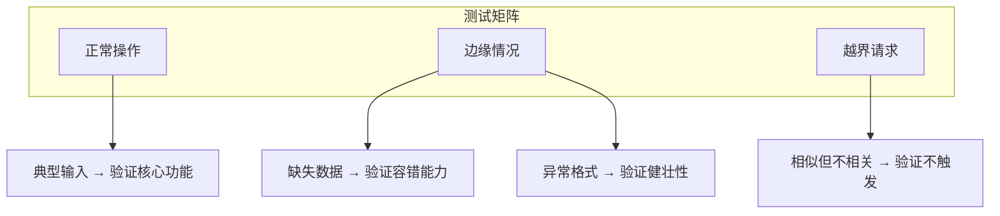
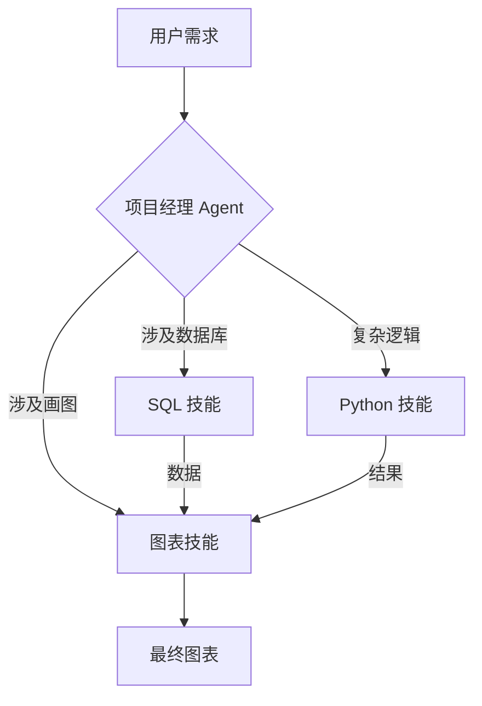

# 第六章 Skills 技能系统

Skills 是 Claude 2025 年推出的新能力，让你可以创建可复用的定制化工作流。

---

## 什么是 Skills？

Skills 是包含指令、脚本和资源的文件夹，Claude 可以自动发现并应用它们。可以把 Skills 想象成为 Claude 定制的“技能包”。

---

## 本章学习目标

- [ ] 理解 Skills 的概念和结构
- [ ] 使用内置 Skills 处理常见任务
- [ ] 创建自定义 Skills
- [ ] 组合多个 Skills 实现复杂工作流

---

## 1. 什么是 Claude Skills：模块化的专业能力扩展

在 2025 年 10 月，Anthropic 正式发布了 **Agent Skills** 功能。这标志着 Claude 从一个通用的对话助手，进化为可以被 **定制化增强** 的专业化平台。

### 1.1 官方定义

根据 Anthropic 官方博客的定义：

> **Skills are folders that include instructions, scripts, and resources that Claude can load when needed.**

翻译过来就是：**Skills 是包含指令、脚本和资源的文件夹，Claude 可以在需要时动态加载它们。**

这个定义揭示了 Skills 的三个核心特征：
1. **文件夹结构**：Skills 不是一段 Prompt 文本，而是一个工程化的目录。
2. **多类型资源**：可以包含 Markdown 指令、可执行脚本、参考文档等。
3. **按需加载**：Claude 会根据任务自动判断是否需要加载某个 Skill。

### 1.2 核心范式转变：从 Prompt Engineering 到 Context Engineering

Skills 的出现代表了一个更深层次的理念转变：**上下文工程（Context Engineering）**。

传统的 *Prompt Engineering* 关注如何通过话术让 AI “听懂指令”。而 *Context Engineering* 将模型的有限上下文窗口视为一种 **稀缺的计算资源**：

*   **信噪比优化**：每一个 Token 都应该提供有效信息，Skills 封装高密度的专业知识，避免通用废话占用上下文。
*   **渐进式披露**：不要一次性把所有知识塞给 Claude，Skills 支持 **Just-In-Time** 动态加载——只有当任务需要时，才注入相关上下文。

### 1.3 信息架构：Skills 的三层模型

为了实现高效的“上下文工程”，Skills 采用了三层信息架构设计。理解这个模型是写好 Skills 的基础。

| 层级 | 内容 | 加载时机 | 作用 |
| :--- | :--- | :--- | :--- |
| **L1: Metadata**| `name` 和 `description` |**Always Active** | 就像函数的签名。Claude 始终“看得到”这部分信息，用于判断是否调用该 Skill。因此这部分必须极其精简且具有区分度。 |
| **L2: Instructions**| `SKILL.md` 的正文 |**On Trigger** | 就像函数的函数体。只有当 Skill 被命中（L1 匹配成功）时，这部分内容才会被加载到上下文中。 |
| **L3: Resources**| Scripts, References |**On Demand** | 就像函数调用的外部库。脚本只在执行时运行，参考文档只在明确读取时加载。这部分几乎不占用上下文窗口。 |

**设计启示**：
*   **L1 要“轻”**：不要在 description 里写具体操作步骤，只写“做什么”和“何时做”。
*   **L2 要“准”**：正文聚焦于具体执行逻辑。
*   **L3 要“全”**：把大量知识库和复杂逻辑下沉到 L3。

### 1.4 Skills 的四大特性

根据官方发布，Skills 具备以下核心特性：

| 特性 | 说明 |
| :--- | :--- |
| **Composable（可组合）** | 多个 Skills 可以组合使用，Claude 会自动判断和调用相关 Skill |
| **Portable（可移植）** | Skill 的文件结构和设计理念可跨 Claude.ai、Claude Code 和 API 复用，但不同产品面需要分别上传、安装或配置 |
| **Efficient（高效）** | 只加载当前任务所需的最小信息集，通过分层加载优化上下文使用 |
| **Powerful（强大）** | Skills 可以包含可执行脚本，处理 Token 生成不擅长的任务（如精确计算、文件格式化） |

#### 为什么说 Skills 不是“玄学功能”

一个常见误解是：Skill 只是换了一种包装方式的 Prompt，本质上有没有都差不多。

2026 年的 SkillsBench 基准测试给出了更有说服力的答案：**高质量、人工策展的 Skills 通常能显著提升智能体完成任务的成功率，但模型临时自写的 Skills 平均并不能带来稳定收益。**

这说明了两件事：

1. **Skills 确实能工作**：它们不是“心理安慰式配置项”，而是可以被独立测量、经常能带来真实增益的运行时增强机制。
2. **Skill 质量高度依赖工程设计**：模型可能会受益于一份好 Skill，但并不意味着它能稳定写出同等质量的 Skill。

对 Claude 用户而言，这个结论非常重要：如果你已经知道某类任务需要固定流程、外部脚本、检查清单和错误处理，那么把这些知识沉淀成 Skill，通常比每次重新写长 Prompt 更稳。

### 1.5 Skills vs Prompts vs Projects vs MCP

这四个概念容易混淆，需要理清它们的区别：

| 概念 | 本质 | 何时使用 | 持久性 |
| :--- | :--- | :--- | :--- |
| **System Prompt** | 对话开场白 | 设定整体风格和角色 | 单次会话 |
| **Projects** | 知识库容器 | 存放参考文档供 RAG 检索 | 跨会话持久 |
| **MCP** | 外部连接协议 | 连接 Notion、Slack 等外部数据源 | 配置后持久 |
| **Skills** | 专业能力包 | 封装特定任务的最佳实践和可执行逻辑 | 跨会话持久 |

**关键区别**：
- Projects 提供 **静态知识**（What to know）
- MCP 提供 **外部数据访问**（Where to look）
- Skills 提供 **执行方法**（How to do）

> **跨产品边界**：自定义 Skills 不会在 Claude.ai、Claude API 和 Claude Code 之间自动同步。Claude.ai 通常是个人上传；API 侧是 workspace-wide 管理；Claude Code 使用本地或项目文件系统路径，也可以通过插件分发。生产部署时要把“格式可移植”和“已在目标产品面安装”分开验证。

一个实际的例子：
- **Project**: 存放公司的品牌规范 PDF
- **MCP**: 连接 Figma 获取设计稿
- **Skill**: 封装如何根据品牌规范检查设计稿的具体流程

### 1.6 Skills 的运作机制

Skills 的核心是 **按需增强（On-Demand Augmentation）**：



工作流程：
1. **语义分析**：Claude 分析用户请求，与所有可用 Skills 的 `description` 进行语义匹配。
2. **智能选择**：这不是关键词匹配，而是理解上下文的语义匹配。多个 Skills 可以同时激活。
3. **动态加载**：仅加载匹配 Skill 的最小必要信息。
4. **执行任务**：使用 Skill 中的指令和工具完成任务。

### 1.7 Skills 的运行时架构（进阶）

> **来源说明**：本节内容基于社区对 Claude Code 源代码的逆向分析（HitCC 项目，CC BY 4.0），描述的是 Claude Code CLI 的内部实现。具体行为可能随版本更新而变化。

前文 6.1.3 节的 L1/L2/L3 描述的是 Skill **信息的分层组织**（元数据 → 正文 → 资源）。本节则从另一个维度——**运行时处理流水线**——来理解 Skills 系统在 Claude Code 内部是如何工作的：

| 阶段 | 名称 | 职责 |
| :--- | :--- | :--- |
| **注册** | 聚合来源 | 从多个来源（内置、项目目录、插件、MCP 命令等）聚合所有可用 Skill |
| **发现** | 动态匹配 | 运行时根据文件路径和条件触发动态注册，支持“条件激活”——某些 Skill 只在访问特定目录时才启用 |
| **注入** | Prompt 组装 | 通过声明列表和已调用 Skill 的指令两种方式注入上下文 |
| **执行** | 调用处理 | 处理斜杠命令调用和工具调用，支持内联展开和 Fork（子代理）两种执行路径 |
| **持久化** | 状态保持 | 在 compact 和 resume 操作中保持 Skill 调用状态 |

#### 关键洞察：Prompt 中的 Skill 列表只是子集

运行时实际存在多个不同的 Skill 集合——全量注册表、可用性过滤后的运行时集合、向模型声明的 Prompt 子集、以及实际可执行的 Skill 池。模型只能调用在 Prompt 中声明的 Skill，但系统可以执行更多未声明的 Skill（如通过斜杠命令直接触发）。

#### Skill 可以改变执行环境

Skill 不仅仅是“信息传递”——在 Claude Code 中，被激活的 Skill 可以**直接改变运行时执行上下文**，例如声明额外的工具权限、指定使用特定模型、调整推理投入程度等。这意味着一个 Skill 被激活后，它不只是给模型提供了额外的指令文本，而是可能**重塑了整个执行环境**的参数。

#### Fork 模式

当 Skill 以 Fork 模式执行时（即在子代理中运行），系统会先将 Skill 预编译为完整的 prompt（包含所有必要的上下文和指令），然后在子代理上执行。这确保了子代理收到的是一个自包含的、完整的任务描述。

### 1.8 为什么需要 Skills？

#### 降低 Prompt 工程门槛

普通用户无需编写复杂的 Prompt，只需启用相应的 Skill。例如，启用 `Excel Skill` 后，Claude 就能生成带有正确公式的专业电子表格。

#### 团队标准化

企业可以定义标准的 Skills 并分发给所有员工。无论谁在使用 Claude，生成的内容都符合公司规范。

#### 质量保证

Skills 可以包含可执行代码。对于需要精确计算的任务（如财务分析、数据处理），应把计算交给确定性脚本，并对输入、公式和输出文件做校验。

#### 成本优化

SkillsBench 还提示了一个经常被低估的现实价值：**小模型 + 高质量 Skill，往往可以逼近大模型裸跑的效果。**

这意味着 Skill 不只是“让最强模型更强”，也是一种很实际的 **成本控制手段**：

- 简单和中等复杂度任务，可以优先尝试 Sonnet / Haiku + Skill；
- 只有在 Skill 无法覆盖或任务本身极其开放时，再升级到更贵的模型；
- 对稳定重复的企业流程，Skill 的一次性编写成本，往往能被后续的大量复用迅速摊薄。

---

理解了 Skills 的概念后，接下来我们深入探讨一个 Skill 的内部结构——官方的 `SKILL.md` 文件格式是什么样的？

➡️ [Skills 的结构与组成](6.2_structure.md)

## 2. Skills 的结构与组成

一个 Skill 是一个 **工程化的文件夹**，其核心是 `SKILL.md` 文件。本节详细介绍官方的文件格式和创建流程。

### 2.1 标准目录结构

一个典型的 Skill 文件夹结构如下：

```text
my-skill/
├── SKILL.md             # 核心文件：元数据 + 指令
├── scripts/             # 可选：可执行脚本
│   └── process.py
├── references/          # 可选：参考文档
│   └── style-guide.md
├── assets/              # 可选：模板、图片、示例文件
│   └── template.docx
└── examples/            # 可选：示例输入输出
    ├── input_1.txt
    └── output_1.txt
```

**最简形式**：一个 Skill 只需要一个 `SKILL.md` 文件即可，其他目录都是可选的。

### 2.2 SKILL.md 文件格式

`SKILL.md` 采用 **YAML Frontmatter + Markdown Body** 的格式：

```yaml
---
name: my-skill-name
description: "Skill 的触发描述，决定何时被调用"
license: Complete terms in LICENSE.txt
---

# Skill 的核心指令

## Overview
这里描述 Skill 的功能概述...

## Instructions
具体的执行指令...
```

### 核心字段说明

| 字段 | 作用 | 要求 |
| :--- | :--- | :--- |
| `name` | Skill 的唯一标识符 | 小写字母、数字和连字符，最多 64 字符，如 `pdf-editor`；不能使用下划线、XML 标签或 `anthropic` / `claude` 等保留词。（此为 API/平台 Agent Skills 规范的必填要求；在 Claude Code 中 frontmatter 全部可省略，`name` 默认取目录名，见 6.4.1） |
| `description` | **最关键字段**：决定 Skill 何时被触发 | 详细描述能力、触发场景、边界条件 |
| `license` | 许可证信息 | 可选 |

**重要提示**：在 API/平台 Agent Skills 的基础规范中，`name` 和 `description` 是触发判断的核心输入，正文内容只在 Skill 被激活后才会被读取。Claude Code 还提供 `when_to_use`、`disable-model-invocation`、`user-invocable`、`paths` 等扩展字段，用于细化自动触发、手动可见性和文件范围。

### 2.3 Description 编写指南

`description` 是 Skill 最关键的部分，它决定了 Claude 何时会调用这个 Skill。

#### 弱 Description 示例

```text
This skill helps with PDFs and documents.
```
问题：太模糊，Claude 不知道具体能做什么、何时该用。

#### 强 Description 示例

```text
Comprehensive PDF manipulation toolkit for extracting text and tables,
creating new PDFs, merging/splitting documents, and handling forms.
When Claude needs to fill in a PDF form or programmatically process,
generate, or analyze PDF documents at scale. Use for document workflows
and batch operations. Not for simple PDF viewing or basic conversions.
```

这个强版本包含了：
- **具体能力**：extract, create, merge, split, handle forms
- **触发场景**：fill in forms, batch operations
- **明确边界**：not for simple viewing（告诉 Claude 何时*不该*用）

#### 用 SkillsBench 反推 Description 的写法

SkillsBench 的一个关键发现是：**聚焦型 Skill 往往优于“大而全”的文档打包。**

落到 `description` 的写法上，意味着：

- 不要写成泛泛的“这个 Skill 很强，能处理各种文档、表格、数据、自动化任务”；
- 应该明确写出 **任务类**、**触发条件** 和 **排除边界**；
- 最好让 Claude 一眼知道“什么时候该调用、什么时候不该调用”。

换句话说，`description` 不是广告文案，而是 **路由规则**。它越像“精确的任务分流标签”，触发质量越高；越像“功能大全”，误触发和负迁移概率越高。

### 2.4 创建 Skill 的六步工作流

Anthropic 官方推荐采用工程化思维，通过六个标准化步骤来创建高质量 Skill：

#### 1. Understand：理解

在动手之前，先明确 Skill 的核心目标。问自己：
- 解决什么痛点？
- “Best result” 是什么样的？
- “Worst case” 可能发生什么？

#### 2. Plan：规划

设计 Skill 的架构，特别是 **文件结构**：
- 哪些内容应该放在 `SKILL.md`（Prompt）？
- 哪些逻辑应该写成 Python 脚本（Script）？
- 哪些参考文档需要放入 `references/`、`assets/` 或 `examples/` 目录？
*设计原则：优先使用脚本处理确定性任务（Low DoF），使用 Prompt 处理创造性任务（High DoF）。*

#### 3. Init：初始化

不要从零手写 YAML。使用脚本（如 `init_skill.py`）生成标准脚手架，确保元数据格式正确。
```bash
python scripts/init_skill.py my-new-skill
```

#### 4. Edit：编写

按正确顺序填充内容：
1.  **先写资源**：编写 `scripts/*.py`、`references/` 和 `assets/`。这确保 Prompt 可以指向真实存在的文件。
2.  **后写指令**：编写 `SKILL.md`，即“胶水层”。

#### 5. Validate：验证

在提交之前，必须通过验证脚本（如 `quick_validate.py`）：
- 检查 YAML 语法
- 检查文件引用路径
- 模拟基本调用

#### 6. Iterate：迭代

Skill 不是一次性工作。根据使用反馈（如“为什么这个 Skill 没被触发？”或“为什么执行错了？”）不断微调 `description` 和 `instructions`。

### 2.5 Skill 上传方式

根据使用场景，有三种上传方式：

#### Claude.ai（消费者）

先在 **Settings → Capabilities** 中启用代码执行，然后进入 **Customize → Skills**，点击 `+` 选择 **Upload a skill**，上传打包为 ZIP 的 Skill 文件夹（Team/Enterprise 计划需 Owner 先在 **Organization settings → Skills** 中启用 Skills）。

#### Claude Code（开发者）

将 Skill 文件夹放置在以下任一位置：
```text
~/.claude/skills/my-skill/SKILL.md      # 全局 Skill
.claude/skills/my-skill/SKILL.md        # 项目级 Skill
```

Claude 会自动发现并加载这些 Skills。

#### API（开发者）

API 场景要区分两步：先上传 Skill，再在 Messages 请求中把它挂到 code execution 容器。只上传到 `/v1/skills` 不会让普通 Messages 请求自动启用该 Skill。

上传 Skill：

```bash
curl -X POST "https://api.anthropic.com/v1/skills" \
  -H "x-api-key: $ANTHROPIC_API_KEY" \
  -H "anthropic-version: 2023-06-01" \
  -F "display_title=My Skill Name" \
  -F "files[]=@my-skill/SKILL.md;filename=my-skill/SKILL.md"
```

Skills、Files API 与 code execution 均已 GA，**不再需要 beta header**（仍发送旧 header 也能正常工作）；在请求中使用时只需声明 code execution 工具，并在 `container.skills` 中按官方类型引用 `skill_id` 和版本：

```jsonc
{
  "model": "claude-sonnet-5-5",
  "max_tokens": 1024,
  "tools": [{"type": "code_execution_20250825", "name": "code_execution"}],
  "container": {
    "skills": [{"type": "custom", "skill_id": "skill_...", "version": "latest"}]
  },
  "messages": [{"role": "user", "content": "使用已上传的 Skill 处理这个文件。"}]
}
```

具体 beta header、工具类型和容器字段会随 API 演进变化，生产代码应按官方 Skills API 与 code execution 文档核验。

### 2.6 高级模式：渐进式披露

对于复杂的 Skills，避免将所有信息放在一个巨大的 `SKILL.md` 中。采用 **菜单模式**：

```text
my-complex-skill/
├── SKILL.md              # 概述 + 目录索引
├── workflow-a.md         # 流程 A 的详细指令
├── workflow-b.md         # 流程 B 的详细指令
└── workflow-c.md         # 流程 C 的详细指令
```

在 `SKILL.md` 中使用相对路径引用：

```markdown
## Available Workflows

### Workflow A
For creating new documents, read the `workflow-a.md` reference file.

### Workflow B
For editing existing documents, read the `workflow-b.md` reference file.
```

Claude 会根据当前任务，只读取相关的子文件，保持上下文精简。

#### 结构设计的经验原则

结合 SkillsBench 与 Claude 生态中的实践，一个高质量 Skill 往往具有如下结构特征：

- **正文短而硬**：`SKILL.md` 聚焦步骤、边界、检查项，不承载大段背景知识。
- **资源按需加载**：大块知识放到 `references/`、`assets/` 或 `examples/`，只有需要时才读取。
- **模块数量受控**：通常 2 到 3 个强相关模块就足够；模块过多会让触发和执行都变得含糊。
- **过程优先于答案**：优先给“排查顺序、验证步骤、常见陷阱”，而不是给一堆任务实例的最终答案。

如果一个 Skill 需要依赖十几个子文件、几十页说明和多套互相竞争的流程，那么与其说它是 Skill，不如说它更像一个尚未完成拆分的信息仓库。

---

了解了 Skill 的结构后，让我们看看 Anthropic 官方提供了哪些开箱即用的内置 Skills。

➡️ [使用内置 Skills](6.3_builtin.md)

## 3. 使用内置 Skills

Anthropic 在不同产品面提供的 Skills 不完全相同。claude.ai / API 侧有面向文档和文件生成的预构建 Agent Skills；Claude Code 侧支持自定义 Skills，并带有若干面向开发流程的 prompt-based bundled skills。使用前应按所在产品面确认可用入口。

### 3.1 官方内置 Skills 列表

claude.ai / API 侧常见的预构建文档 Skills 包括：

| Skill | 功能 | 典型用例 |
| :--- | :--- | :--- |
| **Excel/Spreadsheets** | 生成带公式的专业电子表格 | 财务报表、数据分析、预算规划 |
| **PowerPoint** | 创建演示文稿 | 汇报材料、提案文档 |
| **Word/DOCX** | 创建和编辑 Word 文档，支持修订追踪 | 合同审阅、报告撰写 |
| **PDF** | 处理可填写的 PDF 表单 | 表单填写、文档提取 |

这些 Skills 的强大之处在于：它们不是简单地生成文本，而是 **调用底层库生成真正的二进制文件**。例如，Excel Skill 使用 `openpyxl` 生成的 `.xlsx` 文件包含正确的公式引用，而非静态数值。

### 3.2 Skill Creator：快速创建自定义 Skill

Anthropic 还提供了一个特殊的 **skill-creator** Skill，它可以引导你交互式地创建新 Skill：

1. 启用 skill-creator 后，Claude 会询问你的工作流程细节
2. 自动生成 `SKILL.md` 文件结构
3. 格式化 frontmatter 和正文
4. 打包所需的资源文件

获取方式：
- GitHub 仓库：[anthropics/skills/skills/skill-creator](https://github.com/anthropics/skills/tree/main/skills/skill-creator)
- 或在支持 Skills 的产品面中按当前入口启用

### 3.3 Skills 的触发方式

#### 隐式触发（推荐）

这是最自然的交互方式，无需特殊指令：

```text
用户：帮我创建一个季度销售报表的 Excel 文件，包含同比增长公式。
```

Claude 的内部流程：
1. 语义分析检测到 “Excel” + “公式”
2. 自动加载 Excel Skill
3. 使用 Skill 中的指令生成专业电子表格
4. 返回可下载的 `.xlsx` 文件

#### 显式调用

当需要强制使用特定 Skill 时，可以在请求中明确提及：

```text
用户：使用你的文档处理能力，帮我审阅这份合同并添加修订标记。
```

### 3.4 Skills 获取渠道

#### Claude.ai

1. 先在 **Settings → Capabilities** 中启用代码执行，再进入 **Customize → Skills**
2. 启用所需的内置 Skills
3. 上传自定义 Skills（Free/Pro/Max 直接上传；Team/Enterprise 需组织先启用）

#### Claude Code

Skills 可通过插件市场安装，或手动放置：
```bash
# 全局 Skills 目录
~/.claude/skills/

# 项目级 Skills 目录（版本控制友好）
.claude/skills/
```

#### API 开发者

通过 Skills API 管理：
```bash
# 列出可用 Skills
GET /v1/skills

# 创建新 Skill
POST /v1/skills

# 在消息中使用 Skill
POST /v1/messages

# 请求体中通过 container.skills 引用 skill_id（需 code execution 工具；Skills 已 GA，无需 beta header，见 6.2.5 节）
```

### 3.5 实战演示：财务报表生成

以下演示 Excel Skill 的实际效果：

**用户输入**：
```text
根据以下数据创建一个 Q3 财务摘要 Excel：
- 营收：$2.5M（同比 +15%）
- 成本：$1.8M
- 利润率需要自动计算
- 添加同比趋势图
```

**Claude 处理流程**：



**输出结果**：
- 生成的 Excel 文件包含：
  - 正确的 `=B2-B3` 利润计算公式（非静态值）
  - 动态更新的利润率百分比
  - 内嵌的柱状图（数据区域正确引用）

这与让 Claude 直接生成文本格式的“表格”有本质区别——代码执行能把计算交给确定性程序，但仍需要公式、数据范围和导出结果校验。

### 3.6 Partner Skills 生态

除了官方内置 Skills，Anthropic 还与合作伙伴建立了 Skills 生态：

| 合作伙伴 | Skill 功能 |
| :--- | :--- |
| **Box** | 将 Box 中的文件转换为 PowerPoint/Excel/Word |
| **Canva** | 在 Agent 工作流中生成设计稿 |
| **Notion** | 深度集成 Notion 页面操作 |
| **Rakuten** | 财务工作流自动化 |

上表为 2025-10 Skills 发布时的首批伙伴；2025-12 官方目录上线后，Atlassian、Cloudflare、Figma、Sentry、Vercel、Zapier 等也陆续加入。这些 Partner Skills 可以在官方 [Skills 目录](https://claude.com/connectors)（与 Connectors 共用同一目录页，可按 Skills 筛选）中浏览，并在 claude.ai 的 **Customize → Skills** 中启用。

---

内置 Skills 覆盖了通用场景，但企业往往有独特的业务逻辑和规范。下一节将深入讲解如何创建专属的自定义 Skill。

➡️ [创建自定义 Skills](6.4_custom.md)

## 4. 创建自定义 Skills

当内置 Skills 无法满足特定需求时，就是发挥创造力的时候了。本节将通过三个官方示例，深入讲解如何创建高质量的自定义 Skill。

### 4.1 Agent Skills 的完整解析：SKILL.md 结构与渐进式披露

Agent Skills 是 Anthropic 为了让 Agent 获得专业化能力而设计的机制。一个 Skill 本质上是一个包含 `SKILL.md` 文件的目录，其中包含了指令、脚本和资源。要创建有效的 Skill，首先要理解 SKILL.md 的完整生命周期。

**SKILL.md 的 YAML 前置信息（Frontmatter）**

每个 SKILL.md 以 YAML 前置信息开始。在 Claude Code 中，最小可用形态只需 `description`：

```yaml
---
description: |
  Comprehensive PDF manipulation including form filling, content extraction,
  and page manipulation. Use this when Claude needs to: (1) Extract text
  from PDF files, (2) Fill out PDF forms, (3) Merge or split PDFs,
  (4) Analyze PDF structure and contents.
---
```

**description**（推荐填写）：简洁但完整的概述，帮助 Claude 决定何时使用这个 Skill。`description` 和可选的 `when_to_use` 合计在 skill 列表中被截断到 1,536 字符，要把关键用例放最前。

这构成了**第一级渐进式披露** ——Claude 在启动时就知道有哪些 Skill 可用，以及大致的用途，但还不需要加载完整的细节。

> **产品范围**：下表为 Claude Code 的 frontmatter 字段，其中大部分（如 `when_to_use`、`context`、`agent`、`shell` 等）是 Claude Code 对 Agent Skills 开放标准的扩展，仅在 Claude Code 中生效。经 API（`/v1/skills`）或 claude.ai 上传的 Skill 按平台规范校验：`name` 与 `description` 均为必填（`name` 不超过 64 字符，`description` 非空且不超过 1024 字符），扩展字段不会生效（参见 6.2.2）。

**完整 frontmatter 字段表**（按 Claude Code 官方文档）：

| 字段 | 用途 |
| :--- | :--- |
| `name` | 列表中显示的名称，默认取目录名。`/skill-name` 调用时仍然使用目录名（plugin 根目录除外） |
| `description` | 何时使用此 skill |
| `when_to_use` | 额外的触发场景或示例请求，会追加到 description 后参与 1,536 字符上限 |
| `argument-hint` | 自动补全时显示的参数提示，例如 `[issue-number]` |
| `arguments` | 命名位置参数，配合 `$name` 占位符使用 |
| `disable-model-invocation` | `true` 时只允许用户手动 `/name` 触发，Claude 不会自动加载。同时避免该 skill 被预加载到子代理 |
| `user-invocable` | `false` 时只允许 Claude 自动加载，从 `/` 菜单隐藏 |
| `allowed-tools` | 此 skill 激活时预先批准的工具/命令，例如 `Bash(git add *) Bash(git commit *)`。它不是工具可见性白名单；其他工具仍可能按全局权限规则进入 ask/deny 流程 |
| `disallowed-tools` | 此 skill 激活时从可用池中移除的工具，例如自动循环中禁用 `AskUserQuestion` |
| `model` | 激活时切换的模型（`sonnet` / `opus` / `haiku` / 全名 / `inherit`），仅本回合生效 |
| `effort` | 推理强度（`low` / `medium` / `high` / `xhigh` / `max`），覆盖会话默认 |
| `context: fork` | 在分叉的子代理上下文中执行此 skill；不带此字段时是内联到当前对话 |
| `agent` | 配合 `context: fork` 选择执行子代理类型（`Explore`、`Plan`、`general-purpose`，或 `.claude/agents/` 下自定义的子代理）。省略时用 `general-purpose` |
| `hooks` | 绑定到此 skill 生命周期的钩子 |
| `paths` | Glob 模式，限制此 skill 仅在操作匹配文件时自动激活，例如 `*.go,internal/**/*.go` |
| `shell` | `bash`（默认）或 `powershell`，决定内联 shell 注入用哪个解释器 |

> **常见误读纠正**：`agent` 字段的取值是子代理 **类型名**（如 `Explore`），不是 `read-only` 这种描述性词汇。“只读”是 Explore 这个内置子代理的特性——它默认拒绝 Write 和 Edit 工具。要让 skill 以只读方式运行，写 `context: fork` + `agent: Explore`。

> **权限误读纠正**：`allowed-tools` 只表示免确认，不表示限制。要在 Skill 激活时移除工具，用 `disallowed-tools`；要跨所有 Skill 阻止危险工具或路径，用 Claude Code permission deny 规则，并在信任项目前审查 Skill 来源。

#### 内联 Shell 注入：`` !`command` `` 语法

SKILL.md 中以 `` !`command` `` 形式书写的行，会在 skill 内容送达 Claude 之前被替换为命令的真实输出。这是预处理，不是 Claude 主动执行：

```yaml
---
name: pr-summary
description: Summarize changes in a pull request
context: fork
agent: Explore
allowed-tools: Bash(gh *)
---

## Pull request context
- PR diff: !`gh pr diff`
- PR comments: !`gh pr view --comments`
- Changed files: !`gh pr diff --name-only`

## Your task
Summarize this pull request...
```

注意点：
- `!` 必须在行首或紧跟空白之后才被识别；`KEY=!`cmd`` 不会触发
- 替换只跑一遍，命令输出不会再被扫描第二轮
- 多行命令用 ` ```! ` 围栏代码块代替内联形式
- 可通过 `settings.json` 的 `"disableSkillShellExecution": true` 禁用此能力

**渐进式披露的三个层级**

Agent Skills 采用了一个精妙的架构来管理上下文：

1. **层级一：元数据（启动时加载）**
   - 所有已安装 Skill 的名称和描述（几百字节）
   - 让 Claude 知道“有哪些工具可用”
   - 触发：应用启动时

2. **层级二：SKILL.md 的主体（按需加载）**
   - 当 Claude 认为某个 Skill 可能相关时，调用 bash 工具读取该 Skill 的完整 SKILL.md
   - 包含详细的使用指南、工作流说明、常见场景
   - 触发：Claude 决定该 Skill 与当前任务有关

3. **层级三及以上：附加文件（深度按需加载）**
   - SKILL.md 中引用的其他文件：reference.md、forms.md、examples.py 等
   - Claude 可以根据进展选择性地读取这些文件
   - 例如：在处理 PDF 表单时才读取 forms.md，而处理文本提取时才读取 text_extraction.md

**实例：PDF Skill 的层级结构**

```text
pdf/
├── SKILL.md          # 第一行是前置信息，包含name和description
├── reference.md      # 引用：PDF API的详细参考
├── forms.md          # 引用：表单填充的具体说明
└── scripts/
    └── extract_fields.py  # 代码：PDF字段提取脚本
```

当用户要求“从 PDF 中提取表单字段”时：
1. Claude 读取元数据，发现有“pdf”Skill
2. Claude 执行 `cat pdf/SKILL.md`，加载主体内容
3. Claude 看到 SKILL.md 提到“forms.md 包含表单处理说明”
4. Claude 执行 `cat pdf/forms.md`，加载表单特定信息
5. Claude 可能执行 `python pdf/scripts/extract_fields.py`，让脚本做低级操作

这种设计的好处：
- **初始上下文轻量**：即使装了 100 个 Skill，启动时也只消耗几 KB token
- **智能加载**：只加载与当前任务相关的细节
- **灵活性**：Skill 可以包含任意大的代码或指令，不受上下文限制

**SKILL.md 编写的关键原则**

1. **在 YAML 前置信息中描述“何时”而不仅是“是什么”**

不好的写法：
```yaml
description: PDF 处理工具
```

好的写法：
```yaml
description: |
  Comprehensive PDF manipulation including form filling, text extraction,
  and page manipulation. Use this when Claude needs to: (1) Fill PDF forms,
  (2) Extract structured data from PDFs, (3) Analyze document contents.
```

2. **主体部分应该包含工作流或决策树**

不仅仅列举功能，而是提供清晰的“在这种情况下做 X，在那种情况下做 Y”的指导。

3. **使用引用来分层内容**

将不相关的细节移到单独的文件中，保持主 SKILL.md 清洁。例如：

SKILL.md 主体:
```markdown
## Form Handling

For detailed form field instructions, see `forms.md`.

## Text Extraction

For extraction examples and edge cases, see `reference.md`.
```

4. **在 SKILL.md 中集成代码示例**

```markdown
## Text Extraction Example

Claude can run this Python script to extract text:

\`\`\`python
import pdf  # 假设有 pdf 库
content = pdf.extract_text("file.pdf")
print(content)
\`\`\`
```

---

*融入自 Anthropic 的《Equipping agents for the real world with Agent Skills》中关于 SKILL.md 结构和渐进式披露的设计原则*

### 4.2 核心设计原则：自由度与确定性

在编写 Skill 之前，首先要判断任务的属性。Anthropic 的研究员提出了 **“自由度（Degrees of Freedom）”** 的概念：

*   **高自由度任务（High DoF）**：需要创意、适应性或模糊推理。
    *   *例如*：写一首诗、设计一个网页布局、总结一篇文章。
    *   *最佳实现*：使用 **Markdown 文本指令**。告诉 Claude 目标和风格，留出空间让模型发挥。
*   **低自由度任务（Low DoF）**：需要精确格式、严密逻辑或零容错。
    *   *例如*：生成特定 schema 的 JSON、执行数学计算、转换文件格式。
    *   *最佳实现*：使用 **Python 脚本**。不要试图用 Prompt 强迫模型去“模拟”计算机的行为，直接给它工具（脚本）。

**黄金法则**：
> 如果任务逻辑是“脆弱”的（改一个字就报错），请写代码（Script）；如果任务需要“弹性”（多种结果都可接受），请写 Prompt（Instruction）。

---

### 4.3 示例一：DOCX 文档处理 Skill

这是 Anthropic 官方 Skills 仓库中的一个经典案例，展示了如何处理复杂的工作流分支。

#### SKILL.md 文件

```yaml
---
name: docx
description: "Comprehensive document creation, editing, and analysis with
support for tracked changes, comments, formatting preservation, and text
extraction. When Claude needs to work with professional documents (.docx
files) for: (1) Creating new documents, (2) Modifying or editing content,
(3) Working with tracked changes, (4) Adding comments, or any other
document tasks"
license: Proprietary
---

# DOCX creation, editing, and analysis

## Overview
A user may ask you to create, edit, or analyze the contents of a .docx
file. A .docx file is essentially a ZIP archive containing XML files
and other resources that you can read or edit.

## Workflow Decision Tree

### Reading/Analyzing Content
Use "Text extraction" or "Raw XML access" sections below

### Creating New Document
Use "Creating a new Word document" workflow

### Editing Existing Document
- **Your own document + simple changes**
  Use "Basic OOXML editing" workflow
- **Someone else's document**
  Use **"Redlining workflow"** (recommended default)
- **Legal, academic, business, or government docs**
  Use **"Redlining workflow"** (required)
```

#### 设计亮点

1. **决策树结构**：根据任务类型（读取/创建/编辑）路由到不同流程
2. **渐进式披露**：主文件提供概述，详细流程放在独立的 `workflow-*.md` 文件中
3. **明确的边界**：区分了“自己的文档”和“别人的文档”应使用不同流程

### 4.4 示例二：品牌指南 Skill

这个示例展示了如何封装企业特有的设计规范。

```yaml
---
name: brand-guidelines
description: "Applies Anthropic's official brand colors and typography to
any sort of artifact that may benefit from having Anthropic's look-and-feel.
Use it when brand colors or style guidelines, visual formatting, or company
design standards apply."
license: Complete terms in LICENSE.txt
---

# Anthropic Brand Styling

## Colors

**Main Colors:**
- Dark: `#141413` - Primary text and dark backgrounds
- Light: `#faf9f5` - Light backgrounds and text on dark
- Mid Gray: `#b0aea5` - Secondary elements

**Accent Colors:**
- Orange: `#d97757` - Primary accent
- Blue: `#6a9bcc` - Secondary accent
- Green: `#788c5d` - Tertiary accent

## Typography
- **Headings**: Poppins (with Arial fallback)
- **Body Text**: Lora (with Georgia fallback)

## Text Styling
- Headings (24pt+): Poppins font
- Body text: Lora font
- Smart color selection based on background
```

#### 设计亮点

1. **精确信息**：提供 Claude 无法内置的具体数值（十六进制颜色码、字体名称）
2. **实用主义**：不需要复杂逻辑，直接给出可执行的规范
3. **Fallback 策略**：考虑到字体可能缺失，提供了备选方案

### 4.5 示例三：前端设计 Skill

这个高级示例展示了如何约束创意输出。

```yaml
---
name: frontend-design
description: "Create distinctive, production-grade frontend interfaces with
high design quality. Use this skill when the user asks to build web
components, pages, or applications. Generates creative, polished code that
avoids generic AI aesthetics."
license: Complete terms in LICENSE.txt
---

# Frontend Design Skill

## Design Thinking

Before coding, commit to a BOLD aesthetic direction:
- **Purpose**: What problem does this interface solve?
- **Tone**: Pick an extreme: brutally minimal, maximalist chaos,
  retro-futuristic, organic/natural, luxury/refined, playful/toy-like...
- **Differentiation**: What makes this UNFORGETTABLE?

## Typography
Choose fonts that are beautiful, unique, and interesting.
**AVOID**: Arial, Inter, Roboto, system fonts
**PREFER**: Distinctive display fonts paired with refined body fonts

## Color & Theme
Dominant colors with sharp accents outperform timid, evenly-distributed
palettes. Use CSS variables for consistency.

## NEVER Use
- Overused font families (Inter, Roboto, Arial)
- Clichéd color schemes (purple gradients on white)
- Predictable layouts and component patterns
- Cookie-cutter design that lacks context-specific character
```

#### 设计亮点

1. **反面约束**：明确列出“不要做什么”，避免生成千篇一律的 AI 风格
2. **鼓励创意**：使用激励性语言（“BOLD”, “UNFORGETTABLE”）引导高质量输出
3. **思考框架**：要求先思考再编码，提升输出的针对性

### 4.6 Description 对比：强 vs 弱

以下是影响 Skill 触发准确性的关键因素：

| 弱 Description | 强 Description |
| :--- | :--- |
| "Helps with PDFs" | "Extract tables from PDFs, merge/split documents, fill forms. Use for batch processing. Not for simple viewing." |
| "Code review skill" | "Reviews code for OWASP Top 10 vulnerabilities, enforces company style guide, outputs severity-ranked findings table." |
| "Writing helper" | "Transforms rough notes into polished blog posts following SEO best practices. Outputs markdown with frontmatter." |

**核心原则**：
- 使用 **动词** 描述能力（extract, merge, transform）
- 说明 **触发场景**（when to use）
- 划定 **边界**（not for...）

### 4.7 测试矩阵

创建 Skill 后，使用以下矩阵进行系统测试：



| 测试类型 | 示例 | 期望结果 |
| :--- | :--- | :--- |
| 正常操作 | 使用 docx skill 创建合同 | 生成带格式的 .docx 文件 |
| 边缘情况 | 输入只有表格没有文字的文档 | 正确处理或提示需要补充信息 |
| 越界请求 | 请求 docx skill 分析 PDF | **不应触发**，提示使用 PDF skill |

### 4.8 企业级部署

2025 年 12 月，Anthropic 发布了组织级 Skills 管理功能：

- **集中管理**：管理员可以统一部署、更新、撤回 Skills
- **版本控制**：通过 API 管理 Skill 版本
- **审计日志**：追踪 Skill 的使用情况

部署方式：
1. 管理员在 claude.ai 的 **Organization settings → Skills** 上传 Skill（.zip 包，点击 “+ Add”）
2. 上传后即对组织内全员生效，员工在 Claude.ai 中自动获得访问权限
3. 注意：通过 API（Console `/v1/skills`）上传的 Skill 属于 API workspace，**不会**出现在 claude.ai——两条分发渠道相互独立

---

现在已经掌握了创建单一 Skill 的能力。在实际工作中，复杂任务往往需要多个 Skills 协同工作。下一节将探讨 **Skills 的组合与编排**。

➡️ [Skills 组合与高级用法](6.5_combination.md)

## 5. Skills 组合与高级用法

在单一 Skill 之外，真正的魔法发生在 **组合** 之中。
就像一个足球队不能只有前锋一样，处理复杂的业务流程（Business Process）往往需要多个不同领域的 Skill 互相配合。

### 5.1 Skill Chaining

最简单的组合方式是串行调用。
一个 Skill 的输出，成为下一个 Skill 的输入。

**案例：从构思到发布文章**

1.  **Step 1: Research Skill**
    *   *Input*: “帮我研究一下最新的 AI Agent 趋势。”
    *   *Action*: 联网搜索，阅读白皮书，总结要点。
    *   *Output*: 一份结构化的研究简报。
2.  **Step 2: Copywriting Skill**
    *   *Input*:（主要基于 Step 1 的简报）“把这份简报写成一篇通俗易懂的公众号文章。”
    *   *Action*: 运用 Storytelling 技巧，调整语气，起标题。
    *   *Output*: 文章草稿。
3.  **Step 3: Compliance Skill**
    *   *Input*: 文章草稿。
    *   *Action*: 检查是否违反广告法，是否有虚假宣传。
    *   *Output*: 修改后的合规文章。

这种链式结构可以通过 Workflow 引擎（如 LangChain 或 Claude 自带的 Agent 模式）自动化实现。

### 5.2 Dynamic Routing

在更高级的系统中，Router 是智能的。它像一个项目经理，动态决定要把任务派给谁。



**实战场景：智能客服**
*   用户问：“我的包裹丢了，怎么赔付？”
    *   Router 识别意图 -> 激活 `Refund Policy Skill`。
*   用户接着问：“那我现在账户里还有多少钱？”
    *   Router 识别意图 -> 切换到 `Account Info Skill`（调用 MCP 查询余额）。

### 5.3 Skill Conflict

当两个 Skill 的指令冲突时怎么办？
*   Skill A (Creative): “尽可能发挥想象力，不受拘束。”
*   Skill B (Legal): “严谨，字斟句酌，不要过度承诺。”

**解决方案：流水线编排**
通过设计 Skill 的调用顺序来解决冲突：让 Creative Skill 先生成内容，再由 Legal/Security Skill 审核把关。通常 **Legal/Security Skill** 充当“守门员”的角色，放在流水线末端。
即：Create (Skill A) -> Review (Skill B) -> Output。

### 5.4 团队协作与共享

在企业内部，Skills 应该像代码库一样被管理。

#### Skill Registry

建立一个公司内部的 `git` 仓库 `internal-skills`。
*   `/marketing/social-media-expert`
*   `/engineering/python-guru`
*   `/hr/policy-qa`

#### 版本控制

Skill 也会迭代。
*   v1.0: 只能写 Java 8 代码。
*   v2.0: 升级到 Java 17，增加了 Spring Boot 3 的支持。
确保 Router 能够锁定版本（Pinning），防止 Skill 升级导致原有业务逻辑崩溃。

### 5.5 跨平台一致性

理想的 Skill 定义应该尽量平台无关，但“格式可移植”不等于“行为完全一致”。
claude.ai / API、Claude Code 和自建 SDK 集成在网络访问、文件系统、包安装、工具权限、Code-only frontmatter 扩展和运行时依赖上都可能不同。同一个 Skill 应该在每个目标产品面单独验证。

这要求在编写 Skill 时，尽量使用标准的 Markdown 和 JSON Schema；若依赖 `context: fork`、内联 shell、本地二进制、网络访问或 Claude Code 权限扩展，必须在文档里标明适用产品面和回退策略。

---

通过前面的学习，Claude 已经从最初的对话助手，进化为能够熟练操作工具（Tools & MCP）、感知视觉环境（Computer Use），并拥有特定垂直领域专长（Skills）的智能体。

现在的 Claude，已经不是一个简单的 chatbot，而是一个 **全副武装的智能体 (Agent)**。

但所有的这些技术，最终都要回归到一个最本质的用途——**写代码**。因为代码是构建数字世界的基石，也是 AI 发挥生产力杠杆作用最大的领域。

组合的 Skills 一旦变多，触发与执行问题也随之而来——下一节介绍如何调试与优化 Skills。

➡️ [6.6 Skills 调试与优化](6.6_debugging.md)

## 6. 调试与优化 Skills

创建 Skills 只是第一步，在实际生产环境中，你可能会遇到 Skills 不生效、参数传递错误或执行效率低下的问题。本节将介绍一套系统的调试与优化方法论。

### 6.1 常见故障排除

以下是 Skills 开发和部署中最常见的几类故障，以及对应的排查方法。

#### Skill 未被识别

**现象**：Claude 回复“我不知道如何执行这个任务”，或者完全忽略了你的 `SKILL.md`。

**排查清单**：

*   **文件名检查**：确保主文件名为 `SKILL.md`（全大写）。
*   **路径检查**：确保 Skill 文件夹位于 Claude 配置的正确路径下。
    *   Claude.ai：Customize → Skills（需先在 Settings → Capabilities 启用代码执行）
    *   Claude Code：`~/.claude/skills/` 或项目内 `.claude/skills/`
*   **Frontmatter 格式**：检查 YAML 头部的缩进和冒号是否规范。
    ```yaml
    ---
    name: my-skill  # 这里的 name 必须唯一且简洁
    description: 简明扼要的描述
    ---
    ```
*   **Description 质量**：如果格式正确但仍未触发，问题很可能出在 `description` 上。Description 是否足够具体？是否包含了触发关键词和使用场景？请参考 [6.4.6 Description 对比](6.4_custom.md) 中的强弱对比示例。

#### 参数传递错误

**现象**：Skill 被调用了，但脚本报错“缺少参数”或参数值为空。

**解决方案**：

*   在 `SKILL.md` 中显式定义参数 Schema（如果有支持的格式）。
*   在 Prompt 部分增加示例（Few-shot），明确告诉 Claude 如何提取参数。
    > *示例：当用户说“查询北京天气”时，提取 `location="Beijing"` 作为参数。*
*   检查脚本是否正确处理了参数的默认值和边界情况。

#### Skill 触发了错误的功能

**现象**：用户请求 A 功能，但 Claude 调用了 B Skill。

**解决方案**：

*   **检查 Description 重叠**：两个 Skill 的 `description` 可能存在语义重叠。在 description 中添加 **边界说明**（“Not for...”），明确告诉 Claude 何时*不应该*使用这个 Skill。
*   **使用差异化关键词**：确保每个 Skill 的 description 中包含独特的动词和名词，避免模糊表述。

#### 脚本执行失败

**现象**：Skill 被正确识别并调用，但 Python/Bash 脚本运行报错。

**排查步骤**：

1.  **本地独立测试**：先在本地终端独立运行脚本，确认脚本本身无误。
    ```bash
    python scripts/process.py --input "test data"
    ```
2.  **检查依赖**：确认运行环境中安装了脚本所需的所有依赖库。
3.  **检查路径**：脚本中的文件引用应使用相对路径（相对于 Skill 根目录），或在 `SKILL.md` 中明确指定工作目录。
4.  **查看错误输出**：确保脚本在失败时打印了有意义的错误信息到 `stderr`，而不是只返回一个退出码。

### 6.2 性能优化技巧

#### 减少上下文消耗

不要把整个项目的文档都塞进 Skill。上下文窗口是稀缺资源，应精打细算。

*   **Bad**：“这里是整个 API 文档 (50k tokens)...”
*   **Good**：只放入这一个 Skill 真正需要的 API 端点说明。
*   **Best**：采用渐进式披露模式（参见 [6.2.6](6.2_structure.md)），将详细文档拆分到子文件中，由 Claude 按需读取。

#### 脚本优先于 Prompt

对于确定性任务（精确格式化、数学计算、文件转换），使用脚本比依赖 Prompt 更快、更准确、更省 Token。

| 方式 | 速度 | 准确性 | Token 消耗 |
| :--- | :--- | :--- | :--- |
| Prompt 指令 | 慢（需要推理） | 中等（可能偶尔出错） | 高 |
| Python 脚本 | 快（直接执行） | 100%（代码保证） | 低（仅调用开销） |

#### 预授权只读工具（“Turbo”式自动运行）

对于没有副作用的只读操作（如 `Read`, `Grep`），可以配置自动运行，无需用户逐次确认。在 Claude Code 中，官方做法是在 `SKILL.md` 的 frontmatter 中声明 `allowed-tools: Read Grep`（字段详解参见 [6.4.1](6.4_custom.md)），或在 `settings.json` 的 permissions 规则中放行只读工具。`// turbo` 这类步骤级标注是 Windsurf 等其他工具链的工作流语法，对 Claude 的 `SKILL.md` 不生效，不要混用。

### 6.3 调试工具与方法

#### 使用 Skill Creator 自检

Anthropic 提供的 `skill-creator` Skill 不仅能帮助创建新 Skill，还可以对现有 Skill 进行结构验证。将你的 `SKILL.md` 提供给 Skill Creator，让它检查格式是否规范、description 是否清晰。

#### 对比测试法

当怀疑 Skill 效果不佳时，进行 A/B 对比：

1.  **禁用 Skill**：暂时移除 Skill，用纯 Prompt 方式完成同一任务。
2.  **启用 Skill**：使用 Skill 完成同一任务。
3.  **对比结果**：从准确性、速度和 Token 消耗三个维度评估差异。

#### 日志追踪

在脚本中添加详细的日志输出，帮助定位问题：

```python
import hashlib
import sys

def process(data):
    data_hash = hashlib.sha256(data.encode("utf-8")).hexdigest()
    print(f"[DEBUG] 收到输入数据: {len(data)} 字符，sha256={data_hash}", file=sys.stderr)
    try:
        result = do_something(data)
        print(f"[DEBUG] 处理成功，输出 {len(result)} 字节", file=sys.stderr)
        return result
    except Exception as e:
        print(f"[ERROR] 处理失败: {type(e).__name__}", file=sys.stderr)
        raise
```

### 6.4 最佳实践清单

1.  **单一职责原则**：一个 Skill 只干一件事。不要试图做一个“万能 Skill”。
2.  **原子化脚本**：底层的 Python/Bash 脚本应尽可能独立，方便本地测试。
3.  **清晰的错误提示**：当脚本执行失败时，不要只返回 `Exit Code 1`，而要打印具体的错误原因（如“API Key 无效”），这样 Claude 才能看懂并尝试自我修复。
4.  **版本标注**：在 `SKILL.md` 的 frontmatter 或正文中标注版本号，便于团队协作时追踪变更。
5.  **定期迭代**：根据实际使用中的反馈（如“为什么这个 Skill 没被触发？”或“为什么执行结果不对？”），持续微调 `description` 和 `instructions`。

---

下一章将进入深水区，探讨 Claude 在软件工程领域的终极形态。

➡️ [第七章：Agentic Coding 智能编程](../07_coding/README.md)
