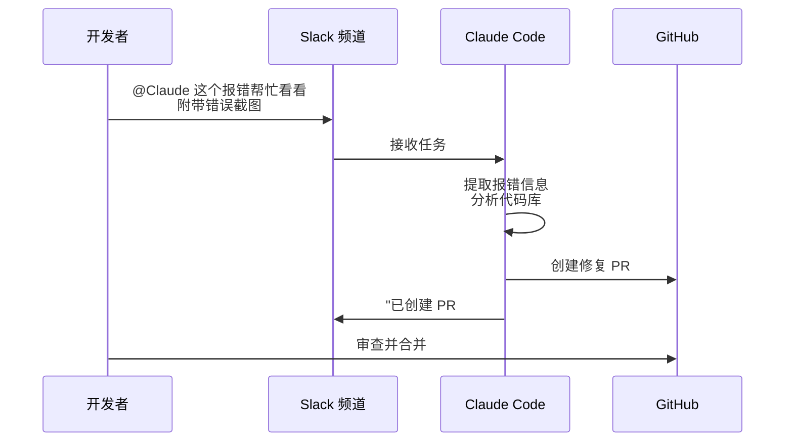

# 第七章 Agentic Coding 与 Claude Code

Claude 已成为开发者的强力编程助手。本章介绍如何充分利用 Claude 的编程能力。

---

## Agentic Coding 是什么？

Agentic Coding 指 Claude 作为自主编程代理，能够：

- 理解代码库结构
- 读写文件
- 运行测试
- 自动修复问题
- 管理 Git 提交

---

## 本章学习目标

- [ ] 掌握 Claude 作为编程助手的用法
- [ ] 学会使用 Claude Code CLI
- [ ] 了解 Agent SDK 集成
- [ ] 建立高效的 AI 编程工作流

---

## 1. Claude 作为编程助手

软件开发正处于转折点。编程不再是一个人对着屏幕敲代码的孤独旅程，而变成了与 AI 结对编程 (Pair Programming) 的协作过程。
相比其他 AI，Claude 在编程领域有着独特的优势：**超长上下文窗口（Opus 4.6+ 支持 1M Token）** 和 **卓越的推理能力 (Opus/Sonnet)**，这使它成为处理大规模重构和复杂架构设计的理想伙伴。

### 1.1 核心能力图谱

Claude 不仅仅是一个代码补全工具，它可以胜任以下角色：

| 角色                            | 能力描述                                                          | 适用场景            |
| :---------------------------- | :------------------------------------------------------------ | :-------------- |
| **Polyglot Coder**（多语言编程）   | 精通 Python, TS, Go, Rust, C++ 等主流语言，甚至包括 COBOL, Fortran 等古董语言。 | 新项目开发、遗留代码维护。   |
| **Refactoring Expert**（重构专家）| 理解复杂的依赖关系，进行函数提取、变量重命名、设计模式优化。                                | 代码坏味道清理、架构升级。   |
| **Debugger**（调试者）           | 根据错误堆栈 (Traceback) 和代码上下文，精准定位 Bug 根源。                        | 线上故障排查、CI 失败分析。 |
| **Quality Engineer**（质量工程师） | 编写单元测试 (`pytest`, `jest`)，生成测试用例，计算覆盖率。                       | TDD 开发、回归测试。    |
| **Tech Writer**（技术作家）       | 为代码编写 Docstring，生成 API 文档，撰写 README。                          | 文档补全、知识库构建。     |

### 1.2 提示工程最佳实践

在编程任务中，Prompt 的质量直接决定了代码的质量。

#### 上下文就是一切

Claude 无法修改它看不见的代码。
*   **Bad**: “帮我优化 `process_data` 函数。”（Claude: 哪个 process_data?）
*   **Good**: “请优化 `src/utils.py` 中的 `process_data` 函数。它是被 `job.py` 调用的。这里是这两个文件的内容...”

#### 定义输出规范

明确告诉 Claude 你要什么风格的代码。
*   *Constraint*: “使用 Python 3.10+ 的 Type Hint。”
*   *Constraint*: “遵循 Google Style Guide。”
*   *Constraint*: “不要使用 `try-except` 包裹所有代码，保留原始报错。”

#### 思维链调试

遇到极其隐晦的 Bug 时，强迫 Claude 先思考。
> “请先阅读提供的日志文件。在 `<analysis>` 标签中逐步分析错误可能发生的原因。列出 3 个假设，然后逐一验证。最后在 `<fix>` 标签中给出修复代码。”

### 1.3 常见陷阱与对策

#### 幻觉库

Claude 偶尔会引用不存在的库或方法（比如 `pandas.read_mind()`）。
*   **对策**: 明确限制第三方库的版本。 “只允许使用 standard library 和 pandas 2.0+。”

#### 循环依赖

在生成跨文件代码时，Claude 有时会忽略导入路径的问题。
*   **对策**: 显式提供项目结构树（`tree` 命令的输出），让它了解文件层级。

#### 截断代码

对于长文件，Claude 可能会偷懒输出 `// ... existing code ...`。
*   **对策**: 在 System Prompt 中强调 “Do not be lazy. You must output the full, compilable code.” 或者使用 Diff 格式输出。

### 1.4 与 Copilot 的区别

| 特性 | GitHub Copilot | Claude (Opus/Sonnet) |
| :--- | :--- | :--- |
| **优势** | 极速补全，IDE 内无缝集成，延迟极低。 | 深度推理，理解整个项目架构，擅长解决复杂难题。 |
| **交互** | Tab 键补全，行级建议。 | 对话式交互，任务级建议。 |
| **Context** | 主要是当前文件 + 最近打开的文件。 | 可以一次性吃掉整个仓库的核心代码（Opus 4.6+ 支持 1M tokens）。 |

**结论**: Copilot 是“自动驾驶辅助”，负责每一行的输入；Claude 是“领航员”，负责指引方向和解决难题。**两者结合是目前的最佳实践。**

---

虽然可以直接在网页版与 Claude 对话，但频繁的 Copy-Paste 效率太低。为了让 Claude 真正融入开发流程，需要一把更锋利的武器——**Claude Code (CLI)**。

➡️ Claude Code CLI 入门

## 2. Claude Code CLI 入门与基础运维

**Claude Code** 是 Anthropic 推出的专为开发者设计的终端工具。它不仅仅是一个 API 包装器，而是一个具有 **Agentic Capabilities** 的编程助手——可以直接读取文件系统、运行终端命令、甚至自动提交 Git commit。

### 2.1 安装与认证

#### 安装

Claude Code 当前推荐优先使用原生安装器或系统包管理器；npm 仍可用，但更适合作为兼容路径。安装前先确认操作系统、shell、网络和账号满足 [官方 Advanced setup](https://code.claude.com/docs/en/setup) 的要求。

macOS、Linux 或 WSL：

```bash
curl -fsSL https://claude.ai/install.sh | bash
```

在受管环境或生产工作站上，不要盲目执行远程脚本；可先下载脚本审阅，或优先使用 Homebrew、WinGet、apt/dnf/apk 等可审计的包管理器路径。

macOS 也可以使用 Homebrew：

```bash
brew install --cask claude-code
```

如果团队仍采用 npm 分发，可以使用：

```bash
npm install -g @anthropic-ai/claude-code
```

#### 认证

安装后直接运行：

```bash
claude
```

CLI 会引导浏览器完成登录。Claude Code 需要 Pro、Max、Team、Enterprise 或 Console 等具备 Claude Code 权限的账号；免费 claude.ai 账号不等于拥有 Claude Code 访问权。脚本和 CI 场景不要复用交互式登录流程，应按官方 CLI 文档生成长期 token 或使用企业授权方式，例如：

```bash
claude setup-token
```

### 2.2 运行模式与认证机制

> **来源说明**：本节部分内容基于社区对 Claude Code 源代码的逆向分析（HitCC 项目，CC BY 4.0），具体行为可能随版本更新而变化。

#### 多种运行模式

Claude Code 支持多种运行模式以适应不同场景：

| 模式 | 用途 | 典型场景 |
| :--- | :--- | :--- |
| **TUI 交互模式** | 终端内的富文本交互界面 | 日常开发：`claude` 直接启动 |
| **Headless 无头模式** | 非交互式处理，输出文本或 JSON | CI/CD 流水线、脚本集成 |
| **Bridge 远程控制** | 允许外部程序（如 claude.ai）远程接管会话 | `/remote-control` 跨端协作 |
| **SDK 模式** | 程序化调用 Claude Code 能力 | 应用程序集成、自动化工作流 |
| **IDE 插件** | VS Code、JetBrains 等编辑器集成 | IDE 内编码辅助 |

不同模式在启动时就会进入各自的代码路径，避免加载不必要的模块。

#### 认证排障顺序

当你遇到认证问题时，先按当前官方文档列出的凭据来源逐层确认，不要把历史逆向结果当作稳定 ABI：

1. **云供应商路径**：如果启用了 Bedrock 或 Google Cloud Agent Platform，先检查对应的环境变量和云侧凭据链。
2. **自定义 Authorization header**：`ANTHROPIC_AUTH_TOKEN` 会作为 `Authorization: Bearer ...` 使用。
3. **Anthropic API Key**：`ANTHROPIC_API_KEY` 会作为 API key 使用；交互式订阅用户仍应优先通过 `/login` 登录。
4. **`apiKeyHelper`**：适合网关、Vault 或短期凭据轮换；官方文档明确其优先级低于 `ANTHROPIC_AUTH_TOKEN` 和 `ANTHROPIC_API_KEY`。
5. **Claude.ai 登录态**：面向订阅账户，由 Claude Code 管理本地安全存储。

`CLAUDE_CODE_OAUTH_TOKEN` 不应作为通用 API key 覆盖方案；只有在当前版本文档或企业部署说明明确要求时再使用。

此外，如果使用 **Amazon Bedrock** 或 **Google Cloud Agent Platform**（原 Vertex AI，环境变量名沿用 `VERTEX`）作为后端，需要通过专用环境变量启用：

```bash
# 使用 Bedrock 后端
export CLAUDE_CODE_USE_BEDROCK=1

# 使用 Google Cloud Agent Platform 后端
export CLAUDE_CODE_USE_VERTEX=1
```

不同的后端提供商有各自独立的认证实现，不共享代码路径。排查认证问题时，务必先确认当前使用的是哪个后端。

### 2.3 核心命令

#### 交互模式

直接运行 `claude` 进入对话模式：

```bash
$ claude
> 帮我分析一下当前目录的结构。
(Claude runs `ls -R`)
当前目录包含 src, tests 和 docs...

> 把 src/utils.py 里的日志库从 logging 换成 structlog。
(Claude reads src/utils.py, edits, shows diff)
```

#### 单次任务

```bash
claude "generate a commit message for the current changes"
claude "explain main.go"
claude "fix strict null checks"
```

#### Unix 哲学与管道：Piping

Claude Code 拥有高度的可组合性，遵循 Unix 哲学。你可以将日志、命令输出通过管道符 (`|`) 传给 Claude，进行串联处理：

```bash
# 监控日志并让 Claude 进行异常告警
tail -f app.log | claude -p "Slack me if you see any anomalies"

# 结合持续集成进行自动化处理
claude -p "translate new strings into French and raise a PR for review"

# 批量进行文件安全检查
git diff main --name-only | claude -p "review these changed files for security issues"
```

### 2.4 CLAUDE.md：项目记忆文件

`CLAUDE.md` 是 Claude Code 的项目记忆机制，让 Claude 在会话开始时获得稳定的项目上下文。它适合记录长期有效的规则、架构说明、常用命令和注意事项，不适合记录一次性任务状态、密钥、私人 token 或会频繁过期的事实。

#### 什么是 CLAUDE.md？

`CLAUDE.md` 是一个特殊的 Markdown 文件，Claude Code 会在合适的位置读取它，并把内容作为项目上下文提供给模型。这意味着你无需重复解释项目结构、编码规范和常用命令；但它仍然是给模型看的上下文，不应被当成不可变的系统级安全边界。

#### 文件位置

| 位置 | 作用域 | 典型用途 |
| :--- | :--- | :--- |
| `~/.claude/CLAUDE.md` | 用户级 | 个人偏好、常用工具、通用工作习惯 |
| 项目根目录 `CLAUDE.md` | 项目级 | 架构、命令、编码规范、测试入口 |
| `.claude/CLAUDE.md` | 项目级 | 与项目内 `.claude/rules/` 搭配的主项目说明 |
| `CLAUDE.local.md` | 本地个人覆盖 | 不提交的本机路径、个人偏好、实验设置 |
| `.claude/rules/*.md` | 项目规则 | 可按路径或文件类型组织的规则文件 |

更稳妥的使用方式不是维护一份神秘的“优先级链”，而是把记忆按稳定性拆开：项目级事实写进项目记忆，个人偏好写进用户记忆，临时任务状态写进 issue、plan 或 checkpoint，密钥和敏感信息一律放在受控 secret 系统。

#### @import 文件导入

`CLAUDE.md` 支持 `@path/to/import` 语法导入其他文本文件：

```markdown
@docs/coding-standards.md
@.claude/shared-rules.md
```

导入路径可以是相对路径或绝对路径；相对路径按包含该导入语句的文件所在目录解析，而不是按当前 shell 工作目录解析。导入可以递归，但官方文档限制最大深度为 4 跳。首次导入项目外文件时，按当前客户端策略可能需要用户批准。

#### CLAUDE.local.md：本地覆盖

`CLAUDE.local.md` 是专为个人配置设计的覆盖文件，典型用途包括：
- 个人的 API 密钥路径或环境变量
- 本地特有的构建命令（如不同的 Python 版本路径）
- 开发者个人偏好（如 diff 格式、日志级别）

因为 `.local.md` 通常被添加到 `.gitignore`，所以不会影响团队其他成员。

#### 示例 CLAUDE.md

````markdown
# Project Context

When working with this codebase, prioritize readability over cleverness.

## About This Project

FastAPI REST API for user authentication. Uses SQLAlchemy and Pydantic.

## Key Directories

- `app/models/` - database models
- `app/api/` - route handlers
- `app/core/` - configuration and utilities

## Standards

- Type hints required on all functions
- pytest for testing (fixtures in `tests/conftest.py`)
- PEP 8 with 100 character lines

## Common Commands

```bash
uvicorn app.main:app --reload  # dev server
pytest tests/ -v               # run tests
```

## Notes

All routes use `/api/v1` prefix. JWT tokens expire after 24 hours.
````

#### 使用 /init 自动生成

运行 `/init` 命令可以自动分析项目并生成初始 `CLAUDE.md`：

```bash
cd your-project
claude
/init
```

Claude 会检查 package.json、README、配置文件等，生成一份针对你项目的配置文件。

#### 自动记忆

你不必总是手动更新 `CLAUDE.md`，Claude Code 还有一套默认开启的 **自动记忆**。它与 `CLAUDE.md` 分工明确：`CLAUDE.md` 是你写给 Claude 的指令，自动记忆是 Claude 自己记下的四类笔记——你的角色与偏好（`user`）、你给出的纠正与确认过的做法（`feedback`）、无法从代码和 git 历史推导出的在办事项与决策（`project`）、以及项目外资源的指引（`reference`）。凡是能从代码库本身看出来的东西（架构、文件路径、某次调试的修法），以及 `CLAUDE.md` 里已经写过的内容，它都会跳过。记忆按仓库存放在 `~/.claude/projects/<project>/memory/`，其中 `MEMORY.md` 是每次会话都会加载的索引，其余按主题分文件、用到时才读。用 `/memory` 可以浏览、编辑，也可以开关这项能力。

#### 出错即学：把单次纠错变成持久规则

`CLAUDE.md` 的真正价值是 **复利**。最简单的复利习惯是：每次 Claude 因为不知道某条项目约定而出错时，在 prompt 末尾追加一句：

```text
Update CLAUDE.md so you do not repeat this.
```

Claude 会自己把这条经验提炼成 `CLAUDE.md` 里的一行规则。下一次新会话开始，这条规则就已经随项目上下文自动加载了。Boris（Anthropic Claude Code 团队）形容 Claude “出奇地擅长给自己写规则”。

这个习惯比手动维护 `CLAUDE.md` 更可持续，因为：

1. **触发条件明确**：只在 Claude 实际犯错时写，避免预设过多不必要规则
2. **来源真实**：每条规则都对应一次真实的错误，而不是想象中可能的问题
3. **复利可见**：几周后回看 `CLAUDE.md`，能直接看到团队踩过的坑被沉淀

判断哪些经验值得写进 `CLAUDE.md` 的简单筛选问题：**“如果删除这一行，Claude 还会不会再犯这个错？”** 答案是会，就留下；答案是不会，就删除。`CLAUDE.md` 不该比一屏内容更长。

#### 上下文喂养：Reference，不要 Describe

给 Claude 喂上下文有两种方式，效果差距很大：

| 反模式 | 推荐做法 | 原因 |
| :--- | :--- | :--- |
| “看看 auth 模块” | `@src/auth/login.py` | 用 `@path` 让 Claude 精确读到文件 |
| 把错误日志粘贴进 prompt | `cat error.log \| claude` | 管道把完整日志喂给 Claude，不丢上下文 |
| “我们项目用 FastAPI” | 把这条事实写进 `CLAUDE.md` | 项目级事实只需要写一次 |

`@path/to/file` 语法在 `CLAUDE.md` 和交互式 prompt 中都支持，相对路径按当前文件所在目录解析。Pipe 模式让 Claude 直接消化外部工具输出（构建错误、测试结果、`gh pr view` 输出），避免你手动复制粘贴时丢失信息。

#### Hooks：拦截命令体系

为了在流程中更自如地植入代码质量检测，Claude Code 引入了 **Hooks** 机制：
你可以约定让 Shell 命令在 Claude 发生相关行为前/后自动执行。例如修改完任何文件后必须走一遍代码格式化（自动运行 Prettier/Black）；再比如可以在让 Claude 代码修改准备 Commit 提交之前执行全量的 Lint 检测，确保不引入新的问题。

### 2.5 自定义 Slash Commands

将常用的提示词封装为自定义命令，避免重复输入。

> **注意**：自定义命令功能可用性取决于当前 Claude Code 版本。建议参考官方文档了解最新支持。

#### 创建自定义命令

在项目根目录创建 `.claude/commands/` 目录并添加 Markdown 文件：

```bash
mkdir -p .claude/commands
```

创建 `.claude/commands/security-review.md`：

```markdown
# Security Review

Analyze the provided code for security vulnerabilities:

## Areas to Check
- SQL injection risks
- XSS vulnerabilities
- Authentication/authorization issues
- Sensitive data exposure
- Input validation

## Output Format
For each issue:
1. **Severity**: Critical/High/Medium/Low
2. **Location**: File and line number
3. **Issue**: Description
4. **Fix**: Recommended solution

**Code to review:**
$ARGUMENTS
```

#### 使用自定义命令

```bash
> /security-review src/auth/login.py
```

`$ARGUMENTS` 会被替换为命令后的参数。

> **内部机制提示**：内置命令（如 `/clear`、`/compact`）由 CLI 本地处理；自定义 commands/skills 是提示词工作流，调用后其内容会渲染并发送给 Claude。理解这一区别有助于排查“为什么模型没有响应我的斜杠命令”类问题。

### 2.6 上下文管理技巧

#### 使用 /clear 重置上下文

长时间对话会累积无关上下文。在切换任务时使用：

```bash
> /clear
```

这会清除对话历史，但保留 `CLAUDE.md` 配置。

#### 使用 Subagent 隔离上下文

对于需要不同视角的任务（如实现后的安全审查），指示 Claude 使用子代理：

```bash
> 使用一个子代理对刚才实现的代码进行安全审查
```

子代理拥有独立的上下文，不会被前序开发思路影响。

> **技术细节**：通过远程控制（`/remote-control`）接管的会话有命令限制——能产生文本输出的命令（如 `/compact`、`/clear`、`/context`、`/usage`、`/exit`、`/recap` 等，新版本还包括 `/mcp`）可在移动端/网页端使用；需要本地交互式选择器的命令（如 `/plugin`、`/resume`）仅限本地，触发时返回 “isn't available over Remote Control”。具体清单以官方 remote-control 文档为准。

### 2.7 权限模式

为了安全，Claude Code 把“能否直接修改文件、执行命令、跳过确认”拆成多个权限模式。不要把它简化成 Safe / Auto 二分；不同客户端和账号可见的模式也可能不同。

| 模式 | 适用场景 | 关键边界 |
| :--- | :--- | :--- |
| `default` | 日常开发 | 需要用户确认写入和多数命令 |
| `acceptEdits` | 让 Claude 连续编辑文件 | 文件编辑和部分工作区内文件系统命令可自动批准，其他命令仍会询问 |
| `plan` | 先审方案再动手 | 适合高风险任务、重构和部署前规划 |
| `auto` | 账号和环境满足要求后的自动执行 | 依赖官方分类器和客户端设置，不应当作简单 allowlist |
| `dontAsk` | CI 脚本等非交互/自动化场景 | 不弹窗确认：未经 `/permissions` 或 `permissions.allow` 规则预先批准的操作会被自动拒绝，只读命令仍可执行 |
| `bypassPermissions` | 容器、一次性 VM 或强隔离环境 | 会跳过权限层和大多数安全确认，不应在普通工作机或生产环境使用 |

CLI 可以用 `--permission-mode` 指定起始模式。`--dangerously-skip-permissions` / `bypassPermissions` 只应在隔离沙箱中使用；在真实项目中，更好的做法是缩小工作区、明确 allowed tools，并保留人工确认门槛。

### 2.8 内部架构揭秘

> **来源说明**：本节内容基于社区对 Claude Code 源代码的逆向分析和工程推断。虽然反映了合理的架构设计方向，但具体技术实现细节、API 参数和隐藏特性描述可能与实际产品有所不同。本节 **不应作为官方功能承诺**，仅供架构学习之用。关于生产环境中 Claude Code 的确切行为，请以官方文档和实际使用为准。

基于社区对源代码的分析，Claude Code 的内部架构展现了 Anthropic 对 AI 编程助手的深刻理解。

#### 分层模块化架构

Claude Code 采用 **5 层架构设计**，从高到低分别为：

```text
Entry Layer          → 入口路由（REPL、SDK、HTTP Bridge）
  ↓
Command Layer       → 命令解析、Slash 命令处理
  ↓
Core Engine         → 对话管理、状态机、事件循环
  ↓
Tools & Services    → 文件操作、终端执行、Git、MCP
  ↓
Infrastructure      → 存储、缓存、认证、日志
```

这种分层设计允许 Claude Code 在不加载无关模块的情况下独立运行各个层级。例如，在 REPL 模式下无需加载完整的 SDK 通信层，在 Bridge 远程模式下也无需启用交互式 UI 组件。

#### 4 种运行时模式

Claude Code 在启动时进入不同代码路径以匹配运行环境：

| 运行模式 | 默认入口 | 场景 | 核心特征 |
| :--- | :--- | :--- | :--- |
| **REPL** | `bin/claude` | 终端交互 | Ink 实时渲染，Readline 输入 |
| **SDK (Headless)** | `node_modules/claude-code/sdk.js` | 程序调用 | 返回 JSON，无 UI |
| **Print** | 单次命令执行 | `claude "task"` | 输出结果即退出 |
| **Bridge (CCR)** | Websocket 服务器 | 远程控制 | 允许 claude.ai 接管会话 |

每种模式有独立的事件处理、状态管理和输出格式。

#### 状态管理：AppStateStore

Claude Code 维护一个 **150+ 字段的应用状态存储**。核心字段包括：

```typescript
type AppStateStore = {
  // 会话状态
  conversation_id: string;
  model: string;
  system_prompt: string;

  // 上下文
  current_directory: string;
  git_status: object;
  recent_files: string[];

  // 授权与配置
  auth_token: string;
  api_key: string;
  user_preferences: object;

  // 运行时
  pending_tool_calls: unknown[];
  tool_results_cache: Map<string, unknown>;
  conversation_history: unknown[];

  // 性能与监控
  token_count: number;
  estimated_cost: number;
  last_cache_hit_time: number;
};
```

状态管理采用 **35 行的发布-订阅实现**：

```javascript
// 简化版 PubSub
class StateStore {
  constructor() {
    this.state = {};
    this.subscribers = new Map();
  }

  subscribe(key, callback) {
    if (!this.subscribers.has(key)) {
      this.subscribers.set(key, []);
    }
    this.subscribers.get(key).push(callback);
  }

  update(key, value) {
    this.state[key] = value;
    this.subscribers.get(key)?.forEach(cb => cb(value));
  }
}
```

所有状态变更通过 **DeepImmutable** 包装器进行，确保不可变性和可追溯性。

#### 对话引擎：QueryEngine

整个会话的生命周期由一个 **1,295 行的 QueryEngine 类** 管理：

**主要职责**：
- 消息归一化（处理不同格式输入：自然语言、结构化任务、工具输出）
- 令牌预算管理（跟踪上下文窗口使用，触发压缩）
- 对话流控制（回合制管理、暂停、恢复）
- 缓存整合（自动检测缓存命中，调整成本计算）

**核心方法**：

```javascript
class QueryEngine {
  async executeQuery(userInput) {
    // 1. 消息规范化
    normalized = this.normalizeInput(userInput);

    // 2. 上下文预算检查
    if (this.tokenBudget.remaining < 1000) {
      await this.compressHistory();
    }

    // 3. 构建请求
    request = this.buildApiRequest(normalized);

    // 4. API 调用
    response = await this.callAPI(request);

    // 5. 结果处理与工具调用
    while (response.stop_reason === 'tool_use') {
      results = await this.executeTool(response.tool_use);
      response = await this.continueConversation(results);
    }

    return response;
  }
}
```

#### 系统提示词架构

Claude Code 使用 **模块化可缓存的系统提示词片段**：

```text
System Prompt = Base + Dynamic Parts + Cache Boundary
                ├─ Base (不变)
                │  ├─ 角色定义 (~500 tokens)
                │  ├─ 工具清单 (~8,000 tokens)
                │  └─ CLAUDE.md 上下文 (~5,000 tokens)
                │
                └─ Dynamic (变化)
                   ├─ 最近命令历史 (~1,000 tokens)
                   └─ 性能指标 (~200 tokens)
```

关键优化是 **SYSTEM_PROMPT_DYNAMIC_BOUNDARY 分割策略**：

```javascript
// 缓存边界标记
const BOUNDARY = "<!-- SYSTEM_PROMPT_DYNAMIC_BOUNDARY -->";

// 第一次请求
system_prompt = BASE_SYSTEM + BOUNDARY + dynamic_part_1;
// → Cache Write: BASE_SYSTEM + BOUNDARY

// 后续请求（仅动态部分变化）
system_prompt = BASE_SYSTEM + BOUNDARY + dynamic_part_2;
// → Cache Hit on BASE_SYSTEM + BOUNDARY, Cache Write on dynamic_part
```

这种策略减少了每次会话中的缓存写入成本 **75%**。

#### 功能开关与编译时优化

Claude Code 在构建时包含 **70+ 功能开关**：

```javascript
// Bun 的 feature() 函数
if (feature("enable_computer_use")) {
  // 计算机使用模块
}

if (feature("enable_remote_control")) {
  // Bridge 模式代码
}

if (feature("enable_experimental_planning")) {
  // 实验性规划引擎
}
```

这些开关进行 **编译时常量折叠和死代码消除**，确保：
- 生产构建不包含调试代码
- 某些功能可通过环境变量动态启用
- 减少二进制大小和运行时开销

#### UI 层：Ink 与 React

Claude Code 的终端 UI 基于 **React + Ink** 架构，包含：

- **50+ 自定义组件**（MessageBox、CodeBlock、Spinner、ProgressBar 等）
- **Yoga 布局引擎**（CSS Flexbox 的移植）
- **87 个 React Hooks**（包括自定义 Hook 如 useTokenCount、useStreamingResponse）

关键的 UI 架构：

```jsx
// 简化的 Claude Code UI 结构
function CLIApp() {
  const [messages, setMessages] = useState([]);
  const [streamingText, setStreamingText] = useState('');
  const [tokenCount, setTokenCount] = useTokenCount();

  return (
    <Box flexDirection="column" padding={1}>
      <ConversationView messages={messages} />
      <StreamingBox>{streamingText}</StreamingBox>
      <CostIndicator tokens={tokenCount} />
      <InputPrompt />
    </Box>
  );
}
```

#### 隐藏特性

源代码中发现了三项产品文档未公开的实验特性：

| 特性名 | 特性门 | 作用 |
| :--- | :--- | :--- |
| **KAIROS** | 编译时 `feature('KAIROS')` | 持久运行的后台助手，维护每日日志，通过 `<tick>` 提示主动行动，设有 15 秒阻塞预算 |
| **BUDDY** | 编译时 `feature('BUDDY')` | 虚拟宠物伴侣系统，含 18 个物种、5 级稀有度、确定性抽卡（同一用户永远得到同一伴侣）|
| **ULTRAPLAN** | 编译时特性门 | 将复杂规划卸载到远程 CCR 会话，最多 30 分钟思考时间 |

这些特性通过 Bun 的编译时特性门控制，在外部构建中被死代码消除，仅内部版本可用。

#### 推测执行引擎

Claude Code 包含一个 **推测执行模块**，在等待 API 响应时预执行可能的下一步操作：

- **隔离机制**：写入操作（Edit、Write）被重定向到 overlay 文件系统 `${CLAUDE_TEMP_DIR}/speculation/${PID}/${id}`，读取操作在 overlay 上隔离进行
- **安全边界**：Bash 命令不允许在推测执行中运行（可能产生不可逆副作用），权限被拒的工具也会终止推测
- **结果处理**：用户确认 → 合并 overlay 到主目录；用户拒绝 → 丢弃 overlay；主响应到达 → 中止推测
- **ROI 追踪**：系统记录每次推测执行的时间节省，用于量化推测执行的投入产出比

核心设计约束是**可逆性**：文件操作通过 overlay 实现可逆，但 bash 命令（如 `git commit`）可能产生不可逆副作用，因此是推测执行的硬边界。

---

CLI 工具非常适合个人开发者在本地终端使用。若想体验 Claude 的进阶特性并在多平台上发挥它更广阔的能力，请延伸阅读本章 7.6 小节。

➡️ Agent SDK 集成 等相关内容，或者直接了解 Claude Code 高阶特性与多端生态

## 3. Agent SDK 集成

如果说 Claude Code CLI 像是一把瑞士军刀，让开发者在终端中快速解决问题，那么 **Agent SDK** 则是工业级的机器人手臂——它允许将 Claude 的自主编程能力 **嵌入到任何应用程序或工作流** 中，实现真正的编程自动化。

本节将详细介绍如何使用 Python 和 TypeScript SDK 来构建定制化的 AI 编程工具。

### 3.1 SDK 与 CLI 的区别

在深入 SDK 之前，先厘清它与 CLI 的关系：

| 维度 | Claude Code CLI | Agent SDK |
| :--- | :--- | :--- |
| **使用方式** | 终端交互，人在回路 | 程序化调用，可全自动 |
| **适用场景** | 日常开发辅助 | CI/CD、IDE 插件、自动化平台 |
| **输出控制** | 实时输出到终端 | 返回结构化对象，可编程处理 |
| **并发能力** | 单任务 | 可并行运行多实例 |

**核心价值**：SDK 将 Claude Code 从“个人开发助手”升级为“可扩展的编程基础设施”。

### 3.2 安装与配置

#### Python SDK

```bash
pip install claude-agent-sdk
```

> **注意**：早期版本使用 `claude-code-sdk` 包名，该包已弃用。请使用 `claude-agent-sdk`，它提供与 Claude Code 相同的工具、Agent 循环和上下文管理能力。

SDK 会自动从环境变量读取 API Key：

```bash
export ANTHROPIC_API_KEY="<ANTHROPIC_API_KEY>"
```

不要把真实 API Key 写入可复用脚本、仓库文件或会被长期保留的命令历史。

#### TypeScript/Node.js SDK

```bash
npm install @anthropic-ai/claude-agent-sdk

# 或
yarn add @anthropic-ai/claude-agent-sdk
```

### 3.3 核心 API 详解

#### Python 示例：自动化代码重构

```python
import asyncio
from claude_agent_sdk import query, ClaudeAgentOptions

async def main():
    # 使用异步流式 API 执行编程任务
    async for event in query(
        prompt="将项目中所有的 var 声明改为 const 或 let，并修复 ESLint 错误",
        options=ClaudeAgentOptions(
            model="claude-sonnet-5-5",  # 指定模型版本
            allowed_tools=["Read", "Edit", "Bash(npm test *)"],  # 自动批准的窄范围工具
            permission_mode="dontAsk",  # 未命中 allow 规则的工具直接拒绝
            cwd="/path/to/project",  # 工作目录
            max_turns=20  # 最大对话轮次
        ),
    ):
        # 生产日志不要直接输出完整 event，避免泄露 prompt、工具参数或文件片段
        # Python SDK 的消息对象按类区分（UserMessage/AssistantMessage/ResultMessage...），
        # 没有 .type 字段，记录类名即可
        print({"type": type(event).__name__})

asyncio.run(main())
```

#### TypeScript 示例：智能测试生成

```typescript
import { query } from "@anthropic-ai/claude-agent-sdk";

async function generateTests(filePath: string) {
  const events = [];

  for await (const event of query({
    prompt: `为 ${filePath} 中的所有公共函数生成单元测试，使用 Jest 框架`,
    options: {
      model: "claude-sonnet-5-5",
      cwd: process.cwd(),
      allowedTools: ["Read", "Edit", "Bash(npm test *)"],
      permissionMode: "dontAsk",
      maxTurns: 15,
    },
  })) {
    events.push(event);
    // 生产日志不要直接输出完整 event，避免泄露 prompt、工具参数或文件片段
    console.log({ type: event.type });
  }

  return events;
}

// 使用示例
generateTests("./src/utils/parser.ts").then((events) => {
  console.log({ eventCount: events.length });
});
```

### 3.4 权限控制：`allowed_tools` 详解

SDK 的安全模型基于 **权限模式 + 允许/拒绝规则**。`allowed_tools` / `allowedTools` 是自动批准列表，不是工具可见性白名单；未列出的工具仍可能继续落到 `permission_mode` / `permissionMode` 或 `can_use_tool` 回调。若要阻止工具使用，应配合 `disallowed_tools` / `disallowedTools`、`dontAsk` 模式或自定义审批回调。

| 工具名 | 功能 | 风险等级 |
| :--- | :--- | :--- |
| `Read` | 读取文件内容 | 🟢 低 |
| `Edit` | 写入/修改文件（首选；如需整文件覆写用 `Write`） | 🟡 中 |
| `Glob` | 列出/匹配目录结构 | 🟢 低 |
| `Bash` | 执行终端命令 | 🔴 高 |
| `Grep` | 基于 ripgrep 的正则/关键词搜索 | 🟢 低 |

**最佳实践**：遵循 **最小权限原则**。如果任务只需要读取和分析代码，就不要授予 `Edit`/`Write` 或 `Bash` 权限。

### 3.5 企业级集成场景

#### 场景一：CI/CD 自动代码审查

在 GitHub Actions 中集成 Claude Code，自动审查每个 PR：

```yaml
# .github/workflows/ai-review.yml
name: AI Code Review
on: [pull_request]

jobs:
  review:
    runs-on: ubuntu-latest
    steps:
      - uses: actions/checkout@v4
      - name: Run Claude Review
        env:
          ANTHROPIC_API_KEY: ${{ secrets.ANTHROPIC_API_KEY }}
        run: |
          pip install claude-agent-sdk
          python scripts/ai_review.py --pr ${{ github.event.pull_request.number }}
```

#### 场景二：VS Code 插件后端

将 SDK 集成到 IDE 插件中，提供“一键修复”功能：

```typescript
// VS Code Extension 示例
vscode.commands.registerCommand('claude.fixIssue', async () => {
  const editor = vscode.window.activeTextEditor;
  const diagnostics = vscode.languages.getDiagnostics(editor.document.uri);

  const events = [];
  for await (const event of query({
    prompt: `修复以下问题：${diagnostics.map(d => d.message).join(', ')}`,
    options: {
      cwd: vscode.workspace.rootPath,
      allowedTools: ['Read', 'Edit'],
      permissionMode: 'dontAsk',
    },
  })) {
    events.push(event);
  }

  if (events.length > 0) {
    vscode.window.showInformationMessage('问题已修复！');
  }
});
```

#### 场景三：批量代码迁移

将遗留代码库从 Python 2 迁移到 Python 3：

```python
import asyncio
import os
from claude_agent_sdk import query, ClaudeAgentOptions

async def migrate_file(filepath: str):
    async for event in query(
        prompt=f"将 {filepath} 从 Python 2 迁移到 Python 3，保持功能不变",
        options=ClaudeAgentOptions(
            cwd="./legacy_project",
            allowed_tools=["Read", "Edit"],
            permission_mode="dontAsk",
        ),
    ):
        print({"type": type(event).__name__})

async def main():
    for root, dirs, files in os.walk("./legacy_project"):
        for file in files:
            if file.endswith(".py"):
                await migrate_file(os.path.join(root, file))

asyncio.run(main())
```

### 3.6 错误处理与重试

健壮的 SDK 集成需要处理各种边缘情况：

```python
import asyncio
from claude_agent_sdk import query, ClaudeAgentOptions

async def main():
    try:
        async for event in query(
            prompt="...",
            options=ClaudeAgentOptions(cwd=".", allowed_tools=["Read"], permission_mode="dontAsk"),
        ):
            print({"type": type(event).__name__})
    except Exception as e:
        print(f"SDK 调用失败：{e}")

asyncio.run(main())
```

---

掌握了 SDK，你已经能够构建自己的编程自动化平台。但大多数开发者的日常工作并不在命令行或脚本中，而是在 **IDE** 里。

接下来，将展示 Claude 如何在最熟悉的编辑器中大显身手。

➡️ IDE 集成与工作流

## 4. IDE 集成与工作流

虽然 CLI 很酷，但很多开发任务仍发生在 IDE 中。
将 Claude Code 集成到 VS Code、Cursor、JetBrains 或终端编辑器中，可以把文件选择、diff 审阅、计划确认和会话历史放回日常开发界面。

### 4.1 官方 Claude Code IDE 集成

对 VS Code 和兼容 VS Code 扩展生态的编辑器，优先查看官方 Claude Code 扩展。官方文档把它作为在 VS Code 中使用 Claude Code 的推荐方式：它提供图形化会话面板、计划审阅、自动接受编辑、文件和行号选择、会话历史，以及多会话窗口。

官方扩展适合这些场景：

- **代码改动审阅**：在 IDE 内查看 Claude 计划和 diff，再决定是否接受。
- **精确上下文引用**：选中代码或用 `@` 引用文件与行号，减少 Claude 猜测上下文。
- **多会话协作**：把调研、实现、审查拆成不同窗口，避免单个会话上下文膨胀。
- **CLI 兜底**：扩展也包含 CLI；高级场景仍可在集成终端运行 `claude`。

如果你使用 JetBrains 系列 IDE，官方插件会在 IDE 终端中运行 Claude Code，权限模式切换仍遵循 CLI 的 `Shift+Tab` 或 `--permission-mode` 机制。外部终端与 IDE 之间也可以通过 `/ide` 连接，让 Claude 获得当前编辑器上下文。

### 4.2 Cursor、Cline 与 Continue

除了官方 Claude Code 集成，Cursor、Cline、Continue 等工具也可以接入 Claude 或其他模型。它们适合已有固定团队工具链、需要多模型切换，或希望保留特定编辑器工作流的团队。

#### Cursor

Cursor 是 AI Native IDE 的代表，围绕代码库检索、Composer、多文件 diff 和自动补全构建体验。使用时要注意：Cursor 的能力、模型列表和上下文索引策略属于 Cursor 自身产品能力，不等同于 Claude Code 官方 CLI 或 Agent SDK 的稳定接口。

#### Cline

Cline 是一个基于 MCP 理念的 VS Code 插件，专为 Agentic Coding 设计。
*   **Visual Evolution**: 它会展示每一步的操作（读取文件 -> 思考 -> 修改文件 -> 运行命令）。
*   **Human-in-the-Loop**: 每一次文件写入和命令执行，都需要用户点击批准（也可以设置自动批准）。
*   **Token 监控**: 实时显示当前任务消耗了多少 Token 和金额。

#### Continue

Continue 是一个开源的 AI 编程助手扩展。
*   **多模型切换**: 可以在 Claude Sonnet 5 和 DeepSeek Coder 之间随意切换。
*   **自定义 Context Providers**: 支持从 Jira、GitHub Issues 拉取上下文。

### 4.3 Zed 与终端编辑器

除了传统 IDE，轻量级编辑器 **Zed** 配合终端工具也是一种高效的 Claude Code 工作方式。Zed 原生支持 MCP 协议，启动速度快，适合需要频繁切换文件的场景。

核心工作模式是 **Zed + Ghostty 分屏协作**：终端（如 Ghostty）占屏幕一半运行 Claude Code，Zed 占另一半打开同一文件。配合 Zed 的自动保存功能（500ms 间隔），Claude Code 编辑文件后变更立即出现在 Zed 中，反过来在 Zed 中手动修改后 Claude Code 也能即时感知。这种模式类似 Google Docs 的实时协作体验，只不过协作方是 AI。

Zed 自动保存配置示例（`Cmd+,` 打开设置）：

```json
{
  "autosave": {
    "after_delay": {
      "milliseconds": 500
    }
  }
}
```

Ghostty 终端支持多窗口和多标签页，适合同时运行多个 Claude Code 并行会话——一个在写计划，一个在执行，一个在调研，一个在修 Bug，互不干扰。

### 4.4 工作流最佳实践

有了这些工具，开发工作流发生了什么变化？

#### TDD 2.0

1.  **Human**: 在 IDE 中创建一个空的测试文件 `test_user_service.py`，写下测试函数名和注释（描述预期行为）。
2.  **Claude (Cursor/Cline)**: “看到这个测试文件了吗？请实现它，并编写通过这些测试所需的实现代码。”
3.  **Claude**: 自动生成测试代码 body，自动创建 `user_service.py`，自动运行测试。
4.  **Human**: 看着绿色的测试通过图标，提交代码。

#### 遗留代码考古

面对一个没有任何注释的 5000 行 `Utils.java`。
1.  **Human**: 选中代码，`Cmd+L` (Chat)。
2.  **Prompt**: “请解释这段代码的逻辑，并为每个公共方法生成 Javadoc。”
3.  **Claude**: 生成解释和注释。
4.  **Human**: “Apply to file”。瞬间代码变得可读了。

#### 结对编程

不要把 Claude 当作搜索引擎，把它当作坐在旁边的同事。
*   **Human**: “我觉得这个函数的复杂度太高了，有没有办法优化一下？”
*   **Claude**: “我们可以把这部分逻辑提取出来，用策略模式重构...”
*   **Human**: “好主意，但这会不会影响性能？”
*   **Claude**: “我们可以做个基准测试...”

### 4.5 提示词工程在 IDE 中的应用

在 IDE 中，Context 是隐式的。需要学会管理这些 Context，最有效的手段是 **显式化项目知识**。

#### 1. `@Files` 引用

显式引用文件比让 AI 猜更准。在 Cursor 或 Cline 中输入 `@` 可以引用文件、文件夹甚至 Git Diff，确保 AI 聚焦于相关代码，而不是产生幻觉。

#### 2. `.cursorrules`

这是 Cursor IDE 特有的机制（其他工具也有类似配置文件）。可以在项目根目录放一个 `.cursorrules` 文件。这主要用于 **约束 AI 的行为**。
> “在这个项目中，我们使用 Tailwind CSS。不要使用传统的 CSS 模块。总是优先使用 flexbox。”

#### 3. `CLAUDE.md`

这是一个在社区中非常流行的最佳实践（有时也叫 `AI.md` 或 `CONTEXT.md`）。
它不是给人类看的 `README.md`，而是 **专门给 AI 看的项目说明书**。

**为什么需要它？**
User 每次开始新会话时，Claude 并不记得项目之前的架构决策、隐含的业务逻辑或特定的构建命令。`CLAUDE.md` 就像是项目的“长期记忆”外挂。

**标准模板示例 (`CLAUDE.md`)**：

```markdown
# Project Context for Claude

## Commands
- Run Server: `npm run dev`
- Run Tests: `npm test`
- Build: `npm run build`
- Database: `npx prisma studio`

## Architecture
- Frontend: React + Vite + Tailwind
- Backend: NestJS (Microservices)
- Data: PostgreSQL + Prisma
- Auth: JWT in http-only cookie

## Coding Standards
1. **Functional Only**: No Class components in React.
2. **Error Handling**: Always use try-catch in async server controllers.
3. **Naming**: Variables use camelCase, database columns use snake_case.

## Common Pitfalls
- When updating user profile, remember to invalidate the redis cache `user:${id}`.
- Do NOT modify `src/legacy/core.js` - it is frozen.
```

**使用技巧**:
*   在 CLI 工具（如 `anthropic-quickstarts` 中的脚本）中，可以配置自动读取此文件。
*   在 IDE 对话开始时，可以直接把这个文件 `@` 进去，让 AI “Read project context first”。

---

工具和环境都准备好了。理论结合实践，下一节将通过几个硬核的实战案例，看看 Agentic Coding 到底能解决多难的问题。

➡️ 自主编码实践与案例

## 5. 自主编码实践与案例

Agentic Coding（代理式编程）与传统的 Code Completion（代码补全）最大的区别在于：**Agent 拥有目标感和行动力**。它不是在等你敲下一个字符，而是主动去解决一个问题。

本节将展示三个不同复杂度的实战案例，带领体验 Agentic Coding 的强大。

### 5.1 案例一：全栈功能即刻实现

**任务**：在一个现有的 Todo List 应用（React + Node.js）中，新增一个“任务优先级”功能。

**Prompt**:
> “请为当前应用添加任务优先级功能。需要前端支持选择高/中/低优先级（用颜色区分），后端数据库添加字段，API 支持读写该字段。”

**Claude Agent 执行流**:
1.  **Reconnaissance（侦察）**:
    *   读取 `package.json` 确认技术栈。
    *   读取 `schema.prisma`（假设用 Prisma）了解数据库结构。
    *   读取 `App.tsx` 了解前端组件结构。
2.  **Backend Changes**:
    *   修改 `schema.prisma`，添加 `priority Enum`.
    *   运行数据库迁移命令 `npx prisma migrate dev`.
    *   更新后端 Controller 处理新字段。
3.  **Frontend Changes**:
    *   修改 `TodoItem` 组件，根据优先级渲染不同的 Badge 颜色 (Red/Yellow/Green)。
    *   修改 `TodoForm` 组件，添加下拉选择框。
4.  **Verification**:
    *   运行 `npm test`，发现旧测试报错（因为缺少 priority 字段）。
    *   自动修复测试数据。
    *   再次运行测试，通过。

**开发者工作**: 审查 Diff，点击 Merge。耗时从 2 小时缩短到 10 分钟。

### 5.2 案例二：遗留代码的大规模重构

**任务**：将一个基于 Python 2.7 的老旧脚本库迁移到 Python 3.10，并添加类型注解。

**Prompt**:
> “将 `scripts/` 目录下的所有 Python 文件迁移到 Python 3。使用 `typing` 模块添加类型注解。确保所有 `print` 语句都改为使用 `logger`。”

**Claude Agent 执行流**:
1.  **Analysis**: 扫描目录，发现 50 个 `.py` 文件。
2.  **Planning**: 决定按依赖顺序处理，先处理底层的 `utils.py`。
3.  **Iterative Refactoring**:
    *   *File 1*: `print "hello"` -> `logger.info("hello")`.
    *   *File 1*: `def add(a, b):` -> `def add(a: int, b: int) -> int:`.
    *   *File 1*: 修复 `urllib` 到 `urllib.request` 的导入变化。
4.  **Validation**:
    *   尝试运行脚本。发现 `str` 和 `bytes` 编码错误。
    *   自我修正：添加 `.decode('utf-8')`。
5.  **Batch Processing**: 对剩余 49 个文件重复此过程。

**重点**: 对于这种机械性强但极易出错的体力活，Agent 是完美的人选。

### 5.3 案例三：从零构建测试套件

**任务**：为一个“裸奔”的电商后端 API 项目补充集成测试。

**Prompt**:
> “分析 `src/routes` 下的所有 API 路由，并在 `tests/` 目录下编写对应的集成测试。使用 `pytest` 和 `httpx`。覆盖正常路径和常见的 400/404 错误路径。”

**Claude Agent 执行流**:
1.  **Understanding**: 遍历路由文件，解析出 GET/POST 请求的参数校验逻辑 (Pydantic models)。
2.  **Scaffolding**: 创建 `conftest.py`，配置测试数据库 fixture。
3.  **Writing Tests**:
    *   生成 `test_products.py`: 测试商品列表、商品详情。
    *   生成 `test_orders.py`: 测试创建订单、库存扣减。
    *   **亮点**: 自动生成了 mock 数据（模拟的商品名、价格）。
4.  **Running & Fixing**:
    *   初次运行报错 401 Unauthorized。
    *   Claude 意识到需要先调用 `/login` 获取 Token。
    *   自动在 `conftest.py` 中添加了一个获取 Token 的 fixture，并注入到所有测试用例中。

### 5.4 案例四：Cowork 模式——非开发者的代理编程

2026 年 1 月，Anthropic 发布了 **Cowork** 模式，将 Claude Code 的能力扩展到非程序员用户。

#### 什么是 Cowork？

Cowork 是 Claude Code 的“轻量版”，专为非技术用户设计：

- 在 Claude 桌面应用中直接访问
- 授权 Claude 访问指定文件夹
- Claude 可以读取、编辑、创建文件
- 支持与 Connectors (MCP) 和 Skills 配合使用

#### 典型用例

| 场景 | 操作 |
| :--- | :--- |
| 整理下载文件夹 | Claude 自动分类、重命名文件 |
| 从截图生成报表 | 识别多张收据截图，生成 Excel 汇总 |
| 笔记整理成报告 | 读取散乱的笔记文件，输出格式化文档 |

#### 使用方式

1. 下载 [Claude 桌面应用](https://claude.com/download)（macOS 或 Windows；2026-04-09 GA 后对所有付费计划开放，见 7.8 节）
2. 点击侧边栏中的 “Cowork”
3. 选择要授权的文件夹
4. 描述任务，让 Claude 执行

#### 安全注意事项

Cowork 虽然强大，但需要注意以下风险：

| 风险 | 说明 | 缓解措施 |
| :--- | :--- | :--- |
| **文件误操作** | Claude 可能误解指令删除文件 | 重要操作前 Claude 会请求确认 |
| **Prompt Injection** | 恶意内容可能干扰 Claude 行为 | Anthropic 内置了防护，但仍需谨慎处理不可信文件 |
| **权限范围** | 只有授权的文件夹可被访问 | 最小权限原则：只授权必要的文件夹 |

### 5.5 成功要素总结

为什么有些人的 Agent 总是写出 Bug，而有些人的 Agent 却能通过图灵测试？

#### 显性上下文

不要让 Agent 猜。如果有数据库 Schema，直接喂给它。如果有 UI 设计图，截图喂给它。
*   *Tip*: 维护一个 `CLAUDE.md` 文件在项目根目录（参见 7.2 节），专门写给 AI 看。

#### 增量反馈

不要试图一次性生成整个操作系统。
*   *Bad*: “做一个类似 Windows 的 OS。”
*   *Good*: “先实现一个简单的文件系统抽象，支持 read/write。” -> “好，现在基于这个 FS 实现一个 shell。”

#### 即时审查

Agent 就像一个手速极快但偶尔粗心的初级程序员。
**Trust, but Verify（信任，但要验证）。**
永远不要在不看 Diff 的情况下直接 `git commit`。务必运行测试。

---

Agentic Coding 正在重塑软件工程的每一环。它不是要取代程序员，而是要 **消灭重复劳动**，让开发者专注于架构设计和业务价值。

掌握了日常实战场景后，接下来深入 Claude Code 的高级特性——hooks、权限体系与自动化工作流。

➡️ 7.6 高级特性与自动化

## 6. Claude Code 高阶特性与多端生态

Claude Code 诞生之初就被定义为一个可以无处不在的 AI 智能助理。它不仅局限于开发者的终端 CLI 和 IDE，还能扩展到完整的开发工作流与跨平台的交互中。

### 6.1 多端无缝衔接

Claude Code 的能力不仅存在于本地 CLI 中，通过同一底层引擎的互联，可以实现多种场景的无缝切换。

#### IDE 深度集成

原生的 Claude Code 扩展支持主流 IDE 和编辑器：

| 编辑器 | 集成方式 | 核心功能 |
| :--- | :--- | :--- |
| **VS Code** | 官方扩展 | 内联 Diff、终端集成、代码操作 |
| **Cursor** | 兼容 VS Code 扩展（VS Code fork） | 同 VS Code 扩展：内联 Diff、会话面板等（Composer、Tab 补全属 Cursor 自身能力，参见 7.4.2 节） |
| **Windsurf** | 兼容 VS Code 扩展（VS Code fork） | 同 VS Code 扩展：内联 Diff、会话面板等（Cascade 属 Windsurf 自身能力） |
| **JetBrains** | 官方插件 | IntelliJ、PyCharm、WebStorm 等全系列 |

在 IDE 中，Claude Code 可以直接读取项目上下文、展示内联的差异比对（Inline Diff），并在编辑器内完成代码修改与审查，无需切换到终端。

#### Desktop 与 Web 协同

通过 **Desktop App**（桌面版应用），可以在可视化界面中管理多条并行任务工作流：

- **多任务视图**：同时观察多个任务的进度和 Diff
- **后台执行**：长耗时任务（如大规模重构）可在后台持续运行
- **实时日志**：查看每个子任务的输出和状态

通过 **Web 版**（`claude.ai/code`）或 **iOS App**，即使不在开发环境旁，也可以远程下发任务：

```text
# 在手机上发起任务
"请审查 main 分支最近 3 天的所有 commit，检查是否有安全隐患，生成报告到 reviews/ 目录。"
```

任务会在云端的沙箱环境中执行，完成后通过通知推送结果。

#### Slack 集成

将 Claude Code 集成到 Slack 后，团队协作效率大幅提升。典型工作流如下：



这种模式特别适合非紧急的 Bug 修复和日常维护任务，极大地压缩了从“发现问题”到“提交修复”的周期。

### 6.2 跨端继续当前会话

Claude Code 的多端协同需要区分“已经公开发布的能力”和“设想中的能力”。官方文档已经明确公开的能力主要有：

- **`/desktop`**：将当前会话继续到 Claude Code Desktop App。该命令只在 macOS 和 Windows 上可见。
- **`/remote-control`**：让当前 CLI 会话可从 `claude.ai` 远程接管或继续。
- **`/remote-env`**：配置 Web 端会话启动时使用的默认远程环境。

```bash
> /desktop

# 在桌面应用中继续当前会话

> /remote-control

# 允许从 claude.ai 远程控制当前 CLI 会话
```

当前官方命令包括 `/desktop`、`/remote-control`、`/remote-env`、`/teleport`；可用性依赖平台、计划和环境。写教程时应把这些命令和内部实验特性分开，不要混成同一组“未公开功能”。

### 6.3 高效工作流实践

Claude Code 的深度用户在实践中总结出了一套显著提升效率的工作方法论，核心理念是 **“80% 规划 + 20% 执行”**——与传统开发中 80% 写代码、20% 做计划的比例恰好相反。

#### plan.md 驱动开发

这套方法的核心是 **plan.md 文件**。每当有新想法、新 Bug 或新需求时，第一步不是写代码，而是生成一份结构化的计划文件。计划文件包含问题描述、方案选择、需修改的文件列表和带复选框的验收标准。

计划文件的真正价值在于它是 **跨会话的持久化检查点**。当上下文丢失（窗口关闭、上下文膨胀等）时，只需开一个新会话，指向已有的 plan.md，即可从断点继续。计划就是能扛过一切的检查点。

社区中流行的 Compound Engineering 插件提供了 `/ce:plan` 和 `/ce:work` 命令来实现这一工作流：`/ce:plan` 并行启动多个 research agent（一个分析代码库、一个搜索历史经验、一个调研外部最佳实践），汇总后写出结构化计划；`/ce:work` 接过计划并逐步实现，运行测试，勾选验收标准。

#### 并行会话

高效用户通常同时运行 **4-6 个 Claude Code 会话**，每个会话处理不同任务——一个在写计划、一个在执行另一个计划、一个在做技术调研、一个在修 Bug。这要求 Claude Code 能自主运行而不频繁请求权限确认，否则无法在多个窗口间来回切换。

#### 语音驱动开发

语音转 LLM 与传统语音输入有本质区别：转录不需要完美，因为 Claude Code 理解上下文，能猜出麦克风听错了什么。可以含糊不清、话说到一半、重新组织句子。Monologue 和 WhisperFlow 等工具可以将语音直接输入到当前聚焦的应用中，配合编辑器的自动保存功能，实现类 Google Docs 的实时协作体验——说话即编程。

#### 关键配置

四个显著提升体验的配置：

**1. 受控权限配置**（`~/.claude/settings.json`）：

```json
{
  "permissions": {
    "allow": ["Read", "Write", "Edit", "Glob", "Grep", "Bash(git status:*)", "Bash(npm test:*)"],
    "deny": ["Read(.env*)", "Read(**/secrets/**)", "Bash(rm -rf:*)"],
    "defaultMode": "acceptEdits",
    "disableBypassPermissionsMode": "disable"
  },
  "cleanupPeriodDays": 30
}
```

`bypassPermissions` / `--dangerously-skip-permissions` 只适合一次性容器、临时 VM 或其他强隔离沙箱；普通工作机应优先使用任务级 allow/deny 规则，并保留危险操作的人类确认门槛。

**2. 任务完成提示音**（Stop hooks）：

```json
{
  "hooks": {
    "Stop": [
      {
        "matcher": "",
        "hooks": [
          {
            "type": "command",
            "command": "afplay /System/Library/Sounds/Blow.aiff"
          }
        ]
      }
    ]
  }
}
```

同时跑多个会话时，听到声音就知道哪个完成了。

**3. 编辑器自动保存**（如 Zed 的 500ms 间隔配置，详见 7.4.3 节）。

**4. 自定义 Auto 模式分类器**（`autoMode`）：

Auto 模式（见 7.6.11）由一个分类器判断哪些操作可以免确认自动执行。`settings.json` 里的 `autoMode` 字段可定制它的判断依据：

```json
{
  "autoMode": {
    "allow": [
      "$defaults",
      "可以自动运行本地测试、lint 和只读检查"
    ],
    "soft_deny": [
      "$defaults",
      "涉及 git push、删除文件、写入 .env 或生产部署时要求确认"
    ],
    "environment": [
      "这是本地开发机，没有生产数据库访问权限",
      "测试套件可反复安全运行，用的是独立测试库"
    ]
  }
}
```

`allow` / `soft_deny`（以及 `hard_deny`）是权限规则；真正特别的是 **`environment`**——它不是规则，而是一组**自然语言**的环境描述，分类器会读取它来对模棱两可的命令做更贴合你环境的安全判断。描述越具体（“无生产访问”“测试库隔离”），它越敢在安全范围内自动放行。详见 [官方 Settings 参考](https://code.claude.com/docs/en/settings)。

#### 非代码场景

这套工作流不限于编程。例如，开着会议录音工具（如 Granola），会后把完整的九十分钟会议记录（包括闲聊）粘贴到 Claude Code 中生成产品提案——Claude 会自动忽略关于餐厅的聊天，只提取产品相关的讨论，并交叉参照代码库和历史战略文档。战略文档、竞品分析、文章写作都可以用同样的“说、计划、迭代”循环。

对于需要随时远程操作的场景，可以在 Mac Mini 上部署 Claude Code，通过 Telegram 从手机发送任务指令；或者在飞机上通过 tmux 连接远程机器，即使 WiFi 中断 20 分钟，重连后会话依然在原处继续。

### 6.4 多智能体协作

当工程任务庞大时，Claude Code 的核心能力是把问题拆成多个角色清晰的子任务，而不是依赖某个神秘的“一键多代理”命令。

#### Sub-Agents 并行执行

Claude Code 的 **Sub-Agents（子代理）** 更接近“独立上下文窗口下的分工协作”：

```text
Lead Agent
├── Reviewer: 审查回归风险与缺失测试
├── Implementer: 负责局部代码修改
└── Writer: 更新迁移说明或文档
```

这里要注意：**默认是上下文隔离，不是仓库隔离**。如果你需要真正的文件级或工作树级隔离，应显式启用对应策略，而不是默认假设“每个子代理天然在独立分支里工作”。

#### 自定义 Agents 的正确入口

当前官方入口是：

- 用 **`/agents`** 查看和管理 agent 配置
- 在项目内通过 `.claude/agents/` 维护专用 agent 角色

如果你需要 DAG、依赖关系、重试策略、统一观测面板这类更复杂的编排，那通常应该在你自己的应用层完成，而不是伪造一个并不存在的 `/execute-agents --agents-config ...` 或 `/run-team ...` 命令。

#### Agent SDK 的边界

这里还要和官方 SDK 边界分清楚。当前 Anthropic 公开的 Python Agent SDK / Claude Code SDK 入口是 `claude_agent_sdk`，而不是 `from anthropic.agent import Agent` 这一套接口。像 `Agent()`、`AgentTeam`、`run_parallel()` 这样的写法，如果被写成“可直接运行的官方 API”，会误导读者复制后立刻报错。

### 6.5 Hooks 系统深度指南

先说为什么需要 Hooks。写在 CLAUDE.md 或提示词里的规则，例如“改完代码先跑测试”“不要动 .env”，是给模型的建议：模型多数时候会照做，但不保证每次都照做。Hooks 是 Claude Code 在生命周期的固定节点上运行的命令，执行与否不由模型决定，官方称之为[确定性控制](https://code.claude.com/docs/en/hooks-guide)，即某些动作一定会发生，而不是依赖模型选择去做。因此，必须每次生效的规则应从 CLAUDE.md 移到 Hook 里。需要硬性允许或拒绝某个操作时，官方建议改用权限规则，因为 Hook 的 `if` 条件对 Bash 命令的匹配只是尽力而为。

Claude Code Hooks 采用的是**事件驱动配置**，不是上一版书稿里那种 `command_hooks / prompt_hooks / agent_hooks` 的自定义 schema。当前官方文档的核心模式是：

1. 先按事件名分组
2. 再用 `matcher` 匹配工具或场景
3. 最后在 `hooks` 数组里配置处理器

常见事件包括：

- `SessionStart`
- `UserPromptSubmit`
- `PreToolUse`
- `PostToolUse`
- `Notification`
- `Stop`
- `SubagentStop`

下面这个示例更接近官方 hooks reference 的真实形态：

```json
{
  "hooks": {
    "PreToolUse": [
      {
        "matcher": "Bash",
        "hooks": [
          {
            "type": "command",
            "command": "\"$CLAUDE_PROJECT_DIR\"/.claude/hooks/check-safe-bash.sh"
          }
        ]
      }
    ],
    "PostToolUse": [
      {
        "matcher": "Write|Edit",
        "hooks": [
          {
            "type": "command",
            "command": "\"$CLAUDE_PROJECT_DIR\"/.claude/hooks/run-tests-async.sh",
            "async": true,
            "timeout": 300
          }
        ]
      }
    ]
  }
}
```

这套结构的几个重点是：

- **事件先行**：例如 `PreToolUse` / `PostToolUse`
- **`matcher` 精准匹配**：决定命中哪些工具
- **`hooks` 数组**：每个事件可挂多个处理器
- **异步限制**：`async: true` 只适用于 `type: "command"` 的 hook

#### 一个现实的 Hooks 场景

如果希望 Claude 在写完文件后异步跑测试，而不是阻塞当前会话，可以这样理解：

```bash
# .claude/hooks/run-tests-async.sh
npm test -- --runInBand
```

```json
{
  "hooks": {
    "PostToolUse": [
      {
        "matcher": "Write|Edit",
        "hooks": [
          {
            "type": "command",
            "command": "\"$CLAUDE_PROJECT_DIR\"/.claude/hooks/run-tests-async.sh",
            "async": true,
            "timeout": 300
          }
        ]
      }
    ]
  }
}
```

#### Hook 的返回值：用 JSON 反向影响 Claude

Hook 不只有“退出码 2 拦截”这一种反馈方式。除了退出码，hook 还能在 stdout 上打印一段 JSON，**反向修改 Claude Code 的后续行为**——改写工具入参、不弹窗直接放行或拦截、向上下文注入内容。这是 hooks 从“被动审查”升级为“可编程中间件”的关键能力。

这里有一个**最容易踩的坑**：事件相关字段必须包在 `hookSpecificOutput` 对象里，并带上 `hookEventName`。网上不少博客把 `permissionDecision`、`updatedInput` 直接写在 JSON 顶层——那种写法会被**静默忽略**，hook 看起来“跑了但没生效”。正确形态是：

```json
{
  "hookSpecificOutput": {
    "hookEventName": "PreToolUse",
    "permissionDecision": "allow",
    "permissionDecisionReason": "只读命令，自动放行"
  }
}
```

不同事件可返回的核心字段（详见 [官方 Hooks 参考](https://code.claude.com/docs/en/hooks)）：

| 事件 | 字段 | 作用 |
| :--- | :--- | :--- |
| `PreToolUse` | `permissionDecision`（`allow`/`deny`/`ask`/`defer`） | 不弹窗直接放行、拒绝、追问或交回默认权限流 |
| `PreToolUse` | `permissionDecisionReason` | 决策理由，显示在 UI |
| `PreToolUse` | `updatedInput` | 执行前改写工具入参 |
| `SessionStart` | `additionalContext` | 向会话注入上下文 |
| `SessionStart` | `watchPaths` | 设置文件监听，变更时触发事件 |
| `SessionStart` | `initialUserMessage` | 预置到首条用户消息之前 |
| `PostToolUse` | `updatedToolOutput` | 改写 Claude 看到的工具返回（任意工具，不限 MCP） |

举例，一个把少量只读 Bash 命令自动放行、其余交回正常权限流的 `PreToolUse` hook（注意 JSON 必须带 `hookSpecificOutput` 外层）。不要用简单前缀匹配放行 shell 命令；必须拒绝 `;`、`&&`、管道、重定向、命令替换等控制符，否则 `git diff && curl ...` 这类组合命令会绕过意图判断：

```bash
#!/bin/bash
CMD=$(jq -r '.tool_input.command' < /dev/stdin)
if echo "$CMD" | grep -qE '[;&|`$<>]'; then
  jq -n '{hookSpecificOutput: {hookEventName: "PreToolUse", permissionDecision: "deny", permissionDecisionReason: "包含 shell 控制符，需人工审查"}}'
elif echo "$CMD" | grep -qE '^(pwd|ls( [[:alnum:]_./-]+)?|git (status|log|diff)( --[[:alnum:]-]+)?)( [[:alnum:]_./:-]+)?$'; then
  jq -n '{hookSpecificOutput: {hookEventName: "PreToolUse", permissionDecision: "allow", permissionDecisionReason: "只读命令"}}'
fi
```

或在执行前给 `git push` 悄悄加上 `--dry-run`（用 `updatedInput` 改写入参）：

```bash
#!/bin/bash
INPUT=$(cat)
CMD=$(jq -r '.tool_input.command' <<< "$INPUT")
if [ "$CMD" = "git push" ]; then
  jq --arg c "$CMD --dry-run" \
    '{hookSpecificOutput: {hookEventName: "PreToolUse", updatedInput: (.tool_input + {command: $c})}}' \
    <<< "$INPUT"
fi
```

除了前面提过的 `async` 与 `timeout`，命令型 hook 还有两个进阶配置字段：

- **`asyncRewake: true`**：后台异步执行，正常路径不阻塞；一旦以退出码 2 结束，则**唤醒模型**——stderr 会以 system reminder 形式呈现给 Claude（异步执行无法拦截已在进行的操作，只能事后提醒纠偏）。即“顺利时不挡路、出问题时才报警”的安全网模式。
- **`shell`**：指定执行所用 shell（`bash` 或 `powershell`）。

（`once: true`“首次成功后即移除”**只在 SKILL.md frontmatter 的 `hooks` 字段中生效**；写在 settings 文件或 agent frontmatter 里会被静默忽略，参见 6.4 节。）

#### 调试 Hooks

如果 hooks 没有按预期触发，可以：

- 运行 `claude --debug`
- 使用 `/hooks` 查看当前配置
- 检查 `matcher` 是否命中目标工具

### 6.6 Memory 与长会话治理

Claude Code 的长会话治理更适合围绕两个官方入口理解：

- **`CLAUDE.md` / `/memory`**：管理项目或用户级长期记忆
- **`/compact`**：压缩当前会话上下文，降低上下文膨胀

```bash
> /memory

# 查看或编辑当前项目的记忆文件

> /compact

# 压缩当前会话上下文
```

这里同样要避免把并不存在的 `/settings memory.strategy ...` 或一串未公开的 `/compact --strategy ...` 选项写成既成事实。长期记忆和压缩能力应该以当前官方 Memory / Commands 文档为准。

#### 长会话治理的实战原则

1. 把稳定规则写进 `CLAUDE.md`，不要每轮重复塞进 prompt。
2. 对临时调试日志、长错误栈、重复 diff 及时做 `/compact`。
3. 团队协作时，把共享约束写进仓库内的记忆文件，而不是只留在个人会话里。

#### Memory 系统的容量阈值

Claude Code 的 **auto memory**（自动记忆）把 Claude 自己记录的经验写入 `~/.claude/projects/<项目>/memory/`，入口是 `MEMORY.md`，细节拆到 `debugging.md`、`patterns.md` 等主题文件；`/memory` 命令用于浏览、编辑这些文件并开关 auto memory。

这里有一个关键阈值（已写入[官方 Memory 文档](https://code.claude.com/docs/en/memory)）：每次会话开始时，只加载 `MEMORY.md` 的**前 200 行或前 25 KB**（以先到为准）。

要点是它是 **“加载”阈值，而非“截断删除”**：超出部分不会被删除，也不会“静默覆盖”早期内容，只是不在会话启动时自动进上下文——文件仍完整留在磁盘上。Claude 的正确用法是把 `MEMORY.md` 当成一份精炼索引来维护，把细节挪进主题文件，需要时再按需读取。由此：

1. `MEMORY.md` 要保持精简、像目录索引；长内容拆进主题文件，而不是堆在一起指望系统自动清理
2. 必须每轮都在场的长期规则写进 `CLAUDE.md`——它整文件加载，不受 200 行 / 25 KB 限制
3. 该阈值只作用于 `MEMORY.md`；主题文件本就不在启动时加载，由 Claude 按需读取

#### 环境变量与调试模式

介绍几个有用但文档较少的环境变量：

| 环境变量 | 作用 |
| :--- | :--- |
| `CLAUDE_CODE_MAX_RETRIES` | 设置 API 调用最大重试次数（默认 10） |
| `CLAUDE_CODE_DISABLE_CLAUDE_MDS` | 禁用所有 CLAUDE.md 文件的加载（调试用） |

`--bare` 模式是另一个调试利器——它跳过所有 CLAUDE.md 和 Memory 的加载，让 Claude Code 以“裸机”状态运行，适合排查配置冲突问题。

### 6.7 Agent Loop 内部机制

> **来源说明**：本节内容基于社区对 Claude Code 源代码的逆向分析（HitCC 项目，CC BY 4.0），旨在帮助用户理解异常行为的成因。具体实现细节可能随版本更新而变化。

理解 Claude Code 的 Agent Loop 内部工作方式，有助于排查异常行为和优化使用体验。

#### 自动压缩（Compaction）机制

很多用户以为上下文压缩只能通过 `/compact` 手动触发（参见 7.6.6 节），但实际上 Claude Code 还内置了**自动压缩**机制：

*   当 token 限制被触及时，系统会**自动触发**压缩
*   支持多种压缩策略：增量压缩、选择性丢弃、全局摘要等
*   内置保护机制防止压缩操作本身失控（例如反复触发压缩-恢复循环）

这意味着即使你从不手动执行 `/compact`，长会话也不会因为上下文溢出而直接崩溃——系统会尝试自动恢复。

#### 错误重试与故障回退

模型响应通过流式传输逐步返回。当流式传输出现异常时，系统会自动切换到同步回退模式并重试。最大重试次数可通过 `CLAUDE_CODE_MAX_RETRIES` 环境变量配置（默认 10 次）。

常见的错误恢复策略包括：

| 错误场景 | 用户可观察到的行为 |
| :--- | :--- |
| 认证过期 | 自动重新认证或提示重新登录 |
| 速率限制 | 自动退避等待后重试 |
| 上下文超长 | 自动触发压缩后重试 |

#### 会话持久化

Claude Code 的会话记录不是简单的聊天历史，而是带有上下文元数据的**事件日志**。每条记录不仅包含消息内容，还携带工具调用元数据和状态变更信息。这也是 `--resume` 能够还原完整工作场景（而非仅恢复对话文本）的技术基础。

空会话不会创建持久化文件（惰性写入），只有产生真实数据后才写入磁盘。

### 6.8 上下文与记忆的工程最佳实践

Claude Code 的记忆层级设计遵循“分层防御”原则——每一层都被设计来防止更昂贵的下一层被触发，形成一个渐进式、成本优化的系统。Claude Code 采用的 7 层递进式记忆架构的详细说明，参见第 8 章 8.3.4 节。

**工程细节**：
- **GrowthBook 远程功能标志**：运行时控制任何子系统，无需部署即可回滚
- **锁文件互斥**：PID+时间戳，陈旧检测，崩溃恢复
- **3-失败断路器**：重复失败自动熔断，带状态重置机制
- **MEMORY.md 启动加载上限**：200 行或 25KB（以先到为准，是加载阈值而非截断删除，见 7.6.6），单条条目约 150 字节

最佳实践：
1. 频繁、短期的工作流依赖内存分层的第 1-2 层（工具结果存储 + 微压缩），成本极低
2. 长运行会话在自动摘要注入时立即进行手动 `/compact`，避免进入完整压缩阶段
3. 项目级规则永远写入 `CLAUDE.md`，而非依赖 Memory 文件（启动时只加载索引的前 200 行 / 25KB，靠后的条目不会进入会话起始上下文）
4. 关键的临时记忆在会话结束时显式标记用于持久化提取

### 6.9 沙箱化与安全隔离

随着 Claude Code 的能力提升，对安全性的关注也随之增加。Claude Code 的沙箱化能力适用于受支持的运行环境和权限配置，用来降低代码执行、文件写入和网络访问风险。

**沙箱化的核心价值**

在没有沙箱之前，Claude Code 采用基于权限的模型：默认为只读，任何修改或执行操作都需要用户确认。虽然安全，但反复的确认会导致“审批疲劳”，用户可能不再仔细检查每个权限请求。

沙箱化缓解了这个问题：通过运行时边界和权限策略限制高风险操作，Claude Code 可以减少重复审批；但越权风险、供应链风险和外部服务副作用仍需要用户确认、最小权限和审计。

**两个沙箱维度**

沙箱通常从两个正交维度降低风险：

1. **文件系统隔离**

限制 Claude Code 能访问和修改的目录范围：
- Claude Code 只应读写明确授权的工作目录及其子目录
- 通过运行时配置限制系统文件或工作目录外文件访问
- 防止的威胁场景：即使被提示注入攻击破坏，Claude Code 也无法修改 SSH 密钥、系统配置等敏感文件

2. **网络隔离**

限制 Claude Code 的外向网络连接：
- 将外向网络连接限制到明确需要的域名、主机或代理
- 对未审批地址保持阻断或人工确认
- 防止的威胁场景：被破坏的 Claude Code 无法泄露本地文件到攻击者的服务器

**技术实现：操作系统级别的强制**

关键点是：沙箱不是由 Claude Code 应用层实现的，而是由操作系统原语强制的。

- **Linux 系统**：使用 `bubblewrap`（Flatpak 项目的沙箱化工具）
- **macOS 系统**：使用 `seatbelt`（Apple 的强制访问控制框架）

这意味着即使 Claude Code 的代码被破坏或被注入恶意指令，OS 内核仍然会强制执行隔离边界。这是一个深度防御策略。

**Claude Code on the Web：云端沙箱**

2025 年底，Anthropic 还发布了“Claude Code on the Web”——在云端浏览器中运行 Claude Code。这种情况下的沙箱化特别重要，因为：

- 每个用户会话在隔离的云端容器中运行
- Claude Code 有完整的文件系统和 bash 访问权限，但仅限于这个容器
- **Git 认证处理特别注意**：Claude Code 永远看不到真实的 Git 凭证

Git 安全设计：
- Claude Code 的所有 Git 命令都经过代理服务
- 代理层验证 git 凭证是否有效，检查命令是否试图推送到错误的分支
- 只有被验证的操作才会使用真实的 GitHub/GitLab 凭证
- 如果 Claude Code 被破坏，也无法接触到实际的 token 或密钥

这确保了即使在云端，用户的开发环境也是安全的。

**启用沙箱化：`/sandbox` 命令**

在 Claude Code 中，可以使用 `/sandbox` 查看和调整沙箱模式；具体文件系统、网络和命令边界仍应以当前设置、运行时沙箱、dev container 或 VM 配置为准：

```bash
/sandbox

# 这会打开沙箱界面，你可以查看模式、覆盖项和当前隔离规则
```

**最佳实践**

1. **对生产环境启用沙箱**：任何与生产代码交互的 Claude Code 会话都应该启用沙箱；只沙箱化 Bash 不等于整个 Claude Code 进程、MCP server、hooks 和内置文件工具都被隔离
2. **审慎配置文件系统范围**：给予最小必要的文件访问权限（如只允许项目目录，不允许主目录），需要强隔离时使用 dev container、临时 VM 或整进程沙箱运行时
3. **监视网络访问**：定期检查“要求用户审批”的网络请求，了解 Claude Code 在尝试连接哪些地址
4. **结合版本控制**：沙箱化与 Git 的集成使得意外修改很难被推送到远程，提供了额外的安全层

---

*融入自 Anthropic 的《Beyond permission prompts: making Claude Code more secure and autonomous》中关于沙箱化机制的设计与实现*

---

### 6.10 综合案例：长时间开发会话的记忆管理

一个典型的多日开发会话中，记忆系统如何协作：

**第 1 天**：多次 Git diff、构建输出填充工具结果。第 1-2 层自动冻结和清理，用户无感知。
**第 2-3 天**：会话达到 80K tokens。用户在第 3 层自动触发时看到摘要注入（~2-3 条新笔记），成本低。
**第 4 天**：如果仍未 `/compact`，达到 150K tokens。第 4 层开始：draft thinking 生成 9 段摘要（成本 ~1/3 正常调用），旧消息组被替换为摘要。
**任务完成**：第 5 层提取所有“新发现的代码模式”到 MEMORY.md，供后续会话使用。
**一周后**：足够的会话积累触发第 6 层梦想整合，相似的“修复策略”和“代码模式”被自动合并，冗余的会话摘要被清理。

这种设计的妙处在于：用户无需理解分层细节，系统自动选择最便宜的保存方式。同时，如果有任何层失控（如梦想 Agent 陷入循环），锁文件和断路器会在 3 次失败后自动停止。

### 6.11 本地自动化原语：`/goal`、`/loop`、`/batch`

在 7.7 节会介绍 Routines（Anthropic 云端定时执行）。在本地，Claude Code 提供另一套自动化原语，它们的共同特点是 **绑定到可验证的退出条件**，让 Claude 自驱动多轮直到目标达成。

#### `/goal`：目标驱动的多回合循环

```bash
/goal all tests in test/auth pass and lint step is clean
```

设置 goal 之后，Claude 会跨多个回合持续工作，直到目标条件满足才停下。`/goal` 取消用 `clear`、`stop`、`off`、`reset`、`none` 或 `cancel`；不带参数会展示当前或最近达成的 goal。

设计 goal 时要遵循三个原则：

1. **可验证**：条件必须能由 Claude 自己检查（运行测试、读文件状态、调用工具），不能依赖人类主观判断
2. **确定性**：避免“代码看起来更好”这类模糊语言，改用“测试通过”、“文件存在”、“覆盖率超过 80%”
3. **绑定执行命令或文件状态**：测试命令、lint 命令、grep 结果、HTTP 状态码都是好锚点

实际可用模板：

```bash
/goal all integration tests pass without flaking 3 runs in a row
/goal docker compose up cleanly and healthcheck returns 200
/goal coverage on src/billing/ above 80% and tests not placeholders
/goal no TODO or FIXME comments remain in src/api/
```

#### `/loop`：按间隔或自定步调重复运行

`/loop` 是一个 **bundled skill**，行为分两种：

- **定时模式**：`/loop 5m check if the deploy finished`——每 5 分钟跑一次
- **自定步调模式**：`/loop` 不带 interval，Claude 自己决定下次什么时候醒来（用于轮询外部状态）

可以配合 `.claude/loop.md` 写一份默认 loop 提示词，之后裸 `/loop` 即可启动维护循环。`/loop` 别名为 `/proactive`。

#### `/batch`：扇出到独立 worktree 并行执行

`/batch` 也是 bundled skill，行为更激进：研究代码库后，把大改动 **拆解成 5-30 个独立单元**，每个单元在自己的 git worktree 里跑一个后台子代理，各自实现、跑测试、开 PR。需要 git 仓库。

```bash
/batch migrate src/ from Solid to React
/batch add OpenTelemetry spans to every handler in services/
```

`/batch` 自动并发的代价是上下文成本——只在确认任务能并行拆解时使用。先用一两个文件验证 prompt，再让 `/batch` 扇出到全量。

#### `/branch`：分叉当前对话

```bash
/branch try-redis-instead
```

`/branch` 在当前对话节点 fork 出一条新分支：你切到新分支继续探索，原对话保留，随时 `/resume` 回到原线。适合“我想试一下另一条路径但不想丢掉当前进度”的场景。

> 注意 `/fork` 的语义随版本变过两次：它曾是 `/branch` 的别名（v2.1.161 之前），v2.1.161–v2.1.211 期间派生分叉子代理，**自 v2.1.212 起改为把当前会话复制成一个新的后台会话**（仅在 agent view 关闭时才退化为分叉子代理）。要把边支任务交给一个继承完整对话、且结果会回到本会话的分叉子代理，现在用 `/subtask`（该命令在 v2.1.161–v2.1.211 期间就叫 `/fork`）。另一个相关但不同的开关是环境变量 `CLAUDE_CODE_FORK_SUBAGENT`——它控制的是 **fork 模式**本身（即允许 Claude 自行派生分叉子代理），交互式会话下**默认已开启**；设 `1` 可在 `claude -p` 与 Agent SDK 中一并开启，设 `0` 则关闭。

#### 组合：`/goal` + Auto 模式 + Stop hook

三件套合起来就是一个完整的“夜间自动化”工作流：

1. **`/goal <可验证条件>`**——明确退出条件
2. **Auto 模式**——用 `claude --permission-mode auto` 启动，或在会话中通过模式选择器 / `Shift+Tab` 切换，减少权限询问中断
3. **`Stop` hook**（见 7.6.3）——任务完成时声音/通知

```text
$ claude --permission-mode auto
> /goal all tests pass and lint is clean
> <离开半小时>
```

回来时要么看到完成提示音，要么看到具体阻塞原因。

#### 几个常被忽视的辅助命令

| 命令 | 用途 |
| :--- | :--- |
| `/insights` | 分析你的 Claude Code 会话，给出项目领域、交互模式、摩擦点报告。建议每月跑一次 |
| `/btw <question>` | 问一个边角问题，不进入对话历史。适合“顺便问一句”场景，避免污染主线 |
| `/focus` | 切换 focus 视图，只显示最后的 prompt + 一行工具调用摘要 + 最终回复。仅在 fullscreen 渲染下可用 |
| `/rewind` | 回滚对话和/或代码到检查点。别名 `/checkpoint`、`/undo`。配合 Esc×2 实现“检查点-试探-回滚”的安全实验流 |
| `/compact [instructions]` | 带提示的有损压缩。例如 `/compact 保留决策、被改文件清单、测试命令；丢弃试错过程` |

---

从命令行起步，通过 Hooks、Sub-Agents、Memory 和 `/compact`，Claude Code 已经覆盖了现代智能开发工作流里的大多数高频场景。真正重要的不是记住一串“看起来很酷”的命令名，而是分清楚哪些是官方已发布能力，哪些只是架构设想。

## 7. Routines：Claude Code 自动化任务

Routine 是 Claude Code 的自动化能力扩展——你只需配置一次（提示词、仓库、连接器），此后 Claude 就可以按计划自动执行、响应 API 调用或在 GitHub 事件发生时触发运行。

> 💡 Routines 于 2026 年 4 月 14 日推出（研究预览），适用于 Pro、Max、Team 和 Enterprise 计划。

### 7.1 三种触发模式

#### Scheduled Routine（定时触发）

按 Cron 表达式周期性运行。典型场景：

- “每晚 2 点：从 Linear 拉取优先级最高的 Bug，尝试修复并开 Draft PR”
- “每周一早上：检查文档是否与代码同步，偏差超过阈值则发 Slack 通知”

#### API Routine（HTTP 触发）

通过 HTTP POST 请求触发，支持自定义 Payload。适合与告警系统、部署钩子、CI/CD 流水线集成：

```bash
export ROUTINE_FIRE_URL="https://api.anthropic.com/v1/claude_code/routines/trig_.../fire"
export ROUTINE_TOKEN="<per-routine-token>"

curl -X POST "$ROUTINE_FIRE_URL" \
  -H "Authorization: Bearer $ROUTINE_TOKEN" \
  -H "anthropic-beta: experimental-cc-routine-2026-04-01" \
  -H "anthropic-version: 2023-06-01" \
  -H "Content-Type: application/json" \
  -d '{"text":"High Error Rate in payment-api. Dashboard: https://..."}'
```

`ROUTINE_TOKEN` 是每个 Routine 单独生成的 Bearer token，应通过本地 secret 管理或 CI secret 注入，不要写入脚本、仓库或日志。

Claude 接收到 Payload 后启动独立会话，分析问题并执行预设的修复流程。

#### Webhook Routine（GitHub 事件触发）

自动响应 GitHub 仓库事件。官方目前支持两类事件：**Pull request**（PR 创建/关闭/指派/打标签/同步等）与 **Release**（创建/发布/编辑/删除）。Claude 为每个匹配的事件创建独立会话，并能处理后续更新：

- PR 创建时自动进行代码审查
- Release 发布时自动生成变更摘要
- 其他事件（如 CI 失败、Issue 评论）可由 CI/监控系统经 **API 触发** 间接接入

### 7.2 执行限额

Routines 有账号级每日运行上限；当前消耗和剩余额度以 `claude.ai/code/routines` 或 `claude.ai/settings/usage` 显示为准。一次性运行不计入每日 routine run cap。

### 7.3 常见使用模式

| 模式 | 触发方式 | 描述 |
|------|---------|------|
| 夜间积压分诊 | Scheduled | 每晚扫描 Backlog，按优先级整理并发 Slack 摘要 |
| 文档漂移检测 | Scheduled（每周） | 对比代码与文档，标记不一致之处 |
| 部署后验证 | API（部署钩子） | 部署完成后自动运行冒烟测试 |
| 告警关联分析 | API（监控系统） | 收到告警后关联近期变更，定位根因 |
| PR 自动审查 | Webhook（PR 创建） | 对新 PR 执行安全/性能/风格审查 |
| CI 失败修复 | API（CI 系统回调） | 分析失败日志，尝试修复并推送 |

### 7.4 最佳实践

- **提示词设计**：Routine 的提示词应明确定义“完成”标准，避免 Agent 陷入无限循环
- **幂等性**：确保 Routine 多次执行不会产生副作用（如重复创建 PR）
- **结果通知**：将执行结果推送到 Slack、GitHub Discussion 或邮件，便于团队追踪
- **资源限制**：为 Routine 设置合理的执行时长和 Token 上限
- **监控告警**：对连续失败的 Routine 设置告警，避免“沉默失败”

### 7.5 本地 `/goal`/`/loop` vs 云端 `/schedule`

Claude Code 同时提供本地自动化原语（见 7.6.11）和云端 Routines（`/schedule`），两者面向不同场景：

| 维度 | 本地 `/goal` + `/loop` | 云端 `/schedule`（Routine） |
| :--- | :--- | :--- |
| 触发方式 | 当前会话内驱动 | Cron / HTTP / GitHub Webhook |
| 持续时间 | 终端关闭即结束（除非配合 `claude --bg` 后台会话） | 笔记本关机仍继续，云端运行 |
| 状态可见性 | 当前 TUI 直接看到 | `claude.ai/code/routines` 后台 |
| 适合场景 | “今天下午我想离开半小时让它跑完测试” | “每晚 2 点扫积压、PR 创建时自动审” |
| 计入额度 | 你的会话 Token 用量 | Routine 每日运行上限 |

实操建议：

1. **可验证的短任务用 `/goal`**——比如让 Claude 把 lint 修干净、把测试跑绿
2. **定时/事件触发用 `/schedule`**——比如每周文档漂移检测、PR 自动审查
3. **跨设备协作用 `claude --bg` + `claude agents`**——后台会话比 Routine 灵活，但比 `/goal` 更难驯服

## 8. Cowork：面向全员的 Agent 工具

Claude Code 面向开发者，而 **Cowork** 则将 Agent 能力扩展到所有知识工作者。Cowork 于 2026 年 1 月以研究预览形式推出，并已于 **2026-04-09 正式 GA**（先在 macOS 和 Windows 的 Claude Desktop 上对付费计划开放）；此后又扩展到 web、移动端和 Claude in Chrome 侧边栏，其中 web 与移动端对 Pro、Max、Team 计划仍是 beta，Enterprise 计划需管理员开启。用户无需编写代码即可让 Claude 操作本地文件、执行多步任务、连接外部工具。

### 8.1 Cowork vs. Claude Code

| 维度 | Claude Code | Cowork |
|------|-----------|--------|
| **目标用户** | 开发者 | 所有知识工作者 |
| **界面** | 终端 CLI / IDE | 桌面、web 与移动端 GUI |
| **编程要求** | 需要 | 不需要 |
| **文件操作** | 代码仓库为主 | 任意文件夹 |
| **工作流** | 编码、调试、部署 | 文档、数据、报告、组织 |

两者共享底层 Agent 引擎，Cowork 可以视为 Claude Code 面向非开发者场景的“友好界面”。

### 8.2 核心能力

#### 智能文件操作

用户授权 Claude 访问指定文件夹后，Claude 可以读取、编辑和创建文件。典型场景包括批量整理和重命名文档、从截图中提取数据生成表格、跨多个文件执行查找替换、将非结构化数据转换为结构化格式等。

#### Skills 集成

Cowork 内置多种 Skills（见第六章），无需配置即可创建 Word 文档、PPT 演示文稿、PDF 报告等专业产出。用户也可以安装自定义 Skills 扩展能力。

#### Connectors（外部工具连接）

通过 MCP 连接器，Cowork 可以安全地与外部系统交互：Slack、Google Drive、Salesforce、Jira 等。连接器由用户显式授权，Claude 不会未经允许访问外部服务。

#### 全局与文件夹指令

- **全局指令**：设定跨所有会话的偏好（语气风格、输出格式、角色背景）
- **文件夹指令**：针对特定项目文件夹的上下文提示，进入该文件夹时自动生效

### 8.3 与 Claude in Chrome 联动

Cowork 可以与浏览器扩展 Claude in Chrome 配合使用：在网页上收集的信息可以无缝流入 Cowork 的工作流，实现“浏览器采集 → 桌面处理 → 文件输出”的完整链路。

### 8.4 企业版特性（2026 年 4 月）

企业版 Cowork 增加了角色与权限管理（管理员控制可用的 Skills 和 Connectors）、团队级成本控制、数据治理与 DLP（防止敏感数据通过 Agent 外泄）、审计日志（所有操作可追溯）以及 SCIM 集成（与企业身份系统对接）等功能。

### 8.5 适用场景

| 角色 | 场景示例 |
|------|---------|
| 营销 | 批量生成社交媒体文案、整理竞品分析报告 |
| 法律 | 合同条款比对、文档格式标准化 |
| HR | 简历筛选、培训材料制作 |
| 财务 | 费用报告自动生成、发票数据提取 |
| 研究 | 文献整理、数据可视化、报告撰写 |

> 📖 Claude Cowork 已于 2026-04-09 在 Claude Desktop 的 macOS 和 Windows 上正式可用，现在也可在 web、移动端和 Claude in Chrome 侧边栏使用（其中 web 与移动端对 Pro、Max、Team 计划仍是 beta，Enterprise 需管理员开启）；在云端运行的会话不占用本机，但访问本地文件仍需桌面端开着。计划与企业权限以当前 Claude 管理/计费页面为准。
