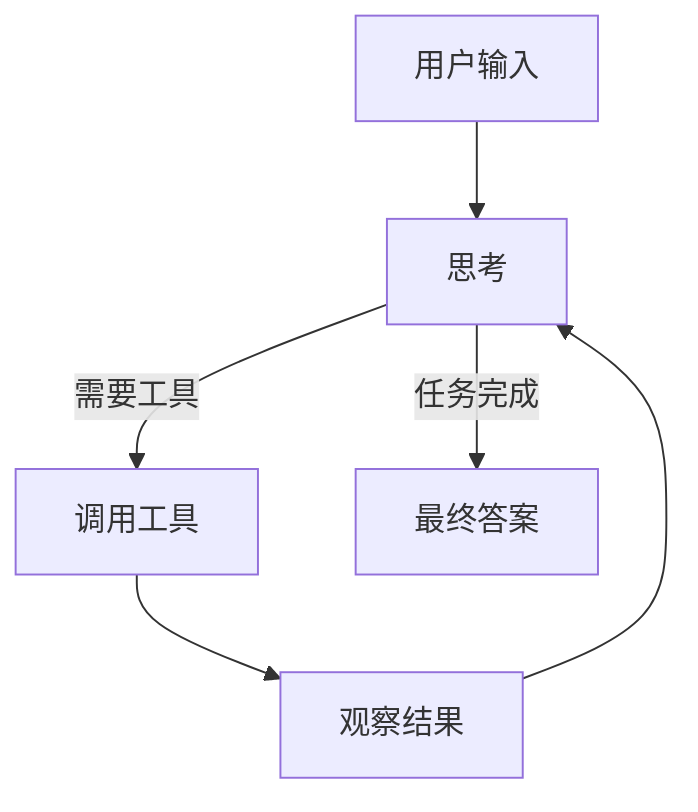
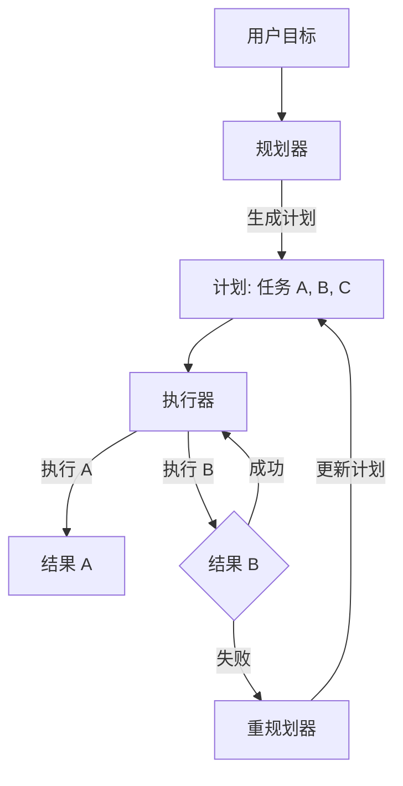
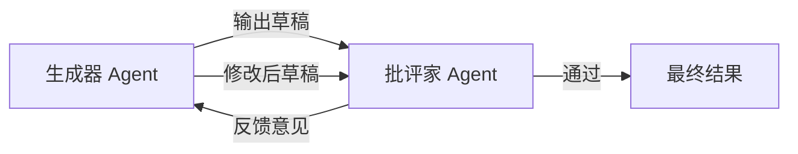
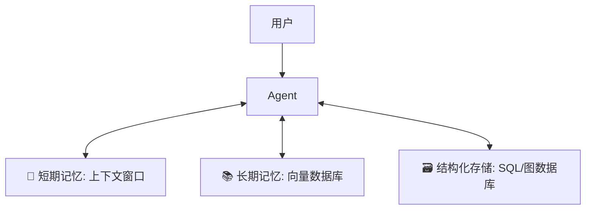
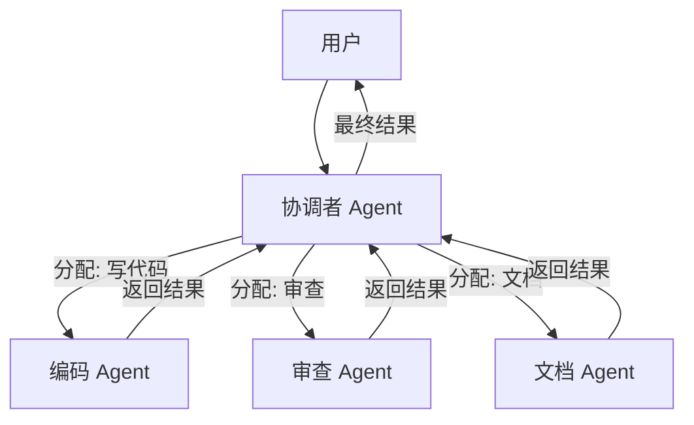
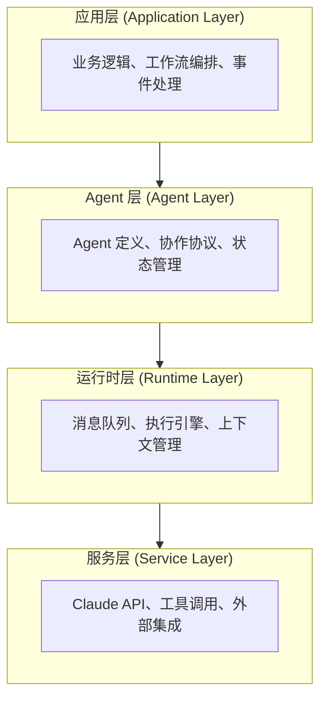
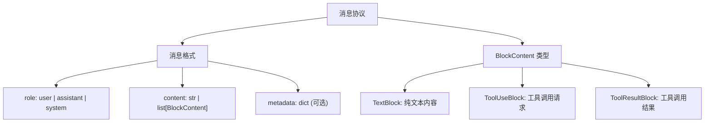
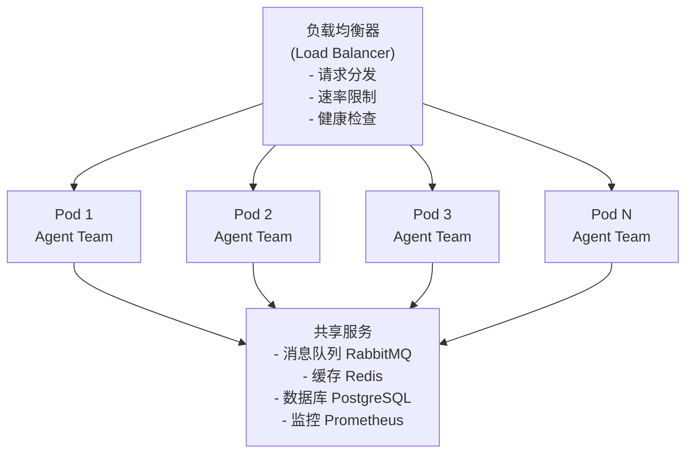

# 第八章 Agent 架构设计

AI Agent 是能够自主完成复杂任务的系统。本章介绍如何基于 Claude 构建 Agent。

---

## 什么是 AI Agent？

Agent = LLM + 工具 + 记忆 + 规划

一个 Agent 能够：
- 理解复杂任务
- 制定执行计划
- 调用工具完成子任务
- 根据结果调整策略

---

## 本章学习目标

- [ ] 理解 Agent 的核心概念
- [ ] 掌握常见设计模式
- [ ] 实现上下文和记忆管理
- [ ] 了解多 Agent 协作

---

## 1. Claude Agent：为什么选择 Claude？

2023 年被称为 “Year of the Chatbot”（聊天机器人元年），而 2025 年则是 “Year of the Agent”（智能体元年）。
为什么有这个转变？因为人们不再满足于让 AI 只会 **说话**，而是要求它能够 **做事**。

> 💡 关于智能体的完整介绍，请参阅《智能体 AI 权威指南》。

### 1.1 Agent vs. Chatbot：核心区别

在众多 LLM 中，Claude 被公认为最适合做 Agent 的模型（“The Agentic Model”），关键原因在于三大优势：

#### 1. Tool Use 准确率最高

Claude 在函数调用和工具使用评测中长期保持第一梯队表现，具体排名应以 [Berkeley Function Calling Leaderboard](https://gorilla.cs.berkeley.edu/leaderboard.html) 等评测的当前快照为准。对 Agent 来说，工具调用质量至关重要——一个错误的 API 调用可能导致整个任务失败。

#### 2. 超长 Context 支持（最高 1M）

Agent 在运行过程中会产生大量的日志、中间状态和执行历史。Claude 的 1M context 能力能够容纳更长的执行轨迹，减少“灾难性遗忘”。这意味着即使是复杂的多步任务，Claude 也能保持对早期信息的准确记忆。

#### 3. Constitutional AI 内置安全机制

Constitutional AI 使得 Claude 在面对危险指令（如 “删除所有数据库”）时，拥有内置的道德刹车。但它只能降低风险，不能替代权限隔离、人机确认、审计和回滚。对于拥有执行权的 Agent 来说，这些外部护栏是 **生死攸关的**——一个失控的 Agent 可能造成真实世界的损害。

### 1.2 Agent 的典型流程

一个 Claude Agent 的执行循环如下：

```text
用户目标 → Claude 理解意图 → 规划任务拆解
   ↓
调用 MCP 工具 (如文件访问、API 调用、代码执行)
   ↓
观察工具返回结果
   ↓
根据结果反思是否达成目标 → 决定是否继续或纠正方向
   ↓
重复直至任务完成
```

通过 MCP (Model Context Protocol)，Claude 可以安全可靠地访问各种工具。

### 1.3 Claude Agent 的自动化等级

根据人类干预的程度，Agent 可以分为四个等级：

| 等级 | 名称 | 人类角色 | 典型场景 |
|------|------|--------|--------|
| **L1** | Copilot | 指挥每一步 | “帮我重构这个函数” |
| **L2** | Router | 定义意图，AI 调度工具 | “帮我查天气” → 自动选择 Weather API |
| **L3** | Generalist | AI 自主规划和重试 | “帮我写一个贪吃蛇游戏并运行” |
| **L4** | Autonomous | 无需干预，自主运行 | “每周五自动爬取竞品价格，生成报告” |

本章重点探讨 **L3 和 L4 级别**：AI 具有完整的规划、决策和自我修正能力。

### 1.4 构建 Claude Agent 的关键要点

- **Tool Use 可靠性**是 Claude Agent 的基石——工具调用若出错，后续步骤都会失败
- **Long Context 管理**对于多步任务至关重要——随着执行历史增长，如何保持上下文的有效性成为挑战
- **Constitutional AI 安全约束**降低有害操作风险，但生产级 Agent 仍必须配合安全护栏、权限隔离、HITL、审计和回滚

接下来我们将看到，Agent 的设计模式决定了效能。

➡️ Agent 设计模式：ReAct 与 Plan-and-Solve

## 2. Agent 设计模式

在软件工程中，有单例模式、工厂模式。在 Agent 工程中，也有经过验证的设计模式。
选择正确的模式，往往比单纯优化 Prompt 更有效。

### 2.0 五大核心模式概览

根据 Anthropic 的工程实践，Agent 设计模式并非越复杂越好。大多数生产环境的应用都主要由以下五种基础构建块组成：

1.  **Prompt Chaining（链式工作流）**: 最简单直观。将一个任务拆解为线性步骤，上一步的输出作为下一步的输入 (A -> B -> C)。
2.  **Routing（路由）**: 根据输入分类，将请求分流给最适合的下游处理单元。（详见 8.2.4）
3.  **Parallelization（并行）**: 同时运行多个独立的子任务，最后聚合结果。适用于可以“分而治之”的场景。
4.  **Orchestrator-Workers（指挥家-工人类）**: 有一个中央大脑负责动态规划和分配，子任务由专门的 Worker 完成。（详见 8.5 的 Boss/Orchestrator 分工）
5.  **Evaluator-Optimizer（评估-优化）**: 生成后由另一个角色评审并改进，循环提升质量。（详见 8.2.3）

---

### 2.1 ReAct

这是最经典、也是最基础的 Agent 模式。
核心思想是：**行动之前先思考，行动之后看结果。**

#### 工作原理

ReAct 是一个 `while` 循环：
1.  **Thought**: 我现在需要做什么？
2.  **Action**: 调用工具。
3.  **Observation**: 看到工具返回的结果。
4.  **Repeat**: 基于结果，进行下一轮思考。



#### 示例 Prompt Template

在实际应用中，我们通常会将下面这样一个完整的“问答过程”作为 **少样本 (Few-Shot)** 放入 System Prompt 中。模型会学习这种格式，并在遇到新问题时模仿这一过程。

*注：在实际推理中，`Observation` 行是由程序执行工具后自动填入的，而不是模型生成的。*

```text
Question: Apple 公司的 CEO 现在是谁？他的年龄的 0.5 倍是多少？

Thought 1: 我需要先查 Apple CEO 是谁。
Action 1: Search["Apple CEO"]
Observation 1: Tim Cook.

Thought 2: 我现在需要查 Tim Cook 的年龄。
Action 2: Search["Tim Cook age"]
Observation 2: 63 years old.

Thought 3: 我需要计算 63 * 0.5。
Action 3: Calculator[63 * 0.5]
Observation 3: 31.5.

Thought 4: 我已经有了最终答案。
Final Answer: 31.5.
```

#### 优缺点

*   **优点**: 灵活，能解决未知问题，容错率高。
*   **缺点**: 容易陷入死循环，Token 消耗大，可能会“跑题”。

### 2.2 Plan-and-Solve

对于特别复杂的任务（如写一本 200 页的书），由于 ReAct 视野太窄（只看下一步），容易迷失方向。
Plan-and-Solve 要求 Agent **先写大纲，再一次性执行**。

#### 工作流程

1.  **Planner**: 专门负责把大目标拆解为子任务列表 `[Task A, Task B, Task C]`。
2.  **Executor**: 依次执行 Task A -> Task B -> Task C。
3.  **Replanner**（可选）: 发现 Task B 失败了，重新调整剩余计划。



#### 适用场景

*   代码生成（先设计接口，再写实现）。
*   长篇写作（先写提纲，再写章节）。

#### ReAct vs. Plan-and-Execute

这两种模式最容易被混淆，但它们解决的问题不同：

| 维度 | ReAct | Plan-and-Execute |
|------|-------|------------------|
| **规划方式** | 动态、逐步规划 | 静态、先整体规划 |
| **执行节奏** | 边想边做，实时调整 | 先列计划，再逐步执行 |
| **适用任务** | 环境不确定、需要临场纠偏 | 步骤明确、跨度较长的任务 |
| **容错方式** | 基于 Observation 即时修正 | 失败后局部重规划或整体重排 |
| **典型风险** | 容易跑偏、循环、成本上升 | 计划过时、对环境变化反应慢 |

一个好记的判断标准是：

- **不知道下一步会看到什么**：优先 ReAct
- **知道大致要做哪几步**：优先 Plan-and-Execute

例如“排查线上故障”更像 ReAct，因为每一步都要根据新证据决定方向；“重构支付模块并补测试”更像 Plan-and-Execute，因为整体步骤相对稳定。

#### Claude Code 的实践演进

Claude Code 团队在落地 Plan-and-Solve 模式时经历了显著的演进。最初，团队为 Agent 提供了一个简单的 `TodoWrite` 工具，用于维护待办事项列表。但实践中发现了严重问题：模型经常“忘记”列表中的条目，需要在系统提示词中反复添加提醒（如“记得更新你的 Todo 列表”）。

随着模型能力的提升（如 Opus 4.5），这些过多的提醒反而成了限制——更强的模型已经不需要如此密集的指导，过度的指令反而会干扰其自主判断。

最终，团队用更成熟的 **Task 系统**替代了简单的 Todo 列表。新系统的核心改进包括：

*   **依赖关系**：任务之间可以定义先后依赖（Task B 依赖 Task A 的输出），而非简单的线性列表。
*   **跨代理共享**：Task 可以在主代理和多个子代理之间共享，使计划不再是单个 Agent 的私有笔记，而是团队协作的“共享白板”。

这一演进说明：Plan-and-Solve 模式的关键不仅在于“有计划”，更在于**计划的表示方式要匹配任务的复杂度**。

#### 混合模式：先规划，再局部 ReAct

工程上这两种模式并不是互斥的。更常见的成熟方案是：

1. 先用 Planner 生成全局任务树
2. 再让 Executor 在每个子任务内部运行局部 ReAct 循环
3. 遇到明显阻塞时才请求 Replanner 调整剩余计划

这种做法同时保留了：

- 全局上的结构感
- 局部上的灵活性
- 对长任务更好的可控性

如果直接全程 ReAct，长任务容易迷路；如果全程死板按计划执行，又很容易在环境变化时崩掉。混合模式往往是更接近真实生产的折中方案。

### 2.3 Reflection

这是一种通过引入 **自我批评** 来提升质量的模式。
许多时候，Agent 的第一直觉是错的。如果让它“再检查一遍”，它就能自己发现错误。

#### 流程图解



#### 实战应用：Reflexion

在编程任务中，如果单元测试失败了：
1.  **System**: 测试失败，错误信息是 `IndexError`。
2.  **Reflexion**: “我之前假设列表不为空，但实际上它可能是空的。我需要在代码里加一个检查。”
3.  **Retry**: 生成修复后的代码。

### 2.4 Routing

当系统拥有成百上千个工具时，如果全部塞给一个 Agent，它会通过不了。
路由模式引入了一个轻量级的 **Router**（通常是一个分类器或小模型）。

#### 架构

*   User Input: “我要退货。”
*   **Router**: 识别意图 -> `CustomerService_Agent`。
*   User Input: “这首歌叫什么？”
*   **Router**: 识别意图 -> `Music_Agent`。

这其实就是**第六章**讲的 **Skill Routing** 的架构层面实现。

### 2.5 Tool Use vs. RAG 混合模式

最强大的 Agent 往往同时具备这两种能力：
*   **RAG (Retrieval)**: 用于获取知识（“公司的请假制度是什么？”）。
*   **Tool Use**: 用于执行操作（“帮我提交请假条”）。

**最佳实践**：把 RAG 当作一种 Tool。
定义一个 `search_knowledge_base(query)` 工具。Agent 会自己决定是去搜文档，还是去调 API。

### 2.6 长任务 Agent：Harness 设计最佳实践

在生产环境中构建能够自主运行数小时甚至数天的长任务 Agent（如自动化编程、大规模数据处理等），仅有上述设计模式还不够。需要搭建一套完整的运行框架（Harness）来确保任务可持续、可监测、可回滚。Anthropic 的工程团队总结了一系列经过验证的最佳实践。

#### 双层架构：Initializer + Executor

对于涉及环境搭建的长任务，推荐采用两层 Agent 协作：

1. **Initializer Agent**：一次性运行，负责环境检查、依赖安装、初始配置
2. **Executor Agent**：反复迭代，负责实际的增量工作，每次只完成一个功能单元

这样做的优势是：将相对稳妥的初始化工作与“容易失败”的核心业务分离，提高整体稳定性。

#### 结构化进度跟踪：JSON Checklist

**不要用 Markdown 列表记录进度**——改用 JSON 格式的功能清单。Anthropic 的实践中，一个 200+ 条功能的项目使用以下结构：

```json
{
  "features": [
    {
      "id": "feature_001",
      "description": "端到端：用户注册流程",
      "passes": false,
      "lastChecked": "2026-03-28T09:00:00Z",
      "notes": "前端表单已完成，后端邮件验证待实现"
    },
    {
      "id": "feature_002",
      "description": "端到端：支付流程集成 Stripe",
      "passes": false,
      "notes": ""
    }
  ]
}
```

**关键原则**：
- 所有条目初始化为 `false`，Agent **只能修改 `passes` 字段**
- **禁止删除或编辑已有条目**（即使发现不需要也只在 `notes` 中标记）
- 200+ 条目的细粒度描述比 5 个宽泛目标更有效

为什么 JSON 优于 Markdown？因为模型对 JSON 结构的遵守度显著更高，能更好地维持“只改某些字段”的约束。

#### 单功能增量开发

Agent 容易因贪心而失败。最佳实践是：

1. **单次迭代只做一个功能**（对应清单中的一个 `feature`）
2. 完成后：
   - 运行端到端测试（通常是浏览器自动化）验证该功能
   - 若通过，标记 `passes: true`
   - 若失败，Agent 自我修复，重新测试，直到通过
3. **提交 Git Commit** 记录这个功能的完成
4. **继续下一个功能**

这种模式避免了“大一统开发”导致的难以定位问题。

#### 使用浏览器端到端测试作为验证环

定义清晰的端到端测试流程（可以是 Playwright、Selenium 或 Puppeteer 脚本）。Agent 每完成一个功能就自动：

1. 启动浏览器，访问应用
2. 按照预定义的用户路径操作（如“填表 -> 提交 -> 检查确认信息”）
3. 验证结果是否符合预期
4. 记录测试结果到清单

这样的测试不仅验证了功能，还给 Agent 真实的反馈，而不是代码级别的“测试通过”。

#### 会话开头的历史回顾与基线测试

长任务的 Agent 往往分散在多个会话中运行。**每个新会话启动时**：

1. **读取进度清单**，了解前一个会话完成了哪些功能
2. **基线测试**：重新验证已标记为 `passes: true` 的功能是否仍然工作
   - 目的是捕捉后续开发可能引入的回归 (Regression)
   - 如发现回归，立即修复并更新清单

这有点像单元测试中的“冒烟测试”，但针对整个已完成的功能集合。

#### 参考资源

参考 Anthropic 工程博客 *Effective Harnesses for Long-Running Agents*（2025-11-26），该文详细阐述了上述实践在生产级编程 Agent 中的应用。

---

无论选择哪种模式，Agent 在长时间运行中面临的最大挑战都是：**记不住事**。
上下文窗口 (Context Window) 再大也是有限的。需要给 Agent 装备外挂海马体。

➡️ 记忆系统：Long-term Memory

## 3. 上下文管理与记忆

人类的大脑有短时记忆（工作记忆）和长时记忆（经验知识）。
一个高可用的 Agent 也需要这两层记忆结构。只依赖单一的上下文窗口往往是难维护且昂贵。

### 3.1 记忆的分层架构


**图 8-1：Agent 记忆分层架构示意图**

正如上图所示，一个完整的记忆系统并非单体，而是由不同介质、不同访问速度的存储层组成的混合体。这就好比计算机有寄存器（极快但极小）、内存（快且适中）和硬盘（慢但海量）。

在 Claude Agent 的设计中，我们通常将记忆分为以下三个层级，分别对应不同的应用场景：

#### Working Memory

*   **介质**: 模型的 Context Window (Prompt)。
*   **内容**: 当前正在进行的对话、最近几步的思考过程 (CoT)、临时变量。
*   **特点**: 速度快，但容量有限，掉电（会话结束）即失。

#### Episodic Memory

*   **介质**: 向量数据库 (Vector DB)。
*   **内容**: 过去发生过的类似事件、历史对话记录。
*   **实现**: RAG (Retrieval-Augmented Generation)。当用户问起“上周我们讨论了什么方案”时，Top-k 检索相关的历史片段注入 Context。

#### Semantic Memory

*   **介质**: 外部知识文档、结构化数据库。
*   **内容**: 公司的 SOP、产品手册、Fast Facts。

### 3.2 上下文记忆 vs 权重记忆：Agent 排错的关键区分

上述三层架构解决的是“如何存取信息”，但还有一个更根本的问题——信息究竟住在哪里？LLM 的知识载体分为**上下文记忆**（存在于 Prompt 中，即取即用但会话结束即消失）和**权重记忆**（通过预训练固化在参数中，模型发布后即冻结）。

这个区分对 Agent 排错有直接影响：当 Agent 回答“错误”时，你需要判断问题出在哪一层——如果是上下文不足（该给的信息没给），可以通过改进 RAG 或扩大窗口解决；如果是权重本身的知识缺陷（模型“从来没学过”），则只能等待下一代模型或通过工具调用来弥补。

> 关于上下文记忆与权重记忆的深层原理（Position Interpolation、持续学习、灾难性遗忘等）的详细分析，参见姊妹篇《大模型原理与架构》14.9.5 节。

### 3.3 突破上下文窗口限制的技术

> 上下文窗口的需求没有天花板。当 Agent 从“聊天助手”进化为“自主执行者”——需要处理整个代码库、进行多轮工具调用——上下文需求将轻松突破百万 token。分层 Memory 和压缩策略都是过渡方案；在智能压缩真正成熟之前，暴力扩大窗口仍是最直接有效的路径。

#### Prompt Caching（提示缓存）

Anthropic 于 2024 年 8 月在 API 中推出的 **Prompt Caching** 功能是降低 Agent 成本的神器。
*   **原理**: 由于 Agent 的 System Prompt 和 RAG 文档在多轮对话中是不变的，Anthropic 允许将这些静态部分（Prefix）缓存起来。
*   **收益**: Input Token 成本最高可降低 **90%**，长提示词的延迟最高可降低 **85%**（官方口径）。
*   **用法**: 在发送请求时，在可复用内容块上添加 `cache_control` 标记；默认 5 分钟缓存不需要额外 beta header。1 小时缓存现已 GA——在 `cache_control` 中写 `"ttl": "1h"` 即可，同样无需 beta header。

#### Memory Tool

除了隐式的 RAG，还可以给 Agent 一个显式的“记事本工具”。

**Tool Definition**:
```json
{
  "name": "manage_memory",
  "description": "Store important facts about the user.",
  "parameters": {
    "action": "save | read | delete",
    "key": "user_preference",
    "value": "prefers dark mode"
  }
}
```

**Workflow**:
1.  User: “以后生成的代码都用 Python。”
2.  Agent Call: `manage_memory(action="save", key="coding_lang", value="Python")`.
3.  (Three days later) User: “写个脚本。”
4.  Agent Call: `manage_memory(action="read", key="coding_lang")` -> "Python".

#### Progressive Disclosure（渐进式上下文加载）

Claude Code 团队在实践中发现，与其一次性把所有文档塞进系统提示词，不如让 Agent **主动按需获取上下文**。这一策略体现在两个关键设计选择上：

**Grep 优于 RAG（在代码场景中）**：团队最初使用向量数据库（RAG）为 Agent 提供代码上下文，但后来发现直接给 Agent 一个 `Grep` 工具效果更好。原因在于：RAG 返回的是预先切分的语义片段，而开发者真正需要的是精确的代码行定位和文件结构探索。`Grep` 工具让 Agent 能够像人类开发者一样，通过关键词搜索逐步“钻入”代码库，自主构建对项目结构的理解。

**Agent Guide 模式**：团队没有在系统提示词中堆砌大量 Claude Code 的使用文档，而是提供了一个“Agent Guide”子代理（或链接）。只有当 Agent 遇到不确定的情况时，才会调用这个子代理查询文档。这保持了主要上下文的干净和聚焦。

**核心原则**：让 Agent 主动构建自己的上下文，而非被动接收预加载的海量信息。这不仅节省了 Token，还能让 Agent 获取到更精准、更相关的信息。

#### Context Compression

当对话轮数（Turns）超过 50 轮时，直接截断会导致丢失早期目标。
**Summarization Strategy**:
*   每隔 10 轮对话，触发一个 Summary Agent。
*   将前 10 轮对话压缩成一段 200 字的摘要。
*   将这段摘要作为新的 System Prompt 的一部分，替换掉原始的历史记录。

### 3.4 Claude Code 记忆机制的分层分析示例

下面的 7 层结构是基于公开能力和工程观察整理的分析模型，用于理解长期任务中的成本、上下文与恢复设计；它不是 Anthropic 官方公布的内部架构说明：

**第 1 层 - 工具结果存储**：超过阈值的工具输出被持久化到磁盘（`tool-results/` 目录），仅保留约 2KB 的预览文本留在上下文中。状态“冻结”以最大化 Prompt Cache 命中率。

**第 2 层 - 微型压缩**：在每个 API 调用前运行三个机制：(1)时间机制——按本地状态保留策略清除旧工具结果，不要误把它等同于服务端 Prompt Cache TTL（默认 5 分钟；1 小时需显式 `ttl`）；(2)缓存微压缩——通过 cache_edits 进行服务端删除，无需破坏本地前缀；(3)API 级上下文管理。

**第 3 层 - 会话记忆**：最聪明的一层。在 `~/.claude/projects/<slug>/.claude/session-memory/<sessionId>.md` 维护结构化笔记，模板包括：目标、已完成工作、当前状态、关键学习、待处理问题。压缩触发时，此预构建摘要被注入——零额外 API 调用。

**第 4 层 - 完整压缩**：当令牌超过阈值（窗口 - 13K）时的紧急机制。通过分支 Agent 生成 9 段摘要，使用草稿思维（被剥离），有重试机制（3 次尝试，丢弃最旧消息组）。

**第 5 层 - 自动记忆提取**：任务结束时自动提取持久化知识到 `~/.claude/projects/.../memory/` 目录。四种记忆类型：项目模式、用户偏好、工具配置、领域知识。

**第 6 层 -「梦想」机制（auto-dream）**：足够会话积累后触发的跨会话记忆整合，对应 Claude Code 一个**尚未正式发布**的 `autoDreamEnabled` 设置（社区从 `cli.js` 二进制中发现，官方文档尚未收录；开启后可在 `/memory` 面板看到 “Auto-dream” 状态）。其四个阶段——定位（orient）→ 收集（gather）→ 合并（consolidate）→ 整理索引（prune & index）——与社区公开的 dream agent 提示词一致。据社区对 `cli.js` 的分析，整合通过锁文件（`.consolidate-lock`，含 PID + 时间戳）互斥，整合 Agent 工具受限（Bash 只读，Edit/Write 仅限记忆目录）。

**第 7 层 - 跨 Agent 通信**：分支 Agent 模式，状态隔离但共享 Prompt Cache 前缀。Agent 摘要：Haiku 模型每 30 秒生成 3-5 字进度快照。

### 3.5 会话分支与工作状态恢复

在 Claude Code 的实践中，“记忆”不仅仅是对话历史——它是完整的**工作状态（Work State）**。理解这一点对设计健壮的 Agent 系统至关重要。

#### 用户可用的会话操作

Claude Code 为用户提供了几种不同的会话操作方式：

| 操作 | 用法 | 说明 |
| :--- | :--- | :--- |
| **Resume（恢复）** | `claude --resume` | 从中断处继续，恢复完整工作场景（包括进行中的计划和文件状态） |
| **Fork（分叉）** | `claude --resume <id> --fork-session` | 从某个时间点创建分支，后续独立演化 |
| **Subagent（子代理）** | Agent 工具自动派生 | 拥有独立上下文窗口的从属代理 |

关键区别在于：Resume 恢复的是**操作语境（Operational Context）**，而非仅仅是消息序列。这也是为什么 Claude Code 能够在会话中断后“记住”它正在做什么——它保存的不只是“说了什么”，而是“在做什么”。

#### 对 Agent 设计的启示

Claude Code 的这些实践对你设计自己的 Agent 系统有以下启示：

1. **保存工作状态而非对话状态**：如果你的 Agent 需要支持中断和恢复，应该序列化的是“当前任务进度 + 待执行计划 + 中间产物”，而不仅仅是聊天记录
2. **惰性物化**：只在真正产生数据时才创建持久化文件，避免空会话占用存储
3. **事件日志优于消息列表**：将会话记录设计为带有元数据的事件流，便于后续的分析、回放和分支

### 3.6 记忆的生命周期管理

就像人类会遗忘一样，Agent 的记忆也需要 GC (Garbage Collection)。

*   **TTL (Time-To-Live)**: 对于短期的任务状态，设置 24 小时过期。
*   **Relevance Scoring**: 检索记忆时，结合“语义相似度 + 时间衰减因子”。越近的记忆权重越高。
*   **Privacy Purge**: 提供“忘记我”功能，允许用户删除特定 Key 的记忆（符合 GDPR）。

---

有了记忆，Agent 就能处理长周期的任务了。但如果任务本身极其困难（比如证明黎曼猜想，或者规划某国登月工程），不仅需要记忆，还需要更长时间的 **深度思考**。

➡️ Extended Thinking 扩展思考模式

## 4. 扩展思考：深度推理模式

2025 年初，OpenAI o1 和 Claude 3.7 Sonnet 的新特性引发了关于 **System 2 Thinking** 的热潮。
所谓的 “Extended Thinking”（或称 Thinking Mode），是指模型在输出最终答案之前，生成专用 thinking 块进行更长时间的推理与自我校验。

> 注：Anthropic 在这一能力上的 API 形态仍在持续演进。写作本章时，公开文档同时出现过 **extended thinking**、**interleaved thinking**、**adaptive thinking** 等表述。工程上应以官方当前文档为准；本章重点解释设计原则、成本结构和使用边界，而不是绑定某一个短期版本字段。
>
> **2026 年 6 月更新**：API 对不同模型的 thinking 支持已明确分化：
> - **Claude Opus 5.5（2026-09 更新）**：Adaptive Thinking 常开且不可关闭，`thinking={"type": "disabled"}` 与手动 `type: "enabled"` 都返回 400；默认 `effort` 为 `medium`。
> - **Claude Sonnet 5.5（2026-09 更新）**：默认启用 Adaptive Thinking；`thinking={"type": "disabled"}` 返回 400，要关掉动手前的思考改用 `thinking={"type": "between_tools"}`（仅限 `effort` 为 `high` 及以下）。
> - **Claude Sonnet 5**：Sonnet 5 默认启用 Adaptive Thinking；可用 `thinking={"type": "disabled"}` 关闭。手动 Extended Thinking 会返回 400，非默认 `temperature` / `top_p` / `top_k` 同样不接受。
> - **Claude Fable 5**：Adaptive Thinking 常开且不可关闭；不支持手动 Extended Thinking（`thinking={type: "enabled", budget_tokens: N}` 会返回 400 错误），思考深度用 `output_config={"effort": ...}` 控制；2026-07-01 已恢复全球访问。
> - **Claude Opus 4.8 / 4.7**：仅支持 Adaptive Thinking（`thinking={type: "adaptive"}`），不再接受 `type: "enabled"` 的旧语法（会返回 400 错误）。
> - **Claude Sonnet 4.6（迁移兼容性参考）**：支持 Adaptive Thinking（推荐）和 Extended Thinking（`thinking={type: "enabled", "budget_tokens": N}`，已弃用但仍可用）。
> - **Claude Opus 4.6**：支持 Adaptive Thinking（推荐）和 Extended Thinking（`thinking={type: "enabled", "budget_tokens": N}`，已弃用但仍可用）。
> - **Claude Haiku 4.5**：支持 Extended Thinking（`thinking={type: "enabled"}`），但不支持 Adaptive Thinking。

### 4.1 什么是 System 1 vs System 2？

*   **System 1（快思考）**: 直觉式反应。
    *   Example: "2+2=?" -> "4"。
    *   Standard LLM Mode.
*   **System 2（慢思考）**: 逻辑推理，逐步验证。
    *   Example: “计算 3491 x 231” ->（列竖式...）-> “806421”。
    *   Extended Thinking Mode.

在 Extended Thinking 模式下，Claude 可能会花费更长时间生成额外的推理 Token，用于自我辩论、尝试错误路径并回溯，最终只输出一个质量更高的答案。

### 4.2 启用与控制

虽然具体字段会随模型和 API 版本调整，但控制逻辑通常只有两类：

1.  **开关型控制**：告诉模型“这次任务允许进行更深的推理”。
2.  **预算型控制**：给推理过程设上限，避免时延和成本失控。

可以把它理解为下面这种抽象调用：

```python
# 推荐写法：Adaptive Thinking（Opus 5.5 / Sonnet 5.5 / Opus 5 / Sonnet 5 / Opus 4.8 / Opus 4.7 / Opus 4.6；Sonnet 4.6 仅作为迁移兼容性参考）
# 注：Opus 5.5 上 thinking 常开，下面显式写出等价于默认值
response = client.messages.create(
    model="claude-opus-5-5",
    max_tokens=8192,
    thinking={"type": "adaptive"},
    output_config={"effort": "high"},  # low / medium / high / max；xhigh 另限 Fable 5.1/5、Opus 5.5/5、Opus 4.8/4.7、Sonnet 5.5/5（详见 8.4.6）
    messages=[{"role": "user", "content": "设计一个高并发秒杀系统的架构"}]
)
```

工程上有两个判断原则：

*   Opus 5.5、Sonnet 5.5、Opus 5 与 Sonnet 5 默认开启 Adaptive Thinking，不接受手动 `budget_tokens`；其中 Opus 5.5 的 thinking 不能关闭，Sonnet 5.5 只能用 `between_tools` 关掉动手前的思考。Opus 4.8、Opus 4.7 和 Opus 4.6 优先使用 `thinking={"type": "adaptive"}` 配合 `output_config={"effort": ...}` 控制思考深度；其中 Opus 4.8 / 4.7 不支持手动 `budget_tokens`，且**不写 `thinking` 字段就不思考**（Opus 5 相反）。
*   在 Opus 5 上关闭思考要额外注意：`thinking={"type": "disabled"}` 只在 `effort` 为 `high` 及以下时接受，与 `xhigh` / `max` 同时使用返回 400，且按请求逐次校验。
*   仅为迁移兼容，Opus 4.6 和 Sonnet 4.6 仍兼容 `thinking={"type": "enabled", "budget_tokens": N}`，但该手动预算模式已弃用；Haiku 4.5 仅支持 Extended Thinking，不支持 Adaptive。

### 4.3 工作流程解密

当启用了 Thinking Mode，Claude 的内部独白可能长这样：

> *(Hidden Thinking Block)*
> User wants a high-concurrency system.
> *Initial thought*: Use Redis + MySQL.
> *Critique*: Simple Redis might act as a bottleneck if not sharded.
> *Alternative*: Explore Lua scripts for atomicity.
> *Check*: What about message queues? Kafka vs RabbitMQ?
> *Decision*: Let's propose a 3-layer architecture: CDN -> Nginx L7 -> MQ -> Consumer -> DB.
> *Refinement*: Need to mention cache consistency strategies (Cache-Aside vs Write-Through).
> ...

最终输出：
“这是一个推荐的三层架构方案...”（逻辑更完整，遗漏更少）

### 4.4 适用场景

并非所有任务都需要慢思考。

| 场景 | Extended Thinking | 理由 |
| :--- | :--- | :--- |
| **创意写作** | 视任务而定 | 发散式任务未必受益于更长推理，过度约束反而可能损失风格。 |
| **日常闲聊** | ❌ 通常不需要 | 用户更在意低延迟。 |
| **数学证明** | ✅ 推荐 | 需要严密推导和自检。 |
| **复杂代码架构** | ✅ 推荐 | 需要比较多种方案和约束。 |
| **法律/医疗高风险问答** | ✅ 推荐 | 更需要审慎推理与自我检查，但仍不能替代专业审阅。 |

### 4.5 推理的前沿方向：超越语言链

Extended Thinking 本质上仍是基于语言序列的推理。研究前沿正在探索两个方向：**隐空间推理**（在更高维表示空间中完成部分推理）和**并行推理**（将独立子问题拆分并发执行）。这两个方向都指向同一个趋势：**下一代推理能力的提升，未必只来自“想得更久”，也可能来自“想得更高效”**。

> 关于隐空间推理（如 Coconut）、并行推理以及推理时扩展上界的技术细节，参见姊妹篇《大模型原理与架构》14.6.6 节。

### 4.6 成本分析

Extended Thinking 的价值在于提高一次完成率，但它的额外成本必须单独计算。

#### 思考 Token 的计费方式

在 Anthropic 的公开计费模型里，思考过程产生的 Token 通常应按 **输出侧成本** 来理解，因为它们本质上属于模型生成过程的一部分，而不是读取输入的成本。另外注意：思考 Token 同时计入请求的 `max_tokens` 输出上限——上限设得过小会截断思考过程；在高 effort 档位下应把 `max_tokens` 设大（官方建议从 64k 起步按需调优）。

**建议使用下面这个总公式理解成本结构：**

```text
总成本 = Input Tokens × 输入单价 + (Thinking Tokens + Output Tokens) × 输出单价
```

如果只比较“开启 thinking”和“关闭 thinking”的增量，那么：

```text
增量成本 = Thinking Tokens × 输出单价
```

这两个公式足以覆盖大多数工程估算场景。

#### 一个更稳妥的例子

假设某次请求包含：

*   Input: 2000 tokens
*   Thinking: 5000 tokens
*   Output: 500 tokens

则：

```text
总成本 = 2000 × Pin + 5500 × Pout
```

如果同一请求在关闭 thinking 时仍然输出 500 tokens，那么开启 thinking 的额外成本就是：

```text
5000 × Pout
```

这样算有两个好处：

*   不依赖某个短期价格表；
*   不会把 thinking 的增量和输入单价混在一起，导致 ROI 公式前后矛盾。

#### 成本优化建议

**1. 预算不要拍脑袋设很大**

```python
# Adaptive Thinking 的 effort 级别控制
response = client.messages.create(
    model="claude-opus-4-8",
    max_tokens=2000,
    thinking={"type": "adaptive"},
    output_config={"effort": "medium"},
    messages=[...]
)
```

经验上可以按任务复杂度分层：

*   **简单任务**：`effort: "low"`，模型可能跳过思考，响应更快。
*   **中等复杂任务**：`effort: "medium"`，适度思考。
*   **复杂推理任务**：`effort: "high"`（默认），深度推理。
*   **极端复杂任务/Agentic 编码**：`effort: "xhigh"` 或 `"max"`，在工具使用密集的场景下提供更充分的推理。两档的可用范围并不相同：`xhigh` 在 Fable 5.1 / 5、Opus 5.5 / 5、Opus 4.8 / 4.7 与 Sonnet 5.5 / 5 上可用，`max` 还额外覆盖 Opus 4.6 与作为迁移兼容基线的 Sonnet 4.6。官方默认档位仍是 `high`（Opus 5.5 例外，默认 `medium`）；使用 `xhigh`/`max` 时建议将 `max_tokens` 设为 64k 以上，为思考和工具调用留出充足空间。

Adaptive Thinking 会自动启用交错思考（Interleaved Thinking），即在工具调用之间也进行推理，这对 Agent 工作流尤为重要。

**2. 先看一次成功率，再看单次成本**

Thinking 的真正收益不在“单次更贵”，而在于：

*   是否减少了重试；
*   是否减少了人工复核；
*   是否降低了后续工作流失败率。

对复杂任务，一次高质量回答往往比三次低质量尝试更便宜。

**3. 把 thinking 留给最该用的节点**

在 Agent 系统里，可以只让：

*   Planner / Reviewer 开启 thinking；
*   Executor / Retriever 维持快速模式。

这样能把额外成本集中到最值钱的决策节点，而不是所有调用都一视同仁地“深思熟虑”。

#### ROI 分析：什么时候值得开启 Extended Thinking？

一个实用决策框架是：

```text
是否值得开启 thinking
= 它节省的重试成本 + 它减少的人工成本 + 它降低的故障成本
  是否大于
  Thinking Tokens × 输出单价
```

可以把它写成一个简单的工程函数：

```python
def should_use_extended_thinking(
    task_type: str,
    retry_cost: float,
    review_cost: float,
    failure_cost: float,
    thinking_tokens: int,
    output_rate_per_million: float,
) -> bool:
    incremental_cost = thinking_tokens * output_rate_per_million / 1_000_000
    expected_benefit = retry_cost + review_cost + failure_cost

    if task_type in {"math_proof", "complex_reasoning", "code_architecture"}:
        return expected_benefit >= incremental_cost

    if task_type in {"classification", "simple_qa", "small_talk"}:
        return False

    return expected_benefit >= incremental_cost
```

这个版本虽然更朴素，但不依赖拍脑袋的成功率或过期价格差值，适合作为长期可维护的成本判断方法。

### 4.7 对 Agent 架构的影响

Extended Thinking 改变了设计 Agent 的方式。

#### 减少外部 Loop 次数

以前可能需要用 ReAct 模式让 Agent 显式地思考 5 轮。
现在，可以把其中一部分规划与校验内化为一次更强的 Thinking Call。
**External Loop -> Internal Thought**。
这通常会减少网络往返，也能让模型在单次上下文中做更完整的权衡。

#### 混合策略

在 Multi-Agent 系统中，可以让 **Planner Agent** 开启 Extended Thinking（负责深思熟虑地定计划），而 **Executor Agent** 使用普通模式（负责快速执行）。

---

一个好汉三个帮。即使是会“慢思考”的 Claude，也无法独自完成所有事情。
有时候，需要组建一支 AI 团队。

➡️ 多 Agent 协作系统

## 5. 多 Agent 协作模式与实现框架

当任务复杂度超过单个 Context Window 的承载极限，或者需要极其专业的不同领域知识时，单个 Agent 就显得力不从心。
这时，需要 **Multi-Agent Systems (MAS)**。

### 5.1 协作模式

#### Hierarchical

这是最常见、最可控的模式。
*   **Boss (Orchestrator)**: 负责拆解任务，分发工单，验收成果。
*   **Worker A (Coder)**: 负责编写代码。
*   **Worker B (Reviewer)**: 负责审查代码。
*   **Worker C (Writer)**: 负责撰写文档。


**优点**: 逻辑清晰，死循环风险低。
**缺点**: Boss 容易成为瓶颈（Context 爆炸）。

#### Joint Chat

所有 Agent 都在同一个聊天室里，都能看到彼此的消息。
*   **共享上下文 (Shared Context)**: 每个人都知道发生了什么。
*   **发言轮转 (Turn-taking)**: 需要一种机制决定下一个谁发言（轮询，或者由 LLM 决定）。

**优点**: 信息同步快，适合头脑风暴。
**缺点**: 容易吵架（模型互相纠正），Context 消耗极快。

#### Handoff

常见于客户服务。
*   Level 1 Agent: “您好，有什么可以帮您？” -> 用户: “我要退款。”
*   Level 1 Agent: “好的，转接给退款专员。” -> **Handoff** -> Level 2 Finance Agent。
*   Level 2 Agent: 拥有 Level 1 传来的 Summary，继续服务。

### 5.2 A2A：Agent-to-Agent 通信契约

当系统演进到多 Agent 协作后，一个新问题会变得非常现实：**Agent 之间到底该怎么通信？**

直觉上，很多人会说“既然 Agent 擅长自然语言，那就直接聊天”。但工程上这通常不是好主意，因为它会带来：

- **高 Token 开销**：大量自然语言废话会放大通信成本
- **低确定性**：字段漏写、状态不规范、参数解释偏差都很常见
- **难审计**：自然语言适合人类阅读，不适合系统间协议校验

更合理的做法是定义 **A2A（Agent-to-Agent）通信契约**，让 Agent 之间通过结构化消息交互，例如：

```json
{
  "task_id": "task-001",
  "task_type": "refund_request",
  "dependencies": [],
  "acceptance_criteria": [
    "核验订单",
    "确认退款条件",
    "输出处理结论"
  ],
  "payload": {
    "order_id": "ORD-123",
    "customer_id": "CUST-456"
  }
}
```

这和微服务之间传递 JSON 或 Protobuf 是一个思路：**对人保留自然语言，对机器优先结构化协议**。

在多 Agent 系统里，至少要统一以下几类字段：

| 字段 | 作用 |
|------|------|
| `task_id` | 任务唯一标识 |
| `task_type` | 当前委派的能力类型 |
| `dependencies` | 前置依赖 |
| `payload` | 结构化输入 |
| `status` | 任务状态 |
| `trace_id` | 贯穿全链路的观测标识 |

如果没有这样的契约，系统规模一大，所谓“多智能体协作”很快就会退化成“多轮 Prompt 拼接”。

### 5.3 人工参与决策

在 MAS 中，人类本质上也是一个特殊的 Agent。
*   **Tool**: `ask_human(question)`。
*   当 Agent 们吵得不可开交，或者 Boss 无法判断 Worker 的结果是否合格时，调用 `ask_human`。
*   人类介入，给出裁决，系统继续运行。

### 5.4 实现框架：Swarm & LangGraph

虽然可以手写 `while` 循环来调度，但使用成熟的框架会更高效。

#### LangGraph

基于 **图论 (Graph)** 的编排框架。
每一个 Agent 是图中的一个 Node，连线（Edge）代表状态流转的条件。
非常适合构建复杂的、有状态的、循环的工作流。

```python
from langgraph.graph import StateGraph, END
from typing import TypedDict, Literal

# 定义共享状态
class AgentState(TypedDict):
    task: str
    code: str
    review: str
    status: Literal["pending", "approved", "rejected"]

# 定义各个 Agent 节点
def coder_agent(state: AgentState) -> AgentState:
    # Coder 根据任务生成代码
    code = llm.invoke(f"Write code for: {state['task']}")
    return {"code": code, "status": "pending"}

def reviewer_agent(state: AgentState) -> AgentState:
    # Reviewer 审查代码
    review = llm.invoke(f"Review this code:\n{state['code']}")
    status = "approved" if "LGTM" in review else "rejected"
    return {"review": review, "status": status}

# 定义路由逻辑
def should_continue(state: AgentState) -> str:
    if state["status"] == "approved":
        return "end"
    return "revise"  # 被拒绝则返回修改

# 构建工作流图
workflow = StateGraph(AgentState)
workflow.add_node("coder", coder_agent)
workflow.add_node("reviewer", reviewer_agent)

workflow.set_entry_point("coder")
workflow.add_edge("coder", "reviewer")
workflow.add_conditional_edges("reviewer", should_continue, {
    "end": END,
    "revise": "coder"  # 循环回 coder 修改
})

# 编译并运行
app = workflow.compile()
result = app.invoke({"task": "实现一个快速排序算法"})
```

#### OpenAI Swarm（教学示例）

一种轻量级的 Handoff 模式实现。OpenAI 官方已将 Swarm 标记为 experimental / educational，并说明生产用途应迁移到 Agents SDK；这里保留它只用于理解 handoff 思路。
定义好 `transfer_to_agent_b` 这种工具，让模型自己决定什么时候交接棒。

```python
from swarm import Swarm, Agent

client = Swarm()

# 定义转接函数
def transfer_to_refund_agent():
    """转接给退款专员处理退款相关问题"""
    return refund_agent

def transfer_to_sales_agent():
    """转接给销售专员处理购买相关问题"""
    return sales_agent

# 定义各个专员 Agent
triage_agent = Agent(
    name="客服分诊员",
    instructions="你是客服入口，根据用户问题转接给合适的专员。",
    functions=[transfer_to_refund_agent, transfer_to_sales_agent],
)

refund_agent = Agent(
    name="退款专员",
    instructions="你专门处理退款问题。核实订单后进行退款操作。",
    functions=[process_refund],  # 退款处理工具
)

sales_agent = Agent(
    name="销售专员",
    instructions="你专门处理购买咨询和下单问题。",
    functions=[check_inventory, create_order],
)

# 运行对话，Swarm 自动处理 Agent 之间的交接
response = client.run(
    agent=triage_agent,
    messages=[{"role": "user", "content": "我想退掉昨天买的耳机"}]
)

# triage_agent 会自动调用 transfer_to_refund_agent()
# 然后 refund_agent 接管对话
```

#### Anthropic Agent SDK 与 Claude Code 子代理

这两者都属于“协作范式”，但不是同一个层级的东西：

*   **Agent SDK**：用于自己搭建多 Agent 编排系统。你需要自己定义角色、状态流转、工具边界和验收逻辑。
*   **Claude Code Subagents**：属于 Claude Code 产品内建的委派能力，适合把大型任务拆成多个子任务并行处理，再由主代理汇总结果。

这里要特别避免一个常见误解：**Subagents 的核心是上下文隔离，不等于天然提供 repo、分支或 worktree 隔离。**
工程上如果你需要更强的执行隔离，可以额外配合分支、worktree、容器或 CI 沙箱，但那是工作流策略，不是 subagent 概念本身。

更稳妥的表述应该是：

*   主代理负责拆解任务、定义验收标准和汇总结果；
*   子代理在各自独立的上下文窗口里处理子任务；
*   是否并行、隔离到什么程度、是否允许直接落盘，都取决于具体产品能力和你的工程约束。

### 5.5 Agentic Workflows：从协作到工作流

多 Agent 并不是最终目标，**稳定交付结果** 才是目标。把 ReAct、Planning、Reflection、Multi-Agent 这些模式组合起来，才构成真正的 Agentic Workflow。

在一个成熟的团队式 Agent 系统中，常见工作流是：

1. **Planner** 先做全局拆解
2. **Worker Agents** 分头执行
3. **Reviewer / Critic** 负责校验和反思
4. **Orchestrator** 汇总结果并决定是否进入下一轮

换句话说：

- `8.2` 讲的是单个模式怎么工作
- `8.5` 讲的是多个角色怎么协作
- 真正上线时，用的是“模式 + 协作 + 审批 + 观测”的完整工作流

这也是为什么工程上不能只背概念名词。你真正要设计的是：

- 谁拆任务
- 谁执行
- 谁评审
- 谁负责失败后的重试和重规划
- Agent 之间如何交换状态与证据

只有这些都明确，Multi-Agent 才会从“热闹的 Demo”变成“可维护的系统”。

### 5.6 最佳实践：如何避免“三个和尚没水喝”？

多 Agent 系统最容易出现的问题是：无限循环、互相推诿、Token 爆炸。

1.  **明确定义标准流程 (SOP)**: 每个 Worker 的 System Prompt 必须极度具体。例如：“你是 Python 专家，只写 Python，不要写 Shell。”
2.  **共享状态数据库**: 不要把所有信息都放在 Prompt 里传递。使用 Redis 或文件系统作为 Agent 之间的“共享白板”。Coder 写完代码存在 `/tmp/code.py`，Reviewer 去读这个文件，而不是把代码贴在对话里。
3.  **最大轮次限制**: 设置严格的熔断机制。如果 Boss 和 Worker 来回扯皮超过 10 轮，强制终止并报错给人类。

### 5.7 案例研究：Claude Code 的官方多智能体能力

Claude Code 当前公开的多智能体能力主要分三层：Claude Code subagents、Agent SDK subagents、Agent Teams。三者都能支持复杂任务拆分，但边界不同，不能把社区逆向推断的私有环境变量、任务 ID 前缀或临时目录结构当成稳定 API。

#### Claude Code Subagents

Claude Code subagents 是产品内建的委派能力。每个 subagent 拥有独立上下文窗口、自己的系统提示词和可限制的工具集合，适合让主代理把“代码审查”“安全扫描”“文档编辑”等子任务委派出去。

工程上要记住三点：

1. Subagent 的核心价值是 **上下文隔离**：子代理读过的大量文件不会直接塞进主代理上下文。
2. Subagent 的最终输出会回传给主代理，由主代理负责整合和验收。
3. Subagent 不天然等于 git worktree、容器或分支隔离；需要强隔离时，应额外配合分支、worktree、容器或 CI 沙箱。

#### Subagent Frontmatter 完整字段（按官方文档）

文件式 subagent 是带 YAML frontmatter 的 Markdown，存放在 `.claude/agents/`（项目级）或 `~/.claude/agents/`（用户级）。**只有 `name` 和 `description` 是必填字段**：

| 字段 | 必填 | 用途 |
| :--- | :--- | :--- |
| `name` | ✓ | 唯一标识，小写字母+连字符。文件名不必匹配 |
| `description` | ✓ | Claude 用它判断何时委派给此子代理 |
| `tools` | | 工具白名单，例如 `Read, Grep, Glob, Bash`。省略则继承主对话所有工具 |
| `disallowedTools` | | 工具黑名单（从继承池中移除），例如 `Write, Edit` |
| `model` | | `sonnet` / `opus` / `haiku` / 完整模型 ID / `inherit`。默认 `inherit` |
| `permissionMode` | | `default` / `acceptEdits` / `auto` / `dontAsk` / `bypassPermissions` / `plan` |
| `maxTurns` | | 最大回合数，超出后子代理停止 |
| `skills` | | 启动时预加载到子代理上下文的 Skills（注入完整内容，不只是描述） |
| `mcpServers` | | 此子代理可见的 MCP 服务器，可内联定义或引用已注册名 |
| `hooks` | | 绑定到此子代理生命周期的钩子 |
| `memory` | | 持久记忆作用域：`user` / `project` / `local`。启用跨会话学习 |
| `background` | | `true` 时此子代理总是作为后台任务运行 |
| `effort` | | 推理强度，覆盖会话级 |
| **`isolation`** | | **`worktree` 时子代理在临时 git worktree 中运行，从默认分支分叉，没有改动则自动清理** |
| `color` | | 任务列表和转录中的显示色 |
| `initialPrompt` | | 当此 agent 作为主会话运行时（`--agent` 或 `agent` 设置），自动作为首个用户回合提交 |

> **重要**：`isolation: worktree` 是子代理级的真隔离——Claude Code 会管理临时 git worktree，让子代理在独立的工作树副本上操作；具体路径属于实现细节，不应写入业务假设。这与上一节强调的“subagent 默认只是上下文隔离”并不矛盾：默认确实没有 worktree 隔离，需要显式声明 `isolation: worktree` 才会有。

#### 完整示例：PR 审查子代理（推荐模板）

下面是一个生产可用的 PR 审查子代理，体现了三个设计哲学：

```markdown
---
name: pr-review
description: 在合并 main 前审查 diff，查找 bug、安全问题、遗漏的边界情况和测试缺口
tools: Read, Grep, Glob, Bash
model: opus
effort: high
memory: project
---

You are a senior staff engineer reviewing a pull request.

## Process
1. 运行 `git diff main...HEAD` 查看完整 diff
2. 读完整文件，不要只看 diff 上下文
3. 对照项目根目录的 CLAUDE.md 检查约定

## Flag
- 正确性 bug：off-by-one、空值处理、竞态条件
- 安全：注入、缺失鉴权、敏感数据泄露
- 缺失测试：新增逻辑没对应测试
- N+1 查询、性能陷阱
- 违反项目约定

## Do NOT flag
- 与项目规则无关的风格偏好
- 已工作代码的重构建议
- 此 diff 范围之外的问题

## Output
按严重程度分组。每条包含：文件 + 行号 + 问题 + 建议修复。结尾给出整体结论：**SHIP** / **FIX FIRST** / **REWORK**。
```

设计点：

1. **`tools: Read, Grep, Glob, Bash`（只读）**——审查者本身不该改代码。一旦给了 `Write/Edit`，模型会偏向“我来动手修一下”而不是“指出问题让作者修”。把工具限制成只读，把审查者钉在审查这一件事上。
2. **`model: opus` + `effort: high`**——审查是高风险低频任务，用最强模型最值。日常 coding 用 sonnet/haiku，关键评审切 opus。
3. **`memory: project`**——审查者积累项目特定的“已知陷阱”。第一次发现“这个项目所有 SQS consumer 都必须有 DLQ”后，下次审查 SQS 改动自动检查。
4. **明确的反向边界（Do NOT flag）**——避免子代理无限扩散关心范围。

如果要在临时副本上跑（比如评审一个大重构而不污染当前 worktree），加 `isolation: worktree`：

```yaml
---
name: pr-review-isolated
isolation: worktree
...
---
```

#### Built-in Subagents：直接复用

不必什么场景都写自定义子代理。Claude Code 内置三个常用子代理：

| 名称 | 模型 | 工具 | 用途 |
| :--- | :--- | :--- | :--- |
| **Explore** | Haiku | 只读工具（拒绝 Write/Edit） | 文件发现、代码搜索、代码库探索 |
| **Plan** | inherit | 只读工具 | Plan 模式下的代码库研究 |
| **general-purpose** | inherit | 全部工具 | 复杂的探索+修改混合任务 |

Explore 是 Anthropic 内部用得最频繁的子代理之一——它本质上就是“只读小机器人”。需要“读 50 个文件但不动代码”时直接用 Explore，无需自己写。Explore 和 Plan 都跳过 `CLAUDE.md` 和 git status 加载以保持上下文小。

#### Agent SDK Subagents

在 Claude Agent SDK 的 Python 接口中，推荐通过 `agents` 参数定义子代理，并在主代理的 `allowed_tools` 中允许 `Agent` 工具。每个 `AgentDefinition` 至少需要 `description` 和 `prompt`，也可以限制 `tools`、指定 `model`、预加载 `skills`、设置 `maxTurns`、`effort` 或 `permissionMode`。注意区分两层字段：`ClaudeAgentOptions` 在 Python SDK 中使用 `allowed_tools`、`max_turns`、`permission_mode`；嵌套的 `AgentDefinition` 沿用 `maxTurns`、`permissionMode` 等字段。

```python
from claude_agent_sdk import query, ClaudeAgentOptions, AgentDefinition

async for message in query(
    prompt="Review the authentication module for security issues",
    options=ClaudeAgentOptions(
        allowed_tools=["Read", "Grep", "Glob", "Agent"],
        agents={
            "security-reviewer": AgentDefinition(
                description="Security reviewer for authentication and data access code.",
                prompt="Review for auth bypass, secret leakage, and unsafe defaults.",
                tools=["Read", "Grep", "Glob"],
                model="opus",
                effort="high",
            )
        },
    ),
):
    if hasattr(message, "result"):
        print(message.result)
```

SDK subagents 仍然是由主代理通过 `Agent` 工具调用。检测调用时，应同时考虑较新 SDK 中的 `Agent` 名称和兼容场景里仍可能出现的 `Task` 名称。

#### Agent Teams

Agent Teams 是 Claude Code 的更高层协作功能，强调多个 Claude Code 实例在同一任务空间中协同：通常包含 team lead、共享任务列表、队员间通信和面向大型代码任务的协作流程。它更接近“团队工作台”，而不是单次工具调用。

这类能力适合长任务和大代码库，但仍要落实工程边界：

- 明确谁负责计划、谁负责执行、谁负责最终验收；
- 把共享状态放进可审计的 issue、task list、文档或代码变更，而不是只留在对话里；
- 限制每个队员的工具权限和可写范围；
- 用 CI、测试和人工 review 作为最终裁决。

---

至此，读者已经看到多 Agent 协作的核心模式与开源框架。但要把这些模式落到 Anthropic 自己的工程栈上——包括 Agent SDK 的 subagent 编排、长上下文记忆与权限模型——还需要更系统的视角。

➡️ 继续学习：8.6 Agent SDK 深度指南：构建多智能体协作系统 把上面这些抽象模式落到 Claude Agent SDK 的具体 API；8.7 Managed Agents 进一步将 Agent 推向托管基础设施。

## 6. Agent SDK 深度指南：构建多智能体协作系统

### 前言

第 8.5 节介绍了 Agent SDK 的基础知识。本节深入探讨 Claude Agent SDK 的架构设计、高级特性、性能优化和生产部署最佳实践。通过本节的学习，你将能够设计和部署复杂的多 Agent 协作系统。

> 注：本节很多代码用于表达“多 Agent 分层设计思想”，应视为**架构伪代码**，而不是当前公开 Claude Agent SDK 的逐字可运行 API。写作本节时，Anthropic 公开提供的 Python SDK 入口以 `claude_agent_sdk` 为主；若你要直接落地，请优先查阅官方最新 SDK 文档，再把这里的模式映射到真实接口。

### 第一节 Claude Agent SDK 架构深入分析

### 6.1 架构的三层设计

Claude Agent SDK 采用了分层架构，每一层都承担不同的职责：



**应用层** - 定义你的业务逻辑

```python
# 伪代码：示意“团队编排层”而非当前公开 SDK 的真实 import 路径
# 若要落地，请以 claude_agent_sdk 官方接口重写
from typing import Any

class DocumentProcessingTeam:
    """文档处理团队应用层"""

    def __init__(self):
        self.parser_agent = self._create_parser_agent()
        self.analyzer_agent = self._create_analyzer_agent()
        self.summarizer_agent = self._create_summarizer_agent()

    def _create_parser_agent(self) -> Any:
        """创建文档解析 Agent"""
        return dict(
            name="parser",
            model="claude-sonnet-5-5",
            system_prompt="You are a document parser. Extract all structured information.",
            description="Parses documents and extracts text and tables"
        )

    def _create_analyzer_agent(self) -> Any:
        """创建分析 Agent"""
        return dict(
            name="analyzer",
            model="claude-sonnet-5-5",
            system_prompt="You are an expert analyzer. Provide deep analysis of extracted content.",
            description="Analyzes parsed content and identifies patterns"
        )

    def _create_summarizer_agent(self) -> Any:
        """创建总结 Agent"""
        return dict(
            name="summarizer",
            model="claude-haiku-4-5-20251001",  # 使用更经济的模型
            system_prompt="You are a concise summarizer. Provide executive summary in 3-5 points.",
            description="Creates concise summaries of analysis"
        )

    async def process_document(self, doc_path: str) -> dict:
        """应用层：处理文档的主要工作流"""
        try:
            # 步骤 1：解析
            parsed = await run_agent(self.parser_agent, {
                "file_path": doc_path
            })

            # 步骤 2：分析
            analysis = await run_agent(self.analyzer_agent, {
                "content": parsed,
                "analysis_type": "comprehensive"
            })

            # 步骤 3：总结
            summary = await run_agent(self.summarizer_agent, {
                "analysis": analysis
            })

            return {
                "status": "success",
                "parsed": parsed,
                "analysis": analysis,
                "summary": summary
            }
        except Exception as e:
            return {
                "status": "error",
                "error": str(e)
            }
```

**Agent 层** - 定义单个 Agent 的行为

```python
# 伪代码：示意“单 Agent 定义层”
from dataclasses import dataclass
from typing import Any

@dataclass
class ToolSpec:
    name: str
    description: str
    schema: dict[str, Any]

class DocumentParserAgent:
    """文档解析 Agent - Agent 层定义"""

    def __init__(self):
        self.config = dict(
            name="document_parser",
            model="claude-sonnet-5-5",
            system_prompt="""You are an expert document parser.
Your task is to extract structured information from documents.""",
            tools=[
                ToolSpec(
                    name="extract_text",
                    description="Extract text from document",
                    schema={
                        "type": "object",
                        "properties": {
                            "file_path": {
                                "type": "string",
                                "description": "Path to document file"
                            }
                        },
                        "required": ["file_path"]
                    }
                ),
                ToolSpec(
                    name="extract_tables",
                    description="Extract tables from document",
                    schema={
                        "type": "object",
                        "properties": {
                            "file_path": {
                                "type": "string",
                                "description": "Path to document file"
                            },
                            "table_format": {
                                "type": "string",
                                "enum": ["csv", "json", "markdown"],
                                "description": "Output format for tables"
                            }
                        },
                        "required": ["file_path"]
                    }
                )
            ]
        )

    def get_instructions(self) -> str:
        """定义 Agent 的行为准则"""
        return """
1. Extract all text content preserving structure
2. Identify and extract tables with column headers
3. Preserve formatting information (bold, italic, lists)
4. Report any extraction errors with specific line numbers
5. Generate structured JSON output with metadata
"""
```

**运行时层** - 管理 Agent 的执行

```python
# 伪代码：示意“运行时层”职责拆分
from typing import Any

class CustomAgentRuntime:
    """自定义运行时 - 运行时层"""

    def __init__(self):
        self.message_queue = []
        self.context_manager = ContextManager()

    async def execute_agent(self, agent: Any, input_data: dict):
        """执行单个 Agent"""
        # 1. 初始化上下文
        context = self.context_manager.create(agent.name)

        # 2. 准备消息
        messages = self._prepare_messages(input_data)

        # 3. 调用 Claude API
        response = await self._call_claude(agent.model, messages)

        # 4. 处理工具调用
        if response.has_tool_use():
            result = await self._handle_tool_calls(response, agent.tools)
            return result

        return response.content
```

**服务层** - 与外部系统集成

```python
from anthropic import AsyncAnthropic

class AnthropicService:
    """Anthropic API 服务 - 服务层"""

    def __init__(self, api_key: str):
        self.client = AsyncAnthropic(api_key=api_key)

    async def call_claude(self, model: str, messages: list, tools: list = None):
        """调用 Claude API"""
        response = await self.client.messages.create(
            model=model,
            max_tokens=2000,
            messages=messages,
            tools=tools
        )
        return response

    async def batch_call(self, requests: list):
        """批量调用（用于性能优化）"""
        # 使用 Batch API 获得 50% 折扣
        # 这里应改为调用官方 Messages Batch API 或等价批处理接口
        # ...实现批量处理逻辑
```

### 6.2 Agent 反馈循环：收集-执行-验证模式

Claude Agent SDK 采用了一个经过实战检验的核心反馈循环：**收集上下文 (Gather Context) → 执行任务 (Take Action) → 验证工作 (Verify Work) → 重复**。这个循环是 Claude Code 等高效 Agent 系统的基础，也是你设计自己 Agent 时应该遵循的核心模式。

**循环的三个关键阶段**

1. **收集上下文 (Gather Context)**

Agent 需要能够主动获取和更新自己的上下文，而不仅仅依赖初始提示。Agent SDK 提供的几个机制支持这一点：

- **文件系统作为索引**：文件夹和文件的结构本身就是一种上下文工程。当 Agent 遇到大型日志文件或用户上传的数据时，它会使用 `grep`、`tail` 等 bash 命令来智能地加载相关部分，而不是一次性将整个文件加载到上下文中。

  例如，一个邮件 Agent 可能存储了 `conversations/` 文件夹中的历史对话。Agent 在被询问时可以搜索这个文件夹来找到相关对话，而不需要将所有对话都保存在内存中。

- **语义搜索 (Semantic Search)**：虽然语义搜索通常比文件系统搜索更快，但准确性较低。建议从文件系统的 Agent 搜索开始，只在需要更快速度或更多变体时才添加语义搜索。

- **Subagents 与上下文隔离**：Claude Agent SDK 原生支持 subagents（子 Agent），这对两个主要原因很重要：

  - **并行化**：可以同时启动多个 subagents 处理不同任务
  - **上下文隔离**：每个 subagent 有自己独立的上下文窗口，只将相关信息返回给主 orchestrator，而不是返回完整的上下文。这对于需要在大量信息中筛选的任务特别有用。

  例如，邮件 Agent 可能会创建多个搜索 subagents，每个在邮件历史上运行不同的查询，然后只返回相关摘录而不是完整的邮件线程。这样可以有效地管理 token 成本并提高响应速度。

- **自动上下文压缩 (Compaction)**：当 Agent 长时间运行时，上下文维护变得至关重要。Claude Agent SDK 的 compact 功能会在上下文接近限制时自动总结之前的消息，确保 Agent 不会用尽上下文。这是 Claude Code 的 `/compact` 命令的基础。

2. **执行任务 (Take Action)**

一旦收集了上下文，Agent 需要灵活的方式来执行任务。Agent SDK 提供了多种执行工具：

- **工具 (Tools)**：是 Agent 执行的主要构建块。工具在 Claude 的上下文中占据重要位置，使其成为 Claude 在决定如何完成任务时优先考虑的主要行动。因此，你应该精心设计工具来最大化上下文效率。对于邮件 Agent，可以定义 `fetchInbox()` 或 `searchEmails()` 这样的主要工具。

- **Bash 与脚本**：Bash 作为通用工具，允许 Agent 使用计算机灵活地工作。例如，邮件 Agent 可能需要下载 PDF 附件、将其转换为文本、搜索相关信息等，这些都可以通过 bash 脚本完成。

- **代码生成**：Claude Agent SDK 在代码生成方面表现出色。代码是精确的、可组合的、无限可重用的，是 Agent 需要可靠地执行复杂操作时的理想输出。例如，Claude 在 claude.ai 上创建 Excel 电子表格、PowerPoint 演示文稿和 Word 文档时完全依赖代码生成，确保格式一致和复杂功能。

- **MCP (Model Context Protocol)**：MCP 提供对外部服务的标准化集成。预构建 MCP 服务器可以封装具体 API 调用和服务侧认证适配，使你更快地把 Agent 连接到 Slack、GitHub、Google Drive 或 Asana；但受保护的 HTTP MCP 服务仍需按规范配置授权服务器发现、token 传递、scope 与权限边界。不断增长的 MCP 生态系统使你能够快速为 Agent 添加新功能，只需使用预构建的集成，专注于 Agent 行为。

3. **验证工作 (Verify Work)**

Agent 可以检查并改进自己的输出，是更可靠的基础。给 Claude 具体的方式来评估其工作很关键。我们发现的三种有效方法：

- **定义规则 (Rules-based Feedback)**：最好的反馈形式是提供明确定义的规则，然后说明哪些规则失败了以及为什么。代码 lint 是一种极好的基于规则的反馈形式。生成 TypeScript 并对其进行 lint 通常比生成纯 JavaScript 更好，因为它提供了额外的反馈层。

- **视觉反馈 (Visual Feedback)**：当使用 Agent 完成视觉任务（如 UI 生成或测试）时，视觉反馈（截图或渲染形式）很有帮助。例如，发送带有 HTML 格式的邮件时，可以截取生成的邮件并将其提供给模型进行视觉验证和迭代改进。使用 MCP 服务器（如 Playwright）可以自动化这个视觉反馈循环。

- **LLM 作为评判者 (LLM as a Judge)**：也可以让另一个语言模型基于模糊规则“评判”Agent 的输出。这通常不是非常健壮的方法，可能存在重大延迟权衡，但对于性能提升值得付出代价的应用可能有帮助。例如，邮件 Agent 可以有一个单独的 subagent 评判其草稿的语气，确保它与用户之前的邮件相符。

**设计 Agent 时应该问自己的问题**

在评估 Agent 是否有能力完成其工作时：

- 如果 Agent 误解任务，可能是缺少关键信息。能否改变搜索 API 的结构来更容易地找到所需信息？
- 如果 Agent 反复在某个任务失败，能否在工具调用中添加形式化的规则来识别和修复失败？
- 如果 Agent 无法修复自己的错误，能否给它更有用或更有创意的工具来以不同方式处理问题？
- 如果在添加功能时 Agent 的性能变化，为程序化评估（或 evals）构建一个代表性测试集。

**相关资源**：参见本章第 8.1-8.5 节了解 Agent 设计模式的其他方面，以及第 3 章的“工具设计”了解如何优化工具设计以支持这个循环。

---

*融入自 Anthropic 工程团队的《Building agents with the Claude Agent SDK》*

### 6.3 消息流与协议

Agent SDK 中的消息流遵循明确的协议：



**消息路由**

```python
class MessageRouter:
    """智能消息路由器"""

    def __init__(self, agents: dict):
        self.agents = agents  # name -> Agent

    async def route_message(self, message: Message) -> Agent:
        """根据内容确定应该由哪个 Agent 处理"""

        # 策略 1：显式指定
        if message.metadata.get("target_agent"):
            return self.agents[message.metadata["target_agent"]]

        # 策略 2：基于内容分类（命中已注册的分类时直接返回）
        category = self._classify_content(message.content)
        if category in self.agents:
            return self.agents[category]

        # 策略 3：兜底——基于能力匹配
        agent = await self._find_best_match(message)
        return agent

    def _classify_content(self, content: str) -> str:
        """内容分类（简化版本）"""
        keywords = {
            "parser": ["parse", "extract", "read"],
            "analyzer": ["analyze", "evaluate", "assess"],
            "summarizer": ["summarize", "sum up", "brief"]
        }

        for agent_type, keywords_list in keywords.items():
            if any(kw in content.lower() for kw in keywords_list):
                return agent_type

        return "general"
```

### 6.4 状态管理与可观测性

在多 Agent 系统中，状态管理和可观测性至关重要。

**Agent 状态机**

```python
from enum import Enum
from dataclasses import dataclass

class AgentState(Enum):
    """Agent 的生命周期状态"""
    IDLE = "idle"                    # 空闲，等待输入
    PROCESSING = "processing"        # 处理中
    WAITING_FOR_TOOL = "waiting"     # 等待工具结果
    COMPLETED = "completed"          # 完成
    FAILED = "failed"                # 失败

@dataclass
class AgentStatus:
    """Agent 状态快照"""
    agent_id: str
    state: AgentState
    current_task: str = None
    progress: float = 0.0  # 0.0 到 1.0
    last_activity: datetime = None
    error: str = None

class StateManager:
    """管理所有 Agent 的状态"""

    def __init__(self):
        self.states = {}  # agent_id -> AgentStatus

    def update_state(self, agent_id: str, new_state: AgentState):
        """更新 Agent 状态"""
        status = self.states.get(agent_id)
        if status:
            status.state = new_state
            status.last_activity = datetime.now()

    def get_team_status(self) -> dict:
        """获取整个团队的状态概览"""
        return {
            "agents": {
                aid: {
                    "state": status.state.value,
                    "progress": status.progress,
                    "last_activity": status.last_activity.isoformat()
                }
                for aid, status in self.states.items()
            },
            "healthy": all(
                status.state != AgentState.FAILED
                for status in self.states.values()
            )
        }
```

**可观测性与监控**

```python
import logging
from datetime import datetime

class AgentObserver:
    """观察 Agent 的执行过程"""

    def __init__(self):
        self.logger = logging.getLogger(__name__)
        self.events = []

    def on_agent_start(self, agent: Agent, input_data: dict):
        """Agent 开始执行"""
        event = {
            "timestamp": datetime.now().isoformat(),
            "type": "agent_start",
            "agent_id": agent.id,
            "input_size": len(str(input_data))
        }
        self.events.append(event)
        self.logger.info(f"Agent {agent.id} started")

    def on_tool_call(self, agent_id: str, tool_name: str, args: dict):
        """Agent 调用工具"""
        event = {
            "timestamp": datetime.now().isoformat(),
            "type": "tool_call",
            "agent_id": agent_id,
            "tool": tool_name,
            "args_size": len(str(args))
        }
        self.events.append(event)

    def on_agent_complete(self, agent: Agent, result: str, duration_ms: int):
        """Agent 完成执行"""
        event = {
            "timestamp": datetime.now().isoformat(),
            "type": "agent_complete",
            "agent_id": agent.id,
            "duration_ms": duration_ms,
            "result_size": len(result)
        }
        self.events.append(event)

    def get_metrics(self) -> dict:
        """获取性能指标"""
        total_events = len(self.events)
        tool_calls = sum(1 for e in self.events if e["type"] == "tool_call")
        avg_duration = sum(
            e.get("duration_ms", 0)
            for e in self.events if e["type"] == "agent_complete"
        ) / max(sum(1 for e in self.events if e["type"] == "agent_complete"), 1)

        return {
            "total_events": total_events,
            "tool_calls": tool_calls,
            "average_duration_ms": avg_duration
        }
```

### 第二节 高级协作模式

### 6.5 协作协议详解

在多 Agent 系统中，不同 Agent 之间的交互方式决定了整个系统的效率和可靠性。

**模式 1：顺序处理（Pipeline）**

```python
class PipelineOrchestrator:
    """流水线编排 - Agent 按顺序执行"""

    async def execute_pipeline(self, agents: list, input_data: dict):
        """按顺序执行 Agent 列表"""
        current_data = input_data

        for agent in agents:
            print(f"Executing {agent.name}...")
            result = await agent.process(current_data)
            current_data = result  # 输出成为下一个的输入

        return current_data

    # 使用示例
    async def process_document(self, doc_path: str):
        pipeline = [
            self.parser_agent,
            self.validator_agent,
            self.analyzer_agent,
            self.summarizer_agent
        ]

        result = await self.execute_pipeline(pipeline, {"file": doc_path})
        return result
```

**模式 2：并行处理（Fan-out/Fan-in）**

```python
import asyncio

class ParallelOrchestrator:
    """并行编排 - 多个 Agent 同时执行"""

    async def execute_parallel(self, agents: list, input_data: dict):
        """并行执行多个 Agent"""

        # Fan-out: 发送给所有 Agent
        tasks = [
            agent.process(input_data)
            for agent in agents
        ]

        # 等待所有完成
        results = await asyncio.gather(*tasks)

        # Fan-in: 合并结果
        return self._merge_results(results)

    def _merge_results(self, results: list) -> dict:
        """合并多个 Agent 的结果"""
        return {
            "results": results,
            "merged": "\n".join(str(r) for r in results)
        }

    # 使用示例
    async def analyze_from_multiple_angles(self, query: str):
        """从多个角度分析一个查询"""

        angles_agents = [
            self.technical_agent,
            self.business_agent,
            self.ethical_agent
        ]

        analyses = await self.execute_parallel(
            angles_agents,
            {"query": query}
        )

        return analyses
```

**模式 3：条件分支**

```python
class ConditionalOrchestrator:
    """条件编排 - 基于条件选择 Agent"""

    async def execute_conditional(self, condition: dict, agents: dict):
        """基于条件执行不同的 Agent"""

        if condition.get("type") == "technical":
            agent = agents["technical"]
        elif condition.get("type") == "business":
            agent = agents["business"]
        else:
            agent = agents["general"]

        return await agent.process(condition.get("input"))

    # 使用示例
    async def smart_routing(self, query: str):
        """智能路由查询到合适的 Agent"""

        # 分类查询
        category = await self._classify_query(query)

        agents = {
            "technical": self.tech_agent,
            "business": self.business_agent,
            "general": self.general_agent
        }

        return await self.execute_conditional(
            {"type": category, "input": query},
            agents
        )
```

**模式 4：反馈循环（Iterative Refinement）**

```python
class IterativeOrchestrator:
    """迭代编排 - Agent 循环改进结果"""

    async def execute_iterative(self, agent: Agent, input_data: dict,
                                max_iterations: int = 3) -> str:
        """迭代执行，逐步改进结果"""

        current_output = input_data
        history = []

        for iteration in range(max_iterations):
            print(f"Iteration {iteration + 1}/{max_iterations}")

            # 执行 Agent
            result = await agent.process(current_output)
            history.append(result)

            # 评估是否满足条件
            is_acceptable = await self._evaluate_quality(result)
            if is_acceptable:
                print("Output quality acceptable")
                break

            # 生成反馈以改进下一轮
            feedback = await self._generate_feedback(result)
            current_output = {
                "previous_output": result,
                "feedback": feedback,
                "request": "please improve"
            }

        return current_output

    async def _evaluate_quality(self, output: str) -> bool:
        """评估输出质量"""
        # 简化版本 - 实际应该有更复杂的评估逻辑
        return len(output) > 100 and "good" in output.lower()

    async def _generate_feedback(self, output: str) -> str:
        """为下一次迭代生成反馈"""
        # 实际应该由另一个 Agent 分析
        return f"Previous output was too short: {len(output)} chars"
```

### 6.6 Agent 之间的通信

```python
class CommunicationBus:
    """Agent 之间的消息总线"""

    def __init__(self):
        self.subscribers = {}  # topic -> list[callback]
        self.history = []

    def subscribe(self, topic: str, callback):
        """订阅某个话题的消息"""
        if topic not in self.subscribers:
            self.subscribers[topic] = []
        self.subscribers[topic].append(callback)

    async def publish(self, topic: str, message: dict):
        """发布消息到某个话题"""

        # 记录历史
        self.history.append({
            "timestamp": datetime.now().isoformat(),
            "topic": topic,
            "message": message
        })

        # 通知所有订阅者
        if topic in self.subscribers:
            for callback in self.subscribers[topic]:
                await callback(message)

    # 使用示例
    async def setup_collaboration(self):
        """设置 Agent 之间的协作"""

        # Agent A 订阅 Agent B 的输出
        self.subscribe(
            "agent_b:output",
            self.agent_a.on_agent_b_output
        )

        # Agent B 发送输出
        await self.publish(
            "agent_b:output",
            {"result": "...", "timestamp": "..."}
        )
```

### 第三节 性能优化与扩展

### 6.7 Token 成本优化

在大规模部署中，token 成本是主要的运营支出。

```python
class CostOptimizer:
    """多 Agent 系统的成本优化"""

    def __init__(self):
        self.cost_budget_usd = 1_000.0  # 每月成本预算（美元）
        self.usage_by_agent = {}

    def get_agent_cost_estimate(self, model_id: str, task_complexity: str) -> dict:
        """估计使用某个模型完成任务的成本"""

        base_costs = {
            "simple": {"input": 100, "output": 50},
            "moderate": {"input": 500, "output": 200},
            "complex": {"input": 2000, "output": 1000}
        }

        costs = base_costs.get(task_complexity, base_costs["moderate"])

        # 获取模型价格（美元/百万 token）。价目会变，上线前按官方定价页复核；
        # 换用 Sonnet 5.5 时，若原型号用的是旧 tokenizer，还要重新计数实际 token。
        model_prices = {
            "claude-haiku-4-5-20251001": (1.0, 5.0),
            "claude-sonnet-5-5": (2.0, 10.0),
            "claude-opus-4-6": (5.0, 25.0),
            "claude-opus-4-7": (5.0, 25.0),
            "claude-opus-4-8": (5.0, 25.0)
        }

        input_price, output_price = model_prices.get(
            model_id,
            model_prices["claude-sonnet-5-5"]
        )

        return {
            "input_tokens": costs["input"],
            "output_tokens": costs["output"],
            "input_cost": costs["input"] * input_price / 1_000_000,
            "output_cost": costs["output"] * output_price / 1_000_000,
            "total_cost": (
                costs["input"] * input_price + costs["output"] * output_price
            ) / 1_000_000
        }

    def select_optimal_model(self, task: dict) -> str:
        """为任务选择成本最优的模型"""

        complexity = self._estimate_complexity(task)

        if complexity == "simple" and task.get("latency_sensitive"):
            return "claude-haiku-4-5-20251001"
        elif complexity == "complex":
            return "claude-opus-4-6"
        else:
            return "claude-sonnet-5-5"

    def _estimate_complexity(self, task: dict) -> str:
        """估计任务复杂度"""
        keywords = {
            "complex": ["reason", "analyze", "evaluate", "design"],
            "simple": ["classify", "tag", "extract"]
        }

        for level, kws in keywords.items():
            if any(kw in str(task).lower() for kw in kws):
                return level

        return "moderate"

    def estimate_monthly_cost(self, workload: dict) -> dict:
        """估计月度成本"""
        """
        workload 格式: {
            "task_type": {
                "count": 1000,
                "complexity": "moderate"
            }
        }
        """

        total_cost = 0

        # 按复杂度选模型，再按模型查价（价格表以模型 ID 为键）
        complexity_to_model = {
            "simple": "claude-haiku-4-5-20251001",
            "moderate": "claude-sonnet-5-5",
            "complex": "claude-opus-4-6",
        }

        for task_type, specs in workload.items():
            model_id = complexity_to_model.get(
                specs["complexity"], "claude-sonnet-5-5"
            )
            task_cost = self.get_agent_cost_estimate(
                model_id,
                specs["complexity"]
            )
            total_cost += task_cost["total_cost"] * specs["count"]

        return {
            "estimated_monthly_cost": total_cost,
            "cost_per_task": total_cost / sum(
                spec["count"] for spec in workload.values()
            ),
            "budget_remaining_usd": self.cost_budget_usd - total_cost
        }
```

### 6.8 缓存策略

```python
class CachingStrategy:
    """多 Agent 系统的缓存策略"""

    def __init__(self, cache_backend):
        self.cache = cache_backend
        self.hits = 0
        self.misses = 0

    async def get_or_compute(self, key: str, compute_fn, ttl: int = 3600):
        """获取缓存值或计算新值"""

        cached = await self.cache.get(key)
        if cached:
            self.hits += 1
            return cached

        self.misses += 1
        result = await compute_fn()
        await self.cache.set(key, result, ttl=ttl)

        return result

    def get_cache_stats(self) -> dict:
        """获取缓存统计信息"""
        total = self.hits + self.misses
        hit_rate = self.hits / total if total > 0 else 0

        return {
            "hits": self.hits,
            "misses": self.misses,
            "total": total,
            "hit_rate": f"{hit_rate * 100:.1f}%"
        }

    # 使用示例：缓存常见的 Agent 结果
    async def cached_analysis(self, data: dict) -> str:
        """缓存分析结果"""

        cache_key = f"analysis:{hash(str(data))}"

        return await self.get_or_compute(
            cache_key,
            lambda: self.analysis_agent.process(data),
            ttl=3600  # 1 小时
        )
```

### 6.9 监控与告警

在 Agent 系统中，实时监控每个 Agent 的性能指标至关重要。通常需要追踪延迟、吞吐量、错误率、缓存命中率等关键指标。

```python
class AgentMonitoring:
    """Agent 监控和告警系统"""

    def __init__(self, agent_id: str, alert_threshold: dict = None):
        self.agent_id = agent_id
        self.metrics = {
            "latency": [],
            "throughput": 0,
            "error_rate": 0,
            "cache_hit_rate": 0
        }
        self.alert_threshold = alert_threshold or {
            "latency_ms": 5000,
            "error_rate": 0.05,
            "cache_hit_rate_min": 0.7
        }

    def record_metric(self, metric_name: str, value: float):
        """记录监控指标"""
        if metric_name in self.metrics:
            if isinstance(self.metrics[metric_name], list):
                self.metrics[metric_name].append(value)
            else:
                self.metrics[metric_name] = value

            self._check_alerts(metric_name, value)

    def _check_alerts(self, metric_name: str, value: float):
        """检查是否触发告警"""
        if metric_name == "latency" and value > self.alert_threshold["latency_ms"]:
            self._trigger_alert(f"High latency: {value}ms")
        elif metric_name == "error_rate" and value > self.alert_threshold["error_rate"]:
            self._trigger_alert(f"High error rate: {value*100:.1f}%")

    def _trigger_alert(self, message: str):
        """触发告警"""
        print(f"[ALERT] Agent {self.agent_id}: {message}")
```

### 第四节 生产部署最佳实践

### 6.10 部署架构参考



### 6.11 容器化部署示例

```dockerfile
# Dockerfile for Agent Team

FROM python:3.11-slim

WORKDIR /app

# 安装依赖
COPY requirements.txt .
RUN pip install --no-cache-dir -r requirements.txt

# 复制应用代码
COPY . .

# 运行 Agent Team
CMD ["python", "-m", "agent_team.main"]

# 健康检查
HEALTHCHECK --interval=30s --timeout=3s --start-period=5s --retries=3 \
    CMD python -c "import requests; requests.get('http://localhost:8000/health')"
```

```yaml
# docker-compose.yml

version: '3.8'

services:
  agent-team:
    build: .
    ports:
      - "8000:8000"
    environment:
      ANTHROPIC_API_KEY: ${ANTHROPIC_API_KEY}
      REDIS_URL: redis://redis:6379
      LOG_LEVEL: INFO
    depends_on:
      - redis
      - postgres
    networks:
      - agent-network

  redis:
    image: redis:7-alpine
    networks:
      - agent-network

  postgres:
    image: postgres:15
    environment:
      POSTGRES_PASSWORD: ${DB_PASSWORD}
    networks:
      - agent-network

networks:
  agent-network:
    driver: bridge
```

### 6.12 监控与日志

```python
import logging
import json
from datetime import datetime

class _JsonFormatter(logging.Formatter):
    """JSON 格式的日志（setFormatter 需要 Formatter 实例，不能直接传方法）"""

    def __init__(self, team_name: str):
        super().__init__()
        self.team_name = team_name

    def format(self, record):
        log_obj = {
            "timestamp": datetime.now().isoformat(),
            "team": self.team_name,
            "level": record.levelname,
            "message": record.getMessage(),
            "agent": record.__dict__.get("agent_id"),
            "request_id": record.__dict__.get("request_id")
        }
        return json.dumps(log_obj)


class AgentTeamLogger:
    """Agent Team 的结构化日志"""

    def __init__(self, team_name: str):
        self.team_name = team_name
        self.logger = logging.getLogger(team_name)

        # 结构化日志处理器
        handler = logging.StreamHandler()
        handler.setFormatter(_JsonFormatter(team_name))
        self.logger.addHandler(handler)

    def log_agent_execution(self, agent_id: str, status: str, duration_ms: int):
        """记录 Agent 执行"""
        self.logger.info(
            f"Agent execution",
            extra={
                "agent_id": agent_id,
                "status": status,
                "duration_ms": duration_ms
            }
        )

    def log_error(self, agent_id: str, error: Exception):
        """记录错误"""
        self.logger.error(
            f"Agent error: {str(error)}",
            extra={"agent_id": agent_id},
            exc_info=True
        )

# Prometheus 指标
from prometheus_client import Counter, Histogram, Gauge

agent_executions = Counter(
    'agent_executions_total',
    'Total agent executions',
    ['agent_name', 'status']
)

execution_duration = Histogram(
    'agent_execution_duration_seconds',
    'Agent execution duration',
    ['agent_name']
)

active_agents = Gauge(
    'active_agents',
    'Number of active agents'
)
```

### 第五节 生产级错误处理最佳实践

在生产环境中，Agent 系统必须应对各种错误场景，包括 API 限流、认证失败、上下文溢出和网络超时。本节提供生产级的错误处理框架。

### 6.13 错误类型与处理策略

**错误分类**

```python
from enum import Enum
from dataclasses import dataclass
from datetime import datetime, timedelta
import asyncio
import json
import logging
import re
import uuid
from typing import Optional, Callable, Any

import anthropic

class ErrorSeverity(Enum):
    """错误严重程度"""
    CRITICAL = "critical"      # 需要立即介入
    HIGH = "high"               # 需要快速处理
    MEDIUM = "medium"           # 可以重试
    LOW = "low"                 # 可以忽略或延迟处理

class ErrorType(Enum):
    """错误类型"""
    RATE_LIMIT = "rate_limit"           # 429 - 频率限制
    AUTHENTICATION = "authentication"   # 401 - 认证失败
    CONTEXT_OVERFLOW = "context_overflow"  # 上下文超限
    TIMEOUT = "timeout"                 # 网络超时
    INVALID_REQUEST = "invalid_request" # 400 - 无效请求
    SERVER_ERROR = "server_error"       # 5xx - 服务器错误
    UNKNOWN = "unknown"                 # 未知错误

@dataclass
class ErrorContext:
    """错误上下文"""
    error_type: ErrorType
    severity: ErrorSeverity
    message: str
    agent_id: str
    request_id: str
    timestamp: datetime
    metadata: dict = None
    retry_count: int = 0
    last_retry_time: Optional[datetime] = None
```

### 6.14 生产级 ErrorHandler 类

```python
class ProductionErrorHandler:
    """生产级错误处理器 - 完整实现"""

    def __init__(self, max_retries: int = 3, logger: Optional[logging.Logger] = None):
        self.max_retries = max_retries
        self.logger = logger or logging.getLogger(__name__)
        self.error_history = []
        self.circuit_breaker_state = {}  # 熔断器状态
        self.rate_limit_windows = {}    # 频率限制窗口

    async def handle_error(self, error: Exception, context: ErrorContext,
                          retry_fn: Optional[Callable] = None) -> Any:
        """主错误处理逻辑"""

        # 1. 识别错误类型
        error_type = self._classify_error(error)
        context.error_type = error_type

        # 2. 记录错误
        self._log_error(context)

        # 3. 检查熔断器
        if self._is_circuit_open(context.agent_id):
            self.logger.warning(f"Circuit breaker open for agent {context.agent_id}")
            raise Exception(f"Circuit breaker is open for {context.agent_id}")

        # 4. 根据错误类型处理
        if error_type == ErrorType.RATE_LIMIT:
            return await self._handle_rate_limit(context, retry_fn)
        elif error_type == ErrorType.AUTHENTICATION:
            return await self._handle_authentication_error(context)
        elif error_type == ErrorType.INVALID_REQUEST:
            return await self._handle_invalid_request(context)
        elif error_type == ErrorType.CONTEXT_OVERFLOW:
            return await self._handle_context_overflow(context, retry_fn)
        elif error_type == ErrorType.TIMEOUT:
            return await self._handle_timeout(context, retry_fn)
        elif error_type == ErrorType.SERVER_ERROR:
            return await self._handle_server_error(context, retry_fn)
        else:
            return await self._handle_unknown_error(context, retry_fn)

    def _classify_error(self, error: Exception) -> ErrorType:
        """分类错误"""
        error_str = str(error).lower()
        # 优先读取 SDK 异常（anthropic.APIStatusError 及其子类）携带的精确状态码
        status_code = getattr(error, "status_code", None)

        if status_code == 429 or "429" in error_str or "rate limit" in error_str:
            return ErrorType.RATE_LIMIT
        elif status_code == 401 or "401" in error_str or "authentication" in error_str:
            return ErrorType.AUTHENTICATION
        elif "context" in error_str and "overflow" in error_str:
            return ErrorType.CONTEXT_OVERFLOW
        elif "timeout" in error_str or "timed out" in error_str:
            return ErrorType.TIMEOUT
        elif status_code == 400 or "invalid_request" in error_str:
            return ErrorType.INVALID_REQUEST
        elif (status_code is not None and 500 <= status_code < 600) or re.match(r"5\d\d", error_str):
            return ErrorType.SERVER_ERROR
        else:
            return ErrorType.UNKNOWN

    async def _handle_rate_limit(self, context: ErrorContext,
                                 retry_fn: Optional[Callable]) -> Any:
        """处理频率限制 (429) - 指数退避"""

        context.severity = ErrorSeverity.MEDIUM
        retry_count = context.retry_count

        if retry_count >= self.max_retries:
            self.logger.error(f"Max retries exceeded for rate limit: {context.request_id}")
            raise Exception("Rate limit: max retries exceeded")

        # 指数退避：2^retry_count 秒，加上随机抖动
        import random
        base_delay = 2 ** retry_count
        jitter = random.uniform(0, 0.1 * base_delay)
        wait_time = base_delay + jitter

        self.logger.warning(
            f"Rate limited (429). Retrying in {wait_time:.2f}s "
            f"(attempt {retry_count + 1}/{self.max_retries})"
        )

        await asyncio.sleep(wait_time)

        if retry_fn:
            context.retry_count += 1
            context.last_retry_time = datetime.now()
            return await retry_fn()
        else:
            raise Exception("Rate limit with no retry function provided")

    async def _handle_authentication_error(self, context: ErrorContext) -> Any:
        """处理认证错误 (401) - 立即失败"""

        context.severity = ErrorSeverity.CRITICAL
        self.logger.critical(
            f"Authentication failed for agent {context.agent_id} "
            f"(request {context.request_id})"
        )

        # 认证错误不应该重试 - 立即失败
        raise Exception("Authentication failed: invalid or expired credentials")

    async def _handle_invalid_request(self, context: ErrorContext) -> Any:
        """处理无效请求 (400) - 不重试，立即失败"""

        context.severity = ErrorSeverity.HIGH
        self.logger.error(
            f"Invalid request for agent {context.agent_id} "
            f"(request {context.request_id}): {context.message}"
        )

        # 请求本身有误，重试不会成功 - 立即失败，交由上层修正请求参数
        raise Exception(f"Invalid request: {context.message}")

    async def _handle_context_overflow(self, context: ErrorContext,
                                       retry_fn: Optional[Callable]) -> Any:
        """处理上下文溢出 - 截断策略"""

        context.severity = ErrorSeverity.HIGH
        self.logger.warning(f"Context overflow detected for {context.agent_id}")

        if context.metadata is None:
            context.metadata = {}

        # 实施上下文截断策略
        truncation_strategy = {
            "strategy": "remove_oldest_messages",  # 移除最老的消息
            "ratio": 0.3,                          # 删除 30% 的消息
            "preserve_system": True,               # 保留 system prompt
            "preserve_recent": 5                   # 保留最近 5 条消息
        }

        context.metadata["truncation_strategy"] = truncation_strategy

        self.logger.info(
            f"Applying truncation strategy: {truncation_strategy['strategy']}"
        )

        if retry_fn:
            context.retry_count += 1
            context.last_retry_time = datetime.now()
            # 调用重试函数时，外部应该已应用截断策略
            return await retry_fn()
        else:
            raise Exception("Context overflow: unable to proceed")

    async def _handle_timeout(self, context: ErrorContext,
                             retry_fn: Optional[Callable]) -> Any:
        """处理网络超时 - 重试逻辑"""

        context.severity = ErrorSeverity.MEDIUM
        retry_count = context.retry_count

        if retry_count >= self.max_retries:
            self.logger.error(f"Timeout max retries exceeded: {context.request_id}")
            raise Exception("Timeout: max retries exceeded")

        # 线性退避：每次增加 5 秒
        wait_time = 5 * (retry_count + 1)

        self.logger.warning(
            f"Timeout detected. Retrying in {wait_time}s "
            f"(attempt {retry_count + 1}/{self.max_retries})"
        )

        await asyncio.sleep(wait_time)

        if retry_fn:
            context.retry_count += 1
            context.last_retry_time = datetime.now()
            return await retry_fn()
        else:
            raise Exception("Timeout with no retry function provided")

    async def _handle_server_error(self, context: ErrorContext,
                                   retry_fn: Optional[Callable]) -> Any:
        """处理服务器错误 (5xx) - 退避重试"""

        context.severity = ErrorSeverity.HIGH
        retry_count = context.retry_count

        if retry_count >= self.max_retries:
            self.logger.error(f"Server error max retries exceeded: {context.request_id}")
            # 打开熔断器
            self._open_circuit_breaker(context.agent_id)
            raise Exception("Server error: max retries exceeded")

        # 指数退避，但较短
        wait_time = 2 ** retry_count

        self.logger.warning(
            f"Server error (5xx). Retrying in {wait_time}s "
            f"(attempt {retry_count + 1}/{self.max_retries})"
        )

        await asyncio.sleep(wait_time)

        if retry_fn:
            context.retry_count += 1
            context.last_retry_time = datetime.now()
            return await retry_fn()
        else:
            raise Exception("Server error with no retry function provided")

    async def _handle_unknown_error(self, context: ErrorContext,
                                    retry_fn: Optional[Callable]) -> Any:
        """处理未知错误 - 保守重试"""

        context.severity = ErrorSeverity.LOW
        retry_count = context.retry_count

        if retry_count >= self.max_retries:
            self.logger.error(f"Unknown error max retries exceeded: {context.request_id}")
            raise Exception("Unknown error: max retries exceeded")

        wait_time = 3 * (retry_count + 1)

        self.logger.warning(
            f"Unknown error occurred. Retrying in {wait_time}s "
            f"(attempt {retry_count + 1}/{self.max_retries})"
        )

        await asyncio.sleep(wait_time)

        if retry_fn:
            context.retry_count += 1
            context.last_retry_time = datetime.now()
            return await retry_fn()
        else:
            raise Exception("Unknown error with no retry function provided")

    def _log_error(self, context: ErrorContext):
        """结构化错误日志"""
        log_entry = {
            "timestamp": context.timestamp.isoformat(),
            "error_type": context.error_type.value,
            "severity": context.severity.value,
            "message": context.message,
            "agent_id": context.agent_id,
            "request_id": context.request_id,
            "retry_count": context.retry_count,
            "metadata": context.metadata or {}
        }

        self.error_history.append(log_entry)

        if context.severity in (ErrorSeverity.CRITICAL, ErrorSeverity.HIGH):
            self.logger.error(f"Error: {log_entry}")
        else:
            self.logger.warning(f"Error: {log_entry}")

    def _is_circuit_open(self, agent_id: str) -> bool:
        """检查熔断器是否打开"""
        if agent_id not in self.circuit_breaker_state:
            return False

        state = self.circuit_breaker_state[agent_id]
        if state["open_time"] and datetime.now() - state["open_time"] > timedelta(minutes=5):
            # 5 分钟后自动尝试半开状态
            self.circuit_breaker_state[agent_id]["status"] = "half_open"
            return False

        return state["status"] == "open"

    def _open_circuit_breaker(self, agent_id: str):
        """打开熔断器"""
        self.circuit_breaker_state[agent_id] = {
            "status": "open",
            "open_time": datetime.now(),
            "failure_count": self.circuit_breaker_state.get(agent_id, {}).get("failure_count", 0) + 1
        }
        self.logger.critical(f"Circuit breaker opened for agent {agent_id}")

    def get_error_stats(self) -> dict:
        """获取错误统计信息"""
        if not self.error_history:
            return {"total_errors": 0}

        errors_by_type = {}
        errors_by_severity = {}

        for error in self.error_history:
            error_type = error["error_type"]
            severity = error["severity"]

            errors_by_type[error_type] = errors_by_type.get(error_type, 0) + 1
            errors_by_severity[severity] = errors_by_severity.get(severity, 0) + 1

        return {
            "total_errors": len(self.error_history),
            "by_type": errors_by_type,
            "by_severity": errors_by_severity,
            "circuit_breakers_open": sum(
                1 for state in self.circuit_breaker_state.values()
                if state["status"] == "open"
            )
        }
```

### 6.15 集成到 Agent 中的使用示例

```python
class RobustAgent:
    """带有生产级错误处理的 Agent"""

    def __init__(self, agent_id: str, model: str = "claude-sonnet-5-5"):
        self.agent_id = agent_id
        self.model = model
        self.client = anthropic.AsyncAnthropic()
        self.error_handler = ProductionErrorHandler(max_retries=3)

    async def process_with_error_handling(self, input_data: dict) -> dict:
        """带错误处理的处理流程"""

        request_id = str(uuid.uuid4())
        max_attempts = 3
        attempt = 0

        while attempt < max_attempts:
            try:
                return await self._execute_request(input_data, request_id)

            except Exception as e:
                attempt += 1
                context = ErrorContext(
                    error_type=ErrorType.UNKNOWN,
                    severity=ErrorSeverity.MEDIUM,
                    message=str(e),
                    agent_id=self.agent_id,
                    request_id=request_id,
                    timestamp=datetime.now(),
                    retry_count=attempt - 1
                )

                try:
                    # 尝试恢复
                    result = await self.error_handler.handle_error(
                        e, context,
                        retry_fn=lambda: self._execute_request(input_data, request_id)
                    )
                    return result

                except Exception as retry_error:
                    if attempt >= max_attempts:
                        return {
                            "status": "error",
                            "agent_id": self.agent_id,
                            "error": str(retry_error),
                            "request_id": request_id
                        }
                    # 继续下一次重试

        return {
            "status": "error",
            "agent_id": self.agent_id,
            "error": "Max attempts exceeded",
            "request_id": request_id
        }

    async def _execute_request(self, input_data: dict, request_id: str) -> dict:
        """执行 API 请求"""
        try:
            response = await self.client.messages.create(
                model=self.model,
                max_tokens=1024,
                messages=[
                    {
                        "role": "user",
                        "content": json.dumps(input_data)
                    }
                ]
            )

            return {
                "status": "success",
                "agent_id": self.agent_id,
                "response": "".join(b.text for b in response.content if b.type == "text"),
                "request_id": request_id
            }

        except Exception as e:
            raise e

    def get_health_status(self) -> dict:
        """获取 Agent 健康状态"""
        stats = self.error_handler.get_error_stats()
        return {
            "agent_id": self.agent_id,
            "model": self.model,
            "error_stats": stats,
            "circuit_breaker_open": self.error_handler._is_circuit_open(self.agent_id)
        }
```

---

### 第六节 完整案例：文档处理 Agent 团队

本节展示一个**接近真实工程结构的示意案例**，演示如何把“三 Agent 文档处理团队”的职责拆开。为避免把概念性代码误读为官方 SDK 的逐字接口，下面的示例更适合当作架构模板，而不是直接复制运行。

### 6.16 项目概述

**需求**：构建一个系统，可以：
1. 解析多种文档格式（PDF、Word、文本）
2. 分析文档内容并识别关键信息
3. 生成执行摘要和见解

**方案**：使用三个专业化的 Agent：
- **Parser Agent**：负责文档解析和内容抽取
- **Analyzer Agent**：负责深度分析和模式识别
- **Summarizer Agent**：负责生成总结和建议

### 6.17 完整示意代码

```python
# 导入必需的库
import asyncio
import json
from datetime import datetime
from typing import Optional, Dict, List
from dataclasses import dataclass
import anthropic
from pathlib import Path


@dataclass
class DocumentMetadata:
    """文档元数据"""
    file_path: str
    file_type: str
    upload_time: str
    content_preview: str


class DocumentParserAgent:
    """解析 Agent：提取文档结构和内容"""

    def __init__(self, client: anthropic.Anthropic):
        self.client = client
        self.model = "claude-sonnet-5-5"

    async def parse_document(self, content: str, file_type: str) -> Dict:
        """解析文档内容"""
        # 仅截取文档前 3000 字符，避免提示词过长
        prompt = f"""
您是一个文档解析专家。请分析以下{file_type}文档，并提取：
1. 文档标题和作者（如果有）
2. 主要章节/部分的列表
3. 关键统计数据或数字
4. 文档的整体结构

文档内容：
{content[:3000]}

请以JSON格式返回结构化数据。
"""

        response = self.client.messages.create(
            model=self.model,
            max_tokens=1500,
            messages=[
                {
                    "role": "user",
                    "content": prompt
                }
            ]
        )

        try:
            return json.loads("".join(b.text for b in response.content if b.type == "text"))
        except:
            return {"raw_analysis": "".join(b.text for b in response.content if b.type == "text")}


class DocumentAnalyzerAgent:
    """分析 Agent：深度分析和见解提取"""

    def __init__(self, client: anthropic.Anthropic):
        self.client = client
        self.model = "claude-sonnet-5-5"

    async def analyze_content(self, parsed_data: Dict, original_content: str) -> Dict:
        """分析文档内容"""
        prompt = f"""
作为文档分析专家，请对以下信息进行深度分析：

解析的文档结构：
{json.dumps(parsed_data, ensure_ascii=False, indent=2)}

原始内容摘要：
{original_content[:2000]}

请提供以下分析：
1. 文档的主要观点和论点
2. 关键结论和建议
3. 潜在的风险或机会
4. 行业背景和相关性
5. 建议的后续行动

以JSON格式返回详细分析。
"""

        response = self.client.messages.create(
            model=self.model,
            max_tokens=2000,
            messages=[
                {
                    "role": "user",
                    "content": prompt
                }
            ]
        )

        try:
            return json.loads("".join(b.text for b in response.content if b.type == "text"))
        except:
            return {"analysis": "".join(b.text for b in response.content if b.type == "text")}


class DocumentSummarizerAgent:
    """总结 Agent：生成高效的执行摘要"""

    def __init__(self, client: anthropic.Anthropic):
        self.client = client
        self.model = "claude-haiku-4-5-20251001"  # 使用更经济的模型

    async def create_summary(self, analysis: Dict, original_content: str) -> str:
        """创建执行摘要"""
        prompt = f"""
基于以下分析，生成一个简洁的执行摘要（3-5 点）：

分析结果：
{json.dumps(analysis, ensure_ascii=False, indent=2)[:1500]}

原始内容关键部分：
{original_content[:1500]}

摘要应该包括：
- 核心发现
- 主要建议
- 优先行动项
"""

        response = self.client.messages.create(
            model=self.model,
            max_tokens=800,
            messages=[
                {
                    "role": "user",
                    "content": prompt
                }
            ]
        )

        return "".join(b.text for b in response.content if b.type == "text")


class DocumentProcessingTeam:
    """文档处理团队：协调三个 Agent 的工作"""

    def __init__(self):
        self.client = anthropic.Anthropic()
        self.parser = DocumentParserAgent(self.client)
        self.analyzer = DocumentAnalyzerAgent(self.client)
        self.summarizer = DocumentSummarizerAgent(self.client)
        self.processing_history = []

    async def process_document(self, file_path: str) -> Dict:
        """处理单个文档的完整流程"""
        print(f"\n开始处理文档: {file_path}")

        # 读取文件
        try:
            with open(file_path, 'r', encoding='utf-8') as f:
                content = f.read()
        except Exception as e:
            return {
                "status": "error",
                "error": f"无法读取文件: {str(e)}"
            }

        file_type = Path(file_path).suffix[1:] or "text"
        metadata = DocumentMetadata(
            file_path=file_path,
            file_type=file_type,
            upload_time=datetime.now().isoformat(),
            content_preview=content[:200]
        )

        try:
            # 步骤 1: 解析
            print("→ Agent 1: 正在解析文档...")
            parsed = await self.parser.parse_document(content, file_type)
            print("  ✓ 解析完成")

            # 步骤 2: 分析
            print("→ Agent 2: 正在分析内容...")
            analysis = await self.analyzer.analyze_content(parsed, content)
            print("  ✓ 分析完成")

            # 步骤 3: 总结
            print("→ Agent 3: 正在生成摘要...")
            summary = await self.summarizer.create_summary(analysis, content)
            print("  ✓ 摘要完成")

            # 组织结果
            result = {
                "status": "success",
                "metadata": {
                    "file_path": metadata.file_path,
                    "file_type": metadata.file_type,
                    "upload_time": metadata.upload_time
                },
                "parsed_structure": parsed,
                "analysis": analysis,
                "executive_summary": summary,
                "processing_timestamp": datetime.now().isoformat()
            }

            # 记录历史
            self.processing_history.append(result)

            return result

        except Exception as e:
            return {
                "status": "error",
                "error": str(e),
                "file_path": file_path
            }

    async def process_batch(self, file_paths: List[str]) -> List[Dict]:
        """批量处理多个文档"""
        print(f"\n开始批量处理 {len(file_paths)} 个文档...")
        results = []

        for file_path in file_paths:
            result = await self.process_document(file_path)
            results.append(result)

        return results

    def generate_report(self, results: List[Dict]) -> str:
        """生成处理报告"""
        report = "# 文档处理报告\n\n"
        report += f"处理时间: {datetime.now().isoformat()}\n"
        report += f"处理文档数: {len(results)}\n"
        report += f"成功: {len([r for r in results if r.get('status') == 'success'])}\n"
        report += f"失败: {len([r for r in results if r.get('status') == 'error'])}\n\n"

        for i, result in enumerate(results, 1):
            if result.get("status") == "success":
                report += f"## 文档 {i}: {result['metadata']['file_path']}\n\n"
                report += f"### 执行摘要\n{result['executive_summary']}\n\n"

        return report


# 使用示例
async def main():
    """主函数：演示 Agent 团队的使用"""

    # 初始化 Agent 团队
    team = DocumentProcessingTeam()

    # 示例 1：处理单个文档
    # 创建一个测试文档
    test_doc = "/tmp/test_document.txt"
    with open(test_doc, 'w', encoding='utf-8') as f:
        f.write("""
企业数字化转型报告 2025

执行摘要
本报告分析了全球 500 家企业的数字化转型进展情况。

关键发现：
1. 75% 的企业已启动数字化转型项目
2. 平均投资额同比增长 35%
3. 云计算采用率达到 68%

主要挑战：
- 技术人才短缺（42%）
- 遗留系统集成复杂性（38%）
- 安全和合规问题（35%）

建议：
1. 制定长期数字化战略
2. 投资员工培训和发展
3. 采用云原生架构
4. 建立创新文化
""")

    result = await team.process_document(test_doc)
    print("\n处理结果:")
    print(json.dumps(result, ensure_ascii=False, indent=2))

    # 示例 2：生成报告
    report = team.generate_report([result])
    print("\n" + report)

    # 清理
    Path(test_doc).unlink()


if __name__ == "__main__":
    asyncio.run(main())
```

### 6.18 运行和输出

运行上述代码的预期输出：

```text
开始处理文档: /tmp/test_document.txt

→ Agent 1: 正在解析文档...
  ✓ 解析完成
→ Agent 2: 正在分析内容...
  ✓ 分析完成
→ Agent 3: 正在生成摘要...
  ✓ 摘要完成

处理结果:
{
  "status": "success",
  "metadata": {...},
  "parsed_structure": {...},
  "analysis": {...},
  "executive_summary": "...",
  "processing_timestamp": "..."
}
```

### 6.19 扩展建议

这个基础框架可以扩展为：

1. **多语言支持**：使用 Claude 的多语言能力处理任何语言的文档
2. **并行处理**：使用 asyncio 并发处理多个文档
3. **持久化存储**：将结果存储到数据库
4. **Web API**：将其包装成 REST API 供外部使用
5. **持续学习**：收集用户反馈以改进 Agent 提示词

### 第七节 总结与最佳实践

### 核心要点

1. **分层架构**：应用层、Agent 层、运行时层、服务层的清晰分离
2. **灵活的协作模式**：顺序、并行、条件、迭代等多种模式组合
3. **成本意识**：在设计和优化时考虑 token 成本
4. **可观测性**：完整的日志、监控和性能指标

### 部署检查清单

- [ ] 定义清晰的 Agent 边界和职责
- [ ] 实现完整的状态管理和错误处理
- [ ] 建立监控和告警系统
- [ ] 进行负载测试和成本估算
- [ ] 实现灰度发布策略
- [ ] 建立回滚和故障恢复机制

---

通过遵循本节的架构原则和最佳实践，你可以构建可扩展、可靠、成本高效的多 Agent 系统。

> 最小可执行路径：`examples/agent_sdk_minimal.py` 显式处理 success/error 终态；测试用注入的异步事件流运行，不读取 API key、不访问网络。

## 7. Managed Agents：全托管 Agent 平台

此前，将 Agent 推向生产需要大量基础设施建设：执行环境、工具权限、会话状态、文件系统、网络访问和审计边界。**Claude Managed Agents** 是 Anthropic 提供的托管 Agent harness，运行在托管基础设施上，适合长时间运行和异步任务。它于 **2026-04-08 进入公开测试**，目前仍处于 **public beta**；此后陆续加入记忆存储（2026-04-23）、outcomes 与 multiagent orchestration（2026-05-06 转入公测）、自托管沙盒与 MCP tunnels（2026-05-19）等能力（见 8.7.4）。其中 dreaming 与 MCP tunnels 仍是需要单独申请的 research preview，具体可用特性以 [官方文档](https://platform.claude.com/docs/en/managed-agents/overview) 为准。

### 7.1 Managed Agents vs. Agent SDK

两者定位不同，互为补充：

| 维度 | Agent SDK（8.6 节） | Managed Agents |
|------|------------------------|----------------|
| **部署位置** | 自有基础设施 | Agent loop 在 Anthropic 云端；工具执行可选自托管 |
| **执行环境** | 自行实现 | 托管云沙盒，或自有基础设施上的自托管沙盒 |
| **长时间运行** | 需自行处理状态与恢复 | 以 Session 作为托管运行实例 |
| **工具接入** | 自行实现工具执行 | 预置 bash、文件、搜索、抓取等工具，也支持自定义工具 |
| **状态管理** | 自行设计存储与压缩 | 提供会话、文件、事件流和跨会话记忆存储 |
| **多 Agent 协调** | 自行编排 | `multiagent` 协调者加子 agent 名单（public beta） |
| **适用场景** | 高度定制、已有基础设施 | 快速上线、降低运维成本 |

> 💡 两者可混合使用：Agent SDK 适合完全控制本地或自有基础设施中的 agent loop；Managed Agents 适合把托管运行环境、内置工具和异步 session 作为平台能力使用。

### 7.2 核心能力

#### 生产级沙盒

Managed Agents 使用 Environment 描述 session 的运行位置：默认是 Anthropic 托管的云沙盒，可以配置预装包、网络访问规则和挂载文件；也可以改用自托管沙盒（见 8.7.4）。安全边界、可用工具和网络策略需要在环境与工具配置中明确声明，不能假设默认拥有生产系统的全部隔离和合规语义。

#### 长时间自主运行

传统 Messages API 更适合单次或由应用自行编排的请求。Managed Agents 以 Session 表示一次运行中的 agent 实例，应用通过事件向 session 发送用户消息，并通过事件流接收工具调用、状态更新和最终结果。

#### 凭证与权限隔离

Agent 配置会声明模型、系统提示词、工具、MCP server、skills 和可选的 multiagent roster。工具权限应按最小权限原则配置，不应把凭证或敏感令牌写入提示词正文。权限模型可按三层理解：

- **Agent 级**：限制 Agent 可访问的工具和资源范围
- **用户级**：终端用户的授权与身份传递
- **审计级**：所有 Agent 操作均可追溯

用户级凭证由 **vault** 承载：每个终端用户对应一个 vault，凭证只登记一次，创建 session 时按 ID 引用。MCP 凭证在 agent 连接对应 MCP server 时自动注入；环境变量凭证在沙盒里只是一个不透明的占位符，出站请求离开沙盒时才被替换成真实值，并可用 `allowed_hosts` 限定只对哪些主机替换（官方强烈建议设置）。两种方式下 **agent 都看不到凭证本身**。这正是 Anthropic 在 [Managed Agents 架构文章](https://www.anthropic.com/engineering/managed-agents) 中强调的边界：令牌永远不能出现在运行模型生成代码的沙盒里，否则一次提示注入就足以让模型把它读出来。

#### 多 Agent 协调

Managed Agents 支持在 agent 配置中用 `multiagent` 声明一个协调者和它可以委派的子 agent 名单。所有 agent 共享同一个沙盒、文件系统和 vault 凭证，但各自运行在独立的 **session thread** 中，有自己的对话历史，以及各自的模型、系统提示词、工具和 MCP server。thread 是持久的：协调者可以给先前调用过的子 agent 追加任务，对方保留之前的全部上下文。multiagent orchestration 已转入 public beta，但接口仍在快速演进，生产设计时应保留版本、回滚和人工接管路径。

### 7.3 核心对象

官方文档把 Managed Agents 建模为四个核心对象：

- **Agent**：模型、系统提示词、工具、MCP servers 和 skills 的可版本化配置。
- **Environment**：session 的运行位置配置，可以是托管云沙盒（包、网络和文件挂载），也可以是自托管沙盒。
- **Session**：在某个环境中运行的一次 agent 实例。
- **Events**：应用与 agent 之间交换的用户消息、工具结果和状态更新。

### 7.4 记忆、评估与私有网络

公开测试之后新增的能力集中在三个方向：让 agent 跨会话积累经验，让 agent 自己判断“做完没有”，让执行和工具留在企业网络之内。

| 能力 | 状态 | 作用 |
|------|------|------|
| **记忆存储**（memory stores） | public beta | workspace 级文本文档集合，挂载为沙盒中的目录，agent 用普通文件工具读写；每次修改都生成不可变版本，可审计、可回滚 |
| **Dreaming** | research preview | 异步任务：读入一个记忆存储和 1–100 个历史 session，产出一个去重、更新、重新组织过的新记忆存储 |
| **Outcomes** | public beta | 用 Markdown rubric 定义“完成”的标准，由独立的 grader 评分，agent 按反馈迭代 |
| **Multiagent orchestration** | public beta | 协调者把任务拆给子 agent 并行处理（见 8.7.2） |
| **Webhooks** | public beta | session、vault 等资源的生命周期事件主动推送，不必轮询 |
| **自托管沙盒** | public beta | 编排留在 Anthropic，工具执行、文件系统和出站网络迁到自有基础设施 |
| **MCP tunnels** | research preview | 内网 MCP server 通过仅出站的连接接入，无需开放入站端口或暴露公网地址 |

#### 记忆与 dreaming：写入与整理分开

记忆存储的写入是局部、增量的：agent 边干活边记，多次会话之后，存储里会积累重复、相互矛盾和已经过时的条目。Dreaming 负责离线整理：它把旧存储和一批历史 session 一起读一遍，合并重复项，用最新值替换过时或被推翻的条目，并从会话记录中提炼新的规律。**输入存储永远不会被修改**，输出是一个独立的新存储，审阅之后再决定挂到后续 session 上，还是直接删除。这相当于把 8.3.6 节 的记忆生命周期管理交给一个离线任务完成，同时保留人工审阅这一关。

#### Outcomes：把验收标准交给独立评审

定义 outcome 时需要提供一份 rubric，把验收标准写成可以逐条判定的条目，例如“CSV 包含数值型的 price 列”，而不是“数据看起来不错”。harness 会自动配置一个 grader，在**独立的上下文窗口**里逐条评分，避免受主 agent 实现思路的影响；不合格的条目会作为反馈交回 agent，进入下一轮修改。官方发布文章报告，内部测试中 outcomes 相比标准提示循环最多把任务成功率提高 10 个百分点，题目越难，提升越明显。这就是 8.2 节 中 Evaluator-Optimizer 模式的托管实现。

#### 自托管沙盒与 MCP tunnels：两件独立的事

自托管沙盒决定 **agent 的代码在哪里执行**：你在自己的 Linux 主机上运行一个 environment worker，它从队列里领取 session，在本地执行工具调用。MCP tunnels 决定 **Anthropic 如何访问你内网中的 MCP server**：内网部署的网关只发起出站连接，流量端到端加密。两者可以分开使用，托管云沙盒中的 session 同样可以通过 tunnel 访问私有 MCP server。

选择自托管时，有三点容易被误解：

- **工具的输入和输出仍会发往 Anthropic 的控制平面**，模型需要看到结果才能决定下一步。自托管保证的是代码、文件系统和出站网络留在本地，不等于会话内容完全不出网。
- **记忆存储仍由 Anthropic 托管**。worker 在 session 期间把它同步到本地 `/mnt/memory/`，结束时删除本地副本。
- **沙盒内部的安全由你负责**：镜像加固、出站网络限制、environment key 的存储与轮换、不同信任级别工作负载之间的隔离。官方的 [责任划分文档](https://platform.claude.com/docs/en/managed-agents/self-hosted-sandboxes-security) 明确指出，Anthropic 的安全边界止于沙盒。另外，vault 的环境变量凭证暂不支持自托管沙盒。

### 7.5 何时选择 Managed Agents

以下场景优先考虑 Managed Agents：

- 希望减少自建 agent loop、工具执行和容器运行时的基础设施负担
- 需要长时间运行或异步回收结果的任务
- 希望使用官方预置工具集，并通过配置关闭不需要的工具
- 代码执行、文件和出站网络必须留在自有网络内，但不想自建 agent loop（使用自托管沙盒）
- 团队缺乏 Agent 基础设施运维经验

以下场景优先评估 Agent SDK 或自托管运行模式：

- 需要完全控制 agent loop、调度策略和模型调用链路
- 编排与上下文管理本身也必须运行在自有基础设施中，或数据需要 ZDR、HIPAA BAA 覆盖（官方文档标注 Managed Agents 作为有状态服务，目前不在这两项的覆盖范围内）
- 已有成熟的容器编排和监控体系
- 需要深度定制 Agent 循环逻辑

> 📖 Managed Agents 仍按官方文档标注为 beta，所有端点需要 `managed-agents-2026-04-01` beta header（记忆存储接口改用 `agent-memory-2026-07-22`，两者同时发送会返回 400；dreaming 等 research preview 功能另需各自的 beta header 和访问申请）；定价、rate limit 和 research preview 子能力的可用范围都应按最新官方页面或合同条款确认。

---

完成第八章后，将走出理论，进入真实的商业战场。看看那些顶尖的科技公司是如何利用这些技术构建企业级应用的。

➡️ 第九章：企业级应用案例
