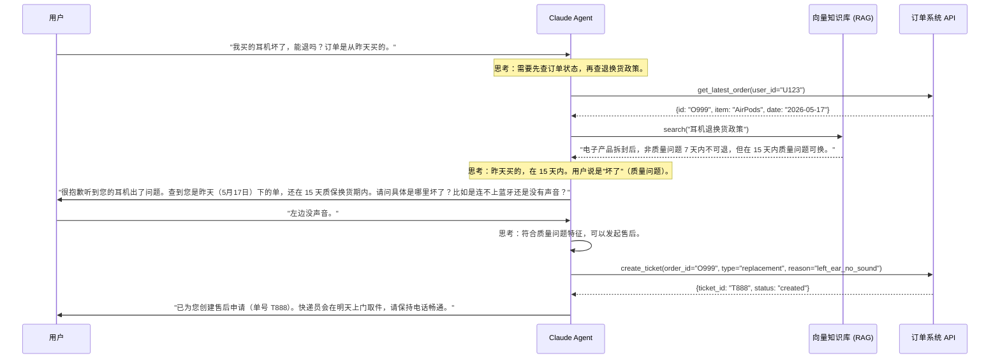
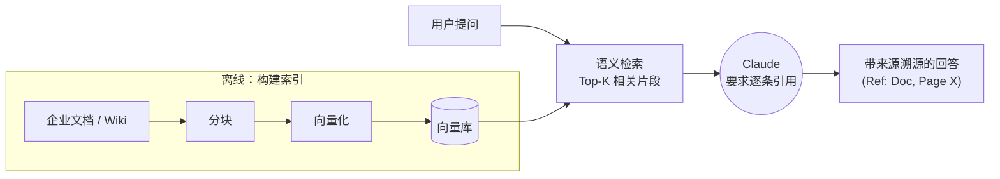

# 第九章 企业级应用案例

本章展示 Claude 在企业场景中的实际应用。

---

## 案例概览

| 案例    | 应用场景    |
| ----- | ------- |
| 智能客服  | 自动化客户服务 |
| 知识库   | 文档处理与检索 |
| 数据分析  | 商业智能辅助  |
| 自动化测试 | QA 流程优化 |

---

## 1. 智能客服系统：从“人工智障”到“金牌销售”

在企业应用中，客服系统往往是 AI 落地的第一站。
但大多数现有的 AI 客服只是简单的关键词匹配，体验极差。基于 Claude 构建的下一代客服 Agent，不仅能回答问题，还能 **解决问题**。

### 1.1 痛点与解决方案

| 传统 Chatbot 痛点 | Claude Agent 解决方案 |
| :--- | :--- |
| **车轱辘话**：反复确认同样的信息。 | **Memory**: 借助 Memory 工具或外部存储记住关键信息，实现跨会话记忆（模型本身并不自带跨会话记忆）。 |
| **答非所问**：只能匹配预设的 FAQ。 | **RAG**: 动态检索最新的知识库（如 PDF 手册、Wiki）。 |
| **只能看不能动**：告诉用户怎么退款，但不能帮用户退。 | **Tool Use**: 直接调用 `refund_api` 帮用户操作。 |
| **没有情商**：语气生硬，不懂安抚。 | **Persona**: 设置高情商 System Prompt，甚至能在合适时候发表情包。 |

### 1.2 架构设计图谱

这是一个经典的 **RAG + Tool Use** 混合架构。



### 1.3 关键实现细节

#### 1. 动态知识库的精细化切片

客户的问题千奇百怪，简单的切片（Chunking）往往不够。
*   **挑战**: 用户问 “红色款掉色吗？”，但手册里写的是 “Scarlet Red 采用阳极氧化工艺”。
*   **优化**:
    *   **元数据增强**: 在存入向量库时，给段落打上 `{"color": ["red", "scarlet"], "issue": ["fading", "durability"]}` 标签。
    *   **查询改写**: 先让 Claude 把 “掉色” 改写为 “耐久性、表面工艺”，再去检索。

#### 2. 权限鉴权与敏感操作

涉及到 “退款”、“改密码” 等敏感操作时，不能仅靠 System Prompt。
*   **方案**:
    *   **Human-in-the-Loop**: 定义工具时，设置 `risk_level: high`。当 Claude 调用此类工具时，后端拦截并向用户前端发送二次确认弹窗。
    *   **参数校验**: 在 Tool Definition 中，`refund_order` 工具必须要求提供 `user_otp`（验证码）。如果用户没提供，Claude 会收到 `MissingParameter` 错误，并自动反问用户索要验证码。

#### 3. 情绪智能与人工接管

AI 不应死磕。
*   **触发条件**:
    1.  **情绪分析**: 每轮对话并行调用一个小模型（如 Haiku）评分 (1-10)。如果愤怒值 > 7，立即触发接管。
    2.  **死循环检测**: 如果 Claude 连续 2 次调用同一个查询工具且参数相同，说明它卡住了。
*   **平滑切换**: Claude 生成一份 `Summary`（摘要），发送给人工客服系统：“用户张三，遇到耳机单侧无声问题，已尝试重置但无效，目前情绪较为激动。” —— 真人客服接手时能直接说：“张先生您好，我看过记录了，别着急...”

### 1.4 真实案例：生产级 System Prompt

一个好的 System Prompt 是客服 Agent 的灵魂。

```xml
<system_prompt>
<role>
你是由 TechGear 及其 AI 实验室开发的高级技术支持专家。你的名字叫 "TG 助手"。
你的目标是高效、专业且富有同理心地解决用户的硬件产品问题。
</role>

<tone_style>
1. **同理心优先**: 永远先安抚用户情绪。例："很抱歉给您带来不便..."
2. **专业简洁**: 不要堆砌技术术语，用通俗易懂的语言解释。
3. **拒绝废话**: 不要每次都说 "我明白了"，直接进入解决步骤。
</tone_style>

<guidelines>
1. **先查后说**: 在回答任何关于订单、物流、政策的问题前，必须先调用工具查询。严禁编造信息。
2. **多步引导**: 如果问题复杂（如排查故障），请一步一步引导用户，不要一次性甩出 10 个步骤。
3. **退款流程**:
   - 必须先通过 `check_eligibility` 检查资格。
   - 如果不符合政策，委婉拒绝并提供替代方案（如维修券）。
</guidelines>

<tools_instruction>
- 使用 `search_kb` 查询产品说明书。
- 使用 `get_order` 查询订单状态。
- 使用 `create_ticket` 创建工单。
- 如果工具返回 Error，请根据 Error Message 调整参数重试，或者询问用户更多信息。
</tools_instruction>
</system_prompt>
```

---

客服只是冰山一角。在企业的后台，有着海量的文档——合同、发票、简历——正在等待被数字化。
下一节将介绍 Claude 如何成为一名不知疲倦的 **文档处理专员**。

➡️ 文档处理与知识库

## 2. 文档处理与知识库

IDP (Intelligent Document Processing) 是企业自动化的“深水区”。
传统 OCR 只能把图片转成文字，但还是非结构化的。Claude 的视觉能力和长文本理解能力，使其能够将非结构化文档转化为 **结构化数据 (JSON)**。

### 2.1 场景案例：非标财务文档抽取

一家投资机构每天收到上百份 PDF 格式的商业计划书 (BP) 和财务报表，格式各异。

#### 传统方案 vs Claude 方案

| 维度 | 传统 OCR + 正则表达式 | Claude Vision + JSON Mode |
| :--- | :--- | :--- |
| **格式适应性** | 极差，换个模板就挂 | 极强，基于语义理解 |
| **表格提取** | 经常错位 | 能完美理解跨页表格 |
| **手写体识别** | 困难 | 极高准确率 |
| **推理能力** | 无（只能提取表面文字） | 有（能计算“同比增长率”） |

### 2.2 实战：复杂财务报表提取

假设我们有一张这种扫描件（图片），里面包含一个复杂的“资产负债表”，甚至有跨页和合并单元格。

#### Input Prompt

> “这张图片是公司的资产负债表。请提取其中的关键财务数据，并验证数据是否平衡（资产 = 负债 + 所有者权益）。如果发现不平衡，请在 `validation_error` 字段中标注。请严格按照以下 JSON Schema 输出。”

#### Output JSON

```json
{
  "company_name": "Future Tech Inc.",
  "report_date": "2025-12-31",
  "currency": "USD",
  "assets": {
    "current_assets": {
      "cash": 5000000,
      "accounts_receivable": 2000000,
      "inventory": 1500000
    },
    "non_current_assets": {
      "property_plant_equipment": 10000000,
      "intangible_assets": 500000
    },
    "total_assets": 19000000
  },
  "liabilities": {
    "current_liabilities": 4000000,
    "long_term_liabilities": 5000000,
    "total_liabilities": 9000000
  },
  "equity": {
    "share_capital": 8000000,
    "retained_earnings": 2000000,
    "total_equity": 10000000
  },
  "validation": {
    "is_balanced": true,
    "calculation": "19000000 = 9000000 + 10000000"
  }
}
```

**Claude 的神奇之处在于**：即使原图中没有显式写出 `total_assets` 的数字，它也能通过计算推导出来；或者如果原图数字有误（扫描模糊导致），它能根据会计恒等式发现并标记。

### 2.3 场景案例：企业知识库的语义增强

很多公司积累了大量的 Wiki，但传统关键词搜索经常搜不到。

RAG（检索增强生成）把企业文档变成可检索的知识库，让 Claude 基于检索到的片段作答并标注来源：



#### 语义搜索与引用溯源

Anthropic API 引入了更精准的 **Citations** 能力（自 2025 年初上线，现行模型均已支持）。在 RAG 系统中，我们要求 Claude 不仅回答，还要告诉我们“你是看哪一行知道的”。

**User Question**: “公司差旅标准里，打车费有限额吗？”

**Claude Response**:
> 根据《员工差旅管理制度 V2.0》第 4 章第 2 条：
> 1. 一般员工在一线城市（北上广深）打车限额为 **150 元/天**。`(Ref: doc_travel_policy.pdf, page 12, para 3)`
> 2. 如果加班至 22:00 以后，通过企业用车平台打车 **不设上限**。`(Ref: doc_travel_policy.pdf, page 12, para 5)`

**技术实现**:
在 System Prompt 中强制要求：`Every claim must be followed by a citation like [Source: Doc Name, Page X].`

### 2.4 最佳实践：Human-in-the-Loop Review

尽管 Claude 很强，但在处理财务数据（Invoice Processing）时，准确率要求是 100%。

**基于置信度的混合工作流**:

1.  **AI 处理**: Claude 提取发票信息，并输出一个 `confidence_score` (0.0 - 1.0)。
2.  **自动分流**:
    *   `score > 0.98`: **直通** -> 自动调用 API 录入 SAP 系统。
    *   `score <= 0.98`: **人工审核** -> 推送到审核人员界面。
3.  **UI 辅助**: 在人工审核界面，使用 bounding box 将 Claude 提取的区域在原图上高亮显示，审核员只需肉眼扫一眼，确认数字无误点击“通过”。这比纯人工录入快 10 倍。（注：Claude 视觉 API 本身不返回像素级坐标；bounding box 通常由 OCR/版面分析层提供，再与 Claude 的抽取结果对齐。）

---

如果说文档处理是把“死数据”变活，那么数据分析就是从“活数据”中挖掘黄金。
Claude 不仅能看懂 Excel，还能自己写 SQL 查数据库，这就是 **Text-to-Insight**。

➡️ 数据分析助手

## 3. 数据分析助手

对于非技术人员（运营、销售、CEO）来说，此时此刻想知道“上周北京地区的复购率是多少”，通常需要给数据分析师提需求，然后等三天。
Claude 赋予了每个人通过自然语言与数据对话的能力。

### 3.1 核心模式：Code Interpreter

Claude 并不直接在大脑里做数学题（容易算错），而是通过 **编写并执行代码** 来分析数据。

#### 实战：CSV 深度分析

**User**: 上传文件 `user_behavior_2025.csv`。
**Questions**: “分析一下用户的留存情况，并画一个同期群分析 (Cohort Analysis) 热力图。”

**Claude Action (Step-by-Step)**:

1.  **Exploration**: 先写代码看前 5 行。
    ```python
    import pandas as pd
    df = pd.read_csv('user_behavior_2025.csv')
    print(df.head())
    print(df.info())
    ```
    *Observation*: 发现 `signup_date` 是字符串，需要转换。

2.  **Analysis**: 编写复杂的 Pandas 逻辑。
    ```python
    # 转换日期格式
    df['signup_date'] = pd.to_datetime(df['signup_date'])
    df['last_active'] = pd.to_datetime(df['last_active'])

    # 计算用户所属的 cohort month
    df['cohort_month'] = df['signup_date'].dt.to_period('M')

    # ... 省略中间的 pivot table 计算逻辑 ...

    # 得到 retention_matrix
    print(retention_matrix)
    ```

3.  **Visualization**: 调用 Plotly 画图。
    ```python
    import plotly.express as px
    fig = px.imshow(retention_matrix,
                    text_auto='.1%',
                    title="User Retention Cohort Analysis")
    fig.write_html("cohort_heatmap.html")
    ```

**Result**: 最终直接返回一个可交互的 HTML 文件给用户。

### 3.2 Text-to-SQL：让非技术人员查库

对于存储在数据库（MySQL, PostgreSQL, Snowflake）中的海量数据，不能把它们都 dump 成 CSV。
这时需要 **Text-to-SQL**。

#### 架构设计与 Self-Correction

一个健壮的 Text-to-SQL 系统必须包含 **错误自愈** 机制。

**Scenario**: 用户查询 “上个月销售额最高的 3 个品类”。

**Round 1 (Fail)**:
*   Claude 生成: `SELECT category, sum(sales) FROM transactions WHERE month(date) = ...`
*   Execution Error: `Function month() does not exist. Did you mean extract(month from date)?`
*   **Claude Thinking**: “啊，这是 Postgres 数据库，不支持 `month()` 函数，我应该用 `EXTRACT` 或者 `DATE_TRUNC`。”

**Round 2 (Success)**:
*   Claude 修正:
    ```sql
    SELECT
        p.category_name,
        SUM(t.amount) as total_sales
    FROM transactions t
    JOIN products p ON t.product_id = p.id
    WHERE t.created_at >= DATE_TRUNC('month', CURRENT_DATE - INTERVAL '1 month')
      AND t.created_at < DATE_TRUNC('month', CURRENT_DATE)
    GROUP BY 1
    ORDER BY 2 DESC
    LIMIT 3;
    ```
*   Result: `["Electronics", 500k], ["Home", 300k], ...`

**Explanation**:
Claude 最后会把结果翻译成人话：“上个月销售额前三的品类是电子产品（50 万）、家居（30 万）...”。

### 3.3 自动可视化

数据分析的尽头是图表。不必手动去 Excel 做图。

**Prompt**:
> “请用一个交互式的 Plotly 散点图展示广告投入(x)与转化率(y)的关系，点的颜色代表地区，点的大小代表销售额。”

Claude 生成的 JSON 配置可以直接注入到前端的 ECharts 或 Plotly.js 中渲染。

### 3.4 真实案例：某电商运营助手

**背景**: 运营每天需要盯盘，发现流量异常。

**Agent 执行逻辑**:
1.  **Schedule**: 每天早 9 点被 Cron Job 唤醒。
2.  **Detection**: 运行 Python 脚本 (`scipy.stats`) 检测昨日流量是否有 > 3 sigma 的波动。
3.  **Drill Down**: 如果发现异常（如 “流量暴跌 40%”），Agent 自动生成 SQL 查询：
    *   “是不是某个渠道挂了？” (Group by Channel)
    *   “是不是安卓端挂了？” (Group by OS)
4.  **Reporting**: 最终生成一份 PDF 简报，通过 Slack 发送给运营总监，并附带一句：“初步排查是 iOS 18.2 版本的转化率异常，建议技术团队跟进。”

---

数据分析需要严谨，软件开发更需要严谨。
AI 写代码很快，但谁来保证它写得对？
这就需要 **AI Testing & QA**。

➡️ 自动化研发流水线与 QA

## 4. 自动化研发流水线与 QA

软件测试与流水线一直是劳动密集型工作。从编写测试用例，到维护自动化脚本，再到手动做 UI 点检。
Claude 的出现，特别是其 **Vision** 和 **Code** 能力的结合，让 QA 行业迎来了变革。

### 4.1 单元测试自动生成

即使团队没有时间写测试，Claude 也可以作为“低成本的测试补充”。

#### 场景：为遗留代码补充测试

**Input Code (Legacy Java)**:
```java
public double calculateShipping(Order order) {
    if (order.getTotal() > 100) return 0;
    if (order.getWeight() > 10) return 20;
    return 10;
}
```

**Prompt**:
> “请为这个方法编写 JUnit 5 测试用例。请确保覆盖所有逻辑分支（100% Branch Coverage），特别是边界条件。”

**Claude Output (JUnit 5)**:
```java
@Test
void testFreeShipping() {
    Order order = new Order(101.0, 5.0); // > 100
    assertEquals(0, calculator.calculateShipping(order));
}

@Test
void testHeavyShipping() {
    Order order = new Order(50.0, 11.0); // <= 100, > 10
    assertEquals(20, calculator.calculateShipping(order));
}

@Test
void testStandardShipping() {
    Order order = new Order(50.0, 9.0); // <= 100, <= 10
    assertEquals(10, calculator.calculateShipping(order));
}

@Test
void testBoundary() {
    Order order = new Order(100.0, 10.0); // 边界值
    assertEquals(10, calculator.calculateShipping(order));
}
```
Claude 精准地识别了 `100` 和 `10` 这两个边界值，并生成了对应的 Assert。

### 4.2 UI 视觉回归测试

这是 Claude Vision 的杀手锏。相比于传统的像素级对比（Pixel Diff），Claude 能够进行 **语义化断言 (Semantic Assertion)**。

#### 场景：响应式布局检查

**Prompt with Image**:
> “这是我们在 iPhone 12 Mini 上的网页截图。请检查：
> 1. ‘立即购买’按钮是否被底部导航栏遮挡？
> 2. 产品标题是否发生了异常换行？”

**Claude Response**:
> **FAIL**:
> 1. ‘立即购买’按钮的下半部分（约 50%）被 TabBar 遮挡，用户难以点击。建议增加 `padding-bottom`。
> 2. 标题显示正常，没有异常换行。

**代码集成 (Playwright + AI SDK)**:
```javascript
test("Check critical layout deterministically", async ({ page }) => {
  await page.goto("/product/123");

  // 硬门禁优先使用 DOM、可访问性和截图 diff 等确定性断言
  const buyButton = page.getByRole("button", { name: "立即购买" });
  await expect(buyButton).toBeVisible();
  await expect(buyButton).toBeInViewport();
});
```

Claude 更适合做语义 triage：解释截图 diff、归类视觉失败原因、生成修复建议。若必须让模型参与自动判断，应要求结构化 JSON、固定 rubric、模型版本、重试策略、人工复核队列和 flake 处理，而不是直接把非确定性 LLM judge 当成唯一 CI 硬断言。

### 4.3 根本原因分析

当 CI 挂了，通常会甩给你几千行的日志。
**Log Analysis Agent** 可以大大缩短 MTTR（平均修复时间）。

**Agent Workflow**:
1.  **Input**: 粘贴 Jenkins 构建失败的 2000 行日志。
2.  **Filter**: Agent 自动忽略 Info/Warn，锁定 `Caused by: java.lang.NoSuchMethodError`。
3.  **Correlate**: Agent 结合 Git API，查看最近 24 小时的提交记录。
4.  **Conclusion**:
    > “构建失败的原因是 `guava` 库依赖冲突。
    > 提交 `feat: update dependencies` (hash: a1b2c3) 将 Guava 从 28.0 升级到了 30.0，删除了 `DirectExecutor` 方法（示意情节，版本细节为虚构）。
    > **建议修复**: 回滚该提交，或修改代码使用新的 Executor API。”

### 4.4 探索性测试

这是 **Computer Use** 的最佳应用场景。
给 Claude 一个新上线的 App（安装包或测试网址），给它一个任务：

> “你是一个挑剔的用户。请试用我们的购物车流程。尝试修改商品数量为负数、超大数、或特殊字符，看看系统是否会崩溃。如果崩溃，请截图报告。”

Claude 会自主操作浏览器，点击输入框，输入 `-100`，点击结算。如果弹出了一个未捕获的异常堆栈页面，它会立即截图并报警：“发现严重 Bug，数量允许输入负数导致后端 500 错误。”

### 4.5 CI/CD 流水线与代码自动化审查

随着生态的延展，AI 除了用于本地研发环节，还能融入团队的核心基础设施，如 GitHub Actions、GitLab CI/CD 环境。

**典型场景：**
1. **自动 PR 审查与 Review**：开发提交 Pull Request 后，流水线触发基于 Claude Code 引擎搭建的自动化工作流，对改动文件进行代码质量与安全薄弱面的多维度预检查。
2. **Issue 分流器与智能工单分配**：对企业内部海量的用户填报工单，Claude 结合其超大上下文能力可以将各类 BUG 通过特征提取归类，自动打入相应标签，甚至是为开发提供详尽的代码排查意见与最小可复现示例（Minimal Reproducible Example）。

---

至此，已经看完了从客服、文档、数据到测试流水线的四大核心场景。
这些案例证明了：**AI 不是玩具，它是生产力。**
但随着 AI 应用规模的扩大，面临着新的问题：**贵**。Token 很贵，延迟很高。如何让 AI 又快又省？

➡️ 第十章：成本优化与性能调优
