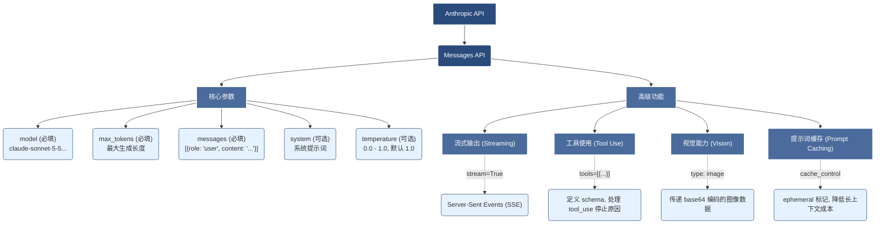
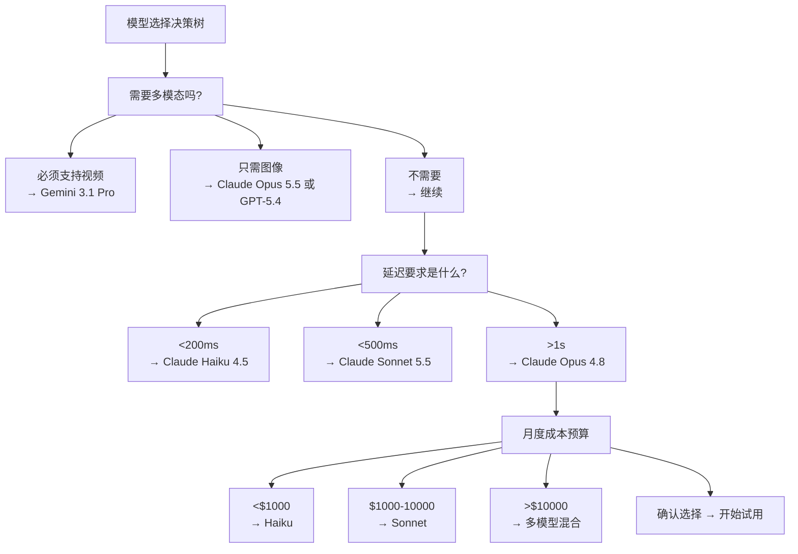
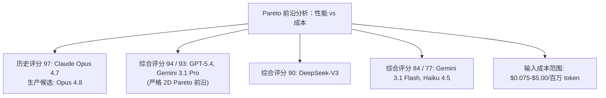

# 第十二章 附录

本章包含 Claude 开发相关的参考资料、常见问题解答和术语表。

---

## 附录 A：API 参考手册

本手册涵盖了 Python SDK 和 TypeScript SDK 的高频用法。
完整的 API 文档请参考 [platform.claude.com/docs](https://platform.claude.com/docs)。

> **版本提示**：模型 ID、上下文窗口、beta header 和工具能力会随 Anthropic 发布节奏变化。生产代码应把模型名和 beta 开关放在配置中，并在升级前按官方文档和回归测试确认。



### 1.1 基础消息

所有交互的核心。

#### Python

```python
import anthropic

client = anthropic.Anthropic() # 自动读取 ANTHROPIC_API_KEY

message = client.messages.create(
    model="claude-sonnet-5-5",
    max_tokens=1024,
    system="You are a helpful assistant.",
    messages=[
        {"role": "user", "content": "Explain quantum computing."}
    ]
)
print("".join(b.text for b in message.content if b.type == "text"))
```

#### TypeScript

```typescript
import Anthropic from '@anthropic-ai/sdk';

const client = new Anthropic();

const message = await client.messages.create({
  model: 'claude-sonnet-5-5',
  max_tokens: 1024,
  messages: [{ role: 'user', content: 'Hello, Claude' }],
});
console.log(
  message.content
    .filter((b): b is Anthropic.TextBlock => b.type === 'text')
    .map((b) => b.text)
    .join(''),
);
```

#### 关键参数说明

*   `model`: 模型 ID。示例模型包括 `claude-sonnet-5-5`、`claude-opus-5-5`、`claude-haiku-4-5-20251001`；Haiku 4.5 也有便捷别名 `claude-haiku-4-5`。实际可用列表以官方模型文档、Models API 和账号权限为准。
*   `max_tokens`: 最多生成多少 Token。**必须指定**。
*   `temperature`: 控制采样随机性的可选参数。`0` 会降低随机性，但不保证完全确定性。Sonnet 5 与 Sonnet 5.5 默认使用 Adaptive Thinking，手动 extended thinking 和非默认采样参数会返回 HTTP 400；迁移时应删除这些参数并按当前 API 文档处理。
*   `system`: 系统提示词。

### 1.2 流式输出

提高首字响应速度 (TTFT)。

#### Python

```python
with client.messages.stream(
    max_tokens=1024,
    messages=[{"role": "user", "content": "Write a long story..."}],
    model="claude-sonnet-5-5",
) as stream:
    for text in stream.text_stream:
        print(text, end="", flush=True)
```

### 1.3 工具使用

#### Tool Definition

```python
tools = [{
    "name": "get_weather",
    "description": "Get current weather",
    "input_schema": {
        "type": "object",
        "properties": {
            "location": {"type": "string"}
        },
        "required": ["location"]
    }
}]
```

#### Handling Tool Calls

```python
response = client.messages.create(
    model="claude-sonnet-5-5",
    max_tokens=1024,
    tools=tools,
    messages=[{"role": "user", "content": "How is weather in Tokyo?"}]
)

if response.stop_reason == "tool_use":
    tool_results = []
    for block in response.content:
        if block.type != "tool_use":
            continue
        # ... 根据 block.name / block.input 执行工具逻辑 ...
        tool_results.append({
            "type": "tool_result",
            "tool_use_id": block.id,
            "content": "...工具执行结果..."
        })

    messages = [
        {"role": "user", "content": "How is weather in Tokyo?"},
        {"role": "assistant", "content": response.content},
        {"role": "user", "content": tool_results},
    ]
```

### 1.4 图像理解

支持 JPEG, PNG, GIF, WEBP。单张图片建议压缩在 5MB 以内。

```python
import base64

with open("image.jpg", "rb") as image_file:
    image_data = base64.b64encode(image_file.read()).decode("utf-8")

message = client.messages.create(
    model="claude-sonnet-5-5",
    max_tokens=1024,
    messages=[
        {
            "role": "user",
            "content": [
                {
                    "type": "image",
                    "source": {
                        "type": "base64",
                        "media_type": "image/jpeg",
                        "data": image_data,
                    },
                },
                {"type": "text", "text": "Describe this image."}
            ],
        }
    ],
)
```

### 1.5 提示缓存

提示缓存已正式发布（GA），无需额外的 beta header，直接在内容块中添加 `cache_control` 即可。

```python
system_message = [
    {
        "type": "text",
        "text": "Huge context text...",
        "cache_control": {"type": "ephemeral"} # 标记缓存点
    }
]
```

### 1.6 错误代码对照表

| Error Code | 含义 | 解决方案 |
| :--- | :--- | :--- |
| `400 invalid_request_error` | 参数错误 | 检查 JSON Schema 或 Token 限制。 |
| `401 authentication_error` | 鉴权失败 | 检查 API Key 是否正确/过期。 |
| `403 permission_error` | 权限不足 | 检查账号是否被封禁或地区限制。 |
| `429 rate_limit_error` | 速率限制 | 实现指数退避重试 (Exponential Backoff)。 |
| `500 api_error` | 服务器错误 | Anthropic 侧故障，稍后重试。 |
| `529 overloaded_error` | 负载过高 | 临时繁忙，稍后重试。 |

### 1.7 可执行 Messages API 参考

`examples/messages_api.py` 将请求构造与传输函数分离，可用 fake transport 离线验证 Messages schema、文本块拼接与 `stop_reason: "refusal"` 分支。安装锁定依赖后直接运行该文件，真实凭据只通过 SDK 默认环境配置读取。

## 附录 B：常见问题解答

整理自 Anthropic 开发者社区和 Discord 的高频问题。

### 2.1 模型能力与选择

#### Q: Claude Sonnet 5.5 和 Opus 到底该选谁？

**A**:
*   90% 的场景：**选 Sonnet**。它比 Opus 档（当前为 Opus 5.5）输出速度快约 2 倍、价格约为 Opus 的一半（Sonnet 5.5 $2/$10 对 Opus 5.5 $4/$20），速度-质量平衡最好（“Sonnet 编程更强”是 Sonnet 4.5 对比 Opus 4.1 时代的旧结论——自 Opus 4.7/4.8 起，Opus 档在编程基准上重回领先）。
*   10% 的场景：**选 Opus**。包括高难度长程编程任务、极度复杂的创意写作、边缘 Case 处理，或者当发现 Sonnet 无论如何都无法遵循某个极其复杂的长指令时。

#### Q: Claude 可以联网吗？

**A**:
*   模型本身（Base Model）是离线的，训练数据截止至某个时间点。
*   但通过 **Tool Use**，可以给它挂载官方 Web Search / Web Fetch 或自定义搜索工具，此时它可以访问实时网页内容。Claude.ai 与 API 的可用工具和计费方式不同，应按对应产品文档核对。

#### Q: Claude 会训练我的数据吗？

**A**:
*   **API / Team / Enterprise（商业产品）**: 默认不会。这是商业承诺。
*   **消费级订阅（Free / Pro / Max）**: 是否用于改进 Claude 取决于用户是否允许相关设置和产品条款；处理敏感数据前，应在账号设置与官方隐私说明中确认当前状态。

### 2.2 调试与优化

#### Q: 为什么 Claude 总是拒绝我的请求？

**A**:
可能是触发了 Constitutional AI 的安全边界。
*   **误判？**: 尝试给它更多合法 Context。例如，不要只说“写一个攻击脚本”，而是说明防御教学目标、授权边界、隔离实验环境和期望的安全输出范围。
*   **不要绕过安全拒答**: Prefill 不应作为绕过安全边界的技巧；在新模型上它也不再可用。正确做法是重写任务，使其明确落在授权、防御、教学或合规场景内。

#### Q: 为什么 Claude 甚至连简单的算术题都做错？

**A**:
LLM 是基于概率预测下一个 Token 的，它本质上不擅长计算。
*   **解决方案**: 不要让它心算。给它一个 `Calculator` 工具，或者要求它写 Python 代码来计算。

#### Q: 如何解决 “Output Cutoff”（输出中断）？

**A**:
*   原因：达到了 `max_tokens` 限制。
*   **解决方案**:
    1.  调用 API 时调大 `max_tokens`。
    2.  如果已经最大，将用户的 `Continue` 作为下一轮 User Message 发送，它会接着写。

### 2.3 Tool Use 常见问题

#### Q: 为什么 Claude 总是填错 JSON 参数？

**A**:
*   你的 JSON Schema `description` 写得不够清楚。
*   把枚举值（Enum）明确写在 Schema 里。
*   在 System Prompt 中添加几个 Few-Shot Examples。

#### Q: Tool Use 是串行还是并行的？

**A**:
Claude 支持 **Parallel Tool Use**。它可以一次性生成多个工具调用请求（比如同时查询 3 个城市的天气），需要并发执行这些请求并将结果一次性回传。

### 2.4 计费与限流

#### Q: 遇到 429 Rate Limit 怎么办？

**A**:
*   **先查当前限制**: 在 Console 的 Limits 页面或 Rate Limits API 中核对组织、workspace、模型和 endpoint 的 RPM / ITPM / OTPM 限制。不要把某个历史充值金额写成固定升级规则。
*   **指数退避**: 代码必须实现 `Exponential Backoff` 重试逻辑，并区分瞬时速率限制、月度使用限制和合同配额不足。

#### Q: Prompt Caching 为什么没生效？

**A**:
*   确保 `cache_control` 参数位置正确。
*   确保前缀完全一致（哪怕差一个空格也会导致 Cache Miss）。
*   缓存必须“热”才能生效。如果请求间隔超过 5 分钟，缓存可能已被清理。

### 2.5 其他

#### Q: Claude 支持微调吗？

**A**:
Anthropic 对微调的支持比较谨慎，主要针对特定的企业大客户开放。对于大多数用户，**Prompt Engineering + RAG** 通常能达到微调 90% 的效果且维护成本更低。

#### Q: 什么是 “Prompt Generator（提示词生成器）”？

**A**:
Anthropic 在 Console 里提供的一项功能，可以帮你自动生成高质量的 Prompt 模板。在 Console 里输入简单任务描述，它会输出一个结构清晰、包含 XML 标签的复杂 Prompt。详见 2.7 节《工具化调试》。

## 附录 C：术语表

本表收录了本书中出现的核心术语，按首字母排序。

> 💡 **术语翻译规范**：本书采用“中文翻译（英文原文, 缩写）”的格式。首次出现时使用完整格式，后续可使用中文或缩写。例如：“思维链 (Chain of Thought, CoT)”。

### 3.1 A

*   **Agent（智能体）**: 一个拥有规划能力、记忆能力和工具使用能力的 AI 系统，能够自主完成复杂任务。
*   **Anthropic**: Claude 背后的 AI 研究公司，由前 OpenAI 员工创立，强调 AI 安全性。
*   **Artifacts（工件）**: Claude 在对话中生成的可独立预览和编辑的内容块，如代码、图表、React 组件等。
*   **Attention Mechanism（注意力机制）**: Transformer 模型的核心，决定了模型在生成当前词时应该关注上下文中的哪些部分。

### 3.2 C

*   **Chain of Thought（CoT, 思维链）**: 一种 Prompt 技巧，要求模型在给出最终答案前，先输出推理步骤（如 “Let's think step by step”）。
*   **Claude Code**: Anthropic 提供的命令行工具 (CLI)，具有 Agent 能力，能直接操作文件系统和终端。
*   **Computer Use**: Claude 3.5 引入的能力，允许模型通过视觉识别屏幕并通过模拟键鼠操作计算机。
*   **Constitutional AI（CAI, 宪法式 AI）**: Anthropic 的训练方法，利用 AI 反馈（RLAIF）而非纯人类反馈，训练模型遵循一套明确的“宪法”原则。
*   **Context Window（上下文窗口）**: 模型一次能“看见”的最大 Token 数量（如 Opus 5.5、Sonnet 5.5、Fable 5.1、Opus 5、Sonnet 5、Fable 5 和 Opus 4.8/4.7/4.6 的 1M；Sonnet 4.6 为迁移兼容性基线；Haiku 4.5/Sonnet 4.5 为 200K）。包含 Input + Output。

### 3.3 E

*   **Embedding（嵌入）**: 将文本转化为高维向量的过程。语义相似的文本在向量空间距离更近。
*   **Extended Thinking**: Claude 在处理复杂任务时的一种模式，模型在给出最终回答前先生成显式的思考块（System 2 Thinking）以提高准确率。思考内容在 API 响应中可见（新模型以摘要形式呈现）且按输出 Token 计费，并非不可见的“后台”推理。

### 3.4 F

*   **Fable 5 (Claude Fable 5)**: 2026-06-09 GA 的新一代模型（$10/$50、1M 上下文、128K 输出、Adaptive Thinking 常开）。6 月 12 日暂停后于 2026-07-01 恢复全球访问；2026-07-01 公告称 Mythos 5 当时恢复给一组美国机构。当前 Mythos 5 非普遍可用，仅向 Project Glasswing 获批客户有限开放，采用邀请制且无自助注册。
*   **Few-Shot Learning（少样本学习）**: 在 Prompt 中提供少量的示例（Input-Output Pairs）来教会模型执行特定任务。
*   **Fine-tuning（微调）**: 在预训练模型的基础上，使用特定数据集进行进一步训练，以适应特定领域。

### 3.5 H

*   **Haiku**: Claude 模型家族中最轻量、最快、最经济的系列。最新版本为 Claude Haiku 4.5。
*   **Hallucination（幻觉）**: LLM 生成看似通顺但实际上错误或编造的信息的现象。
*   **Human-in-the-Loop (HITL)**: 在自动化流程中引入人工审核或干预环节，通常用于高风险操作。

### 3.6 L

*   **Latency（延迟）**: 需区分两个口径：**TTFT**（从发送请求到收到第一个 Token 的时间，决定“开始响应”的体感）与**端到端延迟**（TTFT 加上整个生成过程的耗时）。流式输出主要改善的是前者。
*   **LLM (Large Language Model)**: 大语言模型。

### 3.7 M

*   **MCP (Model Context Protocol)**: 一个开放标准协议，用于连接 AI 模型与数据源/工具。类似于 AI 界的 USB-C。
*   **Multi-Agent System (MAS)**: 多智能体系统，由多个分工明确的 Agent 协作完成任务。

### 3.8 O

*   **Opus**: Claude 4.x 家族中能力最强的系列，擅长复杂推理与高难度工程任务。当前 Opus 档型号为 Claude Opus 5.5（2026-09-22 发布，Opus 5 与 Opus 4.8/4.7/4.6 转入 Legacy models）；Fable 5 已于 2026-07-01 恢复全球访问，Sonnet 5 则是当前 Sonnet 档迁移目标。

### 3.9 P

*   **Prefill（预填）**: 在 API 请求中，预先填入 Assistant 回复的开头部分（如 `{ "role": "assistant", "content": "{" }`），让旧模型按特定格式续写。该能力不再适用于 Claude Opus 5、Sonnet 5、Fable 5、Mythos 5、Mythos Preview、Opus 4.8、Opus 4.7、Opus 4.6，以及作为迁移兼容性基线的 Sonnet 4.6；新项目应优先使用 Structured Outputs。
*   **Prompt Caching**: 一种通过缓存 Prompt 前缀的 KV 状态来降低延迟和成本的技术。
*   **Prompt Injection（提示词注入）**: 一种攻击手段，通过特殊的输入诱导模型忽略安全限制或执行恶意指令。

### 3.10 R

*   **RAG (Retrieval-Augmented Generation)**: 检索增强生成。先从知识库检索相关信息，再喂给 LLM 生成回答，用于解决幻觉和知识过时问题。
*   **ReAct**: “Reason + Act” 的缩写，一种 Agent 设计模式，循环执行“思考-行动-观察”。
*   **RLAIF (Reinforcement Learning from AI Feedback)**: 基于 AI 反馈的强化学习，Constitutional AI 的核心技术。
*   **RLHF (Reinforcement Learning from Human Feedback)**: 基于人类反馈的强化学习。

### 3.11 S

*   **Skills（技能）**: Claude 的模块化专业知识封装，包含 Prompt、工具和文档的集合，用于特定领域任务。
*   **Sonnet**: Claude 模型系列中平衡性最好的模型，性价比高，是大多数企业应用的首选。
*   **Structured Output**: 要求模型输出 JSON、XML 等结构化数据，而非自然语言。
*   **System Prompt**: 发送给模型的第一条指令，定义了模型的角色、风格和边界。

### 3.12 T

*   **Temperature**: 控制采样随机性的参数。较低值会降低随机性，但不保证完全确定性；部分新模型对非默认采样参数有更严格限制。
*   **Token**: LLM 处理文本的最小计费单位。
*   **Tool Use (Function Calling)**: 模型输出特定格式的请求来调用外部函数的能力。

### 3.13 V

*   **Vector Database（向量数据库）**: 专门用于存储 Embedding 向量的数据库，支持语义搜索。

### 3.14 Z

*   **Zero-Shot**: 不提供任何示例，直接让模型执行任务。

## 附录 D：优质资源清单

一份精选的资源列表，帮助你持续学习。

### 4.1 官方文档

最权威的信息来源，建议加入书签。

*   **Claude Platform Console**: [platform.claude.com](https://platform.claude.com/)
    *   管理 API Key，查看用量，使用 Workbench 调试 Prompt。
*   **API Documentation**: [platform.claude.com/docs](https://platform.claude.com/docs)
    *   包含所有最新的参数说明和 SDK 用法。
*   **Claude Blog**: [anthropic.com/news](https://www.anthropic.com/news)
    *   产品发布、最佳实践和案例分享。
*   **Model Context Protocol (MCP)**: [modelcontextprotocol.io](https://modelcontextprotocol.io)
    *   MCP 的协议规范、SDK 和官方 Server 列表。
*   **Agent Skills (API)**: [platform.claude.com/docs/en/build-with-claude/skills-guide](https://platform.claude.com/docs/en/build-with-claude/skills-guide)
    *   在 Claude API 中使用 Agent Skills 的官方文档。
*   **Claude Code Skills**: [code.claude.com/docs/en/skills](https://code.claude.com/docs/en/skills)
    *   在 Claude Code 中创建、管理和共享 Skills 的官方文档。
*   **Skills 示例仓库**: [github.com/anthropics/skills](https://github.com/anthropics/skills)
    *   官方 Skills 模板和示例（docx, brand-guidelines, frontend-design 等）。
*   **Claude Partner Network / Partner Hub**: [claude.com/partners](https://claude.com/partners)
    *   查找服务伙伴、认证团队和企业实施资源时使用；伙伴层级、认证状态和可用服务以官网为准。
*   **Cookbook**: [github.com/anthropics/claude-cookbooks](https://github.com/anthropics/claude-cookbooks)
    *   包含大量 Jupyter Notebook 示例代码（如 RAG, Agent, Vision 等）。

### 4.2 社区与开源项目

*   **LangChain**: [langchain.com](https://www.langchain.com)
    *   最流行的 LLM 编排框架，对 Claude 支持极好。
*   **LlamaIndex**: [llamaindex.ai](https://www.llamaindex.ai)
    *   专注于数据连接（Data Ingestion）和 RAG 的框架。
*   **Cursor**: [cursor.com](https://cursor.com)
    *   集成了 Claude 的 AI Native 代码编辑器。
*   **Cline (Prev. Claude Dev)**: [github.com/cline/cline](https://github.com/cline/cline)
    *   最强的开源 VS Code Agent 插件。

### 4.3 必读论文

若需深入理解原理：

*   **[Constitutional AI: Harmlessness from AI Feedback](https://arxiv.org/abs/2212.08073)**
    *   Anthropic 的立身之本，详细阐述了 CAI 训练方法。
*   **[Sleeper Agents: Training Deceptive LLMs that Persist Through Safety Training](https://arxiv.org/abs/2401.05566)**
    *   关于 AI 安全的前沿研究，探讨了后门攻击的持久性。
*   **[Scaling Laws for Neural Language Models](https://arxiv.org/abs/2001.08361)**
    *   早期的经典论文，解释了为什么模型越大越聪明。
*   **[Many-Shot In-Context Learning](https://arxiv.org/abs/2404.11018)**
    *   Google DeepMind（Agarwal et al., 2024），证明了 Many-Shot 上下文学习在部分任务上可媲美监督微调。

### 4.4 博客与资讯

*   **Anthropic Research Blog**: [anthropic.com/research](https://www.anthropic.com/research)
    *   第一时间发布新模型和安全研究成果。
*   **Simon Willison's Weblog**: [simonwillison.net](https://simonwillison.net)
    *   AI 领域的知名博主，经常分享关于 Claude 和 Prompt Injection 的深度分析。
*   **Ethan Mollick (One Useful Thing)**: [oneusefulthing.org](https://www.oneusefulthing.org)
    *   探讨 AI 对教育和工作的社会影响。
*   **Thariq - Lessons from Building Claude Code**: [x.com/trq212/status/2027463795355095314](https://x.com/trq212/status/2027463795355095314)
    *   Claude Code 团队成员分享的工具设计与 Agent 架构实战经验，包括工具结构化频谱、Task 系统演进等一手洞察。

### 4.5 常用工具

*   **Tiktokenizer**: [tiktokenizer.vercel.app](https://tiktokenizer.vercel.app)
    *   可视化 Token 计算器（注意 Claude 使用自有 BPE tokenizer，与 OpenAI 的 `cl100k_base` 不同；建议直接用 Anthropic SDK 的 `count_tokens` API 进行精确估算）。
*   **Mermaid Live Editor**: [mermaid.live](https://mermaid.live)
    *   本书中大量流程图都是用 Mermaid 画的，本网站可以在线编辑预览。

## 附录 E：Claude 定价与成本参考

> **免责声明**：AI 模型定价调整频繁，本文档数据仅供参考。本附录针对 API 按 Token 计费的预算，做预算决策时，**必须** 以 [Anthropic 官方 API 定价文档](https://platform.claude.com/docs/en/about-claude/pricing) 为准（与附录 G 的定价权威入口一致）；批处理、缓存、数据驻留和托管平台价格也需要按官方文档或合同条款单独确认。

---

### 5.1 计费模式概览

Claude API 主要采用 **Pay-as-you-go（按用量付费）** 模式，计费单位为 **每百万 Token (Per Million Tokens, PMT)**。

#### 核心计费项

1.  **输入 Token (Input Tokens)**：你发送给模型的文字、图片、文档。
2.  **输出 Token (Output Tokens)**：模型生成的回复内容。通常输出 Token 的单价远高于输入 Token（约为 3-5 倍）。
3.  **提示缓存写入 (Prompt Caching Write)**：将常用 Context 存入缓存时的费用（通常比普通输入略贵）。
4.  **提示缓存读取 (Prompt Caching Read)**：复用缓存内容时的费用（通常只有普通输入的 10% 甚至更低，这是 **省钱的关键**）。

---

### 5.2 模型定价参考表

| 模型系列 | 输入 (Input) / PMT | 输出 (Output) / PMT | 缓存读取 (Read) / PMT | 适用场景 |
| :--- | :--- | :--- | :--- | :--- |
| **Claude Sonnet 5.5** | $2.00 | $10.00 | $0.20 | 通用主力（2026-09-28 发布）；单价低于 Sonnet 4.6 的 $3.00/$15.00 |
| **Claude Sonnet 5（Legacy）** | $2.00 | $10.00 | $0.20 | 既有系统可沿用；新项目改用 Sonnet 5.5 |
| **Claude Fable 5.1** | $10.00 | $50.00 | $0.25 | 当前 Fable 档型号（2026-09-01 发布）；高风险任务仍需评估分类器拒绝与回退 |
| **Claude Fable 5（Legacy）** | $10.00 | $50.00 | $1.00 | 2026-07-01 恢复全球访问；2026-09-01 起由 Fable 5.1 接替 |
| **Claude Haiku 4.5** | $1.00 | $5.00 | $0.10 | 高并发日志分析、简单分类、翻译 |
| **Claude Sonnet 4.6（兼容性基线）** | $3.00 | $15.00 | $0.30 | 仅用于既有系统迁移、回归对比或回退预案 |
| **Claude Opus 5.5** | $4.00 | $20.00 | $0.20 | 当前 Opus 档型号（2026-09-22 发布）；复杂代理式编码与企业级任务的默认起点 |
| **Claude Opus 5（Legacy）** | $5.00 | $25.00 | $0.50 | 2026-09-22 起由 Opus 5.5 接替 |
| **Claude Opus 4.8（Legacy）** | $5.00 | $25.00 | $0.50 | 最复杂研究、长程代理式编码、高自治任务 |
| **Claude Opus 4.7** | $5.00 | $25.00 | $0.50 | 软件工程、复杂代码库分析、系统设计; 新 tokenizer 导致实际消耗 1.00-1.35 倍 token* |
| **Claude Opus 4.6** | $5.00 | $25.00 | $0.50 | 极端复杂的创意写作、科研推理 |

> 💡 **提示**（来源：Anthropic models/pricing、What's new in Opus 5、Sonnet 5 release notes）：Sonnet 5 的 $2/$10 已是标准价——发布时公布的同价介绍期原本到 2026-08-31 为止，但官方已取消原定 2026-09-01 上调至 $3/$15 的计划，预算不必再保留涨价情景。Opus 5.5 的单价 $4/$20 低于 Opus 5 与 Opus 4.8/4.7/4.6 的 $5/$25，缓存读取只按基础输入的 5% 计（$0.20/PMT），5m / 1h 缓存写入为 $5 / $8；它的 Fast mode（研究预览）按 $8/$40 计费，Opus 5 的 Fast mode 为 $10/$50，两者都仅在 Claude API 上提供。$5/$25 这一档的 Opus 型号 5m 缓存写入为 $6.25/PMT，1h 缓存写入为 $10/PMT，缓存读取为 $0.50/PMT。Fable 5 已恢复全球访问，其 5m 写入/$12.50、1h 写入/$20、读取/$1.00 仍按官方价格表复核。Sonnet 5 新 tokenizer 对同一文本约增加 30% token，不能只比较每 token 单价。
>
> *Opus 5.5（2026-09-22 发布）是当前 Opus 档型号，Opus 5 与 Opus 4.8/4.7/4.6 已转入官方 Legacy models 分组，仍可调用；Opus 4.7 的 SWE-bench Verified 87.6% 和 GPQA Diamond 94.2% 是该版本发布时的历史指标。*

---

### 5.3 成本估算示例

#### 场景 A：代码审查助手

*   **任务**：每天审查 100 次代码提交，每次提交平均 2000 Tokens（输入），模型回复 500 Tokens（输出）。
*   **模型**：Claude Sonnet 5.5
*   **计算**：
    *   输入日成本：100 * 2000 / 1,000,000 * $2.00 = $0.40
    *   输出日成本：100 * 500 / 1,000,000 * $10.00 = $0.50
    *   **每日总计**：$0.90
    *   **每月总计**：~$27.00（30 天）

#### 场景 B：海量文档归档：使用 Haiku + Caching

*   **任务**：分析 1000 份合同，每份合同 50k Tokens。其中 40k Tokens 是通用的法律条款模板（可缓存）。
*   **模型**：Claude Haiku 4.5
*   **计算（未缓存）**：1000 * 50k / 1m * $1.00 = $50.00
*   **计算（使用缓存）**：
    *   缓存写入（1 次）：40k / 1m * $1.25（假设写入价）= $0.05
    *   缓存读取（999 次）：999 * 40k / 1m * $0.10 ≈ $4.00
    *   差异内容（1000 次）：1000 * 10k / 1m * $1.00 = $10.00
    *   **总计**：~$14.05（**节省约 70%**）

## 附录 F：Claude 与竞品对比——全面的选择指南

### 前言

选择合适的 LLM 是每个 AI 应用开发者面临的重要决策。本章从多个维度系统地对比 Claude 与主要竞品，包括 OpenAI 的 GPT 系列、Google 的 Gemini 系列和其他新兴模型，帮助你做出明智的选择。

> **来源与使用边界**：Claude 模型名称、上下文窗口、thinking 支持和定价应以 Anthropic 官方模型页、定价页和发布说明为准；其他厂商的模型名称、价格和 benchmark 需要在发布前分别回到对应厂商的官方页面核验。下文中的跨厂商评分和性价比指数用于展示选型分析方法，不应直接作为采购或生产路由依据。

> **关于当前口径**：Fable 5 已于 2026-07-01 恢复全球访问；Mythos 5 非普遍可用，仅向 Project Glasswing 获批客户有限开放，采用邀请制且无自助注册。新项目先评测 Sonnet 5.5（`claude-sonnet-5-5`）；Sonnet 4.6 与 Sonnet 5 只作为既有系统灰度迁移与回退基线。下方历史对比表不是生产路由，实际采购必须回到官方模型/价格页和自己的评测集。

### 第一节 市场概览与主要竞品

#### 1. 当前主要的 LLM 产品线

主要的 LLM 产品包括：

| 厂商 | 模型系列 | 当前最新版本 | 发布时间 |
|-----|--------|-----------|--------|
| Anthropic | Claude | Fable 5.1；Opus 5.5；Sonnet 5.5；Haiku 4.5 | 2026-09 快照 |
| OpenAI | GPT | GPT-6 Astra / GPT-6.1 Sol / GPT-6 Luna（GPT-6 Astra 于 2026-09-03 首发） | 2026-09 |
| Google | Gemini | 3.1 Pro | 2026-02 |
| Meta | Llama | 4 Scout / 4 Maverick | 2025-04 |
| Mistral | Mistral | Medium 3.5（128B，Modified MIT open weights） | 2026-05 |
| xAI | Grok | 4.1（Grok 4 于 2025-07 首发） | 2025-11 |

注：本对比重点关注 Claude、GPT、Gemini 等主流商业 LLM。由于竞品版本、价格和公开评测变化很快，表格中的非 Claude 条目只作为分析模板；实际选型应把最新官方价格页、模型卡和你自己的业务评估集作为最终依据。下文各对比表的 GPT 列停留在 GPT-5.4／GPT-5.5 一代的快照；OpenAI 已于 2026-07-09 发布 GPT-5.6 Sol / Terra / Luna，2026-09 又发布 GPT-6 Astra、GPT-6.1 Sol 与 GPT-6 Luna，这两代都未纳入下表，最新对比需读者按官方 Pricing 页重新核验。

### 第二节 多维度详细对比

#### 0. 成本-性能量化对比矩阵

本表展示成本-性能对标方法，适合做内部评估模板；不适合在未逐项核验官方价格、模型 ID、benchmark 口径和日期前直接用于生产路由或采购决策。

| 维度 | Claude Haiku 4.5 | Claude Sonnet 4.6 | Claude Opus 4.7 | GPT-5.4 | Gemini 3.1 Pro | DeepSeek-V3 |
|-----|-----------------|-----------------|-----------------|-------------|---------------|------------|
| **定价（输入/输出）** | $1.00/$5.00 | $3.00/$15.00 | $5.00/$25.00* | $2.50/$15.00 | $2.00/$12.00（<200K 输入档）| $0.27/$1.10 |
| **上下文长度** | 200K token | 1M token | 1M token | 1M token | 1M token | 128K token |
| **推理延迟** | ~100ms | ~300-400ms | ~1-2s | ~250-450ms | ~150-300ms | ~200-300ms |
| **性价比指数** | 10.0 | 8.5 | 5.5 | 8.8 | 9.0 | 11.0 |
| **推理能力(MATH)** | 71% | 89% | 96% | 92% | 89% | 90% |
| **编程能力(HE)** | 77% | 92% | 97% | 94% | 93% | 88% |
| **常识理解(MMLU)** | 82% | 95% | 98% | 96% | 96% | 92% |

**性价比指数**：本书给出的 1-11 定性相对评分，综合能力、成本与生态成熟度，仅用于本表内示意排序（并非由上表数值按公式直接折算——按“能力分 ÷ 成本”线性折算会得到量纲悬殊的结果）。

*Opus 4.7 使用新 tokenizer，同一文本可能消耗 1.00–1.35 倍 token，实际成本可能高于单价所示。

成本计算基础：标准任务（输入 500token，输出 200token）

#### 1. 推理能力对比

**基准测试数据（示例模板，发布前需逐项核验来源与日期）**

| 基准 | Claude Sonnet 4.6 | GPT-5.4 | Gemini 3.1 Pro | 说明 |
|-----|-----------|-----------|--------------|-----|
| MATH | 89.2% | 92.1% | 89.1% | 数学问题求解 |
| MMLU | 95.1% | 96.3% | 95.9% | 多任务知识理解 |
| HumanEval | 92.3% | 94.5% | 93.0% | 编程能力 |
| ARC-Challenge | 94.2% | 95.8% | 94.5% | 科学推理 |
| HellaSwag | 96.1% | 96.7% | 96.2% | 常识推理 |

**核心观察**

GPT-5.4 在数学、编程和知识理解等基准上均以微弱优势领先，主要来自：

- 与同代旗舰相当的知识截止日期（2025-08）
- 卓越的推理和编程能力
- API 定价 $2.5 / $15 per M tokens（输入价低于 Sonnet 4.6，输出持平）

Claude Sonnet 4.6 的优势在于：

- 改进的推理架构和更好的问题分解能力
- 更强的安全对齐和可预测行为
- 完善的缓存和批处理成本优化工具链

Gemini 3.1 Pro 的特色：

- 优秀的多模态能力
- 实时网络搜索集成
- 对视频理解的支持
- 1M token 级长上下文窗口

#### 2. 编程能力对比

这是对开发者最相关的维度。

**语言支持**

| 编程语言 | Claude Sonnet 4.6 | GPT-5.4 | Gemini 3.1 |
|---------|-----------|-----------|-----------|
| Python | 95% | 96% | 90% |
| JavaScript/TypeScript | 94% | 95% | 91% |
| Java | 91% | 92% | 87% |
| C++ | 88% | 90% | 84% |
| Rust | 85% | 87% | 79% |
| Go | 87% | 88% | 83% |
| SQL | 93% | 94% | 89% |

注：数据基于 HumanEval 风格的代码生成测试

**代码生成质量**

```python
# 测试案例：实现一个 LRU 缓存

# 要求：O(1) 时间复杂度的 LRU 缓存

class LRUCache:
    """Claude Sonnet 4.6 生成的代码（注：此实现使用 list，实际复杂度为 O(n)）"""

    def __init__(self, capacity: int):
        self.capacity = capacity
        self.cache = {}
        self.order = []  # 追踪访问顺序

    def get(self, key: int) -> int:
        if key not in self.cache:
            return -1

        # 更新访问顺序
        self.order.remove(key)
        self.order.append(key)

        return self.cache[key]

    def put(self, key: int, value: int) -> None:
        if key in self.cache:
            self.order.remove(key)

        if len(self.cache) == self.capacity and key not in self.cache:
            oldest = self.order.pop(0)
            del self.cache[oldest]

        self.cache[key] = value
        self.order.append(key)
```

**生成代码的特点对比**

| 特性 | Claude Sonnet 4.6 | GPT-5.4 | Gemini 3.1 |
|-----|-----------|-----------|-----------|
| 正确性 | 92% | 94% | 85% |
| 可运行性 | 95% | 96% | 87% |
| 最佳实践 | 89% | 92% | 82% |
| 包含注释 | 94% | 95% | 85% |
| 错误处理 | 87% | 90% | 79% |
| 性能考虑 | 82% | 88% | 74% |

#### 3. 多模态能力对比

**图像理解**

| 能力 | Claude Sonnet 4.6 | GPT-5.4 | Gemini 3.1 Pro |
|-----|-----------|--------|---------------|
| 物体识别 | 96% | 96% | 94% |
| 文字识别 (OCR) | 94% | 94% | 92% |
| 图表理解 | 91% | 91% | 87% |
| 科学图像分析 | 88% | 88% | 84% |
| 幻觉率 | 1.3% | 1.2% | 1.6% |

**视频理解**

| 能力 | Claude Sonnet 4.6 | GPT-5.4 | Gemini 3.1 Pro |
|-----|-----------|--------|---------------|
| 视频摘要 | 可通过图像序列/片段工作流实现 | 原生支持，能力较强 | 原生视频理解能力更强 |
| 动作识别 | 适合中短片段分析 | 适合中长片段分析 | 对长视频更有优势 |
| 时序理解 | 依赖工作流设计 | 较强 | 更强 |
| 音频转录 | 通常需外部链路 | 视产品形态而定 | 视产品形态而定 |

#### 4. 知识与时效性

| 维度 | Claude Opus 4.7 | Claude Sonnet 4.6 | GPT-5.4 | Gemini 3.1 Pro |
|-----|-----------|-----------|-------------|--------------|
| 可靠知识截止 | 2026-01 | 2025-08 | 2025-08 | 2025-01 |
| 训练数据截止 | 2026-01 | 2026-01 | 2026-01 | 2026-02 |
| 实时网络搜索 | 通过工具 | 通过工具 | 通过工具/API | 原生支持 |
| 幻觉率 | 1.2% | 1.3% | 1.1% | 1.6% |
| 事实准确率 | 95.1% | 94.7% | 95.4% | 93.8% |

#### 5. 安全性与可靠性

**宪法式 AI（Constitutional AI）**

Claude 的 Constitutional AI 是独特的：

- Anthropic 公开发布的 CAI 论文和方法
- 通过一套明确的“宪法”来指导模型行为
- 透明的对齐过程

优势：
- 更可预测的行为
- 可定制的价值对齐
- 更好的社区理解和信任

**对抗鲁棒性**

| 攻击类型 | Claude Sonnet 4.6 防御 | GPT-5.4 防御 | Gemini 3.1 防御 |
|---------|---------------|-----------|--------------|
| 越狱提示 | 很强 | 很强 | 强 |
| 有害内容生成 | 拒绝率 98% | 98% | 96% |
| 隐私敏感信息 | 很强 | 很强 | 强 |
| 注入攻击 | 很强 | 很强 | 强 |

#### 6. 成本对比（2025–2026 年）

**基础定价**

| 模型 | 输入成本 | 输出成本 | 缓存写入 | 缓存读取 | 相对成本 |
|-----|--------|--------|--------|--------|--------|
| Claude Haiku 4.5 | $1.00/M | $5/M | $1.25/M | $0.10/M | 最低 |
| Claude Sonnet 4.6 | $3/M | $15/M | $3.75/M | $0.30/M | 低 |
| GPT-5.4 mini | $0.75/M | $4.50/M | N/A | N/A | 极低 |
| Claude Opus 4.7 | $5/M | $25/M | $6.25/M | $0.50/M | 中* |
| Gemini 3.1 Pro | $2/M | $12/M | N/A | N/A | 中 |
| GPT-5.4 | $2.50/M | $15/M | N/A | N/A | 中-低 |
| GPT-5.5 | $5/M | $30/M | N/A | N/A | 中-高 |
| GPT-5.5-pro | $30/M | $180/M | N/A | N/A | 极高 |

**成本-性能比**

假设一个标准的数据分析任务（输入 500 token，输出 200 token）：

| 模型 | 单次成本 | 每月 1000 个请求 | 相对成本 |
|-----|--------|----------------|--------|
| Haiku | $0.0015 | $1.50 | 最低 |
| Sonnet | $0.0045 | $4.50 | 低 |
| Gemini 3.1 Pro | $0.0034 | $3.40 | 低 |
| GPT-5.4 mini | $0.00128 | $1.28 | 极低 |
| GPT-5.4 | $0.00425 | $4.25 | 低-中 |
| GPT-5.5 | $0.0085 | $8.50 | 中-高 |
| GPT-5.5-pro | $0.051 | $51.00 | 极高 |
| Opus 4.7 | $0.0075 | $7.50 | 中 |

**容量和速率限制**

| 限制 | Claude | GPT-5.4 | Gemini 3.1 |
|-----|--------|--------|-----------|
| 并发请求数 | 10K+ | 10-50K | 10K+ |
| 每分钟请求数 | 按用量层级分级（RPM/ITPM/OTPM，见 12.2 FAQ） | 500-2000* | 1000 |
| 月度 token 限制 | 取决于计划 | 取决于计划 | 取决于计划 |

*对于付费用户；Claude API 各层级具体数值见官方 rate limits 页

### 第三节 使用场景决策指南

#### 1. 选择矩阵

```text
基于需求的模型选择

需求 1: 推理复杂度
  ├─ 非常高 (论文分析、数学证明)
  │  └─ Claude Opus 5.5 ✓
  ├─ 高 (数据分析、架构设计)
  │  └─ Claude Sonnet 5.5 或 GPT-5.4
  └─ 中等及以下
     └─ Claude Haiku 4.5 或 Gemini 3.1 Pro

需求 2: 多模态能力
  ├─ 视频处理必须支持
  │  └─ Gemini 3.1 Pro ✓
  ├─ 高质量图像理解
  │  └─ Claude Opus 5.5 或 GPT-5.4
  └─ 基础图像理解足够
     └─ 任何模型可选

需求 3: 成本敏感度
  ├─ 非常敏感 (大规模部署)
  │  └─ Claude Haiku 4.5 ✓
  ├─ 中等敏感 (性价比重要)
  │  └─ Claude Sonnet 5.5 或 Gemini 3.1 Pro
  └─ 成本不是主要考虑
     └─ 选择最高性能的

需求 4: 延迟要求
  ├─ <200ms (实时应用)
  │  └─ Claude Haiku 4.5 ✓
  ├─ <500ms (交互应用)
  │  └─ Claude Sonnet 5.5
  └─ >1 秒可接受
     └─ Claude Opus 5.5
```

#### 2. 具体场景推荐

**场景 1：实时客服系统**

需求：
- 低延迟（<200ms）
- 高吞吐（QPS >100）
- 成本敏感

推荐：**Claude Haiku 4.5**

```python
# 配置示例
client = Anthropic()
response = client.messages.create(
    model="claude-haiku-4-5-20251001",  # 最快最便宜
    max_tokens=500,
    messages=[{"role": "user", "content": query}]
)
```

成本：每个请求约 $0.001-0.003
延迟：平均 100-150ms

**场景 2：内容生成平台**

需求：
- 高质量输出
- 中等延迟可接受
- 成本-质量平衡

推荐：**Claude Sonnet 5.5**。既有 Sonnet 4.6 系统在完成业务评测、token 重计数和成本回归前保持原路由。

```python
# 配置示例
response = client.messages.create(
    model="claude-sonnet-5-5",
    max_tokens=2000,
    system="You are a creative writing expert...",
    messages=[{"role": "user", "content": prompt}]
)
```

成本：按 Sonnet 5.5 的实际 token 数与当前价格计算；新 tokenizer 不能沿用 Sonnet 4.6 的 token 估算
质量：以内容平台自己的人工盲评和任务成功率为准
应用：博客生成、广告文案、创意写作

**场景 3：数据分析与报告生成**

需求：
- 最高准确率（数据驱动决策）
- 延迟可以接受
- 复杂推理

推荐：**Claude Opus 5.5 + Adaptive Thinking**

```python
# 配置示例
response = client.messages.create(
    model="claude-opus-5-5",
    max_tokens=16000,
    thinking={
        "type": "adaptive"
    },
    messages=[{"role": "user", "content": analysis_request}]
)
```

成本：每个请求 $0.10-0.30
准确率：98%+ 数据处理正确性
应用：财务分析、科学研究、商业智能

**场景 4：多模态内容处理**

需求：
- 处理图像、截图或 PDF 文档
- 高准确率
- 实时处理优先

推荐：如果任务主要是图片、截图、图表或文档理解，可以优先评估 Claude Vision / multimodal PDF；如果任务核心是长视频理解，再单独评估明确支持视频的模型。

```python
import anthropic
import base64
from pathlib import Path

client = anthropic.Anthropic()
image_base64 = base64.b64encode(Path("chart.jpg").read_bytes()).decode("utf-8")

response = client.messages.create(
    model="claude-opus-5-5",
    max_tokens=1000,
    messages=[
        {
            "role": "user",
            "content": [
                {
                    "type": "image",
                    "source": {
                        "type": "base64",
                        "media_type": "image/jpeg",
                        "data": image_base64
                    }
                },
                {"type": "text", "text": "Describe this chart and cite visible evidence."}
            ]
        }
    ]
)
```

**场景 5：代码生成与开发**

需求：
- 高代码质量
- 多语言支持
- 最佳实践

推荐：**Claude Sonnet 5.5**。既有 Sonnet 4.6 代码链路只在灰度迁移和回退期间保留。

特点：
- 在项目自己的代码评测集上比较正确性、可运行性和维护成本
- 重新测量新 tokenizer 带来的 token、延迟和 `max_tokens` 变化
- 默认 Adaptive Thinking；移除手动 thinking budget 和非默认 sampling 参数

```python
# 代码生成示例
response = client.messages.create(
    model="claude-sonnet-5-5",
    max_tokens=2000,
    system="""You are an expert software architect.
    Generate clean, well-structured code with:
    - Type hints
    - Error handling
    - Unit tests
    - Documentation
    """,
    messages=[{"role": "user", "content": requirement}]
)
```

**场景 6：研究与学术应用**

需求：
- 论文分析和总结
- 文献综述生成
- 假设验证

推荐：新项目评测 **Claude Sonnet 5.5** 或 **GPT-5.4**；既有 Sonnet 4.6 仅作为迁移基线。

| 历史快照对比维度 | Claude Sonnet 4.6 | GPT-5.4 |
|---------|-----------|-----------|
| 数学推理 | 89.2% | 92.1% |
| 论文理解 | 优秀 | 优秀 |
| 知识截止 | 2025-08 | 2025-08 |
| 幻觉率 | 1.3% | 1.1% |

**场景 7：实时 API 与集成**

需求：
- 高可用性
- 低延迟
- 可靠性高

推荐：**Claude Haiku 4.5**（主要）+**Claude Sonnet 5.5**（关键请求候选）。既有 Sonnet 4.6 仅用于灰度迁移与回退。

```python
# 多层级路由策略
def select_model(priority: str) -> str:
    if priority == "critical":
        return "claude-sonnet-5-5"  # 关键请求先经业务评测
    else:
        return "claude-haiku-4-5-20251001"   # 更快更便宜
```

### 第四节 迁移指南

#### 1. 从 GPT-5.4 迁移到 Claude

**相似的概念映射**

| GPT-5.4 概念 | Claude 等价物 |
|-----------|-------------|
| System message | System prompt |
| Function calling | Tools |
| GPT-5.4 Vision | Vision capabilities |
| Embeddings API |（需要第三方）|
| Fine-tuning |（不普遍开放，仅特定企业客户，见 12.2 FAQ）|

**API 差异**

```python
# GPT-5.4 风格
from openai import OpenAI

client = OpenAI()
response = client.chat.completions.create(
    model="gpt-5.4",
    messages=[{"role": "user", "content": "Hello"}]
)

# Claude 风格
import anthropic

client = anthropic.Anthropic()
response = client.messages.create(
    model="claude-opus-5-5",
    messages=[{"role": "user", "content": "Hello"}],
    max_tokens=1000
)
```

注：上例 OpenAI 侧使用 Chat Completions 接口（`client.chat.completions.create`），它仍受官方支持、也是存量代码中最常见的写法，便于与 Claude 的 `messages` 参数逐项对照；但 OpenAI 现行主推的是 Responses API（`client.responses.create(model="gpt-5.4", input=...)`），新项目应优先使用后者。

**逐步迁移策略**

1. **第一阶段**：在非关键应用中进行 A/B 测试
2. **第二阶段**：监控性能和成本指标
3. **第三阶段**：针对特定用例优化提示
4. **第四阶段**：完全迁移或混合策略

```python
# A/B 测试框架
def ab_test_models(query: str, traffic_split: float = 0.5) -> dict:
    import random

    if random.random() < traffic_split:
        # 测试 Claude
        response = claude_client.messages.create(
            model="claude-sonnet-5-5",
            max_tokens=1000,
            messages=[{"role": "user", "content": query}]
        )
        return {"model": "claude", "response": response}
    else:
        # 保持 GPT-5.4
        response = openai_client.chat.completions.create(
            model="gpt-5.4",
            messages=[{"role": "user", "content": query}]
        )
        return {"model": "gpt5", "response": response}
```

#### 2. 成本迁移影响分析

假设当前使用 GPT-5.4 的应用：

**场景：每月 1000 万个请求**

```text
当前成本（GPT-5.4）:
  输入: 1000 万 × 500 token × $2.50/M = $12,500
  输出: 1000 万 × 200 token × $15/M = $30,000
  总计: $42,500/月

迁移后成本（Claude Sonnet 5.5）:
  输入: 1000 万 × 500 token × $2/M = $10,000
  输出: 1000 万 × 200 token × $10/M = $20,000
  总计: $30,000/月

  注意：500/200 必须是 Sonnet 5.5 重新计数后的平均 token，不能复用 Sonnet 4.6 的统计

或迁移至 GPT-5.4 mini 以降低成本:
  输入: 1000 万 × 500 token × $0.75/M = $3,750
  输出: 1000 万 × 200 token × $4.50/M = $9,000
  总计: $12,750/月

节省: $29,750/月 (70% 成本降低)
```

### 第五节 总结与决策框架

#### 1. 快速决策流程



#### 2. 选择决策表

| 需求 | Claude | GPT-5.4 | Gemini |
|-----|--------|--------|--------|
| 最低成本 | ✓✓✓ | ✗ | ✓✓ |
| 最快速度 | ✓✓✓ | ✗ | ✓✓ |
| 最高质量 | ✓✓✓ | ✓✓ | ✓✓ |
| 多模态 | ✓✓ | ✓✓ | ✓✓✓ |
| 编程能力 | ✓✓✓ | ✓✓ | ✓✓ |
| 推理能力 | ✓✓✓ | ✓✓ | ✓✓ |
| 社区生态 | ✓✓ | ✓✓✓ | ✓ |
| 安全性 | ✓✓✓ | ✓✓ | ✓✓ |

#### 3. 成本-性能 Pareto 前沿分析

在选择模型时，我们需要在 **成本** 和 **性能** 之间找到最优平衡点。Pareto 前沿分析帮助识别哪些模型在这个权衡中最具有价值。

#### Pareto 前沿的定义

**Pareto 前沿** 是一组“没有其他模型既更便宜又更强”的模型。在这条曲线上的任何选择都代表某种权衡的最优点。



#### 历史快照严格 2D Pareto 前沿与实用候选

基于历史输入成本和综合性能评分（MATH + HE + MMLU 的平均值），以下区分当时的严格 2D Pareto 前沿模型与生态内实用候选。若只看“更便宜且更高分”两个维度，Sonnet 4.6 不在严格前沿上；它在本表中的位置仅用于解释历史评估方法，不是当前新项目推荐。新项目应另行评测 Sonnet 5.5；既有 Sonnet 4.6 系统按迁移清单灰度升级。当前 Opus 选型应评测 Opus 5.5，不能把历史 4.7 分数当作新型号的官方 benchmark。

| 模型 | 输入成本 ($/M) | 综合评分 (%) | 推荐场景 | 位置 |
|------|---------------|-----------|---------|------|
| **Claude Haiku 4.5** | $1.00 | 77 | 实时应用、成本极限 | 左下角（极限便宜） |
| **Gemini 3.1 Flash** | $0.075 | 84 | 轻量应用、多模态 | 极低成本 |
| **GPT-5.4** | $2.50 | 94 | 编程与推理、知识时效 | 中偏左（高性价比） |
| **Claude Sonnet 4.6（历史快照）**| $3.00 | 92 | 当时的 Claude 生态通用候选 | 实用候选（非严格 2D 前沿） |
| **Gemini 3.1 Pro** | $2.00 | 93 | 多模态优先 | 中偏右（成本优化） |
| **Claude Opus 4.7（历史快照）** | $5.00 | 97 | 历史 benchmark 参考；新选型评估 Opus 4.8 | 右上角（历史最高性能） |

**不在 Pareto 前沿上的模型**（更好的替代品存在）：

- Llama 4 ($0.50/M, 78%): Haiku ($1/M, 77%) 功能更完整，成本相近 ✗
- Gemini 2.5 Pro（旧版本）: 已被 Gemini 3.1 Pro ($2/M, 93%) 在性能和功能上全面超越 ✗
- 已停用模型: GPT-4 Turbo ($10/M, 86%): 被 Sonnet ($3/M, 92%) 击败 ✗

#### 成本结构的详细分析

不同模型在不同缓存和批处理场景下的真实成本差异：

**基础场景：标准对话（无缓存，无批处理）**

```text
单次请求成本（输入 500 token + 输出 200 token）

Haiku:        ($1 × 500 + $5 × 200) / 1M = $0.0015
Sonnet 5.5:     ($2 × 500 + $10 × 200) / 1M = $0.0030
Sonnet 4.6:   ($3 × 500 + $15 × 200) / 1M = $0.0045
Opus 4.8:     ($5 × 500 + $25 × 200) / 1M = $0.0075
GPT-5.4:      ($2.50 × 500 + $15 × 200) / 1M = $0.00425
GPT-5.4 mini: ($0.75 × 500 + $4.50 × 200) / 1M = $0.00128
Gemini 3.1:   ($2 × 500 + $12 × 200) / 1M = $0.0034
```

**使用 5 分钟缓存（10000 token 长上下文）**

```text
场景：第 1 次写入 + 后续 5 次读取

Haiku:
  写入: 10000 × 1.25 × $1/M = $0.0125
  读取: 5 × 10000 × 0.1 × $1/M = $0.0050
  小计: $0.0175 (平均每次 $0.00292)

Sonnet 5.5:
  写入: 10000 × 1.25 × $2/M = $0.0250
  读取: 5 × 10000 × 0.1 × $2/M = $0.0100
  小计: $0.0350 (平均每次 $0.00583)

Opus 4.8:
  写入: 10000 × 1.25 × $5/M = $0.0625
  读取: 5 × 10000 × 0.1 × $5/M = $0.0250
  小计: $0.0875 (平均每次 $0.01458)
```

**使用 Batch API（50% 折扣，但需要 24 小时延迟）**

```text
批处理 1000 个请求

Haiku:
  基础成本: 1000 × $0.0015 = $1.50
  批处理折扣: $1.50 × 0.5 = $0.75

Sonnet 5.5:
  基础成本: 1000 × $0.0030 = $3.00
  批处理折扣: $3.00 × 0.5 = $1.50

Opus 4.8:
  基础成本: 1000 × $0.0075 = $7.50
  批处理折扣: $7.50 × 0.5 = $3.75
```

#### 选择框架：按预算和性能需求

```mermaid
graph TD
    A["预算分段决策树"]

    B["预算 ≤ $100/月"]
    B1["优先级: 成本 > 性能"]
    B2["推荐: Claude Haiku 4.5"]
    B3["用途: 实时客服、内容审核、基础分类"]
    B4["吞吐: 100K-1M 请求/月"]

    C["预算 $100-$1000/月"]
    C1["优先级: 成本 ≈ 性能"]
    C2["推荐: Claude Sonnet 5.5"]
    C3["用途: 通用应用、内容生成、代码助手"]
    C4["吞吐: 20K-100K 请求/月"]

    D["预算 $1000-$5000/月"]
    D1["优先级: 性能 > 成本"]
    D2["推荐: Sonnet 5.5 + 少量 Opus 5.5"]
    D3["用途: 混合工作流"]
    D4["吞吐: 5K-20K 请求/月"]

    E["预算 > $5000/月"]
    E1["优先级: 性能 >> 成本"]
    E2["推荐: Claude Opus 5.5"]
    E3["用途: 研究、金融分析、医学诊断"]
    E4["吞吐: <5K 请求/月"]

    A --> B
    B --> B1 & B2 & B3 & B4
    A --> C
    C --> C1 & C2 & C3 & C4
    A --> D
    D --> D1 & D2 & D3 & D4
    A --> E
    E --> E1 & E2 & E3 & E4
```



#### 缓存和批处理的成本优化

**何时启用缓存**

```python
def should_use_cache(num_requests: int, context_size_tokens: int,
                     time_window_minutes: int = 60) -> bool:
    """
    判断是否应该使用缓存

    对于 N 个请求、context_size tokens 的场景：
    - 5分钟缓存临界点：N > 1.28（舍入到 2）
    - 1小时缓存临界点：N > 2.11（舍入到 3）

    注：临界点只取决于请求次数（缓存写/读价格与上下文大小同比例缩放，
    context_size_tokens 在公式中约去），保留该参数仅为接口完整性。
    """

    if time_window_minutes == 5:
        return num_requests >= 2
    elif time_window_minutes == 60:
        return num_requests >= 3
    else:
        # 一般规则：平均每分钟 >0.05 个请求
        requests_per_minute = num_requests / time_window_minutes
        return requests_per_minute > 0.05


# 应用示例
should_cache_1 = should_use_cache(5, 10000, 5)     # True (5 >= 2)
should_cache_2 = should_use_cache(2, 10000, 60)    # False (2 < 3)
should_cache_3 = should_use_cache(50, 10000, 60)   # True (50 >= 3)
```

**何时启用 Batch API**

```python
def should_use_batch_api(num_requests: int, urgency: str = "normal") -> bool:
    """
    判断是否应该使用 Batch API

    - Batch API: 50% 折扣，24 小时延迟
    - 适用于后台任务、离线处理
    """

    if urgency == "realtime":
        return False  # 实时任务不适合

    # 经验规则：>100 个请求时，批处理的 50% 折扣超过了批队列等待的价值
    return num_requests >= 100


# 应用示例
use_batch_1 = should_use_batch_api(50, "realtime")    # False
use_batch_2 = should_use_batch_api(500, "offline")    # True
use_batch_3 = should_use_batch_api(1000, "normal")    # True
```

#### Pareto 前沿边界的数学定义

一个模型 M1 被认为在 Pareto 前沿上，当且仅当不存在另一个模型 M2 同时满足：

```text
cost(M2) ≤ cost(M1)  AND  performance(M2) ≥ performance(M1)
（至少有一个不等号是严格小于/大于）
```

使用历史快照数据验证：

```text
Claude Sonnet 4.6 ($3/M, 92%)：
├─ vs Haiku ($1/M, 77%): Sonnet 更贵但性能更强 → 都在前沿上 ✓
├─ vs Opus 档历史快照 ($5/M, 97%): Sonnet 更便宜但性能更弱 → 都在前沿上 ✓
├─ vs GPT-5.4 ($2.50/M, 94%): GPT-5.4 更便宜且性能更高 → Sonnet 被支配 ✗
└─ vs Gemini 3.1 Pro ($2/M, 93%): Gemini 更便宜且性能更高 → Sonnet 被支配 ✗

严格 2D Pareto 分析：Sonnet 4.6 不在前沿上（被 GPT-5.4 支配）。
但实际选型需考虑更多维度：Sonnet 拥有成熟的缓存/批处理工具链、
更强的安全对齐、更好的中文支持，以及与 Claude 生态的无缝集成。
这些维度解释了 Sonnet 4.6 在该历史快照中的实用候选位置；当前新项目应评测 Sonnet 5.5，既有 Sonnet 4.6 只在灰度迁移与回退期间保留。
```

#### 4. 推荐使用原则

1. **新项目先评测 Claude Sonnet 5.5**：既有 Sonnet 4.6 系统按迁移清单灰度升级，不用“适应 80%”这类无来源比例替代业务评测
2. **成本极限选 Haiku 4.5**：降低成本 70%，性能下降 15%，Pareto 前沿左端
3. **超高质量选 Opus 5.5**：当前 Opus 档型号，成本较高，适合最难任务
4. **多模态优先 Gemini 3.1 Pro**：视频理解与搜索整合强，1M 上下文，成本相对较低
5. **混合策略最优**：
   - 高频日常任务用 Haiku（70% 流量）
   - 关键任务用 Sonnet 5.5（25% 流量；既有 Sonnet 4.6 仅用于灰度迁移与回退）
   - 超高精度用 Opus 5.5（5% 流量）

---

本章提供的 Pareto 前沿分析和决策框架应该能帮助你在众多选择中找到最适合的模型。关键洞察：没有绝对的“最好”模型，只有最适合你的 **成本-性能权衡点**。记住，Pareto 前沿上的任何模型都是合理选择，取决于你的具体预算和性能优先级。

## 附录 G：快变事实核验表

> `verified_at`: 2026-10-04 · `expires_at`: 2026-11-03 · `ttl_days`: 30

本表是 Claude 模型、API、价格、迁移和安全行为的唯一快变事实入口。超过 30 天未复核时，项目检查失败；正文与本表冲突时，必须先按官方来源更新本表。

<!-- volatile-status: id=claude-models status=current -->
<!-- volatile-status: id=fable-mythos-access status=resolved-conflict -->
<!-- volatile-status: id=pricing status=current -->
<!-- volatile-status: id=thinking-migration status=current -->
<!-- volatile-status: id=prompt-caching status=current -->
<!-- volatile-status: id=refusals status=current -->

| 类别 | 当前维护口径 | 权威入口 | 编辑要求 |
| --- | --- | --- | --- |
| Claude 模型与可用性 | 官方模型总览当前列出 **Fable 5.1、Opus 5.5、Sonnet 5.5 与 Haiku 4.5**。**Claude Opus 5.5**（`claude-opus-5-5`，2026-09-22 发布）是官方“不确定选哪个时的起点”，1M 上下文、128K 最大输出；**Claude Sonnet 5.5**（`claude-sonnet-5-5`，2026-09-28 发布）1M 上下文、128K 最大输出；**Fable 5.1**（`claude-fable-5-1`，2026-09-01 发布，官方定位“demanding reasoning and long-horizon agentic work”）是需要最高能力上限时的选择。**Fable 5、Opus 5（`claude-opus-5`）、Sonnet 5（`claude-sonnet-5`）与 Opus 4.8/4.7/4.6/4.5、Sonnet 4.6 都在 Legacy models 区**（仍可调用，但官方建议迁移）；Sonnet 4.5 已于 2026-09-30 宣布弃用，2026-11-30 在 Claude API 上退役。Fable 5 已于 2026-07-01 恢复全球访问。缓存命中价：Fable 5.1 与 Mythos 5.1 为基础输入的 2.5%，Opus 5.5 为 5%，其余型号为 10%。Mythos 5 非普遍可用，Mythos 5.1 同样只向 Project Glasswing 获批客户有限开放，采用邀请制且无自助注册。本书教程代码统一使用 `claude-sonnet-5-5` 与 `claude-opus-5-5`，按块类型读取回复，不使用强制工具调用；`claude-sonnet-5` 与 `claude-opus-5` 只出现在 Legacy 与历史条目中。 | [Claude Models](https://platform.claude.com/docs/en/models/overview), [Release notes](https://platform.claude.com/docs/en/release-notes/overview), [What's new in Opus 5.5](https://platform.claude.com/docs/en/models/opus-5-5/whats-new-opus-5-5), [What's new in Sonnet 5.5](https://platform.claude.com/docs/en/models/sonnet-5-5/whats-new-sonnet-5-5), [Model deprecations](https://platform.claude.com/docs/en/about-claude/model-deprecations) | 模型 ID、平台范围和生命周期必须按用途复核；不使用无日期“最新/最强”表述。 |
| Claude 定价 | Opus 5.5 为 $4 / $20 每百万输入/输出 token，低于 Opus 5 与 Opus 4.8 的 $5 / $25；Opus 5.5 的 5m / 1h 缓存写入为 $5 / $8，缓存读取 $0.20。Fast mode 仍是研究预览，**仅在 Claude API（第一方）上提供**：Opus 5.5 按 $8 / $40，Opus 5 与 Opus 4.8 按 $10 / $50。Sonnet 5.5 与 Sonnet 5 同为 $2 / $10，缓存与 batch 价也相同；Sonnet 5 发布时公布的介绍期原定到 2026-08-31 为止，但官方已取消原定 2026-09-01 上调至 $3/$15 的计划，该价现为标准价。其他输入、输出、缓存、batch 与长上下文价格以官方 pricing 页为准。 | [Claude Pricing](https://platform.claude.com/docs/en/about-claude/pricing), [What's new in Opus 5.5](https://platform.claude.com/docs/en/models/opus-5-5/whats-new-opus-5-5) | 任何成本表必须写核验日期与币种；官方撤销过的涨价预告不得继续作为未来情景保留。 |
| Thinking 与迁移 | **Opus 5.5 的 thinking 常开、不可关闭**：`thinking: {type: "disabled"}` 与手动 `type: "enabled"` 都返回 400，思考深度只用 `effort` 控制，且**默认 `effort` 为 `medium`**（Opus 5 及之前为 `high`）。**Sonnet 5.5 的 adaptive thinking 默认开启**，`disabled` 返回 400，关闭动手前的思考改用 `thinking: {type: "between_tools"}`（只在 `effort` 为 `high` 及以下时接受）；它的 tokenizer 与 Sonnet 5 相同。Fable 5.1、Opus 5.5 与 Sonnet 5.5 都不支持强制工具调用（`tool_choice` 为 `any` 或 `tool` 返回 400），需要符合 schema 的工具参数时改用 strict tool use；在 Claude API 与 Google Cloud 上，Opus 5.5 与 Sonnet 5.5 的 computer use 只接受 `computer_toolset_20260801`。Legacy 的 **Opus 5 thinking 默认开启**，`disabled` 只在 `effort` 为 `high` 及以下时接受；Sonnet 5 的 adaptive thinking 默认开启，可显式关闭。从 Sonnet 4.6 或 Opus 4.8 迁移时，手动 `type: "enabled"` 与非默认 sampling 参数返回 400，新 tokenizer 对同一文本约增加 30% token，必须重新计数并检查 `max_tokens`。 | [Migration guide](https://platform.claude.com/docs/en/about-claude/models/migration-guide), [Effort](https://platform.claude.com/docs/en/build-with-claude/effort), [Adaptive thinking](https://platform.claude.com/docs/en/build-with-claude/thinking-steering-and-cost) | 从 Sonnet 5 / Opus 5 迁到 5.5 时审计所有关闭 thinking、强制工具调用与 computer use 的调用点，并重新做 effort 与成本回归；从 Sonnet 4.6 或 Opus 4.8 迁移时另需移除手动 budget 与非默认 sampling 参数。 |
| Prompt Caching | 默认 TTL 为 5 分钟；1 小时缓存需显式 `"ttl": "1h"`。混合 TTL 时，1 小时断点必须位于 5 分钟断点之前。最小可缓存前缀按模型不同：Fable 5.1、Mythos 5.1、Opus 5.5、Opus 5、Sonnet 5.5、Fable 5 与 Mythos 5 为 512 token，Opus 4.8、Sonnet 5 与 Sonnet 4.6 为 1,024 token，Opus 4.7 为 2,048 token，Opus 4.6、Opus 4.5 与 Haiku 4.5 为 4,096 token。 | [Prompt caching](https://platform.claude.com/docs/en/build-with-claude/prompt-caching) | 缓存写入、读取、最小前缀和平台差异都按模型页/价格页复核。 |
| Refusal | 带安全分类器的模型（Fable 5.1、Opus 5.5、Sonnet 5.5 等）拒绝时返回 HTTP 200 正常响应，应用必须按 `stop_reason: "refusal"` 分支；`stop_details` 会给出类别，但 `category` 与 `explanation` 可以为 `null`，不得靠错误码或解释文本识别。2026-09-24 起，在任何输出之前发生、类别为 `bio`、`frontier_llm` 或 `reasoning_extraction` 的拒绝重新计费。 | [Refusals and fallback](https://platform.claude.com/docs/en/build-with-claude/refusals-and-fallback) | 丢弃拒绝前的不完整输出；记录拒绝指标，必要时按官方回退机制切到不同模型。 |
| Claude Code / Agent SDK | CLI、hooks、output styles、permissions、Agent SDK 以 Claude Code docs 为准。 | [Claude Code Docs](https://code.claude.com/docs/), [Agent SDK](https://code.claude.com/docs/en/agent-sdk/overview) | beta / preview 功能必须说明平台和可用范围。 |
| 伙伴与认证 | Claude Partner Network、Partner Hub、伙伴层级、认证人数和服务伙伴状态以官方伙伴页为准。 | [Claude Partners](https://claude.com/partners) | 不把 tier 门槛、折扣、晋降级周期或认证数量写成永久事实。 |
| 数据隐私 | API 数据留存、训练使用、enterprise policy 以官方隐私和数据留存文档为准。 | [API and data retention](https://platform.claude.com/docs/en/manage-claude/api-and-data-retention) | 不用单一数字概括所有产品线留存策略。 |
| 竞品对比 | OpenAI、Gemini、Mistral、DeepSeek 等只作为 dated snapshot。 | 各厂商官方模型和价格页 | benchmark 与价格不得无来源横向硬比。 |
