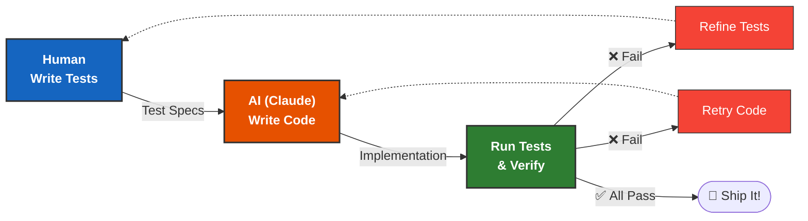

# 第十四章 全书总结

## 第一章 认识 Claude

本章揭开了 Claude 神秘的面纱。不仅了解了它的历史，更深入剖析了它的“性格”和“本领”。

### 核心知识点回顾

#### 价值观决定高度

Anthropic 独特的“公益”基因和 **Constitutional AI** 技术，赋予了 Claude 安全、可控、低幻觉的核心特质。这使得它在企业级应用中拥有无可比拟的信任优势。

#### 三剑客体系

我们不再只有一种选择，而是可以根据需求灵活配置：
*   **Opus（史诗）**：追求极致智能和完美表达，不惜成本（适合科研、创意）。
*   **Sonnet（十四行诗）**：版本答案，速度与智能的完美平衡（适合编程、Agent）。
*   **Haiku（俳句）**：唯快不破，极致性价比（适合高并发、简单任务）。

#### 六边形战士

Claude 早已超越了“聊天机器人”的范畴。
*   它能 **看**（Vision）：读懂图表和 UI。
*   它能 **写**（Text/Code）：部分 Opus / Sonnet 模型支持 1M token（百万 token）上下文窗口，轻量模型以官方模型页为准。
*   它能 **动**（Tools/Computer Use）：联网搜索、查询数据库、甚至直接操作你的鼠标和键盘。
*   它能 **进化**（Skills）：通过加载技能包迅速适应特定岗位。

#### 决策智慧

没有最好的模型，只有最合适的模型。
*   **刚开始开发？** 无脑选 Sonnet。
*   **为了省钱？** 尝试用 Haiku 替换简单的部分。
*   **为了效果？** 在关键节点引入 Opus。
*   **还是太贵？** 优化 Prompt，或使用 Prompt Caching（提示缓存）。

### 假如你只能记住一句话

> **Claude 是一个拥有不同“智商/速度”档位（Opus/Sonnet/Haiku，2026-06 起另有更高能力档的新一代 Fable 5，但其可用性需核验），并且装配了“眼睛”（视觉）和“双手”（工具/电脑操作）的智能协作伙伴，而不仅仅是一段生成文本的代码。**

### 下一步计划

拥有了这把“瑞士军刀”，接下来最重要的问题是：**如何正确地挥舞它？**

不管是写代码、写文章还是做分析，输出质量的 80% 取决于你如何向 Claude 提问。下一章，我们将深入探讨 **Prompt Engineering（提示工程）** 的艺术与科学，教你如何像“指令大师”一样驾驭 Claude。

➡️ [第二章：提示工程核心技术](../02_prompt/README.md)

---

> 📝 **发现错误或有改进建议？** 欢迎提交 [Issue](https://github.com/yeasy/claude_guide/issues) 或 [PR](https://github.com/yeasy/claude_guide/pulls)。

## 第二章 提示工程核心技术

提示工程（Prompt Engineering）并非魔法咒语，它是现代 AI 开发的基础语法。当你通过本章的学习，从“随便问问”进化到“结构化指令”时，你实际上已经完成了从用户到开发者视角的转变。

### 核心知识点回顾

#### 三大基石：Clear, Direct, Specific

所有高级技巧都建立在清晰的表达之上。
*   **消除歧义**：不要让 AI 猜。
*   **肯定指令**：告诉它做什么，而不是不做什么。
*   **具体语境**：像给新员工派活一样交代背景。

#### 结构化思维

*   **物理隔离**：用 `<tag>` 把指令和数据分开。
*   **语义锚点**：XML 标签是 Claude 最熟悉的语言路标。
*   **鲁棒性**：当 Context 变长时，结构化是防止模型“发疯”的唯一解药。

#### 系统提示词

*   它是 AI 的“出厂设置”。
*   包含 **角色 (Role)**、**知识边界 (Scope)** 和 **风格惯例 (Tone)**。
*   具有最高的指令优先级，用于抵抗遗忘和注入攻击。

#### 引导与控制技术

*   **Few-Shot（举栗子）**：让 AI 模仿格式和风格，无需长篇大论。
*   **Chain of Thought（列算式）**：用 `<thinking>` 强迫 AI 慢下来思考，解决复杂逻辑。
*   **Structured Outputs**：新模型优先用 API 级结构约束输出格式；Prefill 只适用于仍支持该能力的旧模型。

#### 工程化迭代

*   Prompt 不是写出来的，是 **测出来的**。
*   建立由真实用例组成的 **Golden Dataset**。
*   利用 **Metaprompting** 让 AI 帮你写 AI。

### 开发者自检清单

在将 Prompt 部署到生产环境前，请问自己：
- [ ] **结构清晰吗？** 是否使用了 XML 区分不同部分？
- [ ] **有示例吗？** 是否提供了至少一个 Few-Shot 示例？
- [ ] **能防注入吗？** 用户输入是否被 `<user_input>` 包裹？
- [ ] **会思考吗？** 对于复杂推理，是否启用了 CoT？
- [ ] **格式对吗？** 是否使用了 Structured Outputs、严格工具输入或可解析的输出约束？

### 下一站：赋予 AI 双手

现在你已经能让 Claude 输出完美的文本了。但如果它只能说话，它依然是被困在盒子里的智者。
是时候打破第四面墙，让它连接 API、数据库和外部世界了。

➡️ [第三章：Tool Use 工具调用](../03_tools/README.md)

---

> 📝 **发现错误或有改进建议？** 欢迎提交 [Issue](https://github.com/yeasy/claude_guide/issues) 或 [PR](https://github.com/yeasy/claude_guide/pulls)。

## 第三章 工具

本章跨越了大型语言模型（LLM）最重要的分水岭：从“被动问答”进化为“主动代理”。通过掌握工具使用（Tool Use），Claude 不再被禁锢在预训练的文本框中，而是获得了感知世界、操纵数据和执行任务的“双手”。

### 核心知识点回顾

#### 工具的本质

工具不仅仅是 API 调用，更是 Claude **逻辑推理能力的延伸**。
*   **客户端工具**：你掌握控制权，Claude 负责意图识别和参数生成。
*   **托管工具**：Anthropic 提供的开箱即用能力（如联网搜索）——3.1 节特意用“托管”而非“服务端”，以免与你自己部署在服务器上的客户端工具混淆。

#### 定义的力量

*   **Description is Prompt**：工具描述是系统提示词的一部分，决定了调用的准确率。
*   **JSON Schema**：精确的参数类型定义（Enum, Required, Format）是防止幻觉的第一道防线。

#### 请-算-行-馈

我们深入剖析了 Agent 运行的生命周期：
1.  **Stop Reason**: 识别 `tool_use` 信号。
2.  **Execution**: 并行或串行执行业务逻辑。
3.  **Result**: 构造包含 Text、Image 或 Document 的 `tool_result`。
4.  **History**: 维护完整的对话链条是成功的关键。

#### 复杂编排

*   **并行模式**：利用 asyncio 降低多工具调用的延迟。
*   **人机协作 (HITL)**：在关键操作前引入人工审批，确保安全。
*   **状态管理**：学会区分哪些状态属于 Context，哪些属于外部数据库。

#### 高级特性

*   **程序化工具调用**：让 Claude 写代码而不是发 JSON，极大提升了处理复杂逻辑和大量数据的效率。
*   **工具搜索**：通过“按需加载”机制，解决了 Token 限制与大规模工具库之间的矛盾，为构建拥有成千上万技能的超级 Agent 铺平了道路。

### 开发者自检清单

在开始构建你的 Agent 之前，请通过以下问题自检：
- [ ] **命名规范**：我的工具名称是否清晰，且不易与现有工具混淆？
- [ ] **描述完整**：description 是否包含了“何时使用”、“参数格式”以及“返回什么”？
- [ ] **错误处理**：当 API 失败时，我是否返回了 `is_error: true` 且带有指导性的错误信息？
- [ ] **Token 预算**：我的工具定义是否过于冗长？是否需要使用工具搜索？
- [ ] **安全性**：是否为了方便而赋予了过大的权限（如 `DROP TABLE`）？是否有人工确认环节？

### 下一站：标准化连接

虽然我们已经学会了如何定义工具，但在现实世界中，连接不同的数据源（Google Drive, Slack, PostgreSQL）往往涉及繁琐的适配工作。

有没有一种通用的标准，让我们能像插 USB 设备一样，即插即用地扩展 Claude 的能力？

答案就是 **MCP (Model Context Protocol)**。

➡️ [进入第 4 章：MCP 模型上下文协议](../04_mcp/README.md)

---

> 📝 **发现错误或有改进建议？** 欢迎提交 [Issue](https://github.com/yeasy/claude_guide/issues) 或 [PR](https://github.com/yeasy/claude_guide/pulls)。

## 第四章 MCP 模型上下文协议

MCP (Model Context Protocol) 标志着 AI 应用开发进入了一个标准化的新时代。它终结了“手写胶水代码连接数据”的蛮荒时期，开启了“即插即用”的模块化时代。

### 核心知识点回顾

#### 协议的价值

*   **标准化 (Standardization)**：Client 和 Server 之间通过通用的 JSON-RPC 2.0 协议对话。
*   **解耦 (Decoupling)**：AI 开发者不需要关心底层数据源的实现，工具开发者不需要适配所有 AI 模型。
*   **USB-C 类比**：让连接数据变得像插外设一样简单。

#### 架构三支柱

*   **Resources（资源）**：被动的数据源，供模型“阅读” (Read Context)。
    *   *例：文件内容、数据库表 Schema、日志流。*
*   **Tools（工具）**：主动的操作，供模型“执行” (Take Action)。
    *   *例：提交代码、发送消息、重启服务。*
*   **Prompts（提示）**：预设的模版，供模型“调用” (Access Expertise)。
    *   *例：服务器自带的分析专家模版。*

#### 实战配置

*   **配置文件**：`claude_desktop_config.json` 是核心枢纽。
*   **多源融合**：我们可以同时挂载 GitHub, SQLite, Filesystem 等多个 Server，通过组合它们的能力，让 Claude 瞬间变身为全栈工程师或数据分析师。

#### 自定义开发

*   **FastMCP (Python)**：基于装饰器的极速开发体验，适合快速验证。
*   **TypeScript SDK**：类型安全，适合构建复杂的生产级 Server。
*   **设计原则**：工具原子化、描述清晰化、错误处理优雅化。

### 开发者自检清单

- [ ] **已配置环境**：我是否成功在 Claude Desktop 中通过 MCP 连上了本地文件夹？
- [ ] **理解权限**：我知道 MCP 本身不强制隔离；实际访问边界取决于宿主审批、Server 实现、进程沙箱、文件系统/API 凭据和配置 scope。
- [ ] **会用组合拳**：我尝试过让 Claude 先从数据库查数据，再写到本地文件的跨 Server 操作吗？
- [ ] **能写扩展**：如果找不到现成的 Server，我是否有能力用 Python 快速写一个简单的 Tool 暴露给 Claude？

### 下一站：打破数字世界的这堵墙

MCP 解决了“API 连接”的问题。但这个世界上还有大量软件 **没有 API**，或者 API 极其难用。我们如何让 AI 操作那些陈旧 ERP 系统、复杂的图形界面软件，或者简单的网页？

答案是：**像人一样，去看，去点，去敲键盘。**

➡️ [第五章：Computer Use 计算机操控](../05_computer_use/README.md)

---

> 📝 **发现错误或有改进建议？** 欢迎提交 [Issue](https://github.com/yeasy/claude_guide/issues) 或 [PR](https://github.com/yeasy/claude_guide/pulls)。

## 第五章 Computer Use 计算机操控

Computer Use 是 AI 发展史上的一个分水岭。它标志着大模型不再满足于仅仅做一个“聊天机器人”，而是开始长出手脚，尝试成为现实世界的“操作者 (Agent)”。

### 核心知识点回顾

#### 范式转移

*   **API-First vs GUI-First**：API 是给机器看的，GUI 是给人看的。Computer Use 打破了这堵墙，让 AI 能像人一样通过 GUI 工作，解决了 99% 的软件没有 API 的集成难题。
*   **视觉弹性**：基于视觉的识别（“点击那个蓝色的登录按钮”）比固定选择器（`#login-btn-v2`）更能适应轻微 UI 变化，但仍需要截图校验、重试、日志和人工确认。

#### 工作原理

*   这是一个 **OODA 循环**：观察（截图）-> 判断（视觉模型）-> 决策(ReAct) -> 行动（鼠标/键盘）。
*   **三大工具**：`computer`（操作键鼠）、`bash_20250124`（命令行）和 `text_editor_20250728` / `str_replace_based_edit_tool`（文本编辑）构成了 Claude 的工具腰带。

#### 安全至上

*   Computer Use 极其强大，也极其危险。
*   **Docker 隔离** 是底线，绝对不可裸奔运行。
*   **HITL（人机回环）** 是关键操作的保险丝。

#### 最佳实践

*   **混合架构**：不要为了用而用。能用 SQL 查库就别让 AI 去点数据库管理软件的 GUI。API + Computer Use = 最佳 ROI。
*   **提示工程**：在此模式下，Prompt 需要包含屏幕分辨率、视觉特征描述（Visual Grounding）等新要素。

### 开发者自检清单

- [ ] **沙箱环境**：我是否在 Docker 中运行 Demo，而不是在我的个人 MacBook 主机上？
- [ ] **权限控制**：我是否限制了容器的网络访问，防止数据外泄？
- [ ] **成本意识**：我是否意识到每一步操作都伴随着高额的截图 Token 消耗？
- [ ] **容错设计**：我的代码里是否包含了 `try-retry` 逻辑，以应对 UI 加载慢或点击失效的情况？

### 下一站：职场进阶

掌握了 Computer Use，Claude 已经像一个刚入职的实习生，能看懂屏幕，也会点鼠标了。
但要让它胜任高级岗位，还需要教它一些特定领域的“专业技能”，比如怎么写高质量的 Python 代码，或者怎么撰写符合 SEO 规范的文章。

下一章，将为 Claude 装备 **Skills**。

➡️ [第六章：Skills 技能系统](../06_skills/README.md)

---

> 📝 **发现错误或有改进建议？** 欢迎提交 [Issue](https://github.com/yeasy/claude_guide/issues) 或 [PR](https://github.com/yeasy/claude_guide/pulls)。

## 第六章 Skills 技能系统

本章介绍了如何通过 **Skills** 将 Claude 从一个通用全才变成特定领域的专家。

### 核心知识点回顾

#### 概念定义

*   **Skills = System Prompt + Tools + Knowledge**。
*   它不同于简单的 Prompt，它是一个包含完整上下文和可执行能力的 **软件包**。
*   核心理念是 **On-Demand Loading（按需加载）**：只在需要时才注入上下文，节省 Token 并减少干扰。

#### 工程化结构

*   一个 Skill 就是一个文件夹。
*   **`SKILL.md`**：核心文件，通过 YAML Frontmatter 定义元数据和触发词，正文定义角色和流程。
*   **`references/` / `assets/`**：外挂参考资料、素材与知识文件。
*   **`scripts/`**：可执行脚本。
*   **`examples/`**：Few-Shot 样本。

#### 多层级应用

*   **Built-in Skills**：开箱即用，覆盖文档分析、数据清洗、可视化等通用需求。
*   **Custom Skills**：企业自定义，覆盖内部合规、私有代码框架、特殊业务流程。

#### 组合与编排

*   **Chaining（串行）**：调研 -> 写作 -> 合规。
*   **Routing（路由）**：根据用户意图，自动分发给最合适的 Expert Skill。

### 开发者自检清单

- [ ] **结构规范**：我的 Skill 文件夹里是否包含了 `SKILL.md`？
- [ ] **示例丰富**：我是否提供了至少 3 个 Few-Shot 示例来固定输出格式？
- [ ] **高内聚**：我的 Skill 是否专注于解决单一领域的问题，而不是试图包罗万象？
- [ ] **文档清晰**：如果是企业内部 Skill，我是否挂载了最新的内部文档？

### 下一站：代码的艺术

有了 Skills，我们离真正的自动化又近了一步。
在所有的 Skill 中，最重要的莫过于 **Coding Skill**。因为代码即法律（Code is Law），代码即世界。
如何让 Claude 写出高质量、无 Bug、可维护的代码？如何让它甚至能自己修 Bug？

让我们进入[第七章](../07_coding/README.md)，探索 Claude 最被程序员称道的能力——**Agentic Coding**。

➡️ [Agentic Coding 智能编程](../07_coding/README.md)

---

> 📝 **发现错误或有改进建议？** 欢迎提交 [Issue](https://github.com/yeasy/claude_guide/issues) 或 [PR](https://github.com/yeasy/claude_guide/pulls)。

## 第七章 Agentic Coding 与 Claude Code

Agentic Coding（代理式编程）正在从根本上改变软件工程的面貌。
本章见证了从 “Copilot”（副驾驶）到 “Agent”（自主代理）的飞跃。前者是 **辅助输入**，后者是 **结果交付**。

### 核心知识点回顾

#### Claude 的角色

*   **Polyglot Expert**: 通晓百种语言，无论是新潮的 Rust 还是古老的 Fortran。
*   **Context Master**: 1M Token 的记忆使其能吞下整个项目的核心逻辑，这是它能做系统级重构的关键。

#### 工具链体系

*   **Claude Code CLI**: 终端不仅是黑客的游乐场，也是 AI 发挥威力的最佳舞台。`claude` 命令赋予了 AI 接触文件系统和 shell 的权力，使其能实现 “Coding -> Testing -> Fixing” 的闭环。
*   **IDE Integration**: Cursor 和 VS Code Plugins 让 AI 上下文感知（Context Awareness）达到了前所未有的高度。

#### 工作流变革

**图 7-1：Agentic Coding TDD 2.0 循环**

*   **TDD 2.0**: 人写测试，AI 写实现。通过测试用例来约束 AI 的发散，这是目前最稳健的开发模式。
*   **Legacy Refactoring**: 那些谁也不敢动的“屎山”代码，现在可以放心地交给 AI 去清理、注释和升级。

#### 成功法则

*   **Context is King**: 喂给 AI 的上下文（Context）必须准确、相关。不要让它猜。
*   **Trust but Verify**: AI 是最好的员工，但不是完美的员工。Code Review 变得比以往任何时候都重要——不仅仅是检查 Bug，更是检查逻辑漏洞和安全隐患。

### 开发者自检清单

- [ ] **工具就绪**：我是否安装了 `claude-code` CLI 并配置了 `CLAUDE.md`？
- [ ] **环境集成**：我的 IDE (VS Code/Cursor) 是否能顺畅地调用 Claude？
- [ ] **协作模式**：我是否尝试过“我写 Test，它写 Code”的 TDD 模式？
- [ ] **安全意识**：在 CLI 中使用自动模式 (`--permission-mode auto`) 时，我是否清楚这一步操作的后果（尤其是 `rm`, `git push`）？

### 下一站：构建 AI 员工

我们已经掌握了“单兵作战”的技巧。现在，假设你想开一家只有 AI 员工的公司。
你需要一个 AI 做产品经理，一个 AI 做后端，一个 AI 做前端，还有一个 AI 做测试。它们需要互相沟通、互相 Review。
这就是 **Multi-Agent Systems（多智能体系统）**。

让我们进入[**第八章**](../08_agent/README.md)，设计真正的 **Agent 架构**。

➡️ [Agent 架构设计](../08_agent/README.md)

---

> 📝 **发现错误或有改进建议？** 欢迎提交 [Issue](https://github.com/yeasy/claude_guide/issues) 或 [PR](https://github.com/yeasy/claude_guide/pulls)。

## 第八章 Agent 架构设计

从这章开始，讨论的焦点不再是“如何向 Chatbot 提问”，而是“如何构建一个能自主干活的数字员工”。这就是 Agent Engineering（智能体工程）。

### 核心知识点回顾

#### Agent 的解剖学

*   **Brain (LLM)**: 核心决策中枢。新项目可从 Claude Sonnet 5.5 开始评测；既有 Sonnet 4.6 与 Sonnet 5 工作负载按迁移清单灰度升级。
*   **Planning (ReAct/Plan-Solve)**: 决定是“走一步看一步”还是“谋定而后动”。
*   **Memory (RAG/VectorDB)**: 超越上下文窗口限制，让 Agent 拥有长期记忆。
*   **Action (MCP)**: 连接现实世界的四肢。

#### 思考的进化

*   **System 1 (LLM)**: 快速直觉反应。
*   **System 2 (Running Code/Extended Thinking)**: 慢速逻辑验证。
*   未来的 Agent 一定是混合这两种系统：用 System 1 快速提案，用 System 2 严格审查。

#### 集体智慧

*   **Multi-Agent Systems**: 术业有专攻。与其用一个超级 Prompt 做所有事，不如用三个简单的 Prompt 分别做一个 Researcher, Coder, Reviewer。
*   **Orchestration**: 无论是层级式（Leader-Follower）还是接力棒式（Handoff），关键在于清晰的 **状态共享** 和 **边界定义**。

### 开发者自检清单

- [ ] **模式选择**：我面对的任务是探索性的（用 ReAct）还是路径清晰的（用 Plan-and-Solve）？
- [ ] **记忆设计**：我的 Agent 真的需要记住三天前的事情吗？如果需要，我是否配置了向量数据库？
- [ ] **防死循环**：我是否设置了最大迭代次数 (e.g. `max_loops=15`)？
- [ ] **成本监控**：在开启 Extended Thinking 或 Multi-Agent 时，我是否计算过单次任务的 Token 成本？

### 下一站：落地

Agent 架构听起来很酷，但它在真实世界中能用来干什么？是帮我订外卖，还是帮我写财报？
下一章，我们将剖析几个真实的 **企业级应用案例**，看看先驱者们是如何把这些概念变成生产力的。

➡️ [企业级应用案例](../09_practical/README.md)

---

> 📝 **发现错误或有改进建议？** 欢迎提交 [Issue](https://github.com/yeasy/claude_guide/issues) 或 [PR](https://github.com/yeasy/claude_guide/pulls)。

## 第九章 企业级应用案例

技术只有产生了价值，才是好技术。
本章走出了代码编辑器，进入了繁杂的真实商业世界。

### 核心知识点回顾

#### 客户服务

*   不要做那个只知道推卸责任的机器人。
*   利用 **RAG** 赋予它知识，利用 **Tools** 赋予它权力，利用 **Persona** 赋予它温度。
*   记住：**Human Handoff** 不是失败，而是负责任的体现。

#### 文档处理

*   **Claude Vision** 让 OCR 变成了 “OCR + Understanding”。
*   从合同比对到发票录入，AI 正在重构 Back-office 的工作流。
*   关键点在于 **Structured Output** (JSON)，这是连接 AI 与 ERP 的桥梁。

#### 数据分析

*   **Code Interpreter** 模式比单纯的 LLM 推理更可靠。让 AI 写代码去算数，而不是自己心算。
*   **Text-to-SQL** 打开了数仓的大门，但必须做好权限隔离和语句审查。

#### 质量保证

*   不仅是写单测。
*   **Visual Regression Testing** 利用 AI 的眼睛去发现 UI 错位，这是传统工具做不到的。
*   **Log Analysis** 利用 AI 的大脑去从海量日志中定位根因。

### 开发者自检清单

- [ ] **高频场景**：我选择的落地场景是否是高频、重复且枯燥的？（如发票录入）
- [ ] **容错设计**：如果 AI 判错了发票金额，我的系统有对应的审核流程 (HITL) 吗？
- [ ] **数据安全**：在处理客户数据时，我是否进行了脱敏？是否符合 GDPR？
- [ ] **用户预期**：我是否明确告知用户对面是 AI？

### 下一站：精打细算

企业应用如果不计成本，那是不合格的。
GPT-5.5-pro 很强，Claude Opus 很强，但它们都很贵。如果你的应用每天有 100 万次调用，每一分钱的 Token 成本都至关重要。
如何让 AI 跑得又快又省钱？如何用提示缓存、批处理和模型分层路由，把账单砍掉一个数量级？

接下来将进入[第十章](../10_optimization/README.md)，学习 **Optimization & Tuning**。

➡️ [成本优化与性能调优](../10_optimization/README.md)

---

> 📝 **发现错误或有改进建议？** 欢迎提交 [Issue](https://github.com/yeasy/claude_guide/issues) 或 [PR](https://github.com/yeasy/claude_guide/pulls)。

## 第十章 成本优化与性能调优

在 AI 浪潮的早期（2023 年），大家都在关注“它能做什么”。
到了现在，关注点已经转移到了“多少钱能做这件事”。
本章就是关于 **如何省钱** 和 **如何提速** 的工程指南。

### 核心知识点回顾

#### Token 经济学

*   Token 是计费单位，也是算力单位。
*   Haiku, Sonnet, Opus 构成了明确的价格阶梯。
*   永远先算 ROI，再决定用哪个模型。不要用牛刀杀鸡。

#### Prompt Caching：缓存

*   这是长文本应用（Long Context App）的救星。
*   通过识别重复前缀（Prefix），它可以显著降低重复输入成本和首 token 延迟；实际幅度取决于缓存命中率、TTL、模型和输出占比。
*   **最佳实践**: 把稳定的 System Prompt、工具定义和大段背景资料放在动态用户输入之前。

#### Context Management：上下文

*   200K/1M 上下文很大，但也很贵。
*   **Sliding Window**: 最简单，丢弃旧对话。
*   **Summarization**: 最智能，总结旧对话。
*   **Distillation**: 最极客，只提取状态。

#### Routing & Cascading：路由与级联

*   **Router**: 一个聪明的看门人，把简单任务扔给 Haiku，复杂任务交给 Opus。
*   **Cascading**: 让 Haiku 先试，只有在它搞砸（Unit Test Fail）的时候，才请 Sonnet 出山救火。

### 开发者自检清单

- [ ] **缓存命中**：我的应用是否启用了 Prompt Caching？命中率有达到 50% 吗？
- [ ] **模型分级**：我是否全线都在用 Sonnet？即使是简单的“提取名字”任务？
- [ ] **成本监控**：我能否实时看到昨天的 Token 消耗账单？
- [ ] **清理策略**：我的 Context 里是否堆积了大量无效的 HTML 源码或报错日志？

### 下一站：为 AI 加上护栏

已经让 Claude 变得聪明（Skills）、能干（MCP）、便宜（Optimization）。
现在，只剩下一个问题：**它安全吗？**
如果用户让它写一个病毒，它会写吗？如果用户试图通过注入攻击套取数据库密码，它会给吗？

[第十一章](../11_safety/README.md)，将探讨 AI 的 **安全与伦理 (Trust & Safety)**，这是所有 AI 应用上线前的最后一道必答题。

➡️ [安全与伦理](../11_safety/README.md)

---

> 📝 **发现错误或有改进建议？** 欢迎提交 [Issue](https://github.com/yeasy/claude_guide/issues) 或 [PR](https://github.com/yeasy/claude_guide/pulls)。

## 第十一章 安全与伦理

第十一章不是关于“如何让 AI 更强”，而是关于“如何让 AI 更可靠”。

### 核心知识点回顾

#### 宪法式 AI

*   **内在约束**: Claude 不仅是基于人类反馈训练的，更是基于一套明确的价值观（宪法）训练的。
*   这使得它在处理敏感话题时更加 **有原则**，而不是一味讨好用户。

#### 护栏工程

*   不要裸奔。
*   **Input Guardrails**: 拦截 Prompt Injection 和 PII。
*   **Output Guardrails**: 过滤有害内容及格式错误。
*   **HITL**: 关键操作必须有人类确认。

#### 数据隐私

*   **API != Training**: 商业 API 数据不用于训练。
*   **Zero Retention**: 对于极致安全需求，可以使用零留存模式，但要逐功能、逐模型核对覆盖范围。
*   **Local Anonymization**: 在数据出门前就把它变成乱码。

#### 负责任的 AI

*   **Augmentation**: AI 是副驾驶，人类是机长。
*   **Bias Check**: 始终警惕模型可能存在的偏见，并用反事实测试去验证它。

### 小结

安全与伦理是 AI 工程化不可或缺的基石。掌握了这些原则，你就为构建负责任的 AI 应用打好了基础。

接下来，我们将进入进阶篇，探索 Claude 的前沿特性与上下文工程。

➡️ [第十三章：进阶能力](../13_advanced/README.md)

---

> 📝 **发现错误或有改进建议？** 欢迎提交 [Issue](https://github.com/yeasy/claude_guide/issues) 或 [PR](https://github.com/yeasy/claude_guide/pulls)。

## 第十三章 进阶能力：Claude 前沿特性与上下文工程

## 核心要点回顾

### 13.1 Claude 5 现状与 4.x 迁移基线

#### 当前能力与兼容性基线

**已确认能力方向**
- Claude Opus 5.5、Claude Sonnet 5.5 和 Claude Fable 5.1 延续了 Anthropic 在长上下文、复杂推理和 Agent 工作流上的优势。
- Claude Sonnet 5.5 是当前通用主力模型；Sonnet 4.6 与 Sonnet 5 仅作为既有系统迁移、回归对比和回退基线。Claude Opus 5.5（Opus 档当前型号，2026-09-22 发布；Opus 5 与 Opus 4.8/4.7/4.6 已转入 Legacy models）适合极度复杂的软件工程和推理任务，需要更高能力上限时再评估 Fable 5.1。
- Prompt Caching、Batch API、Claude Code、MCP 等能力共同强化了工程落地与成本控制路径。

#### 三层+旗舰模型梯队

| 模型 | 定位 | 成本 | 最佳场景 |
|-----|------|------|--------|
| Claude Haiku 4.5 | 轻量快速 | $1.00/$5.00 | 实时、大量 |
| Claude Sonnet 5.5 | 通用主力 | $2.00/$10.00 | 通用、平衡；单价低于 Sonnet 4.6 |
| Claude Opus 5.5 | Opus 档当前型号 | $4.00/$20.00 | 极高难度工程、深层推理 |
| Claude Fable 5.1 | Fable 档当前型号（2026-09-01 发布） | $10.00/$50.00 | 分类器拒绝与回退需单独测试 |
| Claude Sonnet 4.6 | 迁移兼容与回退基线 | $3.00/$15.00 | 不用于新项目默认值 |

#### Claude 5 的观察框架

本章正文写于 Claude 5 发布之前，坚持“不写具体发布日期、参数规模或精确 benchmark 预测”。2026-06-09 Claude Fable 5 / Mythos 5 正式发布，证明了这份发布日核对表的价值（对照结果见 13.1 第四节）：

- **模型家族**：是否延续 Haiku / Sonnet / Opus 分层，是否新增专用研究预览模型。
- **上下文与输出**：窗口、最大输出、批处理上限和长上下文计费是否变化。
- **推理接口**：thinking、adaptive thinking、effort、task budget 等参数是否统一或破坏兼容性。
- **价格结构**：输入、输出、缓存、批处理和数据驻留价格是否变化。
- **安全边界**：系统卡、ASL 级别、ZDR/HIPAA 覆盖和高风险能力限制是否更新。

### 13.2 长对话管理实战指南

#### 核心价值主张

长对话管理通过应用层上下文工程实现：
- 完整历史在应用侧持久化
- 本次请求只放入相关历史、摘要和必要证据
- 成本与实际送入模型和缓存读取的 token 成正比
- 关键事实需要显式检查点和引用，不能假设模型自动记住全部历史

#### 生产级实现

本章包含完整的生产级代码示例，包含：
- **完整错误处理**：重试逻辑、API 异常处理、超时管理
- **成本追踪**：自动计算每次请求的成本，生成成本报告
- **自动摘要**：每 50 条消息自动生成总结，优化上下文管理
- **日志记录**：完整的操作日志便于调试和监测

#### 对话生命周期

1. **初始化阶段**（0-100 条消息）
   - 全部消息被包含
   - 建立交互模式
   - 成本线性增长

2. **成长期**（100-1000 条消息）
   - 对话变复杂
   - 话题标记和总结检查点
   - 上下文选择变关键

3. **稳定期**（1000+ 条消息）
   - 精细的话题分组
   - 定期深度总结
   - 关键决策文档化

#### 1M Token 的最佳用途

1. **完整项目代码库分析** - 将整个中等规模项目加载进行代码审查
2. **多文档研究合成** - 综合 5-10 份研究论文或报告
3. **长期项目完整上下文** - 包含所有文档、代码、决策记录

#### 成本-收益分析

**1000 条消息持续对话**（Claude Opus 4.6，$5/$25 计价，见 13.2.13）：
- 传统模式：$878.75（每个请求都包含完整历史）
- 使用缓存：$106.00（只包含相关部分，节省 88%）
- Batch API：$439.38（允许延迟处理，节省 50%）

**关键推荐**：对于需要低延迟的应用使用提示缓存，对于非实时任务使用 Batch API

### 13.3 Context Engineering 概览

#### 范式转变

从 **提示词工程** 转向 **上下文工程**

关键认识：**问题不在于如何问，而在于给什么**

经验观察：
- 上下文优化（给对信息）的改进空间通常大于提示词措辞优化
- 对知识密集型任务，充分上下文可弥补模型知识限制

#### 四大核心策略

**1. 写入 (Writing)**
- 创建高质量的系统提示词
- 编写详细的背景说明
- 提供参考资料和示例
- 一次性投入，长期使用

**2. 选择 (Selection)**
- 向量搜索和语义相似度
- 结构化元数据选择
- 优先级和重要性评分
- 避免冗余信息

**3. 压缩 (Compression)**
- 摘要式总结（50-80% 压缩率）
- 结构化提取（40-70% 压缩率）
- 去重（10-30% 压缩率）
- 保留信息价值

**4. 隔离 (Isolation)**
- 分离不同来源的信息
- 明确区分事实和假设
- 使用 XML 标签结构化
- 版本控制

#### MCP 驱动的动态上下文工程

本章包含完整的 MCP 集成示例，展示了：

**动态上下文构建**：
- 智能分析用户查询确定所需上下文类型
- 使用 MCP 工具从多个源动态获取信息（GitHub、数据库等）
- 实时上下文生成，避免过时信息

**优势对比传统 RAG**：

| 特性 | 传统 RAG | MCP 驱动 |
|-----|---------|---------|
| 数据来源 | 静态知识库 | 动态多源 |
| 更新频率 | 定期重新索引 | 实时 |
| 上下文选择 | 向量相似度 | 智能分析 |
| 适用场景 | 静态文档 | 快速变化数据 |

#### RAG 与上下文工程

RAG（检索增强生成）是上下文工程的实践工具：

1. 检索 - 从知识库获取相关文档（或通过 MCP 动态获取）
2. 压缩 - 去除冗余，保留关键信息
3. 隔离 - 标注来源和可信度
4. 生成 - 基于精心构建的上下文生成回答

### 13.4 模型内部可解释性

#### 核心要点

- **可解释性研究的工程意义**：理解模型内部机制（情感向量、人格表征）有助于预判能力边界与失败模式，而不只是“黑盒调参”。
- **Anthropic 的公开工作**：以情感向量（绝望向量的因果转向实验）与人格选择模型为代表的解释性研究持续推进，相关论文与博客以官方发布为准（链接核验见该节文末）。
- **对应用开发者的启示**：可解释性结论可以指导提示词设计与安全护栏的设置，但不应被当作行为保证。

## 关键数据一览

### 能力概览（确认方向）

| 维度 | Claude 4.6 / 4.7 / 4.8 当前状态 | 未来模型观察重点 |
|------|--------------------|------------------|
| 推理 | 复杂推理与规划能力继续增强 | 是否进一步提升可控 thinking 与长任务稳定性 |
| 编程 | Sonnet/Opus 在编码与 Agent 工作流上表现强 | 是否扩大代码库级任务优势 |
| 多模态 | 视觉与工具工作流结合更深 | 是否出现更强的原生音视频与实时交互能力 |
| 上下文 | Opus 5.5、Sonnet 5.5、Opus 5、Sonnet 5、Opus 4.8、Opus 4.7 和 Opus 4.6 已进入 1M token 公开规格；Sonnet 4.6 为迁移兼容基线 | 是否在 1M 之上继续扩展或改进利用效率 |

### 成本参考

| 模型 | 输入 | 输出 | 缓存写入 | 缓存读取 |
|-----|------|------|---------|---------|
| Claude Haiku 4.5 | $1.00/M | $5.00/M | $1.25/M | $0.10/M |
| Claude Sonnet 5.5 | $2.00/M | $10.00/M | $2.50/M | $0.20/M |
| Claude Sonnet 4.6（兼容性基线） | $3.00/M | $15.00/M | $3.75/M | $0.30/M |
| Claude Opus 5.5 | $4.00/M | $20.00/M | $5.00/M | $0.20/M |

> 注：Opus 5.5（2026-09-22 发布）为当前 Opus 线型号，缓存读取按基础输入的 5% 计（多数型号为 10%）；Opus 5 与 Opus 4.8/4.7/4.6 已转入官方 Legacy models 分组。Fable 5 已恢复全球访问，并于 2026-09-01 由 Fable 5.1 接替、转入 Legacy；Sonnet 5.5（2026-09-28 发布）是新项目默认评测起点，价格与 Sonnet 5 相同，$2/$10 已是标准价。定价与缓存价格见上方表及[附录 E](../12_appendix/12.5_pricing.md)。

### 长对话管理成本对比

**1000 条消息对话（持续 10 天）**：

| 方案 | 总成本 | 相对传统模式 |
|-----|------|-----------|
| 传统模式（无优化） | $878.75 | 100% |
| 使用提示缓存 | $106.00 | 12%（节省 88%）|
| Batch API（50% 折扣） | $439.38 | 50%（节省 50%）|

**关键洞察**：对于长对话，提示缓存可节省 88% 的成本，是最经济的长对话方案。

### 上下文窗口的演进

| 时期 | 窗口大小 | 等价中文字数 | 应用限制 |
|-----|---------|-----------|--------|
| 当前 | 1M | 约 70 万-100 万（随分词器与中英混排浮动） | 完整项目、多源融合 |
| 近期（预期） | 更高效的 1M 利用方式 | 同上 | 更长任务链、更复杂上下文编排 |
| 长期 | 应用侧外部记忆 + 模型窗口 | 取决于检索和压缩 | 全知识库、完整历史需外部存储与检索 |

## 实战建议清单

### 立即可做的事情

- [ ] 评估当前应用的模型选择是否最优
- [ ] 建立成本监测和性能基准测试
- [ ] 开始设计系统提示词的三层结构
- [ ] 规划 RAG 系统的上下文优化
- [ ] 准备长对话管理策略

### 中期规划（3-6 个月）

- [ ] 实现 RAG 检索和上下文选择机制
- [ ] 建立上下文质量评估指标
- [ ] 开发多模型路由策略
- [ ] 实施提示缓存以优化成本
- [ ] 完整评估长对话管理的适用场景

### 长期准备（6-12 个月）

- [ ] 监测未来 Claude 模型的官方发布动态
- [ ] 重构应用架构以支持更大的上下文窗口
- [ ] 建立完整的上下文管理平台
- [ ] 发展 MCP 集成以动态获取上下文
- [ ] 建立持续优化的反馈循环

## 常见问题

### Q1: 我应该等待 Claude 5 再做架构升级吗？

**A**: 不应该——Fable 5 经历发布、暂停与恢复，Sonnet 5 又带来迁移约束，反而证明系统应当模型可替换、路由可配置、成本可观测。每次可用性变化后：
1. 先用业务评估集离线测试
2. 核对 API 参数、价格和安全边界
3. 小流量灰度关键应用
4. 保留回滚和降级策略

### Q2: 长对话管理对我有帮助吗？

**A**: 如果你的应用满足以下任何条件，答案是肯定的：
- 用户需要跨越数十个消息的上下文连续性
- 需要回溯和引用早期的讨论
- 涉及长期项目跟踪
- 需要逐步构建复杂的想法

### Q3: 应该使用 Haiku 还是 Sonnet？

**A**: 使用决策矩阵：

| 场景 | 推荐 |
|-----|-----|
| QPS > 100, 低延迟 | Haiku |
| 标准任务，平衡 | Sonnet |
| 复杂推理，高质量 | Opus 5.5 |
| 不确定 | 进行小规模基准测试 |

### Q4: 上下文工程比提示词工程更难吗？

**A**: 不是更难，而是不同。上下文工程的优点：
- 更数据驱动，更容易优化
- 改进空间通常更大（优化“给什么”往往比优化“怎么问”更有效）
- 可以自动化
- 易于团队协作

### Q5: MCP 与 RAG 的关系是什么？

**A**:
- **MCP**：提供实时、动态的上下文源（数据库、APIs、文件系统）
- **RAG**：从静态知识库中检索和合成信息
- **结合**：MCP 获取数据，RAG 处理和呈现数据

## 延伸阅读

### 官方资源

- [Anthropic 技术博客](https://www.anthropic.com/news)
- [Claude API 文档](https://platform.claude.com/docs)
- [MCP 规范](https://modelcontextprotocol.io)

### 关键论文

- Constitutional AI (CAI)
- Scaling Laws for Neural Language Models
- Attention Is All You Need

### 工具和框架

- LangChain - LLM 应用开发框架
- LlamaIndex - 数据索引框架
- Anthropic SDK（Python/TypeScript）

## 小结

本章涵盖的三个主题代表了 AI 应用的三个关键进化方向：

1. **纵向深化**（未来模型）：模型能力本身的持续进步
2. **横向扩展**（长对话管理）：应用层上下文组织方式的创新
3. **深层优化**（Context Engineering）：与模型合作方式的根本转变

这三个方向的交汇点，将定义下一代 AI 应用的模样：

- **更智能**：通过更优的上下文工程
- **更长**：通过长对话管理和扩大的上下文窗口
- **更强大**：通过未来模型升级和架构可替换性

准备好拥抱这个未来，就从今天的行动开始。

---

**本章完**

进阶阅读建议：返回第一章，用新的视角重新审视 Claude 的能力和使用模式。
---

> 📝 **发现错误或有改进建议？** 欢迎提交 [Issue](https://github.com/yeasy/claude_guide/issues) 或 [PR](https://github.com/yeasy/claude_guide/pulls)。
