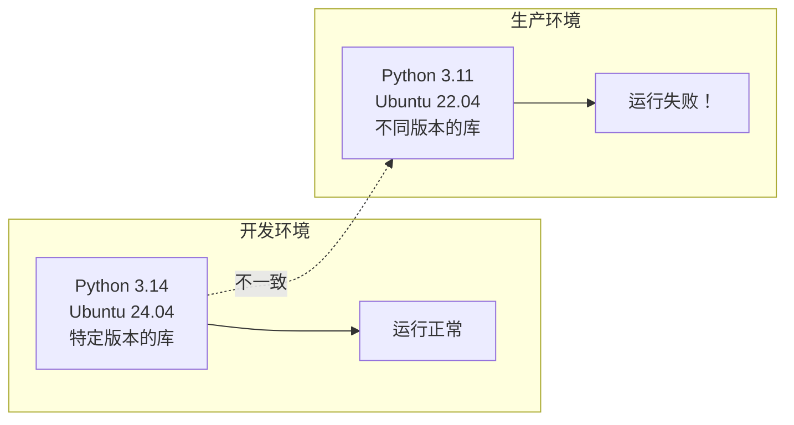
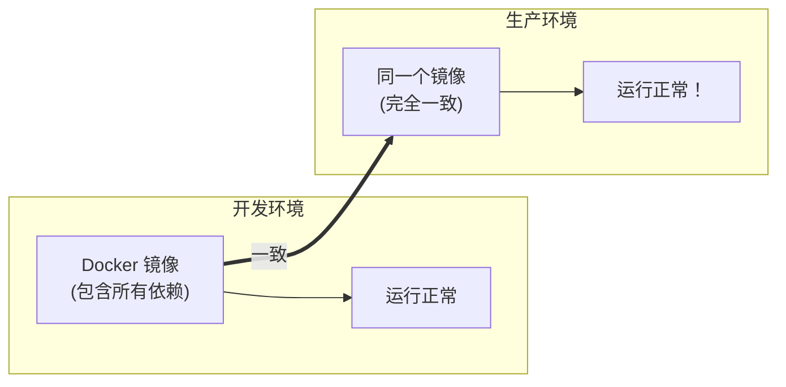
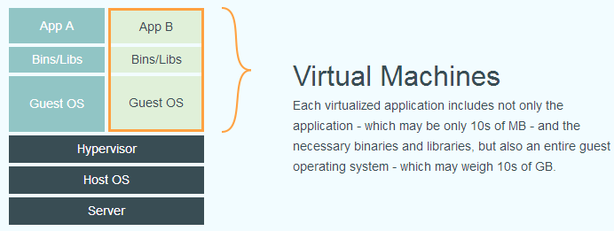
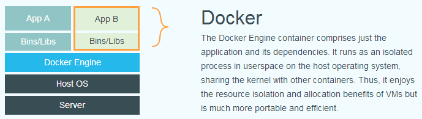
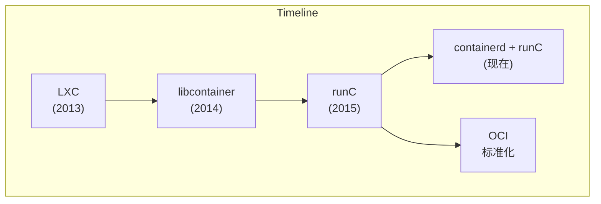
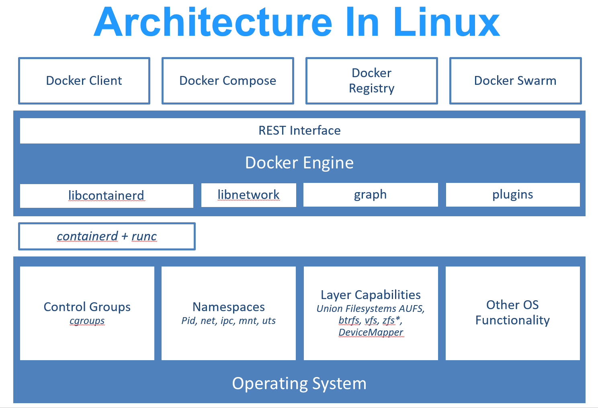
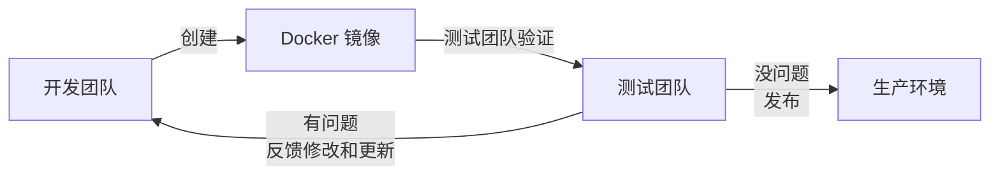
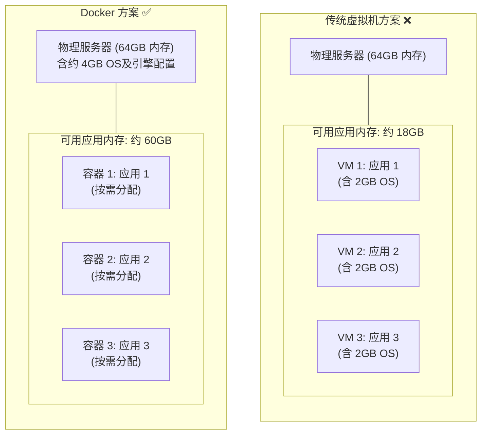
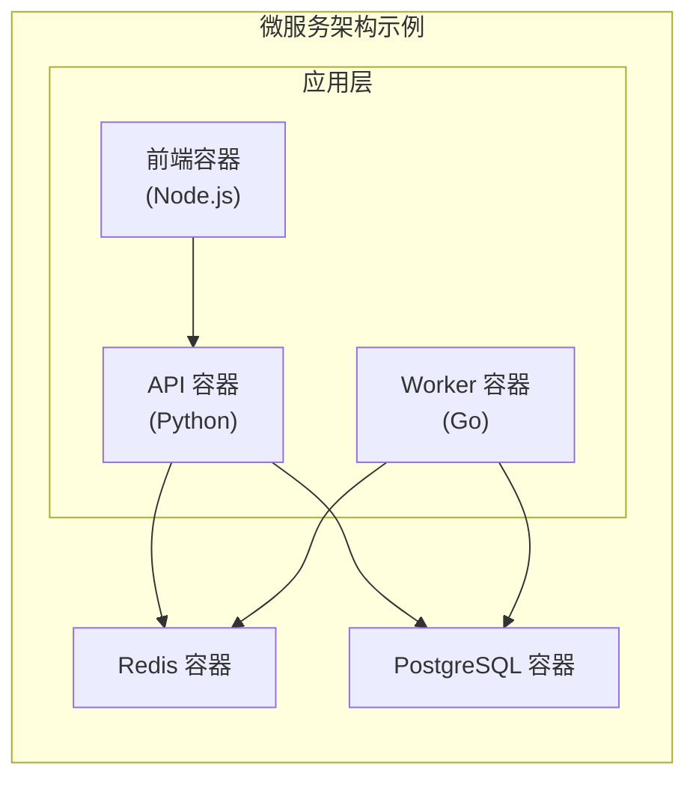

# 第一章 Docker 简介

本章将带领你进入 **Docker** 的世界。

> **版本提示**：本书内容及示例基于 **Docker Engine v29.x** 及以上版本。值得注意的是，自 Docker Engine v29 起，官方在全新安装场景下 **默认启用 `containerd image store` 作为镜像存储后端**（取代传统 classic store 路径下的 graph driver 体系）。这项底层革新极大增强了 Docker 对多架构镜像（Multi-platform）以及软件供应链安全元数据（Attestations, SBOM, Provenance）的本地支持原生性。

## 学习目标

通过本章的学习，你将能够：

1. 理解 Docker 的核心概念与架构。
2. 明白 Docker 解决了现代软件开发与运维中的哪些痛点。
3. 建立起对容器技术的初步认知，为后续的实战操作打下基础。

好吧，让我们带着问题开始这神奇之旅。

## 1. 快速上手

> **版本说明**：本节示例基于 Docker v29.x 编写。示例中使用的 `nginx:alpine` 镜像标签为演示用途，请查阅 [Docker Hub - nginx](https://hub.docker.com/_/nginx) 确认最新可用版本。

开始前请先完成 第 3 章安装 Docker，并确认 `docker version` 与 `docker run hello-world` 可以正常执行。若你只是先浏览流程，可以读完本节后再回到安装章实践。

本节将通过一个简单的 Web 应用例子，带你快速体验 Docker 的核心流程：构建镜像、运行容器。

### 为什么选择 Nginx + HTML 作为入门例子？

在学习 Docker 之前，我们先来理解为什么这个例子适合初学者。Docker 的核心价值在于**一致性交付**：在相同镜像、CPU 架构、内核能力、配置和外部依赖都满足的前提下，应用行为可以保持高度一致。这个 Nginx + 静态 HTML 的例子之所以被广泛采用，是因为它展现了 Docker 工作流的三个核心阶段：

1. **镜像定义（Image Layer）**：通过 Dockerfile 描述如何把应用打包成一个自包含的单元
2. **镜像构建（Build）**：执行 `docker build`，Docker 根据 Dockerfile 逐层构建镜像
3. **容器运行（Runtime）**：通过 `docker run` 启动容器实例，应用真正开始提供服务

Nginx 是一个轻量级、使用广泛的 Web 服务器，学习完这个例子后，你可以轻松扩展到部署 Node.js、Python、Go 等任何语言的应用。

### 1.1 准备代码

创建一个名为 `hello-docker` 的文件夹，并在其中创建一个 `index.html` 文件：

```html
<h1>Hello, Docker!</h1>
```

### 1.2 编写 Dockerfile

在同级目录下创建一个名为 `Dockerfile`（无后缀）的文件：

```dockerfile
FROM nginx:alpine
COPY index.html /usr/share/nginx/html/index.html
```

### 1.3 构建镜像

打开终端，进入该目录，执行构建命令：

```bash
$ docker build -t my-hello-world .
```

* `docker build`：构建命令
* `-t my-hello-world`：给镜像起个名字（标签）
* `.`：指定上下文路径为当前目录

### 1.4 运行容器

使用刚才构建的镜像启动一个容器：

```bash
$ docker run -d -p 8080:80 my-hello-world
```

* `docker run`：运行命令
* `-d`：后台运行
* `-p 8080:80`：将宿主机的 8080 端口映射到容器的 80 端口

### 1.5 访问测试

打开浏览器访问 [http://localhost:8080](http://localhost:8080)，你应该能看到 “Hello, Docker!”。

### 1.6 清理

停止并删除容器：

```bash
# 查看正在运行的容器 ID

$ docker ps

# 停止容器

$ docker stop <CONTAINER_ID>

# 删除容器

$ docker rm <CONTAINER_ID>
```
恭喜！你已经完成了第一次 Docker 实战。接下来请阅读 Docker 核心概念做深入了解。

## 2. 什么是 Docker

Docker 是彻底改变了软件开发和交付方式的革命性技术。本节将从核心概念、与传统虚拟机的对比、技术基础以及历史生态等多个维度，带你深入理解什么是 Docker。

### 2.1 一句话理解 Docker

> **Docker 是一种轻量级的虚拟化技术，它让应用程序及其依赖环境可以被打包成一个标准化的单元，在满足架构、内核能力和外部依赖前提的环境中高度一致地运行。** 如果用一个生活中的类比：**Docker 之于软件，就像集装箱之于货物**。

在集装箱发明之前，货物的运输是一件麻烦的事情——不同的货物需要不同的包装、不同的装卸方式，换一种运输工具就要重新装卸。集装箱的出现改变了这一切：无论里面装的是什么，集装箱的外形是标准的，可以用同样的方式装卸、堆放和运输。

Docker 做的事情类似：无论你的应用是用 Python、Java、Node.js 还是其他语言写的，无论它需要什么样的依赖库和环境，一旦被打包成 Docker 镜像，就可以用同样的方式在兼容的 Docker 环境中运行。

### 2.2 Docker 的核心价值

笔者认为，Docker 解决的是软件开发中最古老的问题之一：**“在我机器上明明能跑啊！”**


有了 Docker：



### 2.3 Docker vs 虚拟机

很多人第一次接触 Docker 时会问：**“这不就是虚拟机吗？”** 答案是：**不是，而且差别很大。**

#### 传统虚拟机

传统虚拟机技术是虚拟出一套完整的硬件，在其上运行一个完整的操作系统，再在该系统上运行应用：



#### Docker 容器

而 Docker 容器内的应用直接运行于宿主的内核，容器内没有自己的内核，也没有进行硬件虚拟：



#### 关键区别

| 特性 | Docker 容器 | 传统虚拟机 |
|------|-------------|------------|
| **启动速度** | 秒级 | 分钟级 |
| **资源占用** | MB 级别 | GB 级别 |
| **性能** | 接近原生 | 有明显损耗 |
| **隔离级别** | 进程级隔离 | 完全隔离 |
| **单机数量** | 可运行上千个 | 通常几十个 |

> 笔者经常用这个类比来解释：虚拟机像是每个应用都住在一栋独立的房子里（有自己的地基、水电系统），而容器像是大家住在同一栋公寓楼里的不同房间（共享地基和水电系统，但各自独立）。

### 2.4 Docker 的技术基础

Docker 使用 [Go 语言](https://golang.google.cn/)开发，基于 Linux 内核的以下技术：

- **[Namespace](https://en.wikipedia.org/wiki/Linux_namespaces)**：实现资源隔离（进程、网络、文件系统等）
- **[Cgroups](https://zh.wikipedia.org/wiki/Cgroups)**：实现资源限制（CPU、内存、I/O 等）
- **[Union FS](https://en.wikipedia.org/wiki/Union_mount)**：实现分层存储（如 OverlayFS）

> 如果你对这些底层技术感兴趣，可以阅读本书的底层实现章节。

#### Docker 架构演进

Docker 的底层实现经历了多次演进：



- **LXC** (2013)：Docker 最初基于 Linux Containers
- **libcontainer** (2014，Docker 0.9)：Docker 自研的容器运行时
- **runC**（2015，Docker 1.11 整合）：捐献给 OCI 的标准容器运行时
- **containerd**：高级容器运行时，管理容器生命周期



> `runc` 是一个 Linux 命令行工具，用于根据 [OCI 容器运行时规范](https://github.com/opencontainers/runtime-spec)创建和运行容器。

> `containerd` 是一个守护程序，它管理容器生命周期，提供了在一个节点上执行容器和管理镜像的最小功能集。

### 2.5 Docker 的历史与生态

**Docker** 最初是 `dotCloud` 公司创始人 [Solomon Hykes](https://github.com/shykes) 在法国期间发起的一个公司内部项目，于 [2013 年 3 月以 Apache 2.0 授权协议开源](https://en.wikipedia.org/wiki/Docker_%28software%29)。

Docker 的发展历程：

- **2013 年 3 月**：开源发布
- **2013 年底**：dotCloud 公司改名为 Docker, Inc.
- **2015 年**：成立[开放容器联盟 (OCI)](https://opencontainers.org/)，推动容器标准化
- **至今**：[GitHub 项目](https://github.com/moby/moby)超过 7 万星标

Docker 的成功推动了整个容器生态的发展，催生了 Kubernetes、Podman 等众多相关项目。笔者认为，Docker 最大的贡献不仅是技术本身，更是它 **让容器技术从系统管理员的工具变成了每个开发者都能使用的标准工具**。

## 3. 为什么要用 Docker

在回答 “为什么用 Docker” 之前，笔者想先问一个问题：**你有没有经历过这些场景？**

### 3.1 没有 Docker 的世界

在 Docker 出现之前，软件开发和运维面临着诸多棘手的问题。我们先来看看以下三个典型的痛点场景。

#### 场景一：“在我电脑上明明能跑”

```text
周五下午 5:00
├── 开发者：代码写完了，本地测试通过，提交！🎉
├── 周一早上 9:00
│   └── 测试："这个功能在测试环境跑不起来"
└── 开发者："不可能，在我电脑上明明能跑啊……"
```
笔者统计过，这个问题通常由以下原因导致：

- Python/Node/Java 版本不一致
- 依赖库版本不一致
- 操作系统配置不一致
- 某些环境变量没有设置
- “哦，忘了说我本地装了个 XXX”

#### 场景二：环境配置的噩梦

```bash
新同事入职
├── Day 1：领电脑，配环境
├── Day 2：继续配环境，遇到问题
├── Day 3：换种方法配环境
├── Day 4：问老同事怎么配的，他也忘了
└── Day 5：终于能跑起来了！但不知道为什么……
```

#### 场景三：服务器迁移的恐惧

```bash
运维："我们需要把服务迁移到新服务器"
开发："旧服务器上的配置文档在哪？"
运维："当时是一个已经离职的同事配的……"
所有人：😱
```

### 3.2 Docker 如何解决这些问题

Docker 的出现为上述问题提供了完美的解决方案。它通过 “一次构建，到处运行” 的核心理念，从根本上改变了软件交付的方式。

#### 核心理念：一次构建，到处运行



### 3.3 Docker 的核心优势

除了解决上述痛点，Docker 还拥有诸多显著的技术优势，包括环境一致性、秒级启动、高效的资源利用等。

#### 1. 环境一致性

Docker 镜像包含了应用运行所需的大部分用户态依赖：代码、运行时、系统工具、库和默认配置。它不包含宿主机内核，也不能消除 CPU 架构、内核能力、外部服务、网络、卷和运行时配置差异。这意味着：

- ✅ 开发环境和生产环境可以显著减少差异
- ✅ 大幅降低 “在我机器上能跑” 的问题
- ✅ 新人入职，一条命令就能启动开发环境

```bash
## 新同事入职第一天

$ git clone https://github.com/company/project.git
$ docker compose up

## 完整的开发环境就准备好了

...
```

#### 2. 秒级启动

传统虚拟机启动需要几分钟（引导操作系统），而 Docker 容器启动通常只需要 **几秒甚至几百毫秒**。

笔者实测数据：

| 启动内容 | 虚拟机 | Docker 容器 |
|---------|--------|-------------|
| 空系统 | ~60 秒 | ~0.5 秒 |
| MySQL | ~90 秒 | ~3 秒 |
| 完整 Web 应用 | ~120 秒 | ~5 秒 |

这个差异对以下场景尤为重要：

- **CI/CD 流水线**：每次构建节省几分钟，一天累积下来就是几小时
- **弹性扩容**：流量高峰时能快速启动更多实例
- **开发体验**：快速重启服务进行调试

#### 3. 资源效率

Docker 容器共享宿主机内核，无需为每个应用运行完整的操作系统。以一台 64GB 内存的物理服务器为例：

- **传统虚拟机方案**：每个虚拟机都需要运行完整的操作系统（每个额外占用如 2GB 内存），产生大量资源开销，实际可用于应用的内存可能只有约 18GB。
- **Docker 方案**：容器直接共享宿主机系统，只需付出很少的基础开销（OS 及引擎约 4GB），即可将约 60GB 的内存全部用于实际应用。



#### 4. 持续交付和部署

Docker 完美契合 DevOps 的工作流程：


使用 Dockerfile 定义镜像构建过程，使得：

- 构建过程 **可重复、可追溯**
- 任何人都能从代码重建完全相同的镜像
- 配合 GitHub Actions 等 CI 系统实现自动化

#### 5. 轻松迁移

Docker 可以在几乎任何平台上运行：

- ✅ 本地开发机 (macOS、Windows、Linux)
- ✅ 公有云（AWS、Azure、GCP、阿里云、腾讯云）
- ✅ 私有云和自建数据中心
- ✅ 边缘设备和 IoT

**同一个镜像，在任何地方运行结果都一致。** 这让应用迁移变得前所未有的简单。

#### 6. 微服务架构的基石

现代微服务架构几乎都依赖容器技术。Docker 让你可以：

- **隔离服务**：每个服务运行在独立容器中，互不干扰
- **独立扩展**：哪个服务负载高，就单独扩展哪个
- **独立部署**：更新一个服务不影响其他服务
- **技术多样**：不同服务可以用不同语言和框架



### 3.4 Docker 不适合的场景

笔者认为，技术选型要客观。Docker 并非银弹，以下场景可能不太适合：

- **需要完全隔离的场景**：容器共享宿主机内核，隔离性不如虚拟机。如果需要运行不受信任的代码，虚拟机可能更安全。
- **需要特殊内核的场景**：容器使用宿主机内核。如果应用需要特定版本的内核或内核模块，可能需要虚拟机。
- **Windows 原生应用**：虽然 Docker 支持 Windows 容器，但生态不如 Linux 容器成熟。传统 Windows 应用的容器化仍有挑战。
- **桌面应用**：Docker 主要面向服务端应用。桌面 GUI 应用的容器化虽然可行，但通常得不偿失。

### 3.5 与传统虚拟机的对比总结

关于容器与虚拟机的详细特性对比，请参阅 1.2.3 Docker vs 虚拟机 中的对比表。总结来说：

- **性能差异**：虚拟机通常有 5-20% 的性能损耗，而容器接近原生性能。
- **最佳场景**：Docker 容器适合微服务、CI/CD、开发环境；虚拟机适合多租户、高安全需求场景。
